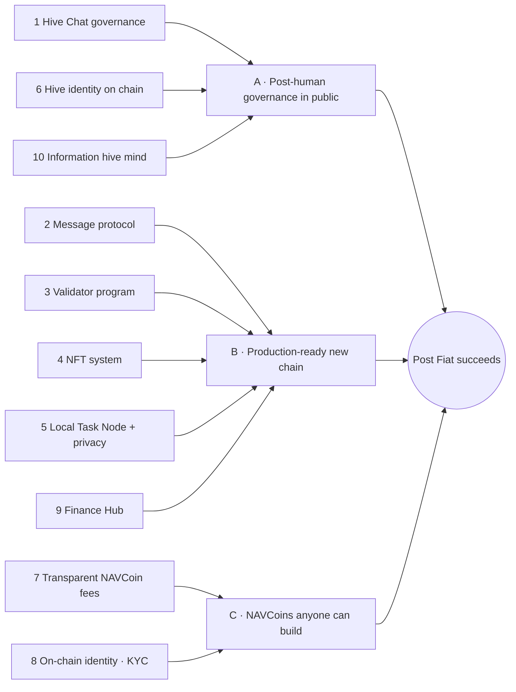
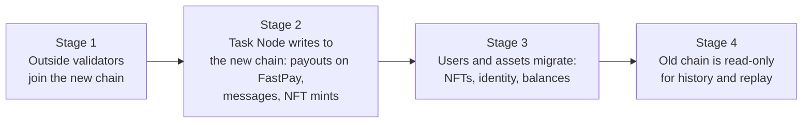
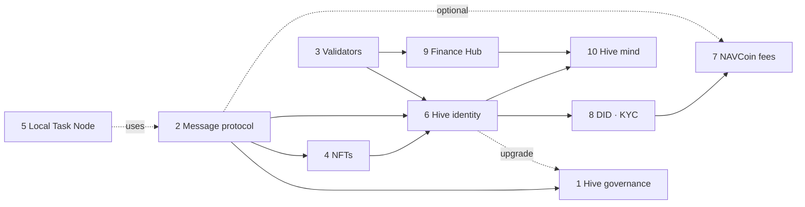

# Post Fiat — The Big Milestone

> **What this is:** the master spec for taking Post Fiat from zero to hero. This page answers one question and organises the answer into ten pillars. Each pillar has its own spec page with a user story, technical requirements, dependencies, acceptance criteria, diagrams and code references. Each page stands on its own, and each one feeds the outcomes below.

## The question

> **What set of activities must be completed to maximise the likelihood of success for Post Fiat?**

## The story we want people to understand

**Post-human governance is a new primitive, and Post Fiat is actively exploring it.**

The essence is simple. **Information packets are uploaded and acted on.** Someone publishes a packet describing the state of the protocol. The network, made up of people, agents and validators, discusses it, decides and acts. Once a packet has been acted on, things kick into gear: tasks are issued, rewards flow and code ships.

Anyone who encounters Post Fiat should come away thinking: *"I see. This is an exploration of what truly post-human activity looks like."*

For that to be true, the activity has to be **public**, **on a chain that works** and **open for anyone to build on**. Those are the three outcomes.

## Three outcomes

| Outcome | What it means | Pillars |
|---|---|---|
| **A. Post-human governance, in public** | Governance runs as a visible loop of packet → public conversation → minutes → deliverables, with an on-chain record and a fixed cadence. | [1 Hive governance](pillars/01-hive-governance.md) · [6 Hive identity](pillars/06-hive-identity.md) · [10 Information hive mind](pillars/10-information-hive-mind.md) |
| **B. A production-ready new chain** | postfiatl1v2 replaces the old chain. It is fast, private and quantum-safe, has NFTs and a message protocol, and outside validators run it. | [2 Message protocol](pillars/02-message-protocol.md) · [3 Validators](pillars/03-validator-program.md) · [4 NFTs](pillars/04-nft-system.md) · [5 Local Task Node](pillars/05-local-task-node.md) · [9 Finance Hub](pillars/09-finance-hub.md) (the reason validators and contributors join) |
| **C. NAVCoins as a primitive anyone can build** | Anyone can mint a NAVCoin with proven reserves, transparent fees and optional KYC, and swap it through pfUSDC and Uniswap. | [7 NAVCoin fees](pillars/07-navcoin-fees.md) · [8 On-chain identity](pillars/08-onchain-identity.md) |



## The ten pillars

| # | Pillar | In one line | Status |
|---|---|---|---|
| 1 | [Hive Chat governance module](pillars/01-hive-governance.md) | Upload a protocol-state packet and run a timed public governance session that publishes minutes and deliverables on chain. | Partial |
| 2 | [Message protocol spec](pillars/02-message-protocol.md) | One standard: protobuf messages, post-quantum encryption, IPFS pinning, FastPay carriage and explorer rendering, plus an x402 profile. | Partial |
| 3 | [Validator rewards program](pillars/03-validator-program.md) | Signed releases, one-command upgrades, an RPC node, a single docs page, an SSH dashboard and one-click Task Node connect. | Early |
| 4 | [NFT system](pillars/04-nft-system.md) | A quantum-safe NFT spec on the message protocol, migration of historical NFTs and new mints on the new chain. | Partial |
| 5 | [Task Node local experience](pillars/05-local-task-node.md) | A local Task Node app that proves shielded transactions on the device and never sends them through the Task Node server. | Early |
| 6 | [Hive Chat identity on chain](pillars/06-hive-identity.md) | "I minted my Task Node identity": an on-chain record tying the new-chain account, Nostr key, handle and validator keys together. | Early |
| 7 | [Transparent NAVCoin fees](pillars/07-navcoin-fees.md) | Deterministic management and performance fees, computed in consensus from on-chain reserve value and block heights, and shown on the explorer. | Partial |
| 8 | [On-chain identity: DID, KYC, optional trust lines](pillars/08-onchain-identity.md) | Permissionless by default, with credential-gated assets for issuers who need KYC. | Partial |
| 9 | [Finance Hub user spec](pillars/09-finance-hub.md) | A daily "Today" research desk for validators and the top 30 contributors. | Partial |
| 10 | [Information hive mind](pillars/10-information-hive-mind.md) | Company agents interview the contributors most likely to know something, then credit and reward what they add. | Early |

*Partial* means a meaningful part is built or live. *Early* means building blocks exist but the user-facing product does not.

## What has to be true first

### The deterministic governance framework

Formalising the deterministic governance framework is the **core of the project**. Today the pipeline is a typed ruleset and deterministic policy, with Cobalt ratification. It runs in research and shadow mode, and authority transfer is not active ([overview](https://github.com/postfiatorg/postfiatl1v2/blob/main/docs/governance/deterministic-governance-overview.md), [verifiable constitution](https://github.com/postfiatorg/postfiatl1v2/blob/main/docs/governance/verifiable-constitution.md)).

No single pillar owns formalising the framework itself. [Pillar 1](pillars/01-hive-governance.md) defines how a session's decision becomes a ruling request, what evidence a ruling may use, and the rule that two separate hosts must replay it to the same result (a disagreement records `hold-no-op`). The wider framework, meaning the ruleset, policy and authority transfer, still needs an owner.

Its scoring runs need **rented GPUs** (Vast and RunPod H200s, roughly $2–4 an hour; past campaigns cost $5–80). [Pillar 1](pillars/01-hive-governance.md) keeps the public conversation off GPUs. The deterministic scoring that ratifies decisions still needs a cheaper, repeatable home.

> **Your draft trails off here:** "though we have migrated that –". Fill in what was migrated and to where, so this page can state the current cost.

### A fixed governance timeline

Governance needs a **fixed cadence**, so the public knows when the next packet and session happen. [Pillar 1](pillars/01-hive-governance.md) supplies the mechanism. The cadence itself is your decision.

### A method for capturing protocol state

There must be one defined way to gather the protocol's current state into a packet: chain height and state root, validators and their admission verdicts, NAV reserve-proof status, bridge state, board budgets, steward-supplied open P0s and changes since the last packet. Each field carries a trust level. That packet is pinned to IPFS. [Pillar 1](pillars/01-hive-governance.md) defines `pf.governance.packet.v1`, and [Pillar 2](pillars/02-message-protocol.md) defines its envelope.

## Chain readiness gates

People can't be moved off the old chain until the new chain performs well enough. In your spec, "performant" means:

| Gate | Where it stands today | Owner |
|---|---|---|
| **1. Supports NFTs in a smart way** | `nft_mint`, `nft_transfer` and `nft_burn` are built and signed with ML-DSA-65. Metadata standard, migration and explorer view are missing. Storage does not scale yet: every NFT transaction copies the ledger and re-checks every NFT ever minted, so keyed storage and paginated lists must land before Task Node switches over. | [Pillar 4](pillars/04-nft-system.md) |
| **2. Works with existing memo-type private payments** | Memos ride on `payment_v2` and are signed into FastPay orders, at most 256 decoded bytes per memo and 512 bytes across all memos, in plaintext. Today's encrypted-memo payments (`pf.ptr` with an encrypted CID) run on the old chain only. | [Pillar 2](pillars/02-message-protocol.md) |
| **3. FastPay as the default for Task Node payouts** | FastPay p50 is 183 ms to quorum across 6 validators on 3 continents, and the epoch-2 committee has been live since height 1123. FastPay carries PFT only, and memos on FastPay certificates don't appear in account history yet. Task Node payouts still send XRPL `Payment`s on the old chain and never touch FastPay. | [Pillar 2](pillars/02-message-protocol.md) · readiness |
| **4. Cobalt understood: simulations, blog posts, Lean proofs** | The adversarial campaign E1–E6 concluded **KEEP_ACTIVE**: 10,240 oracle cases, 442,368 schedules with zero conflicts, +0.45% latency. Live rotation committed at height 924. There is **no Lean model of Cobalt yet**. Lean exists for the PFSH02 privacy work only, on an unmerged branch. | Readiness: more blog posts and iterative Lean studies |
| **5. Every option adversarially stress-tested across multiple models** | Cobalt has an adversarial oracle and harnesses (`crates/cobalt_*`). Other subsystems have no record of cross-model adversarial review. | Readiness |
| **Privacy working locally** | The Mac app proves post-quantum **PFSH03** payments on the device on an open branch (tasknode-apple PR 39, about 2.2 s per action on an M5 MacBook Pro). It depends on unmerged chain PRs 232, 271 and 280; PR 232 supersedes PR 207. Validator admission for user-proven actions is built on `main` but not deployed. Shielded submission is off on every validator. | [Pillar 5](pillars/05-local-task-node.md) |
| **Smooth validator onboarding** | Task Node's validator connect still defaults to the old chain. The new chain has no public release, genesis or registration tool. | [Pillar 3](pillars/03-validator-program.md) |
| **Public RPC** | There is no public RPC endpoint. Local wallets need at least two public endpoints with private admission switched on to submit shielded actions without going through Task Node. | [Pillar 3](pillars/03-validator-program.md) · [Pillar 5](pillars/05-local-task-node.md) |

## Moving from the old chain to the new chain

This is a staged transition. Each stage starts only when the one before it holds.



| Stage | What must hold | Specs |
|---|---|---|
| **1. Validators** | Public genesis and signed releases. The genesis cohort comes from the old chain's Dynamic UNL scoring plus a signed `IdentityReceiptV1` binding each old key to a new ML-DSA key. Later validators pass the admission policy and are ratified by the current set. Making Cobalt the only path for registry changes (gate Z1) is still open. | [Pillar 3](pillars/03-validator-program.md) · [genesis spec](https://github.com/postfiatorg/postfiatl1v2/blob/main/docs/architecture/l1v2-testnet-genesis-and-launch-spec.md) · [testnet path](https://github.com/postfiatorg/postfiatl1v2/blob/main/docs/status/testnet-path.md) |
| **2. Task Node on the new chain** | Payouts on FastPay, the message protocol and NFT mints on the new chain. | [Pillar 2](pillars/02-message-protocol.md) · [Pillar 4](pillars/04-nft-system.md) |
| **3. Users and assets** | NFT migration and identity minting. **The token and balance migration plan does not exist yet**; the genesis spec marks token migration out of scope. | [Pillar 4](pillars/04-nft-system.md) · [Pillar 6](pillars/06-hive-identity.md) |
| **4. Old chain archived** | Old `pf.ptr` v4 pointers stay decodable for replay. A final old-chain ledger hash is published at the freeze, so NFT provenance and evidence archives can still be checked once the old chain is gone. | [Pillar 2](pillars/02-message-protocol.md) · [Pillar 4](pillars/04-nft-system.md) |

## NAVCoins: the near-term product

The nearest deliverable is **NAVCoin swaps**, probably by tracking a Hyperliquid NAVCoin on Solana. NAVCoins are not a fixed set of coins. They are a **primitive any user can build**, through a NAVCoin SDK in postfiatl1v2 and a guide on postfiatorg.github.io. Every NAVCoin is built from five parts:

1. **A Uniswap asset.** An ERC-20 wrapper and pool with a NAV guard. B24 is live with real money.
2. **An on-chain PFTL asset** that can be swapped into. Built: NAV-tracked asset, offer book and atomic swaps.
3. **USDC → pfUSDC.** Built: Solana and Ethereum vault bridges. Solana opens in the daily proving window.
4. **Uniswap asset → actual asset.** Built: export, import and primary cash-out routes.
5. **The fix.** A pfUSDC liquidity pool ready at a set time, like the London FX fix. A packet type exists (`FxFixPacketV1`), but the scheduled settlement does not.

Creation is **operator-only** today by release rule (not a consensus rule), and the SDK is a set of Python builders (`python/postfiat_rpc/navcoin.py`). [Pillar 7](pillars/07-navcoin-fees.md) adds fees, and [Pillar 8](pillars/08-onchain-identity.md) adds optional KYC. Together they make third-party NAVCoins viable.

> **Gap:** none of the ten deliverables owns the **Hyperliquid NAVCoin on Solana** or the **scheduled fix settlement**, though both are named above. Pillar 7 lists them as an open question. They may need their own spec page.

## How the pillars depend on each other



**Pillar 2 is the keystone.** Governance packets, NFT metadata and fee disclosures are message types in it. Identity records ([6](pillars/06-hive-identity.md)) and credentials ([8](pillars/08-onchain-identity.md)) are native ledger transaction types. The explorer renders them directly, and they reuse Pillar 2's key and hash conventions without waiting on it. Dotted lines are optional or later upgrades, not blockers.

## Suggested order

These are steps, not dates. Within a step, the work can run in parallel.

- **Step 1: foundations.**
    - The message protocol `.proto` files and schema registry ([2](pillars/02-message-protocol.md)).
    - Fix the trust-line gating bug ([8](pillars/08-onchain-identity.md), R0), together with holds for bridge credits that fail the gate (R11). The gated NAVCoin A666 uses the PFTL–Uniswap route, so the fix can't ship without them.
    - The validator release channel and registration tool ([3](pillars/03-validator-program.md)).
    - The governance session MVP on the existing pointer flow ([1](pillars/01-hive-governance.md)). That flow writes to the old chain today, so which chain holds governance anchors is an open question in Pillar 1.
- **Step 2: the new chain becomes the default.**
    - Task Node payouts on FastPay.
    - Identity minting ([6](pillars/06-hive-identity.md)), after the client-side signing guard (its R1) ships.
    - NFT spec and migration ([4](pillars/04-nft-system.md)).
    - Finance Hub: content isolation and leak fixes, then the Today page, then the top-30 tier ([9](pillars/09-finance-hub.md)).
- **Step 3: open the primitives.**
    - NAVCoin SDK with fees ([7](pillars/07-navcoin-fees.md)) and credentials ([8](pillars/08-onchain-identity.md)).
    - The local app with post-quantum privacy ([5](pillars/05-local-task-node.md)), after PFSH03's gates pass.
    - The information hive mind ([10](pillars/10-information-hive-mind.md)).

## Findings from writing and reviewing these specs

- **Trust-line gating can be bypassed.** One shared function creates implicit holding lines with `authorized = true` even when the asset has `requires_authorization` set. It is called from six movement paths: payments and atomic swaps, NAV mint, the PFTL–Uniswap route, the vault bridge, the Solana bridge and shielded-pool exit. Revocation doesn't work either: an issuer-approved line stays approved after its credential is revoked or expires. And because offers and escrow need lines on default assets, one ineligible resting offer can fail every taker that crosses it. All of this must be fixed before any KYC NAVCoin ([Pillar 8](pillars/08-onchain-identity.md), R0).
- **The message protocol has no canonical schema.** `pf.ptr` v4 is hand-encoded protobuf in JS and Python. The only `.proto` file, `pf_ptr_v1.proto` in `postfiatorg/explorer`, uses a different field layout ([Pillar 2](pillars/02-message-protocol.md)).
- **Task Node's memos won't move to the new chain as they are.** Task Node writes memo hex in upper case, which the new chain rejects. Its encryption (X25519 with XChaCha20-Poly1305) is not post-quantum ([Pillar 2](pillars/02-message-protocol.md)).
- **The browser wallet can't sign NFT transactions or generic messages.** `wallet_wasm` lacks both, which affects Pillars [2](pillars/02-message-protocol.md), [4](pillars/04-nft-system.md) and [6](pillars/06-hive-identity.md).
- **Task Node's collaboration signer signs any challenge the server sends.** `signedCollaborationProof` signs server-supplied text with the same deterministic old-chain key from which today's Nostr messaging key is derived. A compromised server could ask for the derivation statement as a "challenge" and rebuild a user's Nostr key. Pillar 6 R1 adds a client-side guard that must ship before any identity mint ([Pillar 6](pillars/06-hive-identity.md)).
- **FastPay accepts fee 0,** so memo spam on FastPay is free today; Pillar 2 R27 adds a governed minimum fee ([Pillar 2](pillars/02-message-protocol.md)).
- **ML-DSA signing is randomised,** so a Nostr key can't be derived by hashing a new-chain signature. Today's npubs come from the old-chain secp256k1 wallet, which signs deterministically, so they can carry over ([Pillar 6](pillars/06-hive-identity.md)).
- **`ISSUER_BURNABLE` is stored but not enforced,** and NFT transactions carry no memos ([Pillar 4](pillars/04-nft-system.md)).
- **Only the SP1 proof profile checks NAV against reserves.** On other profiles an issuer can state NAV below reserves, which would hide fees ([Pillar 7](pillars/07-navcoin-fees.md), R8).
- **Validator rewards are Task Node credit, behind two switches.** The reward is $20 of Task Node USD credit per validator, and needs both `TASKNODE_L1_UPTIME_REWARDS_ENABLED` and `TASKNODE_VALIDATOR_REWARDS_ENABLED`. Validator connect defaults to the old chain (`network: "ledger"`), and any binding on either chain unlocks Finance Hub ([Pillar 3](pillars/03-validator-program.md), [Pillar 9](pillars/09-finance-hub.md)).
- **Post-quantum privacy is not merged.** PFSH03 (PR 232, superseding PR 207) is open, and the Mac app's PFSH03 branch depends on it ([Pillar 5](pillars/05-local-task-node.md)).
- **Pillar 10's user story is cut off** at "linked to specific users". The spec completes it, labels the completion as interpretation and keeps it as an open question.

### A note on "PFTL"

Task Node's code and docs use "PFTL" (PFT Ledger) for the **old** chain, for example `server/pftl-pointer.js`. The chain repo uses `pftl_*` names for the **new** chain. These pages say "new chain (postfiatl1v2)" and "old chain" wherever the difference matters.

## Reading and serving these pages

The pages are plain markdown in `big_milestone/`, and they read correctly on GitHub too. To browse them as a site:

```bash
python3 big_milestone/serve.py --host <tailscale-ip> --port 8844
```

Diagrams render from `mermaid` blocks. For offline use, put `mermaid.min.js` (v11) in `big_milestone/_vendor/`; it is untracked. Without it, pages load Mermaid from a pinned CDN.
