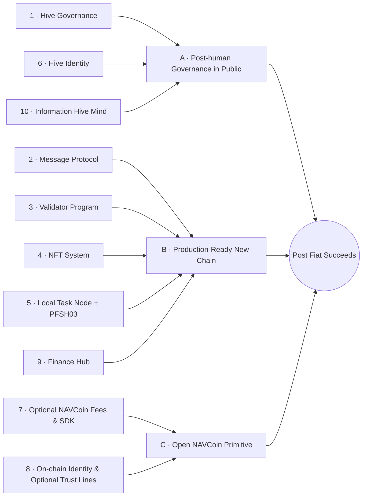
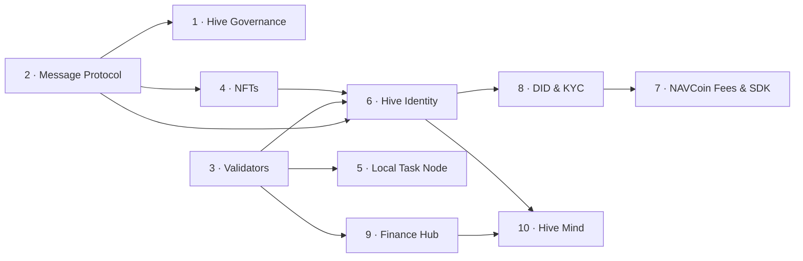

# Post Fiat — The Big Milestone

> **What this is:** The master execution spec and milestone tracker for taking Post Fiat from zero to production. Every open founder decision across all 10 pillars has been resolved and locked in — **zero open questions remain**. Every pillar has concrete `[ ]` build milestones plus the four mandatory ship gates: **1) Executed, 2) Tested by user, 3) Added to docs, 4) Public blog post document**.

## The goal

**Post-human governance is a new primitive, and Post Fiat is actively building it in public.**

The core loop is simple: **information packets are published, acted on, and audited in public.** Anyone who encounters Post Fiat should immediately see a real, working post-human network running on a fast, quantum-safe chain with an open financial primitive anyone can build on.

That breaks down into **three outcomes** across **ten pillars**:

| Outcome | What it delivers | Pillars |
|---|---|---|
| **A. Post-human governance, in public** | On-demand public governance sessions with direct carry-over accountability, verifiable on-chain Nostr identity, and an Information Hive Mind rewarding real alpha. | [1 · Hive Governance](pillars/01-hive-governance.md) · [6 · Hive Identity](pillars/06-hive-identity.md) · [10 · Information Hive Mind](pillars/10-information-hive-mind.md) |
| **B. A production-ready new chain (`postfiatl1v2`)** | Replaces the old XRPL-fork chain with sub-second FastPay, post-quantum messaging, NFTs, outside validators, local Mac privacy (`PFSH03`), and Finance Hub. | [2 · Message Protocol](pillars/02-message-protocol.md) · [3 · Validators](pillars/03-validator-program.md) · [4 · NFTs](pillars/04-nft-system.md) · [5 · Local Task Node](pillars/05-local-task-node.md) · [9 · Finance Hub](pillars/09-finance-hub.md) |
| **C. NAVCoins anyone can build** | An open NAVCoin SDK with optional deterministic fees (zero hedge-fund clutter when off), permissionless-by-default assets, and opt-in KYC credentials. | [7 · NAVCoin Fees & SDK](pillars/07-navcoin-fees.md) · [8 · On-chain Identity & KYC](pillars/08-onchain-identity.md) |



*Naming note: Task Node's legacy code calls the **old** XRPL-fork chain "PFTL", while the new chain repo uses `pftl_*` for the **new** chain. Across all 10 specs, **old chain** means the XRPL fork and **new chain (`postfiatl1v2`)** means Post Fiat L1v2.*

---

## Master milestone checklist (all 10 pillars)

Every pillar is complete **only** when all four ship gates are checked off:

### Pillar 1 — [Hive Chat Governance Module](pillars/01-hive-governance.md)
*Founder-triggered 30-min public Hive sessions with auto-snapshot, direct carry-over accountability from the previous session (no auto PFT bounties), `postfiatl1v2` anchoring, and optional flagged deterministic rulings on our Google setup or Vast.*

- [ ] **1. Executed** — Multi-channel Hive, collector, fast facilitator, transcript/minutes anchoring on `postfiatl1v2`, public archive, explorer view, verifier.
- [ ] **2. Tested by user** — Founder runs a full live 30-min session with prior-session carry-over and verifies third-party audit script.
- [ ] **3. Added to docs** — Governance packet schema, snapshot method, and verification guide published.
- [ ] **4. Public blog post document** — Public blog post published and linked from the session archive.

### Pillar 2 — [Message Protocol Spec](pillars/02-message-protocol.md)
*Canonical protobuf + post-quantum X-Wing encryption + IPFS pinning, Sui-inspired FastPay fee & new-object spam protection, Task Node default FastPay payouts (`"Task reward"` badge on explorer), and x402 (+ MCP helper) agent payments.*

- [ ] **1. Executed** — `.proto` SDKs (JS/Python/Rust), L1 FastPay fees + `account_tx` history, Task Node FastPay payout cutover, Explorer Message panel, x402 facilitator + MCP helper.
- [ ] **2. Tested by user** — Live FastPay reward payout verified on explorer, decrypted locally, legacy v4 history tested, and end-to-end x402 `402 → pay → 200` run.
- [ ] **3. Added to docs** — `docs/specs/message-protocol-v1.md` with worked byte examples published.
- [ ] **4. Public blog post document** — Public blog post explaining Post Fiat's post-quantum message protocol, FastPay, and x402.

### Pillar 3 — [Validator Rewards Program](pillars/03-validator-program.md)
*Same `postfiat-node` binary for validator + RPC, signed releases, `postfiat-node upgrade`, `postfiat-node top` SSH dashboard, one "Run a Validator" docs page, active-liveness enforcement (95% / 14d grace), and `$20/mo` per-operator credit + Finance Hub/API keys (no stake/bond).*

- [ ] **1. Executed** — Signed releases, `upgrade`, `top`, packaged RPC profiles + 2 Foundation public RPCs, signed multi-observer uptime feed, Task Node connect + grace/revocation.
- [ ] **2. Tested by user** — Fresh-host rehearsal following only the docs page, `top` dashboard check, signed upgrade, Task Node connect, and offline grace/revocation test.
- [ ] **3. Added to docs** — Single canonical **Run a Validator** guide (including RPC setup & hardware specs) live on `postfiat.org` and MkDocs.
- [ ] **4. Public blog post document** — Public blog post announcing the Post Fiat L1v2 Validator & RPC Program.

### Pillar 4 — [The NFT System](pillars/04-nft-system.md)
*Signed Pillar 2 metadata (`pf.nft.metadata.v1`), keyed storage lookups, founder inventory + burn-first migration for old Post Fiat chain NFTs (official Task Node issuer with `ISSUER_BURNABLE` off, transferable, `0` fee), new-chain minting, and Explorer NFT page.*

- [ ] **1. Executed** — Metadata schema, L1 keyed NFT lookups, `wallet_wasm` NFT signing, burn-first batch migrator, dual-chain Task Node UI, Explorer NFT view.
- [ ] **2. Tested by user** — Founder reviews inventory, runs burn-first batch migration (verifying zero duplicates on re-run), mints a fresh NFT on `postfiatl1v2`, and inspects Explorer.
- [ ] **3. Added to docs** — `docs/specs/nft-v1.md` (policy, test vectors, migration guide, post-quantum threat model) published.
- [ ] **4. Public blog post document** — Public blog post explaining Post Fiat's quantum-resistant NFT protocol and burn-first migration.

### Pillar 5 — [The Task Node Local Experience](pillars/05-local-task-node.md)
*Native SwiftUI + Rust Mac app (`tasknode-apple`) with local post-quantum `PFSH03` shielded payments (**already proved live on devnet-2 Blocks 1912–1914 on Nov 26, 2026!**), direct public validator RPC default, notarized release, native tab parity, and external audit.*

- [ ] **1. Executed** — Merge PRs `#280`/`#444`/`#39`, unified BIP-39 recovery across clients, direct public validator RPC + leak-capture proof, notarized Mac build, native SwiftUI parity, external audit closed.
- [ ] **2. Tested by user** — Clean-Mac install of notarized `TaskNode.app`, seed restore, one-click *Make private* on FastPay payout, Shield → Send → Receive → Unshield directly via public validator RPC.
- [ ] **3. Added to docs** — Mac install/privacy guide, honest privacy model, MacBook Air + M5 benchmarks, Lean scope statement, and pause/exit runbook published.
- [ ] **4. Public blog post document** — Public blog post announcing local post-quantum private payments (`PFSH03`) in the native Post Fiat Mac app.

### Pillar 6 — [Hive Chat Identity on Chain](pillars/06-hive-identity.md)
*Native `identity_set` transaction tying ML-DSA account, Nostr `npub` (keeping existing v1 `npub`s intact + shipping browser signing guard first), `@tasknode.postfiat.org` or custom NIP-05 handle, validator/old-chain/agent links, Explorer Identity card, and first-party `relay.postfiat.org`.*

- [ ] **1. Executed** — Client signing guard, shared v2 seed KDF, `identity_set` consensus + `wallet_wasm`, handle reservations (`goodalexander`, `hive-board@`), Explorer card, `relay.postfiat.org`.
- [ ] **2. Tested by user** — Founder mints `goodalexander@tasknode.postfiat.org` (same `npub` & history), links validator + old-chain key, checks Explorer Identity card, tests `rotate` + SDK lookup.
- [ ] **3. Added to docs** — On-chain identity spec, v1/v2 test vectors, registrar policy, custom NIP-05 guide, and quantum boundary published.
- [ ] **4. Public blog post document** — Public blog post announcing *"Mint Your Task Node Identity"* with native Nostr & Hive integration.

### Pillar 7 — [Optional Deterministic Fees for NAVCoins](pillars/07-navcoin-fees.md)
*100% optional fee schedules with neutral non-security framing (caps: `5%/yr` annual, `50%` HWM gain, `5%` spread, `1%` fix, `7d` min hike notice), atomic unit accrual inside epoch finalization, strict `floor(V × U / S)` NAV check, Explorer view, and open NAVCoin SDK.*

- [ ] **1. Executed** — `NavFeeScheduleV1` consensus ops + 100+ exact-atom Rust/Python vectors, optional Task Node UI + Explorer fee views, packaged NAVCoin SDK.
- [ ] **2. Tested by user** — Founder launches both a zero-fee NAVCoin (zero clutter) and a fee-enabled NAVCoin on devnet via SDK, verifies exact atom recomputation, tests pending hike notice + cancel, inspects Explorer.
- [ ] **3. Added to docs** — **"Create a NAVCoin"** guide (SDK usage, neutral fee formulas, worked example, accounting docs) published on `postfiatorg.github.io`.
- [ ] **4. Public blog post document** — Public blog post announcing the open NAVCoin SDK and optional deterministic on-chain fee schedules.

### Pillar 8 — [On-chain Identity: DID, KYC & Optional Trust Lines](pillars/08-onchain-identity.md)
*Permissionless by default everywhere (no trust lines needed for NAVCoins or DEX offers), fixes the 6-path gating-bypass bug first, adds zero-PII XRPL-style Credentials + `did:pftl` with creator-chosen issuers (Return-only default exit), bridge holds, and W3C VC / ZK-passport adapters.*

- [ ] **1. Executed** — Gating-bypass fix + single `asset_gate(...)` + bridge holds, permissionless DEX/escrow, Issuer Registry + Credentials + `did_resolve`, W3C VC + ZK-passport adapters, Explorer views.
- [ ] **2. Tested by user** — Founder tests both a permissionless NAVCoin (zero `trust_set` on DEX) and a gated NAVCoin end-to-end with sandbox ZK-passport/VC credential, revocation + Return-only exit, and bridge hold claim.
- [ ] **3. Added to docs** — `did:pftl` spec, optional trust-lines guide, credential policy & issuer adapter docs published.
- [ ] **4. Public blog post document** — Public blog post explaining Post Fiat's *"permissionless by default, optional compliance"* identity & credential layer.

### Pillar 9 — [Finance Hub User Spec](pillars/09-finance-hub.md)
*Daily **Today** morning desk (~60 models + Goodbrief + GoodAlexander Library) for active Pillar 3 validators and Top-30 non-validator Task Node users (existing leaderboard, daily snapshot, 7d grace / keep-until rank 35), sandboxed Goodbrief isolation, signed Publish API, and Pillar 10 bridge.*

- [ ] **1. Executed** — Whole-bundle leak closure + Goodbrief sandbox + watermarks, Today view + search/watchlist/visit markers, signed Publish API + Goodbrief split, daily Top-30 snapshot, Pillar 10 briefs.
- [ ] **2. Tested by user** — Founder reviews live Today page on laptop + phone, tests validator + Top-30 + rank-31/grace states, verifies sandbox isolation and bad-signature publish rejection.
- [ ] **3. Added to docs** — Finance Hub access guide (validator & Top-30 rules, perks, Library/API keys) and signed-publishing runbook published.
- [ ] **4. Public blog post document** — Public blog post showcasing Post Fiat Finance Hub for validators and Top-30 contributors.

### Pillar 10 — [Information Hive Mind](pillars/10-information-hive-mind.md)
*Automatic coverage matching for any eligible Expert/verified user across covered crypto protocols and perp-backed liquid megacap equities, two-phase triangulating AI company agents, strict hash-only MNPI refusal firewall, human model-owner approval, and accelerated rewards for verified alpha.*

- [ ] **1. Executed** — Coverage manifest matching, MNPI attestation + hash-only screening + legal sign-off for perp equities, two-phase company agents, claim store + reviewer clustering, model-host bridge, accelerated alpha payouts + ROI dashboard.
- [ ] **2. Tested by user** — Founder tests member + non-member interviews (confirming zero leaked model targets), intentional MNPI refusal (zero text stored), two-user corroboration, `CHANGELOG` citation, and accelerated alpha reward payout.
- [ ] **3. Added to docs** — Contributor interview guide, MNPI/compliance policy, attribution rules, and accelerated alpha reward docs published.
- [ ] **4. Public blog post document** — Public blog post introducing the Post Fiat Information Hive Mind and accelerated alpha rewards.

---

## Near-term NAVCoin product & chain readiness gates

Two high-priority items from the master brief sit alongside the ten pillars and have their own checklists so nothing falls through the cracks:

### Near-term product: Hyperliquid NAVCoin on Solana & Scheduled FX Fix
Every NAVCoin builds on five core parts: (1) Uniswap ERC-20 wrapper + NAV guard (live on B24), (2) on-chain `postfiatl1v2` asset + offer book (built), (3) USDC → pfUSDC Solana/Ethereum bridges (live), (4) Uniswap → actual asset exit routes (built), and (5) **Scheduled London-style FX Fix** (`FxFixPacketV1` exists; scheduled execution still needed) plus **tracking a Hyperliquid NAVCoin on Solana**.

- [ ] **1. Executed** — Wire Hyperliquid reserve attestation (`HyperCoreReserveReader` + non-issuer attestor) to Solana NAVCoin swaps and ship scheduled `FxFixPacketV1` settlement.
- [ ] **2. Tested by user** — End-to-end live dust swap of Hyperliquid NAVCoin on Solana and one live scheduled FX Fix fill.
- [ ] **3. Added to docs** — Operator & user guide for Hyperliquid NAVCoin swaps and scheduled FX Fix windows published.
- [ ] **4. Public blog post document** — Public blog post announcing live Hyperliquid NAVCoin swaps and the scheduled Post Fiat FX Fix.

### Chain readiness & migration gates (Old Chain → `postfiatl1v2`)

- [ ] **Cobalt formal studies:** Publish iterative Lean formal-verification studies and deep-dive blog posts on Cobalt (building on the completed E1–E6 442,368-schedule adversarial campaign).
- [ ] **Cross-model adversarial stress-testing:** Complete multi-model adversarial reviews across NFT migration (Pillar 4), PFSH03 privacy (Pillar 5), `identity_set` (Pillar 6), and NAVCoin fee/gating execution (Pillars 7–8).
- [ ] **Staged migration execution:**
  - [ ] Stage 1 — Outside validators onboard onto `postfiatl1v2` (Pillar 3).
  - [ ] Stage 2 — Task Node switches default payouts (FastPay), messages (Pillar 2), and new NFT mints (Pillar 4) to `postfiatl1v2`.
  - [ ] Stage 3 — Users migrate NFTs (Pillar 4), mint identities (Pillar 6), and execute token/balance migration plan.
  - [ ] Stage 4 — Old chain freezes to read-only archive with a published final ledger hash (closing classical-key NFT claims).

---

## How the pillars depend on each other & build order



- **Wave 1 (Foundations — run in parallel):**
  - Merge live `PFSH03` PRs (`#280`, `#444`, `#39`) & unify seed recovery ([Pillar 5](pillars/05-local-task-node.md)).
  - Fix the 6-path trust-line gating bypass + cross-chain holds ([Pillar 8](pillars/08-onchain-identity.md) M1).
  - Ship canonical `.proto` specs, FastPay fees + `account_tx` history ([Pillar 2](pillars/02-message-protocol.md) M1–M2).
  - Ship signed validator releases, `upgrade`, `top`, and first 2 Foundation public RPCs ([Pillar 3](pillars/03-validator-program.md) M1–M4).
  - Ship Finance Hub security lockdown, Today page, and signed Publish API ([Pillar 9](pillars/09-finance-hub.md) M1–M3).
- **Wave 2 (New Chain as Default):**
  - Cut Task Node payouts to FastPay + Explorer Message panel + x402 ([Pillar 2](pillars/02-message-protocol.md) M3–M6).
  - Ship client signing guard + native `identity_set` + `relay.postfiat.org` ([Pillar 6](pillars/06-hive-identity.md)).
  - Ship on-demand Hive Governance anchored on `postfiatl1v2` ([Pillar 1](pillars/01-hive-governance.md)).
  - Ship NFT inventory, burn-first migration & Explorer NFT view ([Pillar 4](pillars/04-nft-system.md)).
  - Open Top-30 Finance Hub tier ([Pillar 9](pillars/09-finance-hub.md) M4–M5).
- **Wave 3 (Open Ecosystem Primitives):**
  - Ship optional NAVCoin fees + open NAVCoin SDK ([Pillar 7](pillars/07-navcoin-fees.md)) and zero-PII Credentials / `did:pftl` ([Pillar 8](pillars/08-onchain-identity.md) M2–M5).
  - Launch notarized `TaskNode.app` direct-RPC beta → external audit → uncapped `PFSH03` ([Pillar 5](pillars/05-local-task-node.md) M2–M5).
  - Launch the Information Hive Mind with accelerated alpha rewards ([Pillar 10](pillars/10-information-hive-mind.md)).

---

## Serving these pages locally

```bash
python3 big_milestone/serve.py --host 100.89.219.44 --port 8844
```
Pages render live from Markdown on every request (with interactive-styled `- [ ]` milestone checkboxes and Mermaid diagrams).
