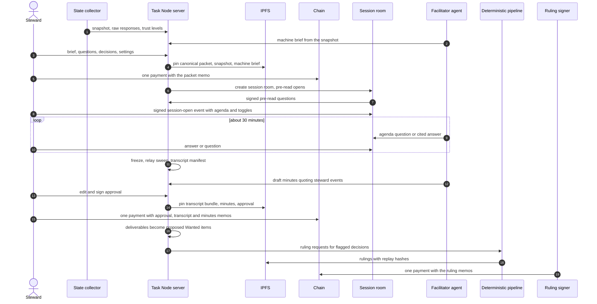
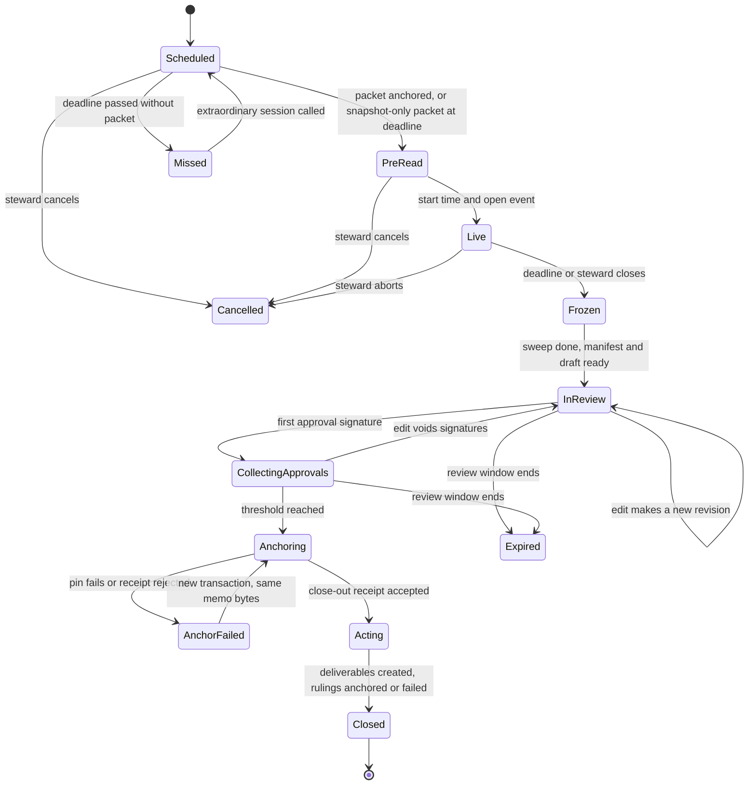

# Pillar 1 — Hive Chat Governance Module

> **Status:** Partial. Hive Chat, the boards and their budgets, the Wanted list, IPFS pinning and the `pf.ptr` pointer writer are live. The governance schedule, steward set, protocol-state collector, session room, signed minutes, link to the deterministic pipeline and explorer view do not exist yet.
>
> **Bubbles up to:** [Outcome A · Post-human governance in public](../README.md#three-outcomes). This is the surface where people see Post Fiat governing itself.

## In one paragraph

Post Fiat governance runs on information packets. On a fixed public schedule, a versioned **collector** captures the protocol's state as a machine-made snapshot, and an agent writes a **machine brief** from it. A steward, at first the founder, adds a brief, open questions and proposed decisions to form a **protocol-state packet**, signs it, and anchors it on chain. A public **governance session** of about 30 minutes then runs in its own Hive Chat room, led by an agent facilitator that asks the agenda and answers from the snapshot. At close, Task Node freezes a verifiable **transcript** and drafts **minutes with deliverables**, each quoting the steward's own words. The steward signs, and one transaction anchors the result. The packet is then **acted on**: deliverables become paid Wanted items within board budgets, flagged decisions get a replayable deterministic ruling, and the next packet reports what happened. Every artifact is labelled human, agent or deterministic, and the page sets out how the human share shrinks.

## User story

**Founder's story.** I am goodalexander. I log onto Hive Chat and upload the packet describing what is happening in the protocol. It is tagged on an IPFS blob the same way the existing message protocol works, and I can read about that message schema on the blog. The upload starts a conversation, held in public as a governance conversation and triggered from the UX with specific toggles. It lasts about 30 minutes. During it I ask and answer questions in a structured format that produces a transcript. When the conversation is over, the minutes and deliverables are published.

**Augmented story.**

1. **Schedule.** Hive shows the next session's start and packet deadline, and links to past sessions. Extraordinary sessions are labelled.
2. **Collect.** Before the deadline the collector publishes a **protocol snapshot** covering the chain, Cobalt, the bridge, NAVCoins, Task Node, board budgets and earlier deliverables, each field with its source and trust level. An agent writes a **machine brief** on what changed, what is stalled and what looks wrong.
3. **Brief.** I press **Prepare governance packet** and write the brief, `open_questions` and `proposed_decisions` beside the read-only snapshot, adding answer options to any I want ruled on. I choose session settings, embargo anything sensitive, and sign once.
4. **Pre-read.** Members and board managers post a few signed questions each. With no pre-read in the schedule, the upload opens the conversation directly.
5. **Open.** At the start time I sign the **session-open event**, which picks the agenda from the queued questions and fixes the toggles:
    - *Posting policy*: steward only, an allowlist (for example validators), or all Hive members.
    - *Agent mode*: off, agenda (the facilitator asks the agenda and answers me), or interactive (it also follows up).
6. **Converse.** The facilitator asks structured questions such as "Decision needed: …". I answer, and ask it questions that it answers from the snapshot. Others post if allowed, as community input.
7. **Close.** At the deadline, or when I press **Close**, the room freezes. Task Node sweeps the relays, builds the **transcript manifest** and drafts minutes, each item quoting the line of mine it came from.
8. **Sign.** I check each item against its quote, edit and sign, with co-stewards if the threshold needs them. One transaction anchors approval, transcript and minutes.
9. **Act.** Deliverables become proposed Wanted items and open once their reward is confirmed. Flagged decisions get deterministic rulings.
10. **Audit.** Anyone, logged in or not, can check every artifact from the session page or explorer with the verifier script.
11. **Follow through.** The next snapshot reports every deliverable (proposed, open, in progress, done, rewrite or dropped) and every ruling.

## What exists today

Checked against Task Node `main` at `204d238` and postfiatl1v2 `main` at `5936d4563`.

| Component | Where | State |
|---|---|---|
| Hive room and API | [`shared/hive-group.js`](https://github.com/postfiatorg/tasknode/blob/main/shared/hive-group.js), [`repositories/hive-group.js`](https://github.com/postfiatorg/tasknode/blob/main/server/repositories/hive-group.js), [`hive-group-routes.js`](https://github.com/postfiatorg/tasknode/blob/main/server/hive-group-routes.js) | Live. One room (`HIVE_GROUP_ID` is a constant), though `hive_group_channels` allows several. Reading needs no login. A posted event must be signed by the member's key and gets its `sequence` only when a relay acknowledges it. No moderation. |
| Relays, ingest, bot | [`hive-group-worker.js`](https://github.com/postfiatorg/tasknode/blob/main/server/hive-group-worker.js), [`hive-group-relay.js`](https://github.com/postfiatorg/tasknode/blob/main/server/hive-group-relay.js), [`hive-group-board.js`](https://github.com/postfiatorg/tasknode/blob/main/server/hive-group-board.js) | Live. A 5-second loop imports only NIP-05 directory members' events, from about 10 minutes before the last delivered one, at most 200 per relay query. The bot replies at most once per 60-second cycle, taking up to 180 seconds. Board managers answer escalations asynchronously under the bot key. |
| Boards, budgets, Wanted list | [`099_board_manager_v2_decisions.sql`](https://github.com/postfiatorg/tasknode/blob/main/server/db/migrations/099_board_manager_v2_decisions.sql), [`board-wanted.js`](https://github.com/postfiatorg/tasknode/blob/main/server/board-wanted.js), [`165_five_boards_wanted.sql`](https://github.com/postfiatorg/tasknode/blob/main/server/db/migrations/165_five_boards_wanted.sql) | Live, five public boards. `board_reward_budgets` holds daily, per-task and per-user caps; `board_reward_spend` records spend. Wanted items store `open` or `dropped` and derive other states from tasks; **no draft state**. `board_ai_l1_governance` is hidden. |
| IPFS pinning | [`context-ipfs.js`](https://github.com/postfiatorg/tasknode/blob/main/server/context-ipfs.js) | Live. Pinata, then the first-party node (which rejects a CID mismatch) and cluster replication. CIDv0, dag-pb, 16 MiB JSON cap. Plain `JSON.stringify`, **not canonical**. |
| Pointer `pf.ptr` v4 | [`pftl-pointer.js`](https://github.com/postfiatorg/tasknode/blob/main/server/pftl-pointer.js), [`pftl-submit.js`](https://github.com/postfiatorg/tasknode/blob/main/server/pftl-submit.js), [`context-publish.js`](https://github.com/postfiatorg/tasknode/blob/main/server/context-publish.js) | Live on the **old chain** (network id 2025), upper-case hex. Fields: 1 cid (text), 2 target, 3 kind (1–11 and 99 only), 4 schema (integer), 5–7 task, thread and context ids, 8 flags. Users' wallets sign context pointers by prepare, sign and submit, with a `LastLedgerSequence` expiry. |
| New chain | [`transactions_mempool_receipts.rs`](https://github.com/postfiatorg/postfiatl1v2/blob/main/crates/types/src/transactions_mempool_receipts.rs), [`methods.md`](https://github.com/postfiatorg/postfiatl1v2/blob/main/docs/rpc/methods.md), [`postfiat_wallet_wasm.d.ts`](https://github.com/postfiatorg/tasknode/blob/main/src/features/wallet/l1/wasm/postfiat_wallet_wasm.d.ts), [`explorer-spec.md`](https://github.com/postfiatorg/postfiatorg.github.io/blob/main/docs/explorer-spec.md) | `payment_v2` takes up to 4 lower-case hex memos, 256 data bytes each and **512 in total**, a non-zero amount, and may pay oneself. Receipts carry `accepted`; `status` returns height and state root. Task Node's wallet has `wallet_sign_payment_v2`, but no flow calls it. The explorer reads only this chain and has no content-pointer view. |
| Chain-state records | [`component-observations.json`](https://github.com/postfiatorg/postfiatl1v2/blob/main/docs/status/component-observations.json) | Operator-entered dated records behind `chain-state-current.md`. Cobalt was last observed at height 924, the fleet at 1906. |
| Deterministic governance | [overview](https://github.com/postfiatorg/postfiatl1v2/blob/main/docs/governance/deterministic-governance-overview.md), [verifiable constitution](https://github.com/postfiatorg/postfiatl1v2/blob/main/docs/governance/verifiable-constitution.md), [weekly dUNL rounds](https://github.com/postfiatorg/postfiatl1v2/blob/main/docs/governance/dunl-subscorer-shadow-weekly-2026.md) | Research and shadow mode; Cobalt ratifies registry and trust-graph changes on devnet. The Verifiable Constitution answers typed questions from fixed answer sets, including `hold-no-op`. An answer counts when two machines give the same parsed-output root; a split forces `hold-no-op`. |
| Inference cost | [agent plan](https://github.com/postfiatorg/postfiatl1v2/blob/main/docs/governance/deterministic-governance-agent-plan.md), [H200 plan](https://github.com/postfiatorg/postfiatl1v2/blob/main/docs/governance/reputation-scoring-h200-run-plan.md), [results](https://github.com/postfiatorg/postfiatl1v2/blob/main/docs/governance/reputation-scoring-h200-results-20260901.md) | `scripts/gov-inference-provider` rents RunPod (preferred, H100) or Vast GPUs. H200s cost an estimated $2.20–3.50 per host-hour. The documented $5.34 run and $77.32 campaign were batch scoring; no per-ruling cost exists. |

## Architecture

### Who makes each artifact

- **Deterministic:** the schedule, the snapshot (with a trust level per field), the eligibility list, the transcript manifest, rulings and follow-up.
- **Agent:** the machine brief, facilitator turns and minutes drafts.
- **Human:** the steward set, the brief, questions and proposed decisions, and minutes edits.

Steward wallets sign the schedule, packet and approval, and the founder's wallet signs the steward set. Nostr keys sign the open event and facilitator turns. The ruling signer anchors rulings (R27a).

### Flow

### Session states

Edits make new minutes revisions and never rebuild the transcript. With one steward, the first signature meets the threshold. Cancelled and expired sessions keep their packet and manifest. The schedule enables either `Missed` or the snapshot-only path (R2). Rulings have their own states (R27a).

### How authority moves from humans to machines (proposed progression)

| Stage | Machine-made | Human-made | Effect of a ruling |
|---|---|---|---|
| **Stage 0**, the Step 1 build | Snapshot, machine brief, manifest, draft minutes, rulings on flagged decisions | Brief, minutes edits, steward signature | Advisory, like today's Verifiable Constitution answers |
| **Stage 1** | Minutes extracted by the replayable deterministic profile, published unless a steward signs a public veto | Brief; steward notes as a separate signed artifact | Advisory |
| **Stage 2** | Rulings on agreed classes take effect, for example opening a Wanted item from a governed budget, or a registry change through Cobalt | Brief and a signed public veto | Binding within those classes |

The founder decides what evidence moves governance between stages and which classes may bind. The Cobalt and Foundation boundaries in the deterministic governance overview are never bypassed.

## Technical requirements

### Fixed timeline

- **R1.** A `hive_governance_schedule` record holds the cadence rule (`per_dunl_round`, `every_nth_round` or `calendar`), next start (UTC), packet deadline, pre-read length (zero allowed), session length (30 minutes by default), review window, relay-sweep timeout, `on_missed_deadline` (`snapshot_only` or `record_missed`), `on_review_expiry` (`publish_unapproved` or `manifest_only`) and `proposed_expiry_sessions` (none or a count). A steward signs and anchors each change. Every option is built; the founder picks the values.
- **R2.** Hive and the public page always show the next session and deadline; no session is skipped silently. Under `snapshot_only` the snapshot and machine brief become the packet at the deadline, labelled *no steward brief*, and the steward signs its anchor at open. Under `record_missed` the session becomes `Missed`.
- **R3.** Extraordinary sessions are labelled on the card, in the archive and in the schema. A steward with the `call` role (R20a) can call one at any time, including after `Missed`.

### Protocol-state methodology

- **R4.** A versioned collector, `pf-gov-collector`, writes `pf.governance.snapshot.v1`. Each field records `source` (RPC method, endpoint, or file at a commit), `read_at`, `raw_cid`, `raw_hash`, `value` and a `trust_level`: `chain_read` (the same answer from two or more validator endpoints at a recorded height), `operator_attested` (a Task Node API or dated operator record) or `human`. A run manifest records the collector version, code hash and every raw hash, like the validator-evidence collector-run manifest. Each raw response is pinned on its own; one over the pin cap fails the run by name. `status` (height, state root) is read before and after the other chain reads, and a root mismatch at one height marks the snapshot `inconsistent`. Re-derivation proves the extraction; the trust level says what backs the raw bytes.
- **R5.** Minimum sections:
    - `chain_state`: `status`, `validators`, `ledger`, `bridge_status`, `navcoin_bridge_supply_status`, `nav_reserve_proof_status`, and the admission verdicts and ratifications [Pillar 3](03-validator-program.md) published since the last snapshot;
    - `cobalt`: the Cobalt record in `component-observations.json` at a commit, `stale` if observed before the previous snapshot;
    - `tasknode` (`/api/system/status`) and `dunl_round` (latest scoring round and verdict);
    - `boards`: each board's budget row, today's spend and the `reward_pft` of its open and proposed governance items;
    - `deliverables`: every earlier deliverable not done or dropped, and every earlier ruling, with state and task id;
    - `steward_supplied` fields with no machine source, such as open P0s.
- **R6.** `pf.governance.packet.v1` holds the `snapshot` and `machine_brief` (read-only, by CID and hash), the `steward_brief` (`title`, `summary`, `changes_since_last`, `open_questions[]`, `proposed_decisions[]`, `attachments[]`), `session_settings` (pre-read posting policy, allowlist, agent mode), `steward_set_version` and an optional `reward_ceiling_pft`. A decision meant for a ruling lists answer options, always including `hold-no-op`. A disputed snapshot field gets a citing note in the brief.
- **R6a.** An agent writes the **machine brief** from the snapshot and previous minutes only: changes, stalled deliverables, stale or inconsistent fields and the questions they raise, each citing a field path. The steward cannot edit it.
- **R7.** Attachments are CIDs within the pin limits; agents read only text, Markdown or JSON. A brief item or attachment can be **embargoed**: only its hash and a label are published until a signed `pf.governance.reveal.v1` releases the bytes. The Brief screen lists every `steward_supplied` field and attachment for a disclosure check before signing.

### Session room and transcript

- **R8.** Each session gets its own `hive_group_channels` row and root event when its packet is anchored (under `snapshot_only`, at the deadline), plus a card in the main room, which is never locked. The worker, routes and UI must support many channels.
- **R8a.** **Pre-read questions** are signed kind-1 events on the session root tagged `["phase","pre_read"]`, from authors `session_settings` allows, under per-pubkey count and length caps. Board managers post theirs under the Hive bot key, labelled `agent`, as they work today. The open event lists the accepted questions, in order, as the agenda.
- **R9.** The **session-open event**, signed by a steward with the `open` role, fixes `posting_policy` (`steward_only`, `allowlist` or `members`) and the allowlist, `agent_mode` (`off`, `agenda` or `interactive`), the facilitator pubkey, open and close times, the packet CID, the agenda, and the CID and hash of the **eligibility list** (`pf.governance.eligibility.v1`: every eligible pubkey with handle and source, `directory`, `allowlist`, `steward` or `facilitator`). Validator allowlists come from Task Node's validator bindings, top-30 lists from [Pillar 9](09-finance-hub.md)'s daily snapshot.
- **R10.** On session channels, `/api/hive/group/messages` enforces the posting policy, time window and a per-pubkey rate limit. Task Node stamps `received_at` and a receipt number when it first sees an event, by API or ingest, without waiting for a relay acknowledgement.
- **R11.** Session ingest runs from the root's creation, accepts every pubkey on the eligibility list and pages past the 200-event relay limit. At freeze Task Node fixes the cut-off T, sweeps every relay from the open time until EOSE or the sweep timeout, then builds the manifest. Eligible events found only by the sweep, with `created_at` between open and T, are included and marked `recovered`, so an outage loses no member events.
- **R12.** **Inclusion rule.** An event belongs to the canonical transcript when:
    - its signature is valid and its root tag is the session root;
    - its author is eligible (for pre-read events, under `session_settings`);
    - it is a pre-read event received between the room's creation and open within its caps, a live event received between open and T, or `recovered`;
    - it is within the rate limit and not moderated (R13a).

    Order is by receipt number, not client `created_at`; recovered events follow by `created_at`, then id. Seen but excluded events are listed with a reason code.
- **R13.** The pinned **transcript bundle** holds the manifest, every included raw signed event and a Markdown rendering, so the transcript never depends on relays. The manifest lists the ordered ids with receipt numbers, times, phase and `recovered` marks, and the exclusions.
- **R13a.** **Moderation.** Before approval a steward can mark a non-steward event `moderated` with a reason. The bundle drops its content and keeps its event id, which commits to it, and the reason. Minutes cannot cite it. Moderation is public.
- **R14.** Governance JSON is canonicalised with RFC 8785 (JCS) before pinning, which needs a canonical mode in `pinContextIpfsJson`. Every hash inside a governance record is SHA3-384 over the exact bytes, the chain-side commitment of [Pillar 2](02-message-protocol.md) R5; only the CID uses SHA-256, as IPFS requires. Pins keep the code's fixed CIDv0 dag-pb parameters, so Pinata and the first-party node agree on CIDs. In Step 2 each artifact becomes a Pillar 2 envelope whose `CANONICAL_JSON` body is the same JCS bytes, so there is one canonical form. Past sessions are never re-pinned.

### Agents in the session

- **R15.** The **facilitator** has its own Nostr key, separate from the Hive bot key, named in the open event and always eligible. It acts only on steward turns, one job at a time, starting when Task Node receives the steward's event (R10), not on the 60-second cycle. In `agenda` mode it asks the next agenda question and answers the steward's questions; `interactive` adds follow-ups. Community posts never trigger it; it summarises them when the steward asks. It drafts agenda wording during the pre-read. The room shows drafting status, agenda progress and time left. Reply latency is published against the founder's target.
- **R15a.** The facilitator sees the packet, the snapshot with raw responses, the machine brief and the previous minutes. Factual answers cite a field path or say the snapshot does not cover it. A live read goes through the collector code and is cited with height and trust level.
- **R16.** Board managers join through the pre-read and escalations; live replies are optional.
- **R17.** Prompts carry steward messages, the packet and community messages as labelled blocks; community text is quoted data, never instructions. Minutes are drafted in two isolated passes. Pass 1 writes decisions, open questions and deliverables from the steward brief, steward events and the facilitator questions they answer. Pass 2 writes `community_input[]` from community events only. Agents never decide for the steward.

### Minutes and signatures

- **R18.** `pf.governance.minutes.v1` has `decisions[]`, `open_questions[]`, `deliverables[]` and `community_input[]`, each item with a provenance label (`human`, `agent` or `deterministic`) and source event ids. Decisions and deliverables carry a `quote`, a verbatim span of the cited steward text. Deliverables add a title, owning board, acceptance line, proposed reward and optional `ruling` flag. Community items record their author and whether a decision cites them.
- **R19.** A validator rejects a decision or deliverable that cites no steward event or brief item, or cites an event outside the manifest or moderated; whose `quote` is absent from the cited text; or whose reward exceeds the board's `per_task_cap_pft` or the remaining `reward_ceiling_pft`. The review screen shows each item beside its quote.
- **R20.** **Approval** is a signed record over the packet CID, the manifest and minutes hashes, the transcript and minutes CIDs and the steward-set version, from M stewards with the `approve` role. Any minutes revision voids the signatures collected.
- **R20a.** **Steward set.** `pf.governance.steward_set.v1` holds a version, threshold M and each member's wallet address, Nostr pubkey and roles (`call`, `open`, `approve`, `anchor_ruling`). Each Nostr key signs its wallet address and the set version, binding the two keys. The founder's wallet anchors every version; the verifier uses the one in force at each anchor. With one steward, a lost key stops approvals until the founder anchors a new set, and sessions in review expire on record. In Step 2 [Pillar 6](06-hive-identity.md) identities provide the binding.
- **R21.** Minutes are drafted on Task Node's existing inference stack, so the chat layer needs **no GPU rental**. Rulings still cost GPU time (R27).

### Anchoring and explorer

- **R22.** Steward wallets sign governance anchors through the client-side prepare, sign and submit flow that context publishing uses. The founder's wallet anchors the steward set and the ruling signer anchors rulings (R27a). Task Node's server keys never sign an anchor. A session takes one packet payment, one open event and one close-out payment, plus the ruling payment.
- **R23.** Anchors stay in `pf.ptr` v4 with one new kind, `GOVERNANCE`, proposed value 12, registered with Pillar 2 and added to the encoder. Field 4 (`schema`) carries a governance schema id registered with Pillar 2; artifacts carry their full schema name, so the id is a lookup hint. Field 6 (`thread_id`) carries the session id (at most 36 bytes), so an indexer groups sessions without IPFS. A memo is about 102 bytes (CIDv0 48, session id 38, other fields 8, type and format 8), so three fit the 256-per-memo and 512-per-payment limits; a test vector checks the worst case on both chains. In Step 2 Pillar 2's v5 pointer replaces v4 with the same kind, schema id and `thread_id`.
- **R24.** One anchor interface targets either chain (open question 5):
    - old chain: an XRPL `Payment` as today, accepted when validated with `tesSUCCESS`;
    - new chain: a `payment_v2` to the signer's own account for the smallest non-zero amount, lower-case hex memos, accepted when the finalized receipt says `accepted: true`, signed by a new flow that calls `wallet_sign_payment_v2`;
    - if anchoring starts on the old chain, the first new-chain anchor is an archive record of every earlier session's CIDs and transaction hashes, so the explorer shows the whole history.
- **R25.** Anchoring is idempotent, keyed by session id, schema id and hash, and each artifact is pinned first. Memo bytes are fixed; a retry signs a new transaction with the same memo bytes, since the old one may have expired. State is per artifact, so a retry covers only unconfirmed ones. Only an **accepted** receipt counts. Each CID must be confirmed pinned by both Pinata and the first-party cluster first.
- **R26.** The explorer gets a **governance view** that groups `GOVERNANCE` memos by `thread_id` into a session timeline.

### Acting on the minutes

- **R27.** **Rulings.** Only a decision with listed answer options can be flagged `ruling`. Its `pf.governance.ruling_request.v1` carries the question, the options (always including `hold-no-op`), the deterministic profile id and the evidence: snapshot, steward brief, steward events and the approved minutes item, never community text. It runs as a Verifiable Constitution question on two distinct hosts through a provider interface, today `scripts/gov-inference-provider`; whatever the founder's migration produced plugs in behind it. Matching parsed-output roots give the answer; a split records `hold-no-op`. A session's rulings share one rental, and each has only the effect its stage allows.
- **R27a.** **Ruling lifecycle and cost.** A ruling goes `Queued`, `Running`, `Replayed` or `Diverged`, then `Anchored`. A provider error, timeout or the per-session cost cap makes it `Failed`; the steward retries or drops it, and the next snapshot reports it. Each run records host-hours, hosts and cost and stops before the cap. The ruling signer, a steward wallet or a registered runner key with the `anchor_ruling` role, anchors a session's rulings in one payment. The verifier checks replay hashes, so validity never depends on the anchoring key.
- **R28.** **Deliverables.** Each becomes a `board_wanted_items` row with a new `proposed` status. That needs a status-check migration, and `wantedState` must treat proposed items as not open. `source_url` is the public session page and `reward_pft` the proposed reward. The item opens when the confirmer (open question 9) confirms; if that is the steward, the approval signature confirms and items open at `Acting`. Items still proposed after `proposed_expiry_sessions` are dropped as *expired unconfirmed*; with no expiry they stay in every snapshot.
- **R29.** **Follow-up.** The next snapshot lists every earlier deliverable and ruling with its state, closing the loop from packet to work to the next packet.

### Public surface

- **R30.** A public session page and archive work without login, lead with the machine-made artifacts, show every artifact with its label and anchors, and link to `verify-governance-session`. Its **deterministic** mode uses only the chain and public gateways to check hashes, signatures, the steward key binding, eligibility, the inclusion rule, quotes, the approval threshold and replay hashes. Its best-effort **`--check-relays`** mode lists eligible relay events missing from the manifest, warning that relays drop events and clients set `created_at`.
- **R31.** A blog post explains the packet schema, the snapshot method and how a session runs, written with Pillar 2's message-protocol post. The founder's story expects it; it does not exist yet.

## Security model

| Threat | Control |
|---|---|
| Relay-direct posts, ineligible keys, spoofed `created_at` | Inclusion rule and receipt order (R11, R12); exclusions listed |
| Relays drop events | The bundle holds every raw event (R13) |
| A compromised server forges history | Steward wallets sign anchors over the manifest and minutes (R20, R22). Receipt order and eligibility remain server-assembled, steward-approved claims: the verifier proves consistency, not truth. |
| A compromised server censors or remaps identities | `--check-relays` (R30); eligibility fixed at open (R9); keys bound in the steward set (R20a); Pillar 6 later |
| Prompt injection, spoofed citations | Isolated passes (R17), quote check (R19), steward review, red-team pass |
| A forged ruling | Two-host replay hashes (R27) |
| Abuse, sensitive disclosure | Moderation (R13a); embargo (R7) |
| Spam, runaway cost, unbounded rewards | Policies, caps and steward-only triggers (R8a, R10, R15, R19, R27a) |
| Loss of a steward key | With one steward, a single point of failure until the founder anchors a new set (R20a); M-of-N removes it |

## Economics

| Cost line | Size | Who pays |
|---|---|---|
| Pins and replication | A few JSON artifacts and raw responses per session | Task Node's Pinata account and cluster |
| Anchors | Two payments per session plus one for rulings; `payment_v2` fees grow with memo bytes. Published per session. | The signer's wallet |
| Facilitator, machine brief, minutes | Bounded by steward-only triggers and the turn cap; cost published per session | Task Node's inference budget, under a per-session cap |
| Rulings | Host-hours × two hosts × hourly rate plus start-up, shared by the session's rulings. H200s are estimated at $2.20–3.50 per host-hour. | As the founder decides, under a hard per-session cap |
| Deliverable rewards | `reward_pft`, within the per-task cap and session ceiling | The owning board's `board_reward_budgets`, as today |

Deliverables pay out through the existing Wanted item, task and reward path, within existing budgets. Each snapshot shows those budgets and every stalled deliverable, so minutes cannot become write-only. Recorded attribution gives any incentive the founder picks its data.

## Dependencies

| Step | Depends on | Notes |
|---|---|---|
| **Step 1 (MVP)**: R1–R25, R27–R31 | The `pf.ptr` writer and wallet signing, Pinata and replication, the Hive room, the Wanted list and budgets, L1 RPC reads, and one rental through `gov-inference-provider` | No other pillar's code. Kind 12 and schema ids are agreed with Pillar 2. Identity is today's NIP-05 directory, bound by the steward set. If the founder picks the new chain, the `wallet_sign_payment_v2` flow is in Step 1. |
| **Step 2** | [Pillar 2 — Message protocol](02-message-protocol.md) | `CANONICAL_JSON` envelopes (R14) and v5 pointers (R23) |
| | [Pillar 6 — Hive identity on chain](06-hive-identity.md) | Stewards, facilitator and allowlisted participants identified on chain |
| | Explorer governance view (R26) | Needs new-chain anchors |
| **Step 3** | A cheap, repeatable home for the deterministic pipeline behind the R27 interface | For Stage 1 minutes every session and Stage 2 rulings |

## Acceptance criteria

1. **Step 1.** The founder runs a scheduled session in production: the card shows in advance, the packet is anchored before the deadline, the session lasts about 30 minutes, and the minutes reach the approval threshold.
2. **Step 1.** The schedule, steward set, packet and close-out each have a CID and an **accepted** transaction from the founder's or a steward wallet, reachable from the public page without login. The session needed two wallet signatures per anchor chain, plus the ruling payment.
3. **Step 1.** The verifier's deterministic mode passes for a third party using only gateways and the chain: it re-derives every snapshot field, checks trust levels, key binding and eligibility, rebuilds the transcript and checks quotes. `--check-relays` reports.
4. **Step 1.** Posting directly to relays: an ineligible event and a post-freeze event are excluded and listed, an allowlisted key outside the directory is included, events sent during a Task Node outage are recovered, and the steward-only and members policies behave as specified.
5. **Step 1.** Each deliverable is a proposed Wanted item linked to its session; a reward over the per-task cap is rejected; the next snapshot reports every state, including `proposed`.
6. **Step 1.** A decision with answer options gets a ruling replayed on two hosts and anchored with replay hashes, its cost recorded and under the cap.
7. **Step 1.** The chat layer uses no GPU rental; facilitator latency and inference cost are published.
8. **Step 1.** A red-team pass shows injected community text, including spoofed citations, cannot create a decision or deliverable.
9. **Step 1.** The blog post (R31) is live and linked from the session page.
10. **Step 2.** Artifacts are Pillar 2 envelopes over the same JCS bytes, the explorer shows the session timeline, and participants resolve through Pillar 6.

## Open questions for the founder

Each answer sets a value or picks an option that is already built, so none blocks building Step 1. All are needed before the first production session.

1. **Cadence.** One session per dynamic-UNL round (weekly today), every Nth round, or a calendar slot?
2. **Pre-read.** None, so the upload opens the conversation as in your story, or a set length? Longer helps more time zones prepare but slows each cycle.
3. **Missed deadline.** (a) A snapshot-only packet, so governance never pauses, or (b) record `Missed` and hold no briefless session?
4. **Stewards.** N=1, or M of N from the start, and who? Who may call and open sessions: you, named stewards, or validators and top-30 users? At review expiry, publish the transcript with unapproved minutes, or keep only the manifest?
5. **Anchor chain.** (a) Old chain: works today, invisible to the explorer, needs the archive record later. (b) New chain: matches the migration and explorer, needs the `wallet_sign_payment_v2` flow in Step 1. (c) Both: most continuity, double the cost and signatures.
6. **Ruling signer.** A steward wallet keeps every anchor human-signed, at one more signature per session. A registered runner key needs no human step, but an operator holds it. Validity is the same either way.
7. **Stages.** What moves governance from Stage 0 to 1 and 1 to 2: a number of sessions where replayed minutes match approved ones, a run with no veto, or your call each time? Which classes may a ruling bind?
8. **Rulings and the GPU migration.** A ruling every session, or only when you flag one? What per-session GPU cap? "We have migrated that": the agent plan prefers RunPod H100 over Vast. Is that the migration, or does deterministic inference now run elsewhere, and at what cost? For the Step 3 home, options beyond per-session batching (built) include reserved instances, validator-hosted inference, or a smaller profile, which the Verifiable Constitution allows only after a model-governance packet proves it.
9. **Deliverable rewards.** Who confirms a reward: the board manager, a steward, or the minutes at Stage 2? Do unconfirmed items expire after some sessions?
10. **Participant incentives.** None, reputation only, or Wanted items for contributions such as a cited question? Attribution is recorded either way.
11. **Limits.** Rate limit, pre-read caps, turn cap, inference cap, facilitator latency target, and whether packets carry a reward ceiling.
12. **Board ownership.** Should `board_ai_l1_governance` own governance deliverables again, or should each go to the board for its subject?

## Code references

- Task Node: [`hive-group-worker.js`](https://github.com/postfiatorg/tasknode/blob/main/server/hive-group-worker.js) · [`board-wanted.js`](https://github.com/postfiatorg/tasknode/blob/main/server/board-wanted.js) · [`pftl-pointer.js`](https://github.com/postfiatorg/tasknode/blob/main/server/pftl-pointer.js) · [`context-ipfs.js`](https://github.com/postfiatorg/tasknode/blob/main/server/context-ipfs.js) · [`docs/wiki/architecture/ipfs.md`](https://github.com/postfiatorg/tasknode/blob/main/docs/wiki/architecture/ipfs.md)
- L1: [`transactions_mempool_receipts.rs`](https://github.com/postfiatorg/postfiatl1v2/blob/main/crates/types/src/transactions_mempool_receipts.rs) · [`docs/rpc/methods.md`](https://github.com/postfiatorg/postfiatl1v2/blob/main/docs/rpc/methods.md) · [`docs/governance/`](https://github.com/postfiatorg/postfiatl1v2/tree/main/docs/governance) · [`scripts/gov-inference-provider`](https://github.com/postfiatorg/postfiatl1v2/blob/main/scripts/gov-inference-provider)
- Website: [`docs/explorer-spec.md`](https://github.com/postfiatorg/postfiatorg.github.io/blob/main/docs/explorer-spec.md) · [LLM governance replay](https://github.com/postfiatorg/postfiatorg.github.io/blob/main/content/blog/llm-governance-replay.md)

---

*Revision history: [changelog](../changelog/01-hive-governance.md).*
