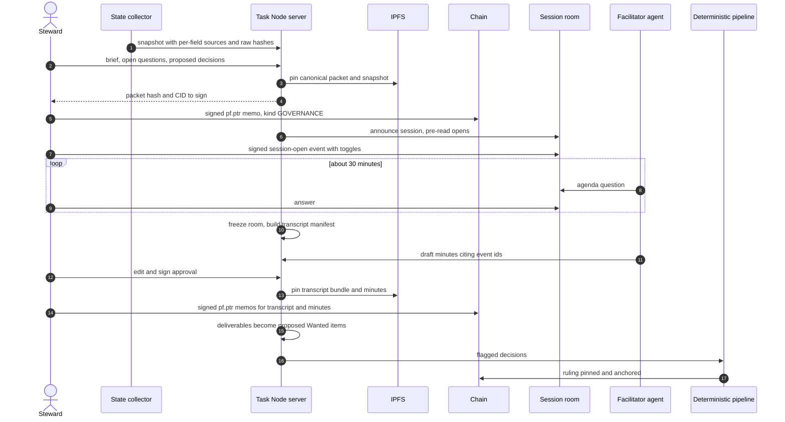
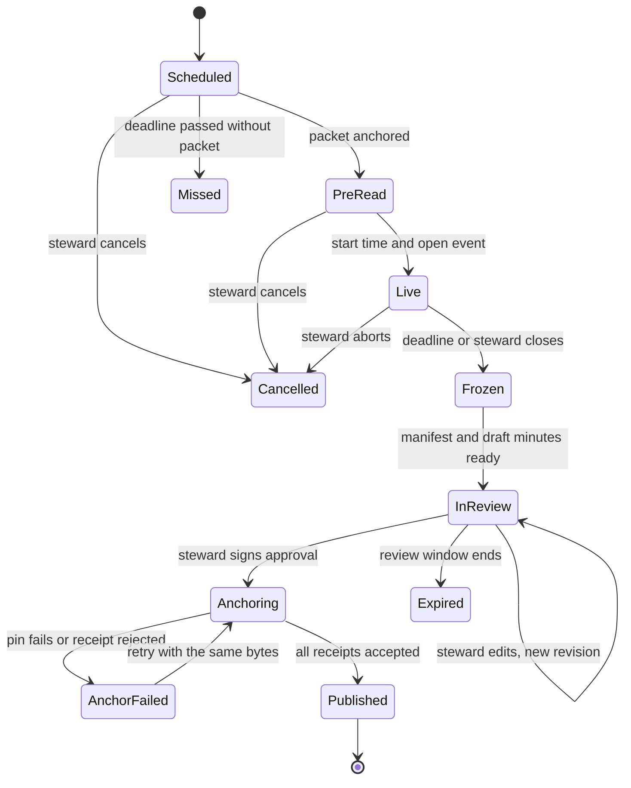

# Pillar 1 — Hive Chat Governance Module

> **Status:** Partial. Hive Chat, the boards, the Wanted list, IPFS pinning and the `pf.ptr` pointer writer are live. The governance schedule, protocol-state collector, session room, signed minutes, link to the deterministic pipeline and explorer view do not exist yet.
>
> **Bubbles up to:** [Outcome A · Post-human governance in public](../README.md#three-outcomes). This is the surface where people see Post Fiat governing itself.

## In one paragraph

Post Fiat governance runs on information packets. On a fixed public schedule, a versioned **collector** captures the protocol's current state as a machine-made snapshot. A steward, at first the founder, adds a brief, open questions and proposed decisions, and together these form a **protocol-state packet**. The steward signs it. It is pinned to IPFS and anchored on chain, and a pre-read period starts. Then a public **governance session** of about 30 minutes runs in its own Hive Chat room, led by an agent facilitator. At close, Task Node freezes a verifiable **transcript** and drafts **minutes with deliverables**, which the steward signs and anchors. The packet is then **acted on**. Deliverables become paid Wanted items. Flagged decisions go to the deterministic governance pipeline, which publishes a replayable ruling. The next packet reports what happened to each deliverable. Every artifact is labelled human, agent or deterministic, and the page sets out how the human share shrinks over time.

## User story

**Founder's story.** I am goodalexander. I log onto Hive Chat and upload the packet describing what is happening in the protocol. It is tagged on an IPFS blob the same way the existing message protocol works, and I can read about that message schema on the blog. The upload starts a conversation, held in public as a governance conversation and triggered from the UX with specific toggles. It lasts about 30 minutes. During it I ask and answer questions in a structured format that produces a transcript. When the conversation is over, the minutes and deliverables are published.

**Augmented story.**

1. **Schedule.** Hive shows the next session's start time and packet deadline, with links to past sessions. Extraordinary sessions are possible and labelled as such.
2. **Collect.** Before the deadline the collector publishes a **protocol snapshot**: chain height, validators, Cobalt state, bridge and NAVCoin supply, Task Node status, and the state of the last session's deliverables. Each field records its source, when it was read and a hash of the raw response.
3. **Brief.** I press **Prepare governance packet**. The snapshot is attached, read-only. I write the brief, `open_questions` and `proposed_decisions`, and sign with my wallet. Task Node pins the packet and my signed `pf.ptr` transaction anchors it. The card shows its title, CID, transaction and countdown.
4. **Pre-read.** Members read and queue questions. Board managers add theirs here, since they work asynchronously.
5. **Open.** At the start time I sign the **session-open event**. The session has its own room, so the main Hive room carries on. The event fixes the toggles:
    - *Posting policy*: steward only, an allowlist (for example validators), or all Hive members.
    - *Agent mode*: off, agenda (the facilitator asks the packet's and the queue's questions in order), or interactive (it also follows up).
6. **Converse.** The facilitator asks structured questions such as "Decision needed: …" and "Evidence for …". I answer inline. Others post if the policy allows, and their posts are marked as community input.
7. **Close.** At the deadline, or when I press **Close**, the room freezes. Task Node builds the **transcript manifest** (every included signed event, in order) and drafts minutes: decisions, open questions and deliverables, each citing its source events.
8. **Sign.** I edit and sign the approval. My signed transactions anchor the transcript and minutes.
9. **Act.** Deliverables become proposed Wanted items and open for work once their reward is set. Flagged decisions go to the deterministic pipeline, and each ruling is anchored with the session.
10. **Audit.** Anyone, logged in or not, can open the session page or the explorer, see every artifact with its CID and transaction, and check them with the verifier script.
11. **Follow through.** The next snapshot reports every deliverable: open, in progress, done, needing a rewrite, or dropped.

## What exists today

Checked against Task Node `main` at `204d238`.

| Component | Where | State |
|---|---|---|
| Public Hive room (Nostr kind-1, NIP-10 root) | [`shared/hive-group.js`](https://github.com/postfiatorg/tasknode/blob/main/shared/hive-group.js), [`HiveGroupChat.jsx`](https://github.com/postfiatorg/tasknode/blob/main/src/features/hive/HiveGroupChat.jsx), [`139_hive_group_chat.sql`](https://github.com/postfiatorg/tasknode/blob/main/server/db/migrations/139_hive_group_chat.sql) | Live. One room, `tasknode-hive-v1`, although the `hive_group_channels` table allows several. Each event needs one `e` root tag matching the room. |
| Room API | [`server/hive-group-routes.js`](https://github.com/postfiatorg/tasknode/blob/main/server/hive-group-routes.js) | Live. Reading needs no login. Posting needs an event signed by the member's own key. |
| Relays and ingest | [`hive-group-relay.js`](https://github.com/postfiatorg/tasknode/blob/main/server/hive-group-relay.js), [`hive-group-worker.js`](https://github.com/postfiatorg/tasknode/blob/main/server/hive-group-worker.js), [`repositories/hive-group.js`](https://github.com/postfiatorg/tasknode/blob/main/server/repositories/hive-group.js) | Live. Public relays (primal, nos.lol, damus). A 5-second loop imports events only from NIP-05 directory members, and only from about 10 minutes before the last delivered message. Postgres sets the order (`sequence`). |
| Hive bot | [`server/hive-group-provider.js`](https://github.com/postfiatorg/tasknode/blob/main/server/hive-group-provider.js) | Live. One decide-and-reply cycle every 60 seconds by default (`TASKNODE_HIVE_GROUP_BOT_INTERVAL_SECONDS`), with at most one reply. A reply can take up to 180 seconds. |
| Board-manager replies | [`server/hive-group-board.js`](https://github.com/postfiatorg/tasknode/blob/main/server/hive-group-board.js) | Live, asynchronous. Managers answer queued escalations, and replies post under the Hive bot key. Managers are not live participants. |
| Boards and Wanted list | [`board-config.js`](https://github.com/postfiatorg/tasknode/blob/main/server/board-config.js), [`board-wanted.js`](https://github.com/postfiatorg/tasknode/blob/main/server/board-wanted.js), [`165_five_boards_wanted.sql`](https://github.com/postfiatorg/tasknode/blob/main/server/db/migrations/165_five_boards_wanted.sql), [`HiveWanted.jsx`](https://github.com/postfiatorg/tasknode/blob/main/src/features/hive/HiveWanted.jsx) | Live, with five public boards. Items have `reward_pft` and a required http(s) `source_url`. The stored status is `open` or `dropped`, and the other states are worked out from tasks. **There is no draft state.** `board_ai_l1_governance` is hidden. |
| Memo-style artifacts | [`hive-board-secretary-worker.js`](https://github.com/postfiatorg/tasknode/blob/main/server/hive-board-secretary-worker.js), [`hive-reports-worker.js`](https://github.com/postfiatorg/tasknode/blob/main/server/hive-reports-worker.js) | Live. Fixed-section memos and reports, the closest thing to minutes today. |
| IPFS pinning | [`context-ipfs.js`](https://github.com/postfiatorg/tasknode/blob/main/server/context-ipfs.js) (`pinContextIpfsJson`), [`ipfs-replication-worker.js`](https://github.com/postfiatorg/tasknode/blob/main/server/ipfs-replication-worker.js) | Live. Pins to Pinata, then a queue re-pins to the first-party cluster. Six read gateways, and a 16 MiB JSON cap in code. JSON is written with plain `JSON.stringify`, **which is not canonical**. |
| Pointer `pf.ptr` v4 | [`pftl-pointer.js`](https://github.com/postfiatorg/tasknode/blob/main/server/pftl-pointer.js), [`pftl-submit.js`](https://github.com/postfiatorg/tasknode/blob/main/server/pftl-submit.js), [`context-publish.js`](https://github.com/postfiatorg/tasknode/blob/main/server/context-publish.js) | Live on the **old chain** (`xrpl.js`, network id 2025). Fields: cid, target, kind, schema, task_id, thread_id, context_id, flags. Kinds 1–11 are used (`CHAT=4`, `POLICY=7`, `DOCUMENT=10`, `SYSTEM=11`). The user's wallet signs context pointers. The server signs task-review pointers. |
| New-chain memos | [`core_chain.rs`](https://github.com/postfiatorg/postfiatl1v2/blob/main/crates/types/src/core_chain.rs), [`docs/rpc/methods.md`](https://github.com/postfiatorg/postfiatl1v2/blob/main/docs/rpc/methods.md) | Built. Up to 4 memos per payment, 256 bytes of data each. `tx` and `account_tx` return the memos. |
| Explorer | [`docs/explorer-spec.md`](https://github.com/postfiatorg/postfiatorg.github.io/blob/main/docs/explorer-spec.md) | New chain only, with no content-pointer view yet. |
| Deterministic governance | [overview](https://github.com/postfiatorg/postfiatl1v2/blob/main/docs/governance/deterministic-governance-overview.md), [verifiable constitution](https://github.com/postfiatorg/postfiatl1v2/blob/main/docs/governance/verifiable-constitution.md), [evidence packet schema](https://github.com/postfiatorg/postfiatl1v2/blob/main/docs/governance/validator-evidence-packet-schema.md) | Research and shadow mode. On devnet, Cobalt ratifies validator-registry and trust-graph changes, and the Foundation holds the other scopes. The Verifiable Constitution lane answers typed questions from hash-bound evidence with a deterministic Qwen profile, with no live effect. Collector-run manifests are drafted for validator evidence. |
| Governance rhythm | [`dunl-subscorer-shadow-weekly-2026.md`](https://github.com/postfiatorg/postfiatl1v2/blob/main/docs/governance/dunl-subscorer-shadow-weekly-2026.md) | Weekly dynamic-UNL shadow scoring rounds on frozen, hashed inputs. |
| Inference cost | [agent plan](https://github.com/postfiatorg/postfiatl1v2/blob/main/docs/governance/deterministic-governance-agent-plan.md) (`scripts/gov-inference-provider`), [H200 run plan](https://github.com/postfiatorg/postfiatl1v2/blob/main/docs/governance/reputation-scoring-h200-run-plan.md), [results](https://github.com/postfiatorg/postfiatl1v2/blob/main/docs/governance/reputation-scoring-h200-results-20260901.md) | Rented RunPod or Vast GPUs at an estimated $2.20–3.50 per host-hour. One run cost $5.34, and a full campaign $77.32. |

## Architecture

### Who makes each artifact

| Artifact | Made by | Label | Signed by |
|---|---|---|---|
| Schedule | Task Node, from the cadence the founder sets | deterministic | Steward, on change |
| Protocol snapshot | Versioned collector | deterministic | Inside the steward-signed packet |
| Brief, open questions, proposed decisions | Steward | human | Steward |
| Facilitator questions | Facilitator agent | agent | Hive bot Nostr key |
| Transcript manifest | Task Node, by the inclusion rule (R12) | deterministic | Steward approval |
| Minutes | Agent draft plus steward edits, labelled per item | agent, human | Steward approval |
| Rulings | Deterministic pipeline | deterministic | Anchored with replay hashes |
| Deliverable follow-up | Derived from Wanted item state | deterministic | Next snapshot |

### Flow

### Session states

An edit makes a new revision of the minutes and never rebuilds the transcript. A cancelled or expired session keeps its packet and frozen manifest on record.

### How authority moves from humans to machines (proposed progression)

| Stage | Machine-made | Human-made | Effect of a ruling |
|---|---|---|---|
| **Stage 0**, the Step 1 build | Snapshot, manifest, draft minutes, rulings on request | Brief, edits to the minutes, steward signature | Advisory, like today's Verifiable Constitution answers |
| **Stage 1** | Minutes extracted by the deterministic profile, which can be replayed. They publish automatically unless a steward signs a public veto. | Brief. Steward notes are a separate signed artifact. | Advisory |
| **Stage 2** | Rulings on agreed classes of decision take effect, for example opening a Wanted item from a governed budget, or a registry change through Cobalt | Brief and a signed public veto | Binding within those classes |

The founder decides when governance moves to the next stage and which classes of decision may bind. The Cobalt and Foundation boundaries in the deterministic governance overview are never bypassed.

## Technical requirements

### Fixed timeline

- **R1.** A `hive_governance_schedule` record holds the cadence rule, the next start (UTC), the packet deadline, the pre-read length, the session length (30 minutes by default) and the review window. A steward signs and anchors every change. The founder sets the values.
- **R2.** Hive and the public session page always show the next session and its deadline. A session is never skipped silently. A missed deadline is handled as the founder chooses (see the open questions).
- **R3.** Extraordinary sessions are labelled as extraordinary on the card, in the archive and in the schema.

### Protocol-state methodology

- **R4.** A versioned collector, `pf-gov-collector`, writes `pf.governance.snapshot.v1`. Each field records `source` (an RPC method, an endpoint, or a file at a commit), `read_at` (a height or a UTC time), `raw_sha256` and `value`. A run manifest records the collector's version, its code hash and every raw-response hash, following the validator-evidence collector-run manifest. The raw responses are pinned with the snapshot, so every field can be re-derived from them.
- **R5.** The minimum fields:
    - New chain: `status`, `validators`, `ledger`, `bridge_status` and `navcoin_bridge_supply_status`.
    - Cobalt: the dated observation in `docs/status/chain-state-current.md`, at a commit.
    - Task Node: `/api/system/status`.
    - The latest dynamic-UNL scoring round and its verdict.
    - Each deliverable from the previous session, with its `wantedState` and task id.
    - Fields with no machine source yet, such as open P0s, are marked `steward_supplied`.
- **R6.** `pf.governance.packet.v1` has two parts. The `snapshot` is read-only and referenced by CID and hash. The `steward_brief` is editable and holds `title`, `summary`, `changes_since_last`, `open_questions[]`, `proposed_decisions[]` and `attachments[]`. A steward who disputes a snapshot field writes a note in the brief that cites it.
- **R7.** Attachments are CIDs within the existing pin limits. Agents read only text, Markdown or JSON attachments.

### Session room and transcript

- **R8.** Each session is its own `hive_group_channels` row with its own root event, plus an announcement card in the main room, which is never locked. The worker, routes and UI must support many channels, because `HIVE_GROUP_ID` is a constant today.
- **R9.** The **session-open event**, signed by the steward's Nostr key, fixes:
    - `posting_policy`: `steward_only`, `allowlist` or `members`;
    - the allowlist;
    - `agent_mode`: `off`, `agenda` or `interactive`;
    - the open and close times;
    - the packet CID.
- **R10.** `/api/hive/group/messages` enforces the posting policy, the time window and a per-pubkey rate limit on session channels. The founder sets the rate-limit values.
- **R11.** Relay ingest for a session starts at its open time, not at the usual window of about 10 minutes before the last delivered message. A Task Node outage during a session then loses no member events.
- **R12.** **Inclusion rule.** An event belongs to the canonical transcript when all of the following hold:
    - its signature is valid;
    - its root tag is the session root;
    - the session-open event made its author eligible;
    - Task Node received it between the open event and the freeze;
    - it is within the rate limit.

    Events are ordered by Task Node's receipt `sequence`, not by the `created_at` time the client sets. Member events that were seen but excluded are listed by id, with a reason code.
- **R13.** The pinned **transcript bundle** holds the manifest, every included raw signed event and a rendered Markdown copy. The manifest gives the ordered event ids, the receipt sequence, `created_at` and the exclusions. The transcript therefore never depends on relays keeping events.
- **R14.** Governance JSON is canonicalised with RFC 8785 (JCS) before pinning, which needs a canonical mode in `pinContextIpfsJson`. The SHA-256 of the canonical bytes is recorded. JSON is the authoritative v1 form. A later protobuf form from [Pillar 2](02-message-protocol.md) is a separate artifact that cites the JSON CID. Past sessions are never re-pinned.

### Agents in the session

- **R15.** A **facilitator** replies as each event arrives, not on the 60-second cycle. It works through `open_questions[]` and the pre-read queue in order. It takes one turn per steward turn, unless the agent mode is `interactive`. Its reply latency is published for every session. The founder sets the target.
- **R16.** Board managers take part through the pre-read queue and escalations, as they do today. Live replies from them are optional.
- **R17.** Prompts carry steward messages, the packet and community messages as separately labelled blocks. Community text and attachments are treated as quoted data and never as instructions. Agents never decide for the steward.

### Minutes and signatures

- **R18.** `pf.governance.minutes.v1` has four lists: `decisions[]`, `open_questions[]`, `deliverables[]` and `community_input[]`. Each item carries a provenance label (`human`, `agent` or `deterministic`) and its source event ids. Each deliverable also has a title, an owning board, an acceptance line, a proposed reward and an optional `ruling` flag.
- **R19.** A validator rejects a draft in which any decision or deliverable either cites no steward or agenda event, or cites an event that is not in the manifest. Items that come only from the community go in `community_input[]`.
- **R20.** Approval is a signed record over the packet CID, the manifest hash and the minutes hash. It carries a steward-set id and a threshold, so M-of-N signing works even while N is 1.
- **R21.** Minutes are drafted on Task Node's existing inference stack, so the chat layer needs **no GPU rental**. This does not make the deterministic pipeline any cheaper. R27 covers that cost.

### Anchoring and explorer

- **R22.** A steward's wallet signs every governance anchor, using the client-side prepare, sign and submit flow that context publishing uses today. The server never signs one.
- **R23.** Anchors stay in `pf.ptr` v4 and use one new kind, `GOVERNANCE`. The proposed value is 12, the next free number, and it is registered with Pillar 2. Field 4 (`schema`) carries the artifact's schema id. Field 6 (`thread_id`) carries the session id, so an indexer can group a session without fetching anything from IPFS. A test vector proves the memo fits the new chain's 256-byte data limit.
- **R24.** The anchor writer can target either chain. The founder chooses which (see the open questions).
- **R25.** Anchoring is idempotent, keyed by session id, schema id and SHA-256. Each artifact is pinned before it is anchored, and a retry resubmits the same bytes. A step succeeds only when its receipt is **accepted**; a committed transaction alone does not count. Each CID must be readable from at least two gateways before it is anchored.
- **R26.** The explorer gets a **governance view** that groups `GOVERNANCE` memos by `thread_id` and shows each session's timeline.

### Acting on the minutes

- **R27.** **Rulings.** Each decision flagged `ruling` is exported as a Verifiable Constitution question, with the snapshot as its evidence packet. It is queued for the deterministic Qwen profile through `scripts/gov-inference-provider`, or whatever replaced it in the migration the founder mentioned. The typed answer and its replay hashes are pinned and anchored. A ruling has only the effect its stage allows.
- **R28.** **Deliverables.** Each deliverable becomes a `board_wanted_items` row with a new `proposed` status. This needs a migration of the status check, and `wantedState` must treat proposed items as not open. The `source_url` is the public session page, and the proposed reward goes in `reward_pft`. The item opens once someone confirms the reward. Who that is, the founder decides.
- **R29.** **Follow-up.** The next snapshot lists each previous deliverable with its derived state. That closes the loop from packet, to work, to the next packet.

### Public surface

- **R30.** A public session page and archive work without login. They show the live session, every artifact and its anchors, and a **Verify** link to `verify-governance-session`. That script checks the hashes, signatures, the inclusion rule and the replay hashes of each ruling.
- **R31.** A blog post explains the packet schema, the snapshot method and how a session runs, written together with Pillar 2's message-protocol post. The founder's story expects this post to exist, and it does not exist yet.

## Security model

| Threat | Control |
|---|---|
| A member posts straight to relays to bypass the toggles | The inclusion rule (R12). Excluded events are listed. |
| A non-member posts to the session root | Ignored at ingest, as today |
| Spoofed `created_at` | Order comes from the receipt `sequence`, and the time window from the server's receipt time (R12) |
| Relays drop events | The pinned bundle holds every raw event (R13) |
| A compromised server or database forges history | The steward's wallet signs the anchors (R22), and the approval covers the manifest and minutes hashes (R20) |
| A compromised server censors events | The verifier compares relay copies with the manifest and reports member events that are missing |
| Prompt injection into minutes or deliverables | R17–R19, steward review, and a red-team pass before the first public session |
| Spam or runaway LLM cost | Posting policy, rate limits and turn limits (R9, R10, R15) |
| Loss of the steward key | M-of-N approval (R20) |

## Economics

| Cost line | Size | Who pays |
|---|---|---|
| Pins and replication | A few small JSON artifacts per session | Task Node's existing Pinata account and cluster |
| Anchors | About five to seven memos per session | The steward's wallet, which is public on chain |
| Facilitator and minutes inference | Bounded by the turn limit | Task Node's inference budget, with a per-session cap the founder sets |
| Rulings | One GPU rental per run (documented at $5.34 for one run, $77.32 for a campaign) | The founder decides: every ruling, batched per session, or flagged classes only |
| Deliverable rewards | `reward_pft` on each item | The owning board's budget, as today |

The economics close in three ways. Deliverables pay out through the existing path from Wanted item to task to reward. Each snapshot's follow-up stops minutes from becoming write-only. The posting policy bounds what open participation costs.

## Dependencies

| Step | Depends on | Notes |
|---|---|---|
| **Step 1 (MVP)** | The existing `pf.ptr` writer and wallet signing, Pinata and replication, the Hive room, the Wanted list and the L1 RPC reads | Needs no other pillar. Identity comes from today's NIP-05 directory and wallet-linked Nostr keys. Session pages link to raw transactions and gateways. |
| **Step 2** | [Pillar 2 — Message protocol](02-message-protocol.md) | Schema registry ids, the protobuf form and the `GOVERNANCE` kind |
| | [Pillar 6 — Hive identity on chain](06-hive-identity.md) | Stewards and allowlisted participants identified on chain |
| | The explorer governance view (R26) | Needs anchors on the new chain, the only chain the explorer indexes |
| | New-chain `payment_v2` memo signing in Task Node | Only if anchors go to the new chain |
| **Step 3** | A cheap, repeatable home for the deterministic pipeline | Needed for Stage 1 minutes and Stage 2 rulings |

## Acceptance criteria

1. The founder runs a full scheduled session in production:
    - the next-session card is shown in advance;
    - the snapshot and brief are anchored before the deadline;
    - the live session lasts about 30 minutes;
    - the minutes are signed.
2. The schedule, packet, snapshot, transcript, minutes and approval each have a CID and an **accepted** transaction signed by the steward's wallet. All of them can be reached from the public session page without logging in.
3. `verify-governance-session` passes for a third party who uses only public gateways and the chain. It re-derives every snapshot field from the pinned raw responses and rebuilds the transcript from the bundle.
4. In a test that posts directly to the relays, an ineligible member's event and an event received after the freeze are both excluded and listed. Steward-only and open policies behave as specified.
5. Each deliverable appears as a proposed Wanted item linked to the session, and the next snapshot reports its state.
6. At least one decision gets a deterministic ruling, anchored with replay hashes, and the cost of the run is recorded.
7. The chat layer runs with no GPU rental, and the facilitator's reply latency is published.
8. A red-team pass shows that injected community text cannot create a decision or a deliverable.
9. The blog post (R31) is published and linked from the session page.

## Open questions for the founder

- **Cadence.** What is the fixed rhythm?
    - One session per dynamic-UNL scoring round (weekly today), every Nth round, or a calendar slot you pick.
    - How long is the pre-read? A longer one lets more time zones prepare, but each cycle takes longer.
- **Missed deadline.** (a) Open with a snapshot-only packet, so governance never pauses. (b) Record the session as `Missed`, which avoids holding an empty session.
- **Who may open or call a session?** Options: you only, a steward set you name, or validators and top-30 users.
- **Steward set and approval.** A single key (N=1), or M of N from the start, and if so, who? When the review window ends, is the transcript published with the minutes marked unapproved, or is only the manifest kept?
- **Anchor chain.**
    - (a) The old chain. It works today, but the explorer does not show it and it needs migrating later.
    - (b) The new chain. It matches the migration and the explorer, but needs new-chain memo signing in Task Node.
    - (c) Both chains during the transition. This gives the most continuity at the highest cost.
- **Stages.** What evidence moves governance from Stage 0 to 1, and from 1 to 2? Which classes of decision may a ruling bind?
- **Ruling budget.** Should every session produce rulings, or only for decisions you flag? Is there a GPU cap per session? And "we have migrated that": what now runs deterministic inference, and at what cost?
- **Deliverable rewards.** Who confirms a reward and opens the item: the board manager, a steward, or the minutes themselves at Stage 2?
- **Participant incentives.** No reward, reputation only, or Wanted items for governance contributions (for example, a cited question that led to a decision)?
- **Limits.** Set the per-pubkey rate limit, the agent turn cap, the per-session inference cap and the facilitator latency target.
- **Board ownership.** Should `board_ai_l1_governance` return to own governance deliverables, or should each deliverable go to the board for its subject?

## Code references

- Hive room: [`shared/hive-group.js`](https://github.com/postfiatorg/tasknode/blob/main/shared/hive-group.js) · [`server/hive-group-worker.js`](https://github.com/postfiatorg/tasknode/blob/main/server/hive-group-worker.js) · [`server/hive-group-relay.js`](https://github.com/postfiatorg/tasknode/blob/main/server/hive-group-relay.js) · [`server/hive-group-routes.js`](https://github.com/postfiatorg/tasknode/blob/main/server/hive-group-routes.js) · [`server/repositories/hive-group.js`](https://github.com/postfiatorg/tasknode/blob/main/server/repositories/hive-group.js)
- Wanted list: [`server/board-wanted.js`](https://github.com/postfiatorg/tasknode/blob/main/server/board-wanted.js) · [`165_five_boards_wanted.sql`](https://github.com/postfiatorg/tasknode/blob/main/server/db/migrations/165_five_boards_wanted.sql)
- Pointers and IPFS: [`server/pftl-pointer.js`](https://github.com/postfiatorg/tasknode/blob/main/server/pftl-pointer.js) · [`server/context-publish.js`](https://github.com/postfiatorg/tasknode/blob/main/server/context-publish.js) · [`server/context-ipfs.js`](https://github.com/postfiatorg/tasknode/blob/main/server/context-ipfs.js) · [`docs/wiki/architecture/ipfs.md`](https://github.com/postfiatorg/tasknode/blob/main/docs/wiki/architecture/ipfs.md)
- L1: [`docs/rpc/methods.md`](https://github.com/postfiatorg/postfiatl1v2/blob/main/docs/rpc/methods.md) · [`docs/governance/`](https://github.com/postfiatorg/postfiatl1v2/tree/main/docs/governance) · [`dynamic-unl-l1-evidence-source-note.md`](https://github.com/postfiatorg/postfiatl1v2/blob/main/docs/governance/dynamic-unl-l1-evidence-source-note.md)
- Explorer: [`docs/explorer-spec.md`](https://github.com/postfiatorg/postfiatorg.github.io/blob/main/docs/explorer-spec.md) · Blog: [LLM governance replay](https://github.com/postfiatorg/postfiatorg.github.io/blob/main/content/blog/llm-governance-replay.md)

## Revision notes (review round 1)

| Item | Change |
|---|---|
| Gemini P1 | Rulings through the Verifiable Constitution lane (R27), a stage table, provenance labels and AC6. The old GPU criterion now covers the chat layer only (AC7). What the GPU migration refers to is an open question. |
| Gemini P2 | Inclusion rule (R12), pinned bundle (R13), ingest from session start (R11), AC4. Partly disputed: non-members cannot pollute Postgres, because ingest drops pubkeys outside the directory. |
| Gemini P3 | The steward's wallet signs anchors (R22), and approval is signed over the hashes (R20). |
| Gemini P4 | Versioned collector with per-field sources (R4–R5). The snapshot is split from the brief (R6). |
| Gemini P5 | One room per session, and the toggles are enums (R8–R9). The main room is never locked. |
| Gemini P6 | Event-driven facilitator (R15), board managers through the pre-read queue (R16), prompt boundary and validator (R17, R19). The latency target is an open question. |
| Gemini P7 | One kind, with the schema id in field 4 and the session id in field 6 (R23). JCS JSON is authoritative (R14). |
| Gemini P8 | Proposed Wanted items with rewards (R28), follow-up (R29), an Economics section and limits. The policy values are open questions. |
| Gemini P9 | Fixed schedule (R1–R3) and a pre-read state. Durations are open questions. |
| Gemini P10 | New states: Missed, Cancelled, Expired and AnchorFailed. Idempotent anchoring (R25). Partly disputed: Pinata is not the only store, because a queue re-pins to the first-party cluster. |
| Gemini P11 | Dependencies arranged by step, with a Step 1 MVP that needs no other pillar. Blog post added (R31, AC9). |
| Opus P1 | The fixed timeline is now a requirement (R1–R3, AC1). Only its values are open. |
| Opus P2 | As Gemini P4. Fields with no machine source are marked `steward_supplied`. |
| Opus P3 | Stage table, labels and rulings (R27). |
| Opus P4 | As Gemini P2. The signed open event defines who is eligible (R9). |
| Opus P5 | As Gemini P7. Proposed value 12. |
| Opus P6 | Checked: pointers go to the old chain, and the explorer reads only the new chain. The writer can target either chain (R24), and the choice is an open question. |
| Opus P7 | Checked: the 60-second interval is configurable, and a reply can take up to 180 seconds. R15. |
| Opus P8 | As Gemini P5. |
| Opus P9 | R17–R19, AC8. |
| Opus P10 | R21 is limited to the chat layer. R27, AC6 and the Economics section cost the rulings. |
| Opus P11 | RFC 8785, receipt order and a verifier (R12, R14, R30). Checked: `pinContextIpfsJson` uses `JSON.stringify`. |
| Opus P12 | As Gemini P10. |
| Opus P13 | Posting policy and rate limits (R9–R10). Incentives and gating are open questions. |
| Opus P14 | Public page and archive with no login (R30), blog post (R31), AC2 and AC9. |
| Opus P15 | Re-checked at `204d238`. Corrections: board managers reply asynchronously under the bot key; Wanted items have no draft state; the JSON cap is 16 MiB; pointers are on the old chain. |
| Opus P16 | Signed M-of-N approval (R20) and wallet-signed anchors (R22). The steward set is an open question. |
