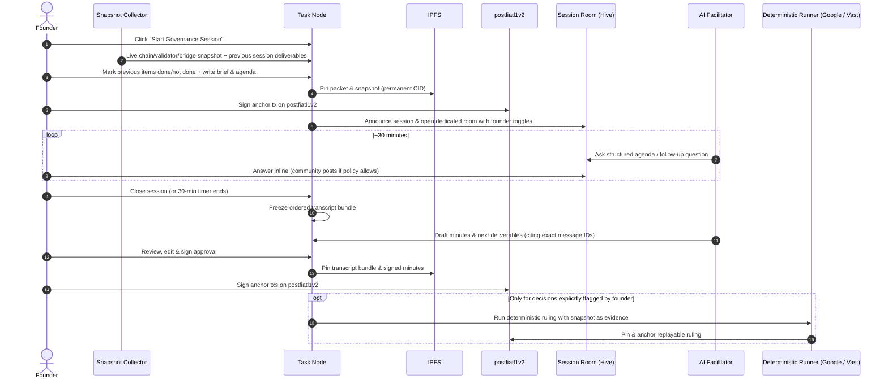

# Pillar 1 — Hive Chat Governance Module

> **Status:** Partial. Hive Chat, IPFS pinning, and pointer anchoring already exist in Task Node. What still needs to be built: the automatic protocol-state snapshot, the founder-triggered 30-minute governance session room, signed minutes with carry-over accountability, new-chain anchoring, and the explorer + public archive view.
>
> **Outcome:** [A · Post-human governance in public](../README.md#three-outcomes) — the public place where anyone can watch Post Fiat govern itself.

## What this pillar is (in plain English)

Post Fiat governance runs as a visible loop of **information packets** and **public accountability**:

1. **Whenever you kick off a session in Task Node**, a script automatically pulls a live **protocol snapshot** (chain height, active validators, bridge/NAVCoin supply, Task Node health) and **automatically loads the deliverables from the previous governance session** so everyone can see what actually got done and what didn't.
2. **You add a short written brief** — what happened since last time, what you did or didn't finish from the last session, the questions to discuss, and any proposed decisions — then sign it with your wallet.
3. **Task Node publishes the packet** to **IPFS** *(a content-addressed file network where every file gets a permanent fingerprint called a CID; if one byte changes, the CID changes)* and writes that CID into a tiny signed transaction on the **new chain (`postfiatl1v2`)** *(called "anchoring" — it proves the exact packet existed at that block and cannot be silently edited later)*.
4. **A 30-minute public governance session** opens in its own Hive Chat room (so normal Hive Chat keeps running uninterrupted). You choose who can post (just you, an allowlist like validators, or all Hive members) and how active the AI facilitator is. The facilitator walks through the agenda and asks structured questions; you answer inline.
5. **When the session closes**, Task Node freezes the exact ordered transcript and drafts **minutes + next deliverables**. You review, edit if needed, and sign off with your wallet. Both the frozen transcript and signed minutes are pinned to IPFS and anchored on `postfiatl1v2`.
6. **Follow-through happens automatically:** There are **no automatic PFT bounties** generated from minutes. Instead, the next time you kick off a governance session, the previous session's deliverables are loaded straight into the opening packet — **either you did the work or you didn't**, in public. If you explicitly flag a decision for **deterministic governance**, it is also sent to the deterministic scoring/ruling runner (on our current Google setup or Vast on demand) and the replayable ruling is anchored alongside the session.

## How a session runs end-to-end

## Locked-in design decisions

- **Trigger:** Sessions run **on demand whenever the founder starts one in Task Node** (no rigid calendar deadline and no fake "missed session" failure state).
- **Authority & approval:** **Founder-only (1-of-1)** opens sessions and signs minutes at launch. The approval record still carries a signer-set ID and threshold field so multi-sig stewards can be added later without changing the schema.
- **Anchor chain:** **New chain (`postfiatl1v2`)** only, using standard `payment_v2` memos so the new block explorer displays governance sessions natively and we carry zero old-chain migration debt.
- **Follow-through mechanism:** **Direct carry-over, not PFT bounties.** Every new governance packet automatically instantiates with the previous session's deliverables list, forcing an explicit public status (`done`, `in_progress`, `not_done`, `dropped`) on each item.
- **Deterministic rulings:** Run **only when explicitly flagged** on a specific decision by the founder, using the **current Google setup or Vast** on demand. The chat facilitator and minutes drafter run on Task Node's normal inference stack with **zero GPU rental**.

## What exists today

Checked against Task Node `main` (`204d238`) and `postfiatl1v2`:

| Piece | Current state | Where |
|---|---|---|
| Hive Chat room (Nostr) | Live, but hardcoded to one room (`tasknode-hive-v1`); DB table already supports multiple channels | [`shared/hive-group.js`](https://github.com/postfiatorg/tasknode/blob/main/shared/hive-group.js), [`HiveGroupChat.jsx`](https://github.com/postfiatorg/tasknode/blob/main/src/features/hive/HiveGroupChat.jsx) |
| Room API & relay sync | Live, public read, signed write. Relay sync currently only looks back ~10 minutes, which needs widening for session rooms | [`server/hive-group-routes.js`](https://github.com/postfiatorg/tasknode/blob/main/server/hive-group-routes.js), [`server/hive-group-worker.js`](https://github.com/postfiatorg/tasknode/blob/main/server/hive-group-worker.js) |
| Hive AI bot | Live, but polls once every 60 seconds — too slow for a live 30-minute session | [`server/hive-group-provider.js`](https://github.com/postfiatorg/tasknode/blob/main/server/hive-group-provider.js) |
| IPFS pinning | Live (Pinata + first-party cluster, 16 MiB cap), but uses plain `JSON.stringify` instead of canonical deterministic JSON | [`server/context-ipfs.js`](https://github.com/postfiatorg/tasknode/blob/main/server/context-ipfs.js) |
| Anchoring (`pf.ptr` v4) | Live on the **old chain** only. New chain (`postfiatl1v2`) already supports memos (up to 4 memos, 256 bytes each), but Task Node doesn't sign new-chain memos yet | [`server/pftl-pointer.js`](https://github.com/postfiatorg/tasknode/blob/main/server/pftl-pointer.js), [`core_chain.rs`](https://github.com/postfiatorg/postfiatl1v2/blob/main/crates/types/src/core_chain.rs) |
| Block explorer governance view | Not built yet | [`docs/explorer-spec.md`](https://github.com/postfiatorg/postfiatorg.github.io/blob/main/docs/explorer-spec.md) |
| Deterministic governance runner | Exists in shadow/research mode (Verifiable Constitution + Cobalt); runs on Google setup or Vast on demand | [`docs/governance/`](https://github.com/postfiatorg/postfiatl1v2/tree/main/docs/governance) |

## Detailed specification

### 1. Protocol-state snapshot, authority binding & carry-over packet
- **Pinned founder authority & offline key binding:** The founder's official `postfiatl1v2` address is pinned in the explorer and verifier config, and every wallet-signed `pf.governance.packet.v1` explicitly embeds the founder's authorized `nostr_pubkey` (upgrading seamlessly to [Pillar 6](06-hive-identity.md) on-chain identity once minted). The block explorer **only** renders `GOVERNANCE` sessions anchored by the pinned founder authority key — outsider spam memos with `kind = 12` are ignored.
- **Automatic collector (`pf-gov-collector`):** Pins all L1 RPC reads to **one finalized `block_height`** (preventing torn reads across blocks) and generates `pf.governance.snapshot.v1`. Every field stores its exact source, block height/UTC timestamp, and SHA-256 hash of the raw response (capped well within the 16 MiB IPFS limit). Raw responses are pinned alongside the snapshot so third parties can re-derive every field.
- **What the snapshot pulls automatically:**
  - `postfiatl1v2` status, active validator set, ledger tip, bridge status, and NAVCoin supply status at the pinned height.
  - Current Cobalt status and latest dynamic-UNL scoring verdict.
  - Task Node `/api/system/status`.
  - **Previous session's deliverables list** (loaded automatically from the last published governance minutes so each item must be marked `done`, `in_progress`, `not_done`, or `dropped`).
- **Founder brief (`pf.governance.packet.v1`):** Attaches the read-only snapshot by CID + hash, plus your editable brief: `title`, `summary`, `previous_deliverables_status[]`, `open_questions[]`, `proposed_decisions[]`, and optional IPFS attachments (text/Markdown/JSON only for agents).
- **Canonical JSON inside Pillar 2 envelopes:** Before pinning, Task Node sorts keys deterministically (RFC 8785 / JCS) and wraps every governance artifact in a signed [Pillar 2](02-message-protocol.md) `pf.msg.v1` envelope (`body_encoding = CANONICAL_JSON`), anchored via **`pf.ptr` v5** (binary 36-byte `cid_bin` + `kind = GOVERNANCE (12)` + `thread_id = session_id`, ~110 bytes total — comfortably inside `postfiatl1v2`'s 256-byte memo cap).

### 2. Dedicated session room, Sybil defense & live facilitation
- **Session state machine:** Every session follows explicit states: `Draft → Live → Frozen → InReview → Anchoring → Published` (plus `Aborted` if cancelled before publish, and `RulingPending → RulingAnchored` for optional flagged deterministic rulings). Minutes edits increment a revision number without ever rebuilding the frozen transcript.
- **One room per session:** Starting a session creates a new `hive_group_channels` room and posts an announcement card in the main Hive room (main chat is never locked).
- **Session-open toggles** (signed by your bound Nostr key):
  - **Who can post:** `founder_only`, `allowlist` (e.g., validators), or `all_members` (restricted to registered Task Node accounts, never arbitrary free Nostr pubkeys). When `allowlist` or `all_members` is active, the session-open event commits the CID/hash of the pinned eligible-pubkey snapshot so third parties can verify eligibility offline without trusting Task Node's database.
  - **AI facilitator mode:** `off`, `agenda` (walks through the packet's questions in order), or `interactive` (also asks follow-ups).
  - **Session length:** 30 minutes default (founder can extend or close early).
- **Anti-spam & turn-budget isolation:**
  - Rate limit: 1 message per 15 seconds per registered account, max 10 messages per non-founder account per session (blocks Sybil floods in `all_members` mode; founder exempt).
  - AI facilitator latency target: under 10 seconds per reply (event-driven on new messages, replacing the old 60-second poll loop).
  - Reserved turn budget: max 25 facilitator turns total — **15 turns reserved exclusively for founder/agenda questions**, max **10 turns** for community follow-ups, so community traffic can never exhaust the facilitator.
  - Relay catch-up: before freezing, Task Node runs a final relay EOSE catch-up back to session-open time (applying rate limits strictly by the event's position inside the live window) so brief outages never drop messages.
- **Structural prompt-injection boundary (two-pass minutes drafting):**
  - **Pass 1 (`previous_deliverables_review[]`, `decisions[]`, `next_deliverables[]`):** Runs over **ONLY** the founder-signed packet, agenda prompts, and founder-signed messages — community messages and attachments are completely excluded from Pass 1's context so citation-spoofing prompt injection is structurally impossible.
  - **Pass 2 (`community_input[]`):** Summarizes community messages separately as quoted data.

### 3. Frozen transcript, signed minutes & custody-safe anchoring
- **Canonical inclusion rule:** At freeze, a message enters the official transcript only if its Nostr signature is valid, it targets the session room, the author is in the session-open eligible-pubkey snapshot, and Task Node received it between open and freeze within per-account limits. Ordering uses Task Node's server receipt sequence (so clients cannot backdate timestamps), and the founder's approval signature commits to that exact ordered manifest. Excluded events are listed by ID with reason codes.
- **Self-contained bundle:** Task Node pins the transcript manifest, eligible-pubkey snapshot, every raw signed Nostr event, and a readable Markdown transcript to IPFS so history never depends on third-party Nostr relays.
- **Founder approval & idempotent `postfiatl1v2` anchoring:** You edit the draft if needed and sign the approval with your wallet (the server never signs on your behalf). Anchors are tracked idempotently by `(session_id, schema, sha256)`; if an anchor transaction expires before inclusion, retry builds a fresh transaction with the current account sequence over the exact same pinned CID. An anchor succeeds only after an **accepted** chain receipt and confirmation on at least two independent pinners/gateways.
- **Custody-safe deterministic rulings (Google setup / Vast):** Only decisions you explicitly check as `run_deterministic_ruling` are exported with **(snapshot + founder brief + signed minutes)** to the deterministic governance runner. The runner on Google/Vast is **read-only compute and never holds a founder signing key** — it returns the replayable ruling + replay hashes to `RulingPending`, and your wallet signs the `RulingAnchored` transaction on review.

### 4. Public archive, honest verifier & block explorer
- **Public session page (no login required):** Shows the live or completed session, previous-session scorecard, every pinned artifact with CID + `postfiatl1v2` transaction link, facilitator latency stats, and a **Verify** link.
- **Independent verifier script (`verify-governance-session`):** Separates **deterministic offline verification** (using only public IPFS gateways + `postfiatl1v2` RPC to check pinned founder key binding, eligible-pubkey snapshot, all hashes/signatures, snapshot raw-response derivation, and ruling replay hashes) from an optional **best-effort `--check-relays` audit** that compares live Nostr relays against the manifest to spot potential server censorship.
- **Block explorer view:** Groups `pf.ptr` v5 `GOVERNANCE` memos anchored by the pinned founder authority key by `thread_id` so each governance session renders as a spoof-proof timeline directly on the explorer.

## Security summary

- **Fake or backdated chat messages:** Blocked by Nostr signature checks + server receipt ordering; direct-to-relay bypasses are filtered by the inclusion rule and logged as exclusions.
- **Relay loss or server tampering:** Every raw signed event lives in the IPFS transcript bundle, and your wallet signs the chain anchors over the canonical hashes.
- **Prompt injection into minutes:** Community messages are isolated as quoted data; drafted decisions/deliverables must cite founder/agenda messages and always require your explicit signature.

## Milestones & completion checklist

### Build milestones
- [ ] **M1 · Multi-channel Hive & canonical IPFS:** Support multiple `hive_group_channels` in routes/worker/UI, widen session relay ingest to session-open time, and add deterministic RFC 8785 canonical JSON mode to `pinContextIpfsJson`.
- [ ] **M2 · Protocol-state collector & carry-over:** Build `pf-gov-collector` (`pf.governance.snapshot.v1`) pulling live chain/validator/bridge/Task Node state plus automatically loading the previous session's deliverables for done/not-done scoring.
- [ ] **M3 · Session UX & fast AI facilitator:** Build the Task Node "Start Governance Session" flow (brief editor, toggles, 30-min room, freeze button) and an event-driven facilitator (`<10s` reply target, 25-turn cap, prompt-injection guardrails).
- [ ] **M4 · Transcript freeze, minutes & `postfiatl1v2` anchoring:** Build transcript bundling, minutes drafting/validation, wallet-signed approval, and idempotent `pf.ptr` v4 (`GOVERNANCE`) memo anchoring on `postfiatl1v2` (requires new-chain memo signing from [Pillar 2](02-message-protocol.md)).
- [ ] **M5 · Public archive, explorer view & verifier:** Ship the no-login public session page + archive, the `postfiatl1v2` explorer governance timeline, the standalone `verify-governance-session` script, and optional flagged-decision export to the deterministic runner (Google setup / Vast).
- [ ] **M6 · Adversarial red-team check:** Verify prompt-injection resistance (community text cannot inject decisions/deliverables) and relay-bypass exclusion tests.

### Required ship gates
- [ ] **1. Executed:** All M1–M6 code merged and deployed to production Task Node, `postfiatl1v2` explorer, and public archive.
- [ ] **2. Tested by user:** Founder kicks off and completes a full live 30-minute governance session in production (including carry-over from a prior packet, signed minutes anchored on `postfiatl1v2`, third-party `verify-governance-session` pass, and at least one flagged deterministic ruling).
- [ ] **3. Added to docs:** Governance packet schema, snapshot methodology, and verification guide published in the Post Fiat docs.
- [ ] **4. Public blog post document:** Public blog post written, published, and linked from the session page explaining Post Fiat's post-human governance loop, packet schema, and how anyone can audit a session.

## Code references

- Hive Chat: [`shared/hive-group.js`](https://github.com/postfiatorg/tasknode/blob/main/shared/hive-group.js) · [`server/hive-group-worker.js`](https://github.com/postfiatorg/tasknode/blob/main/server/hive-group-worker.js) · [`server/hive-group-routes.js`](https://github.com/postfiatorg/tasknode/blob/main/server/hive-group-routes.js) · [`HiveGroupChat.jsx`](https://github.com/postfiatorg/tasknode/blob/main/src/features/hive/HiveGroupChat.jsx)
- Pointers & IPFS: [`server/pftl-pointer.js`](https://github.com/postfiatorg/tasknode/blob/main/server/pftl-pointer.js) · [`server/context-publish.js`](https://github.com/postfiatorg/tasknode/blob/main/server/context-publish.js) · [`server/context-ipfs.js`](https://github.com/postfiatorg/tasknode/blob/main/server/context-ipfs.js)
- L1 & Governance: [`core_chain.rs`](https://github.com/postfiatorg/postfiatl1v2/blob/main/crates/types/src/core_chain.rs) · [`docs/governance/`](https://github.com/postfiatorg/postfiatl1v2/tree/main/docs/governance) · [`docs/explorer-spec.md`](https://github.com/postfiatorg/postfiatorg.github.io/blob/main/docs/explorer-spec.md)
