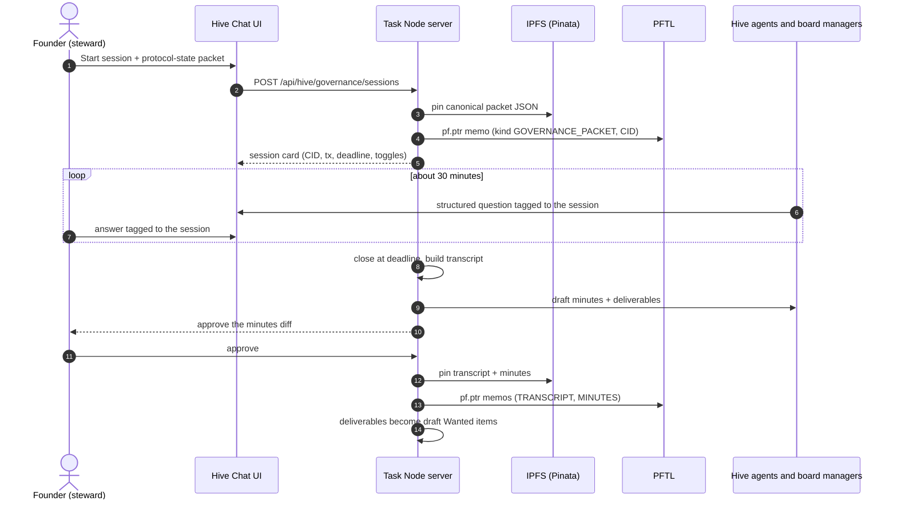
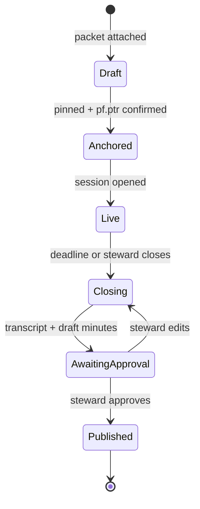

# Pillar 1 — Hive Chat Governance Module

> **Status:** Partial. Hive Chat, the boards and IPFS pointer pinning are live. The governance session, packet upload, minutes and their link to on-chain governance do not exist yet.
>
> **Bubbles up to:** *Post-human governance in public*. This is the surface where people see Post Fiat governing itself.

## In one paragraph

Post Fiat governance runs on information packets. Someone uploads a description of the protocol's current state. The network acts on it in public, and the result is a record anyone can audit. This pillar turns that loop into one Hive Chat feature. The founder, or later any authorised steward, opens a **governance session** by uploading a **protocol-state packet**. The packet is pinned to IPFS and anchored on PFTL. Its upload starts a timed public conversation of about 30 minutes, with structured questions and answers. When the session closes, Task Node publishes a **transcript** and **minutes with deliverables**. Both are pinned and anchored like the packet, and the deliverables become Wanted items on the Hive boards.

## User story

**Founder's story.** I am goodalexander. I log onto Hive Chat and upload the packet describing what is happening in the protocol. It is tagged on an IPFS blob the same way the existing message protocol works, and I can read about that message schema on the blog. The upload starts a conversation, held in public as a governance conversation and triggered from the UX with specific toggles. It lasts about 30 minutes. During it I ask and answer questions in a structured format that produces a transcript. When the conversation is over, the minutes and deliverables are published.

**Augmented story.**

1. **Open.** I press **Start governance session** in Hive Chat. I attach a protocol-state packet: one Markdown or JSON document following the [packet schema](#protocol-state-packet). I can also prefill it from a template that pulls live chain status.
2. **Anchor.** Task Node canonicalises the packet, pins it to IPFS and writes a `pf.ptr` memo on PFTL. The room shows a session card with the packet title, its CID, the PFTL transaction and a countdown, 30 minutes by default.
3. **Structure.** Toggles on the session card set the format:
    - *Agenda mode*: questions come from the packet's `open_questions`.
    - *Open floor*: anyone can post.
    - *Steward only*: only the founder and the board agents post; everyone else reads.
    - *Agent participation*: the Hive bot and the board managers answer from the packet.
    Every message in the session is tagged to that session.
4. **Converse.** Agents ask structured questions such as "Decision needed: …" and "Evidence for …". I answer inline. Community members can react or ask questions, but only if the session's toggles allow it.
5. **Close.** At the deadline, or when I press **Close**, the room is locked to the session. Task Node assembles the transcript, generates **minutes** (decisions, open questions, deliverables with owners) and shows me a diff to approve.
6. **Publish.** When I approve, the transcript and minutes are pinned and anchored next to the packet. Each deliverable becomes a draft Wanted item on the board that owns it.
7. **Audit.** Anyone can open the session later from the Hive or the block explorer and see the packet, the transcript and the minutes, with their CIDs and transactions.

## What exists today

| Component | Where | State |
|---|---|---|
| Public Hive room (Nostr kind-1, NIP-10 root) | [`shared/hive-group.js`](https://github.com/postfiatorg/tasknode/blob/main/shared/hive-group.js), [`src/features/hive/HiveGroupChat.jsx`](https://github.com/postfiatorg/tasknode/blob/main/src/features/hive/HiveGroupChat.jsx) | Live. One fixed room, `tasknode-hive-v1`. No attachments or sessions. |
| Room API | [`server/hive-group-routes.js`](https://github.com/postfiatorg/tasknode/blob/main/server/hive-group-routes.js) | Live: `/api/hive/group`, `/status`, `/read`, `/messages` (signed events only). |
| Outbox, relay ingest and bot loop | [`server/hive-group-worker.js`](https://github.com/postfiatorg/tasknode/blob/main/server/hive-group-worker.js), [`server/hive-group-relay.js`](https://github.com/postfiatorg/tasknode/blob/main/server/hive-group-relay.js) | Live. 5-second loop, plus a 60-second bot decide-and-reply cycle. |
| Hive bot and board-manager replies | [`server/hive-group-provider.js`](https://github.com/postfiatorg/tasknode/blob/main/server/hive-group-provider.js), [`server/hive-group-board.js`](https://github.com/postfiatorg/tasknode/blob/main/server/hive-group-board.js) | Live |
| Boards and Wanted list | [`server/board-config.js`](https://github.com/postfiatorg/tasknode/blob/main/server/board-config.js), [`server/board-wanted.js`](https://github.com/postfiatorg/tasknode/blob/main/server/board-wanted.js), [`src/features/hive/HiveWanted.jsx`](https://github.com/postfiatorg/tasknode/blob/main/src/features/hive/HiveWanted.jsx) | Live: five boards and the Wanted list. The governance board is hidden and takes no new work. |
| Memo-style artifacts | [`server/hive-board-secretary-worker.js`](https://github.com/postfiatorg/tasknode/blob/main/server/hive-board-secretary-worker.js), [`server/hive-reports-worker.js`](https://github.com/postfiatorg/tasknode/blob/main/server/hive-reports-worker.js) | Live. Fixed-section status memos and reports; the closest thing to minutes today. |
| IPFS pin plus on-chain pointer | [`server/context-ipfs.js`](https://github.com/postfiatorg/tasknode/blob/main/server/context-ipfs.js) (`pinContextIpfsJson`), [`server/pftl-pointer.js`](https://github.com/postfiatorg/tasknode/blob/main/server/pftl-pointer.js) (`pf.ptr` v4) | Live for context, tasks and NFT assets. Content kinds include `CHAT=4`, `POLICY=7` and `DOCUMENT=10`. |
| Deterministic governance pipeline | [`docs/governance/deterministic-governance-overview.md`](https://github.com/postfiatorg/postfiatl1v2/blob/main/docs/governance/deterministic-governance-overview.md), [`verifiable-constitution.md`](https://github.com/postfiatorg/postfiatl1v2/blob/main/docs/governance/verifiable-constitution.md) | Research and shadow mode. Authority transfer is not active. |
| Governance inference on rented GPUs | [`docs/governance/deterministic-governance-agent-plan.md`](https://github.com/postfiatorg/postfiatl1v2/blob/main/docs/governance/deterministic-governance-agent-plan.md) (`scripts/gov-inference-provider`, RunPod/Vast) | Works, but each run rents H200s, roughly $2–4 per hour. Past campaigns cost $5–80. |

The current Hive messages are Nostr notes stored in Postgres. They are **not** pinned to IPFS. IPFS pinning today belongs to the `pf.ptr` pointer flow. This pillar brings governance artifacts into that flow.

## Architecture

## Technical requirements

### Protocol-state packet

- **R1.** Define `pf.governance.packet.v1` as canonical JSON, with a protobuf twin once [Pillar 2](02-message-protocol.md) lands. Fields: `title`, `as_of`, `author`, `summary`, `chain_state` (height, validator count, open P0s, NAV epochs), `changes_since_last`, `open_questions[]`, `proposed_decisions[]`, `attachments[]` (CIDs).
- **R2.** A **Prefill from live state** action fills `chain_state` from the sources the protocol already publishes: the network status docs, the Task Node status endpoint and the explorer. The steward then edits the text.
- **R3.** The packet is pinned with `pinContextIpfsJson`, and its CID is anchored by a `pf.ptr` memo using a new content kind, `GOVERNANCE`, rather than reusing `POLICY`.

### Session

- **R4.** Add a `hive_governance_sessions` table (id, packet CID and tx, opened_by, opens_at, closes_at, toggles, status, transcript CID, minutes CID). The default duration is 30 minutes and the steward can change it.
- **R5.** Session messages carry a Nostr `e` tag pointing at a session root event, so the transcript can be rebuilt from relays as well as from Postgres.
- **R6.** Toggles are enforced on the server in `/api/hive/group/messages`: who may post, whether agents answer, and whether agenda questions are injected.
- **R7.** The Hive bot gets the packet as context, and uses decide and reply prompts specific to the session: ask about `open_questions`, and never decide anything on the steward's behalf.

### Close and minutes

- **R8.** The transcript is ordered, signed Nostr events plus a rendered Markdown copy. It is pinned and anchored.
- **R9.** The minutes generator produces `decisions[]`, `open_questions[]` and `deliverables[]` (each with title, owner board, acceptance line and source message ids). It runs on the inference stack Task Node already uses, so governance chat needs **no GPU rental**.
- **R10.** The minutes are published only after the steward approves them, and the approval is recorded. Each deliverable becomes a draft `board_wanted_items` row that links back to the session.
- **R11.** The explorer renders `GOVERNANCE` pointer memos as a session timeline: packet, then transcript, then minutes.

### Bridge to deterministic governance

- **R12.** Minutes can cite DGA, Constitution or Cobalt artifacts by CID, and the deterministic pipeline can take a published packet as an input packet. The chat is where the *discussion* happens. Ratification stays deterministic and on chain, as the [deterministic governance overview](https://github.com/postfiatorg/postfiatl1v2/blob/main/docs/governance/deterministic-governance-overview.md) describes.

## Dependencies

| Depends on | Why |
|---|---|
| [Pillar 2 — Message protocol](02-message-protocol.md) | Packet, transcript and minutes schemas, plus the `GOVERNANCE` pointer kind. |
| [Pillar 6 — Hive identity on chain](06-hive-identity.md) | Session participants are identified by their on-chain identity rather than only a Postgres binding. |
| Explorer | Renders the session timeline. |
| Existing IPFS pinning (Pinata) and the PFTL pointer writer | Already live. |

## Acceptance criteria

1. The founder runs a full session in production: packet upload, a live 30-minute conversation and approved minutes.
2. The packet, transcript and minutes each have a CID and an accepted PFTL transaction, all visible from the session card and the explorer.
3. Each deliverable in the minutes appears as a draft Wanted item linked to the session.
4. The transcript rebuilt from Nostr relays matches the transcript stored in Postgres.
5. A session runs end to end without any GPU rental.

## Open questions for the founder

- Who besides the founder may open a session: validators, top-30 users, or board managers?
- Is the governance cadence fixed (for example a standing weekly session), or opened as needed?
- Do minutes need multi-party approval (for example two stewards), or only the founder's?
- Should the hidden `board_ai_l1_governance` board come back as the owner of session deliverables?

## Code references

- Hive room: [`shared/hive-group.js`](https://github.com/postfiatorg/tasknode/blob/main/shared/hive-group.js) · [`server/hive-group-worker.js`](https://github.com/postfiatorg/tasknode/blob/main/server/hive-group-worker.js) · [`server/db/migrations/139_hive_group_chat.sql`](https://github.com/postfiatorg/tasknode/blob/main/server/db/migrations/139_hive_group_chat.sql)
- Wanted list: [`server/db/migrations/165_five_boards_wanted.sql`](https://github.com/postfiatorg/tasknode/blob/main/server/db/migrations/165_five_boards_wanted.sql)
- Pointers and IPFS: [`server/pftl-pointer.js`](https://github.com/postfiatorg/tasknode/blob/main/server/pftl-pointer.js) · [`docs/wiki/architecture/ipfs.md`](https://github.com/postfiatorg/tasknode/blob/main/docs/wiki/architecture/ipfs.md)
- L1 governance: [`docs/governance/`](https://github.com/postfiatorg/postfiatl1v2/tree/main/docs/governance) · [`dynamic-unl-l1-evidence-source-note.md`](https://github.com/postfiatorg/postfiatl1v2/blob/main/docs/governance/dynamic-unl-l1-evidence-source-note.md)
- Blog: [LLM governance replay](https://github.com/postfiatorg/postfiatorg.github.io/blob/main/content/blog/llm-governance-replay.md)
