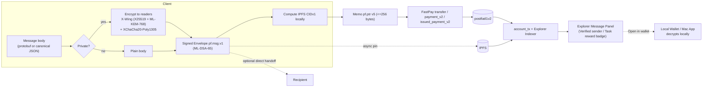
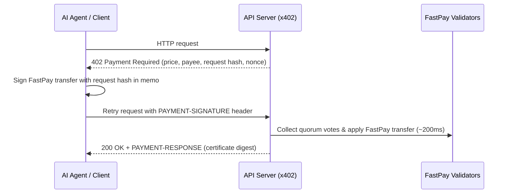

# Pillar 2 — Message Protocol Spec

> **Status:** Partial. Task Node already pins encrypted messages to IPFS and anchors them with `pf.ptr` v4 memos on the **old** chain. `postfiatl1v2` already supports memos on regular payments and FastPay transfers, but lacks a canonical `.proto` spec, post-quantum message encryption, FastPay fee/object-spam protection, FastPay rows in account history, block explorer message rendering, and x402 agent payments.
>
> **Outcome:** [B · A production-ready new chain](../README.md#three-outcomes) — the standard way humans, wallets, and AI agents exchange verifiable public or private messages on Post Fiat. Pillars 1, 4, 6, 7, and 8 all build on top of this format.

## What this pillar is (in plain English)

Today, Post Fiat's message pointers (`pf.ptr` v4) are hand-encoded on the old chain with no single `.proto` source of truth, and their encryption (X25519) is not post-quantum. This pillar standardizes machine-native messaging on `postfiatl1v2`:

1. **One strict format:** Every message is encoded in **protobuf** *(a compact, strict binary format so JS, Python, and Rust apps produce and read identical bytes)*, wrapped in a signed envelope, saved to **IPFS** *(producing a deterministic fingerprint called a CID)*, and linked from a transaction memo (`pf.ptr` v5).
2. **Post-quantum encryption by default:** Private messages use **X-Wing** *(a hybrid of classical X25519 + post-quantum ML-KEM-768, the modern IETF standard: only ~32 extra bytes per recipient, safe even if a flaw were ever found in lattice math)*.
3. **FastPay speed + Sui-style fee discipline:** Task Node reward payouts move to **FastPay** (~200ms finality) with encrypted `pf.reward.v1` memos by default. Pinning to IPFS runs in parallel so it never slows down payments. FastPay adds a small non-zero fee + per-new-object fee (modeled on Sui's computation + storage model) so spam and object bloat cannot be done for free.
4. **Readable block explorer (zero key risk):** The block explorer decodes public messages in place and shows a clean `"Task reward"` badge on encrypted Task Node payouts — decryption always happens locally in the user's wallet or Mac app, never on the explorer.
5. **Agent payments via x402 (+ thin MCP helper):** APIs can reply `402 Payment Required`, an AI agent pays in ~200ms over FastPay (or PFUSDC on the main lane), and the server immediately unlocks the response.

## How messages & x402 flow

## Locked-in design decisions

- **FastPay fees & object bloat (modeled on Sui):** On Sui, fees split into **computation + storage deposit − 99% storage rebate** when objects are merged or deleted, keeping transfers tiny (~$0.001) while making object-splitting spam expensive. For `postfiatl1v2` FastPay:
  - **Ship in v1:** Enforce a small non-zero FastPay fee (`base + per_512_bytes`, matching `payment_v2` at ~25 atoms = `0.000025 PFT` per message) **plus** a per-new-object fee whenever a transfer creates net-new owned objects, and raise the chain-wide owned-object cap above 100,000. Merging payouts pays only the tiny base fee.
  - **Future upgrade (v2):** Add Sui-style refundable storage deposits (99% rebate on merge/unwrap) if owned-object volume warrants it.
- **IPFS pinning responsibility:** **Task Node pins all Task Node traffic, Pillar 1 governance packets, and Post Fiat NFT metadata.** Outside developers and third-party apps pin their own traffic (or pay a pinning service via x402).
- **Task Node payout visibility:** **Private (not Sealed).** The body is encrypted so task details stay confidential, while the block explorer shows a clean `"Task reward"` badge and CID so real network activity is visible.
- **Shielded (`PFSH03`) payments & memos:** Keep the live `PFSH03` shielded pool clean in v1 **without modifying its ZK circuit** (optional private notes travel off-chain via Hive/Nostr). Adding an encrypted memo directly inside `PFSH03` note ciphertexts is reserved as a clean v2 upgrade after the core shielded audit.
- **Agent payment integrations:** Target **x402** first (PFT over FastPay for sub-second speed, PFUSDC on the consensus lane as fallback), operate a Post Fiat facilitator so builders can integrate immediately, and publish a thin **MCP payment wrapper** on top.
- **Engineering defaults locked in:**
  - Post-quantum encryption suite: **X-Wing (X25519 + ML-KEM-768)**. Old X25519 payloads remain readable for legacy history once a user imports their old-chain seed.
  - Pure messages (no value sent to someone else): **FastPay self-transfer** or **`payment_v2` self-payment** (no new chain tx type required).
  - Body encoding: **Protobuf by default**, with `CANONICAL_JSON` (RFC 8785) supported for human-readable artifacts like Pillar 1 governance packets and Pillar 4 NFT JSON views.
  - Schema registry: Core schemas live in `postfiatl1v2/proto/pf/...`; anyone can also publish custom schemas permissionlessly using `schema = 1` + full schema name.
  - Explorer public content: Decode public bodies automatically (all text escaped, zero script execution, media loaded on click) with an operator abuse denylist.

## What exists today

| Piece | Current state | Where |
|---|---|---|
| `pf.ptr` v4 pointers | Live on the **old** chain, hand-encoded (no canonical `.proto`; `pf_ptr_v1.proto` in explorer uses a different layout). Uses uppercase hex, which `postfiatl1v2` rejects | [`server/pftl-pointer.js`](https://github.com/postfiatorg/tasknode/blob/main/server/pftl-pointer.js), [`pointers.py`](https://github.com/postfiatorg/tasknode/blob/main/reference_clients/python/tasknode_pftl/pointers.py) |
| Payload encryption | Classical X25519 + XChaCha20-Poly1305 (not post-quantum), no sender signature, leaks plaintext SHA-256, and includes Task Node as a reader on every payload | [`server/task-payloads.js`](https://github.com/postfiatorg/tasknode/blob/main/server/task-payloads.js) |
| `postfiatl1v2` memos & FastPay | Up to 4 memos per tx (256 decoded bytes each, 512 total, lowercase hex). Works on `payment_v2`, `issued_payment_v2`, and FastPay (`OwnedTransferOrderV3`). FastPay currently accepts fee `0` and has a 100k owned-object cap | [`core_chain.rs`](https://github.com/postfiatorg/postfiatl1v2/blob/main/crates/types/src/core_chain.rs), [`owned_transfer.rs`](https://github.com/postfiatorg/postfiatl1v2/blob/main/crates/execution/src/owned_transfer.rs) |
| FastPay in account history | Applied FastPay certificates live in blocks (`fastpay_pre_state_effects`), but are **not** indexed into `account_tx` / `tx` yet | [`account-history.md`](https://github.com/postfiatorg/postfiatl1v2/blob/main/docs/rpc/account-history.md) |
| Browser & Mac wallets | `wallet_wasm` signs payments and FastPay, but cannot sign envelopes or derive message KEM keys yet | [`crates/wallet_wasm/src/lib.rs`](https://github.com/postfiatorg/postfiatl1v2/blob/main/crates/wallet_wasm/src/lib.rs) |
| Explorer & x402 | Explorer doesn't decode memos or IPFS envelopes yet; no x402 implementation yet | [`explorer.js`](https://github.com/postfiatorg/postfiatorg.github.io/blob/main/static/explorer/explorer.js) |

## Detailed specification

### 1. Canonical schemas, raw-byte signing & `pf.ptr` v5 wire format
- **Proto packages (`postfiatl1v2/proto/pf/`):**
  - Core (`pf/msg/v1/`): `Pointer`, `Envelope`, `Header`, `Reader`, `ContentKind` (preserving v4 kinds `1..11` + `GOVERNANCE = 12`), `CipherSuite`, `BodyEncoding`, `Manifest`, and `pf.msg.text.v1`.
  - Task lifecycle (`pf/task/v1/`, `pf/reward/v1/`): the 6 core Task Node lifecycle schemas.
  - Code generated from `.proto` for **JS, Python, and Rust (`prost`)** with one shared CI test-vector suite across repos.
- **`pf.ptr` v5 memo:** Type `pf.ptr`, format `v5`, lowercase hex protobuf bytes (strictly `<= 256` bytes). Replaces text CID with 36-byte binary `cid_bin` (or small `inline` payload for tiny public records like an x402 request hash). Flags enforce exactly one visibility mode: `public`, `private`, or `sealed`.
- **Envelope (`pf.msg.v1`) & zero re-serialization rule:** Stored as a single IPFS **CIDv1 `raw` block (SHA-256)** up to **1 MiB** so clients compute the CID offline before pinning. `Envelope` wraps `header`, `readers[]`, and `body` as opaque raw byte fields — **verifiers check the CID and ML-DSA-65 signature over those exact transmitted bytes before decoding and never re-serialize protobuf** (eliminating cross-language canonicalization drift). Larger payloads (up to 16 MiB) use a signed `Manifest` listing ordered chunk CIDs with chunk-index-bound encryption.
- **Durable async IPFS pinning outbox:** Clients persist envelopes to a local/server outbox with exponential retry (and browser/NAT clients upload raw blocks through Task Node's authenticated CID-checked pin endpoint) so closing a browser tab mid-payment never strands a dead CID.

### 2. Post-quantum encryption & zero-balance key bootstrap
- **X-Wing + XChaCha20-Poly1305:** Sender generates a random 32-byte content key, wraps it per recipient using X-Wing (`X25519 + ML-KEM-768`) + HKDF-SHA256 bound to header hash, chain ID, and recipient `key_id`, and encrypts the body with XChaCha20-Poly1305. No plaintext hash is ever published.
- **Zero-balance new-user key bootstrap:** Each wallet deterministically derives its message KEM key from the master seed via HKDF (`postfiat-l1-v2/message-key/v1`). Because brand-new users have `0 PFT` and cannot mint a [Pillar 6](06-hive-identity.md) identity before their first reward, the wallet signs its derived X-Wing public key with its ML-DSA-65 account key (`postfiat-l1-v2/message-key-bind/v1`) and registers it with Task Node at onboarding so the **very first FastPay payout** encrypts cleanly. Once the user mints a Pillar 6 identity, on-chain `message_key` becomes authoritative and clients cross-check it. *(Docs explicitly note deterministic seed derivation trades forward secrecy for seed-restorability.)*
- **Strict reader policy & dual-read:** Task Node is a default reader **only** on Task Node lifecycle/reward schemas the server must process — **never** on user-to-user messages or shielded payments. Wallets decode both v4 and v5 pointers; importing an old-chain seed decrypts historical X25519 payloads locally.

### 3. Sui-inspired FastPay fees, crash-safe payouts & account history
- **L1 FastPay fee & anti-bloat formula:** Validators reject any FastPay order whose fee is below **`25 atoms + 1 atom per 512 bytes + 1,000 atoms per net-new owned object` (when `outputs > inputs`) + `1 atom per input`** (so creating spam objects costs `0.001+ PFT` per object while merging up to 2,048 small payouts stays cheap yet non-free). Replace the brittle 100k chain-wide kill-switch cap with per-account soft caps + a high global safety ceiling.
- **Canonical `order_hash` indexing in `account_tx` and `tx`:** `postfiatl1v2` indexes applied FastPay transfers and unwraps (with memos) directly into `account_tx` and `tx` keyed by **`order_hash` (the immutable hash of the signed `OwnedTransferOrderV3`)** rather than `certificate_digest` (which varies depending on which validator signatures arrive first).
- **Crash-safe payout pool & zero double-pay fallback:** Task Node pays rewards over FastPay by default using a pool of ~20 owned objects leased via DB row locks. Before sending to validators, Task Node durably persists `(payout_id, object_id, order_hash, signed_order_bytes)`. On crash or timeout, recovery **always** polls/resubmits that exact `order_hash` (never signing a conflicting order on the same object, preventing equivocation locks). Fallback to `payment_v2` runs **only** after confirming the FastPay order was never certified and cleanly recovering/replacing the leased object — guaranteeing zero double payouts. Target p50 `< 500ms`, p95 `< 2s`, `< 1%` fallback.
- **Wallet UX:** Task Node web and Mac wallets show FastPay, consensus, and shielded balances with one combined total, auto-merge small FastPay objects, and unwrap to the consensus lane in one click.

### 4. Spoof-proof Explorer rendering & hardened x402 (+ MCP)
- **Explorer Message panel:** Decodes public schemas via the published `FileDescriptorSet` with XSS/oversize/dead-CID hardening. Shows *Verified sender* only when the envelope signer matches the transaction signer. Shows the **`"Task reward"` badge ONLY when the verified `sender_pubkey` matches the pinned official Task Node payout key** (outsider `pf.reward.v1` messages render as generic *Private message* so nobody can spoof Task Node payouts). Never touches private keys.
- **Hardened x402 v2 binding + MCP wrapper:** Supports `PAYMENT-REQUIRED`, `PAYMENT-SIGNATURE`, and `PAYMENT-RESPONSE` for PFT on FastPay (`exact` + `pf-fastpay-settled`) and PFUSDC on the consensus lane (with explicit client sequence + accepted finality receipt check). Spent-payment deduplication across replicas is keyed on **immutable `order_hash`** (or `tx_hash` for PFUSDC), eliminating certificate-signature malleability replays. The Post Fiat facilitator enforces per-IP/per-key rate limits and verifies ML-DSA signatures + `payTo`/amount/nonce locally *before* querying validators, and ships a thin MCP payment helper on top.

## Milestones & completion checklist

### Build milestones
- [ ] **M1 · Canonical `.proto` specs & multi-language SDKs:** Publish `proto/pf/msg/v1/`, `pf/task/v1/`, and `pf/reward/v1/` in `postfiatl1v2`; generate JS, Python, and Rust (`prost`) libraries + CLI; pass shared CI test vectors (including X-Wing encryption, manifest chunks, 256-byte worst-case memo, and legacy v4 decode).
- [ ] **M2 · L1 FastPay upgrades:** Ship FastPay indexing in `account_tx`/`tx`, enforce the non-zero Sui-inspired FastPay computation + new-object fee rule, and raise the owned-object cap.
- [ ] **M3 · Wallet & async IPFS support:** Add envelope signing, X-Wing KEM key derivation/decryption, old-seed import, FastPay object merging/unwrapping, and parallel CID-checked IPFS pinning to `wallet_wasm`, Task Node, and the local Mac app.
- [ ] **M4 · Task Node FastPay payout cutover:** Switch default Task Node reward payouts (and all `pf.ptr` lifecycle/context flows) to `pf.ptr` v5 over FastPay using a locked multi-object payout pool; run load test verifying `< 500ms` p50 and `< 1%` fallback.
- [ ] **M5 · Block explorer Message panel:** Ship the Messages lens and custom cards (Task reward, Governance, NFT, Identity, x402) with XSS/oversize/dead-CID hardening.
- [ ] **M6 · x402 facilitator & MCP payment helper:** Ship the Post Fiat x402 v2 server/client library (`exact` + `pf-fastpay-settled`), Post Fiat facilitator for FastPay PFT + consensus PFUSDC, and thin MCP payment wrapper; pass replay and committee-rotation tests.

### Required ship gates
- [ ] **1. Executed:** All M1–M6 code merged and live across `postfiatl1v2`, Task Node, explorer, and SDKs.
- [ ] **2. Tested by user:** Founder verifies a live FastPay task payout with encrypted memo, inspects the `"Task reward"` card on the block explorer, decrypts it locally, tests an old-chain v4 history item, and runs an end-to-end x402 `402 → pay → 200` call.
- [ ] **3. Added to docs:** `docs/specs/message-protocol-v1.md` (with worked byte examples for FastPay, `payment_v2`, PFUSDC, governance packets, and x402) published in Post Fiat docs.
- [ ] **4. Public blog post document:** Public blog post written and published explaining the Post Fiat post-quantum message protocol, FastPay integration, and x402 machine-native payments.

## Code references

- Task Node pointers & encryption: [`server/pftl-pointer.js`](https://github.com/postfiatorg/tasknode/blob/main/server/pftl-pointer.js) · [`server/task-payloads.js`](https://github.com/postfiatorg/tasknode/blob/main/server/task-payloads.js) · [`server/task-review-publication.js`](https://github.com/postfiatorg/tasknode/blob/main/server/task-review-publication.js) · [`server/context-ipfs.js`](https://github.com/postfiatorg/tasknode/blob/main/server/context-ipfs.js)
- L1 memos, fees & FastPay: [`core_chain.rs`](https://github.com/postfiatorg/postfiatl1v2/blob/main/crates/types/src/core_chain.rs) · [`owned_transfer.rs`](https://github.com/postfiatorg/postfiatl1v2/blob/main/crates/execution/src/owned_transfer.rs) · [`fees_offer_planning.rs`](https://github.com/postfiatorg/postfiatl1v2/blob/main/crates/execution/src/fees_offer_planning.rs) · [`wallet_wasm/src/lib.rs`](https://github.com/postfiatorg/postfiatl1v2/blob/main/crates/wallet_wasm/src/lib.rs)
- Explorer: [`docs/explorer-spec.md`](https://github.com/postfiatorg/postfiatorg.github.io/blob/main/docs/explorer-spec.md) · [`explorer.js`](https://github.com/postfiatorg/postfiatorg.github.io/blob/main/static/explorer/explorer.js)
