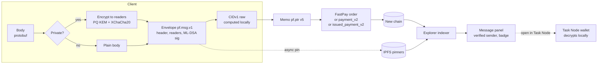
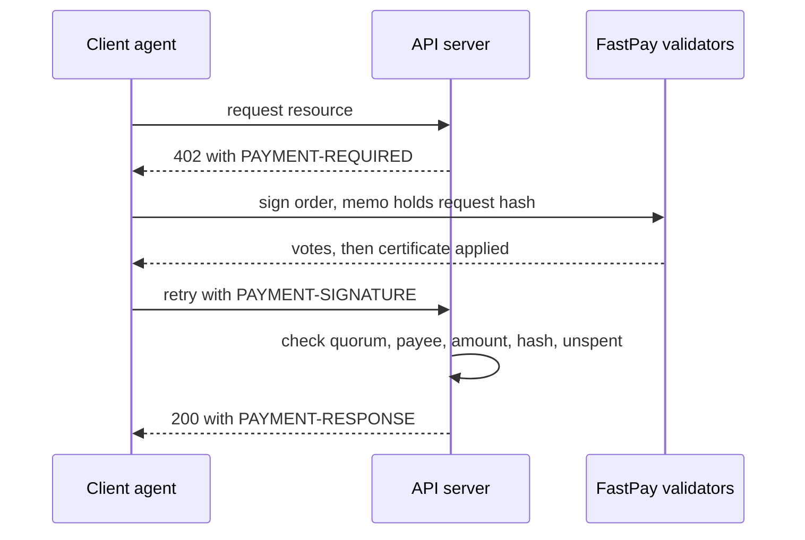

# Pillar 2 — Message Protocol Spec

> **Status:** Partial. A working pointer protocol (`pf.ptr` v4) and encrypted IPFS payloads are live on the **old** chain. The new chain signs memos into payments and FastPay orders. It has no message protocol, no message keys, no post-quantum message encryption, no FastPay memos in account history and no explorer rendering of messages. There is no x402.
>
> **Bubbles up to:** [Outcome B · A production-ready new chain](../README.md#three-outcomes). *Machine-native communication*. Governance packets, NFT metadata, identity records and NAVCoin fee disclosures (Pillars 1, 4, 6, 7, 8) are message types in this protocol. It also owns two readiness gates: **works with existing memo-type private payments** and **FastPay as the default for Task Node payouts**.

## In one paragraph

Post Fiat needs one standard way for people and agents to say things on chain. A message body is a **protobuf** object. It is encrypted when it should be private, wrapped in a signed **envelope**, stored on **IPFS** and referenced from a transaction memo by its **CID**. The transaction can be a FastPay payment, so a message travels at FastPay speed; pinning runs beside the payment and never blocks it. The **block explorer** renders messages for humans without ever touching keys. Task Node already does most of this on the old chain. This pillar writes it down as a versioned spec with `.proto` files and JS, Python and Rust reference code. It ports the protocol to postfiatl1v2 with post-quantum encryption, moves Task Node payouts and their private memos onto FastPay, defines an x402 profile and publishes a docs page and blog post. The **core protocol** ships on its own. Other pillars register their message types on top of it.

**Names.** *Old chain* means the PFT Ledger, which Task Node code calls PFTL (for example `pftl-pointer.js`). *New chain* means postfiatl1v2.

## User story

**Founder's story.** I am a Task Node user, or anyone hoping to use the Post Fiat blockchain. There is a standardized message protocol spec, which pins protobuf representations to IPFS and can encrypt them properly. The method is standardized so it is easy to consume on the block explorer, and it becomes the default for machine-native communication on the Post Fiat chain. The spec has clear examples of how it integrates with FastPay transactions, and those are represented properly on the block explorer. It would be good if the spec could conform to x402 or other integration points.

The founder's readiness list adds two gates owned here. The new chain must *"work with existing memo type private payments"*, and *"the default task node payouts should be using fast pay for maximum speed and latency."* Deliverable 1 adds: *"I can read about the message protocol schema on the blog."*

**Augmented story.**

1. **Read.** I read the blog post on postfiat.org, then `docs/specs/message-protocol-v1.md` and `proto/`. Each carrier has a worked example with exact bytes.
2. **Build.** I install the reference client (`pip`, `npm` or a Rust crate). With three calls I build a message, encrypt it to two readers and myself, and get a memo. The CID is computed on my machine.
3. **Send.** I attach the memo to a FastPay transfer of 1 PFT to an agent. It reaches quorum at FastPay speed (p50 183 ms on the devnet, see the [index](../README.md#chain-readiness-gates)), while the envelope is pinned in parallel.
4. **Get paid.** Task Node pays my reward by default the same way: a FastPay transfer whose memo points to an encrypted `pf.reward.v1` envelope. This is the new-chain form of today's memo-type private payment.
5. **See.** The explorer shows a **Message** panel with schema, kind, CID and a *Verified sender* mark. Public bodies are decoded in place. A private one shows *Encrypted* and **Open in Task Node**. Decryption happens in my wallet or local app, never on the explorer page.
6. **Integrate.** My API answers `402 Payment Required`. A client agent pays with a FastPay certificate whose memo carries a hash of the request inline, with no IPFS step, and retries. The x402 profile shows the exact headers and checks.
7. **Keep history.** My old-chain private context and payments still open, because the client reads both encryption suites.

## What exists today

| Component | Where | State |
|---|---|---|
| Pointer `pf.ptr` v4 | [`server/pftl-pointer.js`](https://github.com/postfiatorg/tasknode/blob/main/server/pftl-pointer.js) · [`pointers.py`](https://github.com/postfiatorg/tasknode/blob/main/reference_clients/python/tasknode_pftl/pointers.py) | Live, old chain, hand-encoded. Fields: 1 `cid` (**text**), 2 `target` (enum, `CONTENT_BLOB=1`, not an address), 3 `kind`, 4 `schema` (a version number, always `1`), 5–7 `task_id`/`thread_id`/`context_id` (strings), 8 `flags` (encrypted=1 default, public=2, ephemeral=4, tombstone=8, multipart=16, undefined semantics). Kinds TASK=1 … SYSTEM=11. Hex is **upper case**. |
| Older `.proto` | [`pf_ptr_v1.proto`](https://github.com/postfiatorg/explorer/blob/main/src/proto/pf_ptr_v1.proto) (old-chain explorer) | `pf.ptr.v1`, a **different layout** from v4. No `.proto` describes v4. |
| Encryption | [`server/task-payloads.js`](https://github.com/postfiatorg/tasknode/blob/main/server/task-payloads.js) · [`encryption.md`](https://github.com/postfiatorg/tasknode/blob/main/docs/wiki/architecture/encryption.md) | `ENC_X25519_XCHACHA20P1305`, JSON envelope. The file key is wrapped per reader with `crypto_box`. There is **no associated data**, **no sender signature**, and a SHA-256 of the **plaintext** is published in clear. Readers are the user and the Task Node service, with keys from `AccountSet.MessageKey`. Not post-quantum. |
| Memo-type private payments | [`server/task-review-publication.js`](https://github.com/postfiatorg/tasknode/blob/main/server/task-review-publication.js) | Encrypt, pin, **then** send an XRPL `Payment` with a `pf.ptr` memo. |
| Task schemas | [`task-event-meaning.js`](https://github.com/postfiatorg/tasknode/blob/main/server/task-event-meaning.js) · [`task-lifecycle.md`](https://github.com/postfiatorg/tasknode/blob/main/docs/wiki/architecture/task-lifecycle.md) | Six lifecycle schemas (`pf.task.request/offer/update/submission/verification_response.v1`, `pf.reward.v1`) and about 30 `pf.*.v1` names server-wide. JSON bodies. Postgres is live, and pointers are the replay path. |
| IPFS | [`server/context-ipfs.js`](https://github.com/postfiatorg/tasknode/blob/main/server/context-ipfs.js) | Pinata plus a first-party gateway, CIDv0 (UnixFS). Reads race all gateways. Limits in code are 16 MiB JSON and 8 MiB files (the wiki's "1 MB" is stale). Task Node pays. |
| L1 memo | [`transactions_mempool_receipts.rs`](https://github.com/postfiatorg/postfiatl1v2/blob/main/crates/types/src/transactions_mempool_receipts.rs) · [`core_chain.rs`](https://github.com/postfiatorg/postfiatl1v2/blob/main/crates/types/src/core_chain.rs) | Up to 4 memos, type and format ≤ 64 bytes, **data ≤ 256 bytes**, 512 total, in **lower-case** hex only. Only `payment_v2` (non-zero amount), `issued_payment_v2` (PFUSDC) and FastPay orders carry memos. NFT operations do not, and neither does PFSH03 (unmerged PR 232). Fee: at least 1 atom, 1 atom per 512 bytes ([`fees_offer_planning.rs`](https://github.com/postfiatorg/postfiatl1v2/blob/main/crates/execution/src/fees_offer_planning.rs)). |
| FastPay memos | [`fastpay_recovery_types.rs`](https://github.com/postfiatorg/postfiatl1v2/blob/main/crates/types/src/fastpay_recovery_types.rs) `OwnedTransferOrderV3.memos` · [`owned_transfer.rs`](https://github.com/postfiatorg/postfiatl1v2/blob/main/crates/execution/src/owned_transfer.rs) | Signed into the order. **PFT only**: issued assets fail closed. Zero-value outputs are rejected. I found no FastPay fee floor. |
| FastPay in history | [`account-history.md`](https://github.com/postfiatorg/postfiatl1v2/blob/main/docs/rpc/account-history.md) | Certificates are **not** `account_tx` rows yet. Memos can only be read with `owned_certificate`, by digest or lock id. |
| Signatures, KEM | [`crypto_provider/src/lib.rs`](https://github.com/postfiatorg/postfiatl1v2/blob/main/crates/crypto_provider/src/lib.rs) · [`privacy-production-burndown.md`](https://github.com/postfiatorg/postfiatl1v2/blob/main/docs/status/privacy-production-burndown.md) | ML-DSA-65 with contexts, randomised signing. **No ML-KEM** in the workspace. PRIV-013/014 plan an ML-KEM KEM/DEM. |
| Task Node L1 wallet | [`postfiat_wallet_wasm.d.ts`](https://github.com/postfiatorg/tasknode/blob/main/src/features/wallet/l1/wasm/postfiat_wallet_wasm.d.ts) | Signs payments, assets, offers, escrows and FastPay orders ([`wallet_wasm`](https://github.com/postfiatorg/postfiatl1v2/blob/main/crates/wallet_wasm/src/lib.rs)). It has no NFT or generic message/envelope signer. Payouts still use old-chain XRPL `Payment`s. |
| Explorer | [`explorer-spec.md`](https://github.com/postfiatorg/postfiatorg.github.io/blob/main/docs/explorer-spec.md) · [`explorer.js`](https://github.com/postfiatorg/postfiatorg.github.io/blob/main/static/explorer/explorer.js) | The page (spec v2) is **new chain only**, escapes all text and decodes no pointers, memos or IPFS. Only the local indexer service (`indexer.py`, not in a public repo) decodes v4 `pf.ptr`, and only on the old-chain feed. The older [postfiatorg/explorer](https://github.com/postfiatorg/explorer) app decodes the v1 layout. |
| Async IPFS | [research note](https://github.com/postfiatorg/postfiatorg.github.io/blob/main/content/research/fastpay-fastdb-async-ipfs-architecture.md) | Not built. The memo commits first, and the payload is pinned later. |
| x402 | — | Not found. Task Node returns plain 402 "add credit" errors. |

## Architecture

## Technical requirements

### Core schema and wire format

- **R1.** Publish `proto/pf/msg/v1/` with `Pointer`, `Envelope`, `Header`, `Reader`, `ContentKind`, `CipherSuite`, `BodyEncoding` and `Manifest`, plus `pf.msg.text.v1` and the six Task Node lifecycle schemas. `ContentKind` keeps v4's values and adds `GOVERNANCE = 12` for Pillar 1. Pillar 1 puts its session id in `thread_id`. Pillars 1, 4, 6, 7 and 8 add their own packages in the same layout. Pillar 2 is complete without them.
- **R2.** Pointer v5. Memo type `pf.ptr`, format `v5`, data = protobuf bytes in lower-case hex. Decoders dispatch on the format, because v4 decoders read every length-delimited field as UTF-8.

    | Field | Name | v5 rule |
    |---|---|---|
    | 1 | `cid` (string) | v4 only. Empty in v5. |
    | 2, 3, 5–8 | as v4 | Same meaning. Omitted when sealed (R11). |
    | 4 | `schema` (uint32) | The registry schema id (R6), as Pillar 1 R23 already uses it. `1` = unregistered: read the name from the envelope. That is what every v4 pointer means today. |
    | 9 | `cid_bin` (bytes) | Binary CIDv1, 36 bytes. Required. |
    | 10 | `inline` (bytes) | Small public payload, no IPFS object (R14). |

    New flag `sealed=32`. `multipart` means the CID is a `Manifest`. `ephemeral` and `tombstone` are advisory: renderers hide, pinners may unpin, readers may drop keys. Chain history and IPFS copies cannot be deleted, and the docs say so. Budget: a binary CID, three 36-character ids and the varints come to about **165 bytes**, leaving about 89 for `inline`. A sealed pointer is about 42 bytes. Encoders refuse anything over 256 bytes.
- **R3.** Envelope. One IPFS block, **CIDv1 `raw` codec with SHA-256**, so any client computes the CID offline and every pinner agrees. The cap is 1 MiB, the safe single-block size; larger content uses a signed `Manifest` of chunk CIDs. The old draft's `envelope_hash` is dropped, because the CID already is that hash.
- **R4.** The header holds:
    - `version`, `chain_id` and `genesis_hash`;
    - the full `schema` name (always), its registry id and `kind`;
    - `sender_pubkey` (ML-DSA-65);
    - `body_encoding`, `cipher_suite` and `created_at_ms`;
    - optionally `request_hash` (x402) and `in_reply_to`.

    The header is followed by `readers[]`, `body` and `signature`.
- **R5.** Canonical bytes and hashes:
    - **Signature.** It covers the stored header bytes plus the SHA3-384 of the stored body, under a new ML-DSA context, `postfiat-l1-v2/message-envelope/v1`. Verifiers never re-serialize.
    - **Encoding.** Producers encode deterministically: ascending fields, no unknown fields, defaults omitted. `body_encoding` is `PROTOBUF` (the default) or `CANONICAL_JSON` (RFC 8785), for Pillar 1 packets, Pillar 4's metadata twin and legacy v4 bodies.
    - **Hashes.** The CID uses SHA-256, because IPFS expects it. Chain-side commitments to an envelope use SHA3-384 over its exact bytes, as the chain's ids do; Pillar 4's `metadata_hash` is one.
    - **Randomised signing.** `crypto_provider` signs with randomness (`try_sign`), so a new signature, and therefore a new CID, comes out every time. Nothing deduplicates by signature or CID or derives keys from a signature. Vectors check verification. Fixed-byte vectors use the seeded signer.
- **R6.** Registry and evolution. The full name is always in the envelope, so the id is a lookup hint, never a gate, and anyone can publish with id `1`. Schemas follow proto3 rules: field numbers are never reused, readers ignore unknown fields, and a breaking change gets a new `vN` name.

### Encryption and keys

- **R7.** v1 writes only a post-quantum suite: hybrid X25519 + ML-KEM-768 (X-Wing) or pure ML-KEM-768 (open question 1). `X25519_XCHACHA20P1305` stays readable and is never written on the new chain. The steps are fixed:
    - KEM encapsulation;
    - HKDF-SHA256 over the suite id, `chain_id`, the header hash and the reader's `key_id`;
    - XChaCha20-Poly1305 wrapping of a 32-byte content key.

    The body AEAD uses the header as associated data, so readers, sender and schema cannot be swapped, and a re-signed copy fails. The code is shared with PRIV-013/014.
- **R8.** Each `Reader` holds a `key_id` (a 16-byte hash of the KEM key), a KEM ciphertext and the wrapped key. The sender is a reader by default. A reader costs about 1.1 KB, and the signature and sender key about 5.3 KB, so the 1 MiB cap sets the reader limit. Group keys are not in v1.
- **R9.** Key directory. A reader's key is the `message_key` field (`{kem_pubkey, key_id, suite}`) of the [Pillar 6](06-hive-identity.md) identity object, set by `identity_set`. Earlier values stay in history, and old secret keys stay in the wallet, so rotation never strands old messages. The key derives from the wallet seed on a domain-separated path, so every device and every restore gets the same key. It is a public field, so encryption has no circular dependency. The fallback, if Pillar 6's native object is not approved, is open question 5.
- **R10.** Wallet support. Task Node's browser wallet ([`crates/wallet_wasm`](https://github.com/postfiatorg/postfiatl1v2/blob/main/crates/wallet_wasm/src/lib.rs)) and the local app ([Pillar 5](05-local-task-node.md)) gain envelope signing under the R5 context, message-key derivation and decryption. Pillars 1, 4 and 6 need the same signer. No key ever enters the explorer page.
- **R11.** Privacy levels:
    - **Public:** plain body.
    - **Private:** encrypted body, with kind, schema and ids visible.
    - **Sealed:** only `cid_bin` and `flags` on chain. Kind, schema and ids move inside the ciphertext, reader ids are blinded (readers trial-decrypt) and the reader count can be padded.

    No level publishes a plaintext hash: v4's clear `content_hash` lets anyone confirm a guessed plaintext. The payment itself (parties, amount, time) is always public.

### Carriers and pinning

- **R12.** Worked byte examples for each carrier:
    - (a) a FastPay `OwnedTransferOrderV3`, PFT only today;
    - (b) a `payment_v2`;
    - (c) an `issued_payment_v2` (PFUSDC);
    - (d) a pure message with no transfer, whose carrier is open question 2.

    No other transaction kind carries memos. A `pf.nft.*` message therefore travels as the NFT's `metadata_uri`/`metadata_hash` ([Pillar 4](04-nft-system.md)) or on a companion payment, never inside an NFT transaction. Shielded PFSH03 payments carry no memo (open question 12).
- **R13.** Fast path. The client computes the CID, submits the payment at once and pins in parallel, with retries and replication. The explorer shows *Content pending*, then *Content unavailable* if the CID never resolves. **Strict mode** (pin and resolve before submitting) is for records people must read before acting: Pillar 1 packets and Pillar 4 metadata.
- **R14.** Two storage profiles share the R4–R6 encoding and signature rules:
    - **Pinned:** the envelope is on IPFS and the memo holds its CID.
    - **Inline, not pinned:** small or consensus-checked payloads sit in the transaction itself and are never put on IPFS. Examples are `pf.identity.*` in `identity_set` (Pillar 6 R10), an x402 request hash or a short receipt in the pointer's `inline` field.

    Inline payloads are public.
- **R15.** High-rate agents split PFT across several owned objects (up to 8 outputs per transfer), so parallel orders never lock the same input. Stuck orders follow the [FastPay recovery spec](https://github.com/postfiatorg/postfiatl1v2/blob/main/docs/specs/fastpay-payment-recovery-v1.md).
- **R16.** JS, Python and Rust (`prost`, new to the workspace) reference code is generated from the `.proto` files. Shared positive and negative vectors run in CI in both repositories: bad signature, wrong context, oversize memo, unknown fields, swapped readers and v4 legacy. A Python CLI builds, encrypts, sends and reads messages.

### Explorer

- **R17.** FastPay discovery. Either the L1 adds FastPay certificates and their memos to `account_tx`/`tx`, or the indexer reads applied certificates from certified blocks. Without one of these, FastPay messages cannot appear.
- **R18.** A **Messages** lens and a Message panel on payment, issued-payment and FastPay rows. A generic renderer built from the published `FileDescriptorSet` shows any public schema. Five types get custom cards: reward payout, governance packet, NFT metadata, identity mint and x402 receipt.
- **R19.** *From* is shown only when `sender_pubkey` signed the carrying transaction (the FastPay `owner_pubkey_hex`, or the key behind the `payment_v2` `from`). An envelope copied onto another transaction shows *Forwarded, signed by X*. A bad signature shows *Unverified*.
- **R20.** Hardening:
    - a fetch cap equal to the envelope cap;
    - timeouts and negative caching of dead CIDs;
    - decode depth and allocation limits;
    - all text escaped, no markup or scripts executed, and media loaded only on click.

### x402 profile

- **R21.** A Post Fiat binding of x402's `exact` scheme, using the x402 v2 headers (`PAYMENT-REQUIRED`, `PAYMENT-SIGNATURE`, `PAYMENT-RESPONSE`) and a CAIP-2-style network id.
    - `accepts[]` carries `amount`, `asset`, `payTo`, `maxTimeoutSeconds` and `extra.request_hash`: SHA-256 over method, URL, body hash and a server nonce.
    - **Direct mode:** the payload is a FastPay v3 certificate whose memo holds `request_hash` inline. **Facilitator mode:** a signed order that a facilitator certifies and settles.
    - The server checks quorum against a pinned `fastpay_recovery_committee` registry root, then payee, asset, amount and hash. It records the certificate digest as spent.
    - A retry with the same certificate and the same hash is served, not charged again. Any other reuse is refused.
    - PFUSDC can pay only through `issued_payment_v2` until FastPay supports issued assets.

### Task Node cutover (readiness gates 2 and 3)

- **R22.** Task Node's default payout on the new chain is a FastPay transfer with a v5 pointer to an encrypted `pf.reward.v1` envelope. It falls back to `payment_v2` with the same memo. The payout wallet is funded by the consensus FastLane deposit, because `wrap_owned` is disabled.
- **R23.** Every flow that writes `pf.ptr` today moves to v5 in Stage 2 of the [migration](../README.md#moving-from-the-old-chain-to-the-new-chain): task request, actions, submission, review and reward publication, context publish and the daily airdrop.
- **R24.** Dual read. Task Node and the indexer decode both v4 and v5. Old X25519 payloads decrypt with the user's old seed, which Pillar 6's old-chain key link ties to the new account. An optional local tool re-encrypts context history.
- **R25.** The spec and `proto/` live in postfiatl1v2. A blog post and docs page on postfiatorg.github.io carry the diagrams, the byte examples, the payout flow and the governance example.

### Worked example: a governance packet

goodalexander uploads a packet in Hive Chat. Task Node builds a public `pf.governance.packet.v1` envelope (CANONICAL_JSON, signed by his key) and pins it in strict mode. It then sends a `payment_v2` self-payment with a v5 pointer (`kind` GOVERNANCE = 12, session id in `thread_id`, as in Pillar 1 R23). The Hive Chat Nostr note carries the CID and transaction id. The explorer shows the packet card with *From goodalexander, verified*.

## Economics

What the code fixes:

- `payment_v2` charges by bytes, so memos already cost something.
- FastPay fees are burned, and I found no FastPay fee floor (this needs a test).
- Task Node pays for all pinning.

The rest are founder decisions: spam price, pinning for third parties, the x402 asset and fee destination (open questions 2–4 and 8).

## Failure modes

| Failure | Behaviour |
|---|---|
| Pin fails after payment | Retries, then *Content unavailable*. The payment stands, and Task Node re-pins from its copy. |
| No FastPay quorum | Recovery (R15), or `payment_v2` fallback for payouts (R22). |
| Certificate not indexed | No panel until R17. `owned_certificate` still works. |
| Reader key rotated | Old secret keys stay in the wallet (R9). |
| x402 server fails after payment | The client retries with the same certificate, and the server must serve it (R21). |

## Dependencies

| Depends on | Why |
|---|---|
| FastPay in production (epoch-2 committee since height 1123) | Fast carrier. See the [readiness gates](../README.md#chain-readiness-gates). |
| FastPay certificates in history (R17) | Explorer rendering of FastPay messages. L1 work. |
| ML-KEM KEM/DEM (PRIV-013/014) | Shared post-quantum code. |
| [Pillar 6](06-hive-identity.md) identity object (`message_key`) | Where reader keys live (R9). Fallback in open question 5. |
| New-chain explorer indexer | Messages lens and panel. |
| Feeds Pillars 1, 4, 6, 7, 8 and 10 | They register message types. |

## Acceptance criteria

1. Core `.proto` files and the registry are merged. JS, Python and Rust pass the shared vectors in CI, including the 256-byte worst case.
2. A devnet FastPay transfer with a v5 memo reaches quorum before its envelope is pinned. The panel goes from *pending* to *resolved*.
3. A post-quantum message decrypts for two readers and the sender, and for no one else. Changing any header byte breaks decryption.
4. A memo copied onto another account's transaction renders as *Forwarded*.
5. Old v4 pointers decode, and an old X25519 payload decrypts in the dual-suite client.
6. Task Node pays a devnet reward **by default** through FastPay with an encrypted `pf.reward.v1` memo, and the worker reads it.
7. An x402 demo completes 402 → pay → retry → 200. A reused certificate is refused on a new request and served on the same one.
8. Explorer tests pass for an oversize envelope, a dead CID, a malformed protobuf and script injection.
9. The Python CLI builds, sends and reads a message. The blog post and docs page are live.

## Open questions for the founder

1. **Post-quantum suite.** Hybrid X-Wing keeps classical security if a lattice flaw appears, at about 32 extra bytes per reader. Pure ML-KEM-768 is simpler and matches the PRIV-013 note plan.
2. **Pure messages.** Options:
    - a FastPay self-transfer: no chain change, but it needs a fee floor;
    - a `payment_v2` self-payment of at least 1 atom: no chain change, but it adds dust rows;
    - a new fee-bearing `message` transaction: clean accounting, but it needs chain work.
3. **Spam price.** Is today's byte fee enough? Should FastPay orders with memos pay a minimum or per-byte fee?
4. **Pinning for others.** Options:
    - Task Node pins only its own traffic;
    - Post Fiat pins everything within a quota;
    - validators pin for rewards ([Pillar 3](03-validator-program.md));
    - users self-pin or pay a pinning service, for example over x402.

    How long are governance packets and NFT metadata kept?

5. **Key directory fallback.** This applies only if Pillar 6's native identity object is not approved. Options are a standalone `message_key_set` transaction (a chain change, queryable over RPC) or a signed public key record on a self-payment (no chain change, but it relies on the indexer).
6. **Payout privacy.** Private (the explorer shows "task reward") or Sealed (it shows only a payment and a CID)?
7. **Registry governance.** Who assigns core schema ids: the core team in the repo, a governed on-chain registry, or ids hashed from the name?
8. **x402 asset and operator.** PFT on FastPay now, PFUSDC on the slower consensus lane, or wait for FastPay issued assets? Should Post Fiat run a facilitator? Which CAIP-2 network id?
9. **Other integrations.** Is x402 the target, or also MCP payment hooks and others?
10. **On-chain scope for Task Node.** Today's pointer flows (R23), every lifecycle event, or rewards only?
11. **Public content.** Should the explorer render all public bodies, show them on click, or keep a denylist?
12. **Memos on shielded payments.** PFSH03 private payments have no memo. Options:
    - an encrypted `pf.msg` envelope (Sealed) referenced from a public leg (deposit, withdrawal or a companion payment): no circuit change, but it links that leg to the message;
    - an encrypted memo inside the note ciphertext, added as a PFSH extension: the strongest privacy, but it needs note-format and circuit work;
    - off-chain delivery (Hive or Nostr) of a Sealed envelope with no on-chain pointer: no linkage, but delivery and durability are weaker.

## Code references

Every path is linked where it is first used in *What exists today*. The other paths used are:

- [`context-history-restore.md`](https://github.com/postfiatorg/tasknode/blob/main/docs/wiki/architecture/context-history-restore.md);
- [`docs/rpc/methods.md`](https://github.com/postfiatorg/postfiatl1v2/blob/main/docs/rpc/methods.md) (`owned_sign_v3`, `owned_apply_v3`, `owned_certificate`, `fastpay_recovery_committee`, `wrap_owned`);
- [`docs/specs/fastpay-payment-recovery-v1.md`](https://github.com/postfiatorg/postfiatl1v2/blob/main/docs/specs/fastpay-payment-recovery-v1.md);
- `crates/types/src/account_owned_asset_types.rs` and `transactions_validation_helpers.rs` (SHA3-384 domain hashing).

## Revision notes (review round 1)

| Item | Change |
|---|---|
| Gemini P1 | R7 KEM/HKDF/AEAD steps and associated data. R8 `key_id` and sender as reader. R9 key directory. R10 no keys on the explorer. Open question 1. |
| Gemini P2 | R13 async pinning, R3 size cap. Open question 4. |
| Gemini P3 | R4 binds chain and genesis. R19 *From* vs *Forwarded*. AC 4. |
| Gemini P4 | R2 field table, hex case, budget, format dispatch. R3 CIDv1 raw, `envelope_hash` dropped. R5 body encoding. Names unified. |
| Gemini P5 | R1 core split, R6 open ids, R18 generic renderer, R9 breaks the Pillar 6 cycle. The "60 schemas" figure was wrong: 6 lifecycle schemas, about 30 names. |
| Gemini P6 | R21 v2 headers, `exact`, both modes, replay and idempotency. Open question 8. |
| Gemini P7 | R22–R25. AC 6 and 9. |
| Gemini P8 | R17 (verified: FastPay is not in `account_tx`). R20. Open question 11. |
| Gemini P9 | R11 privacy levels. Partly disputed: `target` is an enum, not an address. The leaks are the ids, `kind` and v4's clear `content_hash`. |
| Gemini P10 | R16 Rust. |
| Gemini P11 | Verified: zero amounts are rejected on both lanes. Economics section. Open questions 2 and 3. |
| Opus P1, P2 | R2 table and budget (about 165/256 bytes). `envelope_hash` dropped. |
| Opus P3 | R5. |
| Opus P4 | R11 Sealed mode. |
| Opus P5 | R9. Open question 5. |
| Opus P6 | R24. AC 5. |
| Opus P7 | R13. Latency now cites 183 ms p50 from the index. |
| Opus P8 | Economics section. Open questions 2–4. |
| Opus P9, P10 | R21. Open question 8. FastPay is PFT-only (verified). |
| Opus P11 | R6. Open question 7. |
| Opus P12 | R22–R23, AC 6. Open question 10. |
| Opus P13 | R10. |
| Opus P14 | R2 defines the flags as advisory. |
| Opus P15 | R6. |
| Opus P16 | R3 `Manifest`. R8 sizes and reader limit. |
| Opus P17 | R7 makes post-quantum mandatory. Open question 1 narrowed to hybrid vs pure. |
| Opus P18 | R25, AC 9. |
| Opus P19 | Governance-packet worked example. |
| Opus P20 | R15. |
| Cross-pillar (Pillars 1, 4, 5, 6) | Field 4 is the schema id and `GOVERNANCE = 12`. SHA3-384 for chain-side commitments. Memo-carrying kinds listed (no NFT or PFSH03 memos). R10 wallet envelope signing. R9 uses the Pillar 6 `message_key`. R14 inline profile. Randomised ML-DSA noted. Open question 12. Chain names defined. |
| Own corrections | FastPay memos are not in history. The postfiat.org explorer is new-chain only and decodes no pointers. A mismatched `pf_ptr_v1.proto` exists. The IPFS cap is 16 MiB, not 1 MB. Task Node's upper-case hex is rejected by the L1. |
