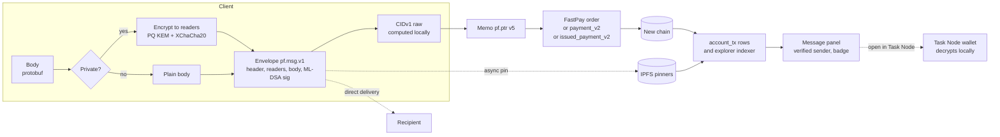
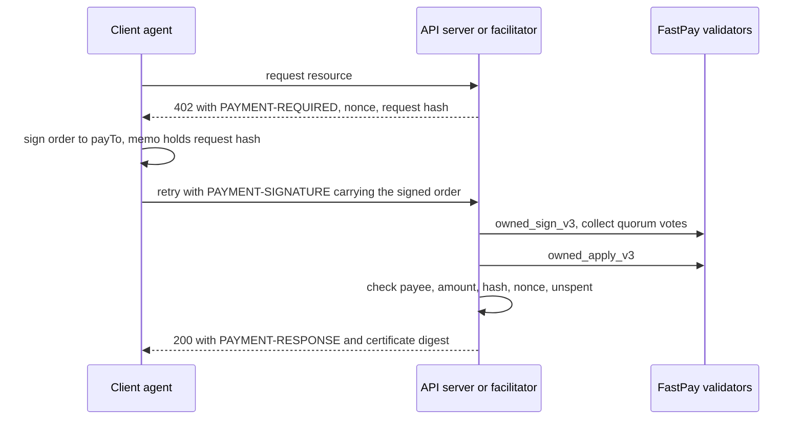

# Pillar 2 — Message Protocol Spec

> **Status:** Partial. A working pointer protocol (`pf.ptr` v4) and encrypted IPFS payloads are live on the **old** chain. The new chain signs memos into payments and FastPay orders, and certified blocks carry applied FastPay certificates. It has no message protocol, no message keys, no post-quantum message encryption, no FastPay rows in account history, no FastPay fee floor and no explorer rendering of messages. There is no x402.
>
> **Bubbles up to:** [Outcome B · A production-ready new chain](../README.md#three-outcomes). *Machine-native communication*. Governance packets, NFT metadata, identity records and NAVCoin fee disclosures (Pillars 1, 4, 6, 7, 8) are message types in this protocol. It also owns two readiness gates: **works with existing memo-type private payments** and **FastPay as the default for Task Node payouts**.

## In one paragraph

Post Fiat needs one standard way for people and agents to say things on chain. A message body is a **protobuf** object, encrypted when it should be private, wrapped in a signed **envelope**, stored on **IPFS** and referenced from a transaction memo by its **CID**. The transaction can be a FastPay payment, so a message travels at FastPay speed; pinning never blocks it. The **block explorer** renders messages without touching keys. Task Node already does most of this on the old chain. This pillar writes it down as a versioned spec with `.proto` files and JS, Python and Rust code, ports it to postfiatl1v2 with post-quantum encryption, moves Task Node payouts and their private memos onto FastPay, defines an x402 profile and publishes a docs page and blog post. The **core protocol** ships on its own; other pillars register message types on top.

**Names.** *Old chain* means the PFT Ledger, which Task Node code calls PFTL (for example `pftl-pointer.js`). *New chain* means postfiatl1v2. 1 PFT = 1,000,000 *atoms*.

## User story

**Founder's story.** I am a Task Node user, or anyone hoping to use the Post Fiat blockchain. There is a standardized message protocol spec, which pins protobuf representations to IPFS and can encrypt them properly. The method is standardized so it is easy to consume on the block explorer, and it becomes the default for machine-native communication on the Post Fiat chain. The spec has clear examples of how it integrates with FastPay transactions, and those are represented properly on the block explorer. It would be good if the spec could conform to x402 or other integration points.

The founder's readiness list adds two gates owned here. The new chain must *"work with existing memo type private payments"*, and *"the default task node payouts should be using fast pay for maximum speed and latency."* Deliverable 1 adds: *"I can read about the message protocol schema on the blog."*

**Augmented story.**

1. **Read.** I read the blog post, then `docs/specs/message-protocol-v1.md` and `proto/`. Each carrier has a worked example with exact bytes.
2. **Build.** I install the reference client (`pip`, `npm` or a Rust crate). With three calls I build a message, encrypt it to two readers and myself, and get a memo, with the CID computed locally.
3. **Send.** I attach the memo to a FastPay transfer of 1 PFT to an agent. It reaches quorum at FastPay speed (p50 183 ms, see the [index](../README.md#chain-readiness-gates)). I hand the envelope to the agent directly, and it checks the bytes against the CID while pinning finishes.
4. **Get paid.** Task Node pays my reward by default the same way: a FastPay transfer whose memo points to an encrypted `pf.reward.v1` envelope. This is the new-chain form of today's memo-type private payment. My wallet merges small payouts and moves PFT to the consensus lane when I need it for fees.
5. **See.** The explorer shows a **Message** panel with schema, kind, CID and a *Verified sender* mark. Public bodies are decoded in place. A private one shows *Encrypted* and **Open in Task Node**. Decryption happens in my wallet or local app, never on the explorer page.
6. **Integrate.** My API answers `402 Payment Required`. A client agent signs a FastPay order whose memo carries a hash of the request, and retries. My server settles it and serves the request.
7. **Keep history.** My old-chain private context and payments still open, because the client reads both encryption suites.

## What exists today

| Component | Where | State |
|---|---|---|
| Pointer `pf.ptr` v4 | [`server/pftl-pointer.js`](https://github.com/postfiatorg/tasknode/blob/main/server/pftl-pointer.js) · [`pointers.py`](https://github.com/postfiatorg/tasknode/blob/main/reference_clients/python/tasknode_pftl/pointers.py) | Live, old chain, hand-encoded. Fields: 1 `cid` (**text**), 2 `target` (enum), 3 `kind` (TASK=1 … SYSTEM=11), 4 `schema` (always `1`), 5–7 `task_id`/`thread_id`/`context_id` (strings), 8 `flags` (encrypted=1 default, public=2, ephemeral=4, tombstone=8, multipart=16; no defined semantics). Hex is **upper case**. |
| Older `.proto` | [`pf_ptr_v1.proto`](https://github.com/postfiatorg/explorer/blob/main/src/proto/pf_ptr_v1.proto) | `pf.ptr.v1`, a **different layout** from v4. No `.proto` describes v4. |
| Encryption | [`server/task-payloads.js`](https://github.com/postfiatorg/tasknode/blob/main/server/task-payloads.js) · [`encryption.md`](https://github.com/postfiatorg/tasknode/blob/main/docs/wiki/architecture/encryption.md) | X25519 + XChaCha20-Poly1305, JSON, file key wrapped per reader. **No associated data**, **no sender signature**, a SHA-256 of the **plaintext** in clear. Readers: the user and the **Task Node service, on every payload**. Browser keys come from `sha256(BIP39 seed)`. Not post-quantum. |
| Memo-type private payments | [`server/task-review-publication.js`](https://github.com/postfiatorg/tasknode/blob/main/server/task-review-publication.js) | Encrypt, pin, **then** send an XRPL `Payment` with a `pf.ptr` memo. Jobs are claimed with `FOR UPDATE SKIP LOCKED`. |
| Task schemas | [`task-event-meaning.js`](https://github.com/postfiatorg/tasknode/blob/main/server/task-event-meaning.js) · [`task-lifecycle.md`](https://github.com/postfiatorg/tasknode/blob/main/docs/wiki/architecture/task-lifecycle.md) | Six lifecycle schemas (`pf.task.*.v1`, `pf.reward.v1`) of about 30 `pf.*.v1` names. JSON bodies. |
| IPFS | [`server/context-ipfs.js`](https://github.com/postfiatorg/tasknode/blob/main/server/context-ipfs.js) | First-party node (CIDv0 UnixFS) plus Pinata (`pinFileToIPFS`, `pinByHash`), checked against an expected CID. Limits 16 MiB JSON, 8 MiB files. Task Node pays. Async pinning ([research note](https://github.com/postfiatorg/postfiatorg.github.io/blob/main/content/research/fastpay-fastdb-async-ipfs-architecture.md)) is not built. |
| L1 memo | [`transactions_mempool_receipts.rs`](https://github.com/postfiatorg/postfiatl1v2/blob/main/crates/types/src/transactions_mempool_receipts.rs) · [`core_chain.rs`](https://github.com/postfiatorg/postfiatl1v2/blob/main/crates/types/src/core_chain.rs) · [`transactions_validation_helpers.rs`](https://github.com/postfiatorg/postfiatl1v2/blob/main/crates/types/src/transactions_validation_helpers.rs) | Up to 4 memos. Limits in **decoded bytes**: type and format ≤ 64, data ≤ 256, all memos ≤ 512. **Lower-case** hex only. Only `payment_v2` (non-zero amount), `issued_payment_v2` (PFUSDC) and FastPay orders carry memos; NFT operations and PFSH03 (unmerged PR 232) do not. |
| L1 fees | [`fees_offer_planning.rs`](https://github.com/postfiatorg/postfiatl1v2/blob/main/crates/execution/src/fees_offer_planning.rs) · [`entrypoints.rs`](https://github.com/postfiatorg/postfiatl1v2/blob/main/crates/execution/src/entrypoints.rs) | `payment_v2` pays 1 atom per 512 bytes of the **whole signed transaction**. Signature and key dominate: a full memo payment costs about 23 atoms. Payments to oneself are accepted; issued payments to oneself are not. |
| FastPay | [`fastpay_recovery_types.rs`](https://github.com/postfiatorg/postfiatl1v2/blob/main/crates/types/src/fastpay_recovery_types.rs) · [`owned_transfer.rs`](https://github.com/postfiatorg/postfiatl1v2/blob/main/crates/execution/src/owned_transfer.rs) | Memos signed into `OwnedTransferOrderV3`, same limits. **PFT only.** **Fee 0 is accepted**, as is a transfer to one's own key. Up to 2,048 inputs and 8 outputs, owned by an ML-DSA **public key**. **100,000 owned objects** chain-wide. Signed unwrap to the account lane exists. |
| FastPay in history | [`account-history.md`](https://github.com/postfiatorg/postfiatl1v2/blob/main/docs/rpc/account-history.md) · [recovery spec §5.5](https://github.com/postfiatorg/postfiatl1v2/blob/main/docs/specs/fastpay-payment-recovery-v1.md) | Not `account_tx` rows. Certified blocks list applied FastPay effects (`fastpay_pre_state_effects`, at most 64), each with its **full certificate, memos included**. |
| Signatures, KEM | [`crypto_provider/src/lib.rs`](https://github.com/postfiatorg/postfiatl1v2/blob/main/crates/crypto_provider/src/lib.rs) · [`privacy-production-burndown.md`](https://github.com/postfiatorg/postfiatl1v2/blob/main/docs/status/privacy-production-burndown.md) | ML-DSA-65 with contexts, randomised signing. An address is a hash of the public key, so account keys cannot rotate. **No ML-KEM** yet; PRIV-013/014 plan an ML-KEM KEM/DEM. |
| Task Node L1 wallet | [`postfiat_wallet_wasm.d.ts`](https://github.com/postfiatorg/tasknode/blob/main/src/features/wallet/l1/wasm/postfiat_wallet_wasm.d.ts) · [`wallet_wasm`](https://github.com/postfiatorg/postfiatl1v2/blob/main/crates/wallet_wasm/src/lib.rs) | Keys from a master seed and account index. Signs payments, assets, offers, escrows and FastPay orders; no NFT or envelope signer. Payouts still use old-chain `Payment`s. |
| Explorer | [`explorer-spec.md`](https://github.com/postfiatorg/postfiatorg.github.io/blob/main/docs/explorer-spec.md) · [`explorer.js`](https://github.com/postfiatorg/postfiatorg.github.io/blob/main/static/explorer/explorer.js) | New chain only; escapes all text, decodes no pointers, memos or IPFS. Only the local old-chain indexer (`indexer.py`, not public) decodes v4. |
| x402 | — | Not found. Task Node returns plain 402 "add credit" errors. |

## Architecture

## Technical requirements

### Core schema and wire format

- **R1.** Each package has its own directory, `proto/pf/<name>/v1/`. The core, `pf/msg/v1/`, holds `Pointer`, `Envelope`, `Header`, `Reader`, `ContentKind`, `CipherSuite`, `BodyEncoding`, `Manifest` and `pf.msg.text.v1`. The six lifecycle schemas live in `pf/task/v1/` and `pf/reward/v1/`; other Task Node names travel as `CANONICAL_JSON` until converted (open question 13). `ContentKind` keeps v4's values and adds `GOVERNANCE = 12` for Pillar 1. Pillars 1, 4, 6, 7 and 8 add their own packages; Pillar 2 is complete without them.
- **R2.** Pointer v5. Memo type `pf.ptr`, format `v5`, data = protobuf bytes, all lower-case hex. Decoders dispatch on the format, because v4 decoders read every length-delimited field as UTF-8.

    | Field | Name | v5 rule |
    |---|---|---|
    | 1 | `cid` (string) | v4 only. Empty in v5. |
    | 2, 3, 5–7 | as v4 | Same meaning. Omitted when sealed (R11). |
    | 4 | `schema` (uint32) | Registry id (R6), as Pillar 1 R23 uses it. `1` = unregistered: read the name from the envelope. Omitted when sealed. |
    | 8 | `flags` | Exactly one of `encrypted=1`, `public=2`, `sealed=32`; `0` or two of them is rejected. `multipart=16` only with `cid_bin`. |
    | 9 | `cid_bin` (bytes) | Binary CIDv1, 36 bytes. |
    | 10 | `inline` (bytes) | Small public payload with no IPFS object (R14). |

    Fields 9 and 10 form a `oneof`; exactly one is set. `ephemeral` and `tombstone` are advisory (renderers hide, pinners may unpin); chain history and IPFS copies cannot be deleted, and the docs say so. Budget against 256 data bytes: a CID pointer with three 36-character ids is about **165 bytes**; an inline pointer fits about 125 payload bytes with three ids, 240 with none; a sealed pointer is about 40 bytes. Encoders refuse anything over the memo limits.
- **R3.** Envelope. One IPFS block, **CIDv1 `raw` codec with SHA-256**, so any client computes the CID offline. Cap 1 MiB. Larger content uses a `Manifest`: a signed envelope whose body lists chunk CIDs, chunk size, count and total size. Chunks are raw blocks of at most 1 MiB. An encrypted chunk uses the content key, nonce = first 16 bytes of `body_nonce` ‖ chunk index (u64), and the body's associated data (R7) plus index and count, so a missing, reordered, repeated or truncated chunk fails. `max_message_bytes` caps the total, starting at Task Node's current 16 MiB.
- **R4.** Wire form: `Envelope { bytes header = 1; repeated bytes readers = 2; bytes body = 3; bytes signature = 4; }`. Header and readers are serialized bytes, so verifiers check exactly what was signed, then decode. The `Header` holds:
    - `version`, `chain_id` and `genesis_hash`;
    - the full `schema` name, its registry id and `kind`;
    - `sender_pubkey` (ML-DSA-65);
    - `body_encoding`, `cipher_suite`, `created_at_ms` and, if encrypted, a random 24-byte `body_nonce`;
    - optionally `request_hash` (x402), `in_reply_to` and, in a sealed message's inner header, `outer_readers_hash`, the outer envelope's `RH` (R5, R11).
- **R5.** Signature, encoding and hashes:
    - **Signature.** ML-DSA-65, context `postfiat-l1-v2/message-envelope/v1`, over SHA3-384(header) ‖ `RH` ‖ SHA3-384(body), where `RH` = SHA3-384 of the length-prefixed readers in order. Adding, removing, reordering or editing a reader breaks it.
    - **Encoding.** Deterministic: ascending fields, no unknown fields, defaults omitted. Verifiers never re-serialize. `body_encoding` is `PROTOBUF` (default) or `CANONICAL_JSON` (RFC 8785) for Pillar 1 packets, Pillar 4's metadata twin and legacy bodies.
    - **Hashes.** The CID uses SHA-256, as IPFS expects. Chain-side commitments use SHA3-384 over the exact bytes; Pillar 4's `metadata_hash` is one.
    - **Randomised signing.** Each signature, and so each CID, is new; nothing deduplicates by either. Fixed-byte vectors use the seeded signer.
- **R6.** Registry and evolution. The full name is always in the envelope, so the id is a hint, never a gate; anyone can publish with id `1`. Field numbers are never reused, readers ignore unknown fields, and a breaking change gets a new `vN`. Each entry lists the schema's default readers (R11).

### Encryption and keys

- **R7.** v1 writes only a post-quantum suite: X-Wing (X25519 + ML-KEM-768) or pure ML-KEM-768 (open question 1). The X25519 suite stays readable and is never written on the new chain. Let `H` = SHA3-384(header).
    - The sender draws a random 32-byte content key.
    - Per reader, KEM encapsulation gives a 32-byte secret. HKDF-SHA256 (input the secret, salt `H`, info `"pf.msg.v1/wrap"` ‖ suite id ‖ `chain_id` ‖ `key_id`) yields a 32-byte wrapping key and a 24-byte nonce, fresh with every encapsulation. XChaCha20-Poly1305 wraps the content key, with `key_id` ‖ KEM ciphertext as associated data.
    - The body is XChaCha20-Poly1305 under the content key, nonce `body_nonce`, associated data `H` ‖ `RH`.

    Wrapping needs only the header, so there is no circularity. Changing the header or reader list breaks signature and decryption. Code is shared with PRIV-013/014.
- **R8.** A `Reader` holds a `key_id` (16-byte hash of the KEM key), the KEM ciphertext and the wrapped key, about 1.1 KB. The sender is a reader by default. The signature and sender key add about 5.3 KB. No group keys in v1.
- **R9.** Keys. A reader's key is the `message_key` field (`{kem_pubkey, key_id, suite}`) of the [Pillar 6](06-hive-identity.md) identity object, set by `identity_set`; fallback in open question 5. The KEM key-generation seed (64 bytes for ML-KEM-768, 32 for X-Wing) is HKDF-SHA256 over the wallet master seed, info `postfiat-l1-v2/message-key/v1` ‖ suite id ‖ account index ‖ key index, fixed by vectors, so every device and restore gets the same key. Rotation bumps the key index; old secret keys stay in the wallet. The key is static, so there is no forward secrecy: a leaked seed opens every message sent to it. That is the price of restore-from-seed, and the docs say so.
- **R10.** Wallet support. `wallet_wasm` and the local app ([Pillar 5](05-local-task-node.md)) gain envelope signing, message-key derivation, decryption and an import slot for the old-chain seed (R24). Pillars 1, 4 and 6 use the same signer. No key enters the explorer page.
- **R11.** Privacy levels:
    - **Public:** plain body.
    - **Private:** encrypted body; kind, schema, ids, sender and time visible.
    - **Sealed:** only `cid_bin` and `flags` on chain. The outer header holds only version, chain, genesis, schema `pf.msg.sealed.v1`, suite and `body_nonce`: no sender, time or outer signature. Its body encrypts an inner envelope signed by the real sender, whose `outer_readers_hash` binds the reader set. Outer readers carry an empty `key_id` (the true one still enters R7's derivation) and are trial-decrypted; same-length dummies pad the count. A reader finds a sealed message through its carrier (it is the payee) or an out-of-band notice; v1 has no scanning.

    No level publishes a plaintext hash. The payment itself (parties, amount, time) is always public. **Reader policy:** the Task Node service is a default reader only on schemas it processes on the server (the lifecycle messages it reviews and the reward record), never on user-to-user messages or memos tied to shielded payments (Pillar 5 R14).

### Carriers and pinning

- **R12.** Worked byte examples for each carrier: (a) a FastPay `OwnedTransferOrderV3`; (b) a `payment_v2`; (c) an `issued_payment_v2` (PFUSDC); (d) a pure message (open question 2). A `pf.nft.*` message travels as the NFT's `metadata_uri`/`metadata_hash` ([Pillar 4](04-nft-system.md)) or on a companion payment. PFSH03 payments carry no memo (open question 12).
- **R13.** Fast path and availability:
    - The client computes the CID, submits the payment at once and pins in parallel: the exact block goes to the first-party node (`block/put`, raw codec, SHA-256) and is replicated with Pinata `pinByHash`. A returned CID that differs from the local one is an error.
    - Readers try the first-party gateway first. The sender may also hand the envelope to the recipient directly (HTTP, Hive or Nostr), checked against the CID. Payment finality and content availability are shown separately.
    - The explorer shows *Content pending* for a configurable grace window, caching no miss inside it, then *Content unavailable* with retries and backoff.
    - **Strict mode** (pin and resolve before submitting) is for records people must read before acting: Pillar 1 packets and Pillar 4 metadata, held by at least the first-party node and Pinata.
    - Pinners apply a pluggable acceptance policy (senders, schemas, quota), set by open question 4.
- **R14.** Storage profiles, both under R4–R6. **Pinned:** the envelope is on IPFS and the pointer holds its CID. **Inline:** small or consensus-checked public payloads stay in the transaction, such as `pf.identity.*` in `identity_set` (Pillar 6 R10), an x402 request hash or a short receipt in `inline`.
- **R15.** High-rate agents split PFT across several owned objects (up to 8 outputs per transfer), so parallel orders never lock the same input. Stuck orders follow the [FastPay recovery spec](https://github.com/postfiatorg/postfiatl1v2/blob/main/docs/specs/fastpay-payment-recovery-v1.md).
- **R16.** JS, Python and Rust (`prost`) code is generated from the `.proto` files. Shared vectors run in CI in both repositories: bad signature, wrong context, reader added, removed or reordered, header byte changed, oversize memo, bad flags, unknown fields, sealed round trip, manifest chunk swap and truncation, v4 legacy. A Python CLI builds, encrypts, sends and reads messages.

### Explorer and history

- **R17.** FastPay history. The L1 adds applied FastPay transfers and unwraps, with memos, to `account_tx` and `tx`: a row for the sender and each recipient (address derived from the output key). Rows come from the certificates certified blocks already carry, so indexer and wallets read one source, and wallets, CLI and local app never depend on the explorer.
- **R18.** A **Messages** lens and a Message panel on payment, issued-payment and FastPay rows. A generic renderer built from the published `FileDescriptorSet` decodes any public schema; how much is shown by default is open question 11. Custom cards: reward payout, governance packet, NFT metadata, identity mint and x402 receipt.
- **R19.** *From* is shown only when `sender_pubkey` signed the carrier: it equals the FastPay `owner_pubkey_hex`, or `address_from_public_key(sender_pubkey)` equals the `from` of a `payment_v2` or `issued_payment_v2`. If key rotation is ever added, the check uses the key valid at that height. An envelope on another transaction shows *Forwarded, signed by X*; a bad signature shows *Unverified*; a sealed one shows *Sealed*, and the reader's wallet checks its sender.
- **R20.** Hardening: fetch cap equal to the envelope cap; manifests never reassembled automatically, downloaded on click up to `max_message_bytes`; timeouts, and negative caching only after the grace window; decode depth and allocation limits; all text escaped, no markup or scripts run, media loaded on click.

### x402 profile

- **R21.** A Post Fiat binding using the x402 v2 headers (`PAYMENT-REQUIRED`, `PAYMENT-SIGNATURE`, `PAYMENT-RESPONSE`) and a CAIP-2-style network id.
    - **Scheme `exact`.** The payload is a signed, unapplied `SignedOwnedTransferOrderV3` to `payTo` with `request_hash` inline in its memo. The server or a facilitator verifies it, collects votes (`owned_sign_v3`), applies it (`owned_apply_v3`) and returns the certificate digest: the client authorises, the server settles, as x402 expects. The order's signature and keys exceed 10 KB before base64, above common 8 KB proxy limits, so servers raise their header limit to the size the vectors publish.
    - **Scheme `pf-fastpay-settled`.** An extension for clients that settle themselves: the payload is only the certificate digest and epoch, and the server fetches the certificate with `owned_certificate`.
    - **Request binding.** `extra.request_hash` is SHA-256 over method, URL, body hash and a server nonce. The nonce is an expiry plus an HMAC of resource and expiry under a server key, echoed back in `accepted`, so the server keeps no per-request state and refuses expired nonces. The salted hash tells the chain nothing about the request.
    - **Checks.** Votes verify against the committee of the certificate's own `committee_epoch` (`fastpay_recovery_committee` by epoch, cached), so rotation breaks nothing; then payee, asset, amount, hash and nonce. Digests go into a spent store shared by all replicas. A retry with the same order or certificate and the same hash is served again without charge; other reuse is refused.
    - PFUSDC pays with a signed `issued_payment_v2` that the server submits, until FastPay supports issued assets.

### Task Node cutover (readiness gates 2 and 3)

- **R22.** Task Node's default payout on the new chain is a FastPay transfer with a v5 pointer to an encrypted `pf.reward.v1` envelope. It falls back to `payment_v2` with the same memo only when there is no quorum.
    - **Payee key.** Outputs are owned by an ML-DSA public key, which Task Node records at wallet registration or reads from the Pillar 6 identity.
    - **Object pool.** The payout float, funded by FastLane deposits because `wrap_owned` is disabled, is split into owned objects. Each payout leases one under a database row lock, as publication jobs are claimed today, so two workers never sign one input. Pool size, float and top-up level are configuration (open question 14).
    - **Throughput.** The chain anchors at most 64 FastPay effects per block and backpressures beyond that; payouts queue rather than fall back.
- **R23.** Every flow that writes `pf.ptr` today moves to v5 in Stage 2 of the [migration](../README.md#moving-from-the-old-chain-to-the-new-chain): task request, actions, submission, review and reward publication, context publish and the daily airdrop.
- **R24.** Dual read. Task Node and the indexer decode v4 and v5. Old X25519 payloads decrypt locally once the user imports the old-chain seed (R10); Pillar 6's old-chain key link only shows which history is the user's. A user who lost the seed can ask Task Node to re-encrypt payloads it was a reader of. An optional local tool re-encrypts the rest.
- **R25.** The spec and `proto/` live in postfiatl1v2. A blog post and docs page on postfiatorg.github.io carry the diagrams, byte examples, payout flow and governance example below.

### Chain and wallet follow-through

- **R26.** Recipient wallet. Task Node's wallet shows FastPay, consensus and private ([Pillar 5](05-local-task-node.md) R13) balances with a total. It merges small owned objects in one transfer (up to 2,048 inputs) and moves PFT to the consensus lane by signed unwrap (`owned_unwrap_sign_v3`, `owned_unwrap_apply_v3`), so a user paid only over FastPay can pay for `identity_set`, NFTs and PFUSDC.
- **R27.** FastPay fee rule. Validators reject a FastPay order whose fee is below `base + per_quantum × ceil(order bytes / 512)`, the shape `payment_v2` uses. Fees stay burned. Both values are explicit launch parameters (open question 3); zero is allowed but must be chosen, not inherited.
- **R28.** Owned-object capacity. Unmerged payouts or cheap splitting can fill the 100,000-object cap. Before FastPay payouts open to all users, the L1 bounds this by a charge per new owned object, a higher cap, or both (open question 3). R22 and R26 merge change.

### Build order

| Step | Work | Blocked by |
|---|---|---|
| **Step 1** | R1–R9, R11–R16: protos, vectors, envelope, PQ suite, pinning, clients and CLI, on a devnet over `payment_v2` | Open question 1, ML-KEM code |
| **Step 2** | R10, R17, R22–R24, R26–R28: wallet signer, FastPay history, fee rule, capacity, payouts, cutover | L1 work; Pillar 6 `message_key` or open question 5 |
| **Step 3** | R18–R21, R25: explorer, x402, blog and docs, testnet acceptance | Step 2 history rows |

### Worked example: a governance packet

goodalexander uploads a packet in Hive Chat. Task Node builds a public `pf.governance.packet.v1` envelope (CANONICAL_JSON, signed by his key) and pins it in strict mode. It sends a `payment_v2` self-payment with a v5 pointer (`kind` GOVERNANCE = 12, session id in `thread_id`, as in Pillar 1 R23). The Hive Chat Nostr note carries the CID and transaction id. The explorer shows the packet card with *From goodalexander, verified*.

## Economics

- **Spam.** A full-memo `payment_v2` costs about 23 atoms (0.000023 PFT) and a FastPay order can cost nothing, so both lanes are effectively free to spam until R27 and R28 are set.
- **Storage.** An envelope is about 5.3 KB plus 1.1 KB per reader plus the body. A short message to two readers and the sender is about 9 KB, so a million is about 9 GB to pin. Task Node pays for all pinning today.
- **x402.** FastPay is PFT only, so PFUSDC payments use the slower consensus lane; AC 7 measures both.

Prices, pinning, float and the x402 asset are founder decisions (open questions 2–4, 8 and 14).

## Dependencies

| Depends on | Why |
|---|---|
| FastPay in production (epoch-2 committee since height 1123) | Fast carrier. See the [readiness gates](../README.md#chain-readiness-gates). |
| L1: FastPay history (R17), fee rule (R27), object capacity (R28) | Discovery, spam resistance, payouts at scale. |
| ML-KEM KEM/DEM (PRIV-013/014) | Shared post-quantum code. |
| [Pillar 6](06-hive-identity.md) `message_key` | Reader keys (R9). Fallback in open question 5. |
| [Pillar 5](05-local-task-node.md) | Local wallet (R10, R26), memos on shielded payments (open question 12). |
| New-chain explorer indexer | Messages lens and panel. |
| Feeds Pillars 1, 4, 6, 7, 8 and 10 | They register message types. |

## Acceptance criteria

1. Core `.proto` files and the registry are merged. JS, Python and Rust pass the R16 vectors in CI, and the real L1 validator accepts the 256-byte worst-case pointer.
2. A devnet FastPay transfer with a v5 memo reaches quorum before its envelope is pinned. A directly delivered envelope verifies against the CID, and the panel goes from *pending* to *resolved*.
3. A post-quantum message decrypts for two readers and the sender, and for no one else. Changing any header byte or reader breaks verification and decryption. A non-reader learns only CID and flags from a sealed message.
4. A memo copied onto another account's transaction renders as *Forwarded*.
5. Old v4 pointers decode, and an old X25519 payload decrypts after the old seed is imported.
6. Task Node pays a devnet reward **by default** through FastPay with an encrypted `pf.reward.v1` memo, and the worker reads it. A burst of concurrent payouts locks no object. The worker merges payouts and unwraps PFT to the consensus lane.
7. Both x402 schemes complete 402 → pay → retry → 200 across two server replicas and a committee rotation. A reused certificate is refused on a new request and served on the same one. Latency is reported for PFT on FastPay and PFUSDC on the consensus lane.
8. A FastPay transfer with a memo appears in `account_tx` for sender and recipient.
9. With a non-zero test value, a FastPay order below the R27 fee is rejected.
10. Explorer tests pass for an oversize envelope, a dead CID inside and after the grace window, a malformed protobuf, an oversize manifest and script injection.
11. A testnet payout load run reports p50 and p95 latency, fallback rate and pin-resolution time against the targets from open question 14.
12. The Python CLI builds, sends and reads a message. The blog post and docs page are live.

## Open questions for the founder

1. **Post-quantum suite.** X-Wing keeps classical security if a lattice flaw appears, at about 32 extra bytes per reader. Pure ML-KEM-768 is simpler and matches the PRIV-013 plan. Only the suite id and vectors change.
2. **Pure messages.** All fit R12 (d): a FastPay self-transfer (no chain change, cost set by R27); a `payment_v2` self-payment (no chain change, about 23 atoms, adds a history row); or a new fee-bearing `message` transaction (clean accounting, needs chain work).
3. **Spam price.** What are R27's base and per-byte values? Zero keeps FastPay free and leaves memo, indexer and object spam unpriced; any non-zero value is a burn on every payout. Is about 23 atoms per `payment_v2` enough? For R28: charge per new owned object, raise the cap, or both?
4. **Pinning for others.** Each option is a setting of R13's pinning policy: Task Node pins only its own traffic; Post Fiat pins everything within a quota; validators pin for rewards ([Pillar 3](03-validator-program.md)); or users self-pin or pay a pinning service, for example over x402. How long are governance packets and NFT metadata kept?
5. **Key directory fallback**, only if Pillar 6's identity object is not approved: a `message_key_set` transaction (chain change, queryable over RPC) or a signed key record on a self-payment (no chain change, relies on the indexer). R9 changes only where the key is read.
6. **Payout privacy.** Private (the explorer shows "task reward") or Sealed (only a payment and a CID)? R22 sets the flag either way.
7. **Registry governance.** Who assigns core schema ids: the core team in the repo, a governed on-chain registry, or ids hashed from the name? Readers work under any choice.
8. **x402 asset and operator.** PFT on FastPay now, PFUSDC on the consensus lane, or wait for FastPay issued assets? Should Post Fiat run a facilitator? Which CAIP-2 network id? Ship `pf-fastpay-settled` or only `exact`?
9. **Other integrations.** Is x402 the target, or also MCP payment hooks and others?
10. **On-chain scope for Task Node.** Today's pointer flows (R23), every lifecycle event, or rewards only?
11. **Public content.** Should the explorer render all public bodies, show them on click, or keep a denylist?
12. **Private payments and memos.** Does gate 2 also cover PFSH03 shielded payments, which carry no memo? Decided with Pillar 5 open question 6:
    - a Sealed envelope referenced from a public leg (deposit, withdrawal or companion payment): no circuit change, but it links that leg to the message;
    - an encrypted memo inside the note ciphertext: strongest privacy, but note-format and circuit work and a new audit;
    - off-chain delivery (Hive or Nostr) of a Sealed envelope: no linkage, weaker delivery and durability.
13. **Protobuf everywhere?** The founder's story asks for protobuf. `CANONICAL_JSON` lets Pillar 1 packets, Pillar 4's twin and the other Task Node names move without conversion; protobuf-only means converting about 24 schemas before Stage 2. `body_encoding` supports either.
14. **Payout float and targets.** How much PFT sits in the payout pool, in how many objects, refilled at what level? A larger float stalls less but puts more capital in a hot wallet. What p50, p95, fallback and pin-resolution targets must AC 11 meet?

## Code references

Every path is linked where it is first used in *What exists today*. The other paths used are:

- [`context-history-restore.md`](https://github.com/postfiatorg/tasknode/blob/main/docs/wiki/architecture/context-history-restore.md);
- [`docs/rpc/methods.md`](https://github.com/postfiatorg/postfiatl1v2/blob/main/docs/rpc/methods.md) (`owned_sign_v3`, `owned_apply_v3`, `owned_unwrap_sign_v3`, `owned_unwrap_apply_v3`, `owned_certificate`, `fastpay_recovery_committee`, `wrap_owned`);
- [`docs/integrate/exchange-guide.md`](https://github.com/postfiatorg/postfiatl1v2/blob/main/docs/integrate/exchange-guide.md) (atoms) and [`fastpay-effect-anchoring-fix-20260928.md`](https://github.com/postfiatorg/postfiatl1v2/blob/main/docs/status/fastpay-effect-anchoring-fix-20260928.md) (block anchoring);
- `crates/types/src/account_owned_asset_types.rs` and `crates/execution/src/issued_asset_ledger_helpers.rs`.

---

*Revision history: [changelog](../changelog/02-message-protocol.md).*
