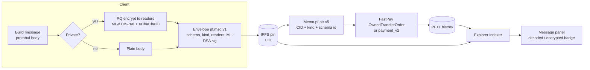
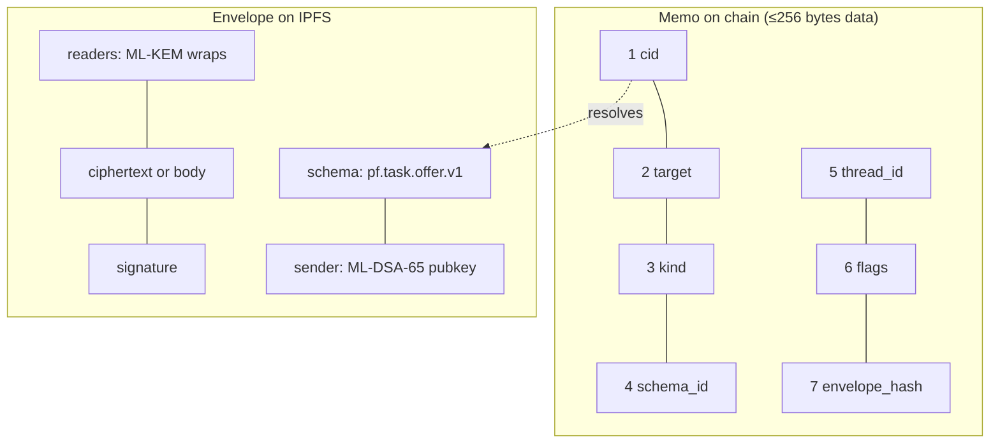

# Pillar 2 — Message Protocol Spec

> **Status:** Partial. A working pointer protocol (`pf.ptr` v4) and encrypted payloads are live on the **old** chain. There is no `.proto` schema, no message protocol on the new chain, no explorer rendering on the new chain, and no x402.
>
> **Bubbles up to:** *Machine-native communication*. Every other pillar (governance packets, NFTs, identity, NAVCoin fees) is a message type in this protocol.

## In one paragraph

Post Fiat needs one standard way for people and agents to say things on chain. The body of a message is a **protobuf** object. It is encrypted when it should be private, pinned to **IPFS** and referenced from a transaction memo by its **CID**. The transaction can be a FastPay payment, so a message can travel with a payment. The **block explorer** knows the schemas and renders messages for humans. Task Node already does most of this on the old XRPL-shaped chain through the `pf.ptr` pointer memo. This pillar writes the protocol down as a versioned spec with real `.proto` files, ports it to postfiatl1v2 and FastPay, replaces classical encryption with a post-quantum suite, and describes how it fits payment-required APIs such as x402.

## User story

**Founder's story.** I am a Task Node user, or anyone hoping to use the Post Fiat blockchain. There is a standardized message protocol spec, which pins protobuf representations to IPFS and can encrypt them properly. The method is standardized so it is easy to consume on the block explorer, and it becomes the default for machine-native communication on the Post Fiat chain. The spec has clear examples of how it integrates with FastPay transactions, and those are represented properly on the block explorer. It would be good if the spec could conform to x402 or other integration points.

**Augmented story.**

1. **Read.** I open `docs/specs/message-protocol-v1.md` and the `proto/` folder. I see the envelope, the pointer memo, the content kinds and one worked example per kind, with exact bytes.
2. **Build.** I `pip install` or `npm install` the reference client. With three calls I build a message, encrypt it to two readers, pin it and get a memo ready to attach to a transaction.
3. **Send.** I attach the memo to a FastPay `OwnedTransferOrder` and pay 1 PFT with a note to an agent. The payment is final in about 200 ms, and the message reference rides inside the signed order.
4. **See.** On the explorer, the transaction shows a **Message** panel: schema name, content kind, CID and sender. A public message is decoded in place. A private one shows *Encrypted to 2 readers*, and a reader with the key can decrypt it in the browser.
5. **Integrate.** An HTTP API I run answers `402 Payment Required` with a Post Fiat payment requirement. A client pays with a FastPay certificate carrying a `pf.msg` receipt memo and retries. The x402 mapping in the spec shows the exact headers.

## What exists today

| Component | Where | State |
|---|---|---|
| Pointer memo `pf.ptr` v4 (hand-encoded protobuf, fields 1–8) | [`server/pftl-pointer.js`](https://github.com/postfiatorg/tasknode/blob/main/server/pftl-pointer.js) `buildPftPointerMemo` · [Python twin](https://github.com/postfiatorg/tasknode/blob/main/reference_clients/python/tasknode_pftl/pointers.py) | Live on the old chain. **No `.proto` file anywhere.** |
| Content kinds | same file (`CONTENT_KIND`) | TASK=1, TASK_UPDATE=2, TASK_SUBMISSION=3, CHAT=4, CONTEXT=5, REWARD=6, POLICY=7, IDENTITY=8 (unused), ASSET=9, DOCUMENT=10, SYSTEM=11 |
| Flags | same file | encrypted=1, public=2, ephemeral=4, tombstone=8, multipart=16 |
| Encryption `ENC_X25519_XCHACHA20P1305` | [`server/task-payloads.js`](https://github.com/postfiatorg/tasknode/blob/main/server/task-payloads.js) · [`docs/wiki/architecture/encryption.md`](https://github.com/postfiatorg/tasknode/blob/main/docs/wiki/architecture/encryption.md) | Live. A file key wrapped for each reader with libsodium `crypto_box`; keys found through `AccountSet.MessageKey`. **Not post-quantum.** |
| Event schemas (`pf.task.*.v1`, `pf.reward.v1`, about 60 more) | [`server/task-event-meaning.js`](https://github.com/postfiatorg/tasknode/blob/main/server/task-event-meaning.js) · [`task-lifecycle.md`](https://github.com/postfiatorg/tasknode/blob/main/docs/wiki/architecture/task-lifecycle.md) | Strings in code; JSON bodies. Task events now live off chain in Postgres, and pointers are a replay path. |
| IPFS pinning and gateways | [`server/context-ipfs.js`](https://github.com/postfiatorg/tasknode/blob/main/server/context-ipfs.js) · [`ipfs.md`](https://github.com/postfiatorg/tasknode/blob/main/docs/wiki/architecture/ipfs.md) | Live. Pinata plus a first-party gateway (`pft-ipfs-testnet-clean`) and a replication queue; 1 MB JSON cap. |
| L1 memo | [`crates/types/src/transactions_mempool_receipts.rs`](https://github.com/postfiatorg/postfiatl1v2/blob/main/crates/types/src/transactions_mempool_receipts.rs) `PaymentMemo` · limits in [`core_chain.rs`](https://github.com/postfiatorg/postfiatl1v2/blob/main/crates/types/src/core_chain.rs) | At most 4 memos, 64-byte type and format, **256-byte data**, 512 bytes total. |
| FastPay orders carry memos | [`crates/types/src/account_owned_asset_types.rs`](https://github.com/postfiatorg/postfiatl1v2/blob/main/crates/types/src/account_owned_asset_types.rs) `OwnedTransferOrder.memos` · V3 in `fastpay_recovery_types.rs` | Built. Memos are signed into the order, and history indexes them ([`docs/rpc/account-history.md`](https://github.com/postfiatorg/postfiatl1v2/blob/main/docs/rpc/account-history.md)). |
| Proposed `pf.event` FastPay binding | [FastPay/FastDB/async IPFS research](https://github.com/postfiatorg/postfiatorg.github.io/blob/main/content/research/fastpay-fastdb-async-ipfs-architecture.md) | Research only, not built. |
| Explorer | [`static/explorer/explorer.js`](https://github.com/postfiatorg/postfiatorg.github.io/blob/main/static/explorer/explorer.js) · [`docs/explorer-spec.md`](https://github.com/postfiatorg/postfiatorg.github.io/blob/main/docs/explorer-spec.md) | Decodes `pf.ptr` on the **old-chain** feed only. No new-chain memo rendering. |
| x402 | — | Not found. Task Node returns plain HTTP 402 "add credit" errors. |

## Architecture

## Technical requirements

### Schema

- **R1.** Publish `proto/pf/msg/v1/*.proto`: `Pointer` (the memo, which formalises today's 8 fields), `Envelope` (on IPFS), `Reader`, `ContentKind` and one message per existing schema (`pf.task.*`, `pf.reward.v1`, `pf.asset.*`, plus `pf.governance.*` from [Pillar 1](01-hive-governance.md), `pf.nft.*` from [Pillar 4](04-nft-system.md), `pf.identity.*` from [Pillar 6](06-hive-identity.md) and `pf.navcoin.fee.*` from [Pillar 7](07-navcoin-fees.md)).
- **R2.** A schema registry: a numeric `schema_id` mapped to a fully qualified name, with that mapping kept in the repo. The memo carries the id so it fits in 256 bytes.
- **R3.** Pointer `v5` keeps wire compatibility with v4 fields 1–8 and adds `envelope_hash`. Old-chain v4 pointers stay valid and decodable for replay.

### Encryption and identity

- **R4.** Suite `ENC_MLKEM768_XCHACHA20P1305`. The file key is wrapped for each reader with ML-KEM-768, and the envelope is signed with the sender's ML-DSA-65 account key. Today's `ENC_X25519_XCHACHA20P1305` stays readable during migration.
- **R5.** Reader keys are found through a new-chain equivalent of `AccountSet.MessageKey`. Either an account field or a `pf.identity.message_key.v1` message (see [Pillar 6](06-hive-identity.md)).

### Transport

- **R6.** Reference examples for each carrier: (a) FastPay `OwnedTransferOrder.memos`, (b) `payment_v2` memos, (c) a zero-value message transaction if the chain adds one.
- **R7.** IPFS pinning keeps today's Pinata plus first-party gateway stack. Every CID in a memo must resolve from at least two gateways before the transaction is submitted.
- **R8.** Reference clients in JS and Python, generated from the `.proto` files, with conformance vectors (bytes in, bytes out) checked in CI.

### Explorer

- **R9.** The new-chain explorer indexer decodes `pf.ptr` v4 and v5 memos on `payment_v2` and FastPay certificates. It fetches the envelope, shows schema and kind, and renders public bodies and an *encrypted to N readers* badge.
- **R10.** Each schema gets a renderer (task offer, reward, governance packet, NFT metadata and so on), so a human can read any public message.

### Payment-required APIs

- **R11.** A short "x402 profile" section maps a `402 Payment Required` challenge onto a FastPay payment whose memo references the request. It covers required headers, receipt verification and replay protection. Conformance with x402 is a goal, but the spec must work without it.

## Dependencies

| Depends on | Why |
|---|---|
| FastPay in production (epoch-2 committee since height 1123) | The carrier for fast messages. See the readiness gates in the [index](../README.md#chain-readiness-gates). |
| [Pillar 6 — On-chain identity](06-hive-identity.md) | Finding reader keys and the sender's identity. |
| Explorer for the new chain | Rendering. |
| Feeds into Pillars 1, 4, 6, 7 and 8 | They define message types on top of this envelope. |

## Acceptance criteria

1. `.proto` files and the schema registry are merged into `postfiatl1v2`. JS and Python clients pass the conformance vectors in CI.
2. A FastPay payment on the devnet carries a `pf.ptr` v5 memo, and the explorer renders its message panel.
3. A private message encrypted with ML-KEM decrypts for its two intended readers and fails for everyone else.
4. Old-chain v4 pointers still decode in the new indexer.
5. A demo HTTP endpoint completes a 402 challenge, then FastPay payment, then retry round trip as described in the spec.

## Open questions for the founder

- Should encryption be post-quantum from day one, or should the classical suite ship first with the post-quantum suite as a version bump?
- Should the chain add a dedicated zero-value "message" transaction, or should messages always ride on payments?
- Is x402 the named integration target, or are there others (for example MCP payment hooks)?

## Code references

- Task Node pointers: [`server/pftl-pointer.js`](https://github.com/postfiatorg/tasknode/blob/main/server/pftl-pointer.js) · [`context-history-restore.md`](https://github.com/postfiatorg/tasknode/blob/main/docs/wiki/architecture/context-history-restore.md)
- Task Node encryption: [`server/task-payloads.js`](https://github.com/postfiatorg/tasknode/blob/main/server/task-payloads.js)
- L1 memo limits: [`crates/types/src/core_chain.rs`](https://github.com/postfiatorg/postfiatl1v2/blob/main/crates/types/src/core_chain.rs) (`MAX_PAYMENT_MEMO_*`)
- FastPay: [`docs/specs/fastpay-payment-recovery-v1.md`](https://github.com/postfiatorg/postfiatl1v2/blob/main/docs/specs/fastpay-payment-recovery-v1.md) · [`docs/rpc/methods.md`](https://github.com/postfiatorg/postfiatl1v2/blob/main/docs/rpc/methods.md) (`owned_sign_v3`, `owned_apply_v3`, `owned_certificate`)
- Signatures: [`crates/crypto_provider/src/lib.rs`](https://github.com/postfiatorg/postfiatl1v2/blob/main/crates/crypto_provider/src/lib.rs) (ML-DSA-65 contexts)
