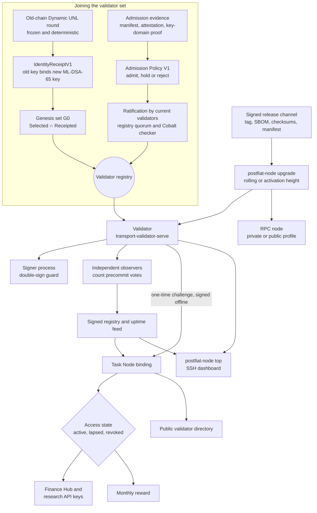

# Pillar 3 — Validator Rewards Program

> **Status:** Early. The node binary and its RPC modes exist. So do the operator key and manifest tools, a signer with a double-sign guard, a deterministic admission policy and the Task Node binding. Binding to the new chain works today, but only for the six Foundation validators. Outside operators still cannot join. There is no signed public release, public genesis, receipt or ratification client, upgrade command, single docs page or SSH dashboard. Reward grants are off.
>
> **Bubbles up to:** [Outcome B · A production-ready new chain](../README.md#three-outcomes). *A decentralised new chain*. Outside validators are the first stage of moving off the old chain.

## In one paragraph

Post Fiat validators get something real for running a node: **Finance Hub** and **GoodAlexander research API keys**, plus a monthly reward for staying up. To deliver that on the new chain, an outsider must be able to **install, update and monitor** a postfiatl1v2 validator, optionally run an **RPC node**, and **connect** it to Task Node, all from one page. On the founder's question: **yes, we have RPC software.** It is the same `postfiat-node` binary in RPC mode, and it updates through the same release. Joining is deliberately not self-service. The first outside validators come from the old chain's Dynamic UNL scoring. Later ones must pass a deterministic admission policy and be ratified by the current validators. That gate is what keeps rewards and research access from being farmed. Today all six validators are Foundation-run. The tooling is spread across about eight docs or assumes the Foundation's fleet, and Task Node's connect screen defaults to the old `postfiatd` chain. This pillar packages the tooling into a product and rolls it out in steps.

## User story

**Founder's story.** I am a validator or an aspiring validator on the PostFiatL1v2 network. I want a clear way to update my validator software, which needs to exist, and to be able to run an RPC. Ripple presumably has RPC software. Do we? Where is it? How does it get updated? If I want to run my own RPC, how do I do that? I should be able to go to a docs page and see clearly how all of this is done. After my validator is up, I should be able to connect it to the Task Node extremely easily. Even better, my validator software should come with a delightful UX I can log into when I SSH in, showing key uptime and other statistics, so that my validator can be usefully used.

*From the wider brief:* moving to the new chain is multi-phased, and the first phase gets some validators onto it. People can't be migrated until the chain performs adequately. Validators should be able to access Finance Hub and GoodAlexander content. The existing validator onboarding tool is not linked to the new chain.

**Augmented story.**

1. **One page.** I open *Run a validator* on postfiat.org, next to the old-chain [validator setup](https://postfiat.org/validator-setup/) page. Its sections are Requirements, Keys, Install, Join, Update, RPC node, Connect and Status. Every command is copy-paste.
2. **Install.** I download a signed release (`postfiat-node` plus systemd units). I verify the tag, the checksums and the signed deployment manifest against the publisher key shown on the page. I make a master key and a hot key, and I run the hot key in the separate signer process.
3. **Join.** I am an old-chain validator picked by the frozen Dynamic UNL round. One command builds my `IdentityReceiptV1`, which binds my old key to a new ML-DSA-65 key, and I submit it before the deadline. Later applicants run a command that assembles their evidence and previews the policy verdict (*admit*, *hold* or *reject*, with reasons). I watch my status go from *submitted* to *ratified* to *active*.
4. **Update.** `postfiat-node upgrade --check` tells me whether a release is a rolling update or must be installed before activation height H. Applying it verifies the signature, stops the services, backs up chain data, swaps the binary, restarts and health-checks. It never touches the signer's double-sign state, and it refuses anything not on the signed channel.
5. **RPC node.** The **same binary** runs in RPC mode. The *private* profile listens on loopback for my own wallet or local Task Node. The *public* profile sits behind a TLS edge. Either one catches up from a pinned checkpoint published with the release.
6. **Connect.** In Task Node, under **Settings > Validator**, the new chain becomes the default at the agreed rollout step. I paste one command as root. It fetches a one-time challenge, signs it inside a sandbox with no network access, and sends back only the signature. My profile shows *Validator · bound · active*, and Finance Hub opens.
7. **Status UX.** Over SSH, `postfiat-node top` shows:
    - height and lag behind the network;
    - peers;
    - my precommit signing;
    - my reward eligibility as Task Node sees it;
    - the release and any upgrade-by height;
    - signer health, disk use and recent warnings.

8. **Rewards and access.** Anyone can recheck my participation record. Task Node counts it, and the reward and research access follow published rules, including the rule for when I go offline.
9. **Useful.** A public directory lists my validator with its participation and, if I opt in, my public RPC endpoint.

## What exists today

| Component | Where | State |
|---|---|---|
| Node binary with RPC modes | [`crates/node`](https://github.com/postfiatorg/postfiatl1v2/tree/main/crates/node): `rpc-serve`, `rpc-catch-up`, `rpc-catch-up-certified-delta` | Built. **No separate RPC product: RPC is the same binary.** The documented topology runs a validator and its RPC service on one data directory. The pinned catch-up fails closed unless it ends at the expected height, block hash and state root. |
| RPC surface | [`docs/rpc/methods.md`](https://github.com/postfiatorg/postfiatl1v2/blob/main/docs/rpc/methods.md) · [`public-rpc-operator-policy.md`](https://github.com/postfiatorg/postfiatl1v2/blob/main/docs/runbooks/public-rpc-operator-policy.md) · [`systemd/postfiat-rpc.service.example`](https://github.com/postfiatorg/postfiatl1v2/blob/main/systemd/postfiat-rpc.service.example) | `status`, `account`, `account_tx`, `tx`, `receipts`, `blocks`, `validators` and `mempool_submit_signed_*`. There is no `account_info`. Private-action admission (`private_action_submit`, `private_action_receipt`) is built behind `--allow-private-action-admission`. It is off, and it signs with the validator's own finality key, so only validators can serve it. Public binds are refused, so public RPC needs a TLS edge. Most reads took 7–10 s on the devnet. **No public endpoint.** |
| Release process | [`docs/release-process.md`](https://github.com/postfiatorg/postfiatl1v2/blob/main/docs/release-process.md) · [`signed-deployment-manifest.md`](https://github.com/postfiatorg/postfiatl1v2/blob/main/docs/runbooks/signed-deployment-manifest.md) | The process is defined: signed tag, SBOM, checksums, a second builder, and rollout one validator at a time. Units check a manifest signed by **one** ML-DSA-65 publisher key. No public release has gone through it. |
| Consensus-change activation | [`replicated-state-v2-activation.md`](https://github.com/postfiatorg/postfiatl1v2/blob/main/docs/runbooks/replicated-state-v2-activation.md) | A governance amendment schedules a future height. Such a change must never ship by "uncoordinated rolling restart". |
| Rollout tool | [`safe-validator-rollout.md`](https://github.com/postfiatorg/postfiatl1v2/blob/main/docs/runbooks/safe-validator-rollout.md) | Foundation fleet only. |
| Operator runbook | [`public-operator-runbook.md`](https://github.com/postfiatorg/postfiatl1v2/blob/main/docs/runbooks/public-operator-runbook.md) | The closest thing to one page. It lists the gaps: no signed artifact, no genesis, no registration tooling, no l1v2 sidecar, no public monitoring and **no hardware sizing**. Units run as user `postfiat` under `ProtectSystem=strict`. |
| Admission and removal | [`validator-registry.md`](https://github.com/postfiatorg/postfiatl1v2/blob/main/docs/governance/validator-registry.md) · [genesis spec](https://github.com/postfiatorg/postfiatl1v2/blob/main/docs/architecture/l1v2-testnet-genesis-and-launch-spec.md) §3, §5 · [`launch-topology-thresholds.md`](https://github.com/postfiatorg/postfiatl1v2/blob/main/docs/architecture/launch-topology-thresholds.md) (proposal) | There is **no join transaction and no stake.** Genesis membership is `G0 = Selected ∩ Receipted`, from a frozen old-chain Dynamic UNL round. **Admission Policy V1** is an advisory selector. Its floors are 99.5% uptime, accountability of at least 70, no shared control groups, a signed manifest and a key-domain proof. Registry changes need ML-DSA-65 signatures from the current registry plus consensus ordering. Removal is a signed transition. Launch needs `n ≥ 12`, with at most 2 seats per correlated group. |
| Operator CLI pieces | [`cli_dispatch_parts/`](https://github.com/postfiatorg/postfiatl1v2/tree/main/crates/node/src/main_parts/cli_dispatch_parts) | Present: `operator-onboarding-keygen` (master and hot key), `operator-manifest-create`, `operator-attestation-create`, `validator-key-stage`, `validator-signer-serve` and `deployment-*`. **Missing:** `upgrade`, `top`, a receipt command and a ratification command. |
| Key custody | [signer policy](https://github.com/postfiatorg/postfiatl1v2/blob/main/docs/runbooks/public-rpc-operator-policy.md#validator-signer-process) · [`validator-emergency-key-rotation.md`](https://github.com/postfiatorg/postfiatl1v2/blob/main/docs/runbooks/validator-emergency-key-rotation.md) | The signer saves its last signed round before each vote and must "never … restore an older copy". It is not yet deployed: the fleet uses key files. There is no HSM. Rotation goes through a registry update. |
| Health tools | `scripts/node-status`, `scripts/testnet-validator-doctor` ([doc](https://github.com/postfiatorg/postfiatl1v2/blob/main/docs/runbooks/validator-doctor.md)), `scripts/testnet-rpc-doctor`, `scripts/testnet-monitor-snapshot`, `python/postfiat_rpc/cobalt_ui.py` | JSON reports and a local alert spool. **No terminal UI.** |
| Task Node binding | [`tasknode-l1-validator-binding.md`](https://github.com/postfiatorg/postfiatl1v2/blob/main/docs/runbooks/tasknode-l1-validator-binding.md) · Task Node [`public/l1-validator.sh`](https://github.com/postfiatorg/tasknode/blob/main/public/l1-validator.sh) · [`server/l1-validator-identity.js`](https://github.com/postfiatorg/tasknode/blob/main/server/l1-validator-identity.js) | **Works for registry members.** It runs as root on Linux x86_64. It downloads a SHA-256-pinned helper and gets a single-use challenge that expires after 30 minutes. It signs under `postfiat-l1-v2/tasknode-validator-binding/v1` inside `unshare --net`, then posts the proof. The chain id is hard-coded to `postfiat-wan-devnet-2`. |
| Registry and participation feed | [`tools/tasknode-validator-binding/registry.py`](https://github.com/postfiatorg/postfiatl1v2/blob/main/tools/tasknode-validator-binding/registry.py) → `research.goodalexander.com:18443/l1-registry/registry.json` | **Live.** At revision time it was fresh and listed six validators with 30 daily participation rows each. Two agreeing RPC reads feed it, and it counts real `precommit_qc.votes`. It is **unsigned**: Task Node checks its shape and rejects it after one hour. The per-validator uptime record is **not exported**. |
| Old-chain onboarding (default) | Task Node [`public/validator.sh`](https://github.com/postfiatorg/tasknode/blob/main/public/validator.sh) · [`ValidatorSettings.jsx`](https://github.com/postfiatorg/tasknode/blob/main/src/features/research/ValidatorSettings.jsx) (`useState("ledger")`) | Live. Targets `postfiatd`; the new chain is opt-in. |
| Rewards | [`server/l1-validator-rewards.js`](https://github.com/postfiatorg/tasknode/blob/main/server/l1-validator-rewards.js) · [`server/l1-validator-uptime.js`](https://github.com/postfiatorg/tasknode/blob/main/server/l1-validator-uptime.js) · [`server/validator-rewards.js`](https://github.com/postfiatorg/tasknode/blob/main/server/validator-rewards.js) | Built. **$20 a month of Task Node USD credit** per validator id, not PFT. It needs 25 of 30 observed days at 95% or more, and the registry is rechecked when the grant is made. Grants run only if `TASKNODE_VALIDATOR_REWARDS_ENABLED=true`, which `fly.toml` doesn't set. `TASKNODE_L1_UPTIME_REWARDS_ENABLED` is false and would switch the evidence to uptime probes. |
| Research access | [`server/index-viewer-routes.js`](https://github.com/postfiatorg/tasknode/blob/main/server/index-viewer-routes.js) · [`server/repositories/validator-bindings.js`](https://github.com/postfiatorg/tasknode/blob/main/server/repositories/validator-bindings.js) · [`server/validator-dashboard.js`](https://github.com/postfiatorg/tasknode/blob/main/server/validator-dashboard.js) | Live. **Any unrevoked binding**, old-chain or new-chain, unlocks the validator-tier Finance Hub bundles and validator research API keys. Chat Deep Research is open to every signed-in account. New-chain validators are checked against the registry only when they bind. Participation affects the monthly credit, never access. Only the user's own *Unbind* removes it. A web dashboard shows reward history. |

**Current network** ([network status](https://github.com/postfiatorg/postfiatl1v2/blob/main/docs/status/network-status.md), [Cobalt](https://github.com/postfiatorg/postfiatl1v2/blob/main/docs/governance/cobalt.md)):

- six Foundation validators, quorum 5 of 6;
- no outside validators and no public RPC;
- Cobalt last verified active at height 924, after ratifying two **key rotations**. **No add-validator change has been ratified on the live devnet**, only in a local drill.

### Gates that block outsiders

From the [testnet path](https://github.com/postfiatorg/postfiatl1v2/blob/main/docs/status/testnet-path.md). Launch gates L1–L6 are in genesis spec §5.

| Item | What it is | Why it blocks validators |
|---|---|---|
| Z1 | Cobalt-ratified transitions become the only registry-change path on the devnet | Ratifying outsiders needs it |
| Z2 | Decision on whether AI model output stays authoritative | It fixes the admission evidence path |
| Z3 | NAVCoin swaps work end to end | A Gate Zero precondition for any community step |
| C1 | Dynamic UNL verification and evidence transparency on the old chain | The genesis set is selected from that scoring |
| C4 | Sidecar extended into the l1v2 ratification client | Without it, no receipt submission or ratification |
| B2/B3 (G6) | Six-clone rehearsal and deployment decision | Launch gate L1 requires it |
| D4 | Public-testnet launch decision | No network to join before it |

## Architecture

### Security model and failure modes

| Trust root | Protects | Today | Required |
|---|---|---|---|
| Release publisher key | Every binary outsiders run | One ML-DSA-65 key | Pinned on the docs page with a rotation procedure; m-of-n is open question 9 |
| Validator key | Consensus votes | Key files on the fleet; the signer process is built but not deployed | The signer process is the default for outsiders; the master key stays offline; guard state is never backed up or restored |
| Registry feed | Binding, access, rewards | Unsigned, on one research host, from two RPC reads | Signed, with at least two independent observers, and recomputable from finalized votes |
| Connect command | The key while binding | Piped from tasknode.postfiat.org into a root shell; the pinned helper signs offline | The signer ships inside the signed release, with an offline mode |
| Catch-up source | A new node's start state | An operator-chosen host | Pinned checkpoints published with each release |

- **Stale feed (more than one hour old).** New bindings and grant runs fail with a 503. Existing access is unaffected.
- **Missing observer days.** They don't count. Credit fails closed.
- **Failed upgrade.** Restore the binary and the data together. Binary rollback alone failed in the live-canary postmortem (runbook §7).
- **Lost guard state.** Rotate the key. Never start a new guard for a key that has already signed.
- **Small set.** At 6 validators with a quorum of 5, two being offline stops finality. Early outsiders add liveness risk until the set reaches the launch minimum.

### Economics

- **What a validator gets.** Finance Hub and validator research API keys on binding, plus $20 a month of Task Node credit if eligible. There is no stake and the grant is small, so **research access is the main incentive**. The docs page should say so.
- **Cost.** No hardware sizing is committed. The devnet runs on two-core cloud hosts. R11 measures the real cost and publishes it.
- **Anti-farming.** Admission is the gate, not Task Node. Nobody self-registers: genesis seats come from old-chain scoring, the policy rejects shared control, and launch caps each correlated group at two seats. While that holds, the validator path is not a cheap bypass of Pillar 9's top-30 path.
- **Gaps and tensions.**
    - Credit is paid per validator id, and one account can hold several bindings.
    - Access never lapses.
    - The genesis spec calls the public testnet "no-reward", yet Task Node's code (switched off) pays credit.
    - RPC operators earn nothing.

All of these are founder choices; see the open questions.

## Technical requirements

### Staged rollout

- **R0.** Each step starts only when its gate holds.
    - **Step 1 — Foundation set.** Binding, the feed and `top` are proven on the six validators. Task Node keeps defaulting to the old chain.
    - **Step 2 — Rehearsal (R7).** A Foundation-run "outside" validator on a separate host joins through the public tooling.
    - **Step 3 — Genesis cohort.** Selected and receipted old-chain validators (`G0`) join the public testnet once Z1–Z3, C1, C4, G6 and D4 close. Old-chain bindings keep working, so nobody loses Finance Hub in the move.
    - **Step 4 — Open admission.** New operators come in through Admission Policy V1 and ratification.
    - **Default flip.** Which step flips Task Node's default is open question 11.
    - **Leaving the old chain.** Old-chain validators aren't asked to leave until the [chain readiness gates](../README.md#chain-readiness-gates) hold.

### Distribution

- **R1.** A signed release channel for each tag. It ships `postfiat-node` for linux-x86_64 and aarch64, the systemd units, an SBOM, checksums and the signed deployment manifest. A second builder reproduces it, as `docs/release-process.md` requires. The docs page shows the publisher public key and how it rotates.
- **R2.** Each network publishes a genesis envelope, chain id, bootstrap peers and pinned catch-up checkpoints (height, block hash and state root).
- **R3.** `postfiat-node upgrade [--check]`:
    - labels each release *rolling* or *activation at height H*, and prints H;
    - runs as root, because the units run as `postfiat` under `ProtectSystem=strict`;
    - verifies the signature and manifest, stops the services, backs up the data directory, swaps the binary, restarts and health-checks;
    - restores binary and data together on failure;
    - never copies, restores or reinitialises the signer guard;
    - refuses anything not on the signed channel;
    - never auto-applies an upgrade unless the founder chooses to allow it.
- **R3a.** Consensus-breaking changes use a governance-scheduled activation height, as the replicated-state amendment does. `top` and `upgrade --check` warn when the installed binary cannot follow a scheduled height.

### Joining, rotation and removal

- **R4.** An identity-receipt command builds and checks `IdentityReceiptV1` as genesis spec §3.2 defines it. It uses the existing types in `crates/types/src/genesis_registry.rs` and the `genesis_registry.py` verifier. The old-chain signature comes from `postfiatd validator-keys`, as the sidecar does. This is how old-chain validators carry their reputation over.
- **R5.** An admission command does four things:
    - assembles the `ValidatorAdmissionEvidencePacket` from the manifest, the attestation and the key-domain proof;
    - runs Admission Policy V1 locally and shows the verdict with reason codes;
    - submits the packet to the transition proposer (today the Foundation pipeline, a recorded dependency to remove);
    - reports status: *submitted*, *held* (with what is missing), *rejected*, *ratified* or *active*.

    The ratification client closes C4.

- **R6.** The docs cover rotation (`validator-key-stage` plus a registry update) and removal (a signed transition). Whether low participation should trigger removal is open question 7.
- **R7.** Before inviting anyone, admit a new validator on the devnet end to end through R5 and ratification, and record the heights.
- **R8.** Benchmark set size. Every vote carries a 3,309-byte ML-DSA-65 signature. Measure certificate size, bandwidth and finality latency at `n = 12` and at any proposed maximum. Publish the results and set the maximum from them.

### Keys

- **R9.** The Keys section of the docs page covers:
    - the master and hot key split, made with `operator-onboarding-keygen`, with the master key offline;
    - the signer process as the default;
    - the guard rule: never delete or restore it;
    - links to the rotation and emergency-rotation runbooks;
    - a plain statement that HSM custody is not implemented.

### RPC node

- **R10.** A packaged RPC profile on the same binary and release, as a systemd unit and a Docker compose file.
    - **Private profile.** Loopback only, for the operator's wallet, scripts or local Task Node ([Pillar 5](05-local-task-node.md)), with a copy-paste example of how to point them at it.
    - **Public profile.** Behind the TLS edge, with the limits in `public-rpc-operator-policy.md`.
    - **Private admission.** On validators only, the public profile can also turn on `--allow-private-action-admission` once a release and governance enable shielded batches. [Pillar 5](05-local-task-node.md)'s local app submits proofs there, to at least two independent endpoints. The page explains the switch, its limits and how refusals are reported.
    - **First sync.** `rpc-catch-up-certified-delta` from an R2 checkpoint.
    - **Follower mode.** Confirm that a non-voting RPC node follows the tip on its own. If it doesn't, build that mode.
    - **Read latency.** Cut the 7–10 s reads, and publish the measured figure.
    - **Plain answer in the docs.** *There is no separate RPC software: RPC nodes are `postfiat-node` in RPC mode and update the same way.*

### Docs

- **R11.** One **Run a validator** page.
    - **Location.** The canonical copy is `docs/validators/run-a-validator.md` on the MkDocs site, with the public face on postfiat.org beside the old-chain page.
    - **Layout.** MkDocs has no tab extension configured, so either add `pymdownx.tabbed` or use anchored sections.
    - **Requirements section.** CPU, RAM, disk and bandwidth measured on the fleet, plus monthly cost, ports and firewall rules.
    - **Other sections.** Keys, Install, Join, Update, RPC, Connect, Status and Troubleshooting.
    - **Scope.** It replaces the scattered runbooks for outside operators. Foundation-only tools move to an internal section.

### Status UX

- **R12.** `postfiat-node top` is a read-only terminal UI over the local status endpoint and store. It shows:
    - height and lag;
    - peers;
    - this validator's recent precommit signing;
    - the release and any upgrade-by height;
    - signer guard health;
    - disk;
    - recent warnings;
    - reward and access eligibility, read from the same signed feed Task Node uses and labelled as Task Node's view, so the two can't disagree.

    It works over plain SSH, with no web port.

### Task Node

- **R13.** Connect stays a single command.
    - The signing helper moves into the signed release (for example `postfiat-node tasknode-bind`) and keeps signing with no network.
    - Add an offline copy-paste mode and aarch64 support.
    - The chain id comes from the published network, not a constant.
    - The success screen lists what the validator unlocked.
- **R14.** `ValidatorSettings.jsx` defaults to the new chain at the R0 step the founder picks. The old chain stays as a legacy option.
- **R15.** Access follows validator state.
    - **Pending:** not in the registry.
    - **Active:** in the registry with its current key.
    - **Lapsed:** removed, rotated away or below the participation rule, and inside a grace window.
    - **Revoked.**

    Bindings are rechecked against the signed feed on a schedule. Tier `validator` and Pillar 9's `finance_hub` tier read this state. The founder chooses the grace length and whether participation affects access.

- **R16.** Trustworthy uptime evidence:
    - the exporter publishes `postfiat-validator-uptime-v1` from at least two independent observers;
    - the feed is signed with ML-DSA-65, and Task Node checks it against a pinned key;
    - participation comes from finalized `precommit_qc.votes`, so anyone can recompute it;
    - a stale feed blocks grants and new bindings, never existing access.
- **R17.** Turn on `TASKNODE_L1_UPTIME_REWARDS_ENABLED` and `TASKNODE_VALIDATOR_REWARDS_ENABLED` only after R16 holds and the economics questions are settled.
- **R18.** A public validator directory, built on the existing validator badge. It shows network, state, participation and an optional RPC endpoint, linked to the operator's identity ([Pillar 6](06-hive-identity.md)).

### Interfaces to other pillars

- **To Pillar 6:** the connect command also emits the `pf.identity.link.v1` co-signature with `key_type=validator`.
- **To Pillar 9:** the R15 access state for each account.
- **To Pillars 2 and 5:** RPC endpoints and the method list. Pillar 5 needs at least two independent public endpoints that serve reads and private-action admission. Without a public RPC, Pillar 5 is blocked.
- **To Pillar 1:** validator count and state for the governance packet's `chain_state`.

## Dependencies

| Depends on | Why |
|---|---|
| Gates Z1–Z3, C1, C4, G6 and D4 | Outsiders joining at all |
| A qualifying frozen Dynamic UNL round | Selecting the genesis cohort |
| Cobalt as the live registry path (Z1) and the R7 rehearsal | Admitting anyone after genesis |
| [Pillar 6 — Hive identity](06-hive-identity.md) | Linking validator keys to an identity, and per-operator rewards if chosen |
| [Pillar 9 — Finance Hub](09-finance-hub.md) | What validators get, and the shared access tier |
| Release-signing key custody | Signing the channel |
| Founder answers below | Before R17 |

## Acceptance criteria

1. **Rehearsal.** On a fresh, separate host, a Foundation-run validator follows only the docs page and is admitted through R5 and ratification. Nobody SSHes into that host.
2. **Receipt.** An R4 receipt passes the `genesis_registry` verifier. Edited, expired and duplicate receipts each fail with their named code.
3. **Upgrade.** A signed rolling release applies and a tampered one is refused. An activation-height release warns before H and switches at H. The signer guard's floor is unchanged across an upgrade and a forced rollback.
4. **RPC.** A packaged RPC node catches up from a published checkpoint and serves `status`, `account` and `tx`. Its read latency is published.
5. **Connect.** One command binds the validator and Finance Hub opens. After the validator is removed from the registry, its access goes *lapsed*, then *revoked*, under the chosen rule.
6. **Uptime.** A grant is made from the signed feed, and a second observer recomputes the same daily figures.
7. **Status.** Over SSH, `postfiat-node top` shows live participation, Task Node's eligibility view and any upgrade-by height.
8. **Scale.** The R8 benchmark and the maximum set size are published.

## Open questions for the founder

1. **What do validators earn?** The options:
    - **(a) $20 of Task Node credit,** as in today's code. Cheap, but it may not cover hosting.
    - **(b) PFT over FastPay.** Visible on chain, but needs a budget and a cap.
    - **(c) Research access only.** Simplest, and it matches the genesis spec's "no-reward" testnet.

    Should the amount scale with participation?

2. **Per validator or per operator?** Per validator matches the current code but rewards running more nodes. Per operator, through the Pillar 6 identity, resists farming but needs identity minting first.
3. **Who gets in, and in what order?** Only the `G0` cohort at first, or open admission after genesis? Should Task Node standing count as evidence? A Task Node UNL scorer exists in shadow mode (`python/postfiat_rpc/tasknode_unl_v2.py`).
4. **Must a validator stay active to keep research access?** The options:
    - **(a) Binding only,** as today. Generous, but open to bind-and-quit.
    - **(b) In the registry with its current key.**
    - **(c) Also meeting the participation rule,** with a grace window whose length you set.
5. **Validator and top-30 overlap.** Should a validator also need Task Node standing, or are the two paths independent, as Pillar 9 assumes?
6. **Maximum set size and group cap.** The launch minimum is 12 validators, with at most two seats per correlated group. The old chain caps its UNL at 35. Should the R8 benchmark set the maximum?
7. **Removal for low participation.** An automatic removal proposal, a warning only, or a manual decision?
8. **Stake or bond.** The protocol has none. Keep it that way, or add a bond for open admission?
9. **Release signing.** One publisher key or m-of-n? And is auto-upgrade allowed, or is applying an upgrade always manual?
10. **Public RPC and private admission.** Should a Foundation endpoint come first, or launch alongside outside operators? Pillar 5 needs two endpoints either way. Should serving them count toward rewards?
    - **(a) No.** Serving stays a duty that goes with the research access. This is simplest, but nothing pays for the extra bandwidth.
    - **(b) Yes, as an eligibility condition.** For example, validators must keep admission on. This guarantees endpoints, but raises the bar to join.
    - **(c) A separate bonus or x402 fees** ([Pillar 2](02-message-protocol.md)). This pays for the load, but needs metering that can't be gamed.
11. **When does Task Node's default flip?** At the rehearsal (Step 2), at the public-testnet decision (Step 3), or only after all five chain readiness gates?
12. **Old-chain validators during the move.** Can they earn on both chains, or is it one grant per operator?

## Code references

- Node: [`cli_dispatch_parts/`](https://github.com/postfiatorg/postfiatl1v2/tree/main/crates/node/src/main_parts/cli_dispatch_parts) · [`validator_signer_guard.rs`](https://github.com/postfiatorg/postfiatl1v2/blob/main/crates/node/src/validator_signer_guard.rs) · [`crates/types/src/genesis_registry.rs`](https://github.com/postfiatorg/postfiatl1v2/blob/main/crates/types/src/genesis_registry.rs) · [`python/postfiat_rpc/genesis_registry.py`](https://github.com/postfiatorg/postfiatl1v2/blob/main/python/postfiat_rpc/genesis_registry.py)
- Docs: [`docs/validators/`](https://github.com/postfiatorg/postfiatl1v2/tree/main/docs/validators) · [`signature-size-and-certificates.md`](https://github.com/postfiatorg/postfiatl1v2/blob/main/docs/quantum/signature-size-and-certificates.md) · [`mkdocs.yml`](https://github.com/postfiatorg/postfiatl1v2/blob/main/mkdocs.yml)
- Task Node: [`server/repositories/validator-connect.js`](https://github.com/postfiatorg/tasknode/blob/main/server/repositories/validator-connect.js) · [`server/validator-connect-routes.js`](https://github.com/postfiatorg/tasknode/blob/main/server/validator-connect-routes.js) · [`fly.toml`](https://github.com/postfiatorg/tasknode/blob/main/fly.toml) · [`docs/wiki/operations/airdrop-recovery-and-l1-uptime.md`](https://github.com/postfiatorg/tasknode/blob/main/docs/wiki/operations/airdrop-recovery-and-l1-uptime.md)
- Old-chain setup, for contrast: [`postfiatd/docs/NodeSetup.md`](https://github.com/postfiatorg/postfiatd/blob/main/docs/NodeSetup.md) (minimum 2 cores and 4 GB RAM)

## Revision notes (review round 1)

| Item | Change |
|---|---|
| Gemini P1 | Admission path corrected (G0, Policy V1, registry-quorum ratification); R4–R7. The premise was partly wrong: self-service join was never the design, but the page had implied it. |
| Gemini P2 | Economics section; R15 access states. Verified that access depends only on binding. Open questions 1, 2 and 4. |
| Gemini P3 | R3 rewritten (classify, root, stop then back up, paired restore, guard untouched); R3a. Signing uses one ML-DSA-65 key; m-of-n is open question 9. |
| Gemini P4 | R0 steps; default flip in R14 and open question 11; old-chain access kept throughout. |
| Gemini P5 | Feed verified live but unsigned; R16. Overstated: a stale feed blocks binds and grants, not existing access. `top` reads the same feed (R12). |
| Gemini P6 | RPC rows corrected; R10 adds profiles, checkpoint sync, follower mode and latency. |
| Gemini P7 | Step 6 corrected: the script uses the network but the signer doesn't. Security table; R13. Single-use 30-minute token and Unbind confirmed in code. |
| Gemini P8 | Gate table; interfaces to Pillars 1, 2, 5, 6 and 9. |
| Gemini P9 | R11: tabs need `pymdownx.tabbed`, otherwise sections; postfiat.org face; hardware and RPC usage. |
| Opus P1 | R0 steps; open question 11. |
| Opus P2 | R3 classification; R3a activation heights. |
| Opus P3 | Verified the signer guard exists. R3 and R9 exclude it from backup; acceptance 3. |
| Opus P4 | Admission floors, removal and caps stated; R6 and R7; open questions 6 and 7. |
| Opus P5 | R8; acceptance 8. |
| Opus P6 | Security table; open question 9. |
| Opus P7 | R16; failure list. |
| Opus P8 | Verified $20 Task Node credit per validator id; open questions 1, 2 and 12. |
| Opus P9 | R15; Pillar 9 interface; open questions 4 and 5. |
| Opus P10 | R9 Keys section. |
| Opus P11 | Verified: `account_info` doesn't exist and `tx` does. Acceptance 4 uses `account` and `tx`. Checkpoint anchor in R2 and R10. |
| Opus P12 | Verified: only key rotations were ratified live. Stated; R7 rehearsal. |
| Opus P13 | Story step 9; R18. |
| Opus P14 | R11 postfiat.org page. |
| Opus P15 | Disputed: founder rule, steps not dates. The R0 steps and the gate table give the order. |
| Coordinator (Pillar 9) | Research-access row corrected. Finance Hub bundles and validator research API keys need a binding on either chain, and chat Deep Research is open to all. The registry is checked only at bind time, and participation affects credit only. |
| Coordinator (Pillar 5) | Private-action admission added to the RPC row, R10 and the Pillar 5 interface; reward treatment is open question 10. |
| Opus P16 | R11: measured hardware and cost; none committed today. |
