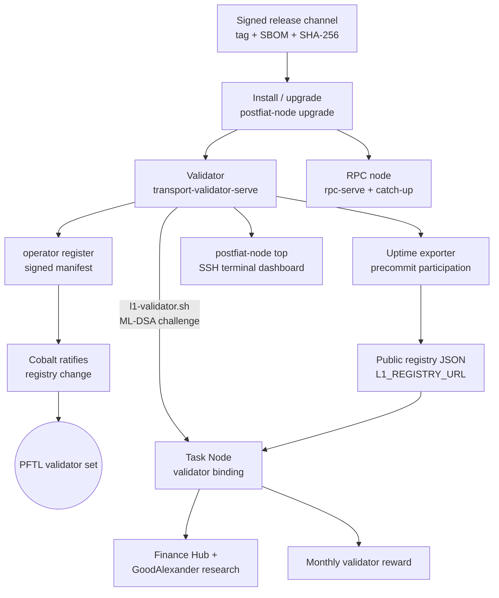

# Pillar 3 — Validator Rewards Program

> **Status:** Early. The node binary, Task Node binding to the new chain and the uptime-reward code exist. Outside operators still cannot join: there is no signed release, public genesis, registration tool, packaged RPC node, single docs page or status UX.
>
> **Bubbles up to:** *A decentralised new chain*. Outside validators are the first stage of moving off the old chain.

## In one paragraph

Post Fiat validators get something real for running a node: access to **Finance Hub** and **GoodAlexander research**, plus uptime rewards. To deliver that on the new chain, an outsider must be able to **install, update and monitor** a postfiatl1v2 validator, optionally run an **RPC node**, and **connect** the validator to Task Node, all from one page. Today the six validators are Foundation-run. The tooling exists but is spread across about eight docs, assumes the Foundation's own fleet, or targets the old `postfiatd` chain by default. This pillar packages it into a product.

## User story

**Founder's story.** I am a validator, or an aspiring validator, on the postfiatl1v2 network. I need a clear way to update my validator software, and I want to be able to run an RPC node. Ripple presumably has RPC software; do we, where is it, and how does it get updated? I should be able to go to one docs page and see clearly how all of this is done. Once my validator is up, connecting it to Task Node should be extremely easy. Better still, the validator software should come with a delightful UX I can log into over SSH, showing uptime and other key statistics, so my validator can be put to good use.

**Augmented story.**

1. **One page.** I open *Run a validator* in the postfiatl1v2 docs. It has four tabs: **Install · Update · RPC node · Connect to Task Node**, and every command is copy-paste.
2. **Install.** I download a signed release (`postfiat-node` plus systemd units) and verify the signature and SHA-256. I generate my ML-DSA-65 validator key, then fetch the public genesis and peer list.
3. **Register.** I run `postfiat-node operator register`. It writes a signed operator manifest and opens a registry change for Cobalt to ratify. I can watch it reach *pending*, then *ratified*.
4. **Update.** `postfiat-node upgrade` checks the signed release channel, verifies the artifact, backs up state and restarts. It refuses on a mismatch, and the docs page shows the current release and its changelog.
5. **RPC node.** The **same binary** runs in RPC mode (`rpc-serve` with catch-up). The page has a systemd unit and a Docker compose file for it. RPC nodes update through the same release channel.
6. **Connect.** On Task Node I click **Connect validator**. I paste one command on my server. It signs a challenge with my validator key and doesn't touch the network. A few seconds later my profile shows *Validator · bound*, and Finance Hub opens.
7. **Status UX.** On my server, `postfiat-node top` opens a terminal dashboard showing height, peers, precommit participation over 24 hours and 30 days, the uptime-reward eligibility window, the current release with any update, disk use and recent errors.
8. **Rewards.** My uptime record is published, Task Node counts it, and the monthly validator reward and research access follow automatically.

## What exists today

| Component | Where | State |
|---|---|---|
| Node binary with RPC modes | [`crates/node`](https://github.com/postfiatorg/postfiatl1v2/tree/main/crates/node): `rpc-serve`, `rpc-catch-up`, `rpc-catch-up-certified-delta` | Built. **There is no separate RPC product; RPC is the same binary.** |
| RPC docs | [`docs/rpc/overview.md`](https://github.com/postfiatorg/postfiatl1v2/blob/main/docs/rpc/overview.md) · [`public-rpc-operator-policy.md`](https://github.com/postfiatorg/postfiatl1v2/blob/main/docs/runbooks/public-rpc-operator-policy.md) · [`systemd/postfiat-rpc.service.example`](https://github.com/postfiatorg/postfiatl1v2/blob/main/systemd/postfiat-rpc.service.example) | Docs and an example unit; no packaged install. **No public RPC endpoint.** |
| Release process | [`docs/release-process.md`](https://github.com/postfiatorg/postfiatl1v2/blob/main/docs/release-process.md) | Releases from `main`, rolled one validator at a time with a release kit. Tag signing, SBOM and reproducible builds are listed. |
| Rollout tool | [`docs/runbooks/safe-validator-rollout.md`](https://github.com/postfiatorg/postfiatl1v2/blob/main/docs/runbooks/safe-validator-rollout.md) (`scripts/postfiat-safe-rollout`) | Foundation fleet only (needs a Vultr API key). |
| Operator runbook | [`docs/runbooks/public-operator-runbook.md`](https://github.com/postfiatorg/postfiatl1v2/blob/main/docs/runbooks/public-operator-runbook.md) | The closest thing to one page. Lists **gaps**: no signed public artifact, no public genesis, no registration tool, no l1v2 sidecar mode, no public monitoring. |
| Health tools | `scripts/node-status`, `scripts/testnet-validator-doctor` ([doc](https://github.com/postfiatorg/postfiatl1v2/blob/main/docs/runbooks/validator-doctor.md)), `scripts/testnet-rpc-doctor`, Cobalt read-only UI | JSON reports. **No terminal UI.** |
| Task Node binding for the new chain | [`docs/runbooks/tasknode-l1-validator-binding.md`](https://github.com/postfiatorg/postfiatl1v2/blob/main/docs/runbooks/tasknode-l1-validator-binding.md) · [`tools/tasknode-validator-binding/`](https://github.com/postfiatorg/postfiatl1v2/tree/main/tools/tasknode-validator-binding) · Task Node [`public/l1-validator.sh`](https://github.com/postfiatorg/tasknode/blob/main/public/l1-validator.sh) · [`server/validator-connect-routes.js`](https://github.com/postfiatorg/tasknode/blob/main/server/validator-connect-routes.js) · [`server/l1-validator-identity.js`](https://github.com/postfiatorg/tasknode/blob/main/server/l1-validator-identity.js) | Built. A SHA-256-pinned helper signs with ML-DSA-65 under `postfiat-l1-v2/tasknode-validator-binding/v1`. The registry is fetched from `L1_REGISTRY_URL` and rejected when older than one hour. |
| Old-chain onboarding (the default today) | Task Node [`public/validator.sh`](https://github.com/postfiatorg/tasknode/blob/main/public/validator.sh) · [`src/features/research/ValidatorSettings.jsx`](https://github.com/postfiatorg/tasknode/blob/main/src/features/research/ValidatorSettings.jsx) (network defaults to `"ledger"`) | Live. Targets `postfiatd`; the new chain is opt-in. |
| Uptime and rewards | [`server/l1-validator-uptime.js`](https://github.com/postfiatorg/tasknode/blob/main/server/l1-validator-uptime.js) · [`server/l1-validator-rewards.js`](https://github.com/postfiatorg/tasknode/blob/main/server/l1-validator-rewards.js) ($20 a month grant) · `l1Participation` (25 of 30 days, at least 95%) | Built, **switched off** (`TASKNODE_L1_UPTIME_REWARDS_ENABLED=false`). The uptime exporter is not deployed. |
| Research access | [`server/index-viewer-routes.js`](https://github.com/postfiatorg/tasknode/blob/main/server/index-viewer-routes.js) (tier `validator`) · [`server/validator-bundles.js`](https://github.com/postfiatorg/tasknode/blob/main/server/validator-bundles.js) | Live. A bound validator unlocks Finance Hub and the GoodAlexander research gateway. |
| Genesis and launch plan | [`l1v2-testnet-genesis-and-launch-spec.md`](https://github.com/postfiatorg/postfiatl1v2/blob/main/docs/architecture/l1v2-testnet-genesis-and-launch-spec.md) · [`docs/status/testnet-path.md`](https://github.com/postfiatorg/postfiatl1v2/blob/main/docs/status/testnet-path.md) | Spec. C1, C4 and D4 open; Gate Zero Z1–Z3 open. |

**Current network** ([network status](https://github.com/postfiatorg/postfiatl1v2/blob/main/docs/status/network-status.md)): six Foundation validators, ML-DSA-65 keys, Cobalt last verified at height 924, no outside validators, no public RPC.

## Architecture

## Technical requirements

### Distribution

- **R1.** A signed public release channel for each tag: `postfiat-node` binaries for linux-x86_64 and aarch64, systemd units, SBOM and a SHA-256 manifest signed by the release key. Reproducibility is checked by a second builder, as `docs/release-process.md` already intends.
- **R2.** A public genesis file and a bootstrap peer list published with each network (devnet, then testnet).
- **R3.** `postfiat-node upgrade [--check]` verifies the signature and hash, takes a state backup, swaps the binary and restarts the service. It aborts if the binary is not on the signed channel.

### Registration

- **R4.** `postfiat-node operator register` emits the signed operator manifest and key-domain binding required by [`validator-registry.md`](https://github.com/postfiatorg/postfiatl1v2/blob/main/docs/governance/validator-registry.md), then submits the registry change for Cobalt ratification. This closes testnet-path item C4.
- **R5.** For old-chain validators, the `IdentityReceiptV1` path in the genesis spec binds the secp256k1 key to the new ML-DSA-65 key, so their reputation carries over.

### RPC node

- **R6.** A packaged RPC profile (systemd unit plus Docker compose) on the same binary and release channel. Docs say plainly: *there is no separate RPC software; RPC nodes are `postfiat-node` in RPC mode and update the same way.*

### Docs

- **R7.** One **Run a validator** page in `docs/validators/` with the Install, Update, RPC node and Connect tabs. It supersedes the scattered runbooks for outside operators, and the Foundation-only tools move to an internal section.

### Status UX

- **R8.** `postfiat-node top` is a read-only terminal UI over the local status and RPC endpoints. It shows height, peers, precommit participation (24 h and 30 d), reward eligibility, release and update state, disk, and recent warnings. It works over plain SSH with no web port.

### Task Node

- **R9.** Make the new chain the default network in `ValidatorSettings.jsx` and keep the old-chain path as a legacy option.
- **R10.** Deploy the uptime exporter so `l1Participation` has data, then switch on `TASKNODE_L1_UPTIME_REWARDS_ENABLED`.
- **R11.** Connect stays one command, and the success state lists what the validator unlocked: Finance Hub, research and rewards.

## Dependencies

| Depends on | Why |
|---|---|
| Cobalt registry ratification (live, height 924) | Admitting outside validators. |
| Public genesis and testnet-path items C1, C4, D4, Z1–Z3 | Outsiders joining at all. |
| [Pillar 6 — Hive identity on chain](06-hive-identity.md) | Linking validator keys to Hive and Nostr identity. |
| [Pillar 9 — Finance Hub](09-finance-hub.md) | What validators get access to. |
| Release-signing key custody | Signing the release channel. |

## Acceptance criteria

1. An outside operator follows the one docs page on a fresh server and their validator is ratified by Cobalt, with no Foundation SSH involved.
2. `postfiat-node upgrade` moves that validator to a new signed release and refuses a tampered artifact.
3. An RPC node installed from the packaged profile catches up and serves `account_info` and `tx`.
4. The validator binds to Task Node with one command, and Finance Hub opens.
5. After the eligibility window, the uptime reward is granted from exported participation data.
6. `postfiat-node top` shows live participation over SSH.

## Open questions for the founder

- What do validators earn: the current $20 a month grant, PFT, or both? Is reward size tied to participation tiers?
- Are old-chain validators admitted to the new chain first (the `G0 = Selected ∩ Receipted` rule), or is admission open from the start?
- Should a public RPC endpoint run by the Foundation launch before outside RPC operators, or alongside them?

## Code references

- Node CLI dispatch: [`crates/node/src/main_parts/cli_dispatch_parts/`](https://github.com/postfiatorg/postfiatl1v2/tree/main/crates/node/src/main_parts/cli_dispatch_parts)
- Validator docs: [`docs/validators/`](https://github.com/postfiatorg/postfiatl1v2/tree/main/docs/validators)
- Task Node binding: [`server/l1-validator-identity.js`](https://github.com/postfiatorg/tasknode/blob/main/server/l1-validator-identity.js) · [`docs/wiki/operations/airdrop-recovery-and-l1-uptime.md`](https://github.com/postfiatorg/tasknode/blob/main/docs/wiki/operations/airdrop-recovery-and-l1-uptime.md)
- Old-chain node setup, for contrast: `postfiatd/docs/NodeSetup.md` (Docker validator and RPC compose)
