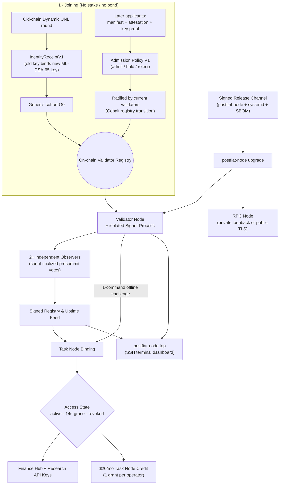

# Pillar 3 — Validator Rewards Program

> **Status:** Guide live, code not merged. The "Run a Validator" guide ([site#56](https://github.com/postfiatorg/postfiatorg.github.io/pull/56)) is live. The contract ([postfiatl1v2#286](https://github.com/postfiatorg/postfiatl1v2/pull/286)) and the CLI/RPC/uptime code ([#290](https://github.com/postfiatorg/postfiatl1v2/pull/290)) are open, and both got a "not ready" second read. Join/ratification CLI, release pipeline, observers, Task Node enforcement and the 2 public RPCs are not started. Full step list under [Build milestones](#build-milestones).
>
> **Outcome:** [B · A production-ready new chain](../README.md#three-outcomes) — moving `postfiatl1v2` from 6 Foundation-run nodes to a real outside validator network.

## Current Status Report (2026-11-27 19:00 UTC)

| Gate 1 · Code / Executed | Gate 2 · Founder UAT | Gate 3 · Docs | Gate 4 · Blog Post |
| --- | --- | --- | --- |
| **PRs Open, changes needed** (`l1#286`, `l1#290`: 5 + 7 blocking review points); M2, release pipeline, observers, Task Node enforcement, 2 Foundation RPCs & G0 cohort Not Started | Not Started | **Guide live** (`site#56` merged) but ahead of the code; `site#59`, `site#61` open; MkDocs copy missing | **Draft merged** (`draft: true`, `site#57`) |

- **Merged on `main`:** Validator doctor fixes ([postfiatl1v2#281](https://github.com/postfiatorg/postfiatl1v2/pull/281)) and spec ([postfiatl1v2#285](https://github.com/postfiatorg/postfiatl1v2/pull/285)).
- **Built & open in PRs (Waves 0–2):**
  - [postfiatl1v2#286](https://github.com/postfiatorg/postfiatl1v2/pull/286) *(Phase 0 C2)* — Signed `postfiat-validator-uptime-v1` feed schema + `upgrade`/`top`/RPC profile spec. *(9 CI pass; `test` failed on pre-`#296` stale assertion + expected ELF drift.)*
  - [postfiatl1v2#290](https://github.com/postfiatorg/postfiatl1v2/pull/290) *(Wave 1 Lane 2)* — `postfiat-node top` SSH dashboard, `upgrade` command, read-replica RPC profiles & read-path cache, and multi-observer uptime feed. *(15 local Rust suites passed; 9 CI pass; `test` cancelled at 2h CI limit — `#298` splits the CI job.)*
  - [postfiatorg.github.io#56](https://github.com/postfiatorg/postfiatorg.github.io/pull/56) & [#57](https://github.com/postfiatorg/postfiatorg.github.io/pull/57) *(**1/1 CI GREEN**)* — Unified "Run a Validator" technical guide (Gate #3) and blog draft (`draft: true`, Gate #4). *(Independent validator-guide enhancements also open: [#59](https://github.com/postfiatorg/postfiatorg.github.io/pull/59) persistent DOCKER-USER limits, [#61](https://github.com/postfiatorg/postfiatorg.github.io/pull/61) 5-minute healthcheck systemd timer.)*
- **Wave 3 work on disk:** No Wave 3 code lane required for Pillar 3 (only CI sweep / rebase onto `#296` + `#298`).
- **Not done yet:** Merge `#286`/`#290`/`#56`/`#59`/`#61`, publish signed release channel, stand up 2 Foundation public RPC endpoints, onboard outside `G0` validator cohort, turn on rewards + active-liveness enforcement, Founder UAT, and publish blog post.

---

## What this pillar is (in plain English)

Running a Post Fiat validator earns operators something genuinely valuable: **Finance Hub access**, **GoodAlexander research API keys**, and **$20/month in Task Node credit** for staying online.

First, answering the founder's direct question on RPC software: **yes, we already have RPC software.** There is no separate RPC codebase — it is the exact same `postfiat-node` binary running in RPC mode, installed and updated from the exact same signed release.

This pillar turns our scattered internal fleet runbooks into a clean product any approved outside operator can run from **one docs page**:

1. **One "Run a Validator" page** on `postfiat.org` (next to the old-chain setup page) with copy-paste steps for Requirements, Keys, Install, Join, Upgrade, RPC Node, Connect to Task Node, and Status.
2. **Signed releases & safe upgrades (`postfiat-node upgrade`):** Verifies the release signature, backs up chain data, swaps the binary, restarts, and rolls back automatically if health checks fail — never touching the double-sign guard file.
3. **Delightful SSH status UX (`postfiat-node top`):** A clean terminal dashboard over SSH showing block height/lag, peer health, recent vote signing, release/upgrade alerts, disk usage, signer health, and Task Node reward eligibility — no web port required.
4. **One-command Task Node connect:** Signs a one-time challenge inside a network-isolated sandbox and unlocks Finance Hub, research API keys, and the monthly $20 credit.
5. **Active-liveness enforcement:** Validators must stay active in the registry and maintain uptime (with a 14-day grace period) to keep research access and rewards — closing today's loophole where connecting once unlocks Finance Hub forever.

## How validator onboarding, monitoring & rewards work

## Locked-in design decisions

- **Validator reward:** **Finance Hub + GoodAlexander research API keys + $20/month in Task Node USD credit**, paid **per operator (not per node)** via [Pillar 6](06-hive-identity.md) identity once live (and one grant per operator across old + new chains during migration — no double-dipping).
- **Must stay active for access:** **Yes.** Research access and monthly credit both require the validator to remain active in the on-chain registry and meet the uptime rule (**≥ 95% participation over 25 of 30 observed days**, computed from finalized `precommit_qc.votes`), with a **14-day grace period** before access revokes so brief outages never punish real operators.
- **No stake / no bond:** Admission remains stake-free. First outside cohort (`G0`) comes from old-chain Dynamic UNL validators who sign an `IdentityReceiptV1`; subsequent operators enter through deterministic Admission Policy V1 + ratification by the current validator set (with Task Node standing counting as positive evidence).
- **Public RPC & private-action admission:** Opt-in for outside validators at launch (Foundation runs the first 2 public RPC + private-admission endpoints so [Pillar 5](05-local-task-node.md) works immediately; later operators can opt in and optionally monetize public RPC via [Pillar 2](02-message-protocol.md) x402).
- **Engineering & rollout defaults locked in:**
  - **Max validator set size:** Launch minimum is **12 validators** (max 2 seats per correlated group); maximum set size is set from our `n = 12+` ML-DSA-65 certificate bandwidth/latency benchmark rather than guessed on paper.
  - **Low participation removal:** Triggers an operator warning, then enters the 14-day grace window, then submits an automatic removal proposal that validators still ratify explicitly.
  - **Release signing & upgrades:** Signed by one pinned ML-DSA-65 publisher key at launch (documented rotation procedure; multi-sig m-of-n later). Applying an upgrade is **always manual** via `postfiat-node upgrade` so nodes never auto-reboot mid-consensus.
  - **Task Node default network flip:** `ValidatorSettings.jsx` switches default from old chain (`ledger`) to `postfiatl1v2` at **Step 3 (public testnet launch)** while keeping old chain as a legacy option during transition.
  - **Finance Hub paths:** Running an active validator and being a top-30 Task Node contributor remain two independent ways to qualify for [Pillar 9](09-finance-hub.md).

## What exists today

| Piece | Current state | Where |
|---|---|---|
| `postfiat-node` (validator + RPC) | Built (`rpc-serve`, `rpc-catch-up-certified-delta`, `--allow-private-action-admission`). RPC is the same binary. Needs follower-mode confirmation, faster read latency (currently 7–10s on devnet), and packaged systemd/Docker profiles | [`crates/node`](https://github.com/postfiatorg/postfiatl1v2/tree/main/crates/node), [`public-rpc-operator-policy.md`](https://github.com/postfiatorg/postfiatl1v2/blob/main/docs/runbooks/public-rpc-operator-policy.md) |
| Key custody & signer guard | Master/hot keygen and separate signer process with double-sign guard are built, but not yet deployed by default | [`validator_signer_guard.rs`](https://github.com/postfiatorg/postfiatl1v2/blob/main/crates/node/src/validator_signer_guard.rs) |
| Release channel & `upgrade` | Release process & signed manifests documented, but no public release published and no `postfiat-node upgrade` command yet | [`docs/release-process.md`](https://github.com/postfiatorg/postfiatl1v2/blob/main/docs/release-process.md) |
| Onboarding & ratification CLI | Manifest & attestation tools exist; missing `identity-receipt`, admission submission/status, and ratification client (gate C4) | [`crates/types/src/genesis_registry.rs`](https://github.com/postfiatorg/postfiatl1v2/blob/main/crates/types/src/genesis_registry.rs) |
| SSH status UX (`top`) | Only raw JSON doctor scripts exist — no terminal dashboard | [`docs/runbooks/validator-doctor.md`](https://github.com/postfiatorg/postfiatl1v2/blob/main/docs/runbooks/validator-doctor.md) |
| Task Node connect & rewards | One-command offline-signed connect works for the 6 Foundation validators (chain ID hardcoded to devnet); `$20/mo` credit code exists but is switched off; registry feed is unsigned on a single host; access never expires today | [`public/l1-validator.sh`](https://github.com/postfiatorg/tasknode/blob/main/public/l1-validator.sh), [`server/l1-validator-rewards.js`](https://github.com/postfiatorg/tasknode/blob/main/server/l1-validator-rewards.js), [`ValidatorSettings.jsx`](https://github.com/postfiatorg/tasknode/blob/main/src/features/research/ValidatorSettings.jsx) |

## Detailed specification

### 1. Staged rollout & Foundation seat scale-down
- **Step 1 — Foundation fleet:** Prove `upgrade`, `top`, signed uptime feed, and Task Node connect on all 6 Foundation validators.
- **Step 2 — External rehearsal:** Admit a fresh Foundation-run "outside" validator on a clean host using *only* the public docs page (no internal fleet shortcuts) and verify end-to-end ratification.
- **Step 3 — Genesis cohort (`G0`):** Once launch gates close (Cobalt sole registry path `Z1`, NAVCoin swaps `Z3`, Dynamic UNL round `C1`, ratification client `C4`, 6-clone rehearsal `G6`, launch decision `D4`), invite old-chain Dynamic UNL validators to submit `IdentityReceiptV1` and launch public testnet (`n >= 12`). As outside `G0` validators join, the Foundation scales down from 6 nodes to **at most 2 correlated seats** to satisfy its own correlated-group rule. Flip Task Node's default validator connect tab to `postfiatl1v2`.
- **Step 4 — Open admission:** Accept new outside operators through Admission Policy V1 + validator ratification.

### 2. Multi-sig signed releases, safe upgrades & key safety
- **2-of-3 signed release channel:** Every tagged release ships `postfiat-node` (`linux-x86_64` and `aarch64`), systemd units, SBOM, checksums, pinned catch-up checkpoints (height, block hash, state root), and a deployment manifest **co-signed by 2-of-3 offline ML-DSA-65 release keys** (covering the independent second builder — eliminating a single publisher-key SPOF).
- **`postfiat-node upgrade [--check]`:** Reports whether a release is *rolling* or *activation at height H* (including advance warning window and halt behavior if missed). Checks free disk space (`>= 2×` chain data size) before backing up, verifies the 2-of-3 manifest signatures, stops services, backs up **chain state only**, swaps binary, restarts, health-checks, and rolls back binary + chain state together on failure. **The double-sign guard file lives in a separate immutable directory (`/var/lib/postfiat/signer-guard/`) and is NEVER copied, backed up, or rolled back** — preventing rollback-vs-guard deadlocks.
- **Key custody & hot-key rotation:** Master key stays offline; hot consensus key runs inside the separate `validator-signer-serve` process (with documented hot-key rotation via `validator-key-stage` + registry transition included in M1). *(Docs explicitly note HSM custody is not yet implemented.)*

### 3. Isolated RPC node (`postfiat-node` in RPC mode) & `<250ms` read SLA
- **Consensus isolation (anti-DoS):** Validators that opt into serving public RPC or `--allow-private-action-admission` run the public RPC/admission edge in a **dedicated rate-limited process with separate CPU/memory cgroups** (or a separate non-voting follower node forwarding pre-checked proofs) so public read/proof floods can never stall consensus voting.
- **Profiles & latency fix:** Ships ready-to-run systemd + Docker Compose profiles (loopback *private* profile and TLS *public* profile), catches up from release-pinned checkpoints (`rpc-catch-up-certified-delta`), confirms automatic non-voting follower mode, and eliminates today's 7–10s read latency (by serving read RPCs from non-blocking read snapshots/replicas instead of blocking behind `redb` writer locks) with a published **`< 250ms` p95 read SLA**.

### 4. SSH dashboard (`postfiat-node top`) & single docs page
- **`postfiat-node top`:** Read-only terminal UI over SSH (no web port needed) showing block height & lag, connected peers, recent vote participation, installed release & any upcoming activation height countdown, signer guard health, disk usage, recent warnings, and Task Node reward/access eligibility pulled directly from the signed observer feed.
- **One "Run a Validator" page:** Canonical source in `docs/validators/run-a-validator.md`, published on `postfiat.org` next to the old-chain page. Includes real measured hardware sizing (CPU, RAM, disk, bandwidth, monthly cost), ports/firewall, Keys, Install, Join, Upgrade, Rotation, RPC, Connect, Status, and Troubleshooting.

### 5. Fair uptime measurement, 3-observer feed & working grace recovery
- **Latency-fair uptime metric (not fast-quorum-biased):** Counting only `precommit_qc.votes` systematically evicts geographically distant validators because fast nodes form a 5-of-6 quorum first and drop slower peers' votes. Instead, observers credit **every valid signed vote or consensus heartbeat submitted within each block-height round window**, scored over **deterministic block-height windows** (zero wall-clock drift).
- **3-of-3 / 2-of-3 signed observer feed (`postfiat-validator-uptime-v1`):** **Three independent geographically distributed observers** compute participation per height window and sign the feed with ML-DSA-65; Task Node requires **2-of-3 observer agreement** (eliminating 2-observer split-brain deadlocks). A stale feed (>1 hour) blocks new bindings and credit grants but **never** falsely revokes existing access.
- **Working grace & Day-0 ramp-in (`pending → active → lapsed (14d grace) → revoked`):**
  - **Day-0 ramp-in:** Newly ratified validators enter `active` immediately on registry inclusion (exempt from the 25-of-30 history check during their first 30 days as long as they stay above 95% over observed days).
  - **14-day grace & fast recovery:** Falling out of the registry or below 95% enters `lapsed` (14-day grace). An operator recovers back to `active` immediately upon sustaining **`>= 95%` participation over 3 consecutive height-days** (fixing the math trap where a 6-day outage would otherwise block recovery for 25 days!).
  - **Revocation:** On `revoked`, Task Node immediately disables Finance Hub access, **invalidates active Research API keys**, and pauses the `$20/mo` credit.
- **Hardened connect (`postfiat-node tasknode-bind`):** Bundled inside the signed release (`x86_64`, `aarch64`, offline mode), signs a single-use challenge binding `(account_id, chain_id, node_id, nonce, expiry)` via the signer allow-list, emits the [Pillar 6](06-hive-identity.md) validator link co-signature, and enforces one grant per operator across old + new chains (using verified Task Node account + network-correlation checks before Pillar 6 identity becomes mandatory). Public validator directory displays live state, participation, identity, and optional public RPC URL.

## Milestones & completion checklist

### Build milestones

Each milestone is broken into numbered steps. `[x]` means merged on `main` or live. "Built" means the code sits in an open PR and is not merged. Review points are from the second read of [`#286`](https://github.com/postfiatorg/postfiatl1v2/pull/286) and [`#290`](https://github.com/postfiatorg/postfiatl1v2/pull/290) (both answered "not ready"; none of the points are fixed yet).

#### M0 · Freeze the contract (`postfiatl1v2#286`)
- [ ] **0.1** Settle what a "day" is (see open decision 1), and make `#286` and `#287` use the same definition.
- [ ] **0.2** Put every field Task Node acts on inside the observer signature: operator identity, public RPC URL, grace and recovery fields, consecutive passing days, removal flag.
- [ ] **0.3** Make the signature check real: verify ML-DSA-65 signatures against pinned observer keys, replace the fixture's invalid signatures, add tests that reject swapped, zeroed and invented signers.
- [ ] **0.4** Give releases an order so `upgrade` refuses an older release than the one installed.
- [ ] **0.5** Fix the smaller contract points: `liveness_met` rule vs schema constant, one rule for observer disagreement, recovery floor same in text and test, an older feed cannot replace a newer one, list of served and never-served RPC methods, the three schemas that are only named, interrupted-upgrade and key-rotation cases.
- [ ] **0.6** Wire `scripts/test-validator-uptime-schema.py` into CI, then merge `#286`.

#### M1 · Signed release channel & `postfiat-node upgrade`
- [ ] **1.1** `upgrade [--check]` command — built in `#290` (`crates/node/src/release_upgrade.rs`), not merged.
- [ ] **1.2** Fix the health check: the node reports an 8-character revision, the manifest requires 40, so every real upgrade rolls back today.
- [ ] **1.3** Backup and rollback keep file owner and permissions; the backup never holds a readable copy of a signing key.
- [ ] **1.4** Rollback never restores the validator's own vote record (today it does, which allows a second vote at the same height). Requires the separate signer and guard directory to be the default (step 1.9).
- [ ] **1.5** `upgrade` cannot leave services stopped; chain, clock and older-release checks cannot be skipped.
- [ ] **1.6** Generate the three offline ML-DSA-65 release keys, publish the pinned keyset, write the rotation procedure.
- [ ] **1.7** Release build workflow: reproducible `linux-x86_64` + `aarch64` binaries, systemd units, SBOM, checksums, pinned catch-up checkpoint, manifest co-signed 2-of-3 with an independent second builder. No such workflow exists yet (`scripts/generate-cargo-sbom` is the only piece).
- [ ] **1.8** Publish the first signed release at a public URL.
- [ ] **1.9** Make the separate `validator-signer-serve` process and `/var/lib/postfiat/signer-guard/` the default deployment on the 6 Foundation validators.
- [ ] **1.10** Document and rehearse hot-key rotation (`validator-key-stage` + registry transition).
- [ ] **1.11** Run a real signed upgrade and a forced-failure rollback on one Foundation validator, then on all 6.

#### M2 · Join & ratification CLI + set-size benchmark
- [ ] **2.1** `identity-receipt` command (old-chain key signs the new ML-DSA-65 key, `IdentityReceiptV1`). Not started.
- [ ] **2.2** Admission evidence submit, verdict and status commands (Admission Policy V1). Not started.
- [ ] **2.3** Ratification client for the current validators (closes gate C4). Not started.
- [ ] **2.4** Automatic removal proposal after warning and grace, still ratified by hand.
- [ ] **2.5** Run and publish the `n = 12+` ML-DSA-65 certificate bandwidth/latency benchmark; set the maximum set size from it.
- [ ] **2.6** Enforce at most 2 seats per correlated group in admission.

#### M3 · Packaged RPC profiles & read-latency fix
- [ ] **3.1** In-process read path and cache — built in `#290` (`rpc_read_cache.rs`), not merged.
- [ ] **3.2** Keep the standard profile on today's worker path so merging changes nothing for the 6 validators; switch the cache on for replica profiles only.
- [ ] **3.3** Cache correctness: answers that change between blocks (`account`, `account_assets`, `metrics`) are not served stale; every cached answer names its height; add an age limit.
- [ ] **3.4** Restore the limits the worker path had (8 at once, 4 per caller, time limit) and measure the effect on the validator's database access under load on a copy.
- [ ] **3.5** Replica profiles: a served-method list (today 100 methods, 12 state-changing), a real non-voting check, and an enforced lag limit (today only printed).
- [ ] **3.6** Fix the packaged Caddy and systemd files so they run as written; test the Docker Compose profiles.
- [ ] **3.7** An equivalence test that compares the new read path with the old one (today it compares the new path with itself), and a `test` CI run that passes rather than times out.
- [ ] **3.8** Consensus isolation: public RPC edge in its own rate-limited process and cgroup.
- [ ] **3.9** Measure and publish the `< 250ms` p95 read number on devnet-2.
- [ ] **3.10** Stand up the first 2 Foundation public RPC + private-admission endpoints (TLS, DNS). Pillar 5's direct-RPC default depends on this.

#### M4 · `postfiat-node top` SSH dashboard
- [ ] **4.1** Dashboard with 7 panels, `--once`, `--json` — built in `#290` (`validator_top.rs`), not merged.
- [ ] **4.2** Eligibility panel reads the real signed feed (after M5.4).
- [ ] **4.3** Run it over SSH on all 6 Foundation validators.

#### M5 · Signed uptime feed, access lifecycle & Task Node connect
- [ ] **5.1** Observer key, sign and verify commands — built in `#290` (`validator_uptime.rs`), not merged.
- [ ] **5.2** Collector bug: per-day counters are lost between runs (JSON keys come back as text), so every validator would end up revoked.
- [ ] **5.3** Collector counts certificate votes only but signs the result as "latency-fair". Implement the rule the contract names; `consensus_heartbeat` does not exist on `main` (see open decision 2).
- [ ] **5.4** One wrong observer must not stop the feed. Deploy 3 observers in 3 regions and publish the 2-of-3 feed at a stable URL.
- [ ] **5.5** Task Node reads the new feed. Today `server/l1-validator-uptime.js` reads a single-host probe feed (96 probes per UTC day) behind `TASKNODE_L1_UPTIME_REWARDS_ENABLED`, which is off.
- [ ] **5.6** Task Node access states `pending → active → lapsed (14d grace) → revoked`, with Day-0 ramp-in and 3-day recovery. Not on `main`.
- [ ] **5.7** On `revoked`: Finance Hub off, research API keys invalidated, `$20/mo` credit paused. A stale feed blocks new grants but revokes nobody.
- [ ] **5.8** `postfiat-node tasknode-bind` inside the signed release, replacing `public/l1-validator.sh` (which hardcodes `l1-devnet`). Not started.
- [ ] **5.9** One grant per operator across old and new chains.
- [ ] **5.10** Emit the Pillar 6 validator link co-signature (after Train B).
- [ ] **5.11** Turn on the `$20/mo` credit.
- [ ] **5.12** Public validator directory: state, participation, identity, optional RPC URL.
- [ ] **5.13** Flip `ValidatorSettings.jsx` default from `ledger` to `postfiatl1v2` at public testnet launch.

#### M6 · Rehearsal and rollout
- [ ] **6.1** Prove `upgrade`, `top`, the signed feed and connect on all 6 Foundation validators.
- [ ] **6.2** Clean-host rehearsal: a new server, only the public docs page, through install, join, ratify, RPC, upgrade, `top`, connect, Finance Hub unlock.
- [ ] **6.3** Close the launch gates: `Z1`, `Z3`, `C1`, `C4`, `G6`, `D4`.
- [ ] **6.4** Invite the old-chain Dynamic UNL validators (`G0`), collect `IdentityReceiptV1`, launch public testnet at `n >= 12`.
- [ ] **6.5** Scale the Foundation from 6 seats to at most 2.
- [ ] **6.6** Open admission through Admission Policy V1.

#### Docs and blog
- [x] **7.1** "Run a Validator" guide live on `postfiat.org` (`content/run-a-validator.md`, `site#56`).
- [ ] **7.2** The live guide describes `upgrade`, `tasknode-bind`, the signed release channel and the 3-observer feed, none of which an operator can use yet. Mark those sections as not yet available, or hold the link until M1 and M5 land.
- [ ] **7.3** Canonical copy at `docs/validators/run-a-validator.md` in `postfiatl1v2` (MkDocs). Missing.
- [ ] **7.4** Replace the guide's hardware numbers with measured ones (from 2.5 and 3.9).
- [ ] **7.5** Merge community guide PRs `site#59` and `site#61`.
- [ ] **7.6** Blog post `content/blog/l1v2-validator-program.md` is merged as `draft: true`; publish after founder testing.

#### Open decisions (this doc says two things)
1. **What a day is.** Section 5 says block-height windows. The chain only makes a block when there is activity (about 26 a day last month), so a height-day of 14,400 blocks takes over a year, and a burst can run through 14 "days" of grace in an hour. Either the chain makes blocks on a fixed rhythm when idle, or the windows are UTC days.
2. **Which votes count.** "Locked-in decisions" says finalized `precommit_qc.votes`; section 5 rejects that and credits every vote or heartbeat in the round window. The second needs a heartbeat that does not exist yet.
3. **Release signing at launch.** "Locked-in decisions" says one pinned publisher key; section 2 says 2-of-3.
4. **Observers.** M5 said "2+"; section 5 says three with 2-of-3 agreement. Steps above assume three.

### Required ship gates
- [ ] **1. Executed:** All M1–M6 code, release tooling, observers, and Task Node reward/access enforcement merged and live.
- [ ] **2. Tested by user:** Founder (and an outside operator) walks through the docs page on a fresh host, runs `postfiat-node top`, executes a signed upgrade, connects to Task Node, verifies Finance Hub unlocks, and verifies grace/revocation behavior when offline.
- [ ] **3. Added to docs:** Single canonical **Run a Validator** guide (including RPC setup, measured hardware specs, and upgrade/rotation runbooks) published on `postfiat.org` and MkDocs.
- [ ] **4. Public blog post document:** Public blog post written and published announcing the Post Fiat L1v2 Validator Program, how to join and run an RPC node, and what active validators earn.

## Code references

- Node & CLI: [`crates/node/src/main_parts/cli_dispatch_parts/`](https://github.com/postfiatorg/postfiatl1v2/tree/main/crates/node/src/main_parts/cli_dispatch_parts) · [`validator_signer_guard.rs`](https://github.com/postfiatorg/postfiatl1v2/blob/main/crates/node/src/validator_signer_guard.rs) · [`genesis_registry.rs`](https://github.com/postfiatorg/postfiatl1v2/blob/main/crates/types/src/genesis_registry.rs)
- Docs & policy: [`docs/release-process.md`](https://github.com/postfiatorg/postfiatl1v2/blob/main/docs/release-process.md) · [`public-rpc-operator-policy.md`](https://github.com/postfiatorg/postfiatl1v2/blob/main/docs/runbooks/public-rpc-operator-policy.md) · [`validator-registry.md`](https://github.com/postfiatorg/postfiatl1v2/blob/main/docs/governance/validator-registry.md)
- Task Node connect & rewards: [`public/l1-validator.sh`](https://github.com/postfiatorg/tasknode/blob/main/public/l1-validator.sh) · [`server/l1-validator-identity.js`](https://github.com/postfiatorg/tasknode/blob/main/server/l1-validator-identity.js) · [`server/l1-validator-rewards.js`](https://github.com/postfiatorg/tasknode/blob/main/server/l1-validator-rewards.js) · [`ValidatorSettings.jsx`](https://github.com/postfiatorg/tasknode/blob/main/src/features/research/ValidatorSettings.jsx)
