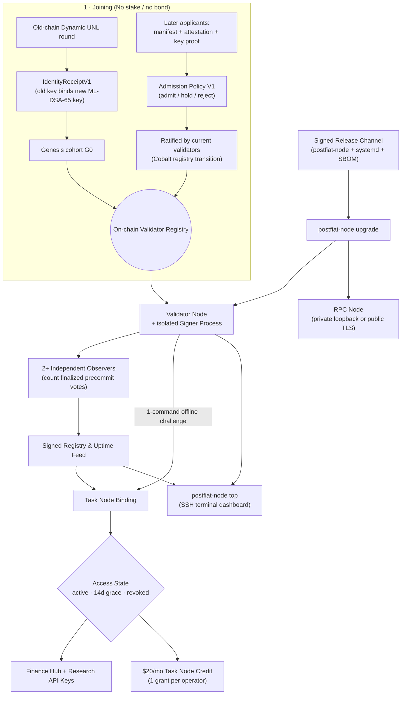

# Pillar 3 — Validator Rewards Program

> **Status:** Early. The `postfiat-node` binary (including RPC mode), double-sign-guarded signer process, deterministic admission policy, and Task Node validator binding already exist. What is missing: a signed public release channel, one-command `upgrade`, the SSH `top` dashboard, receipt/ratification CLI commands, signed multi-observer uptime feed, one unified "Run a Validator" docs page, and turning rewards + active-liveness enforcement on.
>
> **Outcome:** [B · A production-ready new chain](../README.md#three-outcomes) — moving `postfiatl1v2` from 6 Foundation-run nodes to a real outside validator network.

## What this pillar is (in plain English)

Running a Post Fiat validator earns operators something genuinely valuable: **Finance Hub access**, **GoodAlexander research API keys**, and **$20/month in Task Node credit** for staying online.

First, answering the founder's direct question on RPC software: **yes, we already have RPC software.** There is no separate RPC codebase — it is the exact same `postfiat-node` binary running in RPC mode, installed and updated from the exact same signed release.

This pillar turns our scattered internal fleet runbooks into a clean product any approved outside operator can run from **one docs page**:

1. **One "Run a Validator" page** on `postfiat.org` (next to the old-chain setup page) with copy-paste steps for Requirements, Keys, Install, Join, Upgrade, RPC Node, Connect to Task Node, and Status.
2. **Signed releases & safe upgrades (`postfiat-node upgrade`):** Verifies the release signature, backs up chain data, swaps the binary, restarts, and rolls back automatically if health checks fail — never touching the double-sign guard file.
3. **Delightful SSH status UX (`postfiat-node top`):** A clean terminal dashboard over SSH showing block height/lag, peer health, recent vote signing, release/upgrade alerts, disk usage, signer health, and Task Node reward eligibility — no web port required.
4. **One-command Task Node connect:** Signs a one-time challenge inside a network-isolated sandbox and unlocks Finance Hub, research API keys, and the monthly $20 credit.
5. **Active-liveness enforcement:** Validators must stay active in the registry and maintain uptime (with a 14-day grace period) to keep research access and rewards — closing today's loophole where connecting once unlocks Finance Hub forever.

## How validator onboarding, monitoring & rewards work

## Locked-in design decisions

- **Validator reward:** **Finance Hub + GoodAlexander research API keys + $20/month in Task Node USD credit**, paid **per operator (not per node)** via [Pillar 6](06-hive-identity.md) identity once live (and one grant per operator across old + new chains during migration — no double-dipping).
- **Must stay active for access:** **Yes.** Research access and monthly credit both require the validator to remain active in the on-chain registry and meet the uptime rule (**≥ 95% participation over 25 of 30 observed days**, computed from finalized `precommit_qc.votes`), with a **14-day grace period** before access revokes so brief outages never punish real operators.
- **No stake / no bond:** Admission remains stake-free. First outside cohort (`G0`) comes from old-chain Dynamic UNL validators who sign an `IdentityReceiptV1`; subsequent operators enter through deterministic Admission Policy V1 + ratification by the current validator set (with Task Node standing counting as positive evidence).
- **Public RPC & private-action admission:** Opt-in for outside validators at launch (Foundation runs the first 2 public RPC + private-admission endpoints so [Pillar 5](05-local-task-node.md) works immediately; later operators can opt in and optionally monetize public RPC via [Pillar 2](02-message-protocol.md) x402).
- **Engineering & rollout defaults locked in:**
  - **Max validator set size:** Launch minimum is **12 validators** (max 2 seats per correlated group); maximum set size is set from our `n = 12+` ML-DSA-65 certificate bandwidth/latency benchmark rather than guessed on paper.
  - **Low participation removal:** Triggers an operator warning, then enters the 14-day grace window, then submits an automatic removal proposal that validators still ratify explicitly.
  - **Release signing & upgrades:** Signed by one pinned ML-DSA-65 publisher key at launch (documented rotation procedure; multi-sig m-of-n later). Applying an upgrade is **always manual** via `postfiat-node upgrade` so nodes never auto-reboot mid-consensus.
  - **Task Node default network flip:** `ValidatorSettings.jsx` switches default from old chain (`ledger`) to `postfiatl1v2` at **Step 3 (public testnet launch)** while keeping old chain as a legacy option during transition.
  - **Finance Hub paths:** Running an active validator and being a top-30 Task Node contributor remain two independent ways to qualify for [Pillar 9](09-finance-hub.md).

## What exists today

| Piece | Current state | Where |
|---|---|---|
| `postfiat-node` (validator + RPC) | Built (`rpc-serve`, `rpc-catch-up-certified-delta`, `--allow-private-action-admission`). RPC is the same binary. Needs follower-mode confirmation, faster read latency (currently 7–10s on devnet), and packaged systemd/Docker profiles | [`crates/node`](https://github.com/postfiatorg/postfiatl1v2/tree/main/crates/node), [`public-rpc-operator-policy.md`](https://github.com/postfiatorg/postfiatl1v2/blob/main/docs/runbooks/public-rpc-operator-policy.md) |
| Key custody & signer guard | Master/hot keygen and separate signer process with double-sign guard are built, but not yet deployed by default | [`validator_signer_guard.rs`](https://github.com/postfiatorg/postfiatl1v2/blob/main/crates/node/src/validator_signer_guard.rs) |
| Release channel & `upgrade` | Release process & signed manifests documented, but no public release published and no `postfiat-node upgrade` command yet | [`docs/release-process.md`](https://github.com/postfiatorg/postfiatl1v2/blob/main/docs/release-process.md) |
| Onboarding & ratification CLI | Manifest & attestation tools exist; missing `identity-receipt`, admission submission/status, and ratification client (gate C4) | [`crates/types/src/genesis_registry.rs`](https://github.com/postfiatorg/postfiatl1v2/blob/main/crates/types/src/genesis_registry.rs) |
| SSH status UX (`top`) | Only raw JSON doctor scripts exist — no terminal dashboard | [`docs/runbooks/validator-doctor.md`](https://github.com/postfiatorg/postfiatl1v2/blob/main/docs/runbooks/validator-doctor.md) |
| Task Node connect & rewards | One-command offline-signed connect works for the 6 Foundation validators (chain ID hardcoded to devnet); `$20/mo` credit code exists but is switched off; registry feed is unsigned on a single host; access never expires today | [`public/l1-validator.sh`](https://github.com/postfiatorg/tasknode/blob/main/public/l1-validator.sh), [`server/l1-validator-rewards.js`](https://github.com/postfiatorg/tasknode/blob/main/server/l1-validator-rewards.js), [`ValidatorSettings.jsx`](https://github.com/postfiatorg/tasknode/blob/main/src/features/research/ValidatorSettings.jsx) |

## Detailed specification

### 1. Staged rollout & Foundation seat scale-down
- **Step 1 — Foundation fleet:** Prove `upgrade`, `top`, signed uptime feed, and Task Node connect on all 6 Foundation validators.
- **Step 2 — External rehearsal:** Admit a fresh Foundation-run "outside" validator on a clean host using *only* the public docs page (no internal fleet shortcuts) and verify end-to-end ratification.
- **Step 3 — Genesis cohort (`G0`):** Once launch gates close (Cobalt sole registry path `Z1`, NAVCoin swaps `Z3`, Dynamic UNL round `C1`, ratification client `C4`, 6-clone rehearsal `G6`, launch decision `D4`), invite old-chain Dynamic UNL validators to submit `IdentityReceiptV1` and launch public testnet (`n >= 12`). As outside `G0` validators join, the Foundation scales down from 6 nodes to **at most 2 correlated seats** to satisfy its own correlated-group rule. Flip Task Node's default validator connect tab to `postfiatl1v2`.
- **Step 4 — Open admission:** Accept new outside operators through Admission Policy V1 + validator ratification.

### 2. Multi-sig signed releases, safe upgrades & key safety
- **2-of-3 signed release channel:** Every tagged release ships `postfiat-node` (`linux-x86_64` and `aarch64`), systemd units, SBOM, checksums, pinned catch-up checkpoints (height, block hash, state root), and a deployment manifest **co-signed by 2-of-3 offline ML-DSA-65 release keys** (covering the independent second builder — eliminating a single publisher-key SPOF).
- **`postfiat-node upgrade [--check]`:** Reports whether a release is *rolling* or *activation at height H* (including advance warning window and halt behavior if missed). Checks free disk space (`>= 2×` chain data size) before backing up, verifies the 2-of-3 manifest signatures, stops services, backs up **chain state only**, swaps binary, restarts, health-checks, and rolls back binary + chain state together on failure. **The double-sign guard file lives in a separate immutable directory (`/var/lib/postfiat/signer-guard/`) and is NEVER copied, backed up, or rolled back** — preventing rollback-vs-guard deadlocks.
- **Key custody & hot-key rotation:** Master key stays offline; hot consensus key runs inside the separate `validator-signer-serve` process (with documented hot-key rotation via `validator-key-stage` + registry transition included in M1). *(Docs explicitly note HSM custody is not yet implemented.)*

### 3. Isolated RPC node (`postfiat-node` in RPC mode) & `<250ms` read SLA
- **Consensus isolation (anti-DoS):** Validators that opt into serving public RPC or `--allow-private-action-admission` run the public RPC/admission edge in a **dedicated rate-limited process with separate CPU/memory cgroups** (or a separate non-voting follower node forwarding pre-checked proofs) so public read/proof floods can never stall consensus voting.
- **Profiles & latency fix:** Ships ready-to-run systemd + Docker Compose profiles (loopback *private* profile and TLS *public* profile), catches up from release-pinned checkpoints (`rpc-catch-up-certified-delta`), confirms automatic non-voting follower mode, and eliminates today's 7–10s read latency (by serving read RPCs from non-blocking read snapshots/replicas instead of blocking behind `redb` writer locks) with a published **`< 250ms` p95 read SLA**.

### 4. SSH dashboard (`postfiat-node top`) & single docs page
- **`postfiat-node top`:** Read-only terminal UI over SSH (no web port needed) showing block height & lag, connected peers, recent vote participation, installed release & any upcoming activation height countdown, signer guard health, disk usage, recent warnings, and Task Node reward/access eligibility pulled directly from the signed observer feed.
- **One "Run a Validator" page:** Canonical source in `docs/validators/run-a-validator.md`, published on `postfiat.org` next to the old-chain page. Includes real measured hardware sizing (CPU, RAM, disk, bandwidth, monthly cost), ports/firewall, Keys, Install, Join, Upgrade, Rotation, RPC, Connect, Status, and Troubleshooting.

### 5. Fair uptime measurement, 3-observer feed & working grace recovery
- **Latency-fair uptime metric (not fast-quorum-biased):** Counting only `precommit_qc.votes` systematically evicts geographically distant validators because fast nodes form a 5-of-6 quorum first and drop slower peers' votes. Instead, observers credit **every valid signed vote or consensus heartbeat submitted within each block-height round window**, scored over **deterministic block-height windows** (zero wall-clock drift).
- **3-of-3 / 2-of-3 signed observer feed (`postfiat-validator-uptime-v1`):** **Three independent geographically distributed observers** compute participation per height window and sign the feed with ML-DSA-65; Task Node requires **2-of-3 observer agreement** (eliminating 2-observer split-brain deadlocks). A stale feed (>1 hour) blocks new bindings and credit grants but **never** falsely revokes existing access.
- **Working grace & Day-0 ramp-in (`pending → active → lapsed (14d grace) → revoked`):**
  - **Day-0 ramp-in:** Newly ratified validators enter `active` immediately on registry inclusion (exempt from the 25-of-30 history check during their first 30 days as long as they stay above 95% over observed days).
  - **14-day grace & fast recovery:** Falling out of the registry or below 95% enters `lapsed` (14-day grace). An operator recovers back to `active` immediately upon sustaining **`>= 95%` participation over 3 consecutive height-days** (fixing the math trap where a 6-day outage would otherwise block recovery for 25 days!).
  - **Revocation:** On `revoked`, Task Node immediately disables Finance Hub access, **invalidates active Research API keys**, and pauses the `$20/mo` credit.
- **Hardened connect (`postfiat-node tasknode-bind`):** Bundled inside the signed release (`x86_64`, `aarch64`, offline mode), signs a single-use challenge binding `(account_id, chain_id, node_id, nonce, expiry)` via the signer allow-list, emits the [Pillar 6](06-hive-identity.md) validator link co-signature, and enforces one grant per operator across old + new chains (using verified Task Node account + network-correlation checks before Pillar 6 identity becomes mandatory). Public validator directory displays live state, participation, identity, and optional public RPC URL.

## Milestones & completion checklist

### Build milestones
- [ ] **M1 · Signed release channel & `postfiat-node upgrade`:** Ship reproducible signed releases (`x86_64` + `aarch64`), pinned checkpoints, and `postfiat-node upgrade [--check]` with atomic binary+data rollback and guard-state protection.
- [ ] **M2 · Join & ratification CLI + set-size benchmark:** Build `identity-receipt`, admission evidence/verdict/status, and ratification client commands (closing gate C4); run and publish the `n = 12+` ML-DSA-65 certificate benchmark to lock maximum set size.
- [ ] **M3 · Packaged RPC profiles & read-latency fix:** Ship private + public RPC systemd/Docker configs on `postfiat-node`, verify automatic non-voting follower mode, cut read latency from 7–10s, and stand up the first 2 Foundation public RPC + private-admission endpoints.
- [ ] **M4 · `postfiat-node top` SSH dashboard:** Build and test the read-only terminal UI showing height, peers, precommit signing, upgrade warnings, signer health, disk, and Task Node eligibility.
- [ ] **M5 · Signed uptime feed, access lifecycle & Task Node connect:** Move binding helper into `postfiat-node tasknode-bind`, deploy 2+ independent signed observers, enforce `active / 14d grace / revoked` across Finance Hub + `$20/mo` per-operator rewards (no old+new double-dipping), ship the public validator directory, and flip Task Node default to `postfiatl1v2` at public testnet launch.
- [ ] **M6 · Clean-host external rehearsal:** On a brand-new server, follow *only* the public docs page to install, join, ratify, run RPC, upgrade, check `top`, and connect to Task Node to unlock Finance Hub.

### Required ship gates
- [ ] **1. Executed:** All M1–M6 code, release tooling, observers, and Task Node reward/access enforcement merged and live.
- [ ] **2. Tested by user:** Founder (and an outside operator) walks through the docs page on a fresh host, runs `postfiat-node top`, executes a signed upgrade, connects to Task Node, verifies Finance Hub unlocks, and verifies grace/revocation behavior when offline.
- [ ] **3. Added to docs:** Single canonical **Run a Validator** guide (including RPC setup, measured hardware specs, and upgrade/rotation runbooks) published on `postfiat.org` and MkDocs.
- [ ] **4. Public blog post document:** Public blog post written and published announcing the Post Fiat L1v2 Validator Program, how to join and run an RPC node, and what active validators earn.

## Code references

- Node & CLI: [`crates/node/src/main_parts/cli_dispatch_parts/`](https://github.com/postfiatorg/postfiatl1v2/tree/main/crates/node/src/main_parts/cli_dispatch_parts) · [`validator_signer_guard.rs`](https://github.com/postfiatorg/postfiatl1v2/blob/main/crates/node/src/validator_signer_guard.rs) · [`genesis_registry.rs`](https://github.com/postfiatorg/postfiatl1v2/blob/main/crates/types/src/genesis_registry.rs)
- Docs & policy: [`docs/release-process.md`](https://github.com/postfiatorg/postfiatl1v2/blob/main/docs/release-process.md) · [`public-rpc-operator-policy.md`](https://github.com/postfiatorg/postfiatl1v2/blob/main/docs/runbooks/public-rpc-operator-policy.md) · [`validator-registry.md`](https://github.com/postfiatorg/postfiatl1v2/blob/main/docs/governance/validator-registry.md)
- Task Node connect & rewards: [`public/l1-validator.sh`](https://github.com/postfiatorg/tasknode/blob/main/public/l1-validator.sh) · [`server/l1-validator-identity.js`](https://github.com/postfiatorg/tasknode/blob/main/server/l1-validator-identity.js) · [`server/l1-validator-rewards.js`](https://github.com/postfiatorg/tasknode/blob/main/server/l1-validator-rewards.js) · [`ValidatorSettings.jsx`](https://github.com/postfiatorg/tasknode/blob/main/src/features/research/ValidatorSettings.jsx)
