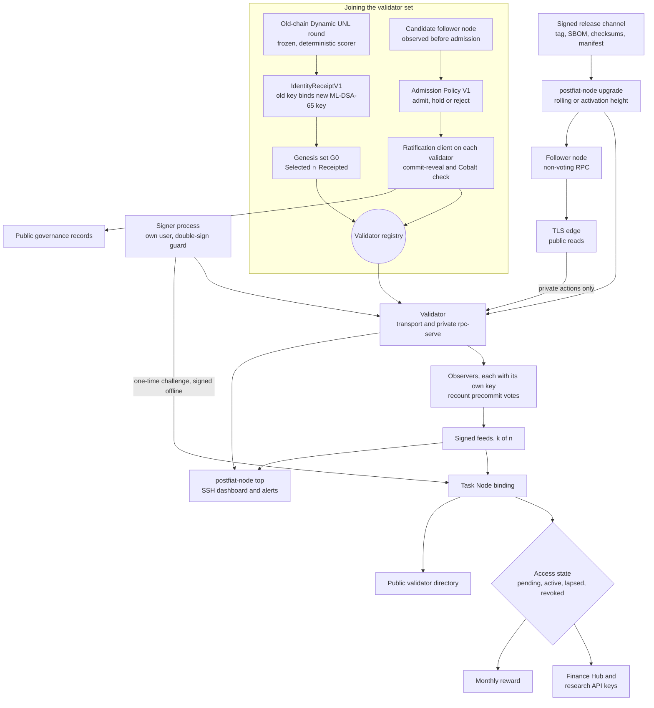

# Pillar 3 — Validator Rewards Program

> **Status:** Early. The node binary and its RPC server exist. So do the operator key and manifest tools, a signer with a double-sign guard, a deterministic admission policy and the Task Node binding. Binding to the new chain works, but only for the six Foundation validators and only with key files. Outside operators cannot join. There is no signed public release, public genesis, stand-alone RPC follower, receipt or ratification client, upgrade command, single docs page or SSH dashboard. Reward grants are off.
>
> **Bubbles up to:** [Outcome B · A production-ready new chain](../README.md#three-outcomes). *A decentralised new chain*. Outside validators are the first stage of moving off the old chain.

## In one paragraph

Post Fiat validators get something real for running a node: **Finance Hub** and **GoodAlexander research API keys**, plus a monthly reward for staying up. To deliver that on the new chain, an outsider must be able to **install, update and monitor** a postfiatl1v2 validator, optionally run an **RPC node**, and **connect** it to Task Node, all from one page. On the founder's question: **yes, we have RPC software.** It is `rpc-serve` in the same `postfiat-node` binary, updated through the same release. Today it runs only beside a validator; this pillar builds the stand-alone RPC node that follows the tip. Joining is deliberately not self-service. The first outside validators come from the old chain's Dynamic UNL scoring. Later applicants run a follower first, pass a deterministic admission policy and are ratified by the current validators. That gate keeps rewards and research access from being farmed. Each verdict is a public, recomputable record: validator membership is itself post-human governance in action.

## User story

**Founder's story.** I am a validator or an aspiring validator on the PostFiatL1v2 network. I want a clear way to update my validator software, which needs to exist, and to be able to run an RPC. Ripple presumably has RPC software. Do we? Where is it? How does it get updated? If I want to run my own RPC, how do I do that? I should be able to go to a docs page and see clearly how all of this is done. After my validator is up, I should be able to connect it to the Task Node extremely easily. Even better, my validator software should come with a delightful UX I can log into when I SSH in, showing key uptime and other statistics, so that my validator can be usefully used.

*From the wider brief:* moving to the new chain is multi-phased, and the first phase gets some validators onto it. People can't be migrated until the chain performs adequately. Validators should be able to access Finance Hub and GoodAlexander content. The existing validator onboarding tool is not linked to the new chain.

**Augmented story.**

1. **One page.** I open *Run a validator* on postfiat.org, next to the old-chain [validator setup](https://postfiat.org/validator-setup/) page. Its sections are Requirements, Keys, Install, Join, Update, RPC node, Connect and Status. Every command is copy-paste.
2. **Install.** I verify a signed release against the publisher key on the page. My master key stays offline. Only the signer, under its own user, reads my validator key.
3. **Join.** If the frozen Dynamic UNL round picked me, one command builds my `IdentityReceiptV1`, binding my old key to my new ML-DSA-65 key. If I come later, I first run a follower that observers measure, then one command previews my verdict (*admit*, *hold* or *reject*, with reasons). My status goes from *observing* to *ratified* to *active*.
4. **Update.** `postfiat-node upgrade --check` says whether a release is rolling or must be installed before activation height H. Applying it checks disk, takes a snapshot, swaps the binary and health-checks. It never touches the signer's guard.
5. **RPC node.** The **same binary** runs as a non-voting follower: privately on loopback for my wallet or local Task Node, or publicly on a separate host behind a TLS edge, so public load never reaches my validator.
6. **Connect.** In Task Node, under **Settings > Validator**, the new chain becomes the default at the agreed step. I paste one command. My signer signs a one-time challenge, and only the signature leaves. My profile shows *Validator · bound · active*, and Finance Hub opens. A later key rotation keeps the binding.
7. **Status UX.** Over SSH, without root, `postfiat-node top` shows node health, my signing, my join or ratification status, my eligibility as Task Node sees it, any upgrade-by height and alerts. Keys open logs, the doctor and an upgrade check. When I'm away, alerts reach my webhook.
8. **Rewards and access.** Anyone can recheck my participation from finalized votes. The reward and research access follow published rules, including what happens when I go offline.
9. **Useful.** My validator votes, can serve admission for local Task Node users, run a public follower and act as a feed observer, and is listed in a public directory.

## What exists today

| Component | Where | State |
|---|---|---|
| Node and RPC server | [`crates/node`](https://github.com/postfiatorg/postfiatl1v2/tree/main/crates/node): `rpc-serve`, `rpc-catch-up`, `rpc-catch-up-certified-delta` | Built. **RPC is not a separate product.** On a validator, `rpc-serve` also drives finality, sharing one store with `transport-validator-serve`. **No stand-alone follower:** `rpc-catch-up` imports a bounded batch (default 64 blocks) and exits. The pinned form fails closed unless it ends at the expected height, hash and state root. |
| RPC surface and speed | [`methods.md`](https://github.com/postfiatorg/postfiatl1v2/blob/main/docs/rpc/methods.md) · [fast-reads note](https://github.com/postfiatorg/postfiatl1v2/blob/main/docs/specs/fast-validator-reads-20261124.md) · [`public-rpc-operator-policy.md`](https://github.com/postfiatorg/postfiatl1v2/blob/main/docs/runbooks/public-rpc-operator-policy.md) | `status`, `account`, `account_tx`, `tx`, `receipts`, `blocks`, `validators` and `mempool_submit_signed_*`. There is no `account_info`. Public binds are refused. `status` and `server_info` are in-process, and `blocks`, `receipts` and `tx` read by key (0.3–0.5 s for `blocks`). **Other reads start a child process each and took 7–10 s**, queued on the store's exclusive lock, which block commits also hold. **No public endpoint.** |
| Private-action admission | [`private_action_rpc.rs`](https://github.com/postfiatorg/postfiatl1v2/blob/main/crates/node/src/private_action_rpc.rs) | Built, off (`--allow-private-action-admission`). The validator verifies the user's proof, reserves the batch and runs an ordinary certified finality round. It signs only consensus messages, so it adds no key domain. It needs the validator's live store, so only validators can serve it. |
| Release and upgrade | [`release-process.md`](https://github.com/postfiatorg/postfiatl1v2/blob/main/docs/release-process.md) · [`signed-deployment-manifest.md`](https://github.com/postfiatorg/postfiatl1v2/blob/main/docs/runbooks/signed-deployment-manifest.md) · [runbook §7](https://github.com/postfiatorg/postfiatl1v2/blob/main/docs/runbooks/public-operator-runbook.md#7-upgrade-and-rollback) · [`safe-validator-rollout.md`](https://github.com/postfiatorg/postfiatl1v2/blob/main/docs/runbooks/safe-validator-rollout.md) · [`replicated-state-v2-activation.md`](https://github.com/postfiatorg/postfiatl1v2/blob/main/docs/runbooks/replicated-state-v2-activation.md) | Defined (signed tag, SBOM, checksums, second builder), with a manifest signed by **one** ML-DSA-65 key. No public release has used it. The Foundation-only rollout tool snapshots first and keeps a rollback pair; binary-only rollback failed in the live-canary postmortem. Consensus changes use a scheduled height. |
| Operator runbook | [`public-operator-runbook.md`](https://github.com/postfiatorg/postfiatl1v2/blob/main/docs/runbooks/public-operator-runbook.md) | The closest thing to one page. Its own gap list: no signed artifact, genesis, registration tooling or public monitoring, and **no hardware sizing**. |
| Admission and removal | [`validator-registry.md`](https://github.com/postfiatorg/postfiatl1v2/blob/main/docs/governance/validator-registry.md) · [genesis spec](https://github.com/postfiatorg/postfiatl1v2/blob/main/docs/architecture/l1v2-testnet-genesis-and-launch-spec.md) §3–5 · [`launch-topology-thresholds.md`](https://github.com/postfiatorg/postfiatl1v2/blob/main/docs/architecture/launch-topology-thresholds.md) (proposal) · [evidence fields](https://github.com/postfiatorg/postfiatl1v2/blob/main/docs/governance/validator-evidence-field-registry.md) | **No join transaction and no stake.** The public testnet is a fresh genesis, `G0 = Selected ∩ Receipted`, from a frozen old-chain round, with no inserted seats. Later changes pass commit-reveal ratification (§4.2), proposed only by the Foundation pipeline. **Admission Policy V1** is a pure selector. Proposed floors: network-observed `uptime_window_bps` ≥ 9950 over 7 days, accountability ≥ 70, no shared control group, a signed manifest, a key-domain proof. Missing evidence holds. Rotation needs a continuity receipt from both keys. Proposed launch: `n ≥ 12`, quorum 10, at most 2 seats per correlated group, **the Foundation included**. The L3 independence verifier is not built. |
| Operator CLI | [`cli_dispatch_parts/`](https://github.com/postfiatorg/postfiatl1v2/tree/main/crates/node/src/main_parts/cli_dispatch_parts) | Present: `operator-onboarding-keygen`, `operator-manifest-create`, `operator-attestation-create`, `validator-key-stage`, `validator-signer-serve`, `deployment-*`. **Missing:** `upgrade`, `top`, follower mode, a receipt command, a ratification client. |
| Key custody | [signer policy](https://github.com/postfiatorg/postfiatl1v2/blob/main/docs/runbooks/public-rpc-operator-policy.md#validator-signer-process) · [`validator_signer.rs`](https://github.com/postfiatorg/postfiatl1v2/blob/main/crates/node/src/validator_signer.rs) | The signer runs under its own user, with guard state outside the data directory that must never be restored. **It signs only consensus and transport contexts**, so it refuses the Task Node binding. The two-user deployment is unqualified, and **the fleet uses key files**. No HSM. |
| Health tools | `scripts/node-status`, [`validator-doctor`](https://github.com/postfiatorg/postfiatl1v2/blob/main/docs/runbooks/validator-doctor.md), `scripts/testnet-rpc-doctor`, `scripts/testnet-monitor-snapshot` | JSON reports. The monitor spools `postfiat.monitor-alert.v1` envelopes "for external delivery", but nothing delivers them. **No terminal UI and no metrics endpoint.** |
| Task Node binding | [binding runbook](https://github.com/postfiatorg/postfiatl1v2/blob/main/docs/runbooks/tasknode-l1-validator-binding.md) · [`l1-validator.sh`](https://github.com/postfiatorg/tasknode/blob/main/public/l1-validator.sh) · [`l1-validator-identity.js`](https://github.com/postfiatorg/tasknode/blob/main/server/l1-validator-identity.js) · [`156_l1_validator_bindings.sql`](https://github.com/postfiatorg/tasknode/blob/main/server/db/migrations/156_l1_validator_bindings.sql) | **Works for registry members with key files.** It runs as root on Linux x86_64 and finds the node by its `--key-file`, so **it fails in signer mode**. A pinned helper signs a single-use, 30-minute challenge inside `unshare --net`. The chain id is hard-coded, also in a database constraint. An account may hold several bindings. |
| Participation feed | [`registry.py`](https://github.com/postfiatorg/postfiatl1v2/blob/main/tools/tasknode-validator-binding/registry.py) → `research.goodalexander.com:18443/l1-registry/registry.json` | **Live.** It lists six validators with daily participation counted from `precommit_qc.votes`. Two RPC reads on one host feed it. It is **unsigned**: Task Node checks its shape and rejects it after one hour. |
| Old-chain onboarding (default) | [`validator.sh`](https://github.com/postfiatorg/tasknode/blob/main/public/validator.sh) · [`ValidatorSettings.jsx`](https://github.com/postfiatorg/tasknode/blob/main/src/features/research/ValidatorSettings.jsx) (`useState("ledger")`) | Live. Targets `postfiatd`. The new chain is opt-in. |
| Rewards | [`l1-validator-rewards.js`](https://github.com/postfiatorg/tasknode/blob/main/server/l1-validator-rewards.js) · [`l1-validator-uptime.js`](https://github.com/postfiatorg/tasknode/blob/main/server/l1-validator-uptime.js) · [`validator-rewards.js`](https://github.com/postfiatorg/tasknode/blob/main/server/validator-rewards.js) | Built, off. **$20 a month of Task Node USD credit** per validator id, not PFT. It needs ≥ 25 observed days of the last 30 with mean participation ≥ 95%. **After a key rotation, grants fail** (`l1_validator_key_not_current`) and re-binding is refused until the old binding is removed. `TASKNODE_VALIDATOR_REWARDS_ENABLED` is unset in `fly.toml`; `TASKNODE_L1_UPTIME_REWARDS_ENABLED` is false. |
| Research access | [`index-viewer-routes.js`](https://github.com/postfiatorg/tasknode/blob/main/server/index-viewer-routes.js) · [`validator-bindings.js`](https://github.com/postfiatorg/tasknode/blob/main/server/repositories/validator-bindings.js) · [`validator-dashboard.js`](https://github.com/postfiatorg/tasknode/blob/main/server/validator-dashboard.js) | Live. **Any unrevoked binding on either chain** unlocks the validator Finance Hub bundles and research API keys. Chat Deep Research is open to all accounts. The registry is checked only at bind time. Only *Unbind* removes access. |

**Current network** ([network status](https://github.com/postfiatorg/postfiatl1v2/blob/main/docs/status/network-status.md)):

- six Foundation validators, quorum 5 of 6, no outside validators and no public RPC;
- [Cobalt](https://github.com/postfiatorg/postfiatl1v2/blob/main/docs/governance/cobalt.md) was last verified active at height 924, after ratifying two **key rotations**;
- **no add-validator change has been ratified on the live devnet**, only in a local drill;
- recent old-chain rounds scored 42–55 validators for a 20-seat UNL ([shadow evaluation](https://github.com/postfiatorg/postfiatl1v2/blob/main/docs/governance/dunl-subscorer-shadow-eval-20260901.md)).

### Gates that block outsiders

From the [testnet path](https://github.com/postfiatorg/postfiatl1v2/blob/main/docs/status/testnet-path.md) [milestone](https://github.com/postfiatorg/postfiatl1v2/blob/main/docs/plans/active/l1v2-public-testnet-path-milestone.md). **Gate Zero** (Z1–Z3) is the operator's recorded rule: no community-facing step starts until all three close.

| Item | What it is | Why it blocks validators |
|---|---|---|
| Z1 | Cobalt ratification is the only registry-change path on the devnet, proven on a real validator change | Ratifying outsiders needs it |
| Z2 | Old-chain Dynamic UNL rounds move from AI-model scores to the deterministic v2 sub-scorer, with model output only an advisory flag (decided, not live) | Those rounds select `G0`, so the scorer must be final and replayable |
| Z3 | NAVCoin swaps round-trip repeatedly with no consensus upgrade | Strangers shouldn't run a binary whose consensus surface is still changing |
| C1 | Dynamic UNL verification and evidence transparency on the old chain | `G0` is selected from that scoring |
| C4 | The sidecar extended into the l1v2 ratification client | Receipt submission and ratification need it |
| B2/B3 (G6) | Six-clone rehearsal and deployment decision | Launch gate L1 |
| D4 | Public-testnet launch decision | No public network before it |

## Architecture

### Keys

| Key | Lives in | Signs |
|---|---|---|
| Old-chain master key (secp256k1) | The operator's old-chain custody | The fork half of `IdentityReceiptV1`, via `postfiatd validator-keys` |
| Operator master key (ML-DSA-65) | Offline, from `operator-onboarding-keygen` | The onboarding record naming the validator key |
| Validator key | The signer process | Votes, proposals, transport authentication and private-action rounds. Also the ML-DSA half of the receipt, rotation continuity receipts and ratification reveals. The Task Node binding and Pillar 6 link go through R13 (open question 12). |
| Release publisher key | Foundation release custody | The deployment manifest |
| Observer keys | One per observer | That observer's feed |

A ratified rotation changes the key but not the validator id. Bindings follow the id (R15).

### Security model and failure modes

| Trust root | Protects | Today | Required |
|---|---|---|---|
| Release publisher key | Every binary outsiders run | One ML-DSA-65 key | Pinned on the docs page, with rotation; m-of-n is open question 9 |
| Validator key | Consensus votes | Key files | Signer under its own user, soaked on the Foundation fleet first |
| Consensus host | Liveness | Reads share the store lock with commits | Public reads only on follower hosts; no public port on validators |
| Participation feed | Binding, access, rewards | Unsigned, one host | k-of-n observers with their own keys, recomputable from votes |
| Connect command | The key while binding | Root shell reads the key file offline | Signer socket, from the signed release, with an offline mode |
| Catch-up source | A new node's start state | Operator's choice | Pinned checkpoints in each release |

- **Feed stale or below k.** New bindings and grants fail with a 503. Existing access is unaffected. `top` shows eligibility *unknown*.
- **Observers disagree on a day.** That day doesn't count, and the disagreement is published.
- **Failed upgrade.** Before H, restore binary and snapshot together. After H, never roll back: the old binary can't follow the network. Halt and alert.
- **Lost guard state.** Rotate the key. Never start a new guard for a key that has signed.
- **Small set.** At 6 validators with quorum 5, two offline stop finality. Later applicants start as followers, and `top` shows the genesis spec's alert when reachable ratifiers near the threshold.

### Participation metrics

| Metric | Measured from | Used for | Threshold today |
|---|---|---|---|
| **Participation** | Signed ÷ committed finalized blocks per UTC day, from `precommit_qc.votes` | Reward, warning, removal, and access if chosen | Reward: mean ≥ 95% over ≥ 25 observed days of 30 (code) |
| **Candidate uptime** (`uptime_window_bps`) | Observers probing a candidate's follower for reachability and tip lag over 7 days | Admission | Policy V1 proposed floor 9950 |

A candidate has no votes, so it is measured through its follower. All thresholds live in one versioned participation policy that Task Node, `top` and the ratification client read. Whether the admission floor still applies after admission is open question 7.

### Economics

- **What a validator gets.** Finance Hub and research API keys on binding, plus $20 a month of credit if switched on. With no stake and a small grant, **research access is the main incentive**, and the docs page says so.
- **Cost.** Unmeasured (the devnet uses two-core cloud hosts); R11 publishes it. A public RPC adds a follower host.
- **Testnet.** The genesis spec calls the public testnet "no-reward" and leaves incentives to its operations package. Access and grants are separate switches here (R15, R17), so either reading works.
- **Anti-farming.** Admission is the gate, not Task Node.
    - Genesis seats come from old-chain scoring. Later applicants need a measured follower, a signed manifest and a key-domain proof.
    - Correlation is checked against a published dataset. Provider, ASN and country come from the placement preflight. Ownership, custody and hosting links come from declarations and domain evidence, and an unresolved record fails.
    - **Hidden common ownership cannot be fully detected, and without a stake trying is cheap.** A bond and per-operator rewards are open questions 3 and 6.
- **Gaps, all founder choices.**
    - Credit is per validator id, and one account can hold several.
    - Access never lapses.
    - Old-chain bindings unlock everything, so nothing pulls validators across.
    - The two endpoints [Pillar 5](05-local-task-node.md) needs are unpaid.

## Technical requirements

### Staged rollout

- **R0.** Each step starts only when its gate holds. The founder's answers move start gates, not the order.
    - **Step 1 — Foundation set.** All six validators move to the two-user signer layout and soak (acceptance 3). Binding through the signer, the signed feed and `top` are proven here.
    - **Step 2 — Rehearsal (R7).** A Foundation-run "outside" validator on a separate host joins through public tooling only.
    - **Step 3 — Invited operators.** Invited operators run R10 followers, which have no consensus role and need no registry change. This starts their candidate record and gives Pillar 5 endpoints. When it starts, and whether invited operators may also vote on the devnet, is open question 1.
    - **Step 4 — Genesis cohort.** The public testnet launches from `G0` once Z1–Z3, C1, C4, G6 and D4 close. Before outreach, count `G0`'s seats and correlation groups from the latest frozen round. Foundation seats are open question 2. Old-chain bindings keep working through the move.
    - **Step 5 — Open admission** through R5b, R5 and R5a.
    - **Default flip.** Open question 10.
    - **Leaving the old chain.** Not asked until the [chain readiness gates](../README.md#chain-readiness-gates) hold.

### Distribution

- **R1.** A signed release channel per tag.
    - Contents: `postfiat-node` for linux-x86_64 and aarch64, systemd units for the two-user signer layout, an SBOM, checksums and the signed manifest.
    - A second builder reproduces it, as `docs/release-process.md` requires.
    - The offline commands (keygen, receipt, offline bind) are also built for macOS on Apple silicon if they compile there. Otherwise the page names the supported offline environment.
    - The page shows the publisher key and how it rotates.
- **R2.** Each network publishes a genesis envelope, chain id, bootstrap peers and pinned checkpoints (height, block hash, state root).
- **R3.** `postfiat-node upgrade [--check]`:
    - labels each release *rolling* or *activation at height H*;
    - runs as root, because units run as `postfiat` under `ProtectSystem=strict`;
    - checks free disk for the snapshot before stopping anything;
    - verifies signature and manifest, stops services, takes the safe-rollout snapshot, swaps the binary, restarts and health-checks;
    - keeps one rollback pair until the release's observation window closes, then prunes it;
    - on failure restores binary and snapshot together before H, and halts and alerts after H;
    - refuses to run if a key file sits in the data directory, since the key and guard belong under the signer user;
    - refuses anything off the signed channel;
    - never auto-applies unless the founder allows it (open question 9).
- **R3a.** Consensus-breaking changes use a governance-scheduled activation height. `top` and `upgrade --check` warn when the installed binary can't follow it.

### Joining, rotation and removal

- **R4.** A receipt command builds and checks `IdentityReceiptV1` per genesis spec §3.2, using `crates/types/src/genesis_registry.rs` and the `genesis_registry.py` verifier. The old-chain half comes from `postfiatd validator-keys`.
- **R5.** An applicant command:
    - assembles the `ValidatorAdmissionEvidencePacket`: manifest, attestation, key-domain proof and R5b record;
    - runs Policy V1 locally and shows the verdict with reason codes;
    - submits to the transition proposer (today the Foundation pipeline, until the multi-proposer follow-on E6);
    - reports *observing*, *submitted*, *held* (with what is missing), *rejected*, *ratified* or *active*.
- **R5a.** A ratification client on every validator, closing C4. For each pending admission, rotation or removal it:
    - fetches the `TransitionProposalV1` and its frozen evidence;
    - recomputes the delta, Policy V1 and the pinned Cobalt check;
    - commits and reveals its signature within the height windows, through the signer, which gains this context as in R13;
    - records a reason when it refuses.

    `top` shows pending proposals and this validator's vote. How many validators one transition may add is a payload parameter.

- **R5b.** Candidate observation. A candidate runs an R10 follower and registers its endpoint. The R16 observers probe it and sign the resulting `uptime_window_bps`.
- **R6.** Rotation is `validator-key-stage` plus a continuity receipt from both keys, ratified through R5a. Removal is a ratified transition. Low-participation removal is open question 7.
- **R7.** Before inviting anyone, admit a new validator on the devnet through R5b, R5 and R5a, and record the heights.
- **R8.** Benchmark set size. Each vote carries a 3,309-byte ML-DSA-65 signature. Measure certificate size, bandwidth and finality latency at `n = 12` and at any proposed maximum, and publish them.

### Keys

- **R9.** The Keys section covers the key table above, the offline master key, the signer under its own user with guard state in its directory, the rule never to delete or restore the guard, the rotation runbooks, and a plain statement that HSM custody is not implemented. The signer becomes the outsiders' default only after the Step 1 soak.

### RPC node

- **R10.** A packaged RPC node on the same binary and release, as a systemd unit and a Docker compose file.
    - **Follower mode (to build).** A non-voting node that follows the tip and verifies each certified block, holding no validator key. It starts with `rpc-catch-up-certified-delta` from an R2 checkpoint.
    - **Private profile.** Loopback only, for the operator's wallet, scripts or local Task Node ([Pillar 5](05-local-task-node.md)), with a copy-paste example.
    - **Public profile.** A follower behind the TLS edge, with the limits in `public-rpc-operator-policy.md`. A validator's own `rpc-serve` never binds a public address.
    - **Admission.** Once shielded batches are enabled, a validator may turn on `--allow-private-action-admission`. The edge forwards only `private_action_submit` and `private_action_receipt` to it.
    - **Read path.** Move the remaining child-process reads in-process, following the fast-reads note. Prove each step byte-for-byte against the old path, and publish p50 and p95 at a stated concurrency. The target is open question 11.
    - **Plain answer in the docs.** *RPC is `postfiat-node` in follower mode, updated through the same release.*

### Docs

- **R11.** One **Run a validator** page.
    - **Source.** `docs/validators/run-a-validator.md` on the MkDocs site. The postfiat.org page is generated from it, with a chain selector. The old-chain page links to it.
    - **Layout.** Add `pymdownx.tabbed` or use anchored sections; no tab extension is configured.
    - **Requirements.** CPU, RAM, disk (snapshot included) and bandwidth measured on the fleet, with monthly cost, ports and firewall rules, for a validator and for a follower.
    - **Sections.** Keys, Install, Join, Update, RPC, Connect, Status and Troubleshooting. Foundation-only tools move to an internal section.

### Status UX

- **R12.** `postfiat-node top`, a read-only terminal UI.
    - **Sources.** The node's loopback status, systemd unit state, disk and the signed feed. It never opens the chain store, whose lock is exclusive, and needs no root.
    - **Panels.** *Node* (height, lag, peers, disk), *Consensus* (signing, signer health), *Membership* (join status, or pending ratifications), *Task Node* (binding and eligibility, labelled as Task Node's view), *Release* (upgrade-by height), *Alerts*. Each is green, amber or red, and red raises a banner.
    - **Keys.** `l` logs, `d` doctor, `u` upgrade check, `q` quit.
    - **First run.** Before membership, the Membership panel leads and says what to do next.
    - **Degraded feed.** It still renders and marks eligibility *unknown*.
    - **Roles.** With RPC or admission on, request and refusal counts appear.
- **R12a.** Alerts. A delivery service sends the existing alert spool to the operator's webhook. It covers missed precommits, signer refusals, low disk, an upcoming activation height and a falling ratifier count. An optional loopback metrics endpoint exposes the same figures.

### Task Node

- **R13.** Connect stays a single command: `postfiat-node tasknode-bind`, shipped in the signed release.
    - **Signer mode.** The signer gains a short allow-list of application contexts with no consensus slot, like transport authentication: binding, Pillar 6 link and ratification. The command asks the signer over its socket, so it needs neither root nor the key file. If the founder picks a separate operator key (open question 12), the validator key signs a one-time delegation instead.
    - **Key-file mode** keeps the `unshare --net` sandbox. An **offline mode** copies the challenge in and the signature out.
    - **Chain id** comes from the published network. The database constraint is migrated.
    - Also: aarch64, and a success screen listing what was unlocked.
- **R14.** `ValidatorSettings.jsx` defaults to the new chain at the step the founder picks. The old chain stays as a legacy option.
- **R15.** Access follows validator state, keyed by validator id.
    - **Pending:** not in the registry.
    - **Active:** in the registry. After a ratified rotation, Task Node moves the binding to the new key using the feed's rotation record, so grants continue without a re-bind.
    - **Lapsed:** removed, holding a key that no rotation explains, or below the participation rule if one is chosen. It stays lapsed through a grace window.
    - **Revoked.**

    Bindings are rechecked against the feed on a schedule. Tier `validator` and Pillar 9's `finance_hub` tier read this state. The rule and grace length are parameters (open question 4). Pillar 9's grace for validators reuses the *lapsed* window.

- **R16.** Trustworthy uptime evidence.
    - **Observers.** Each runs the exporter on its own host and signs its own `postfiat-validator-uptime-v1` feed with its own ML-DSA-65 key. At least one isn't run by the Foundation, and any RPC operator may join.
    - **Verification.** Task Node pins the observer keys and accepts a day when at least k of n feeds agree. With k below n, one observer can fail. k and n are published.
    - **Content.** Participation from finalized `precommit_qc.votes`, candidate records and rotation records, plus a script anyone can use to recompute them from public blocks.
    - **Failure.** Too few fresh feeds blocks grants and new bindings, never existing access.
- **R17.** Turn on `TASKNODE_L1_UPTIME_REWARDS_ENABLED` and `TASKNODE_VALIDATOR_REWARDS_ENABLED` only after R16 holds and open question 6 is settled. Amount, unit (credit or PFT) and payee (validator or operator) are configuration.
- **R18.** A public validator directory on the existing badge. It shows network, state, participation, roles and an optional RPC endpoint, linked to the operator's [Pillar 6](06-hive-identity.md) identity when that exists.

### Interfaces to other pillars

- **To Pillar 1:** validator count and state for `chain_state`. Each verdict and ratification is published as a record the governance packet and block explorer can cite.
- **To Pillars 2 and 5:** follower and admission endpoints and the method list. Pillar 5 needs two independent endpoints and is blocked until Step 3. Every validator is Foundation-run today, so whether those endpoints must be run by someone other than the Foundation before mainnet is [Pillar 5](05-local-task-node.md) open question 1. Validators may also pin message blobs if Pillar 2 chooses that option.
- **To Pillar 6:** once Pillar 6 is live, `tasknode-bind` also emits `pf.identity.link.v1` with `key_type=validator`. Until then it binds without it, and re-running it adds the link. The link goes stale on rotation, as Pillar 6 specifies; the binding does not.
- **To Pillar 9:** the R15 state per account. The access rule is shared with Pillar 9's open question 1.

## Dependencies

| Depends on | Why |
|---|---|
| Gates Z1–Z3, C1, C4, G6 and D4 | The genesis cohort (Step 4) |
| A qualifying frozen Dynamic UNL round | Selecting `G0` |
| Cobalt as the live registry path (Z1), R7 and the multi-proposer follow-on E6 | Admission after genesis without a Foundation-only proposer |
| [Pillar 9 — Finance Hub](09-finance-hub.md) | What validators get, and the shared tier |
| Release-signing key custody | Signing the channel |
| [Pillar 6 — Hive identity](06-hive-identity.md) (soft) | The identity link, and per-operator rewards if chosen. Steps 1–4 don't wait for it. |
| Founder answers below | The steps and switches each one names |

## Acceptance criteria

1. **Rehearsal.** On a fresh, separate host, an operator uses only the public page and signed release, with no Foundation fleet script, pre-made config or out-of-band help. The node is observed (R5b) and passes R5. Each ratifying validator's R5a client verifies and signs independently. The heights are recorded.
2. **Receipt.** An R4 receipt passes the `genesis_registry` verifier. Edited, expired and duplicate receipts each fail with their named code.
3. **Signer soak.** All six Foundation validators run the two-user signer layout through a soak window set in advance. Missed votes are no worse than the key-file baseline, and an R13 bind succeeds.
4. **Upgrade.** A signed rolling release applies; a tampered one is refused; short disk is refused before anything stops. An activation-height release warns before H and switches at H, and a failure after H halts instead of rolling back. The guard floor survives an upgrade and a forced rollback. Missed blocks per upgrade are published.
5. **RPC.** A follower on a separate host stays on the tip through an observation window, and its lag is published. It serves `status`, `account` and `tx` in-process, and p50 and p95 are published and meet the target, if one is set. A private action sent through the public edge reaches a validator's admission, though the validator exposes no public port.
6. **Connect and rotation.** One command binds the validator, without root in signer mode, and Finance Hub opens. After a ratified rotation the binding stays *active* and the next grant succeeds. After removal, access goes *lapsed*, then *revoked*, under the chosen rule.
7. **Feed.** A grant is made from k-of-n signed feeds. Grants continue with one observer offline. A dissenting observer makes that day uncounted. A third party recomputes the figures with the published script.
8. **Status.** As a non-root user, `top` shows participation, Task Node's view, pending ratifications and any upgrade-by height, still renders with the feed down, and never opens the store. A missed-precommit alert reaches a webhook.
9. **Scale.** The R8 benchmark and the maximum set size are published.
10. **Governance record.** The verdict and ratification from criterion 1 are published records cited by the Pillar 1 snapshot.

## Open questions for the founder

Grouped by what they block. Each mechanism above takes the answer as a parameter or a start gate.

**Who joins, and when (Steps 3–5)**

1. **Invited operators before Gate Zero closes?**
    - **(a) Keep Gate Zero.** No outsider runs anything until Z1–Z3 close. Safest, slowest first phase.
    - **(b) Invited followers once the rehearsal passes.** No consensus role. Their record and Pillar 5's endpoints start early, but strangers run a still-changing binary.
    - **(c) Invited voters on the devnet after Z1, C4 and R7.** Outside validators early, with more activation-height upgrades while NAVCoin paths change.
2. **Foundation seats at launch.** Proposed L3 counts the Foundation as one group with at most 2 of 12 seats. At least 10 seats must then come from other groups, and `G0` holds Foundation nodes only where the old-chain round selected them.
    - **(a) Accept.** Launch waits for enough independent groups.
    - **(b) Launch larger.** The cap rises with `n`: 4 at 20 seats, 7 at 35.
    - **(c) A written Foundation exception to L3.** The Foundation could then stall registry changes alone.
3. **Admission after genesis.** Open to anyone passing Policy V1, or by invitation? Does Task Node standing count? A Task Node UNL scorer runs in shadow mode (`python/postfiat_rpc/tasknode_unl_v2.py`). Stay stake-free, or add a bond? A bond prices hidden Sybils but excludes small operators.

**Access and rewards (R15, R17)**

4. **Access rule** (shared with Pillar 9's question 1).
    - **(a) Binding only,** as today. Generous, but open to bind-and-quit.
    - **(b) New-chain registry members only,** with old-chain bindings ending at a step you pick.
    - **(c) (b) plus the participation rule,** with a grace window you set. New operators wait for a record.
    - **(d) (b) at once, with the participation rule after a ramp-in.**
5. **Validator and top-30 overlap.** Pillar 9's question 2 owns this: are the top 30 drawn from all accounts or only non-validators?
6. **Reward package.**
    - **(a) Research access only on the testnet,** with money from production readiness. This matches the "no-reward" testnet.
    - **(b) $20 of Task Node credit,** as coded. Cheap, but may not cover hosting.
    - **(c) PFT over FastPay.** On chain, but needs a budget and a cap.

    Within any option: per validator, or per operator through Pillar 6 (resists farming but needs identity first)? Scaled by participation? During the move, one grant per operator or one per chain?

7. **Participation thresholds.** Does the admission floor apply after admission? What warns and what removes: an automatic removal proposal, a warning only, or a manual decision? Are announced upgrade windows excused?
8. **Public endpoints.** Should the Foundation run the first two, or should they launch alongside outsiders? Should serving them count?
    - **(a) No.** A duty that comes with access. Simple, but nothing pays for the extra host.
    - **(b) Yes, as an eligibility condition.** Guarantees endpoints, but raises the bar to join.
    - **(c) A bonus or x402 fees** ([Pillar 2](02-message-protocol.md)). Pays for load, but needs metering that can't be gamed.

**Release and operations**

9. **Release signing.** One publisher key or m-of-n? Is auto-upgrade allowed, or is it always manual?
10. **Default flip.** At the rehearsal (Step 2), the genesis cohort (Step 4), or only after all five chain readiness gates?
11. **Read-latency target.** (a) Publish the measured figure with no target. (b) A target such as p95 under 500 ms. (c) A tighter one, such as p95 under 200 ms for wallets and FastPay, which likely needs the fast-reads note's resident reader.
12. **Binding and link key** (Pillar 6's question 6). (a) The validator key, through the signer's application contexts: nothing new to manage. (b) A separate operator key delegated once by the validator key: keeps the consensus key out of application signing, but adds a key to rotate.

## Code references

- Node: [`validator_signer_guard.rs`](https://github.com/postfiatorg/postfiatl1v2/blob/main/crates/node/src/validator_signer_guard.rs) · [`private_action_admission.rs`](https://github.com/postfiatorg/postfiatl1v2/blob/main/crates/node/src/private_action_admission.rs) · [`genesis_registry.rs`](https://github.com/postfiatorg/postfiatl1v2/blob/main/crates/types/src/genesis_registry.rs) · [`genesis_registry.py`](https://github.com/postfiatorg/postfiatl1v2/blob/main/python/postfiat_rpc/genesis_registry.py) · [`placement_preflight.py`](https://github.com/postfiatorg/postfiatl1v2/blob/main/python/postfiat_rpc/placement_preflight.py)
- Docs: [`docs/validators/`](https://github.com/postfiatorg/postfiatl1v2/tree/main/docs/validators) · [`signature-size-and-certificates.md`](https://github.com/postfiatorg/postfiatl1v2/blob/main/docs/quantum/signature-size-and-certificates.md) · [`mkdocs.yml`](https://github.com/postfiatorg/postfiatl1v2/blob/main/mkdocs.yml)
- Task Node: [`validator-connect.js`](https://github.com/postfiatorg/tasknode/blob/main/server/repositories/validator-connect.js) · [`validator-connect-routes.js`](https://github.com/postfiatorg/tasknode/blob/main/server/validator-connect-routes.js) · [`fly.toml`](https://github.com/postfiatorg/tasknode/blob/main/fly.toml) · [`airdrop-recovery-and-l1-uptime.md`](https://github.com/postfiatorg/tasknode/blob/main/docs/wiki/operations/airdrop-recovery-and-l1-uptime.md)
- Old chain, for contrast: [`postfiatd/docs/NodeSetup.md`](https://github.com/postfiatorg/postfiatd/blob/main/docs/NodeSetup.md) (minimum 2 cores and 4 GB RAM)

---

*Revision history: [changelog](../changelog/03-validator-program.md).*
