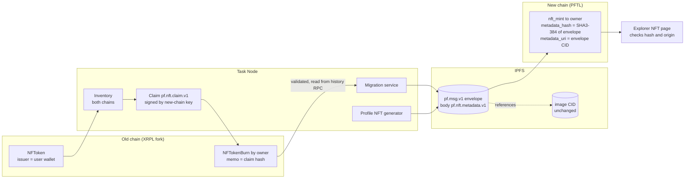

# Pillar 4 — The NFT System

> **Status:** Partial. Native NFT transactions are built on the new chain (`nft_mint`, `nft_transfer`, `nft_burn`), signed with ML-DSA-65. Task Node still mints on the old chain, and its browser wallet can't sign new-chain NFT transactions. There is no inventory or migration tool, no metadata schema, no link to the message protocol and no NFT view in the explorer.
>
> **Bubbles up to:** [Outcome B · A production-ready new chain](../README.md#three-outcomes). *A production-ready new chain*. "Supports NFTs in a smart way" is a readiness gate, and NFTs are the first user-owned assets that have to move.

## In one paragraph

Task Node users, the founder among them, minted profile NFTs on the old XRPL-fork chain. Each one was minted by the user's own wallet, so the user is both its issuer and its owner. Task Node's database holds 79 public CIDs (metadata, thumbnail and image files together), and all of them resolve. Nobody has yet counted the NFTs themselves, which number fewer than 79, or looked for NFTs held outside Task Node's records. The new chain already has native NFTs with ML-DSA-65 ownership, SHA3-384 ids, issuer-scoped collections, policy flags and an optional fixed issuer fee. This pillar adds the parts around them:

- a **metadata standard**, written as a signed [Pillar 2](02-message-protocol.md) message;
- an **inventory** of what the founder actually holds;
- a **migration** that retires each old NFT *before* re-issuing it, with provenance anyone can check;
- **Task Node minting** and an **explorer** view on the new chain;
- a spec and a blog post that state the quantum-safety argument, including its weak point: claims made with classical keys.

## User story

**Founder's story.** Right now XRPL has NFTs, and I have a large number of historical NFTs that I minted on Task Node. I need a way to bring these NFTs onto the new chain, or pin them there. The chain should also come with an intelligible, quantum-resistant NFT protocol spec that I can review in the documentation and in a blog post. This NFT system should fit natively with the message protocol spec.

**Augmented story.**

1. **Review.** I read `docs/specs/nft-v1.md` and a blog post. The owner signs with ML-DSA-65. The metadata is a signed `pf.nft.metadata.v1` message on IPFS, and the on-chain `metadata_hash` is the SHA3-384 hash of those exact bytes. The spec also says how the window for claims signed with old, classical keys closes.
2. **Inventory.** Task Node → Profile → NFTs lists every NFT my wallets hold, on both chains, grouped by chain, issuer and taxon.
3. **Claim and retire.** I sign a claim with my new-chain key. My old wallet then burns the old NFT, with the claim's hash in the burn memo. The old copy is gone before the new one exists.
4. **Re-issue.** Once the burn is validated, the NFT is minted straight to my new-chain account with the same image CID. Its `origin` names the old NFTokenID, issuer, mint transaction and burn transaction. One batch run handles my whole inventory and reports what was done, skipped or failed.
5. **Pin instead.** I can choose to keep an NFT on its original chain. It is then recorded on the new chain as a *provenance record* and is never shown as the asset.
6. **New mints.** Once I have a new-chain account, new profile NFTs mint straight onto the new chain.
7. **See.** The explorer shows the image, issuer and collection, a metadata hash check, the origin (*checked* or *not checked*) and the history.

## What exists today

| Component | Where | State |
|---|---|---|
| NFT transactions, ledger object, id | [`transactions_mempool_receipts.rs`](https://github.com/postfiatorg/postfiatl1v2/blob/main/crates/types/src/transactions_mempool_receipts.rs) (`NftMintOperation`, `NftTransferOperation`, `NftBurnOperation`) · [`market_nav_asset_types.rs`](https://github.com/postfiatorg/postfiatl1v2/blob/main/crates/types/src/market_nav_asset_types.rs) (`NftDefinition`, `nft_id`, `NftIndexes`) · limits in [`core_chain.rs`](https://github.com/postfiatorg/postfiatl1v2/blob/main/crates/types/src/core_chain.rs) | Built. Collection id ≤64 bytes, metadata hash 1–64 bytes, URI ≤256 bytes. NFT flags are `TRANSFERABLE` and `ISSUER_BURNABLE`. Collection flags are `TRANSFER_LOCKED` and `BURN_LOCKED`. |
| Execution, fees, RPC | [`nft_escrow_asset_execution.rs`](https://github.com/postfiatorg/postfiatl1v2/blob/main/crates/execution/src/nft_escrow_asset_execution.rs) · [`fees_offer_planning.rs`](https://github.com/postfiatorg/postfiatl1v2/blob/main/crates/execution/src/fees_offer_planning.rs) · [`entrypoints.rs`](https://github.com/postfiatorg/postfiatl1v2/blob/main/crates/execution/src/entrypoints.rs) · `nft_info`, `account_nfts`, `issuer_nfts` in [`rpc_dispatch.rs`](https://github.com/postfiatorg/postfiatl1v2/blob/main/crates/node/src/rpc_dispatch.rs) | Built. Semantics are listed below. The [parity tracker](https://github.com/postfiatorg/postfiatl1v2/blob/main/docs/status/xrpl-feature-parity-burndown.md) shows NFT-001 to NFT-008 complete. A marketplace, royalties and auctions are out of scope. |
| Signing | [`crypto_provider`](https://github.com/postfiatorg/postfiatl1v2/blob/main/crates/crypto_provider/src/lib.rs) · Python `mint_nft`, `transfer_nft`, `burn_nft` in [`wallet.py`](https://github.com/postfiatorg/postfiatl1v2/blob/main/python/postfiat_rpc/wallet.py) · [`wallet_wasm`](https://github.com/postfiatorg/postfiatl1v2/blob/main/crates/wallet_wasm/src/lib.rs) | ML-DSA-65 (FIPS 204). Python runs the full lifecycle. **The browser wallet has no NFT signing.** |
| Task Node minting (old chain) | [`server/pftl-submit.js`](https://github.com/postfiatorg/tasknode/blob/main/server/pftl-submit.js) (`preparePftNftMintTransaction`) · [`server/profile-nft-mint.js`](https://github.com/postfiatorg/tasknode/blob/main/server/profile-nft-mint.js) (`metadataForNft`, `schema:"erc721"`) · [`pftl.md`](https://github.com/postfiatorg/tasknode/blob/main/docs/wiki/architecture/pftl.md) | Live. `NFTokenMint` from the user's wallet, with `Flags: 9` (burnable and transferable) and `TransferFee: 0`. Task Node stores `txHash` and `nftTokenId`. *Task Node's code calls the old chain "PFTL"; on this page PFTL means the new chain.* |
| Inventory, repin, import | [`server/pftl-nfts.js`](https://github.com/postfiatorg/tasknode/blob/main/server/pftl-nfts.js) · [`profile-nft-cid-repin.mjs`](https://github.com/postfiatorg/tasknode/blob/main/scripts/profile-nft-cid-repin.mjs) · [`import-pftasks-profile-nfts.mjs`](https://github.com/postfiatorg/tasknode/blob/main/scripts/import-pftasks-profile-nfts.mjs) | Live, old chain only. Imports rows from the earlier PFTasks app, with `tx_hash` where present. All 79 CIDs resolve ([IPFS rebuild](https://github.com/postfiatorg/tasknode/blob/main/docs/wiki/architecture/ipfs-infrastructure-rebuild.md)). |
| Private prompt assets | `pf.asset.nft_prompt_series.v1`, `pf.profile.nft_generation_run.v1` ([`ipfs.md`](https://github.com/postfiatorg/tasknode/blob/main/docs/wiki/architecture/ipfs.md)) | Live. Classical encryption to Task Node's service and prompt-authority keys, **not to the holder**. Public metadata carries only `prompt_digest`. |
| New-chain explorer | [`docs/explorer-spec.md`](https://github.com/postfiatorg/postfiatorg.github.io/blob/main/docs/explorer-spec.md) | Live, new chain only. Profile NFTs are listed as "not on the new chain yet". |

### Chain semantics this design relies on (checked in code)

- **Mint.** The **issuer** signs. `owner` can be any existing account, so the issuer mints straight to the user. No transfer is needed afterwards, even for non-transferable NFTs. If the owner account doesn't exist, the mint fails with `missing_owner`.
- **Id and collection.** `nft_id` is SHA3-384 over (`postfiat.nft_id.v1`, chain, issuer, collection id, serial). A repeat is rejected with `duplicate_nft`.
    - A collection is identified by **issuer plus collection id**. Its first mint fixes the collection flags.
    - Anyone can use the name `tasknode.profile.v1` under their own issuer.
- **Transfer.** Needs `TRANSFERABLE`, and the collection must not be `TRANSFER_LOCKED`. This applies to the issuer too.
- **Burn.** Only the **current owner** can burn, and not in a `BURN_LOCKED` collection. **`ISSUER_BURNABLE` is stored and reported, but execution never lets the issuer burn.**
- **Issuer fee.** A fixed amount of native PFT, set at mint. It is charged on every transfer that the issuer doesn't send, including moves between your own wallets. There is no sale price, no percentage royalty and no NFT offer primitive.
- **Network fees.** The fee is `max(1, ceil(bytes/512))` base units. A mint adds a one-time 10-unit state-expansion fee. Fees are burned. There is no ongoing per-NFT reserve.
- **No memos** on NFT transactions. The message-protocol link is carried by `metadata_uri` and `metadata_hash`.
- **Scale.** NFTs live in a `Vec` and every lookup is a linear scan.

## Architecture

## What "smart" means here

The chain already matches XRPL's NFT features. On top of that, this pillar commits to four things:

- **Typed metadata.** It is signed by the issuer and machine-readable by agents and the explorer.
- **Provenance.** It can be checked against both ledgers.
- **Policy fixed at mint.** Transfer and burn rules can't change later.
- **Private prompts.** They are committed by digest, so they can be revealed later.

Credential, identity and gated-content uses are open questions. The schema (R1) leaves room for them without a breaking `v2`.

## Technical requirements

### Specification

- **R1. Metadata message.** `pf.nft.metadata.v1` is a Pillar 2 type with a `.proto` file. Unknown fields are preserved.
    - Core fields: `name`, `description`, `image` (`ipfs://` CID), `media[]` (typed attachments, each optionally an encrypted Pillar 2 payload), `attributes[]`, `collection`, `content_hashes` (SHA3-384 of each referenced file), `prompt_digest` and `license`.
    - Optional `origin`: source chain (e.g. `xrpl:2025`), NFTokenID, original issuer and URI, `mint_tx` if known, retirement mode, `burn_tx` or `snapshot_ledger_index`, and `claim_hash`.
- **R2. One byte stream, one hash.**
    - `metadata_uri` points to a public Pillar 2 `pf.msg.v1` envelope, signed by the issuer and pinned as CIDv1 raw.
    - `metadata_hash` is SHA3-384 over **exactly those bytes**. Verifiers hash what they fetch and never re-encode.
    - Encoders emit deterministic protobuf, so the test vectors reproduce.
    - JSON, including an XLS-24 or ERC-721-style view for other wallets, is a display projection and is never hashed.
    - Pillar 2's `envelope_hash` must use the same function.
- **R3. Spec and blog.** `docs/specs/nft-v1.md` covers:
    - the id domain and issuer-scoped collections;
    - the exact flag and fee semantics above;
    - the commitment, with test vectors;
    - the migration protocol;
    - a **threat model and post-quantum section**: ML-DSA-65 ownership; SHA3-384 for ids and commitments, with SHA-256 CIDs used as locators only; the classical-key risk during migration, and how the claim window closes (R9).

    It lists what is out of scope. A companion blog post goes on postfiatorg.github.io.
- **R4. Profile collection policy.** The spec states the issuer, collection id, flags and issuer fee for migrated and new profile NFTs. The values come from the founder's answers. No flag that does nothing is advertised.

### Inventory and migration

- **R5. Inventory first.** A read-only tool runs `account_nfts` over the founder's wallets on each in-scope chain and groups the results by issuer and taxon. It joins Task Node and PFTasks records and fills `mint_tx` from them or from the old-chain history RPC. The founder reviews the report before any migration.
- **R6. Claim.** `pf.nft.claim.v1` names the source chain, the NFTokenIDs and the destination account, and is signed by the destination ML-DSA key. Control of the old wallet is proven in one of two ways:
    - the retirement transaction, with `claim_hash` in its memo (this works with any wallet);
    - an old-wallet signature from `signWalletChallenge` (Task Node mnemonic wallets).
- **R7. Retire, then re-issue.** A mint happens only after the retirement is **validated** on the old chain. A memo alone never counts as retirement. The modes are below, and the founder chooses which apply.
    - **(a) Burn-first.** The owner burns, with the claim hash in the memo.
    - **(b) Snapshot.** The owner at a published old-chain ledger index can claim, and later transfers are ignored. This is safe only once the old chain is frozen (README Stage 4).
    - **(c) Pin-only.** The NFT gets a provenance record (R10).
- **R8. Mint and idempotency.** The service mints straight to the claimant with `origin` filled in.
    - Serial = the first 8 bytes of SHA3-384 over (`postfiat.nft_migration_serial.v1`, source chain, NFTokenID), with 0 mapped to 1. The chain then rejects a second mint, even if the service's database is lost. A collision is reported as a failure.
    - Batch mode reports done, skipped and failed items with reasons, and is safe to re-run. A missing owner account stops that row with a "create account" step.
- **R9. Claim window.** The service rejects claims backed by classical old-chain keys once the founder's close condition is met.
- **R10. Provenance records.** A pin-only item gets a `pf.nft.provenance.v1` message, or an NFT in a separately labelled collection. It is never shown as the live asset.

### Task Node

- **R11. Dual-read inventory.** While migration is open, Task Node merges both chains. Old NFTs are badged *Not migrated* (with the claim action), *Migrated* (matched by `origin.nftoken_id`) or *Recorded*.
- **R12. New mints, per user.** A user's new profile NFTs move to the new chain once that user has a funded new-chain account (README Stage 2). `metadataForNft` emits `pf.nft.metadata.v1`. Other users keep minting on the old chain, and those NFTs stay migration-eligible.
- **R13. Wallet signing.** `wallet_wasm` gains NFT signing and Pillar 2 envelope signing. The local app ([Pillar 5](05-local-task-node.md)) shares that code, so keys stay on the device. Old-chain burns use the existing `signPreparedPftlTransaction`.
- **R14. Prompt assets.** These move to the Pillar 2 post-quantum suite once it exists. They are encrypted to Task Node keys, not to holders, so a transfer needs no re-encryption.

### Explorer and chain

- **R15. Explorer NFT view.** Shows:
    - image, **issuer and collection** (never the name alone);
    - the `metadata_hash` check and the envelope signature;
    - flags, any issuer fee and history.

    Origin is *checked* only after the burn or snapshot has been read from an old-chain history node. Otherwise it shows *not checked*, as the explorer's no-overclaim rule requires.
- **R16. Scale.** Benchmark mint, transfer and burn at the measured inventory size and at a stress size, against the chain's latency targets. If cost grows with the number of NFTs, replace the linear scans with keyed lookups before Task Node switches over.
- **R17. Unsolicited NFTs.** Any issuer can mint into any existing account. A collection that is both `BURN_LOCKED` and `TRANSFER_LOCKED` can never be removed by its holder. The spec documents this, and wallets handle it as the founder decides.

### Adversarial testing

- **R18.** Tests for each of these:
    - a forged claim;
    - a claim by someone who isn't the owner;
    - a transfer after the snapshot;
    - concurrent claims;
    - a burn memo that doesn't match the claim;
    - a re-run after the service's database is wiped;
    - a metadata hash mismatch;
    - a spoofed collection name;
    - oversized fields;
    - a gateway outage;
    - a stolen migration-issuer key, where NFTs without a checkable origin are flagged.

    The migration design also gets the multi-model adversarial review required by the readiness gates, before the founder's batch runs.

## Security model

| Threat | Defence |
|---|---|
| Old and new copies both live | Burn-first, or a snapshot with the old chain frozen. A memo alone never counts (R7). |
| Claim by someone who isn't the owner | A retirement signed by the old owner, plus the ML-DSA claim (R6). |
| Double migration | A deterministic serial, which the chain rejects if repeated (R8). |
| Spoofed official collection | Issuer-scoped ids, and the issuer is always displayed (R15). |
| Metadata swapped after mint | The SHA3-384 hash over the pinned bytes, plus the issuer's signature (R2). |
| Quantum forgery of old keys | ML-DSA-65 ownership, and a close condition for classical claims (R9). |
| Theft of the migration-issuer key | Checkable origin. NFTs without one are flagged (R15). |
| Art lost from IPFS | A two-replica cluster plus Pinata today. `content_hashes` let anyone re-pin and verify. |

## Economics

The chain charges small byte-based fees that are burned, plus a one-time fee per mint. There is no ongoing reserve. NFTs need no trust lines, so anyone can mint, in line with Deliverable 8's "permissionless by default". The founder decides who pays, who pins, transferability, fees and spam handling (see Open questions). Any issuer fee is displayed the same way as NAVCoin fees ([Pillar 7](07-navcoin-fees.md)).

## Dependencies

| Depends on | Why | State |
|---|---|---|
| [Pillar 2 — Message protocol](02-message-protocol.md) | Envelope, schema registry, NFT types, post-quantum suite, hash choice. | Not built |
| `wallet_wasm` NFT and envelope signing · [Pillar 5](05-local-task-node.md) | Users sign on their own device. | Not built |
| Funded new-chain accounts | `nft_mint` needs the owner account to exist. | Funding policy open |
| New-chain explorer | NFT view and origin checks. | Live, no NFT view |
| Old-chain history RPC ([`pftl_history_rpc`](https://github.com/postfiatorg/tasknode/blob/main/docs/wiki/architecture/pftl-history-rpc-and-archive-wss.md)) | Validating burns and snapshots, filling `mint_tx`. | Configured. History depth not yet confirmed |
| [Pillar 6 — Hive identity](06-hive-identity.md) | Profile NFT as avatar (optional). | Not built |

## Acceptance criteria

1. `docs/specs/nft-v1.md`, with its threat model and test vectors, and the blog post are published and reviewed by the founder.
2. The founder has reviewed the inventory report for every in-scope chain.
3. The founder migrates the in-scope inventory in one batch:
    - every item is on the new chain with the same image CID and an origin marked *checked*;
    - every old copy is retired in the chosen mode;
    - the report accounts for every item.
4. Re-running the batch after wiping the service's database mints nothing.
5. On minting:
    - a user with a new-chain account mints a profile NFT on the new chain from the browser;
    - a user without one still mints on the old chain;
    - Task Node shows both inventories.
6. The explorer shows the issuer, the collection, the hash check, the origin status and the history.
7. The R18 tests pass, the multi-model review is closed, and R16 meets the latency targets.

## Open questions for the founder

- **Scope.** Old Post Fiat chain only, or also XRPL mainnet and other issuers' NFTs? A wider scope means more source readers and more provenance cases.
- **Retirement mode.** Which mode applies, to everything or per class of NFT?
    - **Burn-first** is the strongest, but each owner must sign an irreversible burn.
    - **Snapshot** needs no action from users, but is safe only once the old chain is frozen.
    - **Pin-only** keeps the original, and the new-chain item is only a record.
- **New-chain issuer.** Who issues on the new chain?
    - **One Task Node migration issuer:** one official collection and chain-enforced uniqueness across all users, but the platform holds issuer powers.
    - **Each user's own account:** mirrors the old chain, but gives many collections and uniqueness only per user.
- **Transferable or soulbound?** Old profile NFTs were transferable. Soulbound suits identity, but removes a property holders had.
- **Issuer fee.** Zero, or a fixed PFT amount? A fixed amount is also charged on self-moves. Percentage royalties would need a sale primitive.
- **Who pays** fees and account creation for migration and new mints: Task Node, the user, or a sponsored budget?
- **Who pins** long-term: Task Node for its collections, each issuer, validators, or a paid service?
- **Claim window close.** At a published old-chain ledger, when the old chain goes read-only, or never (accepting the quantum risk)? What happens to unclaimed NFTs?
- **Rollout.** Founder only first, or every user from the start?
- **"Smart" scope.** Should NFTs also be credentials (for example validator or top-30 badges that gate Finance Hub), identity anchors, or carriers of encrypted content for holders?
- **`ISSUER_BURNABLE`.** Implement issuer burn, which revocable credentials need, or document the flag as reserved?
- **Unsolicited NFTs.** Require consent on chain before minting to another account, or have wallets hide issuers the user doesn't follow?
- **Old-chain minting.** Stop it when the claim window closes, or keep it?

## Code references

- Types and id: [`transactions_mempool_receipts.rs`](https://github.com/postfiatorg/postfiatl1v2/blob/main/crates/types/src/transactions_mempool_receipts.rs) · [`market_nav_asset_types.rs`](https://github.com/postfiatorg/postfiatl1v2/blob/main/crates/types/src/market_nav_asset_types.rs) · [`core_chain.rs`](https://github.com/postfiatorg/postfiatl1v2/blob/main/crates/types/src/core_chain.rs)
- Execution and fees: [`nft_escrow_asset_execution.rs`](https://github.com/postfiatorg/postfiatl1v2/blob/main/crates/execution/src/nft_escrow_asset_execution.rs) · [`fees_offer_planning.rs`](https://github.com/postfiatorg/postfiatl1v2/blob/main/crates/execution/src/fees_offer_planning.rs) · [`entrypoints.rs`](https://github.com/postfiatorg/postfiatl1v2/blob/main/crates/execution/src/entrypoints.rs)
- Wallets: [`wallet_wasm/src/lib.rs`](https://github.com/postfiatorg/postfiatl1v2/blob/main/crates/wallet_wasm/src/lib.rs) · [`python/postfiat_rpc/wallet.py`](https://github.com/postfiatorg/postfiatl1v2/blob/main/python/postfiat_rpc/wallet.py) · Task Node [`src/wallet-core.js`](https://github.com/postfiatorg/tasknode/blob/main/src/wallet-core.js) (`signWalletChallenge`, `signPreparedPftlTransaction`)
- Task Node NFT flow: [`server/profile-routes.js`](https://github.com/postfiatorg/tasknode/blob/main/server/profile-routes.js) (`/api/profile/nfts`, `/api/profile/nft/generate`, `/mint`, `/select`) · [`server/profile-nft-render-worker.js`](https://github.com/postfiatorg/tasknode/blob/main/server/profile-nft-render-worker.js)
- IPFS: [`docs/wiki/architecture/ipfs.md`](https://github.com/postfiatorg/tasknode/blob/main/docs/wiki/architecture/ipfs.md)
- Explorer: [`docs/explorer-spec.md`](https://github.com/postfiatorg/postfiatorg.github.io/blob/main/docs/explorer-spec.md)

## Revision notes (review round 1)

| Item | Change |
|---|---|
| Gemini P1 | Verified that the user is the old issuer and that only the owner (or a burnable issuer) can burn. Retirement now comes before re-issue (R7), and duplicates are blocked on chain (R8). The mode is an open question. |
| Gemini P2 | R2: one signed envelope, with SHA3-384 over those exact bytes. JSON is display only. Test vectors added. |
| Gemini P3 | Semantics documented from code. Partly disputed: mint goes straight to `owner`, and ids are issuer-scoped. The name-spoof risk is handled in R15. Flags are an open question. |
| Gemini P4 | Threat-model section (R3) and claim-window close (R9, open question). Partly disputed: prompts are encrypted to Task Node keys, so a transfer needs no re-encryption. |
| Gemini P5 | Fee and reserve facts taken from code. Economics section added. Payer, pinning, fees and spam are open questions. |
| Gemini P6 | Inventory first (R5), a generic `origin.chain`, extensible media (R1), a "smart" section and a scope question. |
| Gemini P7 | Dual-read inventory (R11). The wallet signing gap was verified (R13). |
| Gemini P8 | `mint_tx` is optional (R5), and origin is checked in the new-chain explorer (R15). Partly disputed: Task Node already stores mint hashes. |
| Opus P1, P2, P3 | Burn-first or snapshot before mint (R7). The memo overclaim is removed. |
| Opus P4 | R6: proof through the retirement memo or `signWalletChallenge`, plus an ML-DSA claim. |
| Opus P5 | Corrected: 79 is the number of CIDs, not of NFTs. Inventory step and scope question added. |
| Opus P6 | Issuer powers stated. The issuer model is an open question. |
| Opus P7, P8 | Same changes as Gemini P4 and P2. The CID is a locator, and SHA3-384 is the commitment. |
| Opus P9 | "Smart" section, plus an open question. |
| Opus P10 | Per-user switch (R12). |
| Opus P11 | Economics section, plus open questions. |
| Opus P12 | R18 tests and multi-model review, acceptance criterion 7. |
| Opus P13 | Dependency states added. Disputed: the new-chain explorer exists. R14 is now conditional. |
| Opus P14 | Spot-checked. Collection flags separated out, the field is named `metadata_uri`, and the inert `ISSUER_BURNABLE` is noted. |
| Opus P15 | All five decisions added to Open questions. |
