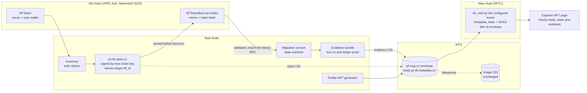

# Pillar 4 — The NFT System

> **Status:** Partial. Native NFT transactions are built on the new chain (`nft_mint`, `nft_transfer`, `nft_burn`), signed with ML-DSA-65, but NFT state is a plain list that every NFT transaction re-validates in full. Task Node still mints on the old chain, and its browser wallet can't sign new-chain NFT transactions. There is no inventory or migration tool, no metadata schema, no link to the message protocol and no NFT view in the explorer.
>
> **Bubbles up to:** [Outcome B · A production-ready new chain](../README.md#three-outcomes). *A production-ready new chain*. "Supports NFTs in a smart way" is a readiness gate, and NFTs are the first user-owned assets that have to move.

## In one paragraph

Task Node users, the founder among them, minted profile NFTs on the old XRPL-fork chain from their own wallets, so each user is both issuer and owner. Task Node holds 79 public CIDs (metadata, thumbnails and images together), all resolving; the NFTs themselves, fewer than 79, have not been counted, nor have NFTs outside Task Node's records. The new chain already has native NFTs with ML-DSA-65 ownership, SHA3-384 ids, issuer-scoped collections, policy flags and an optional fixed issuer fee. This pillar adds a **metadata standard** as a signed [Pillar 2](02-message-protocol.md) message; an **inventory**; a **migration** that retires each old NFT *before* re-issuing it, never strands a burned NFT, and archives provenance that outlives the old chain; **Task Node minting** and an **explorer** view; chain fixes so NFT storage survives permissionless use; and a spec and blog post that state the quantum-safety argument, including its weak point: claims made with classical keys.

## User story

**Founder's story.** Right now XRPL has NFTs, and I have a large number of historical NFTs that I minted on Task Node. I need a way to bring these NFTs onto the new chain, or pin them there. The chain should also come with an intelligible, quantum-resistant NFT protocol spec that I can review in the documentation and in a blog post. This NFT system should fit natively with the message protocol spec.

**Augmented story.**

1. **Review.** I read `docs/specs/nft-v1.md` and a blog post. Owners sign with ML-DSA-65, and the on-chain `metadata_hash` is the SHA3-384 of a signed `pf.nft.metadata.v1` message on IPFS. A table shows which parts are post-quantum, and the spec says how the classical-key claim window closes.
2. **Inventory.** Task Node → Profile → NFTs lists every NFT my wallets hold on both chains, by chain, issuer and taxon, and flags items it can't read cleanly.
3. **Claim and retire.** I sign a claim with my new-chain key naming each old NFT and the exact new NFT id it becomes. Task Node pins it and keeps a copy on my device. Only then does my old wallet burn each old NFT, with the claim's hash in the memo. If anything fails after the burn, the NFT stays claimable.
4. **Re-issue.** Once the burn is validated, the NFT is minted to my account with the same image CID. Its `origin` links the claim, the burn and archived old-chain evidence. One batch run reports what was done, skipped or failed.
5. **Pin instead.** I can keep an NFT on its original chain. The new chain then holds a non-transferable *provenance record* stating the owner as of a ledger, never shown as the asset.
6. **New mints and everyone else.** Once I have a new-chain account, new profile NFTs mint there. Every other user runs the same flow from their profile, and at the window's close unclaimed items get the treatment I chose.
7. **See.** The explorer shows image, issuer, collection, the hash check, the origin (*checked*, *conflicting* or *not checked*) and history, and still checks origin after the old chain is retired.

## What exists today

| Component | Where | State |
|---|---|---|
| NFT transactions, ledger object, id | [`transactions_mempool_receipts.rs`](https://github.com/postfiatorg/postfiatl1v2/blob/main/crates/types/src/transactions_mempool_receipts.rs) · [`market_nav_asset_types.rs`](https://github.com/postfiatorg/postfiatl1v2/blob/main/crates/types/src/market_nav_asset_types.rs) (`NftDefinition`, `nft_id`, `validate_nft_state`) · [`core_chain.rs`](https://github.com/postfiatorg/postfiatl1v2/blob/main/crates/types/src/core_chain.rs) | Built. Collection id ≤64 bytes, metadata hash 1–64 bytes, URI ≤256 bytes, non-zero `u64` serial. Flags below. |
| Execution, fees, RPC | [`nft_escrow_asset_execution.rs`](https://github.com/postfiatorg/postfiatl1v2/blob/main/crates/execution/src/nft_escrow_asset_execution.rs) · [`fees_offer_planning.rs`](https://github.com/postfiatorg/postfiatl1v2/blob/main/crates/execution/src/fees_offer_planning.rs) · [`entrypoints.rs`](https://github.com/postfiatorg/postfiatl1v2/blob/main/crates/execution/src/entrypoints.rs) · [`rpc_dispatch.rs`](https://github.com/postfiatorg/postfiatl1v2/blob/main/crates/node/src/rpc_dispatch.rs) (`nft_info`, `account_nfts`, `issuer_nfts`, `account_tx`) | Built; semantics below. The [parity tracker](https://github.com/postfiatorg/postfiatl1v2/blob/main/docs/status/xrpl-feature-parity-burndown.md) shows NFT-001 to NFT-008 complete. |
| Signing | [`crypto_provider`](https://github.com/postfiatorg/postfiatl1v2/blob/main/crates/crypto_provider/src/lib.rs) · [`wallet.py`](https://github.com/postfiatorg/postfiatl1v2/blob/main/python/postfiat_rpc/wallet.py) · [`wallet_wasm`](https://github.com/postfiatorg/postfiatl1v2/blob/main/crates/wallet_wasm/src/lib.rs) · Task Node [`wallet-core.js`](https://github.com/postfiatorg/tasknode/blob/main/src/wallet-core.js) | ML-DSA-65, randomised (`try_sign`). Python runs the full NFT lifecycle. **The browser wallet has no NFT signing.** Old-chain `signWalletChallenge` signs any bytes, with no domain tag. |
| Task Node minting (old chain) | [`pftl-submit.js`](https://github.com/postfiatorg/tasknode/blob/main/server/pftl-submit.js) (`preparePftNftMintTransaction`) · [`profile-nft-mint.js`](https://github.com/postfiatorg/tasknode/blob/main/server/profile-nft-mint.js) (`metadataForNft`, `schema:"erc721"`) · [`pftl.md`](https://github.com/postfiatorg/tasknode/blob/main/docs/wiki/architecture/pftl.md) | Live. `NFTokenMint` from the user's wallet, `Flags: 9` (burnable, transferable), `TransferFee: 0`, `NetworkID` 2025. Task Node stores `txHash` and `nftTokenId`. *Its code calls the old chain "PFTL"; here PFTL means the new chain.* |
| Inventory, repin, import | [`pftl-nfts.js`](https://github.com/postfiatorg/tasknode/blob/main/server/pftl-nfts.js) · [`profile-nft-cid-repin.mjs`](https://github.com/postfiatorg/tasknode/blob/main/scripts/profile-nft-cid-repin.mjs) · [`import-pftasks-profile-nfts.mjs`](https://github.com/postfiatorg/tasknode/blob/main/scripts/import-pftasks-profile-nfts.mjs) | Live, old chain only, including earlier PFTasks rows. All 79 CIDs resolve ([IPFS rebuild](https://github.com/postfiatorg/tasknode/blob/main/docs/wiki/architecture/ipfs-infrastructure-rebuild.md)). |
| Private prompt assets | `pf.asset.nft_prompt_series.v1`, `pf.profile.nft_generation_run.v1` ([`ipfs.md`](https://github.com/postfiatorg/tasknode/blob/main/docs/wiki/architecture/ipfs.md)) | Live. Classical encryption to Task Node keys, **not to the holder**. Public metadata carries only `prompt_digest`. |
| New-chain explorer | [`explorer-spec.md`](https://github.com/postfiatorg/postfiatorg.github.io/blob/main/docs/explorer-spec.md) | Live, with a block-reading indexer. Profile NFTs are "not on the new chain yet". |

### Chain semantics this design relies on (checked in code)

- **Mint.** The **issuer** signs; `owner` can be any existing account (else `missing_owner`), so the issuer mints straight to the user, even for non-transferable NFTs.
- **Id and collection.** `nft_id` = SHA3-384 over (`postfiat.nft_id.v1`, chain, issuer, collection id, serial); repeats fail with `duplicate_nft`. Burned NFTs stay in state, so a burned id is never reused. A collection is **issuer plus collection id**, and its first mint fixes its flags. Anyone can use the name `tasknode.profile.v1` under their own issuer.
- **Transfer** needs NFT flag `TRANSFERABLE` and a collection that isn't `TRANSFER_LOCKED`, for the issuer too. **Burn** is by the **current owner** only, outside `BURN_LOCKED` collections. **NFT flag `ISSUER_BURNABLE` is stored and reported, but execution never lets the issuer burn.**
- **Issuer fee.** Fixed native PFT, set at mint, charged on every transfer the issuer doesn't send, including moves between your own wallets. No sale price, percentage royalty or offer primitive.
- **Network fees.** 1 PFT = 1,000,000 atoms. The fee is `max(1, ceil(bytes/512))` atoms, at most about 23 since the ML-DSA key and signature dominate; a mint adds a one-time 10 atoms. Fees are burned. Accounts keep a 10-atom reserve; there is no per-NFT reserve.
- **History.** `account_tx` has NFT rows with `nft_id`, sender and recipient, so the mint row records the first owner; `nft_info` shows only the current one.
- **No memos** on NFT transactions; the message-protocol link is `metadata_uri` plus `metadata_hash`.
- **Scale.** NFTs live in a `Vec` with linear-scan lookups. Each NFT transaction copies the ledger and runs `validate_nft_state`, which re-checks every NFT ever minted. `account_nfts` and `issuer_nfts` take a `limit` but no cursor.

## Architecture

## What "smart" means here

The chain covers XRPL's core NFT lifecycle (mint, transfer, burn, collections, a fixed transfer fee) but not its offers, brokered sales or percentage royalties. On top, this pillar commits to **typed metadata** signed by the issuer and readable by agents; **provenance** checkable from archived evidence; **policy fixed at mint**; and **private prompts** committed by digest. Credential, identity and gated-content uses are open question 10; R1 leaves room for them without a breaking `v2`.

## Technical requirements

### Issuer settings

`migration_issuer` (migrated NFTs) and `profile_issuer` (new profile NFTs) are each either **the Task Node issuer**, one dedicated account signing on the server, or **the user**, signing on the device (open question 3). Every requirement works under either and says where they differ:

| | Task Node issuer | User as issuer |
|---|---|---|
| Signs `nft_mint` and metadata | The service | The user's wallet |
| Collections | One per kind | One per kind, per user |
| Duplicates stopped by | The chain (R9) plus the claim binding (R6) | The claim binding plus earliest-wins (R17) |
| Central key risk | One hot key, limited by R17 | None |

### Specification

- **R1. Metadata message.** `pf.nft.metadata.v1` is a Pillar 2 type with a `.proto` file.
    - Core fields: `name`, `description`, `image` (`ipfs://` CID), `media[]` (typed, optionally encrypted Pillar 2 payloads), `attributes[]`, `collection`, `content_hashes` (SHA3-384 per referenced file), `prompt_digest`, `license`.
    - Optional `origin`: `source_chain`, NFTokenID, original issuer, original URI as found, `mint_tx` if known, retirement mode, `burn_tx` or `snapshot_ledger_index`, `claim_cid`, `claim_hash`, `evidence_cid`.
    - `source_chain` is `xrpl:<NetworkID>` (`xrpl:2025` old Post Fiat chain, `xrpl:0` XRPL mainnet), frozen before the first mint because R9 hashes it into serials.
- **R2. One byte stream, one hash.** `metadata_uri` points to a public `pf.msg.v1` envelope signed by the issuer, stored as CIDv1 raw and pinned in strict mode before the mint ([Pillar 2](02-message-protocol.md) R3, R13). `metadata_hash` is SHA3-384 over **exactly those bytes** (Pillar 2 R5). Verifiers hash what they fetch, stop at Pillar 2's 1 MiB cap, and never re-encode.
    - Producers use Pillar 2's deterministic encoding; NFT schemas have no `map` or float fields, so vectors reproduce in Rust, JS and Python. Readers ignore unknown fields for display only.
    - A JSON twin for other wallets (XLS-24 or ERC-721 style) may be published; only the `metadata_uri` envelope is committed.
- **R3. Spec and blog.** `docs/specs/nft-v1.md` covers the id domain and collections, the flag and fee semantics above, the commitment with test vectors, the migration state machine, and a **threat model** with the post-quantum boundary table and the window close (R11). It lists what is out of scope. A blog post goes on postfiatorg.github.io.
- **R4. Collection policy.** For each founder answer, the spec states the issuer, collection id, flags and issuer fee of migrated, new and record items. They use distinct collection ids (for example `tasknode.profile.migrated.v1`, `tasknode.profile.v1`, `tasknode.profile.record.v1`), so serial schemes never mix. No flag that does nothing is set. Because the first mint fixes a collection's flags for good, the full batch runs on devnet first and the founder signs off the flags.

### Inventory and migration

- **R5. Inventory first.** A read-only tool runs `account_nfts` over the founder's wallets, then every user's, on each in-scope chain. It groups by issuer and taxon, joins Task Node and PFTasks records, and fills `mint_tx` from them or the history RPC, whose depth it confirms. Non-IPFS, empty, garbled or dead URIs, and non-Task-Node metadata, are flagged *Needs review* with the raw URI kept, and enter no batch until mapped by hand or moved to pin-only. The founder reviews the report first.
- **R6. Claim.** `pf.nft.claim.v1` is a public Pillar 2 envelope signed by the destination's ML-DSA key. It names the source chain, the destination, and per item the NFTokenID, mode and **target** (issuer, collection, serial, hence the exact `nft_id`). `claim_hash` is SHA3-384 over the stored bytes; signing is randomised, so the signed bytes are persisted before use (R8). Old-wallet control is proven by:
    - **(i)** the retirement transaction, with `claim_hash` in its memo (any wallet);
    - **(ii)** the [Pillar 6](06-hive-identity.md) R14 old-chain link over the claim's domain-separated digest. Task Node wallets sign it with `signWalletChallenge`, and verifiers accept only that digest, never a login challenge;
    - **(iii)** while the old chain accepts transactions, a no-op transaction (such as `AccountSet`) with `claim_hash` in its memo, for wallets that can't sign messages.
- **R7. Retire, then re-issue.** A mint follows only a retirement read from a validated old-chain ledger, with `tesSUCCESS`, signed by the account that held the NFT just before. Old Task Node NFTs are burnable (`Flags: 9`), so an issuer burn of someone else's copy (an `Owner` field) never counts. Modes (open question 2):
    - **(a) Burn-first.** The holder burns, with the claim hash in the memo.
    - **(b) Snapshot.** The owner at a published ledger index can claim; later transfers are ignored, and claims use method (ii). Safe only once the old Post Fiat chain is frozen (README Stage 4); never for XRPL mainnet.
    - **(c) Pin-only.** A provenance record (R12).
- **R8. Burn-first state machine.** `prepared → claim_pinned → burn_submitted → retired → minted`, with `failed_recoverable` reachable after `claim_pinned`.
    - **Preflight** before a burn is offered: the destination exists, the target `nft_id` is free (or already holds this item: skip), the burner holds the NFT, nothing is flagged.
    - The signed claim is pinned and stored by Task Node and on the device before the burn is built.
    - **Recovery.** If the memo is wrong or the claim lost, the holder signs a fresh claim for the burned NFTokenID and proves control with (ii), or (iii) while the old chain is live. This needs a classical key, so it runs while the window is open, and the cohort report (R13) lists every `retired` item not yet `minted`.
- **R9. Mint and idempotency.** Items mint straight to the claimant with `origin` filled in. Serial = first 8 bytes of SHA3-384 over (`postfiat.nft_migration_serial.v1`, source chain, NFTokenID), 0 mapped to 1. On `duplicate_nft` the tool reads `nft_info` and hash-checks its metadata: the same source chain and NFTokenID is *skipped*, anything else *failed (serial collision)* and never retried. Batches report done, skipped and failed with reasons and are safe to re-run. With the user as issuer, the tool prepares each mint and the user's wallet signs it.
- **R10. Evidence archive.** At retirement the service pins a bundle: the signed old-chain transaction and metadata, the validated ledger header, the ledger's transaction set or an inclusion path, and the old validators' validations or a skip-list hash link to the final ledger hash published at the freeze. For a snapshot: the header and the owner's NFToken page with its state proof. `origin.evidence_cid` names it, so the mint commits to it; later forgeries of old-chain signatures can't change it, and it verifies without the old chain.
- **R11. Claim window.** Every claim rests on a classical old-chain key, so once the founder's close condition is met no new claims are accepted. The condition and the treatment of unclaimed items are parameters (open question 8).
- **R12. Provenance records.** A pin-only item gets a non-transferable, holder-burnable NFT in the record collection, with body `pf.nft.provenance.v1`: source chain, NFTokenID, original URI, owner and ledger index as of the record, `evidence_cid`. It is labelled *Record: the asset lives on* `<source chain>`, plus *Owner changed since record* when the source chain shows it. It is an NFT, not a bare message, because the chain has no standalone message transaction yet (Pillar 2 open question 2).

### Task Node

- **R13. Dual read and self-serve claims.** While migration is open, Task Node merges both chains and badges old NFTs *Not migrated* (with the claim action), *Migrated* (matched by `origin.nftoken_id`), *Recorded* or *Needs review*. Any user can run R6–R9 from their profile. A cohort report lists every inventoried item with its R8 state, including at close.
- **R14. New mints, per user.** A user's new profile NFTs move to the new chain once that user has a funded account (README Stage 2), and `metadataForNft` emits `pf.nft.metadata.v1`. The server or the browser signs, per `profile_issuer`. Serials derive from the generation run id as in R9, so retries are idempotent. Other users keep minting on the old chain, and those NFTs stay eligible.
- **R15. Wallet signing.** `wallet_wasm` gains `nft_transfer`, `nft_burn` and envelope signing (needed under both settings), and `nft_mint` (needed only with the user as issuer). The local app ([Pillar 5](05-local-task-node.md)) shares it, so keys stay on the device. Old-chain burns use `signPreparedPftlTransaction`. The founder's batch can run from the Python CLI, so it doesn't wait for `wallet_wasm`.
- **R16. Prompt assets** move to the Pillar 2 post-quantum suite once it exists. They are encrypted to Task Node keys, not holders, so transfers need no re-encryption.

### Explorer and chain

- **R17. Explorer NFT view.** Image, **issuer and collection** (never the name alone), hash and envelope-signature checks, flags (an unimplemented `ISSUER_BURNABLE` shows *no effect*), any issuer fee, and history from the indexer's `account_tx` rows. Origin is ***checked*** only if:
    - the claim hashes to `claim_hash`, is signed by the destination's key, and names this NFTokenID and `nft_id`;
    - the mint row's first owner is the destination;
    - the evidence bundle verifies and shows a holder-signed retirement bound to the claim, or snapshot ownership by the claimant;
    - the image CID matches the original metadata's;
    - no earlier mint holds a checked origin for this NFTokenID.

    If only the last test fails, it shows ***conflicting***; otherwise ***not checked***, per the no-overclaim rule. A stolen issuer key can mint, but can't pass without the claimant's key and the holder's retirement.
- **R18. Scale.** Before Task Node switches over (README Stage 2), whatever a benchmark shows: keyed maps by `nft_id` and by (issuer, collection) replace the scans; each transaction checks only the NFTs it touches; `account_nfts` and `issuer_nfts` gain cursors. A benchmark then runs every NFT operation at the measured inventory and at a stress size modelling spam at the current fee, against the latency targets.
- **R19. Unsolicited NFTs.** Anyone can mint into any account for a few dozen atoms, and a `BURN_LOCKED` + `TRANSFER_LOCKED` item can never be removed. Whatever the founder decides, wallets show only followed issuers by default and the explorer groups NFTs by issuer. The chain rule and price (open questions 12, 13) are a check in `apply_nft_operation` and fee constants, shipped with R18.

### Adversarial testing

- **R20.** Tests: forged and non-holder claims; issuer burns; post-snapshot transfers and concurrent claims; a wrong memo, lost claim, missing destination and outage after a burn; a re-run after a database wipe and a serial collision; a stolen issuer key; a rival claim under another issuer; hash mismatch, over-cap envelopes and oversized fields; spoofed collections and gateway outages; spam at the R18 size and locked unsolicited mints; origin checks with the old chain down. The R8 state machine is model-checked for "at most one live, checked copy", and the design gets the multi-model adversarial review before the founder's batch.

## Security model

| Threat | Defence |
|---|---|
| Old and new copies both live | Burn-first, or snapshot on a frozen chain; a memo alone never counts (R7) |
| Claim by a non-holder | Holder-signed retirement or R14 link, plus the ML-DSA claim (R6); issuer burns never count |
| Burned but never re-issued | Preflight, claim persisted first, recovery (R8) |
| Double migration | Serial under one issuer (R9); one `nft_id` per claim and earliest-wins (R17) |
| Stolen issuer key, spoofed collection | Fails origin tests; issuer always shown (R17) |
| Metadata swapped after mint | SHA3-384 over pinned bytes plus issuer signature (R2) |
| Provenance lost with the old chain | Evidence committed at mint (R10) |
| Art lost from IPFS | Two-replica cluster plus Pinata; `content_hashes` let anyone re-pin and verify |

**Post-quantum boundary:**

| Part | Protection |
|---|---|
| Ownership, transfers, burns, claims, envelope signatures | ML-DSA-65: post-quantum |
| `nft_id`, `metadata_hash`, `claim_hash`, `content_hashes` | SHA3-384: post-quantum commitments |
| IPFS CIDs | SHA-256 locators, never the commitment |
| Old-chain keys, burns, evidence | Classical: trusted until the window closes (R11); evidence fixed at mint |
| Prompt assets | Classical encryption until R16: harvest-now, decrypt-later risk |
| Gateways, transport | Classical TLS; integrity comes from the hashes |

## Economics

A mint costs a few dozen atoms (under 0.0001 PFT), so migration is cheap and spam nearly free, hence R18 and R19. NFTs need no trust lines, matching Deliverable 8's "permissionless by default". The founder decides who pays, who pins, the spam price, transferability and the issuer fee (open questions 4–7, 13). Any issuer fee is displayed like NAVCoin fees ([Pillar 7](07-navcoin-fees.md)).

## Dependencies

| Depends on | Why | State |
|---|---|---|
| [Pillar 2 — Message protocol](02-message-protocol.md) | First only the public-envelope subset (R3–R6: header, signature context, CIDv1 raw, SHA3-384, encoding); encryption later. | Not built |
| [Pillar 6 — Hive identity](06-hive-identity.md) R14 | Old-chain link for claim method (ii); profile NFT as avatar. | Not built |
| `wallet_wasm` NFT and envelope signing · [Pillar 5](05-local-task-node.md) | On-device signing (R15). | Not built |
| Funded new-chain accounts | `nft_mint` needs the owner to exist. | Funding policy open |
| Explorer and indexer | NFT view, history, origin checks. | Live, no NFT view |
| Old-chain history RPC ([`pftl_history_rpc`](https://github.com/postfiatorg/tasknode/blob/main/docs/wiki/architecture/pftl-history-rpc-and-archive-wss.md)) | Retirements, evidence, `mint_tx`. | Configured; depth unconfirmed |

**Build order.**

1. **Step 1** (no founder answer or Pillar 2 needed): R5 inventory and history depth, R18 chain fixes, the spam benchmark.
2. **Step 2:** freeze the Pillar 2 public-envelope subset; write `nft-v1.md` with vectors.
3. **Step 3** (after answers on issuers, modes and policy): migration service, claims, evidence archive, explorer view, devnet dry run.
4. **Step 4:** the founder's batch.
5. **Step 5:** per-user Task Node switch and self-serve claims.
6. **Step 6:** window close and treatment of unclaimed items.

## Acceptance criteria

1. `docs/specs/nft-v1.md` (threat model, post-quantum table, vectors) and the blog post are published and reviewed by the founder.
2. The founder has reviewed the inventory for every in-scope chain, with every *Needs review* item resolved.
3. The full founder batch has run on devnet, and the founder has signed off every collection's flags before the first new-chain mint.
4. The founder migrates the in-scope inventory in one batch: migrated items keep their image CID with origin *checked*, pin-only items have records, every old copy is retired in the chosen mode, and the report accounts for every item.
5. Re-running after wiping the service's database mints nothing and reports every item skipped.
6. Forced failures after a burn (outage, missing destination, wrong memo, lost claim) all end with the item minted through recovery.
7. A user with a new-chain account gets a profile NFT there, signed per `profile_issuer`; a user without one still mints on the old chain; Task Node shows both.
8. A non-founder completes a self-serve claim; the cohort report lists every item's state; at close every unclaimed item has the chosen treatment.
9. The explorer shows issuer, collection, hash check, origin state and history, and marks origins *checked* with the old-chain history node unreachable.
10. R20 and the model check pass, the multi-model review is closed, and R18 meets the latency targets at the stress size.

## Open questions for the founder

1. **Scope.** Old Post Fiat chain only, or also XRPL mainnet and other issuers' NFTs? Wider scope adds readers (R5) and provenance cases; XRPL mainnet items can only be burned first or pinned.
2. **Retirement mode,** for everything or per class? **Burn-first** is strongest, but each holder signs an irreversible burn. **Snapshot** needs no burn from holders, but is safe only once the old chain is frozen. **Pin-only** keeps the original; the new item is only a record.
3. **Issuers,** for `migration_issuer` and `profile_issuer` separately: the **Task Node issuer** (one official collection, chain-enforced uniqueness, one hot platform key) or **the user** (mirrors the old chain, no central key, a collection per user, browser mint signing)?
4. **Transferable or soulbound?** Old profile NFTs were transferable. Soulbound suits identity but removes a property holders had. Only R4's flags change.
5. **Issuer fee.** Zero or a fixed PFT amount? A fixed fee also hits moves between a holder's own wallets. Percentage royalties need a sale primitive.
6. **Who pays** fees, account creation and reserves (a few dozen atoms per item): Task Node, the user or a sponsored budget?
7. **Who pins** long-term, with what media size limits: Task Node for its collections, each issuer, validators or a paid service? Shared with Pillar 2 open question 4.
8. **Claim window.** Close at a published old-chain ledger, when the old chain goes read-only, or never (accepting the quantum risk)? Unclaimed items then get a record under the issuer naming the old owner, nothing beyond the archived report, or continued claimability only through a Pillar 6 old-chain link made before the close.
9. **Rollout.** Founder first, or every user from the start?
10. **"Smart" scope.** Should NFTs also be credentials, such as validator or top-30 badges gating Finance Hub ([Pillar 9](09-finance-hub.md))? [Pillar 8](08-onchain-identity.md) designs native credentials with expiry and revocation, so badges could use those while NFTs stay holdable items. Encrypted holder content would need encryption to the holder and re-encryption on transfer.
11. **`ISSUER_BURNABLE`.** Implement issuer burn (revocable NFT badges need it) or reject the flag at mint? Until then nothing sets it.
12. **Unsolicited NFTs.** Recipient consent before a mint lands (a chain accept step); `BURN_LOCKED` only when issuers mint to themselves, so holders can always burn what others sent; or wallet filtering only, leaving locked junk on chain?
13. **Spam price.** Keep today's fee, raise the NFT state-expansion fee, or add a per-NFT reserve refunded on burn? Tied to Pillar 2 open question 3.
14. **Old-chain minting.** Stop it at the window's close, or keep it?

## Code references

- Chain: [`market_nav_asset_types.rs`](https://github.com/postfiatorg/postfiatl1v2/blob/main/crates/types/src/market_nav_asset_types.rs) · [`nft_escrow_asset_execution.rs`](https://github.com/postfiatorg/postfiatl1v2/blob/main/crates/execution/src/nft_escrow_asset_execution.rs) · [`entrypoints.rs`](https://github.com/postfiatorg/postfiatl1v2/blob/main/crates/execution/src/entrypoints.rs) (`execute_nft_transaction`, fee constants) · [`issued_asset_ledger_helpers.rs`](https://github.com/postfiatorg/postfiatl1v2/blob/main/crates/execution/src/issued_asset_ledger_helpers.rs) (`nft_index`) · [`block_finality.rs`](https://github.com/postfiatorg/postfiatl1v2/blob/main/crates/node/src/block_finality.rs) (NFT `account_tx` rows) · [`faucet-testnet-transactions.md`](https://github.com/postfiatorg/postfiatl1v2/blob/main/docs/runbooks/faucet-testnet-transactions.md) (atoms per PFT)
- Task Node: [`profile-routes.js`](https://github.com/postfiatorg/tasknode/blob/main/server/profile-routes.js) (`/api/profile/nfts`, `/nft/generate`, `/mint`, `/select`) · [`profile-nft-render-worker.js`](https://github.com/postfiatorg/tasknode/blob/main/server/profile-nft-render-worker.js) · [`pftl-submit.js`](https://github.com/postfiatorg/tasknode/blob/main/server/pftl-submit.js) · [`wallet-core.js`](https://github.com/postfiatorg/tasknode/blob/main/src/wallet-core.js)
- Explorer: [`explorer-spec.md`](https://github.com/postfiatorg/postfiatorg.github.io/blob/main/docs/explorer-spec.md)

---

*Revision history: [changelog](../changelog/04-nft-system.md).*
