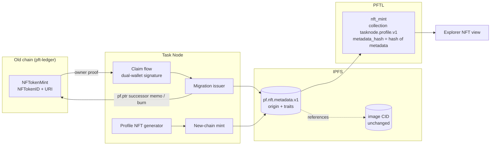

# Pillar 4 — The NFT System

> **Status:** Partial. Native NFT transactions are built on the new chain (`nft_mint`, `nft_transfer`, `nft_burn`). Task Node still mints on the old chain. There is no migration tool, metadata schema, link to the message protocol or new-chain explorer view.
>
> **Bubbles up to:** *A production-ready new chain*. "Supports NFTs in a smart way" is a readiness gate, and NFTs are the first user-owned assets that have to move.

## In one paragraph

Task Node users have minted profile NFTs on the old XRPL-shaped chain. The art is on IPFS, all 79 profile NFT CIDs resolve, and the founder holds many of them. The new chain already has native, quantum-safe NFT transactions, signed with ML-DSA-65, with collections, flags and issuer fees. What's missing is everything around them: a **metadata standard** written as a message type from [Pillar 2](02-message-protocol.md), a **migration** that re-issues each old NFT on PFTL with a verifiable link to the original, **Task Node minting** on the new chain, and an **explorer** view. This pillar delivers those and publishes the spec and a blog post.

## User story

**Founder's story.** Right now XRPL has NFTs, and I have a large number of historical NFTs that I minted on Task Node. I need a way to bring these NFTs onto the new chain, or pin them there. The chain should also come with an intelligible, quantum-resistant NFT protocol spec that I can review in the documentation and in a blog post. This NFT system should fit natively with the message protocol spec.

**Augmented story.**

1. **Review.** I read `docs/specs/nft-v1.md` and a blog post. The NFT is a PFTL ledger object signed with ML-DSA-65. Its metadata is a `pf.nft.metadata.v1` message pinned to IPFS, and its `metadata_hash` commits to that message. Transfer and burn rules are flags set at mint.
2. **Claim.** On Task Node → Profile → NFTs, I see my old-chain NFTs with **Bring to Post Fiat L1**. I sign one claim message with my old-chain wallet, proving I own the NFTokenIDs, and one with my new-chain wallet.
3. **Re-issue.** The migration issuer mints each NFT on PFTL in a `tasknode.profile.v1` collection. The metadata includes `origin: {chain: "pft-ledger", nftoken_id, mint_tx}` and the same image CID, so the art is never re-uploaded.
4. **Retire.** The old NFT is either burned (where it's issuer-burnable) or tagged on the old chain with a `pf.ptr` memo pointing at the new NFT id. Either way, the old copy and the new one can't both pass as the live NFT.
5. **New mints.** From now on, generating a profile NFT on Task Node mints it straight onto PFTL.
6. **See.** The explorer shows my NFTs on the new chain: image, collection, origin link and transfer history.

## What exists today

| Component | Where | State |
|---|---|---|
| New-chain NFT transactions | [`crates/types/src/core_chain.rs`](https://github.com/postfiatorg/postfiatl1v2/blob/main/crates/types/src/core_chain.rs) (`nft_mint` / `nft_transfer` / `nft_burn`, the `postfiat.nft_id.v1` domain) · [`transactions_mempool_receipts.rs`](https://github.com/postfiatorg/postfiatl1v2/blob/main/crates/types/src/transactions_mempool_receipts.rs) (`NftMintOperation`, `NftTransferOperation`, `NftBurnOperation`) | Built. Collection id ≤64 bytes, metadata hash ≤64 bytes, URI ≤256 bytes. Flags: TRANSFERABLE, ISSUER_BURNABLE, TRANSFER_LOCKED, BURN_LOCKED. |
| Ledger object and indexes | [`crates/types/src/market_nav_asset_types.rs`](https://github.com/postfiatorg/postfiatl1v2/blob/main/crates/types/src/market_nav_asset_types.rs) (`NftDefinition`, `NftIndexes`) | Built |
| Execution and RPC | [`crates/execution/src/nft_escrow_asset_execution.rs`](https://github.com/postfiatorg/postfiatl1v2/blob/main/crates/execution/src/nft_escrow_asset_execution.rs) · RPC `nft_info`, `account_nfts`, `issuer_nfts` | Built. Issuer transfer fee supported. |
| Parity tracker | [`docs/status/xrpl-feature-parity-burndown.md`](https://github.com/postfiatorg/postfiatl1v2/blob/main/docs/status/xrpl-feature-parity-burndown.md) | NFT-001 to NFT-008 complete. Marketplace and royalties out of scope. |
| Quantum-safe signatures | [`crates/crypto_provider/src/lib.rs`](https://github.com/postfiatorg/postfiatl1v2/blob/main/crates/crypto_provider/src/lib.rs) | ML-DSA-65 (FIPS 204) |
| Task Node minting (old chain) | [`server/pftl-submit.js`](https://github.com/postfiatorg/tasknode/blob/main/server/pftl-submit.js) (`NFTokenMint`) · [`server/profile-nft-mint.js`](https://github.com/postfiatorg/tasknode/blob/main/server/profile-nft-mint.js) (`metadataForNft`, `schema:"erc721"`) · [`pftl.md`](https://github.com/postfiatorg/tasknode/blob/main/docs/wiki/architecture/pftl.md) | Live on the old chain. The user's wallet signs. |
| Inventory, repin and import | [`server/pftl-nfts.js`](https://github.com/postfiatorg/tasknode/blob/main/server/pftl-nfts.js) · [`scripts/profile-nft-cid-repin.mjs`](https://github.com/postfiatorg/tasknode/blob/main/scripts/profile-nft-cid-repin.mjs) · [`scripts/import-pftasks-profile-nfts.mjs`](https://github.com/postfiatorg/tasknode/blob/main/scripts/import-pftasks-profile-nfts.mjs) | Live. All 79 profile NFT CIDs resolve through the clean gateway ([IPFS rebuild](https://github.com/postfiatorg/tasknode/blob/main/docs/wiki/architecture/ipfs-infrastructure-rebuild.md)). |
| Private prompt assets | `pf.asset.nft_prompt_series.v1`, `pf.profile.nft_generation_run.v1` in `ASSET` pointers | Live, with classical encryption. |
| Migration tool, metadata schema on the new chain, explorer view | — | **Not built** |

## Architecture

## Technical requirements

### Specification

- **R1.** Write `pf.nft.metadata.v1` as a Pillar 2 message type, with an `.proto` file and a canonical JSON form. Fields: `name`, `description`, `image` (an `ipfs://` CID), `attributes[]`, `collection`, `origin` (optional: chain, NFTokenID, mint tx), `content_hashes` and `license`. On PFTL, `metadata_hash` is the hash of the canonical encoding, and `uri` is the metadata CID.
- **R2.** `docs/specs/nft-v1.md` covers the id domain (`postfiat.nft_id.v1`), collection rules, flags, issuer fee, and the quantum-safety argument: ML-DSA-65 ownership and a hash commitment to the metadata. It also lists what is out of scope: a marketplace and royalties. A companion blog post goes on postfiatorg.github.io.

### Migration

- **R3.** A claim message, `pf.nft.claim.v1`, signed by the old-chain owner key and the new-chain ML-DSA key. It lists the NFTokenIDs and the destination account.
- **R4.** The migration issuer checks old-chain ownership (`account_nfts` at a recorded ledger index) and mints one-for-one on PFTL with `origin` populated. It runs idempotently, keyed by NFTokenID.
- **R5.** The old copy is retired: either a burn, where the issuer can burn it, or a `pf.ptr` successor memo from the issuer pointing at the PFTL NFT id. The explorer marks the old copy *migrated*.
- **R6.** A batch mode lets the founder migrate a large historical inventory in one run, with a report of how many were done, skipped or failed.

### Task Node

- **R7.** New profile NFTs mint on PFTL. `metadataForNft` emits `pf.nft.metadata.v1` instead of the ad-hoc `erc721` shape, and inventory reads `account_nfts` from the new chain.
- **R8.** NFT prompt assets that are private move to the post-quantum encryption suite from Pillar 2.

### Explorer

- **R9.** NFT pages and account NFT lists on the new-chain explorer: image through the gateway, attributes, collection, origin link and history.

## Dependencies

| Depends on | Why |
|---|---|
| [Pillar 2 — Message protocol](02-message-protocol.md) | Metadata, claim and successor message types; post-quantum encryption. |
| [Pillar 6 — Hive identity on chain](06-hive-identity.md) | A profile NFT used as the visual for a minted Task Node identity (optional). |
| New-chain explorer | NFT view. |
| Old-chain RPC access | Ownership checks during migration. |

## Acceptance criteria

1. `docs/specs/nft-v1.md` and the blog post are published, and the founder has reviewed them.
2. The founder migrates their historical NFT inventory in one batch. Every NFT appears on PFTL with the same image CID and an `origin` link, and every old copy is marked migrated.
3. A newly generated profile NFT mints directly on PFTL.
4. The explorer shows the NFT, its metadata and both chain links.
5. Re-running the migration mints nothing new.

## Open questions for the founder

- How should old copies be retired: burn where possible, a successor memo only, or both?
- Should migration be founder-only first, or open to every Task Node user from the start?
- Should NFTs carry royalties or issuer transfer fees on the new chain? The chain supports an issuer fee, but royalties are out of scope today.

## Code references

- NFT types: [`crates/types/src/core_chain.rs`](https://github.com/postfiatorg/postfiatl1v2/blob/main/crates/types/src/core_chain.rs) · [`market_nav_asset_types.rs`](https://github.com/postfiatorg/postfiatl1v2/blob/main/crates/types/src/market_nav_asset_types.rs)
- Task Node NFT flow: [`server/profile-routes.js`](https://github.com/postfiatorg/tasknode/blob/main/server/profile-routes.js) (`/api/profile/nfts`, `/generate`, `/mint`, `/select`) · [`server/profile-nft-render-worker.js`](https://github.com/postfiatorg/tasknode/blob/main/server/profile-nft-render-worker.js)
- IPFS: [`docs/wiki/architecture/ipfs.md`](https://github.com/postfiatorg/tasknode/blob/main/docs/wiki/architecture/ipfs.md) (exact-CID repin)
