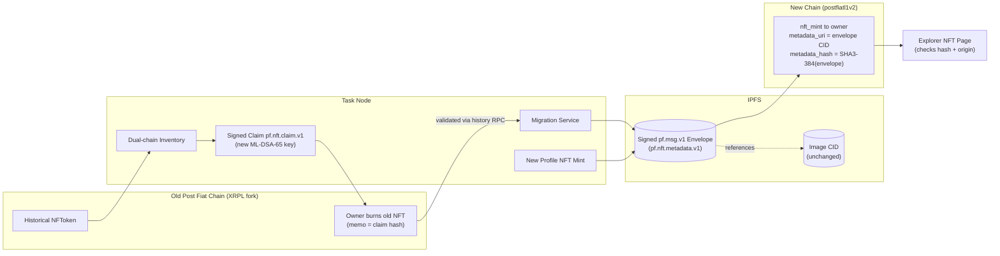

# Pillar 4 — The NFT System

> **Status:** Partial. Native post-quantum NFTs (`nft_mint`, `nft_transfer`, `nft_burn`, signed with ML-DSA-65) are already built on `postfiatl1v2`. What still needs to be built: the Pillar 2 metadata schema, browser/Mac wallet NFT signing, the founder inventory and burn-first migration tool, Task Node new-chain minting, keyed storage lookups (replacing linear scans), and the block explorer NFT page.
>
> **Outcome:** [B · A production-ready new chain](../README.md#three-outcomes) — satisfying the *"supports NFTs in a smart way"* chain readiness gate and moving historical Task Node NFTs onto post-quantum `postfiatl1v2`.

## What this pillar is (in plain English)

Task Node users (including you) minted historical profile NFTs on the old XRPL-fork chain. Today Task Node tracks 79 public IPFS CIDs (images, thumbnails, and metadata), all resolving cleanly, but nobody has yet run a full inventory of the NFTs themselves or moved them to `postfiatl1v2`.

`postfiatl1v2` already has native NFTs secured by post-quantum ML-DSA-65 signatures and SHA3-384 IDs. This pillar adds everything needed to make them real and usable:

1. **Standardized, signed metadata (`pf.nft.metadata.v1`):** Built natively on [Pillar 2](02-message-protocol.md)'s message protocol so every NFT's image, attributes, and origin record are cryptographically signed by the issuer and verified against the on-chain `metadata_hash`.
2. **Full inventory first:** A read-only tool scans your old Post Fiat chain wallets and joins Task Node / PFTasks records so you can review the exact list before migrating a single NFT.
3. **Burn-first migration (zero duplicate live copies):** Your new-chain key signs a claim, your old wallet burns the old NFT with that claim hash in its memo, and once validated, `postfiatl1v2` mints the post-quantum replacement directly to your new-chain account with the exact same image CID and verifiable provenance. *(An optional "pin-only" mode lets you leave an NFT untouched on its original chain and record a provenance reference instead.)*
4. **Native Task Node minting & block explorer view:** Once a user has a new-chain account, new profile NFTs mint straight onto `postfiatl1v2`, and the block explorer displays the artwork, issuer, collection, metadata hash verification, and checked origin history.
5. **Storage scaling & honest post-quantum docs:** Replaces today's linear-scan NFT `Vec` with keyed lookups so NFTs scale cleanly, and publishes both the technical spec and blog post explaining the quantum-resistance guarantees — including why the old classical-key migration window must eventually close.

## How burn-first migration & minting work

## Locked-in design decisions

- **Migration scope:** **Old Post Fiat chain (Task Node / PFTasks) NFTs** in v1. External XRPL mainnet NFTs are out of scope for burn-migration (optional pin-only provenance records can reference them without burning anything on XRPL mainnet).
- **Retirement mode:** **Burn-first** by default (guarantees the old copy is destroyed before the new post-quantum copy is minted), with an optional **pin-only** mode for items you want to leave untouched on the old chain as a provenance record only.
- **Collection issuer & transferability:**
  - **One official Task Node collection issuer** on `postfiatl1v2`, giving one clean verified collection on the explorer and chain-enforced duplicate prevention — with **`ISSUER_BURNABLE` turned OFF** so Task Node can never burn a user's NFT.
  - **Transferable** (`TRANSFERABLE = true`), preserving what holders already had on the old chain.
  - **Issuer fee = `0` PFT** on profile NFTs (a fixed fee charges users even when moving between their own wallets).
- **Operational & rollout defaults locked in:**
  - **Gas & pinning:** Task Node sponsors the tiny migration gas/account-creation cost for users and pins all Post Fiat / Task Node NFT metadata and images long-term (per [Pillar 2](02-message-protocol.md)); third-party issuers pin their own.
  - **Rollout & claim window:** Migrate the founder's full inventory first, then open migration to all users. Close the classical-key claim window and stop old-chain minting when the old chain moves to read-only archive (Stage 4), closing the classical-key quantum attack surface.
  - **Unsolicited spam NFTs:** Keep minting permissionless on chain (matching [Pillar 8](08-onchain-identity.md)), have wallets hide unfollowed issuers by default, and block unsolicited mints that are *both* `BURN_LOCKED` and `TRANSFER_LOCKED` so nobody can permanently glue junk onto another wallet.
  - **Credentials stay separate:** KYC, validator, and top-30 credentials live in [Pillar 8](08-onchain-identity.md)'s native credential system rather than duplicating them inside NFTs; `pf.nft.metadata.v1` remains cleanly extensible.
  - **`ISSUER_BURNABLE` flag:** Enforce it cleanly in execution (only when explicitly enabled on a non-profile collection) so no flag is stored without working.

## What exists today

| Piece | Current state | Where |
|---|---|---|
| Native NFTs on `postfiatl1v2` | `nft_mint`, `nft_transfer`, `nft_burn`, ML-DSA-65 signatures, SHA3-384 IDs, RPC (`nft_info`, `account_nfts`, `issuer_nfts`) all built. **Gaps:** stored in a `Vec` with linear scans; `ISSUER_BURNABLE` stored but not enforced; no memos on NFT txs (metadata links via `metadata_uri`/`metadata_hash`) | [`transactions_mempool_receipts.rs`](https://github.com/postfiatorg/postfiatl1v2/blob/main/crates/types/src/transactions_mempool_receipts.rs), [`nft_escrow_asset_execution.rs`](https://github.com/postfiatorg/postfiatl1v2/blob/main/crates/execution/src/nft_escrow_asset_execution.rs) |
| Wallet NFT signing | Works in Python (`wallet.py`), **missing in `wallet_wasm`** (browser & Mac app cannot sign new-chain NFT txs yet) | [`wallet_wasm/src/lib.rs`](https://github.com/postfiatorg/postfiatl1v2/blob/main/crates/wallet_wasm/src/lib.rs) |
| Task Node minting & IPFS | Live on the **old** chain (`NFTokenMint`); 79 public CIDs repinned and resolving cleanly across Pinata + first-party cluster | [`server/profile-nft-mint.js`](https://github.com/postfiatorg/tasknode/blob/main/server/profile-nft-mint.js), [`server/pftl-nfts.js`](https://github.com/postfiatorg/tasknode/blob/main/server/pftl-nfts.js) |
| Block explorer NFT view | Not built yet ("not on the new chain yet") | [`docs/explorer-spec.md`](https://github.com/postfiatorg/postfiatorg.github.io/blob/main/docs/explorer-spec.md) |

## Detailed specification

### 1. Metadata standard (`pf.nft.metadata.v1`) & one-hash rule
- **Pillar 2 protobuf schema (`pf.nft.metadata.v1`):** Includes `name`, `description`, `image` (`ipfs://` CID), typed `media[]` attachments, `attributes[]`, `collection`, `content_hashes` (SHA3-384 of each referenced asset), `prompt_digest`, `license`, and optional `origin` (`source_chain`, `nftoken_id`, `original_issuer`, `original_uri`, `mint_tx`, `retirement_mode`, `burn_tx`, `claim_cid`, `claim_hash`). Storing **`claim_cid`** (not just `claim_hash`) lets any verifier fetch and verify the exact ML-DSA signed claim offline!
- **One byte stream, one hash:** `metadata_uri` points to the public signed [Pillar 2](02-message-protocol.md) `pf.msg.v1` envelope (pinned as CIDv1 raw) whose `sender_pubkey` **must match the on-chain `nft.issuer`**. On-chain `metadata_hash` is `SHA3-384` of those exact raw envelope bytes. JSON (ERC-721/XLS-24) is a display projection only.
- **Private prompt assets:** Move Task Node's encrypted prompt generation assets to Pillar 2's post-quantum X-Wing suite (encrypted to Task Node keys, not holders, so transfers never require re-encryption).

### 2. Allowlisted inventory, pre-validated burn-first migration & key separation
- **Step 1 — Frozen pre-cutoff allowlist:** A read-only inventory tool scans old Post Fiat chain wallets (`account_nfts`), joins Task Node and PFTasks DB records, and freezes a **signed pre-cutoff eligibility allowlist** (only NFTs minted *before* the cutoff ledger index and matching verified Task Node/PFTasks records or founder-approved inventory qualify). This completely blocks attackers from minting cheap junk on the old chain to pollute the official Task Node collection or drain sponsored migration gas (gas sponsorship is also capped per user account).
- **Step 2 — Pre-validate & durably persist claim BEFORE burn:** Before prompting any irreversible old-chain burn, the migration service verifies the `NFTokenID` is on the allowlist and unmigrated, has the user sign `pf.nft.claim.v1` with their new ML-DSA-65 key, **durably stores and pins the signed claim (`claim_cid`) to IPFS**, and only *then* prompts `NFTokenBurn` with `claim_hash` in its memo. Verification confirms `burn_tx.account == old_owner` (not merely that a burn exists).
- **Step 3 — Replay-proof idempotent mint & partitioned serials:** Once old-chain history RPC confirms the validated burn, the **dedicated migration issuer key** (kept separate from the ongoing fresh-mint issuer key and **permanently retired** when the migration window closes) mints straight to the claimant. Serial numbers are partitioned cleanly (`bit 63 = 1` for deterministic hash-derived migrated serials; `bit 63 = 0` for sequential fresh mints), and `postfiatl1v2` records a permanent **`used_nft_serials` tombstone** so even burning a migrated NFT on `postfiatl1v2` can **never** allow re-minting the same old NFT!
- **Optional pin-only mode:** Anchors a signed `pf.nft.provenance.v1` message via a [Pillar 2](02-message-protocol.md) self-payment (proving ownership via old-wallet signature or burn-free attestation) and renders strictly as a *Recorded Provenance* note — never as a migrated live NFT.

### 3. Task Node dual-chain UI, wallet signing & offline-verifiable Explorer
- **Dual-chain inventory:** While migration is open, Task Node → Profile → NFTs merges both chains and badges old NFTs as *Not migrated* (with one-click Migrate), *Migrated*, or *Recorded*.
- **Automatic new-chain minting:** Once a user has a funded `postfiatl1v2` account, new profile NFTs mint straight onto `postfiatl1v2` under the **ongoing profile-mint issuer key** (separate from the migration key, with documented rotation and daily rate caps) using `pf.nft.metadata.v1`.
- **Wallet signing:** Add NFT signing (`nft_mint`, `nft_transfer`, `nft_burn`) + Pillar 2 envelope signing to `wallet_wasm` and the local Mac app ([Pillar 5](05-local-task-node.md)).
- **Explorer NFT page (survives Stage 4 shutdown):** Displays artwork, **issuer + collection** (never collection name alone), live `metadata_hash` + `envelope.sender == nft.issuer` signature check, flags, transfer history, and origin status (*checked* against an archived, founder-signed old-chain burn-proof bundle pinned to IPFS so provenance verification keeps working even after old-chain RPC nodes shut down at Stage 4!).

### 4. Governed L1 scaling & adversarial security tests
- **Activation-gated storage & spam fixes:** Behind a **governed consensus activation height** (with deterministic state migration so historical replay stays byte-identical), replace linear NFT `Vec` scans with keyed lookups, add paginated `account_nfts` / `issuer_nfts` RPCs (eliminating `O(N)` RPC dumps), enforce `ISSUER_BURNABLE`, record permanent `used_nft_serials` tombstones, and reject unsolicited `BURN_LOCKED + TRANSFER_LOCKED` mints.
- **Adversarial test suite:** Test forged/hijacked claims, non-allowlisted old-chain junk mints, burn-then-remint replay after burning on `postfiatl1v2`, concurrent claims, mismatched burn memos, re-runs after DB wipe, `envelope.sender != nft.issuer` spoofing, oversized fields, and IPFS gateway outages.

## Milestones & completion checklist

### Build milestones
- [ ] **M1 · `pf.nft.metadata.v1` schema & L1 scaling fixes:** Define `pf.nft.metadata.v1` and `pf.nft.claim.v1` on [Pillar 2](02-message-protocol.md); replace linear NFT `Vec` scans with keyed lookups in `postfiatl1v2`; enforce `ISSUER_BURNABLE` and block unsolicited permanent-lock spam mints.
- [ ] **M2 · Wallet signing & inventory tool:** Add NFT + envelope signing to `wallet_wasm` and the Mac app; build the read-only inventory tool and generate the founder's full historical NFT report.
- [ ] **M3 · Burn-first migration service & adversarial tests:** Ship the idempotent burn-first (plus optional pin-only) batch migration service with deterministic chain-enforced serials; pass the full adversarial test suite and multi-model review.
- [ ] **M4 · Task Node dual-chain UI & new-chain minting:** Ship dual-chain Profile → NFTs view (Migrate / Migrated / Recorded badges) and route new profile NFT mints straight to `postfiatl1v2` for funded accounts.
- [ ] **M5 · Block explorer NFT view:** Ship the explorer NFT page displaying issuer, collection, verified `metadata_hash` + signature, flags, transfer history, and checked origin provenance.

### Required ship gates
- [ ] **1. Executed:** All M1–M5 code merged and live across `postfiatl1v2`, Task Node, `wallet_wasm`, and the block explorer.
- [ ] **2. Tested by user:** Founder reviews the historical inventory report, runs the batch burn-first migration on their own NFTs, verifies zero duplicates on re-run, mints a fresh profile NFT directly on `postfiatl1v2`, and inspects both on the block explorer.
- [ ] **3. Added to docs:** `docs/specs/nft-v1.md` (including collection policy, test vectors, migration guide, and honest post-quantum threat model) published in Post Fiat docs.
- [ ] **4. Public blog post document:** Public blog post written and published explaining Post Fiat's quantum-resistant NFT protocol, Pillar 2 metadata integration, and burn-first migration from the old chain.

## Code references

- L1 NFT types & execution: [`transactions_mempool_receipts.rs`](https://github.com/postfiatorg/postfiatl1v2/blob/main/crates/types/src/transactions_mempool_receipts.rs) · [`market_nav_asset_types.rs`](https://github.com/postfiatorg/postfiatl1v2/blob/main/crates/types/src/market_nav_asset_types.rs) · [`nft_escrow_asset_execution.rs`](https://github.com/postfiatorg/postfiatl1v2/blob/main/crates/execution/src/nft_escrow_asset_execution.rs)
- Wallets & Task Node: [`wallet_wasm/src/lib.rs`](https://github.com/postfiatorg/postfiatl1v2/blob/main/crates/wallet_wasm/src/lib.rs) · [`server/profile-nft-mint.js`](https://github.com/postfiatorg/tasknode/blob/main/server/profile-nft-mint.js) · [`server/pftl-nfts.js`](https://github.com/postfiatorg/tasknode/blob/main/server/pftl-nfts.js) · [`server/profile-routes.js`](https://github.com/postfiatorg/tasknode/blob/main/server/profile-routes.js)
- Explorer: [`docs/explorer-spec.md`](https://github.com/postfiatorg/postfiatorg.github.io/blob/main/docs/explorer-spec.md)
