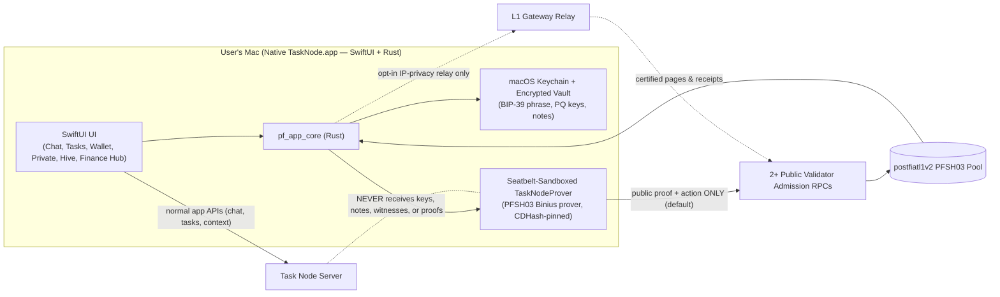

# Pillar 5 — The Task Node Local Experience

> **Status:** In progress — live on `postfiat-wan-devnet-2`! The native SwiftUI + Rust Mac app (`tasknode-apple`, PR #39) is built and signed with a CDHash-pinned Seatbelt `TaskNodeProver` helper using post-quantum **PFSH03** (Binius, curve-free, ML-DSA-65). On Nov 26, 2026, all 6 live devnet validators rolled onto `pq-r3` (PR #280), ratified activation in Block 1910, and executed a full live Shield → Private Send → Scan/Receive → Unshield cycle from an M5 MacBook Pro in Blocks 1912–1914 (~10s prove, ~380 MiB peak RSS, 6/6 validator consensus). What remains: merging PRs #280/#444/#39, unifying recovery seed derivation with `pftl_pq_walletd`, switching submission from relay to direct public validator RPC, adding remaining native SwiftUI tabs (Hive, Finance Hub, NFTs, Governance), Developer ID notarization, and closing multi-model adversarial review.
>
> **Outcome:** [B · A production-ready new chain](../README.md#three-outcomes) — satisfying the *"privacy working locally on MacBooks in our Task Node app"* readiness gate.

## What this pillar is (in plain English)

Privacy only counts if the server never sees your secrets. Our native macOS app (`tasknode-apple` — SwiftUI + Rust `pf_app_core`) already covers chat, tasks, requests, context, rewards, PFTL wallet, bridges, and NAVCoin markets, and now adds **post-quantum shielded transactions (`PFSH03`)** proved strictly on your Mac:

1. **Zero secrets ever leave your Mac:** All spend keys, viewing keys, note openings, trial-decryption scans, and zero-knowledge proofs run inside a sandboxed, code-hash-pinned helper (`TaskNodeProver`) on your Mac. The Task Node server never proves, never sees notes or keys, and never touches private witnesses.
2. **Post-quantum from day one (`PFSH03`):** Uses curve-free Binius proofs + ML-DSA-65 spend authorization (no elliptic-curve Orchard). Fast (~10s end-to-end including helper launch on Apple silicon, ~380 MiB peak RAM, zero cold prewarm). Legacy Orchard and custodial `pftl_swapd` are retired.
3. **Direct to validators (not through Task Node):** Once [Pillar 3](03-validator-program.md)'s public validator RPC endpoints are live, the Mac app submits finished public proofs **directly to 2+ independent validator admission endpoints**, with the L1 gateway relay kept strictly as an opt-in IP-privacy toggle.
4. **Native SwiftUI parity:** Keep extending the existing native SwiftUI Mac app with the remaining tabs (Hive, Finance Hub, NFTs, Governance) — no WebView attack surface and no remote scripts.
5. **Honest privacy UX & rollout:** Launch as a governance-capped *"Shielded Beta"* right after multi-model adversarial review, then raise or lift the TVL cap by governance vote once live pool volume clears its anonymity floor.

## How local shielded transactions work

## Locked-in design decisions

- **Submission path:** **Direct to 2+ independent public validator RPC / admission endpoints** as the default once [Pillar 3](03-validator-program.md) stands up public RPCs (matching *"not processed on the traditional Task Node server"*). The L1 gateway relay (`/api/l1/pq/*`, used for today's devnet proof) stays available only as an explicit opt-in toggle for users who prefer hiding their IP from validators.
- **App architecture:** Keep building on our existing **native SwiftUI + Rust (`tasknode-apple`)** macOS app — zero WebView, zero analytics/crash SDKs. Keys, vaults, scanning, and proving stay 100% local on the Mac; normal app features (chat, tasks, context) talk to hosted Task Node APIs.
- **Platforms & rollout:** **Apple-silicon macOS first** (Developer ID signed and notarized); Linux/Windows later via the shared `pftl_pq_walletd` local daemon + browser UI, and iOS later. Launch with a **governance-controlled "Shielded Beta" TVL cap** after multi-model adversarial review, raising or lifting the cap by governance vote as the pool matures.
- **Assets, payouts & memos:**
  - **Assets at launch:** **PFT and pfUSDC** only (NAVCoins and KYC-gated assets stay outside the pool until Pillar 7/8 disclosure rules exist; optional viewing-key export queued for v2).
  - **Payouts:** FastPay stays the default for Task Node payouts; the Mac app provides a **one-click *Make private* button** on any payout (no forced auto-shielding, and Task Node never proves on a user's behalf).
  - **Memos:** Settled in [Pillar 2](02-message-protocol.md) — keep PFSH03 v1 clean without a circuit rewrite (encrypted notes travel off-chain via Hive/Nostr; in-note encrypted memos reserved for v2).
  - **Fees & caps:** Keep governance-tunable fee + 4-proofs-per-block cap; retire legacy Orchard and custodial `pftl_swapd` (providing a simple two-step exit → PFSH03 shield migration for any old Orchard notes).

## What exists today (updated Nov 26, 2026)

| Piece | Current state | Where |
|---|---|---|
| Live PFSH03 on `postfiat-wan-devnet-2` | **Live on all 6 validators (`pq-r3`, PR #280).** Activated by governance in Block 1910. Live M5 Mac E2E verified in Blocks 1912–1914 (Shield `10.07s` / `382 MiB`, Private Send `10.17s` / `376 MiB`, Bob Scan/Receive, Unshield `9.85s` / `382 MiB`, 6/6 convergence). Needs PR #280 merged to `main` | [`postfiatl1v2#280`](https://github.com/postfiatorg/postfiatl1v2/pull/280) · [`postfiatl1v2#232`](https://github.com/postfiatorg/postfiatl1v2/pull/232) |
| Native Mac app (`tasknode-apple`) | **Built & signed (`TaskNode-PQ.app`, PR #39).** Native SwiftUI covering chat, tasks, requests, context, rewards, PFTL wallet, bridges, NAVCoin markets, and PFSH03 Private tab (Touch ID review, `pfpq1` QR, CDHash-pinned Seatbelt `TaskNodeProver`). Needs merge to `main`, Developer ID notarization, direct public-RPC failover, and remaining tabs (Hive, Finance Hub, NFTs, Governance) | [`tasknode-apple#39`](https://github.com/postfiatorg/tasknode-apple/pull/39) |
| Relay & `wallet-proxy` | Live on devnet (`tasknode#444`, deployed to Fly.io + `navcoin-relay`). Needs merge to `main` | [`tasknode#444`](https://github.com/postfiatorg/tasknode/pull/444) |
| Seed recovery compatibility | **Gap:** Mac app currently hashes BIP-39 with `postfiat/tasknode-apple/pq-seed/v1`, whereas `pftl_pq_walletd` uses a random 48-byte seed. Must unify to one published derivation + test vectors so any client restores the same notes | `crates/privacy_binius_wallet/` · `tasknode-apple` |
| Formal verification & review | 9 Lean modules cover core mathematical properties; multi-model adversarial review in progress | `formal/lean/README.md` |

## Honest privacy model (shown plainly in the app)

Local proving removes the Task Node server as an observer, while remaining honest about what network-level observers can still see:

- **Chain observers** see shield/unshield amounts and public accounts, plus that a private transaction happened and its fee.
- **Receiving validator RPC** sees the public proof + submitter IP/timing (until decentralized outside validators join in Pillar 3, the Foundation still operates today's 6 devnet validators).
- **Task Node server** sees normal non-private app traffic (chat, tasks), **never** keys, notes, witnesses, or private proofs.
- **In-app disclosures:** The app labels the pool *"Shielded (Beta)"* until pool volume clears the anonymity floor (`16+` candidates / `128+` actions), warns against shielding and immediately unshielding identical amounts, and never looks up `pfpq1` addresses through the Task Node server (paste, QR, or direct on-chain Pillar 6 RPC only).

## Detailed specification

### 1. Proving, unified seed recovery & FastPay → Shield bridge
- **Shared crate & unified BIP-39 derivation:** Merge PRs #280, #444, and #39 to `main`; publish one standard HKDF derivation from the master BIP-39 seed (aligned with [Pillar 6](06-hive-identity.md)'s seed hierarchy so every key role uses distinct domain separation) with CI test vectors shared by `tasknode-apple` and `pftl_pq_walletd`. *(Production launches cleanly on this unified derivation; devnet-2 dust rehearsal wallets do not carry over.)* Backups record a birthday checkpoint so clean-Mac restores scan fast and mark spent notes accurately.
- **Cryptographic light-client page verification:** The notarized Mac app ships with the pinned genesis/committee root and discovers public RPC endpoints from the signed [Pillar 3](03-validator-program.md) validator registry feed. Every synced `PFSH03` page and Merkle tree root is **verified against finalized validator quorum signatures (ML-DSA-65)** across 2+ independent endpoints — never trusting unverified JSON.
- **One-click *Make private* from FastPay:** Because Task Node payouts arrive as FastPay owned objects ([Pillar 2](02-message-protocol.md)) while `PFSH03` Shields draw from the consensus account balance, clicking *Make private* automatically chains **`owned_unwrap` (FastPay → consensus balance) → `PFSH03` Shield** as one durable, crash-resumable state machine.
- **Crash-safe & multi-device intents:** Exact signed bytes and intent state (`submitted`, `accepted`, `rejected`, `conflicted`, `expired`) persist before network submission; retries resend identical bytes, and concurrent spends from two devices resolve cleanly without double-proving.
- **Hardware benchmarks:** Measure and publish cold/warm prove time, peak RSS, battery, and thermals on a base 8 GB Apple-silicon MacBook Air as well as M5.

### 2. `pfUSDC` fees, pool conservation, DoS defense & honest submission path
- **`pfUSDC` fees & per-asset pool conservation:** A Shield pays a public PFT fee; a **Private Send or Unshield pays its fee in the spent note's own asset** (`PFT` fees burn; `pfUSDC` fees route to the governance fee collector). Consensus enforces a strict **per-asset shielded pool balance invariant** (`total_shielded_in >= total_unshielded_out + fees` for PFT and `pfUSDC` independently) so no bug can ever leak value across assets.
- **Pre-verification DoS defense & mempool rules:** Public validator admission runs cheap checks first (`< 1ms` syntax + ML-DSA spend-auth + 20-bit PoW) + per-IP rate limits + 60-second mempool expiry + deterministic fee-ordered priority (max 1 queued proof per submitter per block) *before* invoking Binius verification, protecting the 4-proofs-per-block cap from spam floods.
- **Hard custody boundary & honest opt-in relay disclosure:** Default submission goes directly to **2+ independent non-Foundation public validator RPCs** once [Pillar 3](03-validator-program.md) outside validators are live (during early devnet/Foundation-only bootstrap, the UI discloses that the Foundation runs the validators). If a user explicitly enables the optional IP-privacy relay (`/api/l1/pq/*`), the UI plainly states that it runs on Foundation infrastructure (seeing IP/timing, never keys, notes, or witnesses). CI outbound-boundary checks + live release packet captures prove zero secrets ever leave the Mac.
- **Beta cap & governance kill-switches:** During *"Shielded Beta"*, governance sets an explicit **total pool TVL cap per asset** (blocking new Shields above cap while **always keeping Unshields/Exits open**). Activation, cap lifts, pause (halts shields/sends, keeps exits open), and time-bounded exit freezes (elevated quorum, auto-expiring) all require signed governance amendments ratified through Cobalt/validators. Rehearse pause + exit-freeze on devnet before launch.

### 3. Native SwiftUI parity & notarized distribution
- **Developer ID signing & notarization:** Release `.dmg` / `.app` notarized by Apple with hardened runtime and pinned `TaskNodeProver` CDHash; zero Gatekeeper bypasses required.
- **Feature parity tracker:** Add native SwiftUI views for Hive (including Pillar 1 governance sessions), Finance Hub (Pillar 9, opening hosted Finance Hub safely in the system browser), Profile NFTs (Pillar 4), and on-chain Identity (Pillar 6) alongside existing Chat, Tasks, Wallet, Bridges, Markets, and Private tabs.

## Milestones & completion checklist

### Build milestones
- [x] **M0 · Live devnet-2 PFSH03 proof (completed Nov 26, 2026):** Rolled `pq-r3` (PR #280) across all 6 validators, activated via governance (Block 1910), and verified live Shield → Private Send → Scan/Receive → Unshield from signed Seatbelt `TaskNode-PQ.app` on M5 MacBook Pro (Blocks 1912–1914, 6/6 convergence).
- [ ] **M1 · Merge PRs & unify seed recovery:** Merge `postfiatl1v2#280`, `tasknode#444`, and `tasknode-apple#39` to `main`; ship one unified BIP-39 PQ key derivation + birthday-checkpoint restore shared by the Mac app and `pftl_pq_walletd`; retire legacy Orchard & `pftl_swapd`.
- [ ] **M2 · Direct validator RPC & packet-capture leak proof:** Switch default shielded submission from gateway relay to 2+ independent public validator RPC endpoints (with relay kept as opt-in toggle); prove via live network capture and CI that zero shielded data touches Task Node.
- [ ] **M3 · Notarized Mac release & hardware benchmarks:** Ship Apple Developer ID signed + notarized `TaskNode.app`, add one-click *Make private* on FastPay payouts, publish 8 GB MacBook Air + M5 benchmarks, and rehearse kill-switch/pause on devnet.
- [ ] **M4 · Native SwiftUI feature parity:** Add native SwiftUI screens for Hive + Governance (Pillar 1), NFTs (Pillar 4), Identity (Pillar 6), and Finance Hub (Pillar 9).
- [ ] **M5 · Multi-model adversarial review & Lean scope statement:** Close multi-model adversarial review across the Binius circuit, verifiers, wallet crate, admission path, and Mac helper, publish the Lean formal-verification coverage statement, and raise/lift the beta TVL cap by governance vote.

### Required ship gates
- [ ] **1. Executed:** All M1–M5 code merged, notarized macOS release published, multi-model adversarial review closed, and PFSH03 live on production.
- [ ] **2. Tested by user:** Founder installs the notarized `TaskNode.app` on a clean Mac, restores from BIP-39 seed, makes a FastPay payout private in one click, completes Shield → Private Send → Receive → Unshield for both PFT and pfUSDC directly through public validator RPCs, and verifies the leak-capture report.
- [ ] **3. Added to docs:** User install/privacy guide, honest privacy model, hardware benchmarks, Lean scope statement, and operator pause/exit runbook published in Post Fiat docs.
- [ ] **4. Public blog post document:** Public blog post written and published announcing local post-quantum private payments (`PFSH03`) in the native Post Fiat Mac app, how zero-server proving works, and the formal-verification + benchmark results.

## Code references

- PFSH03 & L1 admission: [`postfiatl1v2#280`](https://github.com/postfiatorg/postfiatl1v2/pull/280) · [`postfiatl1v2#232`](https://github.com/postfiatorg/postfiatl1v2/pull/232) · [`private_action_rpc.rs`](https://github.com/postfiatorg/postfiatl1v2/blob/main/crates/node/src/private_action_rpc.rs) · [`wallet-proxy/private-actions.js`](https://github.com/postfiatorg/postfiatl1v2/blob/main/wallet-proxy/private-actions.js)
- Task Node relay: [`tasknode#444`](https://github.com/postfiatorg/tasknode/pull/444)
- Native Mac app: [`tasknode-apple#39`](https://github.com/postfiatorg/tasknode-apple/pull/39) (`core/src/pq_payments.rs`, `mac/Sources/V2/PqPrivateView.swift`, `core/src/prover/`)
- Privacy docs: [`docs/privacy/`](https://github.com/postfiatorg/postfiatl1v2/tree/main/docs/privacy)
