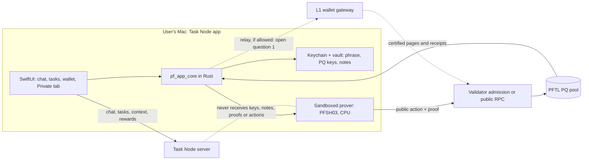
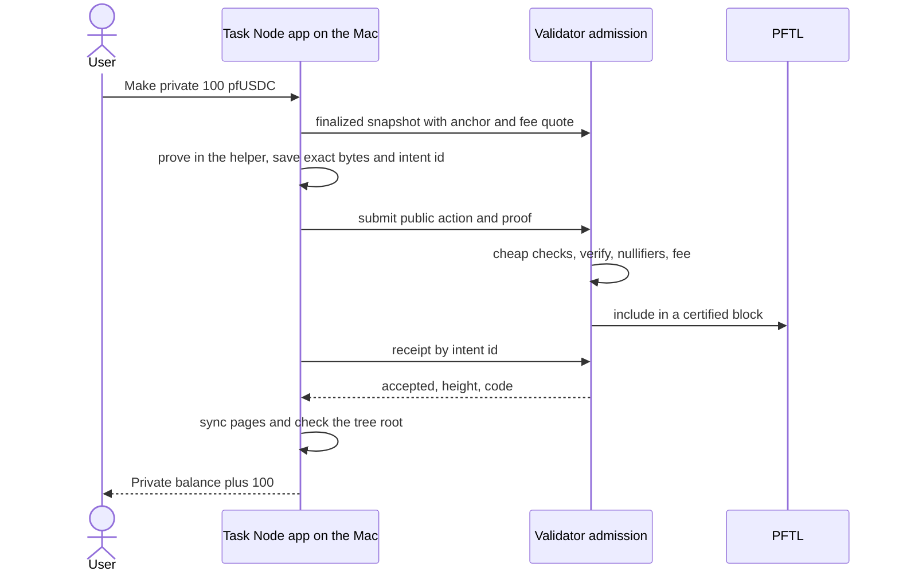

# Pillar 5 — The Task Node Local Experience

> **Status:** Early, but closer than it looks. The native Mac app proves **post-quantum PFSH03** payments on Apple silicon on an open branch (tasknode-apple PR 39: about 2.2 s per action on an M5 MacBook Pro). That branch depends on the open L1 PRs [232](https://github.com/postfiatorg/postfiatl1v2/pull/232) and [280](https://github.com/postfiatorg/postfiatl1v2/pull/280). Nothing is merged and no external audit has started. The released Mac app (v0.2.0) is an ad-hoc-signed pilot with private features compiled out. Public shielded submission is off on every validator.
>
> **Bubbles up to:** [Outcome B · A production-ready new chain](../README.md#three-outcomes). *A production-ready new chain*. "Privacy working, on local MacBooks ideally in our Task Node app" is a readiness gate.

## In one paragraph

Privacy only counts if the server never sees the secret. This pillar ships Task Node as a **local app** that does nearly everything the hosted site does, plus **post-quantum shielded transactions**. The proof is built on the user's machine and sent to validator admission. The Task Node server never proves, never holds a key, note or witness, and never handles the transaction. The privacy system is **PFSH03**: Binius, curve-free, with ML-DSA-65 spend authorisation. Orchard is not the target and does not ship in the app. The work has four parts: take PFSH03 through its gates; ship the Mac integration as a notarised release; close the prototype's gaps (memos, disclosure, payouts, recovery across clients); and say plainly what stays visible.

## User story

**Founder's story.** I am logged into Task Node locally. It can do virtually everything the hosted Task Node can do. More importantly, it can do shielded transactions, and I do not want those processed on the traditional Task Node server.

**Augmented story.**

1. **Install.** I download Task Node for macOS, signed and notarised, and restore my wallet from my recovery phrase. Chat, tasks, requests, context, rewards and the wallet work. The app tells me which hosted features it does not have yet.
2. **Local wallet.** My PFTL keys and my post-quantum spend and receive keys all come from that phrase. They stay in the Keychain and an encrypted vault on the Mac.
3. **Payout, then shield.** A task payout reaches my public balance over FastPay. I choose *Make private* on 100 pfUSDC. The review sheet warns: "Public. Anyone can see this account moved this amount into the private pool." The Mac proves in a few seconds and sends the action to validator admission.
4. **Pay privately.** I send 40 pfUSDC to another user's `pfpq1…` address. The fee comes out of my private notes, so no public account is tied to the payment. The recipient's app finds the note by trial-decrypting new outputs with its own key.
5. **Unshield.** I move 20 pfUSDC to a public account. The explorer shows only that leg.
6. **Trust.** The receipt reads *Proved on this Mac · sent to validator V · not sent to Task Node*. A standing note lists what is still visible (see *Privacy model*). A network capture shows no action, proof or note going to any Task Node host.

## What exists today

| Component | Where | State |
|---|---|---|
| Hosted Task Node run locally | [`docs/wiki/architecture/bootup.md`](https://github.com/postfiatorg/tasknode/blob/main/docs/wiki/architecture/bootup.md) · `docker-compose.dev.yml` | A developer stack that "does not reproduce the complete production system". Not the product. |
| Native Mac app | tasknode-apple `main`: SwiftUI (`mac/Sources/`), Rust core `pf_app_core` through UniFFI, signed prover helper (`core/src/prover/`) | v0.2.0 is **ad-hoc signed, not notarised** (`docs/INSTALL.md`). Covers chat, tasks, requests, context, rewards, the PFTL wallet, bridges and NAVCoin markets. **No Hive, Finance Hub, NFT or governance screens.** Native UI with no WebView. No analytics or crash SDK. |
| Orchard in the Mac app | `core/src/{shielded,private_vault,private_actions}.rs`, `docs/PRIVATE-PAYMENTS-SPEC-20261125.md`, PR 38 (draft) | DEBUG builds on an owned local chain only. 28–31 s per proof, about 250 s of cold prewarm, about 2.1 GB peak. Not quantum-safe. **Not the target.** |
| **PFSH03 in the Mac app** | tasknode-apple PR 39: `core/src/pq_payments.rs`, `core/src/session/pq.rs`, `mac/Sources/V2/PqPrivateView.swift` | **Open**, behind the `TN_PQ_PAYMENTS` flag. Links L1's `postfiat-privacy-binius-wallet` at a pinned commit and proves in a sandboxed helper with a pinned code hash, with no prewarm. Has shield, send and unshield, a `pfpq1` address with QR code, and Touch ID review. The author reports 2.17–2.29 s per action on an M5 MacBook Pro. Submits to the L1 gateway (`/api/private/v1/pq/*`). |
| PFSH03 on the chain | [PR 232](https://github.com/postfiatorg/postfiatl1v2/pull/232) (supersedes PFSH02, [PR 207](https://github.com/postfiatorg/postfiatl1v2/pull/207)) · CI fixes in [PR 271](https://github.com/postfiatorg/postfiatl1v2/pull/271) · devnet-2 and Apple-silicon fixes in [PR 280](https://github.com/postfiatorg/postfiatl1v2/pull/280) | **Open and disabled** until three gates pass: Gate 1, an independent cryptographic, DoS and code audit; Gate 2, production genesis plus hardware and mobile qualification; Gate 3, a governance vote. PR 232's head did not build a release node binary until it was patched ([26 Nov handoff](https://github.com/postfiatorg/postfiatl1v2/blob/main/docs/status/handoff-2026-11-26.md)). |
| PFSH03 numbers | PR 232; `docs/quantum/private-payments.md` on its branch | 2.66 s to prove on 16 threads, with 355–361 MiB peak and ARM64 `PMULL` kernels. PFSH02 took 2.89 s on 32 threads of an AMD EPYC host, and 26.7 s on one thread. **A proof is about 149 KB**, against 7,680 bytes for Orchard (PR 206). PFSH02 verified in about 21 ms on one core, and in 24–55 ms inside a validator. |
| Wallet daemon and browser flow | `crates/node/src/bin/pftl_pq_walletd.rs`, `crates/privacy_binius_wallet/`, `wallet-web/src/components/PqPayments.jsx` (PR 232) | A daemon holds the keys and proves over a Unix socket. A loopback bridge serves the bundled `wallet-web`. Recovery uses a **random 48-byte seed**, a wrapping key and a birthday checkpoint. |
| Validator admission (W-1) | [`user-proven-shielded-actions-milestone.md`](https://github.com/postfiatorg/postfiatl1v2/blob/main/docs/plans/active/user-proven-shielded-actions-milestone.md) · `crates/node/src/private_action_rpc.rs` · `wallet-proxy/private-actions.js` | **Built on main, not deployed.** Snapshot, submit and receipt routes. Admission is validator-owned, behind `rpc-serve --allow-private-action-admission`. The gateway relays the exact public bytes and holds no key, and its secret-inspection test passes. Open: readiness (S7.1) and the approved devnet run (S8). The custodial legacy path (`pftl_swapd`) is off by default in code, but `docker-compose.wallet-public.yml` still defaults it to `on`. |
| Privacy docs | [`docs/privacy/`](https://github.com/postfiatorg/postfiatl1v2/tree/main/docs/privacy) | Orchard disclosure, [metadata bounds](https://github.com/postfiatorg/postfiatl1v2/blob/main/docs/privacy/metadata-anonymity-bounds.md), the [pool floor](https://github.com/postfiatorg/postfiatl1v2/blob/main/docs/privacy/floor-calibration.md) (16 candidates, 128 actions) and the [RPC resource policy](https://github.com/postfiatorg/postfiatl1v2/blob/main/docs/privacy/rpc-and-resource-policy.md). |
| Network | [network status](https://github.com/postfiatorg/postfiatl1v2/blob/main/docs/status/network-status.md) | Six Foundation validators, no public RPC ([Pillar 3](03-validator-program.md)). Public shielded submission is **off**. |

**What PR 232's code fixes in place.**

- **Assets.** The pool takes PFT and **one pinned pfUSDC source series** (`PQ_REHEARSAL_ISSUE`). Other issued assets are refused (`pq_issue_disabled`), and so are assets with a disclosure policy (`pq_unsupported_disclosure`).
- **Fees.** A shield pays a public PFT fee. A payment or exit pays its fee from notes of the same asset. PFT fees burn. pfUSDC fees go to a collector that governance withdraws from. The fee is set by signed amendment, and 1 atom is the proposed start.
- **Capacity and DoS.** At most four PQ proofs fit in a block (`PQ_REHEARSAL_PROOFS`), under a byte cap. The verifier checks the cheap things first: signature, transcript, then a 20-bit proof-of-work. A proof that fails these is refused in under 1 ms; one that fails later takes about 15 ms.
- **Switches.** A pause stops shields and payments but keeps exits open. An exit freeze needs an elevated quorum and expires on its own.
- **Out of scope.** There are no encrypted memos, no viewing keys, and every action is two notes in, two out.

## Architecture

## Privacy model

Proving on the device removes one observer: whoever builds the proof learns the sender, recipient, asset and amount. The other observers remain.

| Observer | Learns |
|---|---|
| Anyone reading the chain | Every shield and unshield: account, asset, amount and time. For a payment in the pool: that it happened, when, its asset and its fee. |
| The endpoint that receives the action | All of the above, plus the submitter's IP address and timing. All validators are run by the Foundation, which also runs Task Node, so "direct to validators" does not yet mean another operator. |
| Task Node server | Ordinary app traffic: session, IP and timing. It can correlate these with public shield and unshield legs. It never receives the private action. |
| The recipient | The amount and asset received. |
| A future quantum attacker | Nothing extra from PFSH03. Old Orchard notes are exposed. |

The app must also handle three known leaks. A shield and an unshield of the same amount close in time link to each other. A small pool hides little. An address lookup through Task Node would show Task Node who pays whom.

## Economics

- **Cost of a payment.** About 149 KB of block space and 24–55 ms of validator CPU. The four-proof cap bounds the load and also caps private throughput. The fee is the only price on block space and on nullifier growth that never shrinks. Pruned nodes reclaim about 95% of PQ body storage.
- **Who earns.** PFT fees burn, and pfUSDC fees go to a governance collector. Validators get **no fee share or reward credit** for serving admission and pages. Their incentive to keep admission switched on therefore depends on [Pillar 3](03-validator-program.md).
- **Fixed costs.** The Gate 1 audit is the largest, with no vendor, scope or budget yet. A native app has a recurring cost of keeping pace with the web app.
- **Reach.** NAVCoins and KYC assets cannot enter the pool. At launch, privacy covers PFT and pfUSDC only.

## Technical requirements

### Proving and integration

- **R1.** The release proving system is **PFSH03**, and no release build enables Orchard. PRs 232, 271 and 280 merge to `main` with CI green and the release binary building. Activation then follows Gates 1–3.
- **R2.** Merge tasknode-apple PR 39 against the merged L1 commit, not a branch pin. The app and `pftl_pq_walletd` share `postfiat-privacy-binius-wallet`, so proving and scanning code exists once.
- **R3.** For shield, send, unshield and sync, measure the time (cold and warm), peak memory, battery and heat. Do this on the minimum supported Mac (proposed: a base 8 GB Apple-silicon MacBook Air) and on the M5. Publish the numbers in the L1 docs. The budget they must meet is a founder decision.

### Keys, recovery and state

- **R4.** **One published derivation** of the PQ keys from the recovery phrase, with test vectors, used by the app, the daemon and the browser. Today the Mac branch hashes the phrase seed with `postfiat/tasknode-apple/pq-seed/v1`, while the daemon uses a random seed plus a wrapping key. A wallet made in one client cannot be restored in the other.
- **R5.** A backup records its birthday checkpoint. A restore on a clean Mac rescans from that checkpoint and marks spent notes as spent.
- **R6.** The scanner fetches whole pages from its cursor, never single outputs. It rebuilds tree roots and checks each one against a certified block from a second, independent endpoint, as the daemon already does.
- **R7.** Each action is saved before it is sent: its exact bytes and its intent state (submitted, accepted, rejected, conflicted or expired), as in the Mac spec. A resubmission sends identical bytes. If two devices with the same phrase spend the same note, one intent ends `accepted` and the other `conflicted`, and the app reports it.

### Submission path

- **R8.** **Hard rule:** the Task Node server never receives a key, note, witness, proof or shielded action, and no server build links the prover. This is the founder's "not processed on the traditional Task Node server".
- **R9.** The app submits to validator admission or a public RPC node ([Pillar 3](03-validator-program.md)), using at least two independent endpoints. It fails over when one refuses or times out, and records which endpoint took each action. Whether the L1 gateway relay is allowed is open question 1. The Mac spec (D5) and PR 39 both default to the relay today, and must follow that decision.
- **R10.** Admission keeps its existing limits: the operator switch, a 1 MiB action and 2 MiB request cap, rate and concurrency limits, cheap checks first and the per-block cap. Public RPC operators publish their limits. The app shows refusals by their typed code.

### The app

- **R11.** Release builds are **Developer ID signed and notarised**, with the prover's code hash pinned. Private features turn on only after a signed amendment activates PFSH03.
- **R12.** **Parity list.** Every hosted feature is marked native, deferred or web-only, including the features from Pillars 1, 4, 6, 9 and 10. How to close the gap is open question 3.
- **R13.** **Payouts.** FastPay stays the default for Task Node payouts. Shielded actions settle through consensus, not FastPay. The wallet shows public, FastPay and private balances separately, and offers one *Make private* action on any payout.
- **R14.** **Memos.** Today's encrypted-memo payments keep working in the app as public payments with private content: a pointer memo plus an encrypted IPFS payload ([Task Node encryption](https://github.com/postfiatorg/tasknode/blob/main/docs/wiki/architecture/encryption.md)). A private payment's memo never lists the Task Node service key as a default reader. How memos travel with private payments is open question 6.
- **R15.** **Address discovery.** A recipient's `pfpq1` address comes from the recipient (paste or QR code) or from an on-chain record read over PFTL RPC ([Pillar 6](06-hive-identity.md)). The app never looks it up through Task Node.
- **R16.** **Wording.** The app follows the Mac spec's rule. It says "Shielded" and "hidden, small pool" until the pool clears the repository's floor, and "private" only after that. Each action carries its disclosure line. A standing warning covers a shield and an unshield of the same amount.
- **R17.** **Leak tests.** A network capture on the release build shows no shielded payload reaching Task Node or any third party. The outbound-payload checks (`V2OutboundBoundary`, the custody boundary) run in CI. Logs and crash reports contain no amounts, counterparties or keys. Adding any analytics or crash SDK requires a review.

### Assurance and operations

- **R18.** **Adversarial review across several models**, as the founder asked, of the circuit, both verifiers, the wallet crate, admission and the Mac integration. It is in addition to `verify.sh` (35 named attacks and 150 random corruptions). Findings close before Gate 1.
- **R19.** **Lean coverage statement.** State what the 9 Lean modules prove: conservation, binding, zero-knowledge and authorisation, conditional on hash assumptions. State what they leave to external review, as their README says: whether the model matches the code, and how the proofs connect to the published literature.
- **R20.** **Kill switch.** A runbook for the pause and the exit freeze, rehearsed on devnet. The app shows the pool's state and keeps exits open whenever the chain does.
- **R21.** **Leaving Orchard.** Orchard notes move with PR 207's two-step migration: exit to the public account, then a fresh PQ shield. The app warns that the two steps link. It never uses `pftl_swapd`.
- **R22.** **Later.** A browser mode built on `pftl_pq_walletd` and its loopback bridge, if open question 4 asks for one.

## Dependencies

| Depends on | Why |
|---|---|
| L1 PRs 232, 271 and 280, then Gates 1–3 | The PQ pool and the Apple-silicon fixes. |
| An external auditor | Gate 1. None engaged yet. |
| W-1 deployment (S7.1, S8) | Validator-owned admission, live on devnet. |
| [Pillar 1 — Governance](01-hive-governance.md) | The activation, fee and cap decisions go through a packet and session. The signed amendment ratifies them. |
| [Pillar 3 — Validators](03-validator-program.md) | Public RPC and independent endpoints, and possibly rewards for serving admission. |
| [Pillar 2 — Message protocol](02-message-protocol.md) | The post-quantum encryption suite and the memo format. |
| [Pillar 6 — Hive identity](06-hive-identity.md) | An on-chain record for a `pfpq1` address. |
| [Pillars 7](07-navcoin-fees.md) and [8](08-onchain-identity.md) | Any move to admit NAVCoins or KYC assets to the pool. |
| FastPay payouts (index, readiness gate 3) | The payouts users shield. |
| Apple Developer ID | Notarised distribution. |

## Acceptance criteria

1. On the devnet, with PFSH03 activated by signed amendment, a notarised build shields, pays and unshields PFT and pfUSDC with dust. Every proof is built on the Mac, and balances and fees reconcile on all validators.
2. A network capture of those flows shows no shielded payload sent to Task Node or a third party, and each receipt names its endpoint.
3. The recipient finds the payment from PFTL pages alone. A page set that has been tampered with, reordered or cut short is refused.
4. The same phrase, restored on a clean Mac and in `pftl_pq_walletd`, recovers the same notes.
5. On six validators, each of the following is refused with no state change: a replay, a double spend, a malformed or oversized proof, a stale anchor, a wrong fee and a disabled asset. A flood of invalid proofs leaves block latency normal.
6. Killing and relaunching the app around a submit, and spending from a second device, each resolve to the correct intent state with no second proof.
7. The R3 measurements are published.
8. A FastPay payout is made private in one action.
9. Memos behave as decided under open question 6.
10. The multi-model review and the external audit are closed. The activation packet cites them, the measurements and the Lean statement.
11. The pause and the exit freeze are rehearsed with the app connected, and exits keep working.

## Open questions for the founder

1. **Submission path.** Should the app submit directly to validators or public RPC only? Or may it use the L1 gateway relay as an option, or as the default as the Mac branch does now?
    - Direct matches your words most closely. It needs Pillar 3's public RPC, and validators see the user's IP.
    - The relay hides the IP from validators. Its operator, today the Foundation, sees who sent a private payment and when.

2. **Thin client or local-first.** This spec is a local client over the hosted APIs, with keys and proving on the Mac. The alternative also keeps context, history and agents on the device. That is a much larger build.
3. **Reaching "virtually everything".**
    - Native SwiftUI throughout: safest, with a recurring porting cost.
    - A signed web build bundled in the app for the non-private screens, with no remote scripts: faster parity, but a web runtime to secure.
    - Browser plus a local daemon: cross-platform, but a weaker install experience.

4. **Platforms.** Is Apple-silicon macOS enough for launch, or are Linux or Windows (through the daemon) and iOS needed?
5. **Launch exposure.** Activate only after the external audit? Or run a capped beta after the multi-model review, with a governance-set limit on pool value? What sample must clear the pool floor before the app says "private"?
6. **Memos on private payments.**
    - An encrypted memo field in the PQ envelope. This changes the circuit and needs a new audit.
    - A separate encrypted message over Nostr or Hive. No chain change, but timing can link the memo to the payment.
    - No memos.

7. **Private payouts.**
    - Manual *Make private* only.
    - Optional auto-shield. This publicly links each payout to a shield.
    - Task Node pays from its own shielded notes. Task Node then proves its own payments and knows who it paid.

8. **Fees and validator pay.** What should the starting fee be (1 atom is proposed), and should the four-proof cap stay? Should serving admission earn validators a fee share or Pillar 3 reward credit?
9. **Which assets can be private.** PFT and pfUSDC only, or NAVCoins and credential-gated assets too? The latter need a disclosure design, a rule for Pillar 7 fees on shielded holdings, and Pillar 8 eligibility checks. Should PQ also get a viewing-key export for auditors, as Orchard has?
10. **Audit.** Scope (circuit, verifiers, wallet crate, admission, Mac app), vendor and budget for Gate 1.
11. **Orchard.** Once migration works: close the pool to new deposits, keep it for compatibility, or retire it together with the custodial `pftl_swapd` swap?

## Code references

- PFSH03: [PR 232](https://github.com/postfiatorg/postfiatl1v2/pull/232). On its branch: `docs/quantum/private-payments.md`, `docs/specs/pq-private-payments-integration.md`, `docs/security/peel-binius-shielded-pq-payments.md`, `crates/node/src/pq_payment_actions.rs`, `crates/types/src/shielded_bridge_governance.rs` (`PQ_REHEARSAL_ISSUE`, `PQ_REHEARSAL_PROOFS`), `crates/privacy_binius_wallet/README.md`, `crates/node/src/bin/pftl_pq_walletd.rs`, `formal/lean/README.md`. Related: [PR 207](https://github.com/postfiatorg/postfiatl1v2/pull/207) · [PR 271](https://github.com/postfiatorg/postfiatl1v2/pull/271) · [PR 280](https://github.com/postfiatorg/postfiatl1v2/pull/280)
- Admission: [`user-proven-shielded-actions-milestone.md`](https://github.com/postfiatorg/postfiatl1v2/blob/main/docs/plans/active/user-proven-shielded-actions-milestone.md) · [`crates/node/src/private_action_rpc.rs`](https://github.com/postfiatorg/postfiatl1v2/blob/main/crates/node/src/private_action_rpc.rs) · [`wallet-proxy/private-actions.js`](https://github.com/postfiatorg/postfiatl1v2/blob/main/wallet-proxy/private-actions.js)
- Privacy: [`docs/privacy/`](https://github.com/postfiatorg/postfiatl1v2/tree/main/docs/privacy) · [`crates/privacy`](https://github.com/postfiatorg/postfiatl1v2/tree/main/crates/privacy) · [`crates/privacy_orchard`](https://github.com/postfiatorg/postfiatl1v2/tree/main/crates/privacy_orchard) · [`crates/wallet_wasm`](https://github.com/postfiatorg/postfiatl1v2/tree/main/crates/wallet_wasm)
- Status: [network status](https://github.com/postfiatorg/postfiatl1v2/blob/main/docs/status/network-status.md) · [handoff 25 Nov](https://github.com/postfiatorg/postfiatl1v2/blob/main/docs/status/handoff-2026-11-25.md) · [handoff 26 Nov](https://github.com/postfiatorg/postfiatl1v2/blob/main/docs/status/handoff-2026-11-26.md)
- Task Node: [`src/features/wallet/l1/wasm/`](https://github.com/postfiatorg/tasknode/tree/main/src/features/wallet/l1/wasm) · [`docs/wiki/architecture/encryption.md`](https://github.com/postfiatorg/tasknode/blob/main/docs/wiki/architecture/encryption.md) · [`docs/wiki/architecture/bootup.md`](https://github.com/postfiatorg/tasknode/blob/main/docs/wiki/architecture/bootup.md)
- Mac app (private repo `postfiatorg/tasknode-apple`; the wallet team grants access): `docs/PRIVATE-PAYMENTS-SPEC-20261125.md`, `docs/INSTALL.md`, `mac/Sources/TNKit/TaskNodeClient.swift`, PR 38 (Orchard, draft), PR 39 (PFSH03)

## Revision notes (review round 1)

| Item | Change |
|---|---|
| Gemini P1 | Checked the code: the UI is native SwiftUI with no WebView, so no remote-script risk. Parity gap: R12. Approach: open question 3. |
| Gemini P2 | Fees, assets and proof size taken from code. New *Economics* section. Fee level: open question 8. |
| Gemini P3 | Found the Mac PFSH03 port (PR 39): R1–R2. Orchard not shipped: R1, R21. Audit and capped beta: open questions 10 and 5. |
| Gemini P4 | Partly disputed: cheap checks first, proof-of-work, size limits, the switch and the block cap all exist. Added failover (R9), published limits (R10), a flood test (AC 5) and validator incentives (open question 8). |
| Gemini P5 | ARM64 kernels and an M5 measurement exist. Base-Mac measurements: R3. Budget left to the founder. |
| Gemini P6 | New *Privacy model* section. Added R15, R16 and R17. |
| Gemini P7 | R13 and R14 (PFSH03 has no memos). Open questions 6 and 7. |
| Gemini P8 | R4–R7. Found that the app and the daemon derive keys differently. PFSH03 has no outgoing viewing key. |
| Gemini P9 | Checked: the code refuses other assets. Open question 9. |
| Gemini P10 | Both clients already share the wallet crate (R2). Platforms: open questions 3 and 4. |
| Gemini P11 | Added acceptance criteria 3–11. |
| Gemini P12 | Removed the local path. Private-repo paths kept as plain text, with the key facts written into the page. |
| Opus P1 | The port exists (PR 39). R2 merges it against merged L1 code. |
| Opus P2 | Corrected: 2.89 s was on 32 threads, not 16 cores. R3 is per action and per machine. |
| Opus P3 | *Privacy model* states that one operator runs validators and Task Node. R16 sets the wording. |
| Opus P4 | Fees from code; R10 and R7. |
| Opus P5 / P6 | R14 / R13. Open questions 6 and 7. |
| Opus P7 | Pillar 1 dependency added. AC 10 lists what the activation packet contains. |
| Opus P8 | R18 and R19. Open questions 5 and 10. |
| Opus P9 | Open question 2. |
| Opus P10 | Open question 9. |
| Opus P11 | R21. Open question 11. |
| Opus P12 | R4–R5. PQ viewing key: open question 9. |
| Opus P13 | AC 1, 10 and 11. Value cap: open question 5. No soak duration, because the plan carries no timelines. |
| Opus P14 | References checked again. W-1 was wrongly described as planned; it is built on main and not deployed. |
| Opus P15 | R8 and R17. |
| Opus P16 | R12. Open question 3. |
