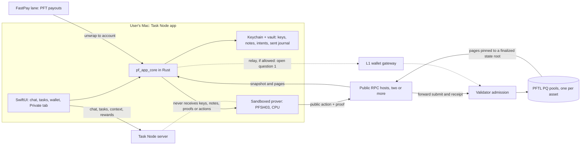
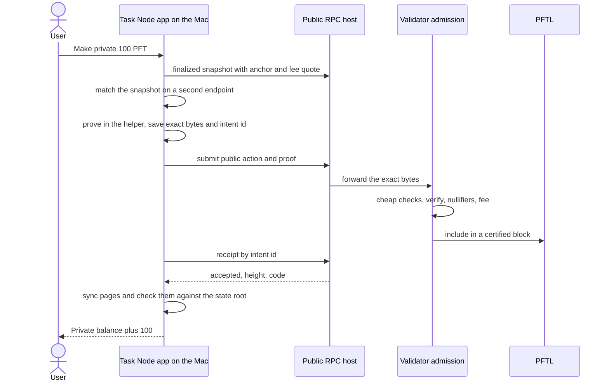

# Pillar 5 — The Task Node Local Experience

> **Status:** Early, but closer than it looks. The native Mac app proves **post-quantum PFSH03** payments on Apple silicon on an open branch (tasknode-apple PR 39: about 2.2 s per action on an M5 MacBook Pro). That branch depends on the open L1 PRs [232](https://github.com/postfiatorg/postfiatl1v2/pull/232) and [280](https://github.com/postfiatorg/postfiatl1v2/pull/280). Nothing is merged and no external audit has started. The released Mac app (v0.2.0) is an ad-hoc-signed pilot with private features compiled out. Public shielded submission is off on every validator.
>
> **Bubbles up to:** [Outcome B · A production-ready new chain](../README.md#three-outcomes). "Privacy working, on local MacBooks ideally in our Task Node app" is one of its readiness gates.

## In one paragraph

Privacy only counts if the server never sees the secret. This pillar ships Task Node as a **local app** that does nearly everything the hosted site does, plus **post-quantum shielded transactions**. The proof is built on the user's machine and sent to validator admission. The Task Node server never proves, never holds a key, note or witness, and never handles the transaction. The privacy system is **PFSH03**: Binius, curve-free, with ML-DSA-65 spend authorisation. Orchard is not the target and does not ship in the app. The work has four parts: take PFSH03 through its gates; ship the Mac integration as a notarised release; close the prototype's gaps (sync integrity, note handling, memos, payouts, recovery across clients); and say plainly what stays visible.

## User story

**Founder's story.** I am logged into Task Node locally. It can do virtually everything the hosted Task Node can do. More importantly, it can do shielded transactions, and I do not want those processed on the traditional Task Node server.

**Augmented story.**

1. **Install.** I download Task Node for macOS, signed and notarised, and restore my wallet from my recovery phrase. Chat, tasks, requests, context, rewards and the wallet work, and the app says which hosted features it lacks.
2. **Local wallet.** My PFTL and post-quantum keys all come from that phrase and stay in the Keychain and an encrypted vault on this Mac.
3. **Payout, then shield.** A 100 PFT task payout reaches me over FastPay. I choose *Make private*. The review sheet shows its two steps (FastPay to my account, then the pool), the fee and the warning: "Public. Anyone can see this account moved this amount into the private pool." The Mac proves in a few seconds and sends the action through a public RPC host to validator admission.
4. **Pay privately.** I send 40 PFT to another user's `pfpq1…` address. The fee comes from my private notes, so no public account is tied to it. The recipient's app finds the note by trial decryption. pfUSDC works the same way.
5. **Unshield.** I move 20 PFT to a public account. The explorer shows only that leg.
6. **Trust.** The receipt reads *Proved on this Mac · sent via RPC host R to validator V, both run by the Foundation · not sent to Task Node*. A standing note lists what is still visible, and a network capture shows nothing private going to Task Node.

## What exists today

| Component | Where | State |
|---|---|---|
| Hosted Task Node run locally | [`docs/wiki/architecture/bootup.md`](https://github.com/postfiatorg/tasknode/blob/main/docs/wiki/architecture/bootup.md) · `docker-compose.dev.yml` | A developer stack, not the product. |
| Native Mac app | tasknode-apple `main`: SwiftUI (`mac/Sources/`), Rust core `pf_app_core` through UniFFI, signed prover helper (`core/src/prover/`) | v0.2.0 is **ad-hoc signed, not notarised** (`docs/INSTALL.md`). Chat, tasks, requests, context, rewards, the PFTL wallet, bridges and NAVCoin markets over hosted APIs. **No Hive, Finance Hub, NFT or governance screens.** The payment signer refuses memos (`core/src/codec.rs`). No WebView or analytics. Team-signed builds keep Keychain items this-device-only and unsynchronised (`KeychainStore.swift`). |
| Orchard in the Mac app | `core/src/{shielded,private_vault,private_actions}.rs`, `docs/PRIVATE-PAYMENTS-SPEC-20261125.md`, PR 38 (draft) | DEBUG on a local chain only, 28–31 s per proof. Not quantum-safe. **Not the target.** |
| **PFSH03 in the Mac app** | tasknode-apple PR 39: `core/src/pq_payments.rs`, `core/src/session/pq.rs`, `mac/Sources/V2/PqPrivateView.swift`, `mac/Sources/V2/V2Gateway.swift` | **Open**, behind `TN_PQ_PAYMENTS`. Links L1's `postfiat-privacy-binius-wallet` at a pinned commit and proves in a sandboxed helper with a pinned code hash. Shield, send, unshield, a `pfpq1` address, Touch ID review. Snapshot, pages and submission all go to one gateway (`/api/private/v1/pq/*`), whose state root sync trusts, with placeholders for missing fields and a full re-read each time. |
| PFSH03 on the chain | [PR 232](https://github.com/postfiatorg/postfiatl1v2/pull/232) (supersedes PFSH02, [PR 207](https://github.com/postfiatorg/postfiatl1v2/pull/207)) · CI fixes [PR 271](https://github.com/postfiatorg/postfiatl1v2/pull/271) · devnet-2 and Apple-silicon fixes [PR 280](https://github.com/postfiatorg/postfiatl1v2/pull/280) | **Open and disabled** until Gate 1 (independent cryptographic, DoS and code audit), Gate 2 (production-genesis cut plus hardware and mobile qualification) and Gate 3 (governance vote). PR 232's head built no release binary until patched (26 Nov handoff). |
| PFSH03 numbers | PR 232; `docs/quantum/private-payments.md` on its branch | 2.66 s to prove on 16 threads, 355–361 MiB peak, ARM64 `PMULL` kernels. Bad signature refused in 0.22 ms, valid-PoW bad proof in about 15 ms. **PFSH02** figures: about 149 KB per action (Orchard: 7,680 bytes), 24–55 ms to verify inside a validator. |
| Wallet daemon and browser flow | `crates/node/src/bin/pftl_pq_walletd.rs`, `crates/privacy_binius_wallet/`, `wallet-web/src/components/PqPayments.jsx` (PR 232) | Keys and proving behind a Unix socket; a loopback bridge serves `wallet-web`. Recovery uses a **random 48-byte seed**, a wrapping key and a birthday checkpoint. Pages are checked against an independent validator. |
| Validator admission (W-1) | [`user-proven-shielded-actions-milestone.md`](https://github.com/postfiatorg/postfiatl1v2/blob/main/docs/plans/active/user-proven-shielded-actions-milestone.md) · `crates/node/src/private_action_rpc.rs` · `wallet-proxy/private-actions.js` | **Built on main, not deployed**, behind `rpc-serve --allow-private-action-admission`. The gateway relays exact public bytes and holds no key. Open: readiness (S7.1), devnet run (S8). The proxy's legacy shielded certification, which reads a validator key, is off in code but `on` in `docker-compose.wallet-public.yml`. |
| Privacy docs | [`docs/privacy/`](https://github.com/postfiatorg/postfiatl1v2/tree/main/docs/privacy) | [Metadata bounds](https://github.com/postfiatorg/postfiatl1v2/blob/main/docs/privacy/metadata-anonymity-bounds.md), the [pool floor](https://github.com/postfiatorg/postfiatl1v2/blob/main/docs/privacy/floor-calibration.md) (16 candidates, 128 actions), the [RPC resource policy](https://github.com/postfiatorg/postfiatl1v2/blob/main/docs/privacy/rpc-and-resource-policy.md). |
| Network | [network status](https://github.com/postfiatorg/postfiatl1v2/blob/main/docs/status/network-status.md) · [settlement lanes](https://github.com/postfiatorg/postfiatl1v2/blob/main/docs/architecture/settlement-lanes.md) | Six Foundation validators, no public RPC, shielded submission **off**. FastPay carries **PFT only**, as prefunded objects unwrapped into an account. |

**What PR 232's code fixes in place.**

- **Assets.** One pool per asset: PFT and **one pinned pfUSDC series** (`PQ_REHEARSAL_ISSUE`, the rehearsals' development series). All else is refused.
- **Compiled-in limits,** changed only by a release: the chains allowed to activate (`pq_rehearsal_domain`), the pinned series, and four PQ actions per block (`PQ_REHEARSAL_PROOFS`, within 640,000 bytes).
- **Fees.** A shield pays public PFT; a payment or exit pays from notes of its asset. PFT fees burn; pfUSDC fees go to a governance collector. A signed amendment sets the fee, and wallets read it from the finalized snapshot. 1 atom is proposed.
- **DoS.** Cheap checks first: signature, transcript, a 20-bit proof-of-work, then the proof.
- **Anchors and notes.** Each tree's last 256 roots are valid anchors. Every action spends two notes and creates two, both inputs under one root, so notes in different tree epochs are merged by a self-payment first. A note no larger than the fee cannot be exited alone.
- **Integrity.** The state root commits each output record and its ciphertext digest. The proof binds the ciphertext, not that it decrypts.
- **Switches.** A pause stops shields and payments but keeps exits open. An exit freeze needs an elevated quorum and expires on its own.
- **Absent.** Encrypted memos, viewing keys (incoming or outgoing), a pool-value cap.

## Architecture

## Privacy model

Proving on the device removes one observer, the prover, who would learn sender, recipient, asset and amount. The others remain.

| Observer | Learns |
|---|---|
| Anyone reading the chain | Every shield and unshield: account, asset, amount and time. For a payment in the pool: that it happened, when, its asset and its fee. |
| The RPC host or relay that receives the action | All of the above, plus the submitter's IP address and timing. Validators see only the forwarder. Today the Foundation runs every validator and Task Node, so a public endpoint does not yet mean another operator. |
| Task Node server | Session, IP and timing, which it can correlate with public shield and unshield legs. Never the private action. |
| The recipient | The amount and asset received. |
| A future quantum attacker | Nothing extra from PFSH03. Old Orchard notes are exposed. |

The app must manage four leaks. A shield and an unshield of the same amount close in time link. Each asset is its own pool, so a quiet asset hides little. An address lookup, or a memo pinned or fetched, through Task Node would show Task Node who pays whom.

## Economics

- **Capacity.** Four private actions per block. In rehearsal a six-validator round with four PFSH02 proofs took about 1.03 s (0.31 s without). So private throughput is a few actions per second at best, shared by all users.
- **Spam.** A valid action costs a fee, a few seconds of proving and a cheap proof-of-work. At 1 atom, one sender with a handful of cores can fill every slot, crowding out users and adding nullifiers that never shrink. Today's levers (fee, per-endpoint rate limits, the cap) do not price congestion (open question 8).
- **Cost per action.** About 149 KB and 24–55 ms of validator CPU (PFSH02; R3 replaces them). Pruned nodes reclaim about 95% of PQ body storage; archival nodes keep it all.
- **Who earns.** Validators get **no fee share or reward credit** for admission and pages (open question 8); their incentive rests on [Pillar 3](03-validator-program.md).
- **Getting in.** A shield's fee is public PFT, so a pfUSDC-only holder needs PFT first. Task Node payouts are PFT.
- **Fixed costs.** The Gate 1 audit (no vendor or budget yet), and keeping a native app level with the web app.
- **NAVCoins.** Fix fills already settle as private swaps in the separate Asset-Orchard pool ([Pillar 7](07-navcoin-fees.md) R6, the [pNOK fix demo](https://github.com/postfiatorg/postfiatl1v2/blob/main/docs/status/PNOK-PRIVATE-FIX-DEMO-ACCEPTANCE-20260801.md)). That pool is not quantum-safe and is not in this app. The PFSH03 pool admits no NAVCoin at launch. Pillar 7 charges its fees by minting fee units, which dilutes shielded and public units alike, so shielded holdings need no fee rule of their own.

## Technical requirements

### Proving and integration

- **R1.** The release proving system is **PFSH03**, and no release build of the app enables Orchard. PRs 232, 271 and 280 merge to `main` with CI green and the release binary building. Activation follows Gates 1–3. Production values of the compiled-in limits ship in a reviewed release; the activation packet names them and the fee.
- **R2.** Merge tasknode-apple PR 39 against the merged L1 commit, not a branch pin. The app and `pftl_pq_walletd` share `postfiat-privacy-binius-wallet`, so proving and scanning exist once.
- **R3.** Measure and publish in the L1 docs:
    - shield, send, unshield and sync, cold and warm: time, memory, battery and heat, on the minimum Mac (proposed: a base 8 GB MacBook Air) and the M5;
    - the PFSH03 verifier, alone and inside a validator, and the proof size;
    - a phrase-only restore scan per 10,000 outputs;
    - sustained full blocks of valid actions: round time, ordinary-traffic latency, disk growth.

### Keys, recovery and state

- **R4.** **One published derivation** of the PQ seed from the recovery phrase, domain-separated, with test vectors, for app, daemon and browser. Today the Mac branch hashes the phrase seed (`postfiat/tasknode-apple/pq-seed/v1`) while the daemon draws a random one. The daemon gains phrase import; existing random-seed wallets restore from their backups.
- **R5.** **Two kinds of restore**, explained in the app. *Phrase only* rescans from PFSH03's activation height (or a later one the user gives) and recovers confirmed notes, not proofs in flight or whom the user paid. The *encrypted vault backup* adds the birthday checkpoint, open intents and the sent-payment journal (R24).
- **R6.** **Sync integrity.** The scanner fetches whole pages forward from its cursor, never single outputs, pinned to one finalized height, block hash and state root. Rebuilt tree roots and output records, ciphertext digests included, must match that root. Until the app verifies finality certificates itself, the state point must match on a second, independent endpoint. A missing field fails the sync; a refused page set keeps the last good checkpoint.
- **R7.** **Intents.** Each action is saved before sending, with its exact bytes and state: submitted, accepted, rejected, conflicted or expired. Retries resend identical bytes while the anchor is among the 256 retained roots and the fee is unchanged. Otherwise the intent is `expired`, its notes are released, and a fresh proof replaces it, sharing a real input so at most one settles. Two devices spending one note end `accepted` and `conflicted`.

### Submission path

- **R8.** **Hard rule:** the Task Node server never receives a key, note, witness, proof, shielded action or private-payment memo, and no server build links the prover. This is the founder's "not processed on the traditional Task Node server". The Mac spec plans its default "Task Node relay" in the Task Node repository (its item C3), which this rule forbids. PR 39 already posts to the L1 gateway (`wallet-proxy`) instead. Any allowed relay runs outside the Task Node server.
- **R9.** **Endpoints** are a configured list of public RPC follower hosts ([Pillar 3](03-validator-program.md)), plus any relay or transport open question 1 allows. A host serves reads and forwards `private_action_submit` and `private_action_receipt` to a validator's admission. Only validators admit, and none listens publicly. The app uses at least two independent endpoints, fails over on refusal or timeout, and names each receipt's endpoint and operator.
- **R10.** **Limits.** Admission keeps its switch, 1 MiB action and 2 MiB request caps, rate and concurrency limits and the per-block cap. RPC operators publish theirs, and the app shows refusals by typed code. Before public submission opens, `docker-compose.wallet-public.yml` sets the legacy shielded certification `off`.

### The app

- **R11.** **Release hardening.** Developer ID signed and notarised, under the hardened runtime with library validation (the disabled job in `.github/workflows/mac.yml` already passes `--options runtime`), with the prover's code hash pinned. Keychain items stay this-device-only and unsynchronised, secrets are zeroised, the vault is encrypted at rest, and updates are signed. The app reads the PQ profile and fee from the finalized snapshot and will not prove under an unknown version. Private features turn on only after a signed amendment activates PFSH03.
- **R12.** **Parity list.** Every hosted feature, including those of Pillars 1, 4, 6, 9 and 10, is marked native, deferred or web-only. Finance Hub is **web-only**: the app opens it in the system browser ([Pillar 9](09-finance-hub.md)). The rest is open question 3. AC 9 tests every native item.
- **R13.** **Payouts.** FastPay stays the default for Task Node payouts and carries PFT. *Make private* on a FastPay payout is one user action with two recorded steps: an unwrap into the account, then a shield. If the shield fails after the unwrap, the funds sit public in the account and the app offers a retry. The wallet shows FastPay, consensus and private balances with a total, and merges small payouts, as [Pillar 2](02-message-protocol.md) R26 specifies.
- **R14.** **Memos.** Today's encrypted-memo payments work from the app as public payments with private content: a pointer memo plus an encrypted IPFS payload ([Task Node encryption](https://github.com/postfiatorg/tasknode/blob/main/docs/wiki/architecture/encryption.md)), in [Pillar 2](02-message-protocol.md)'s format. This needs memo signing in the app. Public context keeps pinning through Task Node with its key as a reader (`server/context-publish.js`), but a memo tied to a private payment never lists that key or passes through Task Node. Memos sit behind one interface, so any answer to open question 6 plugs in.
- **R15.** **Address discovery.** A `pfpq1` address comes from the recipient (paste or QR code) or from an on-chain record read over PFTL RPC ([Pillar 6](06-hive-identity.md)), never through Task Node.
- **R16.** **Wording, per asset.** As in the Mac spec, the app says "Shielded" and "hidden, small pool" until that asset's pool clears the repository's floor over the sample set in open question 5, and "private" only after. Each action carries its disclosure line, and a standing warning covers a shield and an unshield of the same amount.
- **R17.** **Leak tests.** The outbound-payload checks (`V2OutboundBoundary`, the custody boundary) run in CI, and a network capture of the release build backs them (AC 2). Logs and crash reports hold no amounts, counterparties or keys. Any analytics or crash SDK needs a review.

### Assurance and operations

- **R18.** **Adversarial review across several models**, as the founder asked, of the circuit, both verifiers, the wallet crate, admission and the Mac integration, on top of `verify.sh` (35 named attacks, 150 random corruptions). Findings close before Gate 1.
- **R19.** **Lean coverage statement.** State what the 9 Lean modules prove (conservation, binding, zero-knowledge and authorisation, conditional on hash assumptions) and what their README leaves to external review: whether the model matches the code, and how the proofs connect to the literature.
- **R20.** **Kill switch.** A pause and exit-freeze runbook, rehearsed on devnet. The app shows each pool's state and keeps exits open whenever the chain does.
- **R21.** **Leaving Orchard.** Orchard notes move by PR 207's two-step migration: exit to the public account, then a fresh PQ shield. The app warns that the two steps link. It never uses the custodial `pftl_swapd`.
- **R22.** **Later, if open question 4 asks.** A browser mode on `pftl_pq_walletd`, and local agents paying privately through its socket under a spend policy the user signs.

### Notes and history

- **R23.** **Note handling.** Balances show spendable and pending change per asset. A payment uses two notes of one asset and epoch covering amount plus fee. When no pair covers it but the balance does, the app offers consolidation steps with their fees, never chaining actions silently. A note no larger than the fee shows as unspendable until paired.
- **R24.** **Sent-payment journal.** PFSH03 has no outgoing viewing key, so the chain cannot tell a restored wallet whom it paid. The vault keeps an encrypted journal of sent payments (recipient, amount, asset, memo pointer, intent id), included in the vault backup.

## Dependencies

| Depends on | Why |
|---|---|
| L1 PRs 232, 271, 280; Gates 1–3 | The PQ pool and Apple-silicon fixes. |
| An external auditor | Gate 1. None engaged yet. |
| W-1 deployment (S7.1, S8) | Admission live on devnet. |
| [Pillar 1 — Governance](01-hive-governance.md) | Activation, fee and cap decisions, ratified by signed amendment. |
| [Pillar 3 — Validators](03-validator-program.md) | Public RPC follower hosts that forward to validator admission, independent operators, any reward for admission. |
| [Pillar 2 — Message protocol](02-message-protocol.md) | Memo format, encryption suite, FastPay payouts and wallet balances. |
| [Pillar 6 — Hive identity](06-hive-identity.md) | An on-chain record for a `pfpq1` address. |
| [Pillars 7](07-navcoin-fees.md) and [8](08-onchain-identity.md) | Any move to admit NAVCoins or KYC assets. |
| Apple Developer ID | Notarised distribution. |

**Build order.** The critical path runs through the auditor: engagement, audit, production genesis, vote.

1. **Step 1, in parallel.** Engage the auditor (open question 10). Merge PRs 232, 271 and 280. Publish R4. Start R3 and R18.
2. **Step 2.** Deploy W-1 on devnet with the legacy switch off (R10). Merge PR 39 with R5–R7, R11, R23 and R24. Close review findings.
3. **Step 3.** Activate PFSH03 on devnet and pass AC 1–9 and 13 with a notarised build. Any capped beta (open question 5) runs here.
4. **Step 4.** Gate 1 (audit closed), Gate 2 (production genesis, hardware), Gate 3 (vote on the AC 12 packet).

## Acceptance criteria

1. On the devnet, with PFSH03 activated by signed amendment, a notarised build shields, pays and unshields PFT and the pinned pfUSDC series, dust included. Every proof is built on the Mac; balances and fees reconcile on all validators.
2. A network capture of those flows shows no shielded payload or private-payment memo going to Task Node or a third party. Each receipt names its endpoint and operator.
3. The recipient finds the payment from PFTL pages alone. Tampered, reordered or truncated pages are refused, and so are swapped ciphertexts. Spending stops when two endpoints disagree on the state point.
4. The same phrase restored on a clean Mac and in `pftl_pq_walletd` recovers the same confirmed notes. A vault backup also restores open intents and the sent-payment journal.
5. Six validators refuse, with no state change, a replay, a double spend, a malformed or oversized proof, a stale anchor, a wrong fee and a disabled asset. An invalid-proof flood leaves block latency normal. Sustained full valid blocks are run and their R3 costs published.
6. A kill and relaunch around a submit, a spend from a second device and an expired anchor each resolve to the correct intent state, and at most one action settles.
7. A wallet holding five notes pays an amount that needs more than two, through consolidation steps shown with their fees. A dust note shows as unspendable.
8. A FastPay PFT payout is made private in one user action. An interruption after the unwrap leaves the funds public and the shield retryable.
9. The notarised build runs every native parity item against hosted Task Node, including chat, tasks, requests, context, rewards, the wallet and NAVCoin markets. An encrypted-memo public payment sent from the app is read in the hosted app.
10. Memos on private payments behave as decided under open question 6.
11. The R3 measurements are published.
12. The multi-model review and the external audit are closed. The activation packet cites them, the measurements, the Lean statement and R1's production values.
13. The pause and the exit freeze are rehearsed with the app connected, and exits keep working.

## Open questions for the founder

The mechanisms above work under every option; each question says what its answer changes.

1. **Submission path.** Where may the app send actions? Only R9's endpoint list changes.
    - Public RPC hosts only. Closest to your words, but it waits for Pillar 3's public RPC, and each host's operator sees the user's IP.
    - The L1 gateway relay too, as an option or as the default (as on the Mac branch). Works before public RPC exists. Its operator, today the Foundation, sees who sent a private payment and when.
    - A relay or anonymising transport (such as Tor or OHTTP) run outside the Foundation. Hides the IP from the forwarding operator, but needs an outside operator.

    Also: must two non-Foundation endpoints exist before mainnet, or before the app says "private"?

2. **Thin client or local-first.** This spec is a local client over the hosted APIs, with keys and proving on the Mac. Local-first also keeps context, history and agents on the device, and is a much larger build.
3. **Reaching "virtually everything".** Which hosted features must be native at launch (for example Hive, governance sessions, NFTs), and built how? This sets R12 and AC 9.
    - Native SwiftUI: safest, with a recurring porting cost.
    - A signed, bundled web build for the non-private screens, with no remote scripts. Faster parity, but there is a web runtime to secure and every web change needs a notarised release.
    - Browser plus a local daemon: cross-platform, with a weaker install.

4. **Platforms, budgets and agents.** Is Apple-silicon macOS enough at launch, or are Linux, Windows (through the daemon) or iOS needed? Gate 2 includes "mobile qualification", which a Mac-only activation packet must scope to the Mac. What budget must the minimum Mac meet (R3)? Should local agents pay privately (R22)?
5. **Launch exposure.** Wait for the external audit, or run a capped beta after the multi-model review? Before an audit, a soundness bug could let forged notes exit up to the asset's **whole pool reserve**, which is everyone's deposits. No pool-value cap exists in code, so a beta needs a consensus-enforced ceiling: a protocol change with its own review. What sample must clear the floor before the app says "private" (R16)? If a pool never clears it, does the "small pool" label stay, does Foundation cover traffic seed it (costing fees and block space, and the Foundation can still pick out its own traffic), or does the app wait?

6. **Memos on private payments.** Public memo payments work under every option (R14). Decided together with [Pillar 2](02-message-protocol.md) open question 12.
    - An encrypted memo field in the PQ envelope. This changes the circuit and needs a new audit.
    - A separate encrypted message over Nostr or Hive. No chain change, but timing can link the memo to the payment.
    - No memos.

7. **Private payouts.** Manual *Make private* only; optional auto-shield, which publicly links each payout to a shield; or Task Node paying from its own shielded notes, so it proves its payments and knows whom it paid?

8. **Fees, capacity and validator pay.**
    - **Fee rule and level.** A flat fee by amendment (exists; 1 atom proposed), a fee scaled to bytes, or a congestion-priced fee (a protocol change)?
    - **Cap.** Keep four actions per block? Raising it takes a release and AC 5's numbers.
    - **Shield fee asset.** Allow a shield to pay in the shielded asset, so pfUSDC-only holders need no PFT? A protocol change.
    - **Validator pay.** A fee share or Pillar 3 credit for admission, or none?

    Under any answer the app takes the fee from the snapshot and re-proves when it changes (R7, R11), and receipts record the endpoint (R9) for attribution.

9. **Which assets can be private.** PFT and pfUSDC only, or NAVCoins (and their fix fills) and credential-gated assets in PFSH03 too? These need a disclosure design and Pillar 8 checks. Which production pfUSDC series does the pool pin: the one NAVCoin pools and the Solana bridge use? Should several series share a pool? Should PQ get a viewing-key export for auditors, as Orchard has?
10. **Audit.** Scope (circuit, verifiers, wallet crate, admission, Mac app), vendor and budget for Gate 1.
11. **Orchard.** Once migration works, should the Orchard pool close to new deposits, stay for compatibility, or retire with the custodial `pftl_swapd` swap? Pillar 7's fix fills settle there today, so retiring it first needs another home for them.

## Code references

- PFSH03: [PR 232](https://github.com/postfiatorg/postfiatl1v2/pull/232). On its branch: `docs/quantum/private-payments.md`, `docs/specs/pq-private-payments-integration.md`, `docs/security/peel-binius-shielded-pq-payments.md`, `crates/node/src/pq_payment_actions.rs`, `crates/types/src/shielded_bridge_governance.rs` (`PQ_REHEARSAL_ISSUE`, `PQ_REHEARSAL_PROOFS`, `pq_rehearsal_domain`), `crates/types/src/pq_payment.rs`, `crates/privacy_binius_wallet/README.md`, `crates/node/src/bin/pftl_pq_walletd.rs`, `formal/lean/README.md`. Related: [PR 207](https://github.com/postfiatorg/postfiatl1v2/pull/207) · [PR 271](https://github.com/postfiatorg/postfiatl1v2/pull/271) · [PR 280](https://github.com/postfiatorg/postfiatl1v2/pull/280)
- Admission: [`user-proven-shielded-actions-milestone.md`](https://github.com/postfiatorg/postfiatl1v2/blob/main/docs/plans/active/user-proven-shielded-actions-milestone.md) · [`crates/node/src/private_action_rpc.rs`](https://github.com/postfiatorg/postfiatl1v2/blob/main/crates/node/src/private_action_rpc.rs) · [`wallet-proxy/private-actions.js`](https://github.com/postfiatorg/postfiatl1v2/blob/main/wallet-proxy/private-actions.js) · [`wallet-proxy/legacy-shielded-certification.js`](https://github.com/postfiatorg/postfiatl1v2/blob/main/wallet-proxy/legacy-shielded-certification.js) · [`docker-compose.wallet-public.yml`](https://github.com/postfiatorg/postfiatl1v2/blob/main/docker-compose.wallet-public.yml)
- Privacy: [`docs/privacy/`](https://github.com/postfiatorg/postfiatl1v2/tree/main/docs/privacy) · [`crates/privacy`](https://github.com/postfiatorg/postfiatl1v2/tree/main/crates/privacy) · [`crates/privacy_orchard`](https://github.com/postfiatorg/postfiatl1v2/tree/main/crates/privacy_orchard) · [`crates/wallet_wasm`](https://github.com/postfiatorg/postfiatl1v2/tree/main/crates/wallet_wasm)
- Status and lanes: [network status](https://github.com/postfiatorg/postfiatl1v2/blob/main/docs/status/network-status.md) · [settlement lanes](https://github.com/postfiatorg/postfiatl1v2/blob/main/docs/architecture/settlement-lanes.md) · [handoff 25 Nov](https://github.com/postfiatorg/postfiatl1v2/blob/main/docs/status/handoff-2026-11-25.md) · [handoff 26 Nov](https://github.com/postfiatorg/postfiatl1v2/blob/main/docs/status/handoff-2026-11-26.md)
- Task Node: [`src/features/wallet/l1/wasm/`](https://github.com/postfiatorg/tasknode/tree/main/src/features/wallet/l1/wasm) · [`docs/wiki/architecture/encryption.md`](https://github.com/postfiatorg/tasknode/blob/main/docs/wiki/architecture/encryption.md) · [`server/context-publish.js`](https://github.com/postfiatorg/tasknode/blob/main/server/context-publish.js) · [`docs/wiki/architecture/bootup.md`](https://github.com/postfiatorg/tasknode/blob/main/docs/wiki/architecture/bootup.md)
- Mac app (private repo `postfiatorg/tasknode-apple`; the wallet team grants access): `docs/PRIVATE-PAYMENTS-SPEC-20261125.md`, `docs/INSTALL.md`, `mac/Sources/TNKit/TaskNodeClient.swift`, `mac/Sources/TNKit/KeychainStore.swift`, `core/src/codec.rs`, `.github/workflows/mac.yml`, PR 38 (Orchard, draft), PR 39 (PFSH03: `mac/Sources/V2/V2Gateway.swift`, `mac/Sources/V2/PqPrivateView.swift`)

---

*Revision history: [changelog](../changelog/05-local-task-node.md).*
