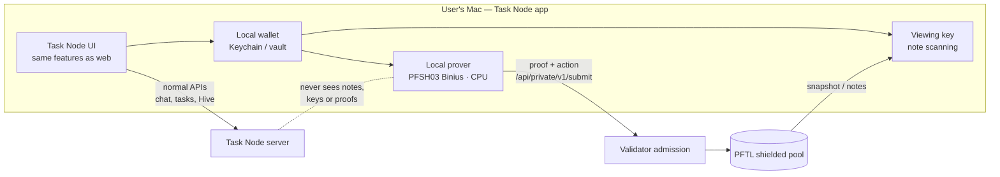
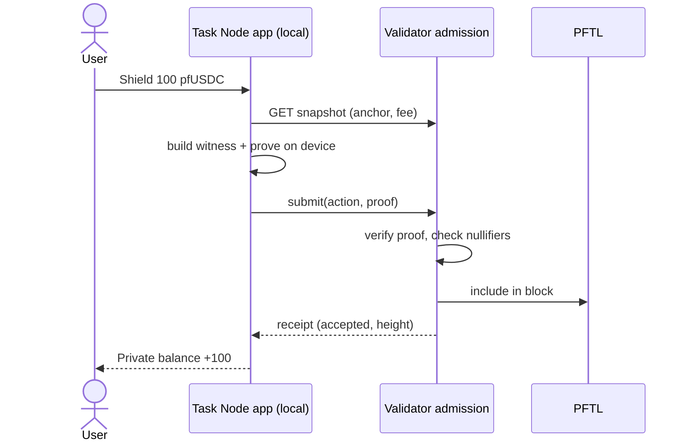

# Pillar 5 — The Task Node Local Experience

> **Status:** Early. Local proving exists on unmerged branches: a native Mac app that proves Orchard on the device, and a post-quantum Binius wallet daemon with a browser flow. Hosted Task Node has no local mode and no shielded flow. Shielded submission is off on every validator.
>
> **Bubbles up to:** *A production-ready new chain*. "Privacy working, on local MacBooks ideally in our Task Node app" is a readiness gate.

## In one paragraph

Privacy only counts if the server never sees the secret. This pillar ships Task Node as a **local app** that does nearly everything the hosted site does. It also does **shielded transactions** by building the proof on the user's own machine and submitting it straight to validators, so the hosted Task Node server is never the prover and never holds a spend key. Two tracks exist. **Orchard** (Halo2) is fast and mature but not post-quantum. **PFSH02/PFSH03** (Binius) is post-quantum and proves in about 3 seconds on 16 cores. Post-quantum privacy is the stated goal. This pillar picks the track, merges it, and moves it out of debug builds into a release.

## User story

**Founder's story.** I am logged into Task Node locally. It can do virtually everything the hosted Task Node can do. More importantly, it can do shielded transactions, and I do not want those processed on the traditional Task Node server.

**Augmented story.**

1. **Install.** I download the Task Node app for macOS, signed and notarised. It opens my existing account. Chat, tasks, the Hive, context and the wallet all work, because the app talks to the same Task Node APIs.
2. **Local wallet.** My PFTL keys live in the macOS Keychain or a local vault, never on the server. Normal payments sign on the device.
3. **Shield.** I move 100 pfUSDC into my private balance. The app builds the proof on my Mac, and a progress bar shows the post-quantum proof taking a few seconds. The app submits the proof directly to validator admission (`/api/private/v1/submit`). Task Node's server sees nothing.
4. **Pay privately.** I send a shielded payment to another Task Node user. Their app detects the note with its viewing key and shows it in their private balance.
5. **Unshield.** I withdraw to my public account. The explorer shows the public leg only.
6. **Trust.** The app shows *Proved on this device · submitted to validators directly*. A network inspector would show no request carrying the note to `tasknode.postfiat.org`.

## What exists today

| Component | Where | State |
|---|---|---|
| Hosted Task Node, run locally | [`docs/wiki/architecture/bootup.md`](https://github.com/postfiatorg/tasknode/blob/main/docs/wiki/architecture/bootup.md) · `docker-compose.dev.yml` | A developer stack only. It uses stubs without providers and "does not reproduce the complete production system". |
| L1 wallet in Task Node web (wasm signing) | [`src/features/wallet/l1/wasm/`](https://github.com/postfiatorg/tasknode/tree/main/src/features/wallet/l1/wasm) · [`crates/wallet_wasm`](https://github.com/postfiatorg/postfiatl1v2/tree/main/crates/wallet_wasm) | Live. Signing, keygen and RPC framing only. **No proving and no shielded UI.** |
| Native Mac app with on-device Orchard proving | `tasknode-apple` (private repo) `origin/main`: `core/src/{pftl_v2,shielded,private_vault,prover,private_actions}.rs`, `docs/PRIVATE-PAYMENTS-SPEC-20261125.md` | DEBUG builds only, against a local chain. 28–31 s per proof after a 250–261 s cold prewarm, about 2.1 GB. "The Task Node server… is never the prover." |
| Validator-side admission for user-proven actions | [`docs/plans/active/user-proven-shielded-actions-milestone.md`](https://github.com/postfiatorg/postfiatl1v2/blob/main/docs/plans/active/user-proven-shielded-actions-milestone.md) | Planned (W-1): `private_action_submit/receipt`, `/api/private/v1/{snapshot,submit,receipt}`. The live private swap is still custodial (`pftl_swapd` on validator 2). |
| Post-quantum shielded pool, PFSH02 | [PR 207](https://github.com/postfiatorg/postfiatl1v2/pull/207) (`feat/peel-binius-shielded-pq`) · `crates/node/src/bin/pftl_pq_walletd.rs` · `wallet-web/src/components/PqPayments.jsx` (`/local/pq/v1`) | **Open, not merged.** M1–M8 done; no external review yet. Proving takes 2.9 s on 16 cores, 26.7 s on one core, 562 MiB. |
| PFSH03 production candidate | [PR 232](https://github.com/postfiatorg/postfiatl1v2/pull/232) · [handoff 25 Nov](https://github.com/postfiatorg/postfiatl1v2/blob/main/docs/status/handoff-2026-11-25.md) | **Open, not merged**, disabled until Gates 1–3: audit, genesis and mobile qualification, and a governance vote. Lean model: 9 modules, 2,847 lines, 0 `sorry`. |
| Privacy docs | [`docs/privacy/`](https://github.com/postfiatorg/postfiatl1v2/tree/main/docs/privacy) | Orchard, disclosure, deposit/spend/withdraw, metadata bounds |
| Network | [network status](https://github.com/postfiatorg/postfiatl1v2/blob/main/docs/status/network-status.md) | Public shielded submission **off** on every validator. |

The Colab GPU window in the [26 Nov handoff](https://github.com/postfiatorg/postfiatl1v2/blob/main/docs/status/handoff-2026-11-26.md) is for **bridge** proofs (Solana deposits and withdrawals), not for the shielded pool. Shielded proving is CPU-only on the device.

## Architecture

## Technical requirements

### Proving system

- **R1.** **Decide the track.** The stated goal is post-quantum privacy, so the release target is PFSH03 (Binius). Orchard stays for compatibility with existing notes, or is retired: see the open questions. Merging PR 207 and PR 232 requires their gates: external review or audit, genesis qualification, and a governance vote.
- **R2.** The prover runs on the device with no GPU. The target is 10 seconds or less per action on an M-series Mac. Today's 2.9 s on 16 cores suggests this is already met; it needs to be measured on a base M-series machine.

### Submission path

- **R3.** Validator admission for user-proven actions, as in W-1: snapshot, submit and receipt endpoints served by validators or public RPC. They must not be routed through Task Node's server.
- **R4.** The app gets snapshots and scans notes from PFTL RPC with its viewing key. The Task Node server stores no notes, nullifiers or viewing keys.

### The app

- **R5.** The Mac app ships as a signed, notarised release build, with private features enabled when the chain enables them. Everything else uses the existing Task Node APIs, so features stay at parity with the web app.
- **R6.** Keys are held in the Keychain or the private vault on the device. Export and backup flows match the web wallet's seed vault.
- **R7.** A **privacy receipt** in the UI says where the proof was built and which endpoint received it. A CI test asserts that no Task Node server route accepts shielded witness data.

### Later

- **R8.** The browser version can follow through `wallet-web`'s `/local/pq/v1` daemon pattern. A local daemon, `pftl_pq_walletd`, proves while the web UI drives it.

## Dependencies

| Depends on | Why |
|---|---|
| PFSH03 merge plus Gates 1–3 | The post-quantum shielded pool itself. |
| Validator admission W-1 | Submission that bypasses Task Node. |
| [Pillar 2 — Message protocol](02-message-protocol.md) | Encrypted memos and notes to recipients use the post-quantum suite. |
| [Pillar 3 — Validators](03-validator-program.md) | Public RPC or validator endpoints to submit to. |
| Apple signing and notarisation | Distribution. |

## Acceptance criteria

1. A release build of the Mac app shields, pays privately and unshields on the devnet, with every proof built on the device.
2. Network capture during those flows shows no shielded payload sent to any Task Node host.
3. The recipient's app detects the private payment from PFTL alone.
4. Proving time on a base M-series Mac is recorded in the docs.
5. Shielded submission is enabled on the validators by governance.

## Open questions for the founder

- Orchard notes: migrate them into the post-quantum pool, keep both pools, or retire Orchard?
- Is the Mac app enough for launch, or do Windows, Linux or iOS matter?
- Is a browser plus local daemon mode wanted as well, for users who won't install an app?

## Code references

- Privacy crates: [`crates/privacy`](https://github.com/postfiatorg/postfiatl1v2/tree/main/crates/privacy) · [`crates/privacy_orchard`](https://github.com/postfiatorg/postfiatl1v2/tree/main/crates/privacy_orchard)
- Plans: [`user-proven-shielded-actions-milestone.md`](https://github.com/postfiatorg/postfiatl1v2/blob/main/docs/plans/active/user-proven-shielded-actions-milestone.md)
- PQ handoff (local): `/home/postfiat/var/pq-work/HANDOFF-2026-11-23.md`
- Mac app spec (private repo): `tasknode-apple/docs/PRIVATE-PAYMENTS-SPEC-20261125.md`
