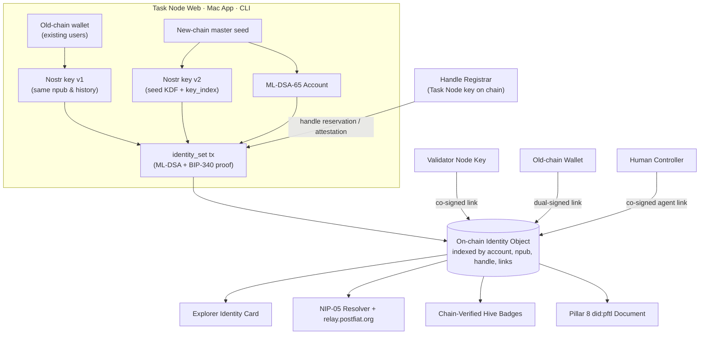

# Pillar 6 — Hive Chat Identity on Chain

> **Status:** Early. Deterministic Nostr keys, `@tasknode.postfiat.org` handles (NIP-05), and validator bindings currently live only in Task Node's Postgres database. `postfiatl1v2` does not yet have a native `identity_set` transaction, on-chain Nostr/handle indexes, `wallet_wasm` identity signing, or a first-party Nostr relay.
>
> **Outcome:** [A · Post-human governance in public](../README.md#three-outcomes) — letting anyone say *"I minted my Task Node identity"* and proving on chain that the person in Hive Chat, the validator operator, the NFT holder, and the NAVCoin issuer are the same key holder.

## What this pillar is (in plain English)

Today, when you log into Hive Chat, Task Node derives a Nostr key (`npub`) from your old-chain wallet signature and saves your handle (`goodalexander@tasknode.postfiat.org`) and validator link in Postgres — meaning everyone has to trust Task Node's database to vouch for who is who.

This pillar moves identity onto `postfiatl1v2` with a native **`identity_set` transaction** so any wallet, app, or the block explorer can verify your identity directly from the chain:

1. **One on-chain identity card per account:** Links your post-quantum `postfiatl1v2` account (`ML-DSA-65`), your Nostr public key (`npub`, proven by a signature so nobody can squat your key), your handle (`@tasknode.postfiat.org` or custom domain), your Profile NFT avatar ([Pillar 4](04-nft-system.md)), your encrypted-message key ([Pillar 2](02-message-protocol.md)), and your optional `pfpq1…` shielded receive address ([Pillar 5](05-local-task-node.md)).
2. **Existing Nostr keys carry over unchanged:** Existing users keep their exact `npub`, contacts, and Hive history (`derivation_version = 1`). New users derive their Nostr key cleanly from their new-chain master seed (`derivation_version = 2`, because ML-DSA signatures are randomized and cannot be hashed into a deterministic key).
3. **Opt-in linked keys:** You can explicitly co-sign links to your validator node key, your old-chain wallet, external EVM/Solana wallets, or (for AI agents like `hive-board@`) the human controller account. Nothing is ever linked automatically, and private spend keys are never linked.
4. **First-party Nostr relay:** Post Fiat runs a lightweight `relay.postfiat.org` mirrored to public relays so Hive Chat never breaks if third-party relays throttle or drop traffic.
5. **Security fix shipped first:** Closes an existing Task Node client bug where the browser signs arbitrary server-supplied collaboration challenges using the same old-chain key that derives v1 Nostr keys.

## How on-chain identity ties Post Fiat together

## Locked-in design decisions

- **Handle registrar (`@tasknode.postfiat.org`):** Operated by **Task Node** via a rotatable ML-DSA-65 registrar key on chain. The registrar may reassign a handle **only on a verified lost-key request or clear abuse/impersonation** (always recorded on chain with a reason code). Users may also bind **custom domains** (`you@yourdomain.com`) verified via standard NIP-05 `nostr.json` or DNS TXT.
- **Required vs optional gating:** Minting an on-chain identity is **required to claim per-operator validator rewards** ([Pillar 3](03-validator-program.md), preventing multi-node reward farming) and **optional everywhere else** at launch (Hive Chat, Finance Hub, NFTs — minting upgrades you to chain-verified badges without locking unminted users out).
- **First-party Nostr relay:** **Yes** — run a lightweight Post Fiat Nostr relay (`relay.postfiat.org`) mirrored to public relays so Hive does not rely solely on Primal, nos.lol, and Damus.
- **Engineering defaults locked in:**
  - **Native `identity_set` object** (not a memo), with consensus-checked BIP-340 Nostr proofs (pure-Rust `k256`, identity-binding only, never authorizes moving funds, plus a governance kill-switch for classical proofs later) and consensus-enforced uniqueness (1 active identity per account, per `npub`, per handle, per validator `node_id`, and per old-chain account).
  - **Existing users keep v1 `npub`** (contacts and history preserved; anyone can `rotate` to v2 anytime); **client-side signing guard ships first** before any v1 mint.
  - **Fees & limits:** Standard burned byte-weighted fee + state-expansion fee (`20` units for `mint`, `10` per `link`, flat handle price, max `16` links), paid from Task Node starter PFT — no complex refundable reserve.
  - **Revoke & rotate safety:** A `compromised` `npub` can **never** be rebound (blocking impersonation); a `planned` rotation keeps handles and links intact, and retired handles can only move via registrar reassignment after hold-back.
  - **Validator link & avatar:** Validator links co-sign with the node key (Pillar 3's signer allow-lists `postfiat-l1-v2/identity-link/v1`); Profile NFTs ([Pillar 4](04-nft-system.md)) attach via `avatar_nft_id` rather than minting a duplicate soulbound NFT; no separate recovery key in v1 (registrar handle reassignment covers lost account keys).

## What exists today

| Piece | Current state | Where |
|---|---|---|
| Nostr v1 derivation & signing gap | Live in browser via old-chain secp256k1 signature; **bug:** `signedCollaborationProof` doesn't check challenge prefix, so a compromised server could trick the browser into deriving the v1 key | [`nostr-messages.js`](https://github.com/postfiatorg/tasknode/blob/main/src/features/messages/nostr-messages.js), [`collaboration-client.js`](https://github.com/postfiatorg/tasknode/blob/main/src/features/collaboration/collaboration-client.js) |
| NIP-05 & validator bindings | Live in Postgres only (365-day handle expiry, no Nostr self-signature, no on-chain record) | [`repositories/nostr-messages.js`](https://github.com/postfiatorg/tasknode/blob/main/server/repositories/nostr-messages.js), [`l1-validator-identity.js`](https://github.com/postfiatorg/tasknode/blob/main/server/l1-validator-identity.js) |
| `postfiatl1v2` identity & `wallet_wasm` | No `identity_set` tx, no BIP-340 check in consensus, and `wallet_wasm` lacks an `identity_set` signer | [`wallet_wasm/src/lib.rs`](https://github.com/postfiatorg/postfiatl1v2/blob/main/crates/wallet_wasm/src/lib.rs), [`tx-builder.js`](https://github.com/postfiatorg/tasknode/blob/main/src/features/wallet/l1/lib/tx-builder.js) |
| Nostr relays | Hive depends entirely on 3 third-party public relays (Primal, nos.lol, Damus) | [`hive-group.js`](https://github.com/postfiatorg/tasknode/blob/main/server/repositories/hive-group.js) |

## Detailed specification

### 1. Security guard & deterministic v1/v2 key derivation
- **Ship signing guard first:** Lock `signedCollaborationProof` so it signs *only* text starting with `Task Node collaboration authorization`, and lock the Nostr v1 derivation helper so *only* it can sign `Task Node private messaging identity`. Add unit tests enforcing both.
- **v2 seed derivation (new users & rotations):** Derive secp256k1 Nostr keys directly from the new-chain master seed via `derive_wallet_seed` (`postfiat.wallet.nostr.seed.v1`, role `nostr-messaging`, `account_index`, `key_index` starting at 0, excluding `chain_id` so the `npub` survives chain upgrades). Implemented once in Rust (`rpc_sdk` / `wallet_wasm`) and shared across web, Mac app, and CLI with CI test vectors. *(Docs note plainly that compromising the master seed compromises both ML-DSA and v2 Nostr keys.)*

### 2. Native `identity_set` transaction, multisig registrar & consensus safety
- **Ordered consensus & strict inline bounds:** All `identity_set` transactions execute strictly through **ordered consensus** (never FastPay). Fields stay inline and public with strict consensus byte caps: `account`, `nostr_pubkey` (32B), `derivation_version`, `key_index`, `identity_kind` (`human` | `agent` | `service`), `sequence`, `status`, optional `handle` (strict canonical lowercase ASCII `[a-z0-9._-]`, 2–32 chars, no leading/trailing punctuation), `relays[]` (max 5 `wss://` URLs `<= 128B` each), optional `avatar_nft_id`, optional `message_key` ([Pillar 2](02-message-protocol.md)), optional `pq_receive_address` (`pfpq1…`), and `links[]` (max 16).
- **Explicit fees in PFT atoms:** Standard byte-weighted fee plus burned state-expansion fees: **`20,000 atoms` (`0.02 PFT`) for `mint`** and **`10,000 atoms` (`0.01 PFT`) per `link`**, paid from Task Node starter PFT.
- **Operations & anti-hijack rules:**
  - `mint`, `update`, `link`, `rotate` (`planned` or `compromised`), `revoke`.
  - **`rotate_account`:** Must be **co-signed by BOTH the old account AND the new destination account** (preventing unwanted identity dumps); validator and controller links enter *pending re-confirmation* until co-signed against the new account.
  - **`unlink`:** Owner or linked key may unlink; linked-key self-unlink commits to an explicit `link_id` (not the owner's sequence) so it cannot be front-run.
  - **2-tier registrar protection:** A hot Task Node registrar key may issue *new* unclaimed `@tasknode.postfiat.org` handle attestations only. **`handle_reassign` requires a 2-of-3 cold/multisig registrar authority + a 7-day timelock** (during which the current owner can contest/cancel unless an emergency compromise flag is co-signed), eliminating single-hot-key handle hijacking.
- **Namespace-scoped uniqueness (no custom-domain squatting):** Consensus enforces global uniqueness **only** for `(account)`, `(nostr_pubkey)`, `(registered_namespace, handle)` (e.g., `@tasknode.postfiat.org`), `(validator node_id)` (with a **30-day cooldown** between operator switches to block validator-reward hopping), and `(old_chain_account)`. **Custom NIP-05 domains (`you@yourdomain.com`) and EVM/Solana links are stored as non-unique client-verified claims** verified live against DNS/`nostr.json` or client signatures — preventing on-chain domain squatting and griefing.
- **Safe BIP-340 kill-switch:** Consensus verifies BIP-340 Nostr proofs (and strict low-S DER ECDSA for old-chain links) with domain separation per `(op, chain_id, account, sequence)`. If governance ever activates the classical BIP-340 kill-switch in the future, **existing identities never deadlock** — pure ML-DSA-65 `update`, `rotate_account`, `link`/`unlink`, and `revoke` keep working normally. Exposes RPCs `identity_info`, `identity_by_nostr`, `identity_by_handle`, and `identity_by_link`.

### 3. Salted handle migration, Hive badges, explorer & gated `relay.postfiat.org`
- **Salted handle reservations:** Registrar publishes `handle_reserve` committing to `SHA3-384(handle || npub || secret_salt)` (delivering `secret_salt` privately inside the user's authenticated Task Node session) so nobody can pre-compute `hash(npub)` or front-run a reservation, and existing users can also opt straight into v2 on claim! `goodalexander` is pre-reserved, and `hive-board` mints as the first `agent` identity with a co-signed controller link.
- **Chain-backed NIP-05 & Hive badges:** `nostr.json` and Hive badges (*Minted*, *Validator · node_id*, *Old chain*) read directly from `postfiatl1v2` for minted users. On `revoke` or compromised `rotate`, badges strip immediately from all events not anchored on chain before the revoke height (never trusting client `created_at`).
- **Explorer Identity card & SDK:** Explorer displays a searchable Identity card showing consensus-verified vs client-verified links, stale validator indicators, and registrar history. SDK ships `resolveIdentity(...)` reading purely from RPC.
- **Gated first-party relay (`relay.postfiat.org`):** Enforces NIP-42 authentication / registered-member write admission, per-pubkey rate limits, and inbound mirror filtering so public-relay spam floods cannot overwhelm our first-party relay. Non-production builds never publish kind-0 profiles to public relays.

## Milestones & completion checklist

### Build milestones
- [ ] **M1 · Client signing guard & shared v2 derivation:** Ship the `signedCollaborationProof` prefix guard + tests in Task Node; implement shared v2 seed derivation (`rpc_sdk` / `wallet_wasm`) with CI test vectors across web, Mac app, and CLI.
- [ ] **M2 · Native `identity_set` on `postfiatl1v2`:** Implement `identity_set` operations, consensus BIP-340 + strict-DER old-chain proof checks, uniqueness indexes, namespace registrar registry, fee rules, and `identity_*` RPCs + `wallet_wasm` signer.
- [ ] **M3 · Mint UX, handle migration & validator/agent links:** Reserve existing Task Node handles (including `goodalexander` and `hive-board@` agent identity), ship **"Mint my Task Node identity"** in Task Node web + Mac app, wire Pillar 3's validator connect to emit co-signed validator links, and switch NIP-05 + Hive badges to read chain state.
- [ ] **M4 · Explorer Identity card, SDK & `relay.postfiat.org`:** Ship the searchable Explorer Identity card, `resolveIdentity` SDK, EVM/Solana client-verified links, ML-DSA companion signatures for high-value events, and deploy `relay.postfiat.org`.

### Required ship gates
- [ ] **1. Executed:** All M1–M4 code, `identity_set` consensus activation, `wallet_wasm` signer, explorer card, and `relay.postfiat.org` merged and live.
- [ ] **2. Tested by user:** Founder mints `goodalexander@tasknode.postfiat.org` on `postfiatl1v2` (confirming unchanged `npub` and preserved DMs/Hive history), links a validator + old-chain key, verifies the Identity card on the explorer, and tests a `rotate` + `resolveIdentity` lookup.
- [ ] **3. Added to docs:** On-chain identity spec, v1/v2 key derivation vectors, registrar policy, custom NIP-05 guide, and honest quantum-boundary note published in Post Fiat docs.
- [ ] **4. Public blog post document:** Public blog post written and published announcing *"Mint Your Task Node Identity"* — native post-quantum on-chain identity integrated with Nostr and Hive Chat.

## Code references

- Task Node Nostr & collaboration: [`nostr-messages.js`](https://github.com/postfiatorg/tasknode/blob/main/src/features/messages/nostr-messages.js) · [`collaboration-client.js`](https://github.com/postfiatorg/tasknode/blob/main/src/features/collaboration/collaboration-client.js) · [`repositories/nostr-messages.js`](https://github.com/postfiatorg/tasknode/blob/main/server/repositories/nostr-messages.js) · [`l1-validator-identity.js`](https://github.com/postfiatorg/tasknode/blob/main/server/l1-validator-identity.js)
- L1 wallet, fees & registry: [`wallet_wasm/src/lib.rs`](https://github.com/postfiatorg/postfiatl1v2/blob/main/crates/wallet_wasm/src/lib.rs) · [`wallet_sdk.rs`](https://github.com/postfiatorg/postfiatl1v2/blob/main/crates/rpc_sdk/src/wallet_sdk.rs) · [`transactions_mempool_receipts.rs`](https://github.com/postfiatorg/postfiatl1v2/blob/main/crates/types/src/transactions_mempool_receipts.rs) · [`tx-builder.js`](https://github.com/postfiatorg/tasknode/blob/main/src/features/wallet/l1/lib/tx-builder.js)
