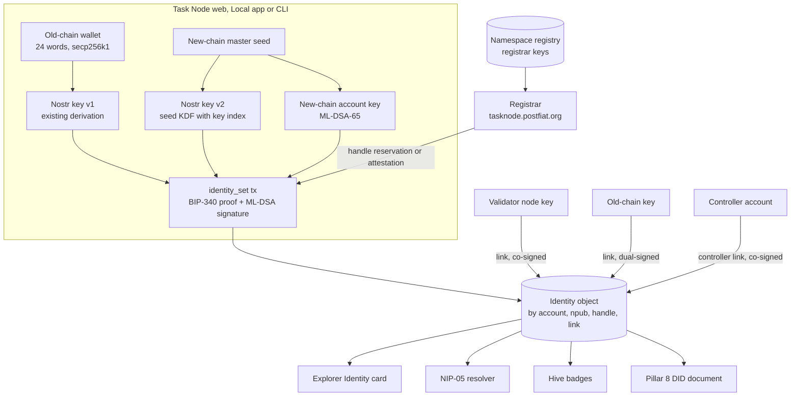

# Pillar 6 — Hive Chat Identity on Chain

> **Status:** Early. A deterministic Nostr identity, NIP-05 names and an off-chain validator binding are live in Task Node's database. Nothing is on chain: no identity transaction, no registry slot for a Nostr key and no secp256k1 library in the consensus crates.
>
> **Bubbles up to:** [Outcome A · Post-human governance in public](../README.md#three-outcomes). *One identity across Post Fiat*. The person in the Hive, the validator operator, the NFT holder and the NAVCoin issuer can be shown to be the same key holder on chain.

## In one paragraph

Today a Task Node user's Hive identity is a Nostr key. The browser gets it by having the user's old-chain wallet sign a fixed statement, then hashing the signature. Postgres binds that key to the account and assigns the handle. A separate binding links the account to a validator key, so only Task Node can vouch for any of it. This pillar adds a **native transaction on the new chain (postfiatl1v2)** that writes an **identity object** to the ledger, so a user can say *"I minted my Task Node identity."* The object ties together:

- the new-chain account key (ML-DSA-65);
- the Nostr pubkey, proven by its own signature;
- the handle, attested by the namespace registrar;
- linked keys: validator, old-chain and, for agents, a controller account.

Anyone can verify the object over RPC or on the explorer. Existing npubs carry over unchanged. New identities derive their Nostr key from the new-chain wallet seed rather than from a signature, because ML-DSA signing in this codebase is randomised.

## User story

**Founder's story.** Right now Hive Chat is a Nostr back end, deterministically derived from an XRPL key. It would be ideal if there were a deterministic blockchain-based transaction on Post Fiat that natively integrated with Nostr in a deterministic identity way, and that is also accessible on the block explorer. Then we are able to say "I minted my Task Node Identity", and also link that Nostr identity to other primitives in the Post Fiat universe, such as your validator keys.

**Augmented story.**

1. **Mint.** In Task Node → Profile I click **Mint my Task Node identity** and unlock both wallets. The old-chain wallet re-derives my existing Nostr key, so my npub, contacts and Hive history stay the same. The new-chain wallet pays from its starter PFT. `goodalexander@tasknode.postfiat.org` is already reserved on chain for my npub. My Nostr key signs the binding, my ML-DSA key signs the transaction, and it goes on chain.
2. **See.** The explorer shows an **Identity** card for my account: handle, npub, mint transaction, linked keys and history. My profile NFT from [Pillar 4](04-nft-system.md) can serve as its avatar.
3. **Link a validator.** I run the one connect command I already use for my validator. The validator key co-signs a `link`, and the card shows *Validator · node id*.
4. **Link my old chain.** In the same unlock, my old-chain wallet signs a link. The card shows *Old chain · r…*, and [Pillar 2](02-message-protocol.md) uses it to tie my old encrypted history to the new account.
5. **Use it everywhere.** Hive shows chain-checked *minted* and *validator* badges on my messages. Other Nostr clients can map `npub → new-chain identity` from chain data alone, and my Nostr profile points back to my account.
6. **Recover.** If my Nostr key leaks, I `rotate` it and mark it compromised. If I lose my account key, I ask the registrar to move my handle to a new identity. The history stays auditable.

## What exists today

| Component | Where | State |
|---|---|---|
| Nostr key derivation | [`nostr-messages.js`](https://github.com/postfiatorg/tasknode/blob/main/src/features/messages/nostr-messages.js) · [`wallet-core.js`](https://github.com/postfiatorg/tasknode/blob/main/src/wallet-core.js) | **Live, browser only.** SHA-256 of `{domain, version:1, accountId, walletAddress, walletPublicKey, walletSignature}`, signed by the **old-chain 24-word wallet** (secp256k1, `m/44'/144'/0'/0/0`) via `ripple-keypairs`, which is deterministic (RFC 6979). Re-deriving needs the mnemonic and Task Node's `accountId`. The signature is never sent; the key is re-derived each session. |
| Server-supplied challenges | [`collaboration-client.js`](https://github.com/postfiatorg/tasknode/blob/main/src/features/collaboration/collaboration-client.js) · [`collaboration-proofs.js`](https://github.com/postfiatorg/tasknode/blob/main/server/repositories/collaboration-proofs.js) | **Live.** The browser signs any challenge text the server returns, with the same old-chain key, and sends the signature back. The honest server's text starts `Task Node collaboration authorization`, but the client never checks, so a compromised server could send the derivation statement and compute the user's v1 Nostr key. |
| New-chain wallet | Task Node [`wallet/l1/core.js`](https://github.com/postfiatorg/tasknode/blob/main/src/features/wallet/l1/core.js) · [`WalletHome.jsx`](https://github.com/postfiatorg/tasknode/blob/main/src/features/wallet/l1/WalletHome.jsx) · [`wallet_sdk.rs`](https://github.com/postfiatorg/postfiatl1v2/blob/main/crates/rpc_sdk/src/wallet_sdk.rs) · [`lifecycle_queries.rs`](https://github.com/postfiatorg/postfiatl1v2/blob/main/crates/node/src/lifecycle_queries.rs) | **Built.** A **separate** random master seed. Keys come from a domain-separated KDF (`derive_wallet_seed`) over `(domain, algorithm, chain_id, account_index, key_role, seed)`; Orchard uses its own domain with a retry-until-canonical KDF. An empty wallet asks the bridge `/faucet` once for starter PFT. |
| ML-DSA signing | [`crypto_provider`](https://github.com/postfiatorg/postfiatl1v2/blob/main/crates/crypto_provider/src/lib.rs) · [`fips204/traits.rs`](https://github.com/postfiatorg/postfiatl1v2/blob/main/third_party/fips204/src/traits.rs) | **Hedged.** `try_sign` draws from `OsRng`, so two signatures over one statement differ. |
| Binding and NIP-05 | [`repositories/nostr-messages.js`](https://github.com/postfiatorg/tasknode/blob/main/server/repositories/nostr-messages.js) · [`collaboration-routes.js`](https://github.com/postfiatorg/tasknode/blob/main/server/collaboration-routes.js) · [migration 110](https://github.com/postfiatorg/tasknode/blob/main/server/db/migrations/110_docs_team_collaboration.sql) | **Live, Postgres only.** The handle is the Hive handle (`taskNodeNostrName`): lowercase ASCII letters, digits and `._-`, at least 2 characters, not starting or ending with `._-`. `hive-board` is reserved; at most 5 relays. Rows carry a 365-day expiry, sequence, status and visibility (`private`, `teammates`, `public`). The old-chain wallet signs the binding; the Nostr key signs nothing. |
| Validator binding | [`l1-validator-identity.js`](https://github.com/postfiatorg/tasknode/blob/main/server/l1-validator-identity.js) · [migration 156](https://github.com/postfiatorg/tasknode/blob/main/server/db/migrations/156_l1_validator_bindings.sql) · [helper](https://github.com/postfiatorg/postfiatl1v2/blob/main/tools/tasknode-validator-binding/src/lib.rs) | **Live, off chain.** A pinned helper signs with the validator's **consensus node key**. One active binding per validator id and per ML-DSA key. Nostr is linked only through a join. |
| Old-chain key proof | [genesis spec §3.2](https://github.com/postfiatorg/postfiatl1v2/blob/main/docs/architecture/l1v2-testnet-genesis-and-launch-spec.md) | **Specified, for validators.** In `IdentityReceiptV1` the fork key and the ML-DSA key each sign a digest of one body. Mainnet and token migration are out of scope. |
| Hive bot and relays | [`hive-group.js`](https://github.com/postfiatorg/tasknode/blob/main/server/repositories/hive-group.js) | **Live.** Only `hive-board@` publishes a kind-0 profile. Relays: Primal, nos.lol, Damus, all third party. |
| Limits | [`core_chain.rs`](https://github.com/postfiatorg/postfiatl1v2/blob/main/crates/types/src/core_chain.rs) · [`protocol_requests.rs`](https://github.com/postfiatorg/postfiatl1v2/blob/main/crates/rpc_sdk/src/protocol_requests.rs) · [`shielded_bridge_governance.rs`](https://github.com/postfiatorg/postfiatl1v2/blob/main/crates/types/src/shielded_bridge_governance.rs) | **Built.** A payment carries at most 512 memo bytes. A signature field holds up to 8,192 hex characters. Signed RPC bodies are capped per type (64 KiB transfers, 128 KiB asset transactions). `ValidatorRegistryEntry` has no metadata slot. |
| Fees | [`entrypoints.rs`](https://github.com/postfiatorg/postfiatl1v2/blob/main/crates/execution/src/entrypoints.rs) · [`fees_offer_planning.rs`](https://github.com/postfiatorg/postfiatl1v2/blob/main/crates/execution/src/fees_offer_planning.rs) | **Built.** Minimum fee 1 unit per 512 bytes. New objects pay a one-time **state-expansion fee** (20 for an asset definition, 10 for a trust line, NFT, offer or escrow). Fees burn. Accounts hold a fixed reserve. The signer pays; there is no fee-payer field. |

**Naming.** *Old chain* is the XRPL-shaped PFT Ledger (`pftl` in Task Node code); *new chain* is postfiatl1v2 (`l1`). There is no "nostr" in `postfiatl1v2/crates`, and no consensus crate uses secp256k1 or BIP-340. The only copies (`k256` via `alloy-primitives`, and `ed25519-dalek`) sit in the `arc-conformance` test crate.

## Architecture

## Technical requirements

### Key derivation

- **R1. Keep v1 for existing users, and close the signing gap.** Today's derivation stays, labelled `derivation_version = 1`. Minting binds the npub the user already has, so keys, contacts and history are unchanged.
    - **Signing guard, before any v1 mint:** `signedCollaborationProof` signs only text with the collaboration header, and only the derivation function may sign text starting `Task Node private messaging identity`. A test enforces both.
    - **Local app and CLI** import the old-chain mnemonic plus the `accountId` Task Node exports with the profile, or the raw Nostr secret. The `accountId` never goes on chain.
- **R2. v2 for new identities.** v2 derives the key from the seed and never hashes an ML-DSA signature: hedged signing would change the key each time, and a leaked signature would leak the key.
    - Use the `derive_wallet_seed` construction with a new domain (for example `postfiat.wallet.nostr.seed.v1`), key role `nostr-messaging` and a `key_index` that starts at 0 and rises by one on each `rotate`.
    - Retry with a counter until the output is a valid secp256k1 scalar, as Orchard's KDF does.
    - Include `account_index` but not `chain_id`, so the npub survives a network change (R25).
    - The object records `key_index`, so a wallet restored from the seed re-derives the current key.
- **R3. One implementation, with test vectors.** Implement v2 once in Rust (`rpc_sdk` via `wallet_wasm`) for the web app, Task Node Local ([Pillar 5](05-local-task-node.md)) and the CLI. CI fails if any client disagrees with the published vectors.

### Record and transaction

- **R4. A native transaction and ledger object (recommended).** An `identity_set` transaction with one variant per R6 operation; an `Identity` object keyed by account, with consensus indexes by Nostr pubkey, handle and linked key; and the RPCs `identity_info`, `identity_by_nostr`, `identity_by_handle` and `identity_by_link`. A memo does not fit: a mint carries at least one 3,309-byte ML-DSA signature, and a payment holds 512 memo bytes. Payloads would move to IPFS and uniqueness to indexers. The founder confirms this in open question 1.
- **R5. Fields, each with a consensus bound.** `account`, `nostr_pubkey`, `derivation_version`, `key_index`, `identity_kind` (`human`, `agent` or `service`), `sequence`, `status`, and:
    - optional `handle` (R11), with the attestation that granted it;
    - `relays`: at most 5 `wss://` URLs within the chain's 256-byte text limit, as Task Node allows today;
    - optional `avatar_nft_id`, ownership checked at read time;
    - optional `message_key`, the `{kem_pubkey, key_id, suite}` reader key of [Pillar 2](02-message-protocol.md) R9, sized by its suite;
    - optional `pq_receive_address` (`pfpq1…`), so [Pillar 5](05-local-task-node.md) R15 can find it without Task Node;
    - `links[]` as compact records: type, key or address, how it was verified, creating transaction.

    Signatures, proofs and earlier field values stay in transaction history, not in state.

- **R6. Operations.**

| Operation | Signed by | Effect |
|---|---|---|
| `mint` | Account and Nostr key; a handle also needs a reservation or attestation | Creates the object |
| `update` | Account; a new handle also needs an attestation | Changes relays, avatar, keys, address or handle |
| `link` | Account and the linked key | Adds a link |
| `unlink` | Account, or for consensus-verified links the linked key alone | Removes a link |
| `rotate` | Account and the **new** Nostr key, reason `planned` or `compromised` | Replaces and retires the npub, bumps `key_index`. Handle and links stay. |
| `rotate_account` | Old and new account on one chain, plus the registrar if there is a handle | Moves the identity to a new account key |
| `revoke` | Account | Tombstones the identity. Reuse of npub and handle follows open question 4. |
| `handle_reserve` | Registrar | Reserves a handle for an existing npub (R11) |
| `handle_reassign` | Registrar, with a reason code | Detaches a handle so it can be attested to another account |

- **R7. What each signature covers.** Each is over the chain's domain-separated hash of a fixed context, so it is valid for one purpose only.
    - **Co-signatures** (Nostr, validator, old chain, controller): `pf.identity.<op>.v1`, `chain_id`, `account`, the next `sequence` and the payload hash.
    - **`rotate_account`:** both accounts sign a digest naming both. The new account must have no identity record, active or tombstoned. Links, `sequence` and history move in the same transaction.
    - **Registrar attestations** cover only the name: `pf.identity.handle.v1`, `chain_id`, namespace, handle, subject and expiry height. The subject is an account (attestation) or an npub hash (reservation). Each is used once, and relay or avatar changes never need the registrar.
    - **Linked-key `unlink`:** `pf.identity.unlink.v1`, `chain_id`, `account` and `link_id`. Any funded account may submit it and pays the fee under its own sequence. A link id is used once, so this cannot be replayed or race the owner's sequence.
- **R8. Consensus verifies the Nostr proof.** Consensus checks the BIP-340 signature on `mint` and `rotate`. Otherwise an attacker could register a victim's npub first, and uniqueness would lock the victim out.
    - This brings secp256k1 into consensus for the first time, for identity binding only. It never authorises moving value.
    - One audited pure-Rust library covers BIP-340 and the old-chain ECDSA links (R14), so `wallet_wasm` builds for `wasm32` and shares test vectors with consensus (open question 10).
    - A governance amendment can switch off new BIP-340-backed operations, for example once quantum attacks make them forgeable. Existing records stay readable.
- **R9. Uniqueness, enforced by consensus.** At most one active identity per account, per Nostr pubkey and per handle in a namespace. At most one active link per validator `node_id` and per old-chain account, as Postgres enforces for validators today. Retired npubs are held as open question 4 decides. One controller may control many agents.
- **R10. Inline and public.** Identity payloads are canonical, unencrypted and stored in the transaction, never on IPFS. The explorer renders them from the native type. [Pillar 2](02-message-protocol.md) registers them as `pf.identity.*` schemas for off-chain decoders; rendering does not wait for it.

### Namespace and handles

- **R11. Binding is permissionless; names are attested.** Anyone may mint without a handle. A handle needs the namespace's registrar (R24).
    - **Canonical rule, in consensus:** Task Node's current rule, so no existing handle breaks, plus a maximum length no shorter than the longest existing handle. Consensus rejects non-canonical input rather than normalising it. Other confusables are registrar policy.
    - **Migration:** the registrar posts a `handle_reserve` for each Postgres binding, naming the handle and an npub hash, so private bindings do not publish their npub. A `mint` proving that npub (R8) claims the name with the registrar offline. `goodalexander` keeps its name; `hive-board` is reserved for the agent identity (R19).
    - **New handles:** the registrar attests at mint time through Task Node.
- **R12. NIP-05 stays DNS-anchored.** `nostr.json` serves a minted account's name from chain data, with a `relays` map, and any client can cross-check it over RPC. Postgres answers only for accounts that have not minted. A minted handle changes only through a registrar-attested `update`, so the two never disagree.
- **R24. Namespace registry.** Registrar keys are ML-DSA-65 accounts in an on-chain registry, modelled on `NavAttestorRegisterOperation`, as [Pillar 8](08-onchain-identity.md) R5 does for credential issuers.
    - It supports register, rotate and remove. Which authority signs these is open question 2; the mechanism is the same under every answer.
    - A planned rotation leaves handles valid. A rotation marked as compromise records a height, and the new key may reassign handles attested after it.
    - `handle_reassign` records a reason code: holder request, lost key, abuse or error. When it may be used is registrar policy (open question 2).
    - Postgres's 365-day expiry is not carried over; attestations expire only before use.

### Links

- **R13. Validator link.** The [Pillar 3](03-validator-program.md) R13 connect command signs the R7 digest under the context `postfiat-l1-v2/identity-link/v1`. Pillar 3 must add an allow-list of non-consensus contexts (binding, identity link) to its signer, with this context on it, because today's helper needs a key file and the signer process refuses anything else.
    - **Checks:** at link time consensus checks the ML-DSA signature, and `node_id` and key against the live registry. The link stores the key.
    - **Staleness:** computed at read time. A link is **stale** when its stored key no longer matches the registry, so a validator rotation writes nothing to identity state. Task Node's binding is different: it follows Pillar 3 R15, where a rotated-away key is *lapsed* inside a grace window, while the on-chain link waits for a re-link.
    - **Self-unlink:** checked against the stored key, so a retired validator can always detach itself.
- **R14. Old-chain link.** A dual-signature proof modelled on `IdentityReceiptV1`: the old-chain key and the ML-DSA key each sign a digest of one body.
    - **Format:** a 33-byte compressed secp256k1 key and the DER ECDSA signature `ripple-keypairs` makes over SHA-512Half. Consensus accepts strict DER with low S only.
    - **Index:** consensus derives the old-chain account id (RIPEMD-160 of SHA-256 of the key) and indexes the link by it.
    - **Key types:** a key-type byte leaves room for ed25519 accounts (open question 10).
    - **Uses:** [Pillar 2](02-message-protocol.md) R24 ties old encrypted history to the new account through it. [Pillar 4](04-nft-system.md) could accept it as a claim's old-wallet proof, but does not need it: Pillar 4's burn-memo path works for any key type.
- **R15. EVM and Solana links.** EIP-191 and Solana signed-message proofs over the R7 digest. Consensus does not verify them, so they are labelled **client-verified**, checked by the SDK and explorer, and removable only by the account. They pay the link fee and count toward the link cap (R26).
- **R16. Links are opt-in, one at a time.** Task Node never links keys automatically. Shielded spending keys and notes ([Pillar 5](05-local-task-node.md)) are never linked. A published `pfpq1…` address is a separate opt-in and reveals nothing about what it receives. Today's `visibility` setting cannot apply on chain, so the mint flow warns that the whole card is public.

### Task Node and Hive

- **R17. Mint flow.** A user with a v1 key unlocks the old-chain wallet, which derives the key and can sign the R14 link in the same step; anyone else gets v2. The new-chain wallet signs the transaction through a new `identity_set` signer (see Dependencies). The client then publishes a kind-0 profile with `nip05` and one NIP-39 `i` tag per chain (chain id and account), merged into the existing profile rather than replacing it.
- **R18. Badges come from chain state.** *Minted*, *Validator · node id* and *Old chain* are read from chain state, never Postgres. Nostr `created_at` is self-asserted, so it never decides a badge alone.
    - **Revoke, or `rotate` marked compromised:** badges come off every event from the old key. Events anchored on chain before that height (such as [Pillar 1](01-hive-governance.md) transcripts) or carrying a valid R20 signature show *anchored before revoke*.
    - **Planned `rotate`:** old-key events show only *previous key of @handle*.
    - **Cache:** cleared whenever the indexer sees an identity transaction.
- **R19. Agent identities.** An `agent` or `service` identity names its operator through a `controller` link that the controller account co-signs, so no one can claim an unwilling controller. The controller can unlink itself. `hive-board@` becomes the first `agent` identity. [Pillar 1](01-hive-governance.md) participants resolve through the identity object. [Pillar 10](10-information-hive-mind.md) contributors may use it, or a Task Node-only pseudonym that never touches this pillar (Pillar 10 R21).
- **R20. Post-quantum signatures for high-value events.** Governance minutes and similar events can carry an ML-DSA account signature over `pf.nostr.event.v1`, `chain_id` and the event id. It cannot sit inside the event, because the id covers the tags, so it travels in the [Pillar 1](01-hive-governance.md) pinned transcript bundle or a companion event citing the id, never as a 4 KB tag on third-party relays. The SDK checks it against the identity.
- **R21. Validator connect.** The [Pillar 3](03-validator-program.md) connect flow emits the R13 link, so each `validator_bindings` row gets an on-chain twin.

### Explorer and SDK

- **R22. Identity card.** Each account page shows an Identity card, searchable by npub, handle, node id or old-chain address. Each link shows whether consensus or the client verified it, and whether it is stale. The history includes registrar actions and reasons.
- **R23. SDK.** `resolveIdentity(npub | account | handle | linked key)`, v2 derivation and proof verification, so a third-party client needs nothing but RPC.

### Networks, size and fees

- **R25. Network changes.** `rotate_account` works within one chain only. On a new `chain_id` the user mints afresh: the same npub with a fresh BIP-340 proof and a handle re-attested there, since R7 voids other chains' proofs. If a future launch imports ledger state, identity objects travel like any other; no such plan exists yet. Non-production builds do not publish kind-0 to public relays, so a devnet mint cannot overwrite a production profile.
- **R26. Size and fees.**
    - **Size:** ML-DSA-65 keys are 1,952 bytes and signatures 3,309. The largest operation, `rotate_account`, carries two keys and up to three signatures: about 14 KB raw, 28 KB as hex. Each signature has its own field within the 8,192-character limit. `identity_set` gets its own RPC cap, sized to that operation with margin and tested at full size.
    - **Fees:** the byte-weighted minimum fee, so larger operations pay more, plus a burned state-expansion fee on `mint` and on each `link`. The values, the link cap and any refundable reserve are open question 3, held in one fee function and a few constants.
    - **Onboarding:** a new user pays from starter PFT. Further sponsorship is open question 3; with no fee-payer field, a sponsor sends PFT rather than paying the fee.

### Security model

- **Authority.** The ML-DSA account key is the root. The Nostr key has no authority over L1 state; the registrar controls names only.
- **Quantum boundary.** The identity record is quantum-safe. Nostr messages are classical secp256k1, so a quantum attacker could forge them from a public npub. Public copy should say exactly this. R20 covers the events that matter most, and R8 can switch off new classical proofs.
- **Compromise.**
    - **Nostr key:** `rotate` with reason `compromised`.
    - **Old-chain mnemonic:** the v1 Nostr key falls with it. Rotate as compromised and unlink the old-chain link.
    - **Account key, leaked or lost:** the KDF is one-way, so the seed and a v2 Nostr key stay safe, but the attacker can sign anything the account can. `handle_reassign` moves the handle to a new identity. The npub follows only if the user revoked first and open question 4 allows rebinding; a recovery key (open question 7) would recover everything.
    - **Master seed:** a v2 Nostr key falls too, and so does the seed-derived [Pillar 2](02-message-protocol.md) R9 message key, which has no forward secrecy. Revoke and start a new seed and npub; the registrar moves the handle.
    - **Validator key:** `unlink`, then rotate it under Pillar 3.
    - **Registrar key:** rotate it as compromised (R24) and reassign handles attested since.
- **Privacy.** Linking keys deanonymises them, so links are opt-in (R16). Reservations publish only an npub hash. An identity account should not fund shielded spends, though it may publish a receive address.

### Economics

- **Cost.** Each identity adds one object, up to three index entries, and one record and index entry per link, each bounded (R5) and paid for by a burned state-expansion fee (R26). Tombstones stay in state, so a refundable reserve could return only part.
- **Squatting.** Names are reserved or attested, not won in a race (R11), and only a Nostr key's holder can bind it (R8).
- **Sybil resistance.** A *minted* badge proves only a key and a fee. One active link per validator and per old-chain account (R9) stops one key lending weight to many identities. No reputation score is computed here.
- **Reasons to mint.** A minted identity could gate Finance Hub ([Pillar 9](09-finance-hub.md)), per-operator validator rewards ([Pillar 3](03-validator-program.md)), hive-mind attribution ([Pillar 10](10-information-hive-mind.md), where a Task Node-only pseudonym is the alternative) and a NAVCoin issuer card ([Pillar 7](07-navcoin-fees.md)). Which to require, and who pays there, is open question 8.

### Build order

Each step works under every founder answer; an answer changes only a parameter, a policy or a later step.

- **Step 1 — Mint.** `mint`, `update`, `rotate`, `revoke`, `handle_reserve`, `handle_reassign`; BIP-340; account, npub and handle uniqueness; the registry; the signing guard; v1 and v2 derivation; size and fees; the `wallet_wasm` signer; RPCs, card and SDK. Criteria 1–3, 7 (except its link cases), 9–10, 12–13.
- **Step 2 — Links and Hive.** Validator, old-chain and controller links, `unlink`, link uniqueness, `rotate_account`, badges, NIP-05 from chain, kind-0 and `hive-board@`. Criteria 4–6, 7 (link cases), 8, 11, 14.
- **Step 3 — Extensions.** EVM and Solana links, R20 signatures, and whatever open questions 2, 7, 9 and 11 add. Criterion 15.

## Dependencies

| Depends on | Why |
|---|---|
| [Pillar 2 — Message protocol](02-message-protocol.md) | The `message_key` shape and `pf.identity.*` schema names. Neither blocks Step 1. |
| [Pillar 3 — Validators](03-validator-program.md) | The R13 connect command, and a signer allow-list for the identity-link context, which Pillar 3 must add. |
| [Pillar 5 — Local Task Node](05-local-task-node.md) | The same v1 import and v2 derivation on the device. |
| Consensus review | `identity_set`, BIP-340 and ECDSA verification (R4, R8). |
| Browser wallet signing ([`wallet_wasm`](https://github.com/postfiatorg/postfiatl1v2/blob/main/crates/wallet_wasm/src/lib.rs), Task Node [`tx-builder.js`](https://github.com/postfiatorg/tasknode/blob/main/src/features/wallet/l1/lib/tx-builder.js)) | Task Node's bundled WASM exports signers for transfers, `payment_v2`, asset, offer and escrow transactions, swaps and owned objects. `tx-builder.js` calls only the transfer, asset and offer ones; `wallet_sign_payment_v2` has no caller, and its 512 memo bytes cannot hold a mint anyway. No signer exists for `identity_set`, NFTs or generic messages. To add: the `identity_set` type, a `wallet_sign_identity_set_fields` export, a rebuilt WASM bundle in Task Node, a `tx-builder.js` branch and its submit RPC. [Pillar 2](02-message-protocol.md) owns envelope signing. |

| Used by | How |
|---|---|
| [Pillar 1 — Hive governance](01-hive-governance.md) | Participants, the Hive bot and anchored transcripts. |
| [Pillar 2 — Message protocol](02-message-protocol.md) | Reader keys, and the old-chain link for old encrypted history. |
| [Pillar 4 — NFTs](04-nft-system.md) | The avatar; the old-chain link, if Pillar 4 adopts it as a claim proof. |
| [Pillar 5 — Local Task Node](05-local-task-node.md) | The published `pfpq1…` address. |
| [Pillar 8 — On-chain identity, DID and KYC](08-onchain-identity.md) | `did:pftl` includes the minted identity (Pillar 8 R7). Credentials are separate records keyed by the same account, so each account has one identity object. |
| [Pillars 3](03-validator-program.md), [7](07-navcoin-fees.md), [9](09-finance-hub.md) and [10](10-information-hive-mind.md) | Validator directory and per-operator rewards, issuer display, gating and optional attribution, if adopted. |

## Acceptance criteria

1. The founder mints `goodalexander@tasknode.postfiat.org` on the new chain by claiming its reservation. The explorer shows the handle, npub, transaction and history.
2. After minting, the founder's npub is unchanged, and existing DMs and Hive history still read.
3. A third-party client, using only RPC and the SDK, maps the npub to the identity and verifies its BIP-340 and ML-DSA proofs.
4. A validator `link` co-signed by the node key appears, reads as stale after the validator key rotates, and can still be removed by the retired validator.
5. A dual-signed old-chain link appears, and the SDK resolves its old-chain account to the identity.
6. After `revoke` or a compromised `rotate`, badges leave every old-key event not anchored on chain before that height. After a planned `rotate`, they move to the new npub.
7. **Consensus rejects** each of the following:
    - a second account minting the same npub;
    - `goodalexander` without a reservation or attestation, or in non-canonical form;
    - an invalid BIP-340 signature, or a high-S or non-strict ECDSA signature;
    - a co-signature replayed with a different account, `chain_id`, operation or sequence;
    - a `controller` link the controller did not sign;
    - a second identity linking an already-linked `node_id` or old-chain account;
    - a field over its bound, or an `identity_set` over its size cap.

8. `rotate_account` moves the identity, handle and links to a new account on the same chain, and fails if that account already has an identity record.
9. The same seed and `key_index` give the same v2 npub on the web, in Task Node Local and in the CLI, matching the vectors. After a `rotate`, a wallet restored from the seed re-derives the new key.
10. Task Node Local, given the old-chain mnemonic and exported `accountId`, derives the same v1 npub as the web app.
11. `hive-board@` is minted as an `agent` identity with a co-signed controller link.
12. The registrar reassigns a handle with a reason code, the explorer shows it, and the handle mints on a new account.
13. The browser refuses to sign a server challenge containing the Nostr derivation statement.
14. The same npub mints on two chain ids with different accounts, and the kind-0 profile carries both `i` tags.
15. An EVM link shows as client-verified, and the SDK verifies an R20 signature on governance minutes against the identity.

## Open questions for the founder

1. **Native object or memo?** A native object (recommended, R4) gives consensus-enforced uniqueness and matches "a deterministic blockchain based transaction". A memo ships sooner, but needs IPFS for payloads and leaves uniqueness to indexers ("first valid claim in ledger order"), so R8–R9 become client checks.
2. **Registrar for `tasknode.postfiat.org`.** Who registers and rotates its key: the Task Node operator, a key governed by Cobalt or the constitution, or both? When may it reassign a handle: only at the holder's request after off-chain checks, also for abuse and impersonation, or never? Should custom NIP-05 domains be allowed, proven by the domain's `nostr.json` or a DNS TXT record? R24 is the same under every answer; only its authority check and reassignment policy change.
3. **Economics.** What are the identity and link fees? Keep the burn (the chain's current pattern), or add a refundable reserve (a new mechanism, part of which a tombstone keeps)? Should handle prices vary with length? What is the link cap? Should Task Node sponsor mint fees beyond starter PFT? Each is a constant or the one fee function (R26).
4. **After a revoke or rotate,** may the retired npub be rebound to a new account by its key holder, with a fresh BIP-340 proof: never, after a hold-back period, or at once? May the handle move to another account, under the same options? "Never" is safest against impersonation but blocks the simplest recovery. Each is one consensus parameter (R9).
5. **Existing users: keep v1, or move them to v2?** v2 needs one seed backup and no trust in Task Node; until the R1 guard ships, a compromised Task Node server could derive the v1 key of any user who signs a challenge. Nostr has no key migration, so moving gives contacts a new npub. R1 ships either way, and `rotate` lets anyone move later.
6. **Validator link key.** Pillar 3 must make the same choice for its binding command. The consensus key matches today's helper. A separate operator key keeps the consensus key out of application signing, but needs a one-time delegation from the validator key. Only the key R13 checks changes.
7. **Recovery key.** Add an optional recovery key that can `rotate_account` without the lost key? It is the only full recovery path, at the cost of another key to protect. Without it, the registrar moving the handle is the recovery.
8. **Gating.** Should a minted identity be required for Finance Hub, per-operator validator rewards or NFT claims, or stay optional? Where required, who pays the mint fee? Hive-mind credit also accepts a Pillar 10 pseudonym either way.
9. **Relay.** Should Post Fiat run a Nostr relay, with public relays as mirrors? Hive depends on three third-party relays. Governance already survives relay loss through Pillar 1's pinned bundles, and R20 keeps large signatures off relays either way.
10. **Secp256k1 in consensus (R8, R14), or clients only?** Client-only checks keep classical cryptography out of consensus, but then the chain cannot safely enforce one identity per npub. Should consensus also verify ed25519 old-chain keys, adding a second library?
11. **Identity as an NFT?** "I minted" may suggest a collectible. Options: the identity object alone, or also a non-transferable NFT pointing at it, which the chain's NFT flags allow. The second adds one NFT mint to R17, needs Pillar 4's wallet NFT signing and ties into Pillar 4's soulbound question.

## Code references

Every file linked in *What exists today* and *Dependencies*, plus:

- **Task Node:** [`server/pftl-pointer.js`](https://github.com/postfiatorg/tasknode/blob/main/server/pftl-pointer.js) (pointer kind `IDENTITY=8`, defined but never used) · [`docs/wiki/surfaces/hive.md`](https://github.com/postfiatorg/tasknode/blob/main/docs/wiki/surfaces/hive.md)
- **postfiatl1v2:** [`crates/types/src/transactions_mempool_receipts.rs`](https://github.com/postfiatorg/postfiatl1v2/blob/main/crates/types/src/transactions_mempool_receipts.rs) (`NavAttestorRegisterOperation`) · [`docs/runbooks/tasknode-l1-validator-binding.md`](https://github.com/postfiatorg/postfiatl1v2/blob/main/docs/runbooks/tasknode-l1-validator-binding.md) · [`docs/governance/validator-identity-packets.md`](https://github.com/postfiatorg/postfiatl1v2/blob/main/docs/governance/validator-identity-packets.md)

---

*Revision history: [changelog](../changelog/06-hive-identity.md).*
