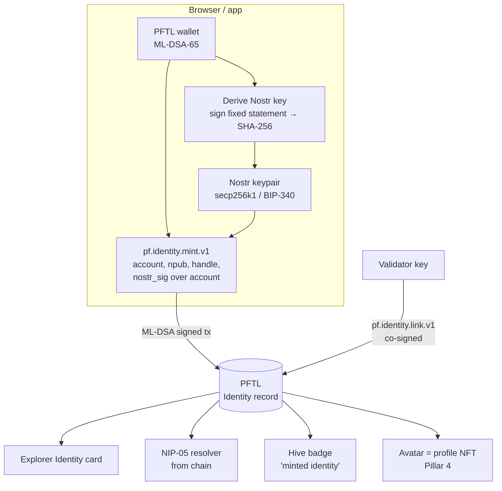

# Pillar 6 — Hive Chat Identity on Chain

> **Status:** Early. A deterministic Nostr identity, NIP-05 names and an off-chain validator binding are live in Task Node's database. Nothing is on chain: the chain has no identity transaction and no registry slot for a Nostr key.
>
> **Bubbles up to:** *One identity across Post Fiat*. The person in the Hive, the validator operator, the NFT holder and the NAVCoin issuer can be shown to be the same key holder on chain.

## In one paragraph

Today a Task Node user's Hive and messaging identity is a Nostr key. The browser derives it by having the user's wallet sign a fixed statement and hashing the signature. A Postgres table binds it to the account, and the account is bound to a validator key separately. That works, but only Task Node can vouch for it. This pillar makes the binding a **PFTL transaction**, letting a user say *"I minted my Task Node identity."* One on-chain record ties together the PFTL account key (ML-DSA-65), the Nostr pubkey, the handle and any validator key. Anyone can verify it from the explorer, and every other primitive (Hive, validators, NFTs, NAVCoins) can point to it.

## User story

**Founder's story.** Right now Hive Chat runs on a Nostr back end, with keys derived deterministically from an XRPL key. Ideally there would be a deterministic blockchain transaction on Post Fiat that integrates natively with Nostr as a deterministic identity, and is visible on the block explorer. Then we can say "I minted my Task Node identity", and link that Nostr identity to other primitives in the Post Fiat universe, such as validator keys.

**Augmented story.**

1. **Mint.** In Task Node → Profile I click **Mint my Task Node identity**. The app derives my Nostr key as today, then builds an identity message. It contains my PFTL account, my Nostr pubkey, my handle (`goodalexander@tasknode.postfiat.org`) and a Nostr signature over the account. My ML-DSA key signs it and it goes on chain.
2. **See.** The explorer shows an **Identity** card for my account: handle, npub, the mint transaction and the linked keys. My profile NFT from [Pillar 4](04-nft-system.md) can be its avatar.
3. **Link a validator.** I run one command on my validator. The validator key co-signs a `link` message to my identity, and the card now shows *Validator · node id*.
4. **Use it everywhere.** Hive Chat shows a *minted identity* badge on my messages. Other clients can check `nostr pubkey → PFTL identity` from chain data alone. NIP-05 resolves from the on-chain record.
5. **Rotate or revoke.** If my Nostr key is compromised, I publish a `rotate` or `revoke` message signed by my account key. History stays auditable.

## What exists today

| Component | Where | State |
|---|---|---|
| Deterministic Nostr key derivation | [`src/features/messages/nostr-messages.js`](https://github.com/postfiatorg/tasknode/blob/main/src/features/messages/nostr-messages.js) (`buildNostrDerivationMessage`, `deriveNostrMessagingIdentity`) · [`src/wallet-core.js`](https://github.com/postfiatorg/tasknode/blob/main/src/wallet-core.js) (`signWalletChallenge`) | Live. The key is SHA-256 of `{domain:"tasknode.nostr.private-messages", version, accountId, walletAddress, walletPublicKey, walletSignature}`. It is derived from a **wallet signature over a fixed statement**, not directly from the XRPL key, and exists only in the browser. |
| Relays | `wss://relay.primal.net`, `wss://nos.lol`, `wss://relay.damus.io` | Live |
| Identity binding and NIP-05 | [`server/repositories/nostr-messages.js`](https://github.com/postfiatorg/tasknode/blob/main/server/repositories/nostr-messages.js) (`bindNostrIdentity`) · [`server/collaboration-routes.js`](https://github.com/postfiatorg/tasknode/blob/main/server/collaboration-routes.js) (`/.well-known/nostr.json`, `/api/messages/identity`) · table `account_nostr_identities` ([migration 110](https://github.com/postfiatorg/tasknode/blob/main/server/db/migrations/110_docs_team_collaboration.sql)) | Live, on the domain `tasknode.postfiat.org`. Postgres only. |
| Validator binding (off chain) | [`server/l1-validator-identity.js`](https://github.com/postfiatorg/tasknode/blob/main/server/l1-validator-identity.js) (ML-DSA-65, context `postfiat-l1-v2/tasknode-validator-binding/v1`) · table `validator_bindings` | Live. Joining on account id links Nostr to the validator, but only in Postgres. |
| Hive bot identity | [`server/repositories/hive-group.js`](https://github.com/postfiatorg/tasknode/blob/main/server/repositories/hive-group.js) (`TASKNODE_HIVE_NOSTR_SECRET_KEY`) | Live (`hive-board@tasknode.postfiat.org`) |
| `pf.ptr` content kind `IDENTITY=8` | [`server/pftl-pointer.js`](https://github.com/postfiatorg/tasknode/blob/main/server/pftl-pointer.js) | Defined, **never used**. |
| L1 validator registry | [`crates/types/src/shielded_bridge_governance.rs`](https://github.com/postfiatorg/postfiatl1v2/blob/main/crates/types/src/shielded_bridge_governance.rs) `ValidatorRegistryEntry {node_id, algorithm_id, public_key_hex, active}` | Built. No metadata slot. |
| L1 account settings | [`crates/types/src/transactions_mempool_receipts.rs`](https://github.com/postfiatorg/postfiatl1v2/blob/main/crates/types/src/transactions_mempool_receipts.rs) `AccountSetOperation` | Flags only (`REQUIRE_MEMO`). No message-key or domain field. |
| Validator identity research | [`docs/governance/validator-identity-packets.md`](https://github.com/postfiatorg/postfiatl1v2/blob/main/docs/governance/validator-identity-packets.md) | Off-chain research packets, shadow only. |

No match for "nostr" anywhere in `postfiatl1v2/crates`.

## Architecture

## Technical requirements

### Record

- **R1.** Define `pf.identity.mint.v1`, `link.v1`, `rotate.v1` and `revoke.v1` as [Pillar 2](02-message-protocol.md) message types.
    - A **mint** binds `{account, nostr_pubkey, handle, derivation_version}`. It carries a BIP-340 Nostr signature over `(account, chain_id)` and is signed by the account's ML-DSA key.
    - A **link** adds `{key_type: validator|old_chain|evm|solana, key, proof}`, co-signed by the linked key under a domain-separated context.
- **R2.** Decide how the chain stores it. Option A: memo messages, `pf.ptr` kind `IDENTITY` on a self-payment, read by the indexer. Option B: a native `identity_set` transaction with a ledger object queryable over RPC (`identity_info`, `identity_by_nostr`). Option B makes it a true chain primitive.
- **R3.** Uniqueness: one live Nostr pubkey per identity, and one identity per Nostr pubkey. Handles are unique within a namespace (`*.tasknode.postfiat.org`).

### Task Node

- **R4.** A **Mint my identity** flow on the profile. It reuses today's derivation, so existing Nostr identities and their history keep working.
- **R5.** `/.well-known/nostr.json` resolves minted identities from chain data, and keeps the Postgres binding as a fallback.
- **R6.** Hive messages from minted identities show a badge. The badge is verified against the chain, not the database.
- **R7.** The validator connect flow from [Pillar 3](03-validator-program.md) emits a `link` with `key_type=validator`, so the off-chain `validator_bindings` row gets an on-chain twin.

### Explorer and SDK

- **R8.** An explorer Identity card on account pages, plus search by npub and by handle.
- **R9.** A small SDK function, `resolveIdentity(npub | account | handle)`, for third-party Nostr clients.

## Dependencies

| Depends on | Why |
|---|---|
| [Pillar 2 — Message protocol](02-message-protocol.md) | Identity message types. |
| [Pillar 3 — Validators](03-validator-program.md) | The validator link flow. |
| [Pillar 4 — NFTs](04-nft-system.md) | Avatar (optional). |
| [Pillar 8 — On-chain identity, DID and KYC](08-onchain-identity.md) | Credentials attach to this identity. |

## Acceptance criteria

1. The founder mints `goodalexander@tasknode.postfiat.org` on PFTL. The explorer shows it with npub, handle and transaction.
2. A third-party Nostr client verifies the npub-to-identity mapping using only RPC or explorer data.
3. A validator `link` appears on the identity card, signed by the validator key.
4. Hive shows the minted-identity badge, and the badge disappears after a `revoke`.
5. Existing Nostr message history works unchanged after minting.

## Open questions for the founder

- Should identity be a memo-level convention (fast to ship) or a native transaction type (a true primitive)?
- Should minting cost a fee or a PFT burn, to discourage squatting?
- Should handles be under `tasknode.postfiat.org` only, or should identity support custom NIP-05 domains?

## Code references

- Nostr derivation: [`src/features/messages/nostr-messages.js`](https://github.com/postfiatorg/tasknode/blob/main/src/features/messages/nostr-messages.js)
- Identity tables: [`migration 110`](https://github.com/postfiatorg/tasknode/blob/main/server/db/migrations/110_docs_team_collaboration.sql) (`account_nostr_identities`)
- L1 types: [`shielded_bridge_governance.rs`](https://github.com/postfiatorg/postfiatl1v2/blob/main/crates/types/src/shielded_bridge_governance.rs) · [`transactions_mempool_receipts.rs`](https://github.com/postfiatorg/postfiatl1v2/blob/main/crates/types/src/transactions_mempool_receipts.rs)
- Hive docs: [`docs/wiki/surfaces/hive.md`](https://github.com/postfiatorg/tasknode/blob/main/docs/wiki/surfaces/hive.md)
