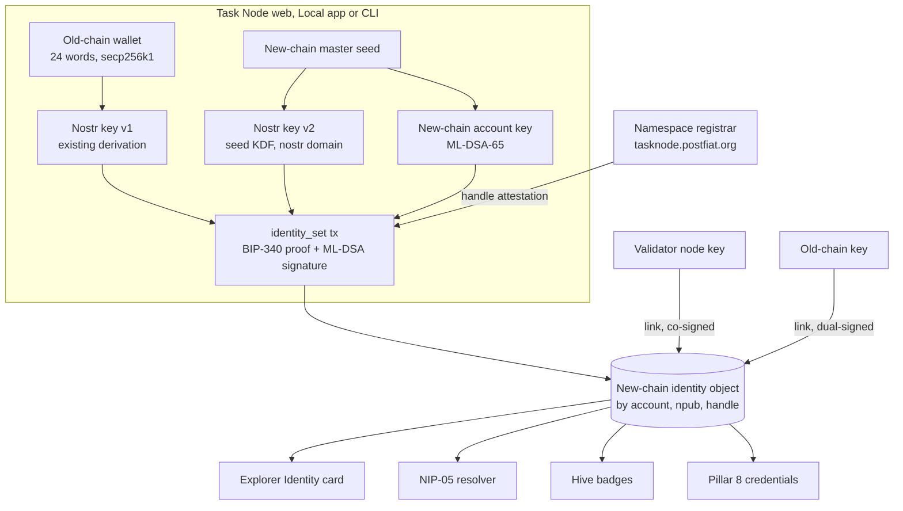

# Pillar 6 — Hive Chat Identity on Chain

> **Status:** Early. A deterministic Nostr identity, NIP-05 names and an off-chain validator binding are live in Task Node's database. Nothing is on chain: no identity transaction, no registry slot for a Nostr key and no secp256k1 library.
>
> **Bubbles up to:** [Outcome A · Post-human governance in public](../README.md#three-outcomes). *One identity across Post Fiat*. The person in the Hive, the validator operator, the NFT holder and the NAVCoin issuer can be shown to be the same key holder on chain.

## In one paragraph

Today a Task Node user's Hive identity is a Nostr key. The browser gets it by having the user's old-chain wallet sign a fixed statement, then hashing the signature. Postgres binds that key to the account and assigns the handle. A separate binding links the account to a validator key, so only Task Node can vouch for any of it. This pillar adds a **native transaction on the new chain (postfiatl1v2)** that writes an **identity object** to the ledger, so a user can say *"I minted my Task Node identity."* The object ties together:

- the new-chain account key (ML-DSA-65);
- the Nostr pubkey;
- the handle;
- linked keys: the validator key first, then the old-chain key.

Anyone can verify the object over RPC or on the explorer. Existing npubs carry over unchanged. New identities derive their Nostr key from the new-chain wallet seed rather than from a signature, because ML-DSA signing in this codebase is randomised.

## User story

**Founder's story.** Right now Hive Chat is a Nostr back end, deterministically derived from an XRPL key. It would be ideal if there were a deterministic blockchain-based transaction on Post Fiat that natively integrated with Nostr in a deterministic identity way, and that is also accessible on the block explorer. Then we are able to say "I minted my Task Node Identity", and also link that Nostr identity to other primitives in the Post Fiat universe, such as your validator keys.

**Augmented story.**

1. **Mint.** In Task Node → Profile I click **Mint my Task Node identity** and unlock my new-chain wallet. The app reuses my existing Nostr key, so my npub, contacts and Hive history stay the same. The Task Node registrar attests that `goodalexander@tasknode.postfiat.org` is mine. My Nostr key signs the binding, my ML-DSA key signs the transaction, and it goes on chain.
2. **See.** The explorer shows an **Identity** card for my account: handle, npub, mint transaction, linked keys and history. My profile NFT from [Pillar 4](04-nft-system.md) can serve as its avatar.
3. **Link a validator.** I run the one-command helper I already use to connect my validator. The validator key co-signs a `link`, and the card then shows *Validator · node id*.
4. **Link my old chain.** I sign once with my old-chain wallet and once with my new-chain key. The card shows *Old chain · r…*, and [Pillar 4](04-nft-system.md) reuses the same proof to bring over my historical NFTs.
5. **Use it everywhere.** Hive shows chain-checked *minted* and *validator* badges on my messages. Other Nostr clients can map `npub → new-chain identity` from chain data alone, and my Nostr profile points back to my new-chain account.
6. **Rotate or revoke.** If my Nostr key is compromised, I `rotate` or `revoke`. No one else can take my handle, and the history stays auditable.

## What exists today

| Component | Where | State |
|---|---|---|
| Nostr key derivation | [`nostr-messages.js`](https://github.com/postfiatorg/tasknode/blob/main/src/features/messages/nostr-messages.js) (`deriveNostrMessagingIdentity`) · [`wallet-core.js`](https://github.com/postfiatorg/tasknode/blob/main/src/wallet-core.js) (`signWalletChallenge`) | **Live, browser only.** The key is SHA-256 of `{domain, version:1, accountId, walletAddress, walletPublicKey, walletSignature}`. The signer is the **old-chain 24-word wallet** (secp256k1, `m/44'/144'/0'/0/0`) via `ripple-keypairs`, which signs with RFC 6979 and no extra entropy. The signature, and so the key, is **deterministic**. Re-deriving also needs Task Node's `accountId`. |
| New-chain wallet and key derivation | Task Node [`wallet/l1/core.js`](https://github.com/postfiatorg/tasknode/blob/main/src/features/wallet/l1/core.js) · [`wallet_sdk.rs`](https://github.com/postfiatorg/postfiatl1v2/blob/main/crates/rpc_sdk/src/wallet_sdk.rs) (`derive_wallet_seed`) · [`lifecycle_queries.rs`](https://github.com/postfiatorg/postfiatl1v2/blob/main/crates/node/src/lifecycle_queries.rs) | **Built.** A **separate** random 32-byte master seed sits in its own vault; it is not the 24-word mnemonic. Account keys come from a domain-separated SHA3-384 KDF over `(domain, algorithm, chain_id, account_index, key_role, seed)`. Orchard keys use their own domain (`postfiat.wallet.orchard.seed.v1`), and a Nostr key can follow the same pattern. |
| ML-DSA signing mode | [`crypto_provider/src/lib.rs`](https://github.com/postfiatorg/postfiatl1v2/blob/main/crates/crypto_provider/src/lib.rs) · [`fips204/src/traits.rs`](https://github.com/postfiatorg/postfiatl1v2/blob/main/third_party/fips204/src/traits.rs) · [`wallet_wasm/src/lib.rs`](https://github.com/postfiatorg/postfiatl1v2/blob/main/crates/wallet_wasm/src/lib.rs) | **Hedged (randomised).** `ml_dsa_65_sign_with_context` calls `try_sign`, which draws from `OsRng`, and the wallet signs through it. Two signatures over the same statement differ. A seeded variant exists, but the wallet does not use it. |
| Binding and NIP-05 | [`repositories/nostr-messages.js`](https://github.com/postfiatorg/tasknode/blob/main/server/repositories/nostr-messages.js) (`bindNostrIdentity`) · [`collaboration-routes.js`](https://github.com/postfiatorg/tasknode/blob/main/server/collaboration-routes.js) (`/.well-known/nostr.json?name=`) · `account_nostr_identities` ([migration 110](https://github.com/postfiatorg/tasknode/blob/main/server/db/migrations/110_docs_team_collaboration.sql)) | **Live, Postgres only.** The server assigns the handle from the member's Hive handle (`[a-z0-9._-]`, at least 2 characters) and reserves `hive-board`. Each pubkey is unique to one account. Rows carry a 365-day expiry, a sequence, a status and a visibility (`private`, `teammates` or `public`). |
| Validator binding | [`l1-validator-identity.js`](https://github.com/postfiatorg/tasknode/blob/main/server/l1-validator-identity.js) · [`tasknode-validator-binding`](https://github.com/postfiatorg/postfiatl1v2/blob/main/tools/tasknode-validator-binding/src/lib.rs) · [runbook](https://github.com/postfiatorg/postfiatl1v2/blob/main/docs/runbooks/tasknode-l1-validator-binding.md) | **Live, off chain.** A pinned, network-isolated helper signs with the validator's **consensus node key** under the context `postfiat-l1-v2/tasknode-validator-binding/v1`. Nostr is linked only through a Postgres join. |
| Old-chain to new-chain key proof | [genesis spec §3.2](https://github.com/postfiatorg/postfiatl1v2/blob/main/docs/architecture/l1v2-testnet-genesis-and-launch-spec.md) `IdentityReceiptV1` | **Specified, for validators.** The fork key and the ML-DSA key each sign a domain-separated digest of one body. |
| Hive bot and relays | [`hive-group.js`](https://github.com/postfiatorg/tasknode/blob/main/server/repositories/hive-group.js) | **Live.** `hive-board@` is the only identity that publishes a kind-0 profile. The relays are Primal, nos.lol and Damus, all third party. |
| `pf.ptr` kind `IDENTITY=8` | [`pftl-pointer.js`](https://github.com/postfiatorg/tasknode/blob/main/server/pftl-pointer.js) | **Defined, never used.** |
| L1 registry, account settings and memos | [`shielded_bridge_governance.rs`](https://github.com/postfiatorg/postfiatl1v2/blob/main/crates/types/src/shielded_bridge_governance.rs) · [`transactions_mempool_receipts.rs`](https://github.com/postfiatorg/postfiatl1v2/blob/main/crates/types/src/transactions_mempool_receipts.rs) · [`core_chain.rs`](https://github.com/postfiatorg/postfiatl1v2/blob/main/crates/types/src/core_chain.rs) | **Built.** `ValidatorRegistryEntry` has no metadata slot. `AccountSet` sets flags only. A payment carries at most 4 memos of 256 data bytes each. |

**Naming.** This page says *old chain* for the XRPL-shaped PFT Ledger and *new chain* for postfiatl1v2. Task Node code uses `pftl` for the old chain (for example `pftl-pointer.js`) and `l1` for the new one.

There is no "nostr" anywhere in `postfiatl1v2/crates`, and no crate in the workspace depends on a secp256k1 or BIP-340 library.

## Architecture

## Technical requirements

### Key derivation

- **R1. Keep v1 for existing users.** Today's derivation stays as it is, labelled `derivation_version = 1`. Minting binds the npub the user already has, so keys, contacts and message history are unchanged.
- **R2. v2 for new identities.** v2 derives the key from the seed and never hashes an ML-DSA signature, for two reasons. Signing here is hedged, so the key would change on every derivation. And a key derived from a signature leaks whenever that signature leaks. v2 works as follows:
    - Use the existing `derive_wallet_seed` construction with a new domain (for example `postfiat.wallet.nostr.seed.v1`) and the key role `nostr-messaging`.
    - Retry with a counter until the output is a valid secp256k1 scalar, as Orchard's `-retry-canonical` KDF does.
    - Include `account_index` but not `chain_id`, so the npub survives the move from devnet to mainnet. The account key does change with `chain_id`, so after a network change the user re-binds the same npub with `rotate_account` (R6).
- **R3. One implementation, with test vectors.** Implement v2 once in Rust (`rpc_sdk` via `wallet_wasm`) for the web app, Task Node Local ([Pillar 5](05-local-task-node.md)) and the CLI. CI fails if any client disagrees with the published vectors.

### Record and transaction

- **R4. A native transaction and ledger object (recommended).** This adds:
    - an `identity_set` transaction;
    - an `Identity` object keyed by account, with consensus indexes by Nostr pubkey and by handle;
    - the RPCs `identity_info`, `identity_by_nostr` and `identity_by_handle`.

    A memo convention does not fit. A mint that carries a registrar attestation includes a 3,309-byte ML-DSA signature, while a payment holds at most 4 × 256 memo bytes. The payload would have to move to IPFS, and uniqueness would become an indexer convention. The founder confirms this choice in open question 1.

- **R5. Fields.** `account`, `nostr_pubkey`, `derivation_version`; optional `handle` with its attestation; `identity_kind` (`human`, `agent` or `service`) with an optional `controller`; `relays`; optional `avatar_nft_id` (ownership checked at read time); optional `message_key` (the reader key [Pillar 2](02-message-protocol.md) R5 looks up); optional `pq_receive_address` (a `pfpq1…` shielded receive address, so [Pillar 5](05-local-task-node.md) R15 can find it without Task Node); `links[]`, `sequence`, `status`. Earlier values stay readable in the transaction history.
- **R6. Operations.**

| Operation | Signed by | Effect |
|---|---|---|
| `mint` | Account and Nostr key, plus the registrar if a handle is set | Creates the object |
| `update` | Account, plus the registrar if the handle changes | Changes relays, avatar, message key or handle |
| `link` | Account and the linked key | Adds a link |
| `unlink` | Account, or the linked key alone | Removes a link. A retired validator can detach itself. |
| `rotate` | Account and the **new** Nostr key | Replaces the npub and records the old one. The handle and links stay. |
| `rotate_account` | Old and new account, plus the registrar for the handle | Moves the identity after a network or key change |
| `revoke` | Account | Tombstones the identity. The npub and handle never pass to another account by default (open question 4). |

- **R7. What each signature covers.** Every co-signature (Nostr, registrar, validator or old chain) signs one canonical digest of the operation context `pf.identity.<op>.v1`, `chain_id`, `account`, the identity's next `sequence` and the hash of the full payload. A proof is valid for one account, chain, operation and sequence only.

- **R8. Consensus verifies the Nostr proof.** Consensus checks the BIP-340 signature on `mint` and `rotate`. Without this check, an attacker could register a victim's npub first, and the uniqueness rule would lock the victim out. This makes consensus depend on a secp256k1 library for the first time: one audited library, also used for old-chain links (R14). It needs its own review (open question 10).
- **R9. Uniqueness, enforced by consensus.** Each account, each Nostr pubkey and each handle within a namespace has at most one active identity.
- **R10. Inline and public.** Identity payloads are canonical, unencrypted and stored in the transaction. They are never stored on IPFS. [Pillar 2](02-message-protocol.md) assigns schema ids for explorer rendering.

### Namespace and handles

- **R11. Binding is permissionless; names are attested.** Anyone may mint without a handle. A `tasknode.postfiat.org` handle needs an attestation from that namespace's registrar key, which is registered on chain. The registrar first attests every existing Postgres binding, so current holders, including `goodalexander`, keep their names and `hive-board` stays reserved. Who holds the registrar key, and whether other domains are allowed, is open question 2.
- **R12. NIP-05 stays DNS-anchored.** `nostr.json` serves names from chain data, with a `relays` map, and any client can cross-check the answer over RPC. During the transition, an unattested on-chain claim never overrides a Postgres binding. Postgres is the fallback only for accounts that have not minted.

### Links

- **R13. Validator link.** Extend the existing helper with the context `postfiat-l1-v2/identity-link/v1` over the R7 digest.
    - **Checks:** consensus checks the ML-DSA signature, and checks `node_id` and the public key against the registry.
    - **Rotation:** when the validator key rotates, the link is marked **stale** until it is re-linked.
    - **Lookup:** validator-to-identity lookups use an index over links, so `ValidatorRegistryEntry` stays unchanged.
- **R14. Old-chain link, shipped first.** This is a dual-signature proof modelled on `IdentityReceiptV1`: the old-chain secp256k1 key and the ML-DSA key each sign a domain-separated digest of one body. Consensus verifies it with the R8 library. [Pillar 4](04-nft-system.md)'s `pf.nft.claim.v1` should reuse it.
- **R15. EVM and Solana links.** These are EIP-191 and Solana signed-message proofs over the R7 digest, stored on chain. The SDK and explorer verify them, and the explorer labels them **client-verified**.
- **R16. Links are opt-in, one at a time.** Task Node never links keys automatically. Shielded spending keys and notes ([Pillar 5](05-local-task-node.md)) are never linked. Publishing a `pfpq1…` receive address (R5) is a separate opt-in: it lets others pay the user privately and does not reveal what that address receives. Today's `visibility` setting cannot apply on chain, so the mint flow warns that everything on the identity card is public. The protocol caps the number of links per identity; the value is open question 3.

### Task Node and Hive

- **R17. Mint flow.** The mint uses the v1 key if the user has one, otherwise v2. It needs the unlocked new-chain wallet, which today cannot sign this transaction (see Dependencies). Afterwards it publishes a kind-0 profile with `nip05` and a NIP-39 `i` tag naming the new-chain account.
- **R18. Badges come from chain state.** The *Minted*, *Validator · node id* and *Old chain* badges are read from chain state, never from Postgres.
    - **Revoke:** badges come off every event from the key. Nostr `created_at` is self-asserted, so older events cannot be trusted either.
    - **Rotate:** events from the old key show *previous key of @handle*.
    - **Cache:** cleared whenever the indexer sees an identity transaction.
- **R19. Agent identities.** `hive-board@` becomes the first `agent` identity, with a `controller` link to its operator. [Pillar 1](01-hive-governance.md) session participants and [Pillar 10](10-information-hive-mind.md) contributors resolve through the identity object.
- **R20. A post-quantum tag for high-value events.** Governance minutes and similar events can carry an ML-DSA account signature as a Nostr tag, which the SDK checks against the identity.
- **R21. Validator connect.** The [Pillar 3](03-validator-program.md) connect flow emits the R13 link, so each `validator_bindings` row gets an on-chain twin.

### Explorer and SDK

- **R22. Identity card.** Each account page shows an Identity card, searchable by npub, handle or node id. Every link shows whether consensus or the client verified it, and whether it is stale. The card also shows the identity's history.
- **R23. SDK.** The SDK provides `resolveIdentity(npub | account | handle)`, v2 derivation and proof verification, so a third-party client needs nothing but RPC.

### Security model

- **Authority.** The ML-DSA account key is the root. The Nostr key has no authority over L1 state.
- **Quantum boundary.** The identity record is quantum-safe. Nostr messages are classical secp256k1, so a quantum attacker could forge them from a public npub. Public copy should say exactly this. R20 covers the events that matter most.
- **Compromise.**
    - **Nostr key only:** `rotate`.
    - **Account key:**
        - Under v2 the Nostr key falls with it, because both come from one seed.
        - Under v1 the Nostr key is a separate secret, but the attacker can still rotate the binding.
        - Recovery is a recovery key (open question 7), or `revoke` then a re-mint with a fresh registrar attestation.
    - **Validator key:** `unlink`, then rotate the key under Pillar 3.
- **Privacy.** Linking keys deanonymises them. Links are opt-in (R16). An identity account should not fund shielded spends, though it may publish a shielded receive address.

### Economics

- **What exists.** Every transaction has a `fee` field. There is no XRPL-style owner reserve in `crates/types` or `crates/execution`. Each identity adds one object, up to three index entries, and its links.
- **Squatting.** Under R11, `tasknode.postfiat.org` names are assigned by the registrar, not won in a race. Under R8, only the holder of a Nostr key can bind it.
- **Spam and state.** These are bounded by the fee or reserve choice and by the link cap, all founder decisions (open question 3).
- **Sybil resistance.** A *minted* badge proves only a key and a fee. Badges gain weight through verifiable links, such as a validator or old-chain history. No reputation score is computed here.
- **Reasons to mint.** A minted identity could gate Finance Hub access ([Pillar 9](09-finance-hub.md)), the validator reward roster ([Pillar 3](03-validator-program.md)), NFT claims ([Pillar 4](04-nft-system.md)), hive-mind attribution ([Pillar 10](10-information-hive-mind.md), already planned) and a NAVCoin issuer card ([Pillar 7](07-navcoin-fees.md)). Which to require is open question 8.

## Dependencies

| Depends on | Why |
|---|---|
| [Pillar 2 — Message protocol](02-message-protocol.md) | Schema ids for identity payloads, and the `message_key` reader key. |
| [Pillar 3 — Validators](03-validator-program.md) | The helper and connect flow for validator links. |
| [Pillar 5 — Local Task Node](05-local-task-node.md) | The same v2 derivation on the device. |
| Consensus review | The `identity_set` transaction and BIP-340 verification (R4, R8). |
| Browser wallet signing ([`wallet_wasm`](https://github.com/postfiatorg/postfiatl1v2/blob/main/crates/wallet_wasm/src/lib.rs)) | Today it signs payments, transfers, assets, offers, escrows, swaps and owned-object orders only: no NFT, `identity_set` or generic message signing. The mint flow needs an `identity_set` signer. [Pillar 2](02-message-protocol.md) owns generic envelope signing. |

| Used by | How |
|---|---|
| [Pillar 1 — Hive governance](01-hive-governance.md) | Session participants and the Hive bot. |
| [Pillar 4 — NFTs](04-nft-system.md) | The avatar, and the old-chain link for claims. |
| [Pillar 8 — On-chain identity, DID and KYC](08-onchain-identity.md) | Credentials attach to this object. Each account has one identity object, not two. |
| [Pillars 7](07-navcoin-fees.md), [9](09-finance-hub.md) and [10](10-information-hive-mind.md) | Issuer display, access gating and attribution, if adopted. |

## Acceptance criteria

1. The founder mints `goodalexander@tasknode.postfiat.org` on the new chain. The explorer shows the handle, npub, transaction and history.
2. After minting, the founder's npub is unchanged, and existing DMs and Hive history still read.
3. A third-party client, using only RPC and the SDK, maps the npub to the identity and verifies its BIP-340 and ML-DSA proofs.
4. A validator `link` co-signed by the node key appears. It shows as stale after the validator key rotates.
5. A dual-signed old-chain link appears, and the Pillar 4 claim flow accepts it.
6. After `revoke`, badges disappear from every event signed by that key. After `rotate`, they move to the new npub.
7. **Consensus rejects** each of the following:
    - a second account minting the same npub;
    - `goodalexander` without a registrar attestation;
    - an invalid BIP-340 signature;
    - a co-signature replayed with a different account, `chain_id`, operation or sequence.

8. The same seed gives the same v2 npub on the web, in Task Node Local and in the CLI, on every run, matching the published vectors.
9. `hive-board@` is minted as an `agent` identity with a controller link.

## Open questions for the founder

1. **Native object or memo?** A native object (recommended, R4) gives consensus-enforced uniqueness and matches "a deterministic blockchain based transaction". A memo ships sooner, but needs IPFS for payloads and leaves uniqueness to indexers. An interim memo version would use "first valid claim in ledger order" and migrate later.
2. **Registrar for `tasknode.postfiat.org`.** Who holds it: the Task Node operator key, a key governed by Cobalt or the constitution, or both? Should custom NIP-05 domains be allowed (proven by that domain's `nostr.json` or a DNS TXT record), or only the one namespace?
3. **Economics.** Base fee only, a PFT burn, or a refundable reserve? A reserve is a new mechanism, and it is the only option that pays for state. Should handle prices vary with length? What is the cap on links per identity?
4. **After a revoke,** should the npub and handle be tombstoned forever, held back for a period, or released? Tombstoning is safest against impersonation, but the names are lost for good.
5. **Existing users: keep v1 forever, or offer v2?** v2 needs only one seed backup. But Nostr has no key migration, so followers and DM contacts stay on the old npub.
6. **Validator link key.** The consensus key matches today's helper. A separate operator key keeps the consensus key out of application signing, but needs new key handling in Pillar 3.
7. **Recovery key.** Should an optional recovery key be added, at the cost of extra complexity? The alternative is revoke and re-mint.
8. **Gating.** Should a minted identity be required for Finance Hub, the validator reward roster, NFT claims or hive-mind credit, or should it stay optional?
9. **Relay.** Should Post Fiat run a Nostr relay, with public relays as mirrors? Hive and governance transcripts depend on three third-party relays today.
10. **BIP-340 in consensus (R8), or verified by clients only?** Client-only verification keeps secp256k1 out of consensus, but then the chain cannot safely enforce one identity per npub.
11. **DID view.** Should the object also be presented as `did:pftl:<account>` for [Pillar 8](08-onchain-identity.md) and outside KYC vendors?

## Code references

- **Task Node:** [`src/features/messages/nostr-messages.js`](https://github.com/postfiatorg/tasknode/blob/main/src/features/messages/nostr-messages.js) · [`src/wallet-core.js`](https://github.com/postfiatorg/tasknode/blob/main/src/wallet-core.js) · [`src/features/wallet/l1/core.js`](https://github.com/postfiatorg/tasknode/blob/main/src/features/wallet/l1/core.js) · [`server/repositories/nostr-messages.js`](https://github.com/postfiatorg/tasknode/blob/main/server/repositories/nostr-messages.js) · [`server/collaboration-routes.js`](https://github.com/postfiatorg/tasknode/blob/main/server/collaboration-routes.js) · [`server/db/migrations/110_docs_team_collaboration.sql`](https://github.com/postfiatorg/tasknode/blob/main/server/db/migrations/110_docs_team_collaboration.sql) · [`server/db/migrations/156_l1_validator_bindings.sql`](https://github.com/postfiatorg/tasknode/blob/main/server/db/migrations/156_l1_validator_bindings.sql) · [`server/l1-validator-identity.js`](https://github.com/postfiatorg/tasknode/blob/main/server/l1-validator-identity.js) · [`server/repositories/hive-group.js`](https://github.com/postfiatorg/tasknode/blob/main/server/repositories/hive-group.js) · [`server/pftl-pointer.js`](https://github.com/postfiatorg/tasknode/blob/main/server/pftl-pointer.js) · [`docs/wiki/surfaces/hive.md`](https://github.com/postfiatorg/tasknode/blob/main/docs/wiki/surfaces/hive.md)
- **postfiatl1v2:** [`crates/crypto_provider/src/lib.rs`](https://github.com/postfiatorg/postfiatl1v2/blob/main/crates/crypto_provider/src/lib.rs) · [`third_party/fips204/src/traits.rs`](https://github.com/postfiatorg/postfiatl1v2/blob/main/third_party/fips204/src/traits.rs) · [`crates/wallet_wasm/src/lib.rs`](https://github.com/postfiatorg/postfiatl1v2/blob/main/crates/wallet_wasm/src/lib.rs) · [`crates/rpc_sdk/src/wallet_sdk.rs`](https://github.com/postfiatorg/postfiatl1v2/blob/main/crates/rpc_sdk/src/wallet_sdk.rs) · [`crates/node/src/lifecycle_queries.rs`](https://github.com/postfiatorg/postfiatl1v2/blob/main/crates/node/src/lifecycle_queries.rs) · [`crates/types/src/shielded_bridge_governance.rs`](https://github.com/postfiatorg/postfiatl1v2/blob/main/crates/types/src/shielded_bridge_governance.rs) · [`crates/types/src/transactions_mempool_receipts.rs`](https://github.com/postfiatorg/postfiatl1v2/blob/main/crates/types/src/transactions_mempool_receipts.rs) · [`crates/types/src/core_chain.rs`](https://github.com/postfiatorg/postfiatl1v2/blob/main/crates/types/src/core_chain.rs) · [`tools/tasknode-validator-binding/src/lib.rs`](https://github.com/postfiatorg/postfiatl1v2/blob/main/tools/tasknode-validator-binding/src/lib.rs) · [`docs/runbooks/tasknode-l1-validator-binding.md`](https://github.com/postfiatorg/postfiatl1v2/blob/main/docs/runbooks/tasknode-l1-validator-binding.md) · [`docs/architecture/l1v2-testnet-genesis-and-launch-spec.md`](https://github.com/postfiatorg/postfiatl1v2/blob/main/docs/architecture/l1v2-testnet-genesis-and-launch-spec.md) · [`docs/governance/validator-identity-packets.md`](https://github.com/postfiatorg/postfiatl1v2/blob/main/docs/governance/validator-identity-packets.md)

## Revision notes (review round 1)

| Reviewer item | Change |
|---|---|
| Gemini P1 · Opus P1 | ML-DSA hedging confirmed in the code (`try_sign` → `OsRng`). v2 now derives from the seed (R2, R3). The diagram no longer shows ML-DSA as the signer. |
| Gemini P1 · Opus P2 | Partly disputed: the current signer is the old-chain secp256k1 wallet using RFC 6979, which is deterministic, and no migration forces a new npub. v1 kept (R1, AC2), and `rotate_account` added for network changes. |
| Gemini P2 · Opus P7 | Handles now need registrar attestation, and existing handles are pre-attested. An unattested claim never overrides a Postgres binding. NIP-05 is stated as DNS-anchored (R11, R12). Open question 2 added. |
| Gemini P3 · Opus P3 · Opus P14 | Native object recommended, with the memo-size reason (R4). Payloads inline (R10), and BIP-340 checked in consensus (R8). Open questions 1 and 10. |
| Gemini P4 · Opus P11 | One identity object per account. Pillar 8 moved to "Used by". Open question 11. |
| Gemini P5 · Opus P4 | Operations table with `unlink` and `rotate_account` (R6). Signature digest scope defined (R7). Open question 4. |
| Opus P5 | Compromise cases and badge rules added (R18, Security model). Open question 7. |
| Gemini P6 · Opus P12 | Economics section added. Open questions 3 and 8. |
| Gemini P7 · Opus P10 | Old-chain link added, reused by Pillar 4 (R14). EVM and Solana proofs (R15). Avatar field (R5). |
| Gemini P8 | Kind-0 profile with NIP-39 tag (R17). Relays map in `nostr.json` (R12). Open question 9. |
| Gemini P9 | Single Rust v2 implementation with test vectors (R3, AC8). |
| Opus P6 | Quantum boundary stated, with an ML-DSA tag for high-value events (R20). |
| Opus P8 | Links opt-in, shielded addresses unlinkable, warning shown at mint (R16). |
| Opus P9 | Confirmed that the helper uses the consensus key. New link context, staleness on rotation and a reverse index (R13). Open question 6. |
| Opus P13 | `identity_kind` and `controller` fields. `hive-board@` minted as an agent (R19, AC9). |
| Opus P15 | Negative, migration and parity criteria added (AC2, AC4, AC7, AC8). |
| Gemini and Opus intent notes (native transaction weakened, Hive adaptation, other primitives, gating) | Native object recommended (R4). Hive adaptation covered by R17–R20. Avatar, agent and issuer fields added (R5). Gating offered as open question 8. |
| Cross-pillar (Pillars 4, 5) | `pq_receive_address` field (R5, R16). Browser wallet signing listed as a dependency. Old chain and new chain named explicitly. |
