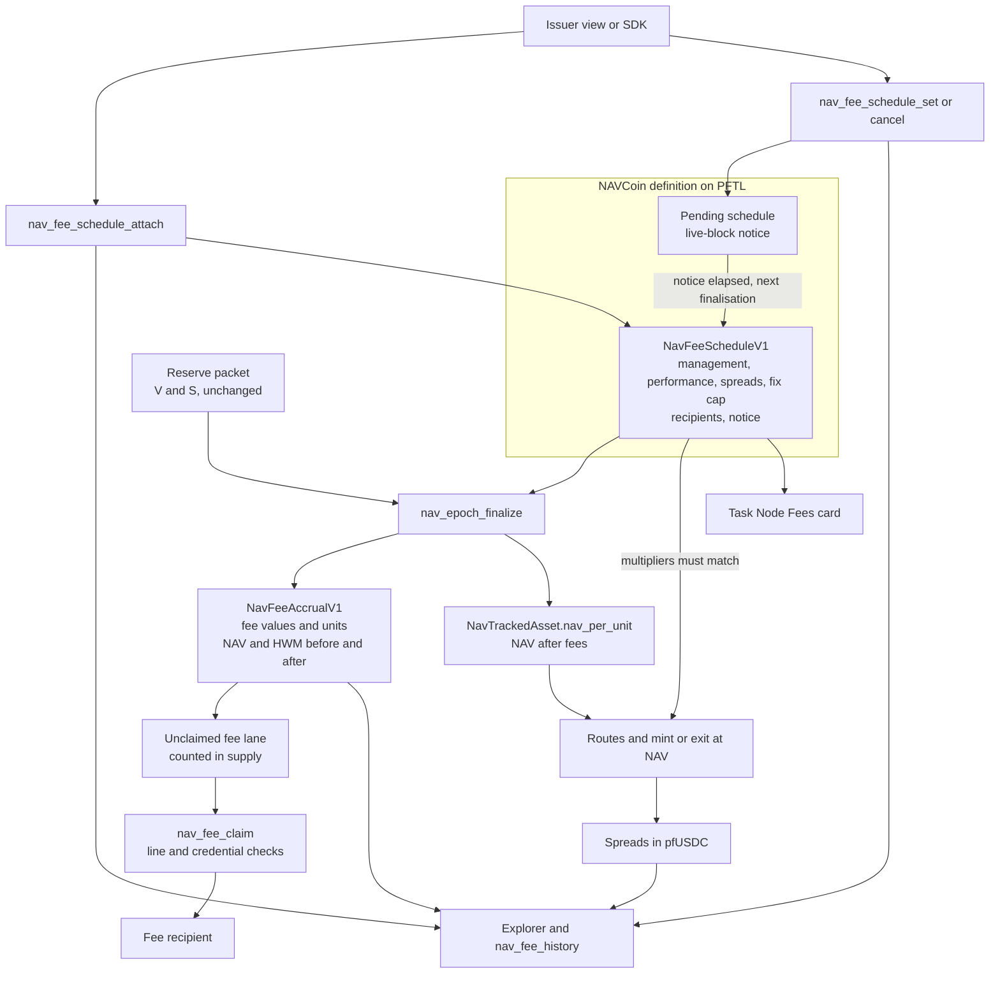

# Pillar 7 — Transparent Fees for NAVCoins

> **Status:** Partial. Primary-market spreads are built: per-route cash-in and cash-out multipliers (`issue_multiplier_bps`, `redeem_multiplier_bps`), capped at 500 bps, paid in the settlement asset to `spread_recipient` or to route "non-NAV fee custody". Task Node shows them and lets the issuer change the cash-in spread, which applies at once through a route epoch advance. There is no management fee, performance fee, high-water mark or fee accrual. Fee transactions are not shown on the explorer. NAVCoin creation is operator-only as a release rule; consensus only checks that the signer issued the asset.
>
> **Bubbles up to:** [Outcome C · NAVCoins anyone can build](../README.md#three-outcomes). A creator can't build a real product on a NAVCoin without stating what it charges.

## In one paragraph

A NAVCoin is an asset that trades to a proven net asset value. Its reserves are proven on PFTL each epoch, and it can be swapped against pfUSDC and a Uniswap pool. For anyone to build one, the creator must be able to say **what they charge**, and holders must be able to **check it deterministically**. Today the only fees are primary-market spreads. This pillar adds a **fee schedule** to the NAVCoin definition: a management fee in bps a year, a performance fee in bps of gains above a per-unit high-water mark, the issue and cash-in spreads, and a cap on fix fees. Fees accrue inside epoch finalisation, in integer atoms, from the proven reserve value and block heights, and are paid by minting NAVCoin units. Every number is on chain, in Task Node, and on the explorer next to the transaction that set it.

## User story

**Founder's story.** Right now, if I create a NAVCoin, I cannot set a deterministic performance or management fee. There is no way to handle this at the moment. There is no way to display a fee if there is one or to set the type of fee, and that transaction cannot be represented in any way on the block explorer.

**Augmented story.**

1. **Create with fees.** In the NAVCoin creator (SDK or Task Node issuer view), I set:
    - Management fee: 100 bps a year
    - Performance fee: 1,000 bps of gains above the high-water mark
    - Issue spread: 50 bps; cash-in spread: 5 bps; fix fee cap: 0 bps
    - Fee recipient: my fee account (separate from the issuer account, as `spread_recipient` is today)

    The chain rejects any rate above the protocol caps, and the schedule transaction appears on the explorer.

2. **Disclose.** The profile page's **Fees** card shows each fee type, rate, basis and recipient, the last change, any pending change with its effective height, and how much of the reserve value is proven versus attested.
3. **Accrue.** At each epoch finalisation the chain computes the management fee from reserve value and blocks elapsed, then the performance fee from the per-unit gain above the high-water mark, mints the matching units into an unclaimed fee balance, and writes a `NavFeeAccrualV1` record ([Fee math](#fee-math-and-economics)).
4. **Verify.** The explorer shows, per epoch, NAV before fees, each fee in value and units, NAV after fees and the high-water mark before and after. Any holder can recompute every number with the SDK.
5. **Change safely.** Any change that could make holders pay more waits a notice period of live blocks, so holders can exit first on the old terms. A change that only lowers fees applies from the next finalisation.
6. **Get paid.** From the issuer view I claim the accrued fee units to my fee account.

## What exists today

| Component | Where | State |
|---|---|---|
| NAVCoin ops | [`crates/types/src/transactions_mempool_receipts.rs`](https://github.com/postfiatorg/postfiatl1v2/blob/main/crates/types/src/transactions_mempool_receipts.rs) (`NavAssetRegisterOperation`, `NavReserveSubmitOperation`, `NavEpochFinalizeOperation`, `NavMintAtNavOperation`, `NavRedeemAtNavOperation`), executed in [`crates/execution/src/nft_escrow_asset_execution.rs`](https://github.com/postfiatorg/postfiatl1v2/blob/main/crates/execution/src/nft_escrow_asset_execution.rs) | Built. The issuer signs finalisation, `nav_halt` and `nav_mint_at_nav`; the holder signs `nav_redeem_at_nav`, which the issuer settles. Neither charges a spread. Finalisation clears any halt. |
| NAV state | [`crates/types/src/account_owned_asset_types.rs`](https://github.com/postfiatorg/postfiatl1v2/blob/main/crates/types/src/account_owned_asset_types.rs) (`NavTrackedAsset`, `NavReservePacket` with `verified_net_assets` and its proven/attested/controlled split, `NavProofProfile` with the `max_epoch_gap_blocks` deadman) | Built. **No fee fields.** Values are `u64`. Finalisation copies the packet's `nav_per_unit` and `circulating_supply` into `NavTrackedAsset`; that supply is the mint cap. |
| NAV arithmetic | [`crates/types/src/market_nav_asset_types.rs`](https://github.com/postfiatorg/postfiatl1v2/blob/main/crates/types/src/market_nav_asset_types.rs) (`nav_per_unit_floor_with_unit_scale`) | `nav_per_unit` = valuation atoms per 10^precision atoms; precision ≤ 18. Only the provider-neutral SP1 profile requires NAV to equal the floor of reserves over supply; other profiles let a submitter state NAV below reserves. |
| Spread policy | same file (`PftlUniswapPrimaryMarketPolicyV2`: `spread_recipient`, `issue_multiplier_bps`, `redeem_multiplier_bps`, `policy_hash`; `PFTL_UNISWAP_MAX_PRIMARY_SPREAD_BPS = 500`) | Built. A666 uses 10050/9995. The multipliers are inside `policy_hash`, which Ethereum mint packets commit to. |
| Spread execution | [`crates/execution/src/nav_vault_asset_execution.rs`](https://github.com/postfiatorg/postfiatl1v2/blob/main/crates/execution/src/nav_vault_asset_execution.rs) | Built. Issue rounds up, cash-in rounds down; the public and Orchard private primary routes share the policy. The spread goes to `spread_recipient` or to `non_nav_spread_atoms`, the "non-NAV fee custody" of [`primary-market-accounting.md`](https://github.com/postfiatorg/postfiatl1v2/blob/main/docs/navcoins/primary-market-accounting.md), outside holder value. Routes price from `NavTrackedAsset.nav_per_unit`, need a finalisation in the last 100 blocks (`MAX_PFTL_UNISWAP_PRICING_AGE_BLOCKS`), and their assets may not have a `max_supply`. |
| Supply | [`issued_asset_ledger_helpers.rs`](https://github.com/postfiatorg/postfiatl1v2/blob/main/crates/execution/src/issued_asset_ledger_helpers.rs) (`issued_asset_supply`) | Supply is the sum of every custody lane; a compile-time check forces each new lane to be classified. Crediting an issued asset to its issuer, or to a frozen line, fails. |
| Fix packet fee | [`crates/types/src/fx_fix_types.rs`](https://github.com/postfiatorg/postfiatl1v2/blob/main/crates/types/src/fx_fix_types.rs) (`FxFixPacketV1.fee_bps`, only checked ≤ 10,000) | Built. Zero fee in the pfUSDC→pNOK demo spec. |
| Fee display and change | Task Node [`profile/index.jsx`](https://github.com/postfiatorg/tasknode/blob/main/src/features/wallet/l1/profile/index.jsx) (Swap fees card, incl. Uniswap LP and protocol fees) · [`issuer/index.jsx`](https://github.com/postfiatorg/tasknode/blob/main/src/features/wallet/l1/issuer/index.jsx) · [`server/l1/navcoin-routes.js`](https://github.com/postfiatorg/tasknode/blob/main/server/l1/navcoin-routes.js) (`/api/l1/navcoin/fee`, 0–500 bps, serves operator-prepared route epoch advances) | Spreads only. Changes apply at once; the epoch advance resets route capacities. |
| Create flow | [`docs/navcoins/navcoin-create-and-swap-spec.md`](https://github.com/postfiatorg/postfiatl1v2/blob/main/docs/navcoins/navcoin-create-and-swap-spec.md) | "Only the operator creates NAVCoins in the first release." |
| Python builders | [`python/postfiat_rpc/navcoin.py`](https://github.com/postfiatorg/postfiatl1v2/blob/main/python/postfiat_rpc/navcoin.py) | Profile, attestor, packet and settle builders and `calculate_nav`: the seed of an SDK |

`BlockHeader` ([`core_chain.rs`](https://github.com/postfiatorg/postfiatl1v2/blob/main/crates/types/src/core_chain.rs)) has no timestamp, so height is the only clock. Existing mul-div helpers, such as `mul_div_floor` in [`market_policy.rs`](https://github.com/postfiatorg/postfiatl1v2/blob/main/crates/execution/src/market_policy.rs), use checked `u128`; there is no 256-bit one.

## The NAVCoin primitive these fees attach to

Every NAVCoin is built from the same five parts, per the founder's spec. The schedule states the fee at each part.

| Element | What it is | Exists today | Fee |
|---|---|---|---|
| Uniswap asset | An ERC-20 wrapper (for example wB24) in a Uniswap pool, with a NAV guard hook | `PFTLUniswapPrimaryMarketV2.sol`, `NAVGuardHook.sol`, [`crates/pftl_uniswap_proofs`](https://github.com/postfiatorg/postfiatl1v2/tree/main/crates/pftl_uniswap_proofs). The B24 pool is live with real money. | Uniswap LP and protocol fee, displayed |
| On-chain PFTL asset | The NAV-tracked issued asset on PFTL that can be swapped into | `NavTrackedAsset`, the offer book and atomic swaps. No AMM on PFTL. | Management and performance |
| USDC → pfUSDC | Bridge USDC from Solana or Ethereum into pfUSDC | `VaultBridge*` ops, [`crates/pfusdc_proofs`](https://github.com/postfiatorg/postfiatl1v2/tree/main/crates/pfusdc_proofs), `solana/pfusdc-*`. Live; Solana opens in the daily proving window. | Outside the schedule |
| Uniswap asset → actual asset | Move the wrapper back to PFTL, then exit to reserves at NAV | `PftlUniswapExportDebit`, `PftlUniswapReturnImport`, `PftlUniswapPrimaryRedeem` | Issue and cash-in spreads |
| The fix | A pfUSDC liquidity pool ready at a set time, like the London FX fix | `FxFixPacketV1` (ratio, band, fee, heights, capacity); fills settle as private swaps in the shielded pool. No scheduled settlement yet. | Fix fee, capped |

**Near term:** NAVCoin swaps, probably by tracking a Hyperliquid NAVCoin on Solana. `HyperCoreReserveReader.sol` reads Hyperliquid state, but HIP-3 positions are attested, not proven, and nothing yet ties a Hyperliquid NAVCoin to Solana. Its reserve value would be mostly `attested_value`. It can launch at Step 1 of the [build order](#build-order) with a management fee and `p = 0`, whatever the answers to open questions 1, 4 and 5.

**SDK:** `python/postfiat_rpc/navcoin.py` and [`crates/rpc_sdk`](https://github.com/postfiatorg/postfiatl1v2/tree/main/crates/rpc_sdk) become a **NAVCoin SDK** plus a "Create a NAVCoin" guide on postfiatorg.github.io (R17–R19). Fees are a required part of its create call.

## Architecture

## Fee math and economics

### Notation

Inputs are `u64` chain values. Intermediates are exact 256-bit integers, so no product of three inputs can overflow.

| Symbol | Meaning | Source |
|---|---|---|
| `V` | Reserve value for holders, valuation atoms | the finalised packet's `verified_net_assets`, less any declared deduction (R8) |
| `S` | Supply, NAVCoin atoms | that packet's `circulating_supply` |
| `U` | `10^precision`, at most `10^18` | asset definition |
| `N` | NAV per unit: valuation atoms per `U` atoms | `floor(V × U / S)` (R8) |
| `H` | High-water mark per unit, same unit as `N` | fee state |
| `m`, `p` | Management bps a year, performance bps | active schedule |
| `Δh` | `min(h − h_last, accrual_cap_blocks)` | finalisation height and stored `last_accrual_height`; which blocks count is open question 3 |
| `Y` | Blocks per year | protocol constant (open question 3) |

**Why heights.** Blocks carry no timestamp, and epochs are issuer-chosen counters, so a per-epoch charge would reward finalising more often. The issuer cannot speed up heights, but block rate varies with consensus settings and load: `Y` is an approximation, and Task Node shows the realised annual rate.

### Every finalisation (Option A)

Management comes first, so no performance fee is charged on the management fee.

1. `F_m = floor((V × m × Δh + r) / (10_000 × Y))`, keeping the remainder `r` in fee state. Finalising more often then neither gains nor loses fee value; without it, small fees on a route NAVCoin, which must finalise every 100 blocks to keep dealing, would round to zero.
2. `N_m = floor((V − F_m) × U / S)`.
3. `g = max(0, N_m − H)`, `F_p = floor(g × S × p / (10_000 × U))`.
4. One mint for both: `F = F_m + F_p`, `ΔS = floor(F × S / (V − F))`, split as `ΔS_m = floor(F_m × S / (V − F))` and `ΔS_p = ΔS − ΔS_m`. Minting `F / N` would underpay, because the mint dilutes the price it is valued at.
5. `S' = S + ΔS`, `N_after = floor(V × U / S')`, `H' = max(H, N_after)`. `N_after` becomes `NavTrackedAsset.nav_per_unit`.

Every step rounds down, so the recipient never gets more than `F` and dust stays with holders.

**The high-water mark lasts as long as the asset.** The first finalisation with `S > 0` after attach charges no performance fee and sets `H = N_after`. Step 5 runs at every finalisation, whatever `p` is, and nothing lowers `H`, so cutting `p` to zero and back cannot reset it, and gains made while `p = 0` are never charged later.

These cases never fail a finalisation. They give a zero or clamped fee and a reason code:

- `S = 0` or `V = 0`: no fee, and `last_accrual_height` advances with no catch-up.
- `F ≥ V`, or under Option B `F_m + P ≥ V_B`: no fee.
- A mint past `max_supply` or `u64`: management units first, then performance units up to the room left. `N_after` and `H'` use the clamped `S'`, and the clipped value is recorded (open question 9). Route NAVCoins have no `max_supply`.

### Entering and exiting between finalisations

Every dealing operation names the finalised epoch and packet. Once a newer epoch finalises, mint and exit at NAV fail with `nav_epoch_mismatch`, and route operations fail with `pftl_uniswap_pricing_binding_mismatch` until the route re-pins. So all later dealing is at `N_after`.

- **Snapshot.** Fees use the packet's `V` and `S` as one snapshot. Dealing between submission and finalisation happens at the previous NAV, outside the snapshot as for NAV today, and shows in the next packet.
- **Management.** Charged at finalisation on `V` for the whole interval. Entering or exiting just before, or inside that window, shifts at most `m × Δh / Y` of the value concerned; `accrual_cap_blocks` and the deadman bound it after gaps.
- **Performance.** The method is an economic choice for the founder (open question 1).

| | **Option A: every finalisation** (math above) | **Option B: provisional, crystallised at an interval** |
|---|---|---|
| Dealing price | After every charged gain | Net of an accrued liability |
| Exit before a charge | Nothing to avoid: the exit price is already net | Leaves its share of the liability, paid at once as fee units |
| Late entrant | Never charged for earlier gains; entering below `H`, recovers to `H` free | Never charged for earlier gains; entering below the mark lowers the pooled mark, so holders below their own entry share the charge on its recovery |
| Rise-then-fall path | Costs holders more: each peak is charged | Costs less: losses net off before crystallisation |
| Issuer's choice of heights | The issuer picks which finalisations charge; on a volatile path, more charges raise the fee | Finalising more often between crystallisations changes nothing |
| Code touched | Finalisation only | Finalisation, every supply path (R13), and a snapshot at packet submission (R10) |

**Option B state:** benchmark value `B`, provisional liability `P`, and `S_B`, the units the state covers (units minted into proof-backed headroom join when minted). `N` is the stored dealing price.

| Event | Rule |
|---|---|
| Finalisation | `V_B = floor(V × S_B / S)`. `F_m` on `V_B`, then `B += F_m`. `P = floor(max(0, V_B − B) × p / 10_000)`. Mint `floor(F_m × S_B / (V_B − P − F_m))` units into `S_B`. Stored `N = floor((V_B − P) × U / S_B)` |
| Crystallisation (first finalisation at or after the interval) | As above, but one mint of `floor((F_m + P) × S_B / (V_B − F_m − P))` units pays both. If `P > 0`, `B = V_B`. Then `P = 0`. The mark shown is `B × U / S_B` |
| Entry of `x` atoms | `B += floor(x × N / U)`; `S_B += x` |
| Exit of `y` atoms | `c = floor(P × y / S_B)`; `P −= c`; `B −= floor(B × y / S_B)`; `S_B −= y`. Then `floor(c × U / N)` fee units go to the unclaimed lane and into `S_B`, and `B += c` |

`B` starts at `V_B` at the first finalisation after attach; while `p = 0`, each finalisation sets `B = max(B, V_B)`. The rules leave the dealing price unchanged across entries, exits and crystallisation, keep holder value plus `P` equal to `V_B`, and never divide by zero, since a full exit leaves the fee units. Example, `m = 0`, `p = 1,000`: 100 units at 1.00 rise to `V = 120`, so `P = 2` and `N = 1.18`. Crystallising flat mints 1.694915 units, keeps `N = 1.18` and sets `B = 120`; the next flat finalisation charges nothing.

A mark per holder (series or equalisation accounting) is ruled out: per-holder state breaks the fungibility of units moving through the Ethereum wrapper, Uniswap and the shielded pool.

### Worked example (Option A)

`U = 10^6`, `V = 1,100,000.000000`, `S = 1,000,000.000000`, `H = 1.000000`, `m = 100`, `p = 1,000`, `r = 0`. For illustration only, `Y = 1,000,000` and `Δh = 10,000`, a hundredth of a year.

| `F_m` | `N_m` | `g` | `F_p` | `ΔS` (mgmt + perf) | `N_after` = `H'` |
|---|---|---|---|---|---|
| 110.000000 | 1.099890 | 0.099890 | 9,989.000000 | 9,265.979203 (100.926597 + 9,165.052606) | 1.089901 |

Check: the fee units are worth 10,098.999999 at `N_after` (`F` = 10,099.000000), and holders keep 1,089,901.000000.

### Why fees are paid in units

The chain cannot move reserves held off PFTL (Hyperliquid positions, custodied stock). Cutting NAV without minting would leave proven reserves unchanged, and the next packet would restore NAV. Minting is atomic, and the recipient exits or sells units for cash. Spreads stay a separate channel, paid in the settlement asset when holders deal, outside holder value.

## Technical requirements

### Schedule

- **R1.** Add `NavFeeScheduleV1` to the NAVCoin's NAV state, hashed like `policy_hash`. Fields:
    - `management_bps_per_year`, `performance_bps`, `performance_method`, and `crystallisation_interval_blocks` (Option B only)
    - `issue_spread_bps`, `redeem_spread_bps`, `fix_fee_cap_bps`
    - `recipient`, and `spread_recipient` (none means route custody, as today)
    - `increase_notice_blocks`, `accrual_cap_blocks`
    - optional `disclosure_ref`, a [Pillar 2](02-message-protocol.md) `pf.navcoin.fee.*` message hash
    - fee-base, hurdle or protocol-share fields, only if adopted (open questions 4, 5 and 8)

    `recipient` must not be the issuer account: an execution constraint, not a holder protection, since an issuer can use a second account.

- **R2.** Protocol limits, enforced at attach and at set: a cap on every rate (the 500 bps spread cap exists), a minimum notice, a maximum `accrual_cap_blocks` and, for Option B, a minimum interval. The values are open question 2.
- **R3.** Authority and attach:
    - Only the issuer may attach, set or cancel, with the signer check of `nav_epoch_finalize`. Re-running `nav_asset_register`, which overwrites an asset's operator, profile, valuation unit and `redemption_account`, must not touch the schedule.
    - `nav_fee_schedule_attach` runs once per asset. On an asset that has never finalised, any schedule within the limits applies at once; assets registered after this ships need one, all zeros allowed, before their first finalisation.
    - On a live asset, the attached schedule must equal what holders pay today: `m = p = 0`, the route policy's spreads and `spread_recipient`, and a fix cap equal to the highest `fee_bps` of its active fix packets (0 if none). Anything higher goes in as a pending schedule under R4, with notice counted from the attach.
- **R4.** `nav_fee_schedule_set` and `nav_fee_schedule_cancel`:
    - A change is an **increase** if it could raise what holders pay: a rate or cap up, a longer `accrual_cap_blocks`, a shorter interval or notice, or a method or fee-base change.
    - If any field is an increase, the whole new schedule is pending until `max(current notice, protocol minimum)` **live blocks** have passed since the set, and activates at the next finalisation. A block is live when the asset is not halted and its deadman has not tripped; the count updates at every halt, unhalt and finalisation, so halting or withholding packets pauses the clock. Until then every path charges the active schedule, so holders who exit during notice exit on the old terms.
    - A pure decrease applies from the next finalisation, and for spreads at the next route re-pin (R5).
    - There is one pending slot. A new `set` replaces it and restarts the clock.
    - An interval in which a rate changes is charged at the lower of the two rates.
- **R5.** The schedule's spreads bind every on-chain spread:
    - `pftl_uniswap_route_init_v2` and route epoch advance must carry `issue_multiplier_bps = 10_000 + issue_spread_bps`, `redeem_multiplier_bps = 10_000 − redeem_spread_bps` and the schedule's `spread_recipient`. This covers the public and private primary routes.
    - An epoch advance above the active spreads is rejected. After a decrease, a route on higher multipliers cannot issue or exit until it re-pins, so holders never pay more than is shown; after an increase, a route on lower ones keeps working. A re-pin changes `policy_hash` like any epoch advance today.
    - `nav_mint_at_nav` and `nav_redeem_at_nav` charge no spread on chain. The Fees card says so; any off-chain charge on them is outside the schedule.
    - Attach migrates live assets from their current policy (A666: 50/5), keeping the multipliers and `policy_hash` unchanged, so no Ethereum packet format changes.
- **R6.** An `FxFixPacketV1` whose base or quote asset has a schedule needs `fee_bps ≤ fix_fee_cap_bps`. The fix settles as a private swap whose proof exposes the ratio and fee but not the values, so the NAVCoin's history lists each fix packet's `fee_bps`, not per-fill amounts. Today that swap runs in the Asset-Orchard pool, which is not quantum-safe; if Orchard is retired ([Pillar 5](05-local-task-node.md) open question 11), fix fills need a PFSH03 or transparent path ([Pillar 8](08-onchain-identity.md) open question 6, option d).

### Accrual

- **R7.** Accrual runs atomically inside `nav_epoch_finalize`, exactly per the [Fee math](#fee-math-and-economics) for the chosen method, with exact 256-bit intermediates and the management remainder in fee state. The performance gain takes its NAV from a pluggable input, so open question 5 is a parameter.
- **R8.** For NAVCoins with a schedule, consensus derives `N = floor(V × U / S)` for every proof profile and rejects a packet whose `nav_per_unit` differs. A deduction that `verified_net_assets` does not already carry goes in a typed packet field with a reason hash; NAV and fees both use the net value, and the explorer shows the deduction. Otherwise, stating NAV below reserves would be a hidden fee.
- **R9.** Fee accrual never fails a finalisation. Fee units go to an unclaimed fee lane, a new custody lane that `issued_asset_supply` counts. `nav_fee_claim` transfers out of it, with no mint, under the normal line, freeze and [Pillar 8](08-onchain-identity.md) credential checks. On a credential-gated NAVCoin, attach and set reject a recipient without an authorised line that meets the asset's credential policy. If the recipient later loses it, claims fail and the units stay unclaimed, counted in supply and sharing NAV, until the line is authorised again. Fee claims are ordinary PFTL transactions, not FastPay transfers, which carry PFT only.
- **R10.** Supply and the snapshot:
    - A packet for a NAVCoin with a schedule is rejected at submission if its `circulating_supply` is below issued supply, fee lane included. The check runs only then, so dealing before finalisation cannot block it.
    - Finalisation sets `NavTrackedAsset.circulating_supply` to `S + ΔS`, so fee units do not use up mint headroom.
    - Under Option B, consensus stores `B`, `P` and `S_B` with the packet at submission. Finalisation computes against that snapshot, then carries forward pro rata the units that exited and the value that entered since.
- **R11.** `NavTrackedAsset.nav_per_unit` becomes `N_after` (or the Option B dealing price). The packet's own `nav_per_unit` stays as submitted, so its hash is unchanged. Every route and every mint and exit at NAV already reads the tracked-asset value. Fee units move to Ethereum like any other units, through `PftlUniswapExportDebit`.
- **R12.** A `NavFeeAccrualV1` record goes into the finalisation receipt and the state commitment. Its fields are named by unit: `schedule_hash`, `accrual_blocks`, `verified_net_assets`, `supply_before_atoms`, `nav_before_per_unit`, `mgmt_fee_value_atoms`, `perf_fee_value_atoms`, `mgmt_fee_units`, `perf_fee_units`, `supply_after_atoms`, `nav_after_per_unit`, `hwm_before_per_unit`, `hwm_after_per_unit`, `mgmt_remainder`, `clipped_value_atoms`, `recipient` and `reason_codes`. Under Option B it also has `B`, `P` and `S_B`.
- **R13.** (Option B only.) Every path that changes supply applies the entry or exit rule:
    - `NavMintAtNav` and `NavRedeemAtNav`
    - PFTL-Uniswap primary issue and exit
    - the private primary routes, which already expose amounts to consensus
    - vault-bridge mints

### Display and explorer

- **R14.** Task Node:
    - The Fees card shows every schedule field; active and pending schedules, with live blocks left; the last accrual, recipients and unclaimed units; the proven, attested and controlled shares of `V`; the realised annual management rate; that direct mint and exit carry no on-chain spread; and the Uniswap fees it already reads.
    - The issuer view replaces the cash-in fee control with attach, set, cancel and claim. It checks the limits, previews whether a change is an increase and when it would activate, and signs locally from operations `navcoin-routes.js` serves, as today.
- **R15.** The explorer shows three things:
    - schedule transactions (attach, set, cancel, claim), with old → new values and the effective height;
    - per-transaction spreads, and the fee rate on each fix packet;
    - per-epoch `NavFeeAccrualV1`.

    RPC `nav_fee_schedule(asset_id)` and `nav_fee_history(asset_id)` return the same data.

- **R16.** `primary-market-accounting.md` covers both channels: spreads in the settlement asset, and ongoing fees in minted units.

### SDK and guide

- **R17.** A NAVCoin SDK package built from `navcoin.py` and `crates/rpc_sdk`. Its `create_navcoin(...)` registers the asset and attaches a schedule (all zeros allowed), and takes an optional Pillar 8 credential policy. Its route and fix helpers take spreads and fix fee from the schedule. Once Pillar 2 ships, the SDK and Task Node publish a `pf.navcoin.fee.*` message with each schedule transaction as its `disclosure_ref`.
- **R18.** A Python reference implementation of the fee math, with test vectors shared with the Rust tests. The SDK's `recompute_fees(asset_id, epoch)` must match every record.
- **R19.** A "Create a NAVCoin" guide on postfiatorg.github.io, publishing the formulas and the worked examples.

### Build order

Each step works under every answer to the questions it does not list. Limits and `Y` are parameters: devnet runs on test values until the founder sets them.

| Step | Ships | Waits on |
|---|---|---|
| 1 | R1–R12 and R14–R19 with `p` held at 0; A666 migration | Open questions 2 and 3, before mainnet |
| 2 | Performance fee under the chosen method, and R13 for Option B | Open questions 1, 4 and 5 |
| 3 | Hurdle, protocol share and locks, if adopted | Open questions 7 and 8 |

## Dependencies

| Depends on | Why |
|---|---|
| NAV epochs and reserve proofs (live for B24) | Accrual uses the finalised packet. |
| [Pillar 8 — On-chain identity](08-onchain-identity.md) | Claim-time credential checks; KYC-gated fee NAVCoins. |
| [Pillar 2 — Message protocol](02-message-protocol.md) | `pf.navcoin.fee.*` documents for `disclosure_ref`. Fees ship without it. |
| [Pillar 1 — Hive governance](01-hive-governance.md) | Optional: schedule changes in the protocol snapshot, next to NAVCoin supply. |
| [Pillar 3 — Validator program](03-validator-program.md) | Only if a validator share of fees is adopted. |
| Opening NAVCoin creation beyond the operator | Fees matter most to third-party creators. |
| Explorer for the new chain | Renders R15 from the R12 record and schedule transactions. |

## Acceptance criteria

1. The Python reference and Rust agree to the atom on both worked examples and at least 100 generated cases, including precision 18, supply near the `u64` limit, clamping, and dealing between submission and finalisation.
2. On devnet (`m = 100`, `p = 1,000`), a NAV path that rises, falls below `H` and recovers charges no performance fee until NAV is back above `H`. Cutting `p` to 0 and back leaves `H` unchanged. Two independent recomputations match every record.
3. An exit just before a finalisation avoids no performance fee on gains it received, a late entrant pays none on earlier gains, and timing shifts the management fee by at most `m × Δh / Y`.
4. With `S = 0`, at `max_supply`, with a frozen or de-authorised recipient line on a gated NAVCoin, and with dealing between submission and finalisation, finalisation succeeds with the documented reason codes. A blocked claim succeeds once the line is authorised again.
5. Increases, notice reductions, shorter intervals and mixed changes wait the notice period, and halted or deadman blocks do not count. A pure decrease applies at the next finalisation. Replacing a pending schedule restarts the clock. Attaching to a live asset raises no fee without notice.
6. Splitting the same blocks into more finalisations leaves total management fee value unchanged and units within one atom per finalisation; under Option B it leaves the performance fee unchanged too.
7. Values outside the protocol limits are rejected at attach and at set. A fix packet above `fix_fee_cap_bps`, and a route epoch advance above the active spreads, are rejected.
8. After migration, A666's multipliers and `policy_hash` are unchanged, and an exit after an accrual pays at `N_after`.
9. A packet whose supply omits fee units, or which states NAV below `floor(V × U / S)` without a declared deduction, is rejected.
10. Under Option B: a flat finalisation after crystallisation charges nothing; a full exit leaves only fee units; entries, exits and crystallisation move the dealing price by at most one atom; holder value plus `P` equals `V_B` within rounding.
11. The issuer view performs attach, set, cancel and claim; the Fees card and explorer show them, the spreads, the fix fee rates and each accrual. SDK `create_navcoin` reproduces the Option A worked example on devnet.

## Open questions for the founder

1. **Performance method.** Option A or Option B? A touches only finalisation, but charges every peak, at heights the issuer picks (a dealing route NAVCoin finalises at least every 100 blocks). B charges only at an interval and nets losses first, but touches every supply path and pools the mark.
2. **Limits.** What maxima for the management, performance and fix fees? Keep 500 bps for spreads? What minimum notice, in blocks, and should creators be able to lengthen it? What maximum `accrual_cap_blocks` and, for Option B, minimum interval?
3. **Clock.** A protocol `blocks_per_year` is simple but drifts if block rate changes; a consensus timestamp in block headers is accurate but changes consensus. Which? Should `Δh` count all blocks, or only live ones, so no management fee accrues while the asset is halted or past its deadman?
4. **Fee base.** On attested reserves, as on the Hyperliquid NAVCoin:
    - charge on all of `V` and disclose the split;
    - charge the performance fee on the proven value only;
    - charge no performance fee without an attestor quorum that excludes the issuer.

    Should unclaimed fee units be exempt from the management fee, so the recipient is not charged on its own fees? Should management use the end-of-interval `V`, or the average of this packet and the last?

5. **Manipulated peaks.** The issuer finalises and may run the reserves. Should the performance fee use the lower of this epoch's and the last epoch's NAV, need a non-issuer attestation, or be capped per charge?
6. **Exit during notice.** While an increase is pending, should route epoch advances be barred from cutting cash-in capacity? On a gated NAVCoin, a holder who has lost authorisation cannot exit at NAV at all ([Pillar 8](08-onchain-identity.md)). Should a pending increase let that holder exit, or should the notice period not protect them?
7. **Recipients and locks.** Should a change of `recipient` or `spread_recipient` apply at once as a shown event, or after notice? Should creators be able to lock fees, or set ceilings that can never rise?
8. **More fee types.** Should there be a hurdle rate in v1? A protocol or validator share?
9. **Clipped fees.** At `max_supply`, is the remainder forgone or carried forward? `max_supply` is fixed at `asset_create`, so a carried fee is paid only after supply falls.
10. **Regulation.** Must NAVCoins that charge a performance fee be credential-gated, or carry a `disclosure_ref` document?
11. **Opening creation.** When does creation open beyond the operator, and does this pillar ship first?
12. **Ownership.** No pillar owns the Hyperliquid NAVCoin on Solana or the scheduled fix settlement. Should this pillar grow to cover them, or should a separate NAVCoin-primitive pillar?

## Code references

- postfiatl1v2: the files linked above, plus [`nav_reserve_public_values.rs`](https://github.com/postfiatorg/postfiatl1v2/blob/main/crates/types/src/nav_reserve_public_values.rs) (observation heights) · [`crates/nav_reserve_protocol`](https://github.com/postfiatorg/postfiatl1v2/tree/main/crates/nav_reserve_protocol) · [`tools/nav-reserve-proof`](https://github.com/postfiatorg/postfiatl1v2/tree/main/tools/nav-reserve-proof) · [`crates/ethereum-contracts/src/`](https://github.com/postfiatorg/postfiatl1v2/tree/main/crates/ethereum-contracts/src) (`NAVGuardHook.sol`, `PFTLUniswapPrimaryMarketV2.sol`, `HyperCoreReserveReader.sol`) · [pNOK fix demo spec](https://github.com/postfiatorg/postfiatl1v2/blob/main/docs/deferred-plans/PNOK-TIER4-PRIVATE-FIX-SWAP-DEMO-SPEC-20260801.md) · [`docs/navcoins/`](https://github.com/postfiatorg/postfiatl1v2/tree/main/docs/navcoins)
- Blog: [canonical NAVCoin transaction](https://github.com/postfiatorg/postfiatorg.github.io/blob/main/content/blog/canonical-navcoin-transaction.md) · [NAVCoin counterparty risk](https://github.com/postfiatorg/postfiatorg.github.io/blob/main/content/blog/navcoin-counterparty-risk.md)

---

*Revision history: [changelog](../changelog/07-navcoin-fees.md).*
