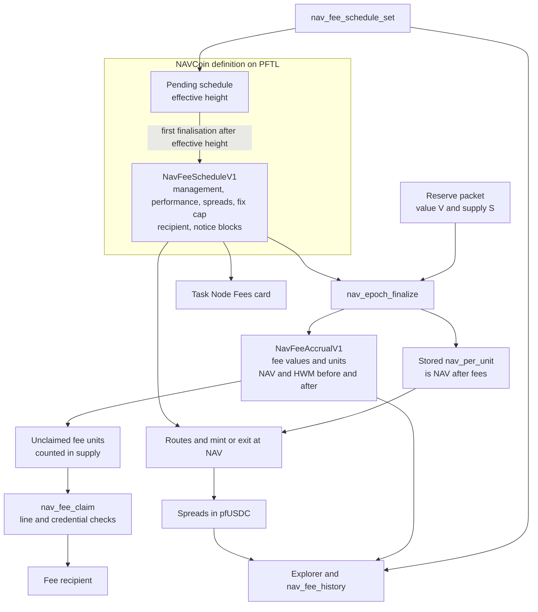

# Pillar 7 — Transparent Fees for NAVCoins

> **Status:** Partial. Primary-market spreads are built: per-route cash-in and cash-out multipliers (`issue_multiplier_bps`, `redeem_multiplier_bps`), capped at 500 bps, paid in the settlement asset to `spread_recipient` or to route "non-NAV fee custody". Task Node shows them and lets the issuer change the cash-in spread, which applies at once through a route epoch advance. There is no management fee, performance fee, high-water mark or fee accrual. Fee transactions are not shown on the explorer. NAVCoin creation is operator-only as a release rule; consensus only checks that the signer issued the asset.
>
> **Bubbles up to:** [Outcome C · NAVCoins anyone can build](../README.md#three-outcomes). A creator can't build a real product on a NAVCoin without stating what it charges.

## In one paragraph

A NAVCoin is an asset that trades to a proven net asset value. Its reserves are proven on PFTL each epoch, and it can be swapped against pfUSDC and a Uniswap pool. For anyone to build one, the creator must be able to say **what they charge**, and holders must be able to **check it deterministically**. Today the only fees are primary-market spreads. This pillar adds a **fee schedule** to the NAVCoin definition: a management fee in bps a year, a performance fee in bps of gains above a per-unit high-water mark, the issue and cash-in spreads, and a cap on fix fees. Fees accrue inside epoch finalisation, in integer atoms, from the proven reserve value and block heights, and are paid by minting NAVCoin units. Every number is on chain, in Task Node, and on the explorer next to the transaction that set it.

## User story

**Founder's story.** Right now, if I create a NAVCoin, I cannot set a deterministic performance or management fee. There is no way to handle this at the moment. There is no way to display a fee if there is one or to set the type of fee, and that transaction cannot be represented in any way on the block explorer.

**Augmented story.**

1. **Create with fees.** In the NAVCoin creator (SDK or Task Node issuer view), I set:
    - Management fee: 100 bps a year
    - Performance fee: 1,000 bps of gains above the high-water mark
    - Issue spread: 50 bps; cash-in spread: 5 bps; fix fee cap: 0 bps
    - Fee recipient: my fee account (separate from the issuer account, as `spread_recipient` is today)

    The chain rejects any rate above the protocol caps, and the registration transaction appears on the explorer.

2. **Disclose.** The profile page's **Fees** card shows each fee type, rate, basis and recipient, the last change, any pending change with its effective height, and how much of the reserve value is proven versus attested.
3. **Accrue.** At each epoch finalisation the chain computes the management fee from reserve value and blocks elapsed, then the performance fee from the per-unit gain above the high-water mark, mints the matching units into an unclaimed fee balance, and writes a `NavFeeAccrualV1` record ([Fee math](#fee-math-and-economics)).
4. **Verify.** The explorer shows, per epoch, NAV before fees, each fee in value and units, NAV after fees and the high-water mark before and after. Any holder can recompute every number with the SDK.
5. **Change safely.** Any change that could make holders pay more waits a notice period in blocks, so holders can exit first. A change that only lowers fees applies from the next finalisation.

## What exists today

| Component | Where | State |
|---|---|---|
| NAVCoin ops | [`crates/types/src/transactions_mempool_receipts.rs`](https://github.com/postfiatorg/postfiatl1v2/blob/main/crates/types/src/transactions_mempool_receipts.rs) (`NavAssetRegisterOperation`, `NavReserveSubmitOperation`, `NavEpochFinalizeOperation`, `NavMintAtNavOperation`, `NavRedeemAtNavOperation`), executed in [`crates/execution/src/nft_escrow_asset_execution.rs`](https://github.com/postfiatorg/postfiatl1v2/blob/main/crates/execution/src/nft_escrow_asset_execution.rs) | Built. The issuer signs finalisation. Epoch numbers need only increase. |
| NAV state | [`crates/types/src/account_owned_asset_types.rs`](https://github.com/postfiatorg/postfiatl1v2/blob/main/crates/types/src/account_owned_asset_types.rs) (`NavTrackedAsset`, `NavReservePacket` with `verified_net_assets` and its proven/attested/controlled split, `NavProofProfile` with the `max_epoch_gap_blocks` deadman) | Built. **No fee fields.** |
| NAV arithmetic | [`crates/types/src/market_nav_asset_types.rs`](https://github.com/postfiatorg/postfiatl1v2/blob/main/crates/types/src/market_nav_asset_types.rs) (`validate_nav_reserve_collateralization_with_unit_scale`, `nav_per_unit_floor_with_unit_scale`) | `nav_per_unit` = valuation atoms per 10^precision NAVCoin atoms. Only the provider-neutral SP1 profile requires NAV to equal the floor of reserves over supply; other profiles let a submitter state NAV below reserves. |
| Spread policy | same file (`PftlUniswapPrimaryMarketPolicyV2`: `spread_recipient`, `issue_multiplier_bps`, `redeem_multiplier_bps`, `policy_hash`; `PFTL_UNISWAP_MAX_PRIMARY_SPREAD_BPS = 500`) | Built. A666 uses 10050/9995. The multipliers are inside `policy_hash`, which Ethereum mint packets commit to. |
| Spread execution | [`crates/execution/src/nav_vault_asset_execution.rs`](https://github.com/postfiatorg/postfiatl1v2/blob/main/crates/execution/src/nav_vault_asset_execution.rs) | Built. Issue rounds up, cash-in rounds down. The spread goes to `spread_recipient`, or to the route's `non_nav_spread_atoms`. Routes price from the stored `nav_per_unit` of the pinned packet. |
| Accounting | [`docs/navcoins/primary-market-accounting.md`](https://github.com/postfiatorg/postfiatl1v2/blob/main/docs/navcoins/primary-market-accounting.md) | Spreads sit in "non-NAV fee custody", outside holder value. |
| Fix packet fee | [`crates/types/src/fx_fix_types.rs`](https://github.com/postfiatorg/postfiatl1v2/blob/main/crates/types/src/fx_fix_types.rs) (`FxFixPacketV1.fee_bps`, only checked ≤ 10,000) | Built. Zero fee in the pfUSDC→pNOK demo spec. |
| Fee display and change | Task Node [`profile/index.jsx`](https://github.com/postfiatorg/tasknode/blob/main/src/features/wallet/l1/profile/index.jsx) (Swap fees card, incl. Uniswap LP and protocol fees) · [`issuer/index.jsx`](https://github.com/postfiatorg/tasknode/blob/main/src/features/wallet/l1/issuer/index.jsx) · [`server/l1/navcoin-routes.js`](https://github.com/postfiatorg/tasknode/blob/main/server/l1/navcoin-routes.js) (`/api/l1/navcoin/fee`, 0–500 bps, serves operator-prepared route epoch advances) | Spreads only. Changes apply immediately. |
| Create flow | [`docs/navcoins/navcoin-create-and-swap-spec.md`](https://github.com/postfiatorg/postfiatl1v2/blob/main/docs/navcoins/navcoin-create-and-swap-spec.md) | "Only the operator creates NAVCoins in the first release." |
| Python builders | [`python/postfiat_rpc/navcoin.py`](https://github.com/postfiatorg/postfiatl1v2/blob/main/python/postfiat_rpc/navcoin.py) | Profile, packet and settle builders and `calculate_nav`: the seed of an SDK |

Two more facts shape the design. `BlockHeader` ([`core_chain.rs`](https://github.com/postfiatorg/postfiatl1v2/blob/main/crates/types/src/core_chain.rs)) has no timestamp and observation windows are heights, so height is the only clock. Crediting an issued asset to its issuer, or to a frozen line, fails ([`issued_asset_ledger_helpers.rs`](https://github.com/postfiatorg/postfiatl1v2/blob/main/crates/execution/src/issued_asset_ledger_helpers.rs)), so a fee mint inside finalisation must not credit the recipient directly.

## The NAVCoin primitive these fees attach to

Every NAVCoin is built from the same five parts, per the founder's spec. The schedule sits on the NAVCoin definition and states the fee at each part.

| Element | What it is | Exists today | Fee |
|---|---|---|---|
| Uniswap asset | An ERC-20 wrapper (for example wB24) in a Uniswap pool, with a NAV guard hook | `PFTLUniswapPrimaryMarketV2.sol`, `NAVGuardHook.sol`, [`crates/pftl_uniswap_proofs`](https://github.com/postfiatorg/postfiatl1v2/tree/main/crates/pftl_uniswap_proofs). The B24 pool is live with real money. | Uniswap LP and protocol fee, displayed |
| On-chain PFTL asset | The NAV-tracked issued asset on PFTL that can be swapped into | `NavTrackedAsset`, the offer book and atomic swaps. No AMM on PFTL. | Management and performance |
| USDC → pfUSDC | Bridge USDC from Solana or Ethereum into pfUSDC | `VaultBridge*` ops, [`crates/pfusdc_proofs`](https://github.com/postfiatorg/postfiatl1v2/tree/main/crates/pfusdc_proofs), `solana/pfusdc-*`. Live; Solana opens in the daily proving window. | Outside the schedule |
| Uniswap asset → actual asset | Move the wrapper back to PFTL, then exit to reserves at NAV | `PftlUniswapExportDebit`, `PftlUniswapReturnImport`, `PftlUniswapPrimaryRedeem` | Issue and cash-in spreads |
| The fix | A pfUSDC liquidity pool ready at a set time, like the London FX fix | `FxFixPacketV1` (ratio, band, fee, heights, capacity); fills settle as private swaps in the shielded pool. No scheduled settlement yet. | Fix fee, capped |

**Near term:** NAVCoin swaps, probably by tracking a Hyperliquid NAVCoin on Solana. `HyperCoreReserveReader.sol` reads Hyperliquid state, but HIP-3 positions are attested, not proven, and nothing yet ties a Hyperliquid NAVCoin to Solana. Its reserve value would be mostly `attested_value`, so its performance fee is open question 4.

**SDK:** `python/postfiat_rpc/navcoin.py` and [`crates/rpc_sdk`](https://github.com/postfiatorg/postfiatl1v2/tree/main/crates/rpc_sdk) become a **NAVCoin SDK** plus a "Create a NAVCoin" guide on postfiatorg.github.io (R17–R19). Fees are a required part of its create call.

## Architecture

## Fee math and economics

### Notation

All quantities are unsigned integers from chain state; intermediates are checked `u128`.

| Symbol | Meaning | Source |
|---|---|---|
| `V` | Reserve value for holders, valuation atoms | `verified_net_assets` of the packet being finalised |
| `S` | Supply, NAVCoin atoms | that packet's `circulating_supply` |
| `U` | `10^precision` | asset definition |
| `N` | NAV per unit: valuation atoms per `U` atoms | `nav_per_unit` |
| `H` | High-water mark per unit, same unit as `N` | new fee state |
| `m`, `p` | Management bps a year, performance bps | active schedule |
| `Δh` | `min(h − h_last, accrual_cap_blocks)` | finalisation height, stored `last_accrual_height` |
| `Y` | Blocks per year | protocol constant (open question 3) |

**Why heights.** Blocks carry no timestamp, and epochs are issuer-chosen counters: a per-epoch charge would pay an issuer for finalising more often. Heights cannot be sped up. Notice periods use heights too.

### Every finalisation

Management comes first, so no performance fee is charged on the management fee.

1. `F_m = floor(V × m × Δh / (10_000 × Y))`.
2. `N_m = floor((V − F_m) × U / S)`.
3. Option A performance: `g = max(0, N_m − H)`, `F_p = floor(g × S × p / (10_000 × U))`.
4. One mint for both: `F = F_m + F_p`, `ΔS = floor(F × S / (V − F))`, split as `ΔS_m = floor(F_m × S / (V − F))` and `ΔS_p = ΔS − ΔS_m`. Minting `F / N` would underpay, because the mint dilutes the price it is valued at.
5. `S' = S + ΔS`, `N_after = floor(V × U / S')`, `H' = max(H, N_after)`. `N_after` becomes the stored `nav_per_unit`.

Every step rounds down, so the recipient never gets more than `F` and dust stays with holders. `H` starts at `N` on the first finalisation with `S > 0` after a schedule with `p > 0` activates (for live assets, the first after migration). These cases never fail a finalisation; they give a zero or clamped fee and a reason code:

- `S = 0` or `V = 0`: no fee, and `last_accrual_height` advances with no catch-up.
- `F ≥ V`, or an overflow: no fee.
- A mint past `max_supply`: clamped, and the clipped value recorded.

### Entering and exiting between finalisations

Every dealing operation names the finalised epoch and packet. Once a newer epoch finalises, mint and exit at NAV fail with `nav_epoch_mismatch`, and route operations fail with `pftl_uniswap_pricing_binding_mismatch` until the route re-pins. So all later dealing is at `N_after`, and no fee lands on a price someone already traded at.

- **Management.** Charged at finalisation on `V` for the whole interval. Entering just before or exiting just before shifts at most `m × Δh / Y` of a holder's value; `accrual_cap_blocks` and the deadman bound it after gaps.
- **Performance.** The method is an economic choice for the founder (open question 1).

| | **Option A: every epoch** (math above) | **Option B: provisional, crystallised at an interval** |
|---|---|---|
| Dealing price | Always after every charged gain | Net of an accrued liability |
| Exit before a charge | Nothing to avoid: the exit price is already net | The holder's share of the liability is charged at exit |
| Late entrant | Never charged for earlier gains. Entering below `H`, recovers to `H` free. | Never charged for earlier gains; does not dilute others |
| Rise-then-fall path | Costs holders more: the peak is charged | Costs less: losses net off before crystallisation |
| Code touched | Finalisation only | Finalisation and every supply path (R13) |

Option B state: benchmark value `B`, provisional liability `P`, and `K`, value charged at exits but not yet minted. `S` is supply before the event.

| Event | Rule |
|---|---|
| Finalisation | Mint `floor(F_m × S / (V − K − F_m))` units for `F_m` on `V − K`; `B += F_m`; `P = floor(max(0, V − K − B) × p / 10_000)`; stored `N = floor((V − K − P) × U / S')` |
| Entry | `B +=` the entry's base value, as the chain already computes it |
| Exit of `y` atoms | `c = floor(P × y / S)`; `P −= c`; `K += c`; `B −= floor(B × y / S)` |
| Crystallisation (first finalisation at or after the interval) | `F_p = P + K`, minted as `floor(F_p × S / (V − F_p))` units; if there was a gain, `B = V − F_p`; `P = K = 0`. Displayed mark = `B × U / S` |

A separate mark per holder (series or equalisation accounting) is ruled out: it needs per-holder state, which breaks the fungibility of units moving through the Ethereum wrapper, Uniswap and the shielded pool.

### Worked example (Option A)

`U = 10^6`, `V = 1,100,000.000000`, `S = 1,000,000.000000`, `H = 1.000000`, `m = 100`, `p = 1,000`. For illustration only, `Y = 1,000,000` and `Δh = 10,000`, a hundredth of a year.

| `F_m` | `N_m` | `g` | `F_p` | `ΔS` (mgmt + perf) | `N_after` = `H'` |
|---|---|---|---|---|---|
| 110.000000 | 1.099890 | 0.099890 | 9,989.000000 | 9,265.979203 (100.926597 + 9,165.052606) | 1.089901 |

Check: the fee units are worth 10,098.999999 at `N_after` (`F` = 10,099.000000), and holders keep 1,089,901.000000.

### Why fees are paid in units

The chain cannot move reserves held off PFTL (Hyperliquid positions, custodied stock). Cutting NAV without minting would leave proven reserves unchanged, and the next packet would restore NAV. Minting is atomic, and the recipient exits or sells units for cash. Spreads stay a separate channel, paid in the settlement asset when holders deal, outside holder value.

## Technical requirements

### Schedule

- **R1.** Add `NavFeeScheduleV1` to the NAVCoin's NAV state, hashed like `policy_hash`. Fields:
    - `management_bps_per_year`, `performance_bps`, `performance_method`, and `crystallisation_interval_blocks` (Option B only)
    - `issue_spread_bps`, `redeem_spread_bps`, `fix_fee_cap_bps`
    - `recipient`, which must not be the issuer account
    - `increase_notice_blocks`, `accrual_cap_blocks`
    - optional `disclosure_ref`, a [Pillar 2](02-message-protocol.md) `pf.navcoin.fee.*` message hash
    - hurdle or protocol-share fields, only if adopted (open question 8)
- **R2.** Protocol caps on every rate, and a protocol minimum notice, enforced when a schedule is attached or set. The 500 bps spread cap exists. The other values are open question 2.
- **R3.** Only the NAV asset's issuer may attach or change the schedule, with the same signer check as `nav_epoch_finalize` and `nav_halt`. Re-running `nav_asset_register`, which today overwrites an existing asset's operator, profile and `redemption_account` at once, must not touch the schedule.
- **R4.** `nav_fee_schedule_set` and `nav_fee_schedule_cancel`. These are the rules:
    - A change is an **increase** if it could raise what holders pay: a rate or cap up, a longer `accrual_cap_blocks`, a shorter interval, a method change, or a shorter notice.
    - If any field is an increase, the whole new schedule is pending until `h_set + max(current notice, protocol minimum)`. It activates at the first finalisation after that height. Otherwise it applies from the next finalisation.
    - There is one pending slot. A new `set` replaces it and restarts the clock.
    - An interval in which a rate changes is charged at the lower of the two rates.
- **R5.** Spreads move into the schedule, under the same rules:
    - `pftl_uniswap_route_init_v2` and route epoch advance must carry `issue_multiplier_bps = 10_000 + issue_spread_bps` and `redeem_multiplier_bps = 10_000 − redeem_spread_bps`, so the spread shown is the spread charged.
    - `nav_fee_schedule_attach` migrates live assets from their current policy (A666: 50/5), keeping the multipliers and `policy_hash` unchanged, so no Ethereum packet format changes.
    - Task Node's cash-in fee control moves to `nav_fee_schedule_set`.
- **R6.** An `FxFixPacketV1` whose base or quote asset has a schedule needs `fee_bps ≤ fix_fee_cap_bps`. The fix settles as a private swap inside the shielded pool. The swap proof exposes the ratio and fee but not the values. The NAVCoin's history therefore lists each fix packet's public `fee_bps`, not fee amounts per fill.

### Accrual

- **R7.** Accrual runs atomically inside `nav_epoch_finalize`, exactly per the [Fee math](#fee-math-and-economics) for the chosen method.
- **R8.** For NAVCoins with a schedule, consensus derives `N = floor(V × U / S)` for every proof profile and rejects a packet whose `nav_per_unit` differs. Otherwise, stating NAV below reserves would be a hidden fee.
- **R9.** Fee accrual never fails a finalisation. Fee units go to an on-chain unclaimed balance. `nav_fee_claim` moves them to the recipient with the normal line, freeze and [Pillar 8](08-onchain-identity.md) credential checks. On a credential-gated NAVCoin the recipient needs an authorised line that meets the asset's credential policy. Attach and set reject a recipient that fails it at that height. If the recipient later loses it, claims fail and the units stay unclaimed: they still count as supply and share NAV, but cannot move or exit until the line is authorised again. Fee claims are ordinary PFTL transactions, not FastPay transfers, which carry PFT only.
- **R10.** `ΔS` is added to issued supply and to `NavTrackedAsset.circulating_supply`, so fee units do not use up mint headroom. Unclaimed units count as supply. A later packet whose `circulating_supply` is below the chain's valid supply, fee units included, is rejected.
- **R11.** The stored `nav_per_unit` is `N_after`. Every route and every mint and exit at NAV already reads it, so no pre-fee NAV is ever priced. Fee units move to Ethereum like any other units, through `PftlUniswapExportDebit`.
- **R12.** A `NavFeeAccrualV1` record goes into the finalisation receipt and the state commitment. Its fields are named by unit: `schedule_hash`, `accrual_blocks`, `verified_net_assets`, `supply_before_atoms`, `nav_before_per_unit`, `mgmt_fee_value_atoms`, `perf_fee_value_atoms`, `mgmt_fee_units`, `perf_fee_units`, `supply_after_atoms`, `nav_after_per_unit`, `hwm_before_per_unit`, `hwm_after_per_unit`, `recipient` and `reason_codes`. Under Option B it also has `B`, `P` and `K`.
- **R13.** (Option B only.) `B` and `K` are updated by every path that changes supply:
    - `NavMintAtNav` and `NavRedeemAtNav`
    - PFTL-Uniswap primary issue and exit
    - the private primary routes, which already expose amounts to consensus
    - vault-bridge mints

### Display and explorer

- **R14.** Task Node's Fees card shows:
    - every schedule field;
    - the active and pending schedules, with the effective height;
    - the last accrual and the recipient;
    - the proven, attested and controlled shares of `V`;
    - the Uniswap fees it already reads.
- **R15.** The explorer shows three things:
    - schedule transactions (attach, set, cancel), with old → new values and the effective height;
    - per-transaction spreads, and the fee rate on each fix packet;
    - per-epoch `NavFeeAccrualV1`.

    The RPC methods `nav_fee_schedule(asset_id)` and `nav_fee_history(asset_id)` return the same data.

- **R16.** `primary-market-accounting.md` covers both channels: spreads in the settlement asset, and ongoing fees in minted units.

### SDK and guide

- **R17.** A NAVCoin SDK package built from `navcoin.py` and `crates/rpc_sdk`. Its `create_navcoin(...)` requires a fee schedule (all zeros allowed) and takes an optional Pillar 8 credential policy.
- **R18.** A Python reference implementation of the fee math, with test vectors shared with the Rust tests. The SDK's `recompute_fees(asset_id, epoch)` must match every record.
- **R19.** A "Create a NAVCoin" guide on postfiatorg.github.io, publishing the formulas and the worked example.

## Dependencies

| Depends on | Why |
|---|---|
| NAV epochs and reserve proofs (live for B24) | Accrual uses the finalised packet. |
| [Pillar 8 — On-chain identity](08-onchain-identity.md) | Claim-time credential checks; KYC-gated fee NAVCoins. |
| [Pillar 2 — Message protocol](02-message-protocol.md) | Optional: `pf.navcoin.fee.*` documents for `disclosure_ref`. Fees ship without it. |
| [Pillar 3 — Validator program](03-validator-program.md) | Only if a validator share of fees is adopted. |
| Opening NAVCoin creation beyond the operator | Fees matter most to third-party creators. |
| Explorer for the new chain | Renders R15 from the R12 record and schedule transactions. |

## Acceptance criteria

1. The Python reference and Rust agree to the atom on the worked example and at least 100 generated cases, edge cases included.
2. On devnet (`m = 100`, `p = 1,000`), a NAV path that rises, falls below `H` and recovers charges no performance fee until NAV is back above `H`. Two independent recomputations match every record.
3. An exit just before a finalisation avoids no fee on gains it received, and a late entrant pays no fee on earlier gains.
4. With `S = 0`, at `max_supply`, with a frozen or de-authorised recipient line on a gated NAVCoin, and with overflow inputs, finalisation succeeds with the documented reason codes. A blocked claim succeeds once the line is authorised again.
5. Increases, notice reductions, shorter intervals and mixed changes wait the notice period. A pure decrease applies at the next finalisation. Replacing a pending schedule restarts the clock.
6. Finalising more often does not raise total management fees over the same blocks, beyond rounding.
7. Rates above caps are rejected at attach and at set. A fix packet above `fix_fee_cap_bps` is rejected.
8. After migration, A666's multipliers and `policy_hash` are unchanged, and an exit after an accrual pays at `N_after`.
9. A packet that omits fee units from supply, or states NAV below `floor(V × U / S)`, is rejected.
10. The Fees card and the explorer show the schedule transaction, the spreads, the fix fee rates and each accrual. SDK `create_navcoin` reproduces the worked example on devnet.

## Open questions for the founder

1. **Performance method.** Option A or Option B? A is simple and touches only finalisation, but costs holders more on paths that rise and fall back. B is fairer on those paths but touches every supply path.
2. **Caps.** What maxima for the management, performance and fix fees? Keep 500 bps for spreads? What minimum notice, in blocks? Should notice be protocol-wide, or a minimum that creators may lengthen?
3. **Clock.** A protocol `blocks_per_year` is simple but drifts if block time changes. A consensus timestamp in block headers is accurate but changes consensus. Which? What `accrual_cap_blocks`? Should management fees accrue while the deadman has stopped dealing?
4. **Attested reserves**, as on the Hyperliquid NAVCoin. Options:
    - charge on all of `V` and disclose the split;
    - charge the performance fee on the proven value only;
    - charge no performance fee without an attestor quorum that excludes the issuer.
5. **Manipulated peaks.** The issuer finalises and may run the reserves. Should the performance fee use the lower of this epoch's and the last epoch's NAV, need a non-issuer attestation, or be capped per charge?
6. **Exit during notice.** While an increase is pending, should routes be barred from cutting cash-in capacity? On a gated NAVCoin, a holder who has lost authorisation cannot exit at NAV at all ([Pillar 8](08-onchain-identity.md)). Should a pending increase let that holder exit, or should the notice period not protect them?
7. **Recipient change.** Should it apply immediately as a shown event, or after notice?
8. **More fee types.** Should there be a hurdle rate in v1? A protocol or validator share?
9. **Clipped fees.** At `max_supply`, is the remainder forgone or carried forward?
10. **Locked schedules.** Should creators be able to lock fees, or set ceilings that can never rise?
11. **Regulation.** Must NAVCoins that charge a performance fee be credential-gated, or carry a `disclosure_ref` document?
12. **Opening creation.** When does creation open beyond the operator, and does this pillar ship first?
13. **Ownership.** No pillar owns the Hyperliquid NAVCoin on Solana or the scheduled fix settlement. Should this pillar grow to cover them, or should a separate NAVCoin-primitive pillar?

## Code references

- postfiatl1v2: the files linked above, plus [`nav_reserve_public_values.rs`](https://github.com/postfiatorg/postfiatl1v2/blob/main/crates/types/src/nav_reserve_public_values.rs) (observation heights) · [`crates/nav_reserve_protocol`](https://github.com/postfiatorg/postfiatl1v2/tree/main/crates/nav_reserve_protocol) · [`tools/nav-reserve-proof`](https://github.com/postfiatorg/postfiatl1v2/tree/main/tools/nav-reserve-proof) · [`crates/ethereum-contracts/src/`](https://github.com/postfiatorg/postfiatl1v2/tree/main/crates/ethereum-contracts/src) (`NAVGuardHook.sol`, `PFTLUniswapPrimaryMarketV2.sol`, `HyperCoreReserveReader.sol`) · [pNOK fix demo spec](https://github.com/postfiatorg/postfiatl1v2/blob/main/docs/deferred-plans/PNOK-TIER4-PRIVATE-FIX-SWAP-DEMO-SPEC-20260801.md) · [`docs/navcoins/`](https://github.com/postfiatorg/postfiatl1v2/tree/main/docs/navcoins)
- Blog: [canonical NAVCoin transaction](https://github.com/postfiatorg/postfiatorg.github.io/blob/main/content/blog/canonical-navcoin-transaction.md) · [NAVCoin counterparty risk](https://github.com/postfiatorg/postfiatorg.github.io/blob/main/content/blog/navcoin-counterparty-risk.md)

---

*Revision history: [changelog](../changelog/07-navcoin-fees.md).*
