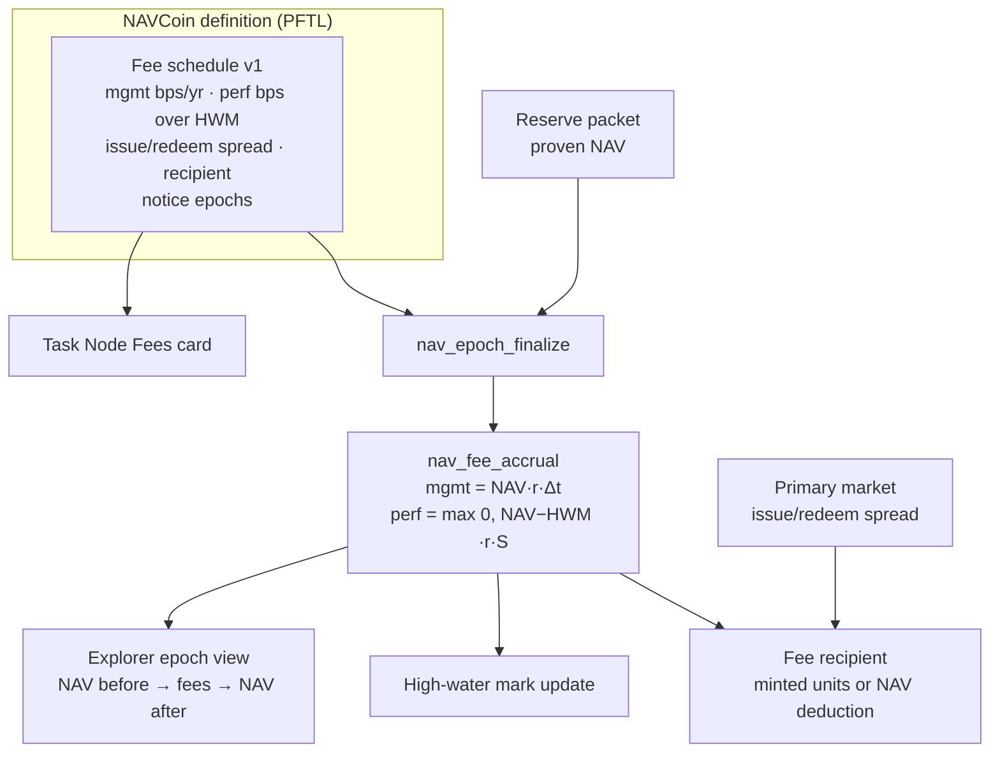

# Pillar 7 — Transparent Fees for NAVCoins

> **Status:** Partial. Primary-market spreads (issue and redeem multipliers, capped at 500 bps, paid to `spread_recipient`) are built, shown in Task Node and adjustable by the issuer. There is no management fee, performance fee, high-water mark or fee accrual. Fee transactions are not visible on the explorer, and only the operator can create NAVCoins today.
>
> **Bubbles up to:** *NAVCoins as a primitive anyone can build*. A creator can't build a real product on a NAVCoin without stating what it charges.

## In one paragraph

A NAVCoin is an asset that trades to a proven net asset value. Its reserves are proven on PFTL each epoch, and it can be swapped against pfUSDC and a Uniswap pool. For anyone to build one, the creator must be able to say **what they charge**, and holders must be able to **check it deterministically**. Today the only fees are spreads on the primary market. This pillar adds a **fee schedule** to the NAVCoin definition: management fee (bps a year, accrued per epoch), performance fee (bps above a high-water mark) and the existing issue and redeem spreads. It also adds a **fee accrual transaction** computed from the proven NAV. Every number is on chain, is shown in Task Node, and appears on the explorer as its own line item.

## User story

**Founder's story.** Right now, if I create a NAVCoin, I cannot set a deterministic performance or management fee. There is no way to handle this at the moment. There is no way to display a fee if there is one or to set the type of fee, and that transaction cannot be represented in any way on the block explorer.

**Augmented story.**

1. **Create with fees.** In the NAVCoin creator (SDK or Task Node issuer view), I set:
    - Management fee: 100 bps a year
    - Performance fee: 1,000 bps over the high-water mark, crystallised quarterly
    - Issue spread: 50 bps
    - Redeem spread: 5 bps
    - Fee recipient: my account

    The chain rejects any fee above protocol caps.

2. **Disclose.** The NAVCoin's profile page shows a **Fees** card: each fee type, rate, basis, recipient and the epoch when it last changed. A link opens the on-chain fee schedule.
3. **Accrue.** At each NAV epoch finalisation, the chain computes `management_accrual = NAV × rate × Δt` deterministically from the proven NAV. On crystallisation dates it computes `performance_accrual = max(0, NAV − HWM) × rate × supply`. It then mints fee units to the recipient, or deducts them from NAV per share. A `nav_fee_accrual` record is written.
4. **Verify.** On the explorer, the epoch shows NAV before fees, each accrual, NAV after fees and the new high-water mark. Any holder can recompute every number from on-chain data.
5. **Change safely.** Raising a fee needs notice: the new schedule takes effect only after N epochs, so holders can redeem first. Lowering a fee takes effect immediately.

## What exists today

| Component | Where | State |
|---|---|---|
| NAVCoin ops: register, reserve submit, epoch finalise, mint and redeem at NAV | [`crates/types/src/transactions_mempool_receipts.rs`](https://github.com/postfiatorg/postfiatl1v2/blob/main/crates/types/src/transactions_mempool_receipts.rs) (`NavAssetRegisterOperation`, `NavEpochFinalizeOperation`, `NavMintAtNavOperation`, `NavRedeemAtNavOperation`) | Built |
| NAV state | [`crates/types/src/account_owned_asset_types.rs`](https://github.com/postfiatorg/postfiatl1v2/blob/main/crates/types/src/account_owned_asset_types.rs) (`NavTrackedAsset`, `NavReservePacket`, `NavAttestor`) | Built. **No fee fields.** |
| Primary-market spread policy | [`crates/types/src/market_nav_asset_types.rs`](https://github.com/postfiatorg/postfiatl1v2/blob/main/crates/types/src/market_nav_asset_types.rs) (`PftlUniswapPrimaryMarketPolicyV2`: `spread_recipient`, `issue_multiplier_bps`, `redeem_multiplier_bps`; cap `PFTL_UNISWAP_MAX_PRIMARY_SPREAD_BPS = 500`) | Built. A666 uses 10050/9995. |
| Spread execution | [`crates/execution/src/nav_vault_asset_execution.rs`](https://github.com/postfiatorg/postfiatl1v2/blob/main/crates/execution/src/nav_vault_asset_execution.rs) | Built. Pays the spread to `spread_recipient`. |
| Accounting | [`docs/navcoins/primary-market-accounting.md`](https://github.com/postfiatorg/postfiatl1v2/blob/main/docs/navcoins/primary-market-accounting.md) | Issue and redeem fees go to "non-NAV fee custody". |
| Fix packet fee | [`crates/types/src/fx_fix_types.rs`](https://github.com/postfiatorg/postfiatl1v2/blob/main/crates/types/src/fx_fix_types.rs) (`FxFixPacketV1.fee_bps`) | Built. Demonstrated at zero fee on pfUSDC→pNOK. |
| Fee display and issuer change | Task Node [`src/features/wallet/l1/profile/index.jsx`](https://github.com/postfiatorg/tasknode/blob/main/src/features/wallet/l1/profile/index.jsx) (Swap fees card) · [`src/features/wallet/l1/issuer/`](https://github.com/postfiatorg/tasknode/tree/main/src/features/wallet/l1/issuer) (change cash-in fee) · [`server/l1/navcoin-routes.js`](https://github.com/postfiatorg/tasknode/blob/main/server/l1/navcoin-routes.js) (`/api/l1/navcoin/fee`, 0–500 bps) | Live for spreads only |
| NAVCoin create flow | [`docs/navcoins/navcoin-create-and-swap-spec.md`](https://github.com/postfiatorg/postfiatl1v2/blob/main/docs/navcoins/navcoin-create-and-swap-spec.md) | Spec. "Only the operator creates NAVCoins in the first release." |
| Python builders | [`python/postfiat_rpc/navcoin.py`](https://github.com/postfiatorg/postfiatl1v2/blob/main/python/postfiat_rpc/navcoin.py) | Packet and operation builders, the seed of an SDK |

## The NAVCoin primitive these fees attach to

Every NAVCoin is built from the same five parts, per the founder's spec. This pillar's fee schedule sits on the NAVCoin definition and applies across all of them.

| Element | What it is | Exists today |
|---|---|---|
| Uniswap asset | An ERC-20 wrapper (for example wB24) traded in a Uniswap pool, with a NAV guard hook | `PFTLUniswapPrimaryMarketV2.sol`, `NAVGuardHook.sol`, [`crates/pftl_uniswap_proofs`](https://github.com/postfiatorg/postfiatl1v2/tree/main/crates/pftl_uniswap_proofs). The B24 pool is live with real money. |
| On-chain PFTL asset | The NAV-tracked issued asset on PFTL that can be swapped into | `NavTrackedAsset`, the offer book and atomic swaps. There is no AMM on PFTL. |
| USDC → pfUSDC | Bridge USDC from Solana or Ethereum into pfUSDC on PFTL | `VaultBridge*` ops, [`crates/pfusdc_proofs`](https://github.com/postfiatorg/postfiatl1v2/tree/main/crates/pfusdc_proofs), `solana/pfusdc-*`. Live; the Solana side opens in the daily proving window. |
| Uniswap asset → actual asset | Redeem the wrapper back to the PFTL asset, and then to reserves at NAV | Route ops `ExportDebit` / `ReturnImport`, `PrimaryRedeem` |
| The fix | A pfUSDC liquidity pool that is ready to go at a set time, like the London FX fix | `FxFixPacketV1` (ratio, band, fee, valid-from and expiry heights, capacity). No scheduled auction or settlement yet. |

**Near term:** NAVCoin swaps, probably by tracking a Hyperliquid NAVCoin on Solana. `HyperCoreReserveReader.sol` reads Hyperliquid state, but HIP-3 positions are attested, not proven, and nothing yet ties a Hyperliquid NAVCoin to Solana.

**SDK:** `python/postfiat_rpc/navcoin.py` and [`crates/rpc_sdk`](https://github.com/postfiatorg/postfiatl1v2/tree/main/crates/rpc_sdk) are the starting point. A **NAVCoin SDK** package plus a "Create a NAVCoin" guide on postfiatorg.github.io turn the operator-only flow into one anyone can use. Fees are a required part of that SDK's create call.

## Architecture

## Technical requirements

### Schedule

- **R1.** Add `NavFeeScheduleV1` to the NAVCoin definition with these fields:
    - `management_bps_per_year`
    - `performance_bps`
    - `performance_basis` (`high_water_mark`)
    - `crystallisation` (each epoch, monthly or quarterly, expressed in epochs)
    - `issue_spread_bps`, `redeem_spread_bps` (these unify today's route multipliers)
    - `recipient`
    - `increase_notice_epochs`
- **R2.** Protocol caps, enforced at registration and change. The 500 bps spread cap already exists. Management and performance caps need values; see the open questions.
- **R3.** A `nav_fee_schedule_set` operation. An increase is pending until `increase_notice_epochs` have passed; a decrease applies immediately.

### Accrual

- **R4.** Accrual is computed inside `nav_epoch_finalize` from the **proven** NAV only, using integer math with documented rounding, so the result is identical on every validator.
- **R5.** A `NavFeeAccrual` record goes into the epoch receipt: `nav_before`, `mgmt_atoms`, `perf_atoms`, `nav_after`, `hwm_before`, `hwm_after` and `recipient`. The recipient is paid by minting NAVCoin units at `nav_after` (dilution). An alternative, deducting from reserves, is an open question.
- **R6.** Fee units minted to the recipient count toward supply in the next reserve check, so the mint cap and reserve invariants still hold.

### Display

- **R7.** Task Node's Fees card shows every schedule field, the last change and any pending increase with the epoch it takes effect.
- **R8.** The explorer epoch view lists accruals as their own line items, and the RPC method `nav_fee_history(asset_id)` returns them.
- **R9.** The SDK `create_navcoin(...)` call requires a fee schedule (it can be all zeros), and docs publish the formulas with a worked example.

## Dependencies

| Depends on | Why |
|---|---|
| NAV epochs and reserve proofs (live for B24) | Accrual is computed from the proven NAV. |
| [Pillar 2 — Message protocol](02-message-protocol.md) | `pf.navcoin.fee.*` messages for off-chain disclosure documents. |
| [Pillar 8 — On-chain identity](08-onchain-identity.md) | Some fee-charging NAVCoins will be KYC-gated. |
| Opening NAVCoin creation beyond the operator | Fees matter to third-party creators. |
| Explorer for the new chain | Rendering. |

## Acceptance criteria

1. A NAVCoin registered on the devnet with a 100 bps management fee and a 10% performance fee over the high-water mark accrues the expected atoms over three epochs. Two independent recomputations match the receipts exactly.
2. A fee increase takes effect only after the notice epochs; a decrease takes effect at once.
3. Task Node's Fees card and the explorer show the schedule and each accrual.
4. A fee above the protocol caps is rejected at registration.
5. Reserve and mint-cap invariants hold with fee units included.

## Open questions for the founder

- What should the protocol caps be for management and performance fees?
- Should performance fees be paid in minted units (dilution) or by deduction from reserves?
- Should the notice period for fee increases be protocol-wide or set per NAVCoin?
- When is NAVCoin creation opened beyond the operator, and does this pillar ship before or after that?

## Code references

- NAVCoin docs: [`docs/navcoins/`](https://github.com/postfiatorg/postfiatl1v2/tree/main/docs/navcoins) · [`navcoin-create-and-swap-spec.md`](https://github.com/postfiatorg/postfiatl1v2/blob/main/docs/navcoins/navcoin-create-and-swap-spec.md)
- Reserve protocol: [`crates/nav_reserve_protocol`](https://github.com/postfiatorg/postfiatl1v2/tree/main/crates/nav_reserve_protocol) · [`tools/nav-reserve-proof`](https://github.com/postfiatorg/postfiatl1v2/tree/main/tools/nav-reserve-proof)
- Contracts: [`crates/ethereum-contracts/src/`](https://github.com/postfiatorg/postfiatl1v2/tree/main/crates/ethereum-contracts/src)
- Blog: [canonical NAVCoin transaction](https://github.com/postfiatorg/postfiatorg.github.io/blob/main/content/blog/canonical-navcoin-transaction.md) · [NAVCoin counterparty risk](https://github.com/postfiatorg/postfiatorg.github.io/blob/main/content/blog/navcoin-counterparty-risk.md)
