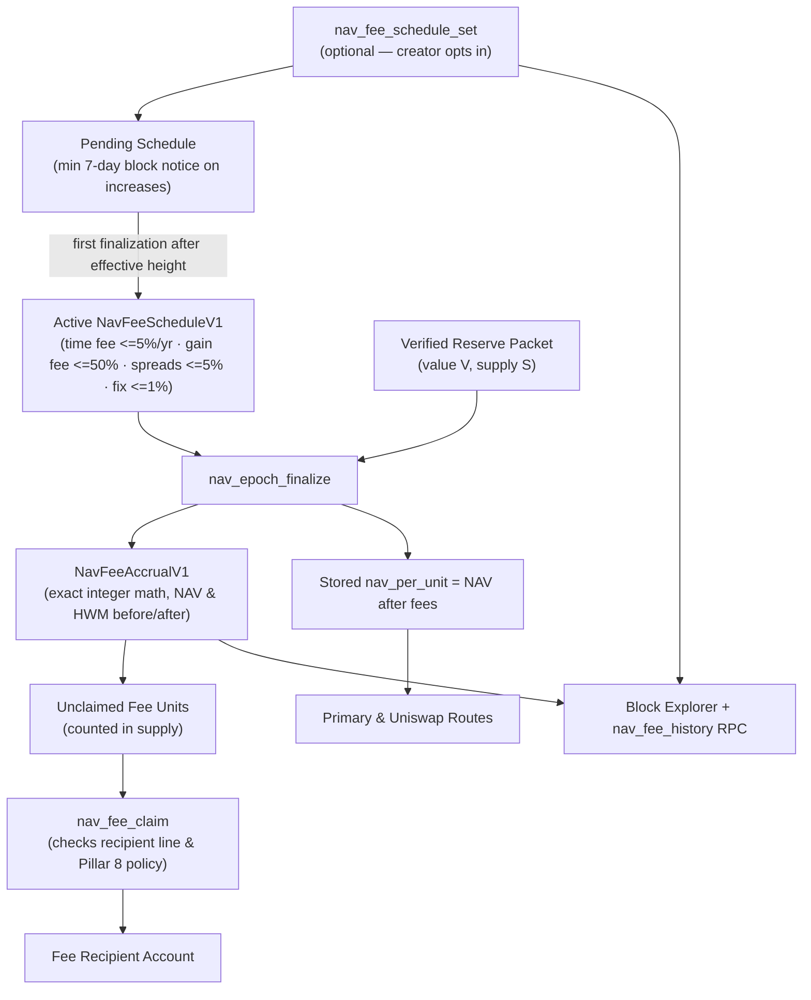

# Pillar 7 — Optional Deterministic Fees for NAVCoins

> **Status:** Partial. Primary-market spreads (`issue_multiplier_bps`, `redeem_multiplier_bps`, capped at 500 bps) already exist and are shown in Task Node. What is missing: optional on-chain time-based and high-water-mark fee schedules, deterministic fee accrual inside epoch finalization, strict `N = floor(V × U / S)` consensus enforcement (preventing hidden fees), block explorer fee-transaction rendering, and the standalone NAVCoin SDK + guide.
>
> **Outcome:** [C · NAVCoins as a primitive anyone can build](../README.md#three-outcomes) — giving third-party NAVCoin builders an optional, deterministic, auditable fee primitive without forcing fee complexity or investment-fund framing onto every NAVCoin.

## What this pillar is (in plain English)

A **NAVCoin** is an on-chain asset that tracks a verified reserve value (proven or attested each epoch) and can swap against `pfUSDC` and a Uniswap pool. Today, a NAVCoin can only charge primary-market buy/sell spreads.

This pillar adds an **entirely optional, deterministic on-chain fee module** plus a clean **NAVCoin SDK**:

1. **100% optional (not forced on every NAVCoin):** A NAVCoin creator does **not** have to attach a fee schedule at all. NAVCoins are neutral software/asset primitives, not securities or investment funds — so when a NAVCoin has no fee schedule (or zero rates), Task Node and the explorer do not clutter it with hedge-fund language.
2. **Neutral, deterministic fee mechanics when enabled:** Creators who opt in can configure any combination of:
   - **Time-based fee** (up to **5%/year**, i.e., `500 bps/yr`), computed strictly from block height elapsed;
   - **High-water-mark gain fee** (up to **50%**, i.e., `5,000 bps`) on per-unit net asset gains above the all-time high-water mark;
   - **Primary issue / redeem spreads** (capped at **5% / 500 bps**);
   - **FX fix fee cap** (capped at **1% / 100 bps**).
3. **Paid atomically in NAVCoin units:** Because `postfiatl1v2` cannot directly move off-chain brokerage or Hyperliquid reserves, accrued fees mint the exact matching number of NAVCoin units into an on-chain unclaimed balance at epoch finalization. The fee recipient claims those units in a normal transaction (subject to any [Pillar 8](08-onchain-identity.md) credential checks), and all subsequent pricing uses the post-fee `nav_per_unit`.
4. **No silent fee hikes & no hidden fees:** Any change that could raise what holders pay waits a **minimum 7-day notice period** (in blocks) during which routes cannot cut exit capacity; pure fee cuts apply on the next epoch. And for any NAVCoin with a fee schedule, consensus enforces `nav_per_unit == floor(V × U / S)` across every proof profile so nobody can hide an undisclosed fee by understating NAV.
5. **Explorer visibility & NAVCoin SDK:** Every fee schedule set/update/cancel transaction and every per-epoch fee accrual (`NavFeeAccrualV1`) renders cleanly on the block explorer and is independently recomputable via the Python/Rust NAVCoin SDK.

## How deterministic fee accrual works

## Locked-in design decisions

- **Optional fees & neutral framing:** Attaching a fee schedule is **strictly optional** (a NAVCoin with no schedule has zero fee logic and no fee UI clutter). Public UI, explorer labels, and docs use **neutral, factual protocol language** (e.g., *Fee schedule*, *Annual rate*, *High-water-mark rate*, *Spread*) rather than investment-fund / securities terminology, and display fee details only when non-zero fees are configured.
- **Protocol caps & notice:**
  - Annual time-based rate cap: **5% / year (`500 bps`)**
  - High-water-mark gain rate cap: **50% (`5,000 bps`)**
  - Issue / redeem spread cap: **5% (`500 bps`)** (already in code)
  - FX fix fee cap: **1% (`100 bps`)**
  - Fee-increase notice period: **minimum 7 days (in blocks)**; creators can configure a longer notice or permanently lock their schedule with a one-way `lock_schedule` flag. Fee decreases apply at the next finalization.
- **High-water-mark calculation timing:** **Option A — per finalized epoch** in v1. Whenever a finalized epoch's post-annual-fee NAV beats the all-time high-water mark, the gain fee accrues atomically inside `nav_epoch_finalize` without complicating every swap/bridge path.
- **Attested reserves & v1 scope:**
  - Reserves with attested components (such as Hyperliquid positions) accrue on verified total `V` **only when backed by a non-issuer attestor**, and Task Node + the explorer clearly show the proven vs attested split.
  - **No hurdle rate** and **no Post Fiat protocol/validator fee cut** in v1.
  - **Hyperliquid NAVCoin on Solana + Scheduled FX Fix** are tracked separately in the master [`README.md`](../README.md) with their own `[ ]` checklist so Pillar 7 stays laser-focused on the fee primitive and SDK.
- **Engineering defaults locked in:**
  - **Clock:** Protocol constant `blocks_per_year` (no consensus block-header timestamp rewrite needed) + `accrual_cap_blocks` bounded by `max_epoch_gap_blocks` so annual fees stop accruing if the deadman halts dealing.
  - **Protection during pending hikes:** Routes cannot reduce cash-in exit capacity while a fee increase is pending; fee-recipient changes apply immediately as a visible on-chain event; fees clipped by `max_supply` are forgone (zero hidden carry-forward debt).
  - **Creation rollout:** Third-party NAVCoin creation opens via the SDK once Pillar 7 (optional fees) and [Pillar 8](08-onchain-identity.md) (optional credential gating) both ship.

## What exists today

| Piece | Current state | Where |
|---|---|---|
| NAVCoin lifecycle & spreads | `NavAssetRegister`, `NavReserveSubmit`, `NavEpochFinalize`, `NavMintAtNav`, `NavRedeemAtNav`, and primary-market spreads (500 bps cap) are built; Task Node shows/updates spreads immediately | [`transactions_mempool_receipts.rs`](https://github.com/postfiatorg/postfiatl1v2/blob/main/crates/types/src/transactions_mempool_receipts.rs), [`nav_vault_asset_execution.rs`](https://github.com/postfiatorg/postfiatl1v2/blob/main/crates/execution/src/nav_vault_asset_execution.rs), [`server/l1/navcoin-routes.js`](https://github.com/postfiatorg/tasknode/blob/main/server/l1/navcoin-routes.js) |
| Hidden-fee gap | Only the SP1 proof profile currently enforces `nav_per_unit == floor(V × U / S)`; other profiles allow understating NAV | [`market_nav_asset_types.rs`](https://github.com/postfiatorg/postfiatl1v2/blob/main/crates/types/src/market_nav_asset_types.rs) |
| Ongoing fee schedules & explorer view | Not built yet; fee transactions are not rendered on the block explorer | [`docs/navcoins/`](https://github.com/postfiatorg/postfiatl1v2/tree/main/docs/navcoins) |
| Python SDK seed | `python/postfiat_rpc/navcoin.py` has low-level packet/settle builders, not yet a packaged SDK + guide | [`python/postfiat_rpc/navcoin.py`](https://github.com/postfiatorg/postfiatl1v2/blob/main/python/postfiat_rpc/navcoin.py) |

## Detailed specification

### 1. Deterministic integer math & exact initialization
At each `nav_epoch_finalize` (for NAVCoins with an active schedule), all arithmetic uses **widened `u256` intermediates** (eliminating silent `u128` overflow zeros) and rounds down at every step so dust always stays with holders:
- **Exact initialization (zero retroactive taxation):** When a schedule attaches to a live or new NAVCoin, `h_last` initializes to **`h_attach`** (never `0`), and `H` (high-water mark) initializes to **`N_current`** on the first finalization with `S > 0` (so pre-existing gains before attaching a fee schedule are never taxed!).
- Let `V` = verified net assets (valuation atoms), `S` = circulating supply (NAVCoin atoms), `U = 10^precision`, `H` = high-water mark per unit, `m` = annual bps, `p` = high-water-mark bps, `Δh = min(h - h_last, accrual_cap_blocks)`, `Y` = protocol `blocks_per_year` (recorded explicitly inside each `NavFeeAccrualV1`).
- **Step 1 (Time-based fee first):** `F_m = floor(V × m × Δh / (10_000 × Y))`; `N_m = floor((V - F_m) × U / S)`.
- **Step 2 (High-water-mark gain fee):** `g = max(0, N_m - H)`; `F_p = floor(g × S × p / (10_000 × U))`.
- **Step 3 (Atomic unit mint):** `F = F_m + F_p`; `ΔS = floor(F × S / (V - F))` (accounting for dilution so minted units are worth `<= F` at post-fee NAV).
- **Step 4 (Update state):** `S' = S + ΔS`; `N_after = floor(V × U / S')`; `H' = max(H, N_after)`. Store `N_after` as the new `nav_per_unit`.
- **Mixed-rate intervals & fail-safe guards:** If a pending schedule activates across an interval, that interval accrues at the **lower** of the old and new rates (preventing retroactive charging of a new rate over prior blocks). `S = 0`, `V = 0`, or `F >= V` never fail finalization — they record a zero/clamped fee with an explicit reason code. `ΔS` hitting `max_supply` is clamped and forgone.
- **Worked example:** With `V = 1,100,000`, `S = 1,000,000`, `H = 1.000000`, `m = 100 bps (1%/yr)`, `p = 1,000 bps (10%)`, `Δh/Y = 0.01`: `F_m = 110`, `N_m = 1.099890`, `F_p = 9,989`, `ΔS = 9,265.979203` units, `N_after = H' = 1.089901` (holders retain `1,089,901`, fee units worth `10,098.999999`).

### 2. Universal NAV integrity, anti-bypass rules & Ethereum sync
- **Universal `floor(V × U / S)` check (ALL NAVCoins):** Consensus enforces `nav_per_unit == floor(V × U / S)` across **ALL** NAVCoins and **ALL** proof profiles — even zero-fee NAVCoins without a schedule — closing hidden NAV-understatement fees completely! Finalization also checks that `packet.circulating_supply == live_ledger_supply` (rejecting stale packets if supply changed between snapshot and finalization).
- **Enforced non-issuer attestor for attested reserves:** Whenever `attested_value > 0` on a fee-enabled NAVCoin, consensus requires the attesting signature to come from a registered `NavAttestor` account with **`attestor_account != issuer_account`** (blocking trivial issuer self-attestation HWM extraction; issuer-only attested reserves cannot charge HWM fees).
- **`NavFeeScheduleV1` & strict increase rules:** Optional on `NavTrackedAsset`. Holds `annual_rate_bps`, `hwm_rate_bps`, `issue_spread_bps`, `redeem_spread_bps`, `fix_fee_cap_bps`, `recipient` (must not equal issuer account), `increase_notice_blocks`, `accrual_cap_blocks`, `rates_locked` flag, and optional `disclosure_ref`.
  - **What counts as an increase (waits min 7-day notice):** Any increase to `annual_rate_bps`, `hwm_rate_bps`, `issue_spread_bps`, `redeem_spread_bps`, `fix_fee_cap_bps`, or `accrual_cap_blocks`, OR any decrease to `increase_notice_blocks`. **Legacy spread updates on unscheduled NAVCoins follow the exact same 7-day notice rule on increases** (closing the instant-spread-hike bypass!).
  - **`rates_locked` (safe key recovery):** Permanently freezes rate ceilings so fees can never rise, while still permitting a visible `recipient` rotation (with 7-day notice if `recipient` is unreachable/lost) so a lost recipient key never bricks fee claims.
- **Unclaimed bucket (zero Pillar 8 deadlock) & Ethereum NAV sync:** Atomic fee accrual inside `nav_epoch_finalize` mints directly into the protocol's on-chain unclaimed bucket (counted inside `circulating_supply`, **bypassing `asset_gate`** so finalization can never deadlock even if the recipient loses KYC!). **`nav_fee_claim`** (callable by `recipient`) then moves units out through `asset_gate`. Every `nav_epoch_finalize` emits the post-fee `N_after` in the signed epoch packet relayed to Ethereum's `NAVGuardHook.sol` / `PFTLUniswapPrimaryMarketV2.sol`, and routes reject dealing on stale pre-fee epochs until re-pinned so L1 and Uniswap NAV stay in lockstep.

### 3. Explorer, Task Node UI & NAVCoin SDK
- **Block explorer & RPCs:** Add `nav_fee_schedule(asset_id)` and `nav_fee_history(asset_id)` RPCs. Explorer renders fee schedule attach/set/cancel transactions (old → new values + effective height), per-tx spreads, fix fee rates, and per-epoch `NavFeeAccrualV1` breakdowns (including `blocks_per_year` used).
- **Task Node UI:** Shows active/pending fee schedules, effective heights, last accrual, and proven vs attested reserve split **when a NAVCoin has fees configured**, and routes all issuer spread/schedule updates through `nav_fee_schedule_set`.
- **NAVCoin SDK (`python/postfiat_rpc/navcoin.py` + `crates/rpc_sdk`):** Packages `create_navcoin(...)` (fee schedule optional, [Pillar 8](08-onchain-identity.md) credential policy optional) and `recompute_fees(asset_id, epoch)` with 100+ shared Python/Rust test vectors agreeing to the single atom.

## Milestones & completion checklist

### Build milestones
- [ ] **M1 · `NavFeeScheduleV1` consensus ops & math:** Implement optional fee schedule state, protocol caps (`5%` annual, `50%` HWM, `5%` spread, `1%` fix, `7d` min increase notice), `attach`/`set`/`cancel`/`claim` ops, atomic `nav_epoch_finalize` accrual, strict `floor(V × U / S)` enforcement, and `nav_fee_schedule` / `nav_fee_history` RPCs.
- [ ] **M2 · Cross-language math vectors & migration safety:** Pass 100+ shared Rust/Python exact-atom test vectors (including edge cases: `S=0`, `max_supply`, frozen recipient, pending-increase notice, deadman halt) and verify live asset migration preserves existing Ethereum `policy_hash`.
- [ ] **M3 · Task Node UI & Block Explorer rendering:** Wire optional fee display + issuer schedule controls in Task Node (neutral non-security wording, hidden when no fees configured) and render schedule txs, spreads, fix rates, and per-epoch `NavFeeAccrualV1` on the explorer.
- [ ] **M4 · NAVCoin SDK package:** Package the Python/Rust NAVCoin SDK with `create_navcoin(...)` and `recompute_fees(...)`, tested end-to-end on devnet.

### Required ship gates
- [ ] **1. Executed:** All M1–M4 code merged and live across `postfiatl1v2`, Task Node, explorer, and SDK.
- [ ] **2. Tested by user:** Founder creates both a zero-fee NAVCoin (confirming zero fee clutter) and a fee-enabled NAVCoin on devnet via the SDK, runs multi-epoch NAV up/down/recovery cycles, verifies independent `recompute_fees` agreement to the atom, tests a pending fee-increase notice + cancellation, and inspects the transactions on the block explorer.
- [ ] **3. Added to docs:** **"Create a NAVCoin"** guide (SDK usage, neutral fee formulas, worked example, and updated `primary-market-accounting.md`) published on `postfiatorg.github.io`.
- [ ] **4. Public blog post document:** Public blog post written and published announcing the open NAVCoin SDK and optional deterministic on-chain fee schedules on `postfiatl1v2`.

## Code references

- L1 NAVCoin & spreads: [`transactions_mempool_receipts.rs`](https://github.com/postfiatorg/postfiatl1v2/blob/main/crates/types/src/transactions_mempool_receipts.rs) · [`account_owned_asset_types.rs`](https://github.com/postfiatorg/postfiatl1v2/blob/main/crates/types/src/account_owned_asset_types.rs) · [`market_nav_asset_types.rs`](https://github.com/postfiatorg/postfiatl1v2/blob/main/crates/types/src/market_nav_asset_types.rs) · [`nav_vault_asset_execution.rs`](https://github.com/postfiatorg/postfiatl1v2/blob/main/crates/execution/src/nav_vault_asset_execution.rs) · [`fx_fix_types.rs`](https://github.com/postfiatorg/postfiatl1v2/blob/main/crates/types/src/fx_fix_types.rs)
- Task Node & SDK: [`profile/index.jsx`](https://github.com/postfiatorg/tasknode/blob/main/src/features/wallet/l1/profile/index.jsx) · [`issuer/index.jsx`](https://github.com/postfiatorg/tasknode/blob/main/src/features/wallet/l1/issuer/index.jsx) · [`server/l1/navcoin-routes.js`](https://github.com/postfiatorg/tasknode/blob/main/server/l1/navcoin-routes.js) · [`python/postfiat_rpc/navcoin.py`](https://github.com/postfiatorg/postfiatl1v2/blob/main/python/postfiat_rpc/navcoin.py)
