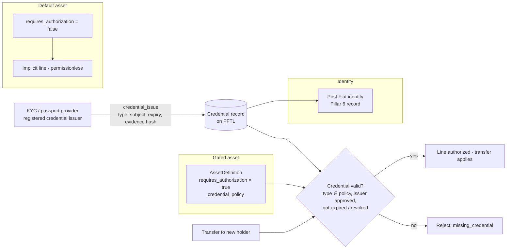

# Pillar 8 — On-chain Identity (DID, KYC, Optional Trust Lines)

> **Status:** Partial. Trust lines, issuer authorisation, freeze and clawback exist, and assets are permissionless by default. There is no DID, verifiable credential or KYC integration for users or assets. **One prerequisite bug:** implicit trust lines are created authorized even when the asset requires authorisation.
>
> **Bubbles up to:** *NAVCoins anyone can build, including regulated ones*. Permissionless by default, KYC-gated where an issuer needs it.

## In one paragraph

The chain should be **permissionless by default**: anyone can hold and send any asset without setting a trust line. An issuer who needs KYC can opt in to **trust-line-gated** assets, where only accounts holding a valid credential can hold the asset. This pillar adds a DID-style **identity and credential layer** on top of [Pillar 6](06-hive-identity.md)'s identity record. External KYC or passport providers issue verifiable credentials to an identity. A gated asset's issuer names the credential types it accepts, and the chain enforces it. The postfiatl1v2 asset model already supports the default: issuing an asset implicitly creates authorized trust lines. It also has the issuer controls: `requires_authorization`, freeze and clawback. What's missing is the credential layer, plus a fix so that gated assets can't be bypassed.

## User story

**Founder's story.** There are a number of DID-type things on the XRPL, and best practices for integrating with external KYC or passport-based systems, which could then be used to KYC NAVCoins. I also do not know whether trust lines need to be set for NAVCoins. Ideally the chain would be designed so that **trust lines are an option, not a default**. Everything is permissionless by default, but you can have trust-line-based assets.

**Augmented story.**

1. **Default.** I create a NAVCoin with default settings. Anyone can receive it with no trust line to set; the chain creates the holding line automatically. This is already how postfiatl1v2 works.
2. **Opt in to gating.** For a second NAVCoin, I set `requires_authorization` and name a **credential policy**: holders need a `kyc.basic` credential from one of the approved issuers, not expired, and not revoked.
3. **Get credentialed.** A user completes KYC with an outside provider, either a passport-based or a regulated KYC vendor. The provider issues a credential to the user's Post Fiat identity: an on-chain attestation by the provider's key, holding a hash of the evidence and no personal data.
4. **Hold.** When the user tries to receive the gated NAVCoin, the chain checks for a valid matching credential. With one, the line is authorized automatically; without one, the transfer is rejected with `missing_credential`.
5. **Revoke.** If the provider revokes the credential, the line stops moving at the next transfer. The issuer can also freeze or claw back as today.
6. **Explore.** The explorer shows that the asset is gated and which credential types and issuers it accepts. It never shows anyone's personal data.

## What exists today

| Component | Where | State |
|---|---|---|
| Issued-asset flags | [`crates/types/src/account_owned_asset_types.rs`](https://github.com/postfiatorg/postfiatl1v2/blob/main/crates/types/src/account_owned_asset_types.rs) `AssetDefinition` (`requires_authorization`, `freeze_enabled`, `clawback_enabled`, all default false) | Built |
| Trust lines | same file `TrustLine` (`authorized`, `frozen`, `limit`) · `TrustSetOperation` in [`transactions_mempool_receipts.rs`](https://github.com/postfiatorg/postfiatl1v2/blob/main/crates/types/src/transactions_mempool_receipts.rs) | Built |
| Permissionless by default | [`crates/execution/src/issued_asset_ledger_helpers.rs`](https://github.com/postfiatorg/postfiatl1v2/blob/main/crates/execution/src/issued_asset_ledger_helpers.rs) `issued_asset_credit_recipient_line_index`: a missing line is created on credit with `authorized = true` | Built. **Trust lines are already optional.** |
| Movement checks | same file `ensure_line_can_move` (`missing_issuer_authorization`, `frozen_trustline`) | Built |
| **Bug: gating bypass** | `issued_asset_credit_recipient_line_index` sets `authorized = true` **even when `asset.requires_authorization` is true**, and an existing test (`core_asset_execution_tests.rs`) asserts this behaviour | **Must fix before any KYC asset.** A holder could send a gated asset to a new, unverified recipient. |
| Private NAVCoin "Access" panel | [`docs/navcoins/navcoin-create-and-swap-spec.md`](https://github.com/postfiatorg/postfiatl1v2/blob/main/docs/navcoins/navcoin-create-and-swap-spec.md) | Spec only. The holder list does not cover the Ethereum wrapper. |
| Identity-bearing attestors | `NavAttestor` (domain, optional bond, registration height) | Built, for reserve attestors |
| KYC references | [`crates/consensus_cobalt`](https://github.com/postfiatorg/postfiatl1v2/tree/main/crates/consensus_cobalt) tests (`validator.private.kyc_status`) · [`docs/specs/identity-flag-pipeline-spec-20261023.md`](https://github.com/postfiatorg/postfiatl1v2/blob/main/docs/specs/identity-flag-pipeline-spec-20261023.md) | **Validators only.** Nothing for users or assets. |
| DID or verifiable credentials | — | Not found |

## Architecture

## Technical requirements

### Prerequisite

- **R0.** Fix `issued_asset_credit_recipient_line_index`. When `asset.requires_authorization` is true, an implicitly created line must be `authorized = false`, unless a credential policy authorizes it (R4). Update the test that asserts the current behaviour, and add a regression test: a holder sends a gated asset to an unverified new account, and the transfer is rejected.

### Credentials

- **R1.** **Credential issuer** registration: an account declares itself an issuer of named credential types, with a public domain, optionally bonded, modelled on `NavAttestor`.
- **R2.** `credential_issue` and `credential_revoke` operations create a `Credential {subject_identity, type, issuer, issued_at, expires_at, evidence_hash, status}`. **No personal data on chain**; only the hash of the provider's evidence.
- **R3.** Align credential fields with the W3C Verifiable Credentials data model, and with the XRPL credentials and permissioned-domains amendments where practical, so outside KYC vendors can issue with little adaptation.

### Policy

- **R4.** `AssetDefinition.credential_policy {accepted_types[], accepted_issuers[], require_unexpired}`. When `requires_authorization` is set and a policy exists, the chain authorizes a line automatically if the recipient has a valid matching credential. Manual issuer authorisation (`TrustSet`) still works as an override.
- **R5.** A revoked or expired credential makes the line fail at the next movement with `credential_revoked` or `credential_expired`.
- **R6.** Gated NAVCoins carry the policy across to the Ethereum wrapper: the hook or the primary market checks the holder list, closing the gap in the create-and-swap spec.

### Defaults and docs

- **R7.** Documentation states the rule plainly: **assets are permissionless by default, and trust lines are optional**. The sample NAVCoin create call in [Pillar 7](07-navcoin-fees.md)'s SDK shows both modes.
- **R8.** The explorer shows an asset's gating status and policy, and an identity's credential types and issuers. It never shows evidence.

## Dependencies

| Depends on | Why |
|---|---|
| [Pillar 6 — Hive identity on chain](06-hive-identity.md) | The identity a credential attaches to. |
| [Pillar 2 — Message protocol](02-message-protocol.md) | Off-chain credential evidence envelopes, encrypted to the issuer. |
| [Pillar 7 — NAVCoin fees and SDK](07-navcoin-fees.md) | Creating gated NAVCoins. |
| Legal and eligibility gate B7.2 in the NAVCoin spec | When gated products may go live. |

## Acceptance criteria

1. The R0 fix is merged: a gated asset can't reach an unverified account through an implicit line.
2. A test KYC issuer registers, issues `kyc.basic` to two identities, and revokes one.
3. A gated NAVCoin moves to the credentialed account and is rejected for the uncredentialed and revoked accounts, with the documented error codes.
4. A default NAVCoin still moves permissionlessly, with no trust-line step.
5. The explorer shows the policy and credentials without personal data.

## Open questions for the founder

- Which external KYC or passport providers are the first targets, and do they already issue W3C credentials?
- Should credential issuers be approved by governance (Cobalt or a constitution rule) or by each asset's issuer?
- Should gating extend to the Uniswap wrapper from day one, or start on PFTL only?

## Code references

- Asset model: [`account_owned_asset_types.rs`](https://github.com/postfiatorg/postfiatl1v2/blob/main/crates/types/src/account_owned_asset_types.rs)
- Enforcement: [`issued_asset_ledger_helpers.rs`](https://github.com/postfiatorg/postfiatl1v2/blob/main/crates/execution/src/issued_asset_ledger_helpers.rs)
- Parity tracker: [`docs/status/xrpl-feature-parity-burndown.md`](https://github.com/postfiatorg/postfiatl1v2/blob/main/docs/status/xrpl-feature-parity-burndown.md)
