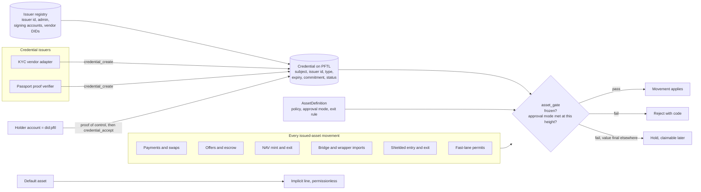

# Pillar 8 — On-chain Identity (DID, KYC, Optional Trust Lines)

> **Status:** Partial. Trust lines, issuer authorisation, freeze and clawback exist, and assets are permissionless by default. There is no DID, verifiable credential or KYC integration for users or assets. **One prerequisite bug, on many paths:** every path that creates a holding line implicitly marks it authorized, even when the asset requires authorisation.
>
> **Bubbles up to:** [Outcome C · NAVCoins anyone can build](../README.md#three-outcomes). *NAVCoins anyone can build, including regulated ones*. Permissionless by default, KYC-gated where an issuer needs it.

## In one paragraph

**Do NAVCoins need trust lines? No.** On postfiatl1v2 anyone can be paid a default asset without setting anything, because the chain creates the holding line on first credit. This pillar extends that to the DEX and escrow, so trust lines are **an option, not a default**, everywhere. Then it adds the opt-in. An issuer marks an asset `requires_authorization` and attaches a **credential policy**. A holder then needs the issuer's approval, a valid credential from an issuer the policy accepts, or both, as the asset's approval mode says. Credentials attach to a PFTL account, which doubles as a DID (`did:pftl`). The design follows the XRPL DID, Credentials and Permissioned Domains amendments and the W3C data models. KYC vendors and passport-proof verifiers issue the credentials. **One gate function decides every movement of an issued asset**, on every path.

### What a gated NAVCoin can do

| Founder's core NAVCoin element | Gated NAVCoin |
|---|---|
| PFTL asset that can be swapped into | Yes, for accounts that pass the gate |
| USDC into pfUSDC | Unaffected: it moves pfUSDC |
| Uniswap asset | Open question 7: none, free-moving and disclosed, or restricted |
| Uniswap asset into PFTL asset | Yes, wherever a wrapper exists. An import to an ineligible account waits in a hold (R11). |
| pfUSDC pool at a fix | Open question 6. The fix settles only as a shielded swap, so barring gated assets from the pool removes it. |

## User story

**Founder's story.** There are a number of DID-type things on the XRPL, and best practices for integrating with external KYC or passport-based systems, which could then be used to KYC NAVCoins. I also do not know whether trust lines need to be set for NAVCoins. Ideally the chain would be designed so that **trust lines are an option, not a default**. Everything is permissionless by default, but you can have trust-line-based assets.

**Augmented story.**

1. **Default.** I create a NAVCoin with default settings. Anyone can receive it or bid for it, with no trust line to set.
2. **Opt in to gating.** For a second NAVCoin I set `requires_authorization` and a policy: *`kyc.basic` from issuer A, or `passport.over18` from verifier B*. I pick the approval mode and what a holder who loses eligibility may still do.
3. **Get credentialed.** A user proves control of their PFTL account, then does KYC in the vendor's flow or proves passport facts in a passport app. The vendor or verifier creates a credential for that account. It carries a salted commitment and no personal data. The user accepts it with one signature.
4. **Hold and trade.** Every path that would give the user the gated NAVCoin checks the gate first. Without a valid credential it fails with `missing_credential`. If the value has already left another chain, it waits in a hold instead.
5. **Revoke or expire.** The next movement fails with `credential_revoked` or `credential_expired`. Returning units to me follows my exit rule. Freeze and clawback work as today, and clawback also reaches offers and escrows.
6. **Explore.** The explorer shows the asset's gating, the (issuer, type) pairs it accepts, and its wrapper and shielded settings. It never shows personal data.

## What exists today

| Component | Where | State |
|---|---|---|
| Asset flags | `AssetDefinition` in `account_owned_asset_types.rs`: `requires_authorization`, `freeze_enabled`, `clawback_enabled`, default false | Set only at `AssetCreate`. Nothing changes them later. |
| Explicit lines | `TrustLine` · `TrustSet` in `nft_escrow_asset_execution.rs` | A holder-created line pays the line fee and starts `authorized = !requires_authorization`. An issuer-signed `trust_set` can set **or clear** `authorized` and `frozen` on an existing line. |
| Implicit lines | `issued_asset_credit_recipient_line_index` in `issued_asset_ledger_helpers.rs` | A missing line is created on credit with `authorized = true`, `limit = amount`, `reserve_paid = 0`. Payments, mints, bridge and shielded credits **raise `limit`**, even on a line the holder set. |
| **Bug: gating bypass** | Same function. Test `asset_transactions_create_trust_pay_burn_and_reject_frozen_lines` asserts that a gated asset sent to a new account lands on an authorized line. | **Fix before any KYC asset.** It contradicts `TrustSet` and the NAVCoin Access panel. |
| Offers | `apply_offer_operation`, `apply_offer_fills` in `fees_offer_planning.rs` | Both sides need an existing line, even on default assets. One resting maker that fails `ensure_line_can_move` fails the taker's whole transaction. `offer_cancel` refunds unchecked. |
| Clawback | `AssetClawback` | Free line balance only, not offers or escrows |
| Line fees | `entrypoints.rs` · `fees_offer_planning.rs` | 10 atoms per new line (1 PFT = 1,000,000 atoms), burned. Paid by `trust_set`, atomic-swap legs, Solana deposit proofs and vault deposit claims. **`issued_payment` and NAV mint pay none.** |
| Recipient controls | `AccountSet` | `REQUIRE_MEMO` only. No way to refuse assets. Empty lines are never deleted. |
| Fast-lane permits | `FastHolderPermitV1` (`fastswap_types.rs`) · `fastswap.rs` | A receiver of a gated asset needs a permit for (asset, owner key), valid through an inclusive height. No control action revokes one. Admission ignores L1 freeze. |
| The fix | `FxFixPacketV1` · `consume_fx_fix_swap_plan` (`execution_actions.rs`) | Fills only inside a shielded swap |
| Access panel, hook | `navcoin-create-and-swap-spec.md` · `NAVGuardHook.sol` | The issuer approves each holder with `trust_set`, as A666 did at h341, on PFTL only. Wrappers are "PFTL only" or "PFTL and Ethereum". The hook has no holder checks. |
| Reserve attestors | `NavAttestor` | Optional bond, but no slashing and no key rotation. PFTL accounts can't rotate keys either. |
| KYC references | `validator.private.kyc_status` (Cobalt tests) · `identity-flag-pipeline-spec-20261023.md` | **Validators only**, in shadow mode |
| Task Node wallet | `src/features/wallet/l1/market/offer-setup.js` | Sends `trust_set` before an offer |
| DID or verifiable credentials | — | Not found |

### Why XRPL has trust lines, and what replaces them here

| XRPL reason | PFTL today | This pillar |
|---|---|---|
| Each line locks a reserve | Lines cost 10 atoms or nothing, and are never deleted | R13 |
| Consent to hold an asset | Anyone can credit anyone | R14: refuse flag and spam labels |
| Credit limit per counterparty | Limits rise automatically | R14: holder limits bind |
| Issuer approval (RequireAuth) | Exists, but can be bypassed | R0–R4 |

## Architecture

## Technical requirements

### Prerequisite

- **R0.** Fix `issued_asset_credit_recipient_line_index`. On a gated asset, a missing line is created only when the recipient passes the gate (R2), and with `authorized = false`, so the credential carries the approval and revocation keeps working. Issuer-sourced credits get no exception: a mint is not an approval. A failing credit is rejected with the gate's code, or held where the value is already final on another chain (R11). Until credentials exist, the XRPL flow applies: the holder sends `trust_set` and the issuer authorizes the line, the only way `line.authorized` is set.
    - The fix covers rows 1, 4, 7, 9, 10 and 13 below, each with a regression test, including an issuer mint to a new, unverified account.
    - It activates at a governed height through `AssetExecutionCompatibility`, as `require_memo_active` did, so replay is unchanged. Before activation, list the lines on gated assets the bug authorized (`authorized = true`, `reserve_paid = 0`). The issuer can clear them with `trust_set`.
    - Default assets are untouched, so R0 does not slow near-term NAVCoin swaps.

### Enforcement points

- **R1.** One function, `asset_gate(asset, account, direction, height)`, decides every issued-asset movement, and every path below calls it. Review rejects any new path that skips it.

| # | Path | Code | Today | Gap |
|---|---|---|---|---|
| 1 | Issued payment v1/v2, issuer mints, atomic-swap legs | `apply_issued_payment` | Sender checked, implicit recipient line | **Bypass** |
| 2 | Offers | `ensure_offer_asset_participation`, `lock_offer_sell_side`, `credit_offer_received_asset` | Existing lines that can move | Book poisoning (R3). Lines needed on default assets (R14). |
| 3 | Escrow | `lock_issued_asset_for_escrow`, `release_issued_asset_escrow_to_recipient`, `refund_issued_asset_escrow_to_owner` | Existing lines, all checked | Refund to a de-authorized owner fails. Clawback can't reach it (R3). |
| 4 | NAV mint at NAV | `NavMintAtNav`, issuer-signed | Implicit line | **Bypass** |
| 5 | NAV redeem, burn | `NavRedeemAtNav`, `AssetBurn` | Owner checked | Ineligible holder can't exit (R3) |
| 6 | Clawback | `AssetClawback` | No movement check, by design | Free balance only (R3) |
| 7 | PFTL–Uniswap route credits: cash-in, release, refunds, return import, cash-out payout | `credit_issued_asset_balance[_from_custody]` | Implicit line | **Bypass.** Imports are final on Ethereum (R11). |
| 8 | Route debits: export, cash-out input | `debit_issued_asset_balance` | Owner checked | Free once on Ethereum (R11) |
| 9 | Vault bridge: deposit claim, mint from receipts, NAV exit settlement | `nav_vault_asset_execution.rs` | Implicit line | **Bypass.** Deposits are final on Ethereum (R11). |
| 10 | Solana bridge deposits | `credit_verified`. Series copy the family's flags. | Implicit line. One bad receipt rejects the proof. | **Bypass** for gated series, and batch jams (R11) |
| 11 | Shielded entry | `execute_asset_orchard_ingress_burn` → `AssetBurn` | Sender checked | Holds |
| 12 | Inside the pool: transfers, swaps, **the fix**, private primary issue and exit | `apply_verified_asset_orchard_swap_action_to_state`, `apply_asset_orchard_private_primary_action_to_state` | None. Holders are hidden. | **Open** (R12) |
| 13 | Shielded exit | `credit_issued_asset_from_shielded_pool`, on a trial ledger | Implicit line | **Bypass.** Rejecting is safe: the note stays unspent. |
| 14 | FastPay owned transfers | `wrap_to_owned`, `apply_owned_deposit`, `unwrap_from_owned` | PFT only | None today (R12) |
| 15 | FastSwap fast lane | `execute_fastlane_deposit`, `execute_fastlane_redeem`, `validate_asset_rules` | Lines checked at deposit and redeem. Receiver needs a permit. | No revocation. Trades ignore L1 freeze (R12). |
| 16 | Fee claims ([Pillar 7](07-navcoin-fees.md) R9) | `nav_fee_claim`, not built | — | Calls the gate like any credit |

### Movement rules

- **R2.** The gate is evaluated live at each movement and never cached. A frozen line fails. Otherwise, on a gated asset:
    - with no policy: `line.authorized`, which is today's manual approval;
    - `approval_mode = either`: `line.authorized || policy_met(account, height)`;
    - `approval_mode = both`: `line.authorized && policy_met(account, height)`.

    Both modes are built. Open question 2 decides who picks.

- **R3.** Receiving and sending to a third party need the gate. A holder who fails only the approval test follows the asset's `exit_rule`, set at creation. Every option in open question 1 is built. Under any of them:
    - **Unlocking is not moving.** `offer_cancel` and escrow refunds always return a holder's own locked units to the holder's line. Today's escrow-refund check goes. The units then fall under the exit rule and clawback.
    - **Resting offers.** Matching skips a maker that fails the gate for either asset, and cancels its offer as above. Skips count toward `MAX_DEX_CROSSES_PER_TRANSACTION` (64).
    - **Clawback reach.** On a `clawback_enabled` asset, `asset_clawback` can cancel the owner's open offers and owner-funded escrows in that asset and claw the units in one transaction.
    - Freeze, clawback and the exit rule apply to holds (R11) as to lines.
- **R4.** `requires_authorization` stays immutable, so a default asset never becomes gated. Changes to the policy, approval mode or exit rule use one `asset_access_set` transaction with an effective height, limited by a change rule set at creation. Open question 3 sets the allowed rules and asks whether a gated asset may ever open. Policies name issuer ids (R5), so a key rotation never needs a policy change.

### Credentials and DID

- **R5.** **Issuer registry**, modelled on `NavAttestor`. An entry has a stable `issuer_id`, an admin account, signing accounts, a domain, its credential types, and the external DIDs it signs off-chain VCs with (R8).
    - **Rotation.** An issuer adds a signing account and retires the old one at a height. Earlier credentials stay valid. After a compromise, the admin sets the cut-off at or before it, and later credentials from that key fail with `credential_issuer_inactive`.
    - **Deregistration** takes effect at a grace height. The issuer's credentials then fail, and holders fall under the exit rule. The docs advise policies to accept more than one issuer.
    - A chain parameter makes registration open or governance-approved. Open question 4 picks it and who may deregister. Bonds are open question 5.
- **R6.** Lifecycle, as in XRPL Credentials:
    - `credential_create` by a live signing account. It locks a refundable deposit, returned to the issuer on deletion, as offers lock a reserve today. Open question 8 sets the amount, which may be zero.
    - `credential_accept` by the subject. An unaccepted credential never counts.
    - **Renewal:** a create on an existing (subject, issuer id, type) record updates expiry and commitment and keeps the acceptance, which lasts until the subject deletes the record.
    - **Revocation** sets `status = revoked`, and the record stays until expiry or issuer deletion.
    - `credential_delete` by the subject at any time, by the issuer, or by anyone after expiry.
    - Fields: `subject`, `issuer_id`, `signing_account`, `credential_type` (bounded, namespaced), `issued_height`, `expires_height`, `commitment`, `status`. Indexed by (subject, issuer id, type), one lookup per pair.
    - **Expiry** is inclusive, as for `FastHolderPermitV1` and `FxFixPacketV1`: valid while `height <= expires_height`. Empty means no expiry.
    - **Codes:** `missing_credential`, `credential_not_accepted`, `credential_revoked`, `credential_expired`, `credential_issuer_inactive`. If no rule passes, the gate reports the first failing pair of the first rule.
- **R7.** **`did:pftl` method.** The DID is the chain id plus the account address. Its document is derived from ledger state:
    - the account's ML-DSA-65 key, as the verification method;
    - an optional document URI and hash, as in XRPL's DID object;
    - the [Pillar 6](06-hive-identity.md) Nostr key and handle, if the account minted an identity.

    `did_resolve` over RPC returns it. No W3C cryptosuite exists for ML-DSA-65 yet, so the method spec defines one. The gate does not depend on it.

- **R8.** **Standards mapping.** The on-chain record is the authoritative, post-quantum credential. The W3C VC stays off chain with the user and the vendor, under the vendor's own DID and signature, which the registry links to the `issuer_id`.

| On chain | XRPL Credentials | W3C VC 2.0 |
|---|---|---|
| `issuer_id` | `Issuer` | `issuer`: the vendor's DID, listed in the registry |
| `subject` | `Subject` | `credentialSubject.id` = `did:pftl:<account>` |
| `credential_type` | `CredentialType` | `type` |
| `expires_height` | `Expiration` | `validUntil` |
| `commitment` | nearest is `URI` | salted hash of the VC |
| `status` | deletion only | `credentialStatus` |

- **R9.** Two pathways write the same record:
    - **Vendor adapter.** A small service turns the vendor's API or webhook result into `credential_create`. Documents never pass through Post Fiat.
    - **Passport proof.** A zero-knowledge passport app proves age, nationality, or uniqueness through a nullifier. A registered, open-source verifier checks it off chain and issues the credential, one live credential per nullifier and scope. On-chain verification is open question 11.
    - **Proof of control.** Before issuing, the wallet signs a session nonce with the account's ML-DSA-65 key, and the adapter checks the key hashes to the address (`address_from_public_key`). A passport proof takes the account as a public input, so it can't be replayed. Handing over a key stays possible, as in any account-based KYC.

### Policy

- **R10.** `credential_policy` is a list of rules. Each rule is an AND-set of (issuer id, type) **pairs**, and any one rule passing is enough. Pairs stop an issuer approved for one type from satisfying another. `MAX_POLICY_RULES`, `MAX_PAIRS_PER_RULE` and `MAX_POLICY_PAIRS` bound it. The total starts at XRPL Permissioned Domains' 10 until the benchmark (acceptance 11) sets the values for the worst case: a taker crossing 64 makers under the largest policy.

### Wrappers, holds, shielded pools and fast lanes

- **R11.** Each route records the creator's wrapper option for a gated asset on chain, and the explorer shows it. Today: "PFTL only" or "PFTL and Ethereum". A restricted wrapper is open question 7.
    - **Holds.** On rows 7, 9 and 10 the value is final on another chain, so a credit that fails the gate goes to a hold keyed by (asset, recipient, source reference). Held units count as supply but can't move. The recipient claims them once the gate passes. Under a return-only exit rule the hold can exit at NAV or be returned to the issuer. One bad receipt no longer rejects a whole Solana proof.
    - A failing shielded exit (row 13) is rejected. It runs on a trial ledger, so the note stays unspent for an exit to another account.
    - Later Solana or Hyperliquid venues follow the same wrapper choice and holds.
- **R12.** Shielded pools and fast lanes:
    - **Shielded pools**: Asset-Orchard today, and PFSH03 from [Pillar 5](05-local-task-node.md). Until open question 6 is answered, gated assets are rejected at shielded entry and private primary issue. First check that no live gated asset, such as A666, uses the pool. Each option in question 6 is a separate build.
    - **Fast lane.** Add a `RevokeHolderPermit` control action. Admission refuses an intent whose sending or receiving owner of a gated asset has a frozen L1 line or fails the gate at the lane's finalized height. The docs state that delay. Permits end by the credential's expiry. `execute_fastlane_redeem` follows the exit rule.
    - **Owned objects** are keyed by public key, not account. Any issued-asset owned lane checks the gate at wrap and unwrap and keeps gated assets out.

### Economics and spam

- **R13.** Every path that creates a line or a hold charges the line fee to the transaction's source: the `issued_payment` sender, the issuer on a NAV mint, the offer or escrow creator. Bridge proofs and claims already pay. This applies the parity tracker's rule that every state-expanding object pays a reserve or a fee.
    - The fee is 10 atoms (0.00001 PFT), burned, against 22 atoms for a typical ML-DSA-65 transfer. Lines for 10,000 new holders cost 0.1 PFT. It is state accounting, not a spam deterrent: byte fees and R14 limit spam.
    - The amount, a refundable reserve instead, and deleting empty lines are open question 8.
- **R14.** Lines and recipient controls:
    - **No `trust_set` for the DEX.** On a default asset, `offer_create` and escrow creation create the missing line for the owner or recipient. On a gated asset they do so only when the gate passes. The Task Node wallet drops its `trust_set` step for default assets.
    - **Binding limits.** `TrustLine` gains `holder_limit: Option<u64>`, set by a holder-signed `trust_set` and empty on implicit and pre-activation lines. A set limit binds on every credit path, and nothing raises it.
    - **Refuse flag.** An account flag, off by default, rejects assets the account has no line for, like XRPL deposit authorisation. Open question 9 decides whether it ships.
    - Wallets and the explorer label assets the account never chose to hold.

### Privacy and security

- **R15.** No personal data goes on chain. The `commitment` hashes a random salt with the VC, so it can't be brute-forced or linked. Types stay coarse (`kyc.basic`, not a country). Records are public. The explorer lists an account's credentials only on the subject's opt-in, and says the data is public anyway. Wallets default to a separate account for gated assets, and warn before credentialing an account with a Pillar 6 identity, which would publicly link KYC status to a social identity.
- **R16.** Credentials are ordinary ML-DSA-65-signed transactions, so the on-chain record is post-quantum. The chain never relies on the vendor's signature. Upstream stays classical: passport chip signatures, today's passport proofs, vendor VC signatures and webhooks. The docs say so.

### Defaults and docs

- **R17.** The docs say it plainly: **assets are permissionless by default, and trust lines are optional**. The [Pillar 7](07-navcoin-fees.md) SDK sample shows both modes.
    - A Python CLI covers issuer register and rotate, create, accept, renew, revoke, delete, setting a policy, checking the gate and claiming a hold.
    - The wallet UI follows, starting with proof of control, accept and delete.
- **R18.** The explorer shows each asset's gating, policy pairs, approval mode, exit rule and wrapper and shielded settings, plus the issuer registry, holds, and an account's credentials on opt-in. It never shows evidence.

### Build order

Steps, not dates.

1. **Close the holes**, with Step 1 of the [suggested order](../README.md#suggested-order): R0 with holds (R11), the four R3 rules, the shielded entry bar and A666 check (R12), and the R13 fee on payments and NAV mints. A666 is gated and uses the route, so holds land with R0. Exits keep today's behaviour until step 2.
2. **Credentials**, with the NAVCoin SDK in Step 3 of the suggested order: the registry, lifecycle, policy, approval modes, exit rules, fast-lane revocation, R14, CLI and explorer.
3. **Later:** `did_resolve`, the passport pathway, the wallet UI, and whatever questions 6, 7 and 11 choose.

## Dependencies

| Depends on | Why |
|---|---|
| [Pillar 6 — Hive identity on chain](06-hive-identity.md) | Optional: a minted identity appears in the DID document. Holding a gated asset does not need one. |
| [Pillar 2 — Message protocol](02-message-protocol.md) | Message types for credential schemas and issuer metadata. No KYC documents. |
| [Pillar 5 — Local Task Node](05-local-task-node.md) | Admitting gated assets to PFSH03, and any credential proof in its circuit |
| [Pillar 7 — NAVCoin fees and SDK](07-navcoin-fees.md) | Creating gated NAVCoins. Fee claims pass the gate. |
| Legal and eligibility gate B7.2 in the NAVCoin spec | When gated products may go live, and whether one NAVCoin may rely on KYC done for another |

## Acceptance criteria

1. R0 ships behind an activation height. Rows 1, 4, 7, 9, 10 and 13 each reject or hold a gated asset sent to an unverified account, then accept it after authorization. An issuer mint to a new unverified account fails. A holder who received through a credential cannot send after revocation.
2. A test issuer registers, issues `kyc.basic` to two accounts that accept, renews one and revokes the other. A third never accepts. Old credentials pass after a routine rotation, and fail after a compromise cut-off if signed later.
3. Every row that can move a gated asset is tested against six accounts: credentialed, uncredentialed, unaccepted, revoked, expired and frozen. Each returns the documented code.
4. A revoked holder can do exactly what each exit rule allows. A taker crossing an ineligible maker fills against the next offer, and the maker's units return. Clawback reaches offers and escrows.
5. Both approval modes behave as R2 states. Approval and credential can each be withdrawn.
6. A default NAVCoin moves by payment, offer and escrow with no trust-line step, and each new line's creator pays the fee.
7. A return import and a Solana deposit to an ineligible account land in holds, claimable after a credential. A Solana proof with one such receipt still credits the rest. A rejected shielded exit leaves the note unspent.
8. After a freeze or revocation, fast-lane admission refuses the owner at the next finalized height.
9. `did_resolve` returns a valid document, with the Pillar 6 identity when minted.
10. One sandbox integration, with a real KYC vendor or passport-proof verifier, works end to end, including proof of control.
11. Gate overhead at the largest policy, per transfer and for a 64-cross taker, is measured against today and published.
12. End to end: a gated NAVCoin is made with the Pillar 7 SDK. A credentialed user mints at NAV, trades on the DEX, uses the Uniswap route under the chosen wrapper option, and exits at NAV. An uncredentialed account is rejected or held on every path.
13. The R17 and R18 flows work, and the explorer shows no personal data.

## Open questions for the founder

Each answer sets a parameter or enables a separately built option. None blocks build step 1.

1. **Exit rule when eligibility lapses.** Which may creators pick, and is one a floor for all?
    - (a) Strict: nothing moves and the issuer claws back. Today's behaviour. Tightest for compliance, but it strands funds.
    - (b) Return only: exit at NAV, burn, or pay the issuer, never a third party.
    - (c) As (b), plus a grace period in blocks.

    [Pillar 7](07-navcoin-fees.md) question 6 covers the overlap with a pending fee increase.

2. **Manual approval.** (a) Approval or a credential suffices. (b) Both are needed. (c) Each creator picks.
3. **Changing access after issue.**
    - (a) Fixed at creation.
    - (b) Changeable after a notice period counted in live blocks, as [Pillar 7](07-navcoin-fees.md) R4 does for fees.
    - (c) Loosen any time, tighten only with notice.

    Tightening can strand holders. Under (a), losing every issuer a policy names closes the asset to new holders. Separately: may a gated asset ever drop `requires_authorization`, one way?

4. **Who approves credential issuers, and who may deregister them?** This also covers who may run a passport verifier.
    - (a) Each creator picks its own issuers, and only an issuer's admin deregisters. Liability stays with the creator.
    - (b) A governance registry that can also deregister. Simpler for users, but it makes Post Fiat governance a compliance gatekeeper, a liability B7.2 must review.
    - (c) Both: a curated list creators may use or ignore.
5. **Issuer bonds.**
    - (a) None: registration is a record with a verified domain.
    - (b) A bond, slashed when governance rules an attestation false.

    Regulated vendors rarely post token bonds, and a bond without a slashing rule secures nothing.

6. **Gated assets in shielded pools, and the fix.**
    - (a) Barred, as in R12. No fix for gated NAVCoins.
    - (b) Gated at entry and exit only. The fix works, but any note holder could hold the asset privately.
    - (c) A credential proof in the PFSH03 circuit. The fix works, after new circuit and audit work.
    - (d) A transparent fix path for gated assets, outside the pool. The fix works without privacy, as a new execution path.
7. **The wrapper for gated NAVCoins.**
    - (a) PFTL only, with no Uniswap pool.
    - (b) PFTL and Ethereum, the wrapper moving freely, disclosed. A666 works this way today.
    - (c) A transfer-restricted wrapper in the style of ERC-3643, checking an allowlist root posted from PFTL. It needs a credential bridge with its own cost, delay and trust model. A Uniswap hook alone is not enough: plain transfers skip it.

    Every option except (b) splits liquidity.

8. **Fees.**
    - The line fee: its amount, and burned fee or refundable reserve.
    - Delete empty fee-free lines, or keep them.
    - The credential deposit (R6): its amount, and whether part rewards whoever deletes an expired record.
    - Who pays the KYC vendor: the user, the issuer, or Post Fiat as a subsidy.
    - Whether to sponsor fees for new users with no PFT.
9. **The refuse flag (R14).** Should it ship? On by default for institutional wallets?
10. **First providers.** Which KYC vendors and passport apps first? Do they output W3C VCs, and can they bind a session to a signed nonce?
11. **Passport proofs on chain.** Is a verifier-issued credential enough, or should the chain later verify passport proofs itself?
12. **Reuse.** Should validator status, top-30 contributor status and Finance Hub access ([3](03-validator-program.md), [9](09-finance-hub.md)) become credential types, or should the validator identity pipeline stay a separate governance process?
13. **Type names.** Who governs `kyc.*` and `passport.*`: governance, or each issuer under its own domain?

## Code references

postfiatl1v2:

- Types: [`account_owned_asset_types.rs`](https://github.com/postfiatorg/postfiatl1v2/blob/main/crates/types/src/account_owned_asset_types.rs) · [`transactions_mempool_receipts.rs`](https://github.com/postfiatorg/postfiatl1v2/blob/main/crates/types/src/transactions_mempool_receipts.rs) · [`core_chain.rs`](https://github.com/postfiatorg/postfiatl1v2/blob/main/crates/types/src/core_chain.rs) · [`fastswap_types.rs`](https://github.com/postfiatorg/postfiatl1v2/blob/main/crates/types/src/fastswap_types.rs) · [`fx_fix_types.rs`](https://github.com/postfiatorg/postfiatl1v2/blob/main/crates/types/src/fx_fix_types.rs)
- Execution: [`issued_asset_ledger_helpers.rs`](https://github.com/postfiatorg/postfiatl1v2/blob/main/crates/execution/src/issued_asset_ledger_helpers.rs) · [`nft_escrow_asset_execution.rs`](https://github.com/postfiatorg/postfiatl1v2/blob/main/crates/execution/src/nft_escrow_asset_execution.rs) · [`nav_vault_asset_execution.rs`](https://github.com/postfiatorg/postfiatl1v2/blob/main/crates/execution/src/nav_vault_asset_execution.rs) · [`entrypoints.rs`](https://github.com/postfiatorg/postfiatl1v2/blob/main/crates/execution/src/entrypoints.rs) · [`fees_offer_planning.rs`](https://github.com/postfiatorg/postfiatl1v2/blob/main/crates/execution/src/fees_offer_planning.rs)
- Bridges and lanes: [`solana_bridge.rs`](https://github.com/postfiatorg/postfiatl1v2/blob/main/crates/execution/src/solana_bridge.rs) · [`owned_transfer.rs`](https://github.com/postfiatorg/postfiatl1v2/blob/main/crates/execution/src/owned_transfer.rs) · [`fastswap.rs`](https://github.com/postfiatorg/postfiatl1v2/blob/main/crates/execution/src/fastswap.rs) · [`fastswap_bridge.rs`](https://github.com/postfiatorg/postfiatl1v2/blob/main/crates/execution/src/fastswap_bridge.rs) · [`fastswap_control.rs`](https://github.com/postfiatorg/postfiatl1v2/blob/main/crates/execution/src/fastswap_control.rs)
- Shielded exit and fix fills: [`orchard_state_application.rs`](https://github.com/postfiatorg/postfiatl1v2/blob/main/crates/node/src/orchard_state_application.rs) · [`execution_actions.rs`](https://github.com/postfiatorg/postfiatl1v2/blob/main/crates/node/src/execution_actions.rs)
- Address derivation: [`crypto_provider/src/lib.rs`](https://github.com/postfiatorg/postfiatl1v2/blob/main/crates/crypto_provider/src/lib.rs)
- Bug test: [`core_asset_execution_tests.rs`](https://github.com/postfiatorg/postfiatl1v2/blob/main/crates/execution/src/core_asset_execution_tests.rs) · Uniswap hook: [`NAVGuardHook.sol`](https://github.com/postfiatorg/postfiatl1v2/blob/main/crates/ethereum-contracts/src/NAVGuardHook.sol)
- Validator KYC: [`consensus_cobalt/src/tests.rs`](https://github.com/postfiatorg/postfiatl1v2/blob/main/crates/consensus_cobalt/src/tests.rs) · [`identity-flag-pipeline-spec-20261023.md`](https://github.com/postfiatorg/postfiatl1v2/blob/main/docs/specs/identity-flag-pipeline-spec-20261023.md)
- Docs: [`navcoin-create-and-swap-spec.md`](https://github.com/postfiatorg/postfiatl1v2/blob/main/docs/navcoins/navcoin-create-and-swap-spec.md) (Access panel, B7.2) · [`xrpl-feature-parity-burndown.md`](https://github.com/postfiatorg/postfiatl1v2/blob/main/docs/status/xrpl-feature-parity-burndown.md) (state-fee rule) · [`exchange-guide.md`](https://github.com/postfiatorg/postfiatl1v2/blob/main/docs/integrate/exchange-guide.md) (atoms, fee burn)
- Task Node: [`src/features/wallet/l1/market/offer-setup.js`](https://github.com/postfiatorg/tasknode/blob/main/src/features/wallet/l1/market/offer-setup.js)

---

*Revision history: [changelog](../changelog/08-onchain-identity.md).*
