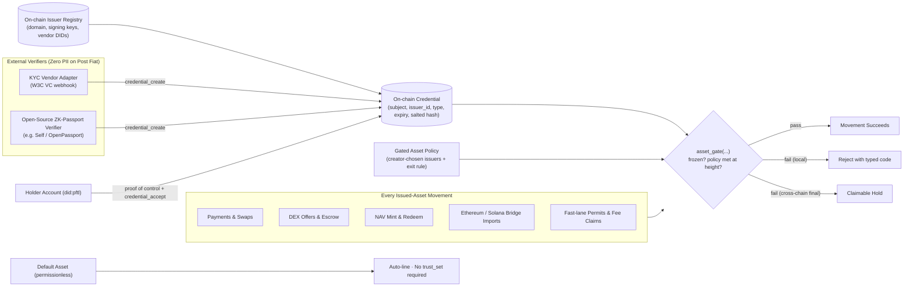

# Pillar 8 — On-chain Identity (DID, KYC & Optional Trust Lines)

> **Status:** Partial. `postfiatl1v2` already makes assets permissionless by default and includes trust lines, issuer authorization, freeze, and clawback. What is missing: fixing an active gating-bypass bug across 6 movement paths, dropping the mandatory `trust_set` step on DEX offers/escrows for default assets, adding native XRPL-style on-chain Credentials + `did:pftl` resolution, claimable holds for ineligible bridge credits, and a sandbox KYC/ZK-passport adapter.
>
> **Outcome:** [C · NAVCoins as a primitive anyone can build](../README.md#three-outcomes) — permissionless by default, with clean opt-in credential gating when a third-party creator needs compliance.

## What this pillar is (in plain English)

Answering the founder's question directly: **no, NAVCoins do not need trust lines.** On `postfiatl1v2`, everything is **permissionless by default** — anyone can receive, bid on, or hold a default asset without ever creating a trust line.

When an issuer *does* want an opt-in gated asset (for example, a KYC-gated NAVCoin), this pillar provides the clean, zero-PII primitive:

1. **Fix the gating bypass first:** Today, one shared helper (`issued_asset_credit_recipient_line_index`) accidentally creates missing holding lines with `authorized = true` even when an asset has `requires_authorization` enabled — bypassing gating across payments, NAV mints, bridges, and shielded exit. We fix that first and route **every** issued-asset movement through one single `asset_gate(...)` function.
2. **Permissionless everywhere by default:** Remove the leftover `trust_set` requirement on DEX offers and escrows for default assets so users never see trust-line friction unless they interact with an explicitly gated asset.
3. **XRPL-style Credentials + `did:pftl` (zero personal data on chain):** External KYC vendors or open-source ZK-passport apps verify a user off chain and submit a tiny ML-DSA-65 signed credential record (`subject`, `issuer_id`, `credential_type`, `expiry`, salted hash commitment) to `postfiatl1v2`. The user accepts it with one signature. A gated asset simply lists which `(issuer_id, credential_type)` pairs it accepts.
4. **Safe holds for cross-chain bridge imports:** If someone bridges a gated asset back from Ethereum or Solana into an unverified account, the funds are already final on the source chain — so instead of losing funds or jamming an entire Solana proof batch, `postfiatl1v2` parks those units in a claimable hold until the holder gets credentialed (or exits back to the issuer).
5. **Creator-owned liability (Post Fiat is never a compliance gatekeeper):** Each gated-asset creator chooses which KYC or passport issuers their asset trusts. Post Fiat governance never approves or polices KYC vendors.

## How credential gating & permissionless defaults work

## Locked-in design decisions

- **Issuer trust model:** **Each gated-asset creator chooses their own trusted issuers** — Post Fiat governance does *not* curate or act as a compliance gatekeeper (keeping regulatory liability strictly on the asset creator, not Post Fiat). No slashable crypto bonds on issuers (registration is an on-chain record with a verified domain).
- **Lapsed-eligibility exit rule:** **Default to "Return-only"** — if a holder's credential expires or is revoked, they can still exit at NAV, burn, or send back to the issuer (funds are never stranded), while blocked from transferring to third parties. Issuers may optionally choose strict freeze/clawback if their jurisdiction requires it.
- **Ethereum/Uniswap wrapper for gated NAVCoins:** Keep the two clean options at launch — **"PFTL only"** (no Uniswap pool) OR **"PFTL + Ethereum free-moving wrapper, clearly disclosed"** (matching A666 today; no ERC-3643 allowlist bridge unless specifically requested later).
- **First reference providers:** Ship a generic **W3C VC webhook adapter** plus one **open-source ZK-passport verifier** (e.g., Self / OpenPassport) verified off chain and written as an ML-DSA-65 credential on `postfiatl1v2` (no heavy SNARK verifier in L1 consensus).
- **Engineering & policy defaults locked in:**
  - **Approval mode:** Each gated-asset creator picks `either` (manual issuer approval OR valid credential) or `both`.
  - **Policy changes after launch:** Permissionless assets can **never** retroactively turn gated (`requires_authorization` cannot flip false → true; one-way true → false opening is allowed). Gated policies can loosen anytime and tighten only after a **minimum 7-day notice** (in blocks).
  - **Shielded pools:** Gated assets stay **barred from shielded pools** in v1 (matching [Pillar 5](05-local-task-node.md); no ZK circuit rewrite). If a gated NAVCoin later needs the FX fix, it uses a transparent fix path outside the shielded pool.
  - **Fees & anti-spam:** Keep the existing tiny burned **10-atom** line fee across all line-creation paths (including payments and NAV mints, with optional deletion of empty lines), a small refundable deposit on credentials (returned on delete), and an opt-in account flag (`refuse_unsolicited_assets`, off by default for normal users, on for institutional wallets). Issuers/users pay any third-party KYC vendor fees directly.
  - **Separation of concerns:** Validator status ([Pillar 3](03-validator-program.md)) and top-30 Finance Hub status ([Pillar 9](09-finance-hub.md)) stay in their own systems; credential types are namespaced cleanly under each issuer's domain (`<domain>/kyc.basic`, `<domain>/passport.over18`).

## What exists today

| Piece | Current state | Where |
|---|---|---|
| Asset flags & trust lines | `requires_authorization`, `freeze_enabled`, `clawback_enabled` exist on `AssetDefinition`; `TrustSet` works, **but** `issued_asset_credit_recipient_line_index` creates implicit lines with `authorized = true` (bypassing gating across 6 paths) | [`account_owned_asset_types.rs`](https://github.com/postfiatorg/postfiatl1v2/blob/main/crates/types/src/account_owned_asset_types.rs), [`issued_asset_ledger_helpers.rs`](https://github.com/postfiatorg/postfiatl1v2/blob/main/crates/execution/src/issued_asset_ledger_helpers.rs) |
| DEX offers, escrow & clawback | Offers currently require existing trust lines even on default assets; one ineligible resting maker can fail a taker's whole trade; clawback only reaches free balance (not offers/escrows) | [`fees_offer_planning.rs`](https://github.com/postfiatorg/postfiatl1v2/blob/main/crates/execution/src/fees_offer_planning.rs), [`nft_escrow_asset_execution.rs`](https://github.com/postfiatorg/postfiatl1v2/blob/main/crates/execution/src/nft_escrow_asset_execution.rs) |
| Fast-lane permits & bridges | `FastHolderPermitV1` has no revocation and ignores L1 freeze; one bad Solana receipt fails an entire batch proof | [`fastswap.rs`](https://github.com/postfiatorg/postfiatl1v2/blob/main/crates/execution/src/fastswap.rs), [`solana_bridge.rs`](https://github.com/postfiatorg/postfiatl1v2/blob/main/crates/execution/src/solana_bridge.rs) |
| DID & Credentials | Not built yet | — |

## Detailed specification

### 1. Prerequisite fix, single `asset_gate(...)` & aggregated holds
- **Close the 6-path gating bypass (behind a governed activation height):** Fix `issued_asset_credit_recipient_line_index` so gated assets create a missing line **only** when the recipient passes `asset_gate` and **always with `line.authorized = false`** (never permanently setting `authorized = true` — credentials stay checked live on every movement so revocation always works in `either` mode!). Run an automated pre-activation remediation script clearing any unapproved legacy lines created by the bug.
- **Single enforcement point:** Route every user-facing issued-asset movement — payments, swaps, DEX offers, escrows, NAV mint/redeem, bridge credits, shielded entry/exit, fast-lane permits, and **`nav_fee_claim`** — through **`asset_gate(asset, from, to, op_kind, block_height)`** evaluated live at the executing block height.
  - **Zero Pillar 7 deadlock:** [Pillar 7](07-navcoin-fees.md) atomic fee accrual inside `nav_epoch_finalize` mints into the protocol unclaimed bucket without calling `asset_gate`; `asset_gate` runs on `nav_fee_claim`.
  - **Return-only & unlock rules:** `offer_cancel` and escrow refunds always return locked units to the owner's own line (never stranded). Under Return-only, `AssetBurn`, `NavRedeemAtNav` (if a NAV route exists), and direct `pay-issuer` transfers always succeed even after credential expiry/revocation.
- **Anti-DoS DEX, bounded clawback & aggregated holds:**
  - **DEX book anti-poisoning:** Add a permissionless `offer_prune_ineligible` op and count skipped ineligible makers separately from filled crosses (persisting cancellations on partial fills) so stale offers cannot jam the 64-cross DEX limit.
  - **Bounded `asset_clawback`:** Accept an explicit bounded list (max **64** offers/escrows/holds per transaction) so issuers can sweep safely without `O(N)` block-validation DoS, and flag escrows of `clawback_enabled` assets clearly in wallets.
  - **Aggregated bridge holds (zero Solana batch jamming & zero hold bloat):** Route **ALL** non-fatal recipient rejections on finalized Ethereum/Solana bridge imports — gate failure, `holder_limit` exceeded, **AND** `refuse_unsolicited_assets` — into an **aggregated hold keyed strictly by `(asset, recipient)`** (emitting individual `source_reference` IDs in receipts, never creating unbounded per-transfer state objects!). Holds are reachable by `asset_clawback`, claimable once eligible, and directly returnable/burnable under Return-only.
- **Fast-lane revocation:** Add `RevokeHolderPermit` and reject fast-lane intents when a gated-asset sender/receiver is frozen or fails `asset_gate` at the lane's finalized height.

### 2. Permissionless UX, auto-pruning & holder controls
- **Drop `trust_set` on default assets:** `offer_create` and escrow creation auto-create missing lines on default assets (and on gated assets when the gate passes), letting Task Node remove its extra `trust_set` step for default assets.
- **Auto-pruning empty lines & holder controls:** Auto-prune zero-balance, non-frozen, default-limit implicit lines on debit/zero-out (preventing permanent 10-atom dust state bloat). Add optional binding `holder_limit` on `TrustLine` (never auto-raised once set) and an opt-in account flag `refuse_unsolicited_assets` (off by default). Wallets/explorer clearly label unsolicited assets.

### 3. On-chain Credentials, delegated 0-PFT acceptance & `did:pftl`
- **Issuer registry (off-chain domain check + rotatable admin):** Stores `issuer_id`, admin account (rotatable via two-step **`issuer_admin_transfer`** so losing one key never bricks an issuer!), rotatable ML-DSA-65 signing accounts (with compromise cut-off height), domain string (verified **off chain** by Explorer/W3C DID resolvers — never non-deterministic DNS inside consensus!), namespaced credential types, and linked off-chain vendor DIDs.
- **Credential lifecycle & zero-PFT onboarding:**
  - **`credential_create_and_accept` (delegated acceptance):** User signs both proof-of-control and credential acceptance during the off-chain vendor/passport flow; the issuer submits them atomically so brand-new **`0 PFT` users never hit a gas chicken-and-egg deadlock!** (Standard two-step `credential_create` + `credential_accept` also supported.)
  - **Safe renewal & revocation:** Renewal **overwrites `issued_height`, `signing_account`, and `status`** (closing the compromise-cutoff bypass where a leaked key could renew an older record). `credential_delete` (by subject, issuer, or anyone post-expiry) returns the refundable deposit to the issuer. Policy tightening (removing an accepted issuer or narrowing rules) waits a 7-day block notice — **except** an emergency escape hatch allowing immediate removal of a compromised/deregistered issuer.
- **Policy rules:** A gated asset's `credential_policy` is an OR-list of AND-rules over `(issuer_id, credential_type)` pairs (bounded and benchmarked at worst-case 64-maker DEX cross).
- **`did:pftl` & privacy:** `did:pftl:<chain_id>:<account>` resolves over `did_resolve` RPC from ledger state (including ML-DSA-65 public key once revealed on chain, optional document URI/hash, and [Pillar 6](06-hive-identity.md) identity if minted). **Zero personal data goes on chain** — only a salted commitment hash. Wallets default to a separate account for credentialed assets and warn before linking KYC status to a public Pillar 6 social identity.
- **Adapters & explorer:** Ship the generic W3C VC webhook adapter + open-source ZK-passport verifier, Python CLI, wallet accept/delete UI, and Explorer views showing asset gating, policy pairs, exit rule, wrapper setting, issuer registry, and holds (never PII).

## Milestones & completion checklist

### Build milestones
- [ ] **M1 · Prerequisite gating-bypass fix & holds:** Fix `issued_asset_credit_recipient_line_index` behind a governed activation height, introduce single `asset_gate(...)`, add cross-chain claimable holds, fix DEX book-poisoning + clawback reach, bar gated assets from shielded pools, and charge the 10-atom line fee consistently.
- [ ] **M2 · Permissionless DEX/escrow & holder controls:** Auto-create missing lines on offers/escrows for default assets (removing Task Node's `trust_set` step), enforce binding `holder_limit`, and ship the opt-in `refuse_unsolicited_assets` flag.
- [ ] **M3 · On-chain Issuer Registry, Credentials & `did:pftl`:** Implement `issuer_*`, `credential_*`, `asset_access_set`, `RevokeHolderPermit`, `did_resolve` RPC, and benchmark worst-case 64-cross DEX gate overhead.
- [ ] **M4 · Reference KYC/ZK-passport adapters, CLI & wallet UI:** Build the generic W3C VC webhook adapter + open-source ZK-passport sandbox verifier (with ML-DSA proof-of-control), Python CLI, and Task Node wallet accept/delete UI (defaulting to a separate account for privacy).
- [ ] **M5 · Block explorer views & end-to-end gated NAVCoin test:** Render asset gating, policies, exit rules, wrapper modes, issuer registry, and holds on the explorer (zero PII); verify full end-to-end gated NAVCoin lifecycle via [Pillar 7](07-navcoin-fees.md) SDK.

### Required ship gates
- [ ] **1. Executed:** All M1–M5 code merged and live across `postfiatl1v2`, Task Node, adapters, CLI, and the block explorer.
- [ ] **2. Tested by user:** Founder creates both a default permissionless NAVCoin (trading on the DEX with zero trust-line steps) and a credential-gated NAVCoin, completes a sandbox ZK-passport / W3C VC credential flow, tests acceptance, movement, revocation + Return-only exit, and bridge hold recovery, and inspects the explorer.
- [ ] **3. Added to docs:** `did:pftl` method spec, optional trust-lines guide (*permissionless by default*), credential policy & issuer adapter docs, and SDK examples published in Post Fiat docs.
- [ ] **4. Public blog post document:** Public blog post written and published explaining Post Fiat's *"permissionless by default, optional compliance"* architecture — DIDs, zero-PII verifiable credentials, and opt-in gated NAVCoins.

## Code references

- L1 asset execution & gating: [`issued_asset_ledger_helpers.rs`](https://github.com/postfiatorg/postfiatl1v2/blob/main/crates/execution/src/issued_asset_ledger_helpers.rs) · [`nft_escrow_asset_execution.rs`](https://github.com/postfiatorg/postfiatl1v2/blob/main/crates/execution/src/nft_escrow_asset_execution.rs) · [`fees_offer_planning.rs`](https://github.com/postfiatorg/postfiatl1v2/blob/main/crates/execution/src/fees_offer_planning.rs) · [`account_owned_asset_types.rs`](https://github.com/postfiatorg/postfiatl1v2/blob/main/crates/types/src/account_owned_asset_types.rs)
- Bridges & fast lanes: [`solana_bridge.rs`](https://github.com/postfiatorg/postfiatl1v2/blob/main/crates/execution/src/solana_bridge.rs) · [`fastswap.rs`](https://github.com/postfiatorg/postfiatl1v2/blob/main/crates/execution/src/fastswap.rs) · [`nav_vault_asset_execution.rs`](https://github.com/postfiatorg/postfiatl1v2/blob/main/crates/execution/src/nav_vault_asset_execution.rs)
- Task Node wallet: [`offer-setup.js`](https://github.com/postfiatorg/tasknode/blob/main/src/features/wallet/l1/market/offer-setup.js)
