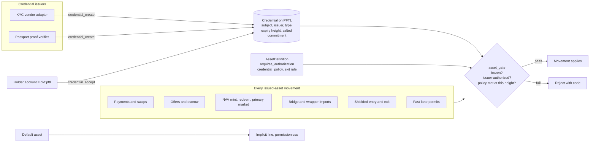

# Pillar 8 — On-chain Identity (DID, KYC, Optional Trust Lines)

> **Status:** Partial. Trust lines, issuer authorisation, freeze and clawback exist, and assets are permissionless by default. There is no DID, verifiable credential or KYC integration for users or assets. **One prerequisite bug, on many paths:** every path that creates a holding line implicitly marks it authorized, even when the asset requires authorisation.
>
> **Bubbles up to:** [Outcome C · NAVCoins anyone can build](../README.md#three-outcomes). *NAVCoins anyone can build, including regulated ones*. Permissionless by default, KYC-gated where an issuer needs it.

## In one paragraph

**Do NAVCoins need trust lines? No.** On postfiatl1v2 anyone can receive a default asset without setting anything, because the chain creates the holding line on first credit. Trust lines are already **an option, not a default**. This pillar keeps that default and adds the opt-in. An issuer marks an asset `requires_authorization` and attaches a **credential policy**. A holder then needs either the issuer's approval or a valid credential from an issuer the policy accepts. Credentials attach to a PFTL account, which doubles as a DID (`did:pftl`). The design follows the XRPL DID, Credentials and Permissioned Domains amendments and the W3C data models. KYC vendors and passport-proof verifiers issue the credentials. **One gate function decides every movement of an issued asset**, on every path: payments, swaps, offers, NAV mints, bridges, the shielded pool, the fast lanes and the Ethereum wrapper.

## User story

**Founder's story.** There are a number of DID-type things on the XRPL, and best practices for integrating with external KYC or passport-based systems, which could then be used to KYC NAVCoins. I also do not know whether trust lines need to be set for NAVCoins. Ideally the chain would be designed so that **trust lines are an option, not a default**. Everything is permissionless by default, but you can have trust-line-based assets.

**Augmented story.**

1. **Default.** I create a NAVCoin with default settings. Anyone can receive it, with no trust line to set. This already works.
2. **Opt in to gating.** For a second NAVCoin I set `requires_authorization` and a policy: *`kyc.basic` from issuer A, or `passport.over18` from verifier B*. I also pick what a holder who loses eligibility may still do.
3. **Get credentialed.** A user does KYC in the vendor's own flow, or proves passport facts in a passport app. The vendor or verifier creates a credential for the user's PFTL account. It carries a salted commitment and no personal data. The user accepts it with one signature.
4. **Hold and trade.** Every path that would give the user the gated NAVCoin checks the gate first. With a valid credential the movement applies. Without one it fails with `missing_credential`.
5. **Revoke or expire.** After revocation or the expiry height, the next movement fails with `credential_revoked` or `credential_expired`. Returning units to me follows the exit rule I picked. Freeze and clawback work as today.
6. **Explore.** The explorer shows that the asset is gated, the (issuer, type) pairs it accepts, and its wrapper and shielded settings. It never shows personal data.

## What exists today

| Component | Where | State |
|---|---|---|
| Asset flags | `AssetDefinition` in `account_owned_asset_types.rs`: `requires_authorization`, `freeze_enabled`, `clawback_enabled`, all default false | Built. Set only at `AssetCreate`. Nothing changes them later. |
| Explicit lines | `TrustLine` · `TrustSet` in `nft_escrow_asset_execution.rs` | Built. A holder-created line pays at least `TRUSTLINE_STATE_EXPANSION_FEE` (10) and starts `authorized = !requires_authorization`. The issuer can authorize or freeze an **existing** line only. |
| Implicit lines | `issued_asset_credit_recipient_line_index` in `issued_asset_ledger_helpers.rs` | Built. A missing line is created on credit with `authorized = true`, `limit = amount` and `reserve_paid = 0`. |
| **Bug: gating bypass** | Same function. Test `asset_transactions_create_trust_pay_burn_and_reject_frozen_lines` asserts it: a holder sends a gated asset to a new account, and the payment is accepted on an authorized line. | **Fix before any KYC asset.** It contradicts the explicit `TrustSet` rule and the NAVCoin Access panel. The public history is one squashed commit, so no message records an intent. |
| Movement check | `ensure_line_can_move` (`missing_issuer_authorization`, `frozen_trustline`) | Built. Used for senders, offers, escrow, burns and NAV redeem. |
| Line state fees | `fees_offer_planning.rs` | `trust_set` and atomic-swap legs pay the state-expansion fee for a new line. **`issued_payment` pays none.** |
| Limits | `apply_prepared_issued_asset_credit` | Offers and escrow enforce `limit`. Payments, mints, bridge and shielded credits **raise it automatically**. |
| Recipient controls | `AccountSet` | `REQUIRE_MEMO` is the only account flag. There is no way to refuse incoming assets, and empty lines are never deleted. |
| Fast-lane holder permits | `FastHolderPermitV1` (`fastswap_types.rs`) · admission in `fastswap.rs` | Built. In a FastSwap, the receiver of a gated asset needs a permit for (asset, owner key), valid between two heights. I found no early-revoke operation. |
| FastPay owned lane | `owned_transfer.rs` | PFT only. Issued assets fail with `UnsupportedAsset`. |
| NAVCoin Access panel | `navcoin-create-and-swap-spec.md` | The issuer approves each holder with `trust_set authorized=true`, which A666 did at h341. That holder list covers PFTL only. The Ethereum wrapper moves freely, and creators choose between "PFTL only" and "PFTL and Ethereum". |
| Uniswap hook | `NAVGuardHook.sol` | Records swaps and depth. No holder checks. |
| Reserve attestors | `NavAttestor` (domain, optional bond, registration height) | Built. The bond is escrowed, but I found no slashing code. |
| KYC references | `validator.private.kyc_status` (Cobalt tests) · `identity-flag-pipeline-spec-20261023.md` | **Validators only**, in shadow mode |
| Task Node wallet | `src/features/wallet/l1/market/offer-setup.js` | Sends `trust_set` before an offer, because offers need an existing line |
| DID or verifiable credentials | — | Not found |

### Why XRPL has trust lines, and what replaces them here

| XRPL reason | PFTL today | This pillar |
|---|---|---|
| State costs money, so each line locks a reserve | Implicit lines are free on `issued_payment` and never deleted | R13 |
| Consent to hold an asset | Anyone can credit anyone | R14: an opt-in refuse flag and spam labels |
| Credit limit per counterparty | Limits are raised automatically | R14: limits a holder sets explicitly stay binding |
| Issuer approval (RequireAuth) | Exists, but can be bypassed | R0–R4 |

## Architecture

## Technical requirements

### Prerequisite

- **R0.** Fix `issued_asset_credit_recipient_line_index`. On a gated asset, an implicit line is created authorized only in two cases: the gate passes (R2), or the transaction's source is the asset's issuer, which is the same approval an issuer-signed `trust_set` gives. Otherwise the credit is rejected with `missing_issuer_authorization`. Until credentials exist, the holder creates a line with `trust_set` and the issuer authorizes it, as on XRPL.
    - Every implicit-credit path calls this one function, so the fix covers rows 1, 4, 7, 9, 10 and 13 below. Each row gets a regression test that rejects a gated asset sent to a new, unverified account.
    - The fix activates at a governed height through `AssetExecutionCompatibility`, as `require_memo_active` did, so historical replay is unchanged. Before activation, list the authorized implicit lines on gated assets. The issuer can de-authorize any of them.

### Enforcement points

- **R1.** One function, `asset_gate(asset, account, direction, height)`, decides every issued-asset movement, and every path below calls it. Review rejects any new path that skips it.

| # | Path | Code | Check today | Gap |
|---|---|---|---|---|
| 1 | Issued payment v1/v2, including issuer mints, and atomic-swap legs | `apply_issued_payment` | Sender checked. Recipient gets an implicit line. | **Bypass** |
| 2 | Offers | `ensure_offer_asset_participation`, `lock_offer_sell_side`, `credit_offer_received_asset` | Both sides need an existing line that can move | Holds after R0 |
| 3 | Escrow | `lock_issued_asset_for_escrow`, `release_issued_asset_escrow_to_recipient`, `refund_issued_asset_escrow_to_owner` | Existing lines, all checked | A refund to a de-authorized owner fails (R3) |
| 4 | NAV mint at NAV | `NavMintAtNav` | Implicit line | **Bypass** |
| 5 | NAV redeem, burn | `NavRedeemAtNav`, `AssetBurn` | Owner checked | A de-authorized holder cannot exit (R3) |
| 6 | Clawback | `AssetClawback` | Needs `clawback_enabled`. No movement check. | None |
| 7 | PFTL–Uniswap route credits: subscribe, release, refunds, return import from Ethereum, redeem payout | `credit_issued_asset_balance[_from_custody]` | Implicit line | **Bypass** |
| 8 | Route debits: export, redeem input | `debit_issued_asset_balance` | Owner checked | Free once on Ethereum (R11) |
| 9 | Vault bridge: deposit claim, mint from receipts, NAV-redeem settlement | `nav_vault_asset_execution.rs` | Implicit line | **Bypass** |
| 10 | Solana bridge deposits | `credit_verified`. Series assets copy the family's flags. | Implicit line | **Bypass** for any gated series |
| 11 | Shielded entry | `execute_asset_orchard_ingress_burn` → `AssetBurn` | Sender checked | Holds |
| 12 | Inside the pool: transfers, swaps, **the fix**, private primary issue and redeem | `apply_verified_asset_orchard_swap_action_to_state`, `apply_asset_orchard_private_primary_action_to_state`. The fix settles as a private swap (`FxFixPacketV1`). | None. Holders are hidden. | **Open** (R12) |
| 13 | Shielded exit | `credit_issued_asset_from_shielded_pool` | Implicit line | **Bypass** |
| 14 | FastPay owned transfers | `wrap_to_owned`, `apply_owned_deposit`, `unwrap_from_owned` | PFT only | None today (R12) |
| 15 | FastSwap fast lane | `execute_fastlane_deposit`, `execute_fastlane_redeem`, `validate_asset_rules` | Lines authorized and not frozen. Holder permit needed. | Permit lifetime is the revocation delay |
| 16 | Fee mints ([Pillar 7](07-navcoin-fees.md) R5) | Not built | — | Must call the gate. The fee recipient needs an authorized line like any holder. |

### Movement rules

- **R2.** The gate is evaluated live at each movement and never cached: `can_move = !frozen && (!requires_authorization || line.authorized || policy_met(account, height))`.
    - `line.authorized` stays the issuer's manual flag, and the issuer can clear it with `trust_set`. Freeze overrides everything.
    - Expiry is a **block height**, as `FastHolderPermitV1` and `FxFixPacketV1` already use.
- **R3.** Receiving always needs `can_move`, and so does sending to a third party. A line that fails only the credential test follows the asset's **exit rule** (open question 1). The exit rule also covers refunds from offers and escrow.
- **R4.** `requires_authorization` stays immutable. Policy changes after issue are open question 3, and every change is a visible transaction.

### Credentials and DID

- **R5.** **Issuer registration** records an account, a public domain and the credential types it issues, modelled on `NavAttestor`. Bonds are open question 5. Deregistering an issuer invalidates all its credentials, which is how a compromised issuer key is handled.
- **R6.** Lifecycle, as in XRPL Credentials:
    - `credential_create` by the issuer.
    - `credential_accept` by the subject. An unaccepted credential never counts.
    - `credential_delete` by the subject at any time, by the issuer as revocation, or by anyone after expiry.
    - Fields: `subject`, `issuer`, `credential_type` (bounded and namespaced), `issued_height`, `expires_height`, `commitment` and `status`.
    - Records are indexed by (subject, issuer, type), so a check costs one lookup per policy pair.
- **R7.** **`did:pftl` method.** The DID is the chain id plus the account address. Its document is derived from ledger state:
    - the account's ML-DSA-65 key, as the verification method;
    - an optional document URI and hash, as in XRPL's DID object;
    - the [Pillar 6](06-hive-identity.md) Nostr key and handle, if the account minted an identity.

    `did_resolve` over RPC returns the document. The method spec defines how an ML-DSA-65 key appears as a verification method.

- **R8.** Field mapping. The on-chain record stays compact, and the full W3C VC stays off chain with the user and the vendor:

| On chain | XRPL Credentials | W3C VC 2.0 |
|---|---|---|
| `issuer` / `subject` | `Issuer` / `Subject` | `issuer` / `credentialSubject.id` (both `did:pftl`) |
| `credential_type` | `CredentialType` | `type` |
| `expires_height` | `Expiration` | `validUntil` |
| `commitment` | `URI` | salted hash of the VC |
| `status` | deletion | `credentialStatus` |

- **R9.** Two pathways write the same record:
    - **Vendor adapter.** A small service takes the vendor's result from its own API or webhook and sends `credential_create`. Documents never pass through Post Fiat.
    - **Passport proof.** The user proves facts with a zero-knowledge passport app: age, nationality, or uniqueness through a nullifier. In Step 1 a registered verifier checks the proof off chain and issues the credential. On-chain verification is open question 11.

### Policy

- **R10.** `credential_policy` is a bounded list of rules. Each rule is an AND-set of (issuer, type) **pairs**, and any one rule passing is enough. Pairs stop an issuer approved for one type from satisfying another. A gate benchmark fixes the bound. For comparison, XRPL Permissioned Domains caps its list at 10.

### Wrappers, shielded pools and fast lanes

- **R11.** Each route records on chain which wrapper option the creator chose for a gated asset, and the explorer shows it. Today's options are "PFTL only" and "PFTL and Ethereum"; a restricted wrapper is open question 7.
    - A return import (row 7) to an account that fails the gate must leave the units recoverable. This is defined before any gated asset is exported.
    - Later Solana or Hyperliquid NAVCoin venues follow the same choice.
- **R12.** Shielded pools and fast lanes:
    - **Shielded pools**, both Asset-Orchard today and PFSH03 from [Pillar 5](05-local-task-node.md). Until open question 6 is answered, gated assets are rejected at shielded entry and at private primary issue. First check that no live gated asset, such as A666, already uses the pool.
    - **Fast-lane permits.** A permit is issued only to an owner whose account passes the gate, and it ends no later than the credential's expiry. Either add early revocation or keep permits short.
    - **Owned objects.** FastPay owned objects are keyed by public key, not account. Any issued-asset owned lane checks the gate at wrap and unwrap and keeps gated assets out of the lane.

### Economics and spam

- **R13.** The sender pays the existing state-expansion fee when a payment creates an implicit line. This applies the parity tracker's rule that every state-expanding object pays a reserve or a fee, and it matches what atomic-swap legs already charge. The amount, and whether empty fee-free lines are deleted, are open question 8.
- **R14.** Add an account flag, off by default, that refuses assets the account has no line for, like XRPL deposit authorisation. A limit the holder set explicitly binds on every path. Wallets and the explorer label assets the account never chose to hold.

### Privacy and security

- **R15.** No personal data goes on chain. The `commitment` is a hash over a random salt and the VC, so it can't be brute-forced or linked across records. Credential types stay coarse (`kyc.basic`, not a country). A holder may use a fresh account for gated assets. Records are public state. The explorer lists an account's credentials only if the subject opts in, and it says plainly that the data is public anyway.
- **R16.** Credentials are ordinary PFTL transactions signed with ML-DSA-65, so they are post-quantum like every other transaction. The chain never relies on the vendor's off-chain signature.

### Defaults and docs

- **R17.** The docs say it plainly: **assets are permissionless by default, and trust lines are optional**. The SDK sample in [Pillar 7](07-navcoin-fees.md) shows both modes.
    - A Python CLI covers register, create, accept, delete, setting a policy and checking the gate.
    - The wallet UI follows, starting with accept and delete.
- **R18.** The explorer shows each asset's gating, policy pairs, exit rule and wrapper and shielded settings. It also shows the issuer registry, and an account's credentials when the subject opts in. It never shows evidence.

## Dependencies

| Depends on | Why |
|---|---|
| [Pillar 6 — Hive identity on chain](06-hive-identity.md) | Optional: a minted identity appears in the DID document. Holding a gated asset does not need one. |
| [Pillar 2 — Message protocol](02-message-protocol.md) | Message types for credential schemas and issuer metadata. It carries no KYC documents. |
| [Pillar 5 — Local Task Node](05-local-task-node.md) | Admitting gated assets to PFSH03, and any credential proof inside its circuit |
| [Pillar 7 — NAVCoin fees and SDK](07-navcoin-fees.md) | Creating gated NAVCoins. Fee mints pass the gate. |
| Legal and eligibility gate B7.2 in the NAVCoin spec | When gated products may go live, and whether one NAVCoin may rely on KYC done for another |

## Acceptance criteria

1. R0 is merged behind an activation height. Rows 1, 4, 7, 9, 10 and 13 each have a test where a gated asset sent to an unverified account is rejected and then accepted after issuer authorization.
2. A test issuer registers and issues `kyc.basic` to two accounts that accept it, then revokes one. A third account never accepts the credential it was sent.
3. Every enforcement row that can move a gated asset is tested against six kinds of account: credentialed, uncredentialed, unaccepted, revoked, expired and frozen. Each test returns the documented code.
4. A revoked holder can do exactly what the chosen exit rule allows, and clawback still works.
5. Manual `trust_set` approval and a credential each authorize on their own. Each can be withdrawn on its own.
6. A default NAVCoin still moves with no trust-line step, and the sender pays the implicit-line fee.
7. `did_resolve` returns a valid document that includes the Pillar 6 identity when one is minted.
8. One sandbox integration works end to end, with either a real KYC vendor or a passport-proof verifier.
9. Gate overhead per transfer is measured at the largest allowed policy, compared with today's `issued_payment`, and published.
10. The explorer and the CLI flows in R17 and R18 work, and the explorer shows no personal data.

## Open questions for the founder

1. **Exit rule when eligibility lapses.**
    - (a) Strict: nothing moves and the issuer uses clawback. This is today's behaviour. It is the tightest for compliance, but it strands funds.
    - (b) Return only: the holder may redeem at NAV, burn, or pay the issuer, but never pay a third party.
    - (c) As (b), plus a grace period counted in blocks.
2. **Manual approval.** Should an issuer's `trust_set` approval stand alone, as R2 assumes, or also need a live credential?
3. **Changing a policy after issue.**
    - (a) Fixed at creation.
    - (b) Changeable with notice epochs, as [Pillar 7](07-navcoin-fees.md) does for fees.
    - (c) Loosen at any time, tighten only with notice.

    Tightening can strand existing holders.

4. **Who approves credential issuers?**
    - (a) Each NAVCoin issuer chooses its own, so liability stays with the creator.
    - (b) A governance registry. This is simpler for users, but it makes Post Fiat governance a compliance gatekeeper.
    - (c) Both: a curated registry that creators may use or ignore.
5. **Issuer bonds.**
    - (a) None: registration is a record with a verified domain.
    - (b) A bond, slashed when governance rules an attestation false.

    Regulated vendors rarely post token bonds, and a bond with no slashing rule secures nothing.

6. **Gated assets in shielded pools.**
    - (a) Barred. This is the Step 1 default in R12.
    - (b) Gated only at entry and exit. Any note holder could then hold the asset privately.
    - (c) A credential proof inside the PFSH03 circuit, which needs new circuit and audit work.

    This choice also decides whether gated NAVCoins can use the fix.

7. **The wrapper for gated NAVCoins.**
    - (a) PFTL only.
    - (b) PFTL and Ethereum, with the wrapper moving freely and this disclosed. A666 works this way today.
    - (c) A transfer-restricted wrapper token that checks an allowlist root posted from PFTL. It needs a credential bridge with its own cost, delay and trust model. A Uniswap hook alone is not enough, because plain token transfers skip it.

    Every option except (b) splits liquidity.

8. **Fees.**
    - Keep or change the implicit-line fee.
    - Delete empty fee-free lines, or keep them.
    - Charge or waive fees for `credential_create` and `credential_accept`.
    - Who pays the KYC vendor: the user, the issuer, or Post Fiat as a subsidy.
    - Whether to sponsor fees for new users who hold no PFT.
9. **The refuse flag (R14).** Should it be added? Should institutional wallets turn it on by default?
10. **First providers.** Which KYC vendors and passport apps come first? Do they already issue W3C credentials?
11. **Passport proofs on chain.** Is a verifier-issued credential enough, or should the chain later verify passport proofs itself?
12. **Reuse.** Should validator status, top-30 contributor status and Finance Hub access ([3](03-validator-program.md), [9](09-finance-hub.md)) become credential types? Or should the validator identity pipeline stay a separate governance process?
13. **Type names.** Who governs the `kyc.*` and `passport.*` names: governance, or each issuer under its own domain?

## Code references

postfiatl1v2:

- Types: [`account_owned_asset_types.rs`](https://github.com/postfiatorg/postfiatl1v2/blob/main/crates/types/src/account_owned_asset_types.rs) · [`transactions_mempool_receipts.rs`](https://github.com/postfiatorg/postfiatl1v2/blob/main/crates/types/src/transactions_mempool_receipts.rs) · [`fastswap_types.rs`](https://github.com/postfiatorg/postfiatl1v2/blob/main/crates/types/src/fastswap_types.rs) · [`fx_fix_types.rs`](https://github.com/postfiatorg/postfiatl1v2/blob/main/crates/types/src/fx_fix_types.rs)
- Implicit lines, payments, offers and the shielded credit: [`issued_asset_ledger_helpers.rs`](https://github.com/postfiatorg/postfiatl1v2/blob/main/crates/execution/src/issued_asset_ledger_helpers.rs)
- `TrustSet`, escrow, burn, clawback and NAV mint and redeem: [`nft_escrow_asset_execution.rs`](https://github.com/postfiatorg/postfiatl1v2/blob/main/crates/execution/src/nft_escrow_asset_execution.rs)
- Route and vault-bridge credits: [`nav_vault_asset_execution.rs`](https://github.com/postfiatorg/postfiatl1v2/blob/main/crates/execution/src/nav_vault_asset_execution.rs)
- Atomic swaps, shielded ingress burn and fee constants: [`entrypoints.rs`](https://github.com/postfiatorg/postfiatl1v2/blob/main/crates/execution/src/entrypoints.rs) · [`fees_offer_planning.rs`](https://github.com/postfiatorg/postfiatl1v2/blob/main/crates/execution/src/fees_offer_planning.rs)
- Bridges and lanes: [`solana_bridge.rs`](https://github.com/postfiatorg/postfiatl1v2/blob/main/crates/execution/src/solana_bridge.rs) · [`owned_transfer.rs`](https://github.com/postfiatorg/postfiatl1v2/blob/main/crates/execution/src/owned_transfer.rs) · [`fastswap.rs`](https://github.com/postfiatorg/postfiatl1v2/blob/main/crates/execution/src/fastswap.rs) · [`fastswap_bridge.rs`](https://github.com/postfiatorg/postfiatl1v2/blob/main/crates/execution/src/fastswap_bridge.rs) · [`fastswap_control.rs`](https://github.com/postfiatorg/postfiatl1v2/blob/main/crates/execution/src/fastswap_control.rs)
- Shielded entry and exit: [`orchard_state_application.rs`](https://github.com/postfiatorg/postfiatl1v2/blob/main/crates/node/src/orchard_state_application.rs)
- Bug test: [`core_asset_execution_tests.rs`](https://github.com/postfiatorg/postfiatl1v2/blob/main/crates/execution/src/core_asset_execution_tests.rs)
- Uniswap hook: [`NAVGuardHook.sol`](https://github.com/postfiatorg/postfiatl1v2/blob/main/crates/ethereum-contracts/src/NAVGuardHook.sol)
- Validator KYC: [`consensus_cobalt/src/tests.rs`](https://github.com/postfiatorg/postfiatl1v2/blob/main/crates/consensus_cobalt/src/tests.rs) · [`identity-flag-pipeline-spec-20261023.md`](https://github.com/postfiatorg/postfiatl1v2/blob/main/docs/specs/identity-flag-pipeline-spec-20261023.md)
- Docs: [`navcoin-create-and-swap-spec.md`](https://github.com/postfiatorg/postfiatl1v2/blob/main/docs/navcoins/navcoin-create-and-swap-spec.md) (Access panel, B7.2) · [`xrpl-feature-parity-burndown.md`](https://github.com/postfiatorg/postfiatl1v2/blob/main/docs/status/xrpl-feature-parity-burndown.md) (state-fee rule)
- Task Node: [`src/features/wallet/l1/market/offer-setup.js`](https://github.com/postfiatorg/tasknode/blob/main/src/features/wallet/l1/market/offer-setup.js)

## Revision notes (review round 1)

| Reviewer item | What changed |
|---|---|
| Gemini P1 | R2 evaluates the gate live, with a precedence formula. R3 sets direction rules. The exit rule is Q1. `requires_authorization` was verified immutable (R4). Policy changes are Q3. |
| Gemini P2 | Verified: implicit lines pay no fee on `issued_payment`, set `limit = amount`, are never deleted, and limits auto-raise. Added the XRPL comparison table, R13 and R14. Fee amounts and deletion are Q8. |
| Gemini P3 | Added an enforcement table built from code, covering 16 paths: shielded pool, the fix, FastPay, fast lane, offers and fee mints. R12 handles shielded pools and lanes. |
| Gemini P4 | R11: the wrapper option is recorded on chain, return imports must stay recoverable, and later Solana and Hyperliquid venues follow the same choice. The restricted wrapper is Q7, which removes the old R6 contradiction. |
| Gemini P5 | R10: (issuer, type) pairs in bounded AND/OR rules, with an indexed lookup. |
| Gemini P6 | R7 adds the `did:pftl` method. R9 adds a passport-proof pathway. Q11 covers on-chain proofs. |
| Gemini P7 | Credentials attach to a PFTL account. Pillar 6 is an optional link, and R15 allows fresh accounts. |
| Gemini P8 | R6: accept and delete, and expiry by height. R5: deregistration handles key compromise. Q13 covers type names. |
| Gemini P9 | R15: salted commitment, coarse types, explorer listing opt-in. Pillar 2 no longer carries evidence (R9). |
| Gemini P10 | Verified: no slashing code exists for `NavAttestor` bonds. Bonds are Q5, approval and liability Q4, fees and KYC cost Q8, liquidity Q7. Credential reuse is left to B7.2. |
| Gemini P11 | R8 adds the field mapping. Acceptance 8 requires a real sandbox integration. |
| Opus P1 | One gate (R1), the 16-row table, and per-path tests (acceptance 1 and 3). |
| Opus P2 | R15 and Q6. Credentials no longer bind to the Pillar 6 identity. |
| Opus P3 | Verified the test and its contradiction with `TrustSet` and the Access panel. R0 now defines issuer-sourced credits, the holder-line flow, activation and an audit of existing lines. |
| Opus P4 | R7, R8 |
| Opus P5 | R6 adds `credential_accept`. Fees are Q8. |
| Opus P6 | R2 (expiry by height), R3, Q1. Verified that redeem, burn and escrow refunds are blocked today for de-authorized lines. |
| Opus P7 | Partly disputed: in code, Ethereum is the only NAVCoin wrapper, and the Solana bridge carries USDC series. R11 covers later venues. Q7 covers the credential bridge. |
| Opus P8 | R13, R14 |
| Opus P9 | Q4, Q5, Q8 |
| Opus P10 | Q12 |
| Opus P11 | R15 (salt), R16 (ML-DSA-65), R5 (deregistration cascade) |
| Opus P12 | Acceptance expanded: per-path matrix, expiry, override, exit rule, DID, sandbox and benchmark. |
| Opus P13 | Disputed: every reference exists on main. Links now point to exact files. |
