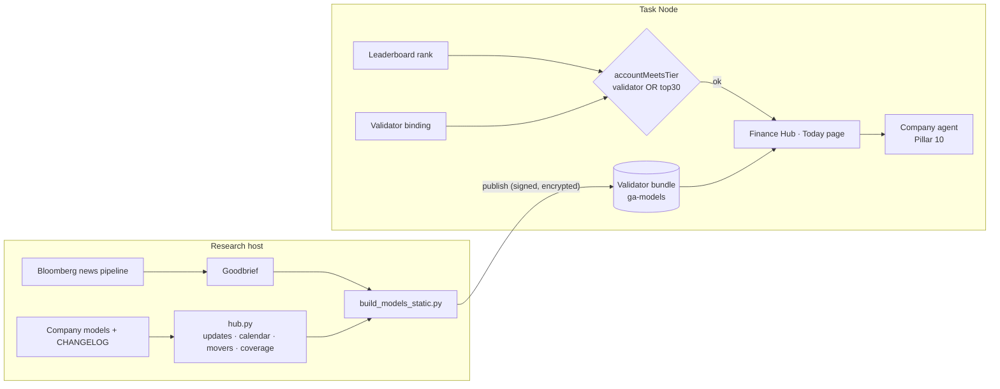

# Pillar 9 — Finance Hub User Spec

> **Status:** Partial. Finance Hub is live as an encrypted bundle of company models, movers, calendar and updates, open to any account with a bound validator. There is no top-30 tier. The Goodbrief is built outside Task Node and pulled in over SSH, and there is no daily-use design.
>
> **Bubbles up to:** *A reason to join*. Finance Hub is what validators and top contributors get, so it pulls operators onto the new chain ([Pillar 3](03-validator-program.md)) and gives people a reason to do great work on Task Node.

## In one paragraph

Finance Hub is Post Fiat's members' research desk: the GoodAlexander coverage universe of company models, what changed, what's reporting, what moved, and the **Goodbrief** macro roundup. It is the reward for being a **validator** or a **top-30 Task Node contributor**. Today it is a static encrypted bundle shown in an iframe, unlocked by validator binding. This pillar makes it a daily destination with one clear front page, adds the top-30 access tier, and moves the Goodbrief and model updates onto a reliable publishing path.

## User story

**Founder's story.** Once I am a validator or a top-30 Task Node user, I should be able to log in and see Finance Hub. Finance Hub should have a clear portal of all the most recent model updates, earnings releases and changes across the coverage universe. It should give access to the Goodbrief, the macro news roundup. It should be an intuitively designed place I want to log into every day to see what's going on in markets.

**Augmented story.**

1. **Access.** I'm in the top 30 on the Task Node leaderboard, or I have a bound validator. **Finance Hub** appears in my sidebar, with a note saying why I have access, for example *Top 30 · rank 12*.
2. **Today.** The front page is **Today**:
    - the Goodbrief at the top (dated, reading time)
    - **Model updates** since my last visit (company, what changed, old and new target or estimate, link to the model)
    - **Reporting this week** (earnings calendar)
    - **Movers** (biggest moves across the coverage universe)
    - **Changes** (coverage added or dropped)
3. **Drill in.** I click a company and see its model, changelog, earnings history and the latest note. From there I can ask the company's agent a question ([Pillar 10](10-information-hive-mind.md)).
4. **Come back.** Tomorrow the *since your last visit* markers tell me what's new. An optional daily email or Task Node notification points to Today.
5. **Lose access gracefully.** If I drop out of the top 30, I keep access for a grace window, and the hub tells me how to regain it: a validator or tasks.

## What exists today

| Component | Where | State |
|---|---|---|
| Finance Hub view (iframe of the bundle) | Task Node [`src/features/research/finance-hub-route.js`](https://github.com/postfiatorg/tasknode/blob/main/src/features/research/finance-hub-route.js) · [`FinanceHubView.jsx`](https://github.com/postfiatorg/tasknode/blob/main/src/features/research/FinanceHubView.jsx) | Live. Shows "Connect a validator" without access. |
| Sidebar gate | [`src/app/App.jsx`](https://github.com/postfiatorg/tasknode/blob/main/src/app/App.jsx) (`hasFinanceHub = signedIn && session.validator.bindings.length > 0`) | Live. **Validator-only.** |
| Server gate | [`server/validator-bundles.js`](https://github.com/postfiatorg/tasknode/blob/main/server/validator-bundles.js) → [`server/index-viewer-routes.js`](https://github.com/postfiatorg/tasknode/blob/main/server/index-viewer-routes.js) `accountMeetsTier` (tier `validator` = `hasValidatorBinding`; unknown tiers fail closed) | Live |
| Bundle publishing | [`scripts/publish-validator-bundle.mjs`](https://github.com/postfiatorg/tasknode/blob/main/scripts/publish-validator-bundle.mjs) (`ga-models`, `tier: "validator"`) | Live. AES-GCM encrypted bundle. |
| Docs | [`docs/wiki/surfaces/validator-research.md`](https://github.com/postfiatorg/tasknode/blob/main/docs/wiki/surfaces/validator-research.md) · [`finance-hub-demand-loading-20261111.md`](https://github.com/postfiatorg/tasknode/blob/main/docs/wiki/plans/finance-hub-demand-loading-20261111.md) | Per-file encrypted loading validated locally; live rollout not confirmed. |
| Hub content builder | `navstrategies/company_models/hub.py` (movers from Hyperliquid trade.xyz perps, calendar, updates from CHANGELOG, coverage, brief, freshness) · `navstrategies-company-models/tools/finance_hub/build_models_static.py` | Built (private repos) |
| Goodbrief | `navstrategies/.../bloomberg/news_summary_pipeline.py` (`BloombergGoodBriefPipeline`) → bundle fetched over SSH from the research host, with a stale-cache fallback | Live, but through a fragile SSH pull |
| Leaderboard | [`server/repositories/directory-leaderboard.js`](https://github.com/postfiatorg/tasknode/blob/main/server/repositories/directory-leaderboard.js) (network tasks × 3 + personal tasks + rewards / 25,000 + alignment) | Live, **not linked to access** |
| Per-company agent tables | [`server/db/migrations/158_finance_agent.sql`](https://github.com/postfiatorg/tasknode/blob/main/server/db/migrations/158_finance_agent.sql) | Migration only; no code uses it yet |

## Architecture

## Technical requirements

### Access

- **R1.** Add a tier `finance_hub` = `validator OR top30`, evaluated by `accountMeetsTier`. Unknown tiers still fail closed. Top 30 is computed from the existing leaderboard score once a day and stored as a snapshot, so access doesn't flicker.
- **R2.** A grace window, N days after dropping out of the top 30, during which access continues with a notice.
- **R3.** `hasFinanceHub` in `App.jsx` reads the server's tier decision instead of only `validator.bindings`.

### Today page

- **R4.** A **Today** page as the hub's front page. It is assembled from the bundle's `goodbrief.json`, `updates`, `calendar`, `movers` and `coverage` data, which `hub.py` already produces.
- **R5.** Per-user *since your last visit* state stored in Task Node (last-seen timestamp per section).
- **R6.** Each model update shows company, change summary, old and new key numbers, and a link to the model page.

### Publishing

- **R7.** Replace the SSH pull of the Goodbrief with a signed push: the research host publishes the bundle to Task Node with `publish-validator-bundle` after each build. The hub shows build freshness and warns if the bundle is stale.
- **R8.** Ship per-file demand loading from the 11 Nov plan to production, so the hub opens fast.

### Retention

- **R9.** An optional daily notification or email linking to Today when there is new content. Users can turn it off.

## Dependencies

| Depends on | Why |
|---|---|
| [Pillar 3 — Validators](03-validator-program.md) | The validator path to access. |
| [Pillar 10 — Information hive mind](10-information-hive-mind.md) | Company agents inside the hub. |
| Research host build pipeline (navstrategies) | Content. |
| Leaderboard (live) | The top-30 tier. |

## Acceptance criteria

1. A non-validator account ranked in the top 30 sees Finance Hub. An account at rank 31 doesn't, unless it is inside its grace window.
2. Today shows the latest Goodbrief, the model updates since the last visit, this week's reporters, movers and coverage changes, all from one published bundle.
3. The Goodbrief arrives by signed push; the SSH pull is retired.
4. The hub loads its first screen without downloading the full bundle.

## Open questions for the founder

- Should top 30 be computed with the existing leaderboard formula or a separate one?
- How long should the grace window be after dropping out of the top 30?
- Should GoodAlexander content outside Finance Hub (posts, films) live in the same portal?

## Code references

- Gate: [`server/index-viewer-routes.js`](https://github.com/postfiatorg/tasknode/blob/main/server/index-viewer-routes.js) · [`server/validator-bundles.js`](https://github.com/postfiatorg/tasknode/blob/main/server/validator-bundles.js)
- View: [`src/features/research/`](https://github.com/postfiatorg/tasknode/tree/main/src/features/research)
- Leaderboard: [`server/repositories/directory-leaderboard.js`](https://github.com/postfiatorg/tasknode/blob/main/server/repositories/directory-leaderboard.js)
