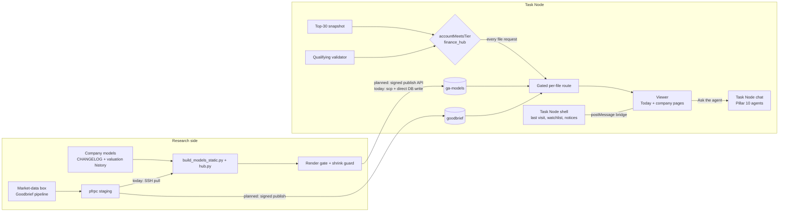

# Pillar 9 — Finance Hub User Spec

> **Status:** Partial. Finance Hub is live inside Task Node: about 60 company models and a home page of movers, earnings, model updates and the Goodbrief, republished automatically. Access is **validator-only**, and any bound validator counts, old-chain included. There is no top-30 tier, single Today page, *since your last visit* state, search or watchlist. Publishing is unsigned.
>
> **Bubbles up to:** [Outcome B · A production-ready new chain](../README.md#three-outcomes). *A reason to join*. Finance Hub is what validators and top contributors get, so it pulls operators onto the new chain ([Pillar 3](03-validator-program.md)) and gives people a reason to do great work on Task Node.

## In one paragraph

Finance Hub is Post Fiat's members' research desk: the GoodAlexander coverage universe of company models (what changed, reported, is reporting and moved) plus the **Goodbrief** macro roundup. It is the reward for **validators**, who also get **GoodAlexander content**, and for **top-30 Task Node users**. Most content exists. This pillar adds the top-30 path, defines which validators qualify, and turns the home page into one **Today** page worth opening daily. It also closes the leak paths and moves publishing to a signed path that alerts when it stalls.

## User story

**Founder's story.** Once I am a validator or am a top-30 Task Node user, I should be able to log in and see Finance Hub. Finance Hub should have a clear portal of all the most recent model updates, earnings releases and changes across the coverage universe. It should allow access to the Goodbrief, which is the macro news roundup, and be an intuitively designed place where I want to log in every day and see what is going on in markets. *(Validator-program premise: validators should be able to access Finance Hub as well as GoodAlexander content.)*

**Augmented story.**

1. **Access.** I have a qualifying validator bound to Task Node, or I'm in the top 30. **Finance Hub** appears in my sidebar with the reason, for example *Validator · L1* or *Top 30 · rank 12*. If I have neither, the locked page explains both ways in.
2. **Today.** The front page is **Today**. It covers equities, crypto and macro, and the old tabs become filters. In order:
    - the **Goodbrief** summary: its date, whether today's brief is out yet, and a link to the full brief
    - **Just reported**: result against consensus, model state, upside move and call takeaway
    - **Model updates**: target and expected upside, before → after, and why
    - **Reporting this week**, with the options-implied move
    - **Movers**, refreshed live
    - **Coverage changes**: models added or dropped
    - anything new since my last visit is marked, and my watchlist comes first

3. **Find.** I search by ticker or name and can star companies into a watchlist.
4. **Drill in.** A company page shows the model, change ledger, earnings history and latest note. It also shows **Contributor insights** and an **Ask the agent** entry point. The agent and contributor interviews run in Task Node chat ([Pillar 10](10-information-hive-mind.md)).
5. **Come back.** On my next visit the *new* markers are still right, even if I refreshed mid-read. If I opt in, I get a notice when a new Goodbrief lands.
6. **Lose access clearly.** If I drop out of the top 30, the hub shows when access ends and how to regain it: run a validator or do more rewarded work.

## What exists today

| Component | Where | State |
|---|---|---|
| Finance Hub view | [`finance-hub-route.js`](https://github.com/postfiatorg/tasknode/blob/main/src/features/research/finance-hub-route.js) · [`FinanceHubView.jsx`](https://github.com/postfiatorg/tasknode/blob/main/src/features/research/FinanceHubView.jsx) | Live. Same-origin iframe of the `ga-models` bundle, with a `postMessage` bridge for route and theme. |
| Sidebar gate | [`App.jsx`](https://github.com/postfiatorg/tasknode/blob/main/src/app/App.jsx) `hasFinanceHub` · session from [`server/app-state.js`](https://github.com/postfiatorg/tasknode/blob/main/server/app-state.js) | Live. Validator-only. |
| In-app file gate | [`server/validator-bundles.js`](https://github.com/postfiatorg/tasknode/blob/main/server/validator-bundles.js) | Live. **Every file request** re-checks `accountMeetsTier`, then decrypts on the server and serves `private,no-store`. |
| Static-site key path | [`server/index-viewer-routes.js`](https://github.com/postfiatorg/tasknode/blob/main/server/index-viewer-routes.js) (`index-auth/start` → `exchange` → `unlock`) | Live. Gives an eligible account the **whole-version content key**. The ciphertext is public at `…/indices/<id>/content`. Unknown tiers fail closed. |
| Validator binding | [`validator-bindings.js`](https://github.com/postfiatorg/tasknode/blob/main/server/repositories/validator-bindings.js) · [`l1-validator-identity.js`](https://github.com/postfiatorg/tasknode/blob/main/server/l1-validator-identity.js) · [`156_l1_validator_bindings.sql`](https://github.com/postfiatorg/tasknode/blob/main/server/db/migrations/156_l1_validator_bindings.sql) | Live. Networks: `devnet`/`testnet` (old `postfiatd`) and `l1-devnet` (postfiatl1v2, ML-DSA-65, registry-`active` **at bind time only**). One identity per account. `hasValidatorBinding` accepts any binding. Participation (`l1RewardEligibility`, 25 of 30 days at 95%) drives the monthly credit, not access. |
| Publisher | [`publish-validator-bundle.mjs`](https://github.com/postfiatorg/tasknode/blob/main/scripts/publish-validator-bundle.mjs) | Live. Hard-codes `tier: "validator"`. Each publication gets a new random key and an atomic swap that keeps the previous version. |
| Per-file loading | [`finance-hub-demand-loading-20261111.md`](https://github.com/postfiatorg/tasknode/blob/main/docs/wiki/plans/finance-hub-demand-loading-20261111.md) · [`159_validator_bundle_files.sql`](https://github.com/postfiatorg/tasknode/blob/main/server/db/migrations/159_validator_bundle_files.sql) | On `main` (#384). In a local replay, the home page read 221,307 encrypted bytes instead of the 19 MB archive. Production use is unconfirmed. |
| Hub content | `hub.py` · `build_models_static.py` · viewer `app.js` (private, paths below) | Live. Home has *Just reported*, *Reporting*, *Updates* (target and upside before → after, with why), *Change ledger*, movers and coverage. No coverage diff, search or watchlist. Pre-print estimates are not stored. |
| Goodbrief | `BloombergGoodBriefPipeline` on the market-data box → staged on pfrpc → pulled over SSH by the build | Live, inside `ga-models`. A failed pull shows the last good copy, marked stale. The vendor's name is scrubbed from published text. |
| Publish loop | `publish_to_tasknode.py` (`ga-models-publish.timer`, every 15 minutes) | Live. Render gate, shrink guard, five kept exports, `STALE.json` on failure. `scp` to pfrpc, which writes **directly to the production database**. Unsigned. |
| Leaderboard | [`directory-leaderboard.js`](https://github.com/postfiatorg/tasknode/blob/main/server/repositories/directory-leaderboard.js) | Live, not linked to access. Score = 3 × network tasks + personal tasks + rewards / 25,000 + alignment (0–100). Tasks and rewards are **all-time**; alignment covers 30 days. Only rewarded tasks with on-chain evidence count. Only **publicly discoverable** accounts are ranked. No snapshot. |
| Notifications | [`server/app-realtime.js`](https://github.com/postfiatorg/tasknode/blob/main/server/app-realtime.js) | In-app stream for open sessions. No email sender. |
| Finance agent tables | [`158_finance_agent.sql`](https://github.com/postfiatorg/tasknode/blob/main/server/db/migrations/158_finance_agent.sql) | Migration only. For an **allowlisted operator** whose agent proposes model edits for approval. No contributor fields. |
| Other GoodAlexander content | [`validator-research.md`](https://github.com/postfiatorg/tasknode/blob/main/docs/wiki/surfaces/validator-research.md) | Deep Research in chat is open to every account, at cost. Research API keys are validator-only. |

## Architecture

**Rendering decision.** The viewer keeps rendering: it already draws every section and is gated per file on the same origin. The Task Node shell owns what needs the account (access, last visit, watchlist, notices, agent hand-off) and passes it over the existing bridge. A native React port is out of scope.

## Technical requirements

### Access model

- **R1.** A tier `finance_hub` in `accountMeetsTier`: *qualifying validator* OR *top 30* OR *in grace*. It returns the basis (`validator`, `top30` plus rank, or `grace` plus end time). Unknown tiers still fail closed.
- **R2.** Tier migration, in one release:
    - `publish-validator-bundle.mjs` takes `--tier`.
    - The `ga-models` and `goodbrief` publications and their live index rows use `finance_hub`.
    - `revokeValidatorBinding` currently revokes only `tier='validator'` tokens. It must cover the new tier too.
    - An integration test fetches real files as a validator, a top-30 account and a rank-31 account.
- **R3.** *Qualifying validator* is a single server function, and its definition is open question 1. It reads `validator_bindings.network`. If liveness is required, it reuses `l1RewardEligibility` with a cached result, so file requests never wait on the registry.
- **R4.** *Top 30* comes from a stored **daily snapshot** (account, rank, score, components, time), not the live leaderboard. The scoring and the ranked population are open questions 2–3. Ties break deterministically, ending on `account_id`; today's sort ends on a handle that can be empty. Pillar 1 can reuse the snapshot.
- **R5.** Grace length, whether grace can repeat, and an optional keep-until rank are parameters (open question 4). The notice shows the exact end time.
- **R6.** The session gains `financeHub: { ok, basis, rank, graceEndsAt }`. `App.jsx` and `hasFinanceHubAccess` read it, and the locked screen explains both paths.

### Security and content rights

- **R7.** `ga-models` and `goodbrief` are served **only** through the in-app per-file route. `unlock` refuses `finance_hub`-tier indices, so no one can download a whole-version key. Before the switch, confirm that no static site relies on that path.
- **R8.** Revocation: once an account stops qualifying, its next file request fails. Files it has already viewed cannot be recalled, and each publication uses a new key.
- **R9.** Each bundle request is logged per account (file and time) and rate-limited per account, to catch bulk download. Watermarking is open question 6.
- **R10.** The top-30 rollout waits on the founder's answer about redistribution rights (open question 5). Scrubbing the vendor's name does not settle them.

### Today page and content

- **R11.** Today is the landing view, built from the existing `hub/*.json` files:
    - `goodbrief`;
    - `brief.models[].printed` and `calendar.recent` for *Just reported*;
    - `updates`;
    - `calendar.upcoming` with the options-implied moves from `brief`;
    - `movers`, refreshed live as now;
    - `coverage`.

    The tabs become filters, and the render gate checks Today.

- **R12.** Each `hub/*.json` file carries a `schema` version, and the viewer degrades section by section when a field is missing. Optionally, store the pre-print quarter estimates, so *Just reported* can show the actual result against **our** number as well as consensus.
- **R13.** The build diffs `models.json` against the last published export and writes `hub/coverage_changes.json`: model, added or dropped, and a note. Drops already need `--allow-shrink`, so each one is deliberate.
- **R14.** Task Node stores `last_seen_at` per account. When a session opens, the shell passes the stored value to the viewer as `previous_visit_at`, then saves the new time. The markers stay fixed for the whole session and reset on **Mark caught up**.
- **R15.** Company search, plus a per-account watchlist stored in Task Node. Today and the Goodbrief summary must be readable at phone width.
- **R16.** Record eligible accounts, daily active accounts and return visits by access basis, for the founder to see. No targets are set here.
- **R17.** **Inputs for [Pillar 10](10-information-hive-mind.md):**
    - `hub/coverage_manifest.json` lists each company with its asset class and knowledge-area tags. Company keys are model directories such as `RKLB`.
    - Each company gets an agent brief, `models/<DIR>/agent_brief.json`. The members part is kept separate from a public part that carries no model numbers or targets.
    - Each company gets `models/<DIR>/contributor_insights.json`, built from the accepted contributions Pillar 10 returns.

### Publishing

- **R18.** A Task Node **publish API** replaces `scp` plus the direct database write:
    - The request carries the manifest, a version number that must increase, and a signature from a publisher key pinned in Task Node.
    - A bad signature or a version that isn't newer is rejected.
    - A rollback is a signed request that names one of the kept versions.
    - The swap stays atomic.
    - The database credential on pfrpc is retired.
- **R19.** The Goodbrief becomes its own signed publication (`goodbrief`), pushed by the pfrpc staging job. A failed model build can then never hold back the brief, and the build's SSH pull goes away.
- **R20.** An operator alert fires on any of: `STALE.json`, a failed publish, or freshness past an operator-set threshold. This is in addition to the in-hub stale banner.
- **R21.** Confirm per-file loading in production. The live `ga-models` row has `metadata.fileFormat`, and a cold Today load reads neither company model files nor the archive.

### Retention, local app and GoodAlexander content

- **R22.** Opt-in notice when a new Goodbrief publishes, in-app and as a Task Node notification. It can be switched off per account. Off-app delivery is open question 7.
- **R23.** The local app ([Pillar 5](05-local-task-node.md)) opens Finance Hub through hosted Task Node with the user's session. No bundle or key is stored locally.
- **R24.** **GoodAlexander content** shares the entitlement. Validators keep research API keys, and a **Library** section lists other GoodAlexander publications under `finance_hub`. What it contains, and whether top-30 users get API keys too, is open question 8.

### Economics

- **Validator path.** Today one signed challenge on any network unlocks the hub until the operator unbinds. That does not pull operators onto postfiatl1v2 or keep them live. R3 makes the rule explicit.
- **Top-30 path.** Personal tasks count only once Task Node has rewarded them with on-chain evidence, so self-farming is limited to work it pays for. But all-time totals entrench incumbents. Alignment alone can add up to 100 points, the same as 33 network tasks. Any score that gates access will be optimised for (open question 2).
- **Scarcity and supply.** The reward is worth having only while it stays exclusive (R7–R9) and keeps arriving from one research host and one market-data box (R19–R20).

## Dependencies

| Depends on | Why |
|---|---|
| [Pillar 3 — Validators](03-validator-program.md) | New-chain binding as the default, plus uptime data if liveness is required. |
| [Pillar 10 — Information hive mind](10-information-hive-mind.md) | The agents and contributor interviews, which run in Task Node chat. The hub hosts *Contributor insights* and the **Ask the agent** entry point, and supplies the R17 inputs. |
| [Pillar 5 — Local Task Node](05-local-task-node.md) | Local app access through the hosted session. |
| Research host and market-data box | The content and the signed publishers. |
| Founder answers on rights and access policy | They gate widening access to the top 30. |

## Acceptance criteria

1. A non-validator at snapshot rank 30 opens Finance Hub and every file loads. Rank 31 gets 403 unless it is in grace, in which case it sees the end time. A tie at rank 30 resolves the same way on every run.
2. A validator meeting the chosen definition gets in. An account whose only binding fails it (for example, old-chain-only, if so decided) is refused with a reason.
3. After an account stops qualifying, its next file request fails. `unlock` never returns a key for `ga-models` or `goodbrief`.
4. Today shows the Goodbrief, Just reported, Model updates, Reporting this week, Movers and Coverage changes. A dropped model appears under Coverage changes.
5. New markers survive a refresh within the session and clear on **Mark caught up**.
6. Search finds any covered company, and a starred company comes first on the next visit.
7. A publish with a bad signature or an older version is rejected. A signed rollback to a kept version succeeds.
8. A Goodbrief publishes while the model build is failing, and a stalled build raises an operator alert.
9. In production, a cold Today load reads no company model file and not the archive.
10. Opting out stops notices. The local app opens Finance Hub without storing bundle files.
11. The R17 files are present in every publication. Usage by access basis is visible to the founder.

## Open questions for the founder

1. **Which validators qualify?**
    - (a) Any bound validator, as today. This keeps rewarding the old chain.
    - (b) postfiatl1v2 validators only, with a sunset for old-chain bindings.
    - (c) Option (b) plus the existing participation rule. This shuts out new operators until they have a track record, and it needs the Pillar 3 uptime exporter.

2. **Which score picks the top 30?**
    - (a) The current all-time leaderboard. It is simple but entrenches incumbents.
    - (b) The same formula over a rolling window. This rewards current work.
    - (c) A dedicated score, for example network tasks and paid rewards only. It is harder to game, but it is a new formula.

    Separately: should the number stay at 30 as the network grows?

3. **Who is ranked?** Only publicly discoverable accounts, as today, or everyone? Ranking everyone lets private contributors in without being listed.
4. **Grace.** How long does it last? Can it repeat? Should there be a keep-until rank (enter at 30, keep access until some lower rank)?
5. **Content rights.** Is the Goodbrief (an LLM synthesis of Bloomberg articles), along with the other data sources, cleared for outside validators and top-30 users? The options are to confirm it as is, to limit top-30 users to models only, or to run a licence review first.
6. **Watermarks.** Should the Goodbrief and model pages carry per-user watermarks? They deter leaks but add build work.
7. **Off-app notices.** Email (needs a sending provider and consent), a Nostr/Hive message, or in-app only?
8. **GoodAlexander content.** What goes in the Library: posts, films, research reports? Do top-30 users get the same content and API keys as validators?

## Code references

- Gate: [`server/index-viewer-routes.js`](https://github.com/postfiatorg/tasknode/blob/main/server/index-viewer-routes.js) · [`server/validator-bundles.js`](https://github.com/postfiatorg/tasknode/blob/main/server/validator-bundles.js) · [`server/repositories/index-viewer.js`](https://github.com/postfiatorg/tasknode/blob/main/server/repositories/index-viewer.js)
- Bindings: [`server/repositories/validator-bindings.js`](https://github.com/postfiatorg/tasknode/blob/main/server/repositories/validator-bindings.js) · [`server/l1-validator-identity.js`](https://github.com/postfiatorg/tasknode/blob/main/server/l1-validator-identity.js) · [`server/l1-validator-uptime.js`](https://github.com/postfiatorg/tasknode/blob/main/server/l1-validator-uptime.js) · L1: [`docs/runbooks/tasknode-l1-validator-binding.md`](https://github.com/postfiatorg/postfiatl1v2/blob/main/docs/runbooks/tasknode-l1-validator-binding.md)
- View and session: [`src/features/research/`](https://github.com/postfiatorg/tasknode/tree/main/src/features/research) · [`src/app/App.jsx`](https://github.com/postfiatorg/tasknode/blob/main/src/app/App.jsx) · [`server/app-state.js`](https://github.com/postfiatorg/tasknode/blob/main/server/app-state.js)
- Publishing: [`scripts/publish-validator-bundle.mjs`](https://github.com/postfiatorg/tasknode/blob/main/scripts/publish-validator-bundle.mjs) · [`159_validator_bundle_files.sql`](https://github.com/postfiatorg/tasknode/blob/main/server/db/migrations/159_validator_bundle_files.sql)
- Leaderboard: [`server/repositories/directory-leaderboard.js`](https://github.com/postfiatorg/tasknode/blob/main/server/repositories/directory-leaderboard.js)
- Private: `navstrategies-company-models/navstrategies/company_models/hub.py` · `navstrategies-company-models/tools/finance_hub/build_models_static.py` · `navstrategies-company-models/tools/finance_hub/publish_to_tasknode.py` · `navstrategies-company-models/apps/company_model_viewer/app.js` · `navstrategies/navstrategies/data_sources/bloomberg/news_summary_pipeline.py`

## Revision notes (review round 1)

| Reviewer item | Change |
|---|---|
| Gemini P1, Opus P1 | R3, open question 1, acceptance 2. Partly disputed: L1 binding already exists, with ML-DSA, a registry check and one identity per account. The gaps are that old-chain bindings also count and that liveness is never re-checked. |
| Gemini P2 | Rendering decision, R7, R8. Partly disputed: the iframe is same-origin with a working bridge, and files are decrypted on the server on every request. |
| Gemini P3, Opus P3 | Leaderboard facts verified (all-time totals, public accounts only, ties end on handle). R4, R5, Economics, open questions 2–4. |
| Gemini P4 | R18–R20. Partly disputed: the hub already republishes every 15 minutes, movers refresh live, and a failed Goodbrief fetch never fails the build. |
| Gemini P5 | Confirmed: the tier is hard-coded, and so is the revocation query. R2. |
| Gemini P6 | R11–R13. Partly disputed: `updates.json` already has before → after values, and *Just reported* exists. The real gaps are pre-print estimates and the coverage diff. |
| Gemini P7, Opus P7 | R17, story step 4, and the Ask-the-agent link to Task Node chat. Migration 158 is now described accurately. How users link to coverage is decided in Pillar 10. |
| Gemini P8, Opus P11 | R24, open question 8. |
| Gemini P9, Opus P4 | R7–R10, open questions 5–6. |
| Gemini P10, Opus P12 | R22, acceptance 10, open question 7. Verified: there is no email sender. |
| Gemini P11 | R14, R15, acceptance 5–6. |
| Gemini P12, Opus P14 | R21, R23. Disputed: the plan's date (2026-11-11, merged in #384) is correct. The production state is now stated. |
| Opus P2 | R7, R8, acceptance 3. The leak is the `unlock` key path, not the in-app view. |
| Opus P5 | R11. *Just reported* already exists; it now sits on Today. |
| Opus P6 | R11, R14–R16. Usage metrics added without invented targets. |
| Opus P8 | Confirmed: nothing is signed today. R18, acceptance 7. |
| Opus P9 | Clarified: the Goodbrief ships inside `ga-models`. R19 makes it its own publication. |
| Opus P10 | R5, open question 4. |
| Opus P13 | Existing safeguards listed. Operator alerting added (R20). |
| Opus P15 | Acceptance criteria now cover access, revocation, publishing, Today, retention, the Pillar 10 inputs and metrics. |
