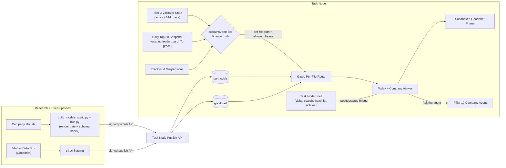

# Pillar 9 — Finance Hub User Spec

> **Status:** Partial. Finance Hub is already live inside Task Node (~60 company models + movers, earnings, model updates, and the Goodbrief macro roundup). What is missing: adding the Top-30 contributor tier (using the existing leaderboard), connecting validator access to [Pillar 3](03-validator-program.md)'s active-liveness state, unifying the landing screen into one daily **Today** page with search/watchlist/*"new since last visit"* markers, isolating Goodbrief HTML scripts safely, and replacing unsigned direct-DB publishing with a signed publish API.
>
> **Outcome:** [B · A production-ready new chain](../README.md#three-outcomes) — Finance Hub is the daily research reward that motivates outside validators to run `postfiatl1v2` and motivates contributors to do high-signal work on Task Node.

## What this pillar is (in plain English)

Finance Hub is Post Fiat's members-only research desk: the GoodAlexander coverage universe (~60 company/crypto models showing what changed, what just reported, who reports next, and live movers) plus the **Goodbrief** macro roundup and GoodAlexander Library posts/reports.

This pillar turns Finance Hub into a product you genuinely want to open every morning while closing today's security and publishing gaps:

1. **Two clean ways in (`finance_hub` tier):**
   - **Active Validators:** Tied directly to [Pillar 3](03-validator-program.md)'s access state (active in the registry + 95%/30-day uptime after initial ramp-in, with a 14-day grace window).
   - **Top 30 Task Node Users:** Picked by a daily snapshot of the **existing Task Node leaderboard formula** (`3 × network tasks + personal tasks + rewarded PFT / 25,000 + alignment`), awarding **30 non-validator seats** across all non-blacklisted accounts (so private contributors still qualify without having to list themselves publicly), with a **7-day grace period** and **keep-until rank 35** so nobody flickers in and out at rank 30/31.
2. **One "Today" morning landing page:** Combines equities, crypto, and macro on one clean feed (old tabs become filters) in priority order: **Goodbrief summary** → **Just reported** → **Model updates** (target/upside before → after + why) → **Reporting this week** (with options-implied moves) → **Live movers** → **Coverage changes** (added/dropped models). Your starred **watchlist** floats to the top, and **"New since your last visit"** markers stay consistent across refreshes, tabs, and mobile.
3. **Real security & anti-leak hygiene:** Serves every bundle file strictly through per-file auth checks (disabling whole-archive key downloads), drops `'unsafe-inline'` scripts, runs the full HTML Goodbrief inside a strict **sandboxed iframe** so third-party/LLM HTML can never touch your Task Node session, adds subtle per-user watermarks + rate limits + operator suspension, and switches publishing from unsigned `scp`/direct-DB writes to a **signed Publish API** (with Goodbrief decoupled into its own signed publication so a model build error never delays the morning brief).
4. **Connected to Pillar 10 (Information Hive Mind):** Every company page displays verified **Contributor insights** and an **Ask the agent** button that launches a [Pillar 10](10-information-hive-mind.md) research chat on that exact company.

## How Finance Hub publishing & access work

## Locked-in design decisions

- **Top-30 scoring & eligibility:** Use the **existing Task Node leaderboard method** (`directory-leaderboard.js` formula), persisted as a **daily UTC snapshot** with deterministic tie-breaking on `account_id`. Rank **all non-blacklisted accounts** (so private users can qualify without being publicly listed), awarding **30 non-validator seats** so validators don't crowd out top contributors. Failed snapshot jobs keep the last good snapshot and alert operators.
- **Validator qualification & grace:** Reads [Pillar 3](03-validator-program.md)'s access state directly (active in registry + 95%/30-day uptime after initial 30-day ramp-in; **14-day grace** when lapsed; old-chain bindings sunset once migration completes). Top-30 users get a **7-day grace window** plus a **keep-until rank 35** hysteresis band. The hub clearly displays exact grace expiry dates and how to regain access.
- **Content access & perks parity:**
  - **Both Active Validators and Top-30** get **Finance Hub** (all company models, Goodbrief, and GoodAlexander Library posts/reports).
  - **Research API keys** stay **Validators-only** (and validators can spend their Pillar 3 `$20/mo` Task Node credit on Deep Research).
  - Every publication and Library item carries an `allowed_bases` metadata list checked per request so Goodbrief or any specific publication can be adjusted per tier in one config edit with zero code deploy (plus a pre-launch content-rights review item in the checklist).
- **Engineering & anti-leak defaults locked in:**
  - **Keep same-origin viewer + harden isolation:** Keep the existing first-party viewer (no needless React rewrite), remove `'unsafe-inline'`, sandbox full HTML Goodbrief inside `<iframe sandbox="allow-scripts">` with matching CSP so it runs in an opaque origin, and reject raw HTML in LLM/contributor text.
  - **Anti-leak controls:** Disable whole-bundle key `unlock` and `.../content` archive downloads for `finance_hub` indices; enforce per-account logging, rate limiting, unusual-scrape alerts, subtle per-user watermarks, and operator suspension (appealable via the existing reinstatement board).
  - **Notifications & local Mac app:** Opt-in **in-app + Hive DM** notification when a new Goodbrief lands (no third-party email sender in v1). On the native Mac app ([Pillar 5](05-local-task-node.md)), Finance Hub links cleanly to the hosted web view (never storing protected research bundles on disk) until a dedicated native view is built.

## What exists today

| Piece | Current state | Where |
|---|---|---|
| Finance Hub viewer & file gate | Live in Task Node (`ga-models`, ~60 models, Equities/Crypto/Macro tabs), per-file demand loading built (PR #384), **but** iframe is unsandboxed, CSP allows `'unsafe-inline'`, whole-bundle `unlock`/`content` paths still exist, and Goodbrief HTML scripts run on Task Node's origin | [`FinanceHubView.jsx`](https://github.com/postfiatorg/tasknode/blob/main/src/features/research/FinanceHubView.jsx), [`validator-bundles.js`](https://github.com/postfiatorg/tasknode/blob/main/server/validator-bundles.js), [`index-viewer-routes.js`](https://github.com/postfiatorg/tasknode/blob/main/server/index-viewer-routes.js) |
| Access & leaderboard | Validator-only (any old/new binding stays unlocked forever); leaderboard exists (`directory-leaderboard.js`) but has no daily snapshot and isn't connected to Finance Hub | [`directory-leaderboard.js`](https://github.com/postfiatorg/tasknode/blob/main/server/repositories/directory-leaderboard.js), [`l1-validator-identity.js`](https://github.com/postfiat/tasknode/blob/main/server/l1-validator-identity.js) |
| Publishing pipeline | Runs every 15 min via `publish_to_tasknode.py` with render gate & shrink guard, **but** pushes unsigned via `scp` directly into production Postgres, and couples Goodbrief inside `ga-models` | `navstrategies-company-models/publish_to_tasknode.py`, [`publish-validator-bundle.mjs`](https://github.com/postfiatorg/tasknode/blob/main/scripts/publish-validator-bundle.mjs) |

## Detailed specification

### 1. Unified `finance_hub` tier, grace cooldown & daily Top-30 snapshot
- **`accountMeetsTier("finance_hub")`:** Returns `{ ok, basis, rank, snapshotAt, graceEndsAt }` (`basis` = `validator`, `top30`, or `grace`), checks `allowed_bases` per publication on every request (including Today's Goodbrief summary card independently of `ga-models`), and fails closed on blacklisted, suspended, or unknown-tier accounts.
- **Zero-downtime migration & dual-chain sunset:** Accept both legacy `validator` and `finance_hub` tiers first, update `revokeValidatorBinding` for both, then flip `ga-models` and `goodbrief` to `finance_hub`. Old-chain validator bindings remain valid until Pillar 3's Step 3→4 migration sunset; a stale Pillar 3 validator feed (>1h) preserves existing access and blocks only new grants.
- **Daily Top-30 snapshot (anti-bounce grace):** Runs at a fixed UTC time using the existing `directory-leaderboard.js` formula over all non-blacklisted accounts **excluding active validators**, awarding exactly **30 non-validator seats** (deterministic tie-break on `account_id`). Users enter at rank `<= 30`, keep access down to rank `<= 35`, and get **7-day grace** on dropping below 35 — with a **30-day grace cooldown per account** so bouncing rank 35↔36 cannot grant infinite grace!

### 2. Daily "Today" landing page, watchlist & clean Pillar 10 bridge
- **Today view:** Unified equities/crypto/macro landing page with filters: (1) Goodbrief summary (fetched from the independent `goodbrief` publication under its own `allowed_bases` check), (2) Just reported (vs consensus + model state + call takeaway), (3) Model updates (target/upside before → after + why), (4) Reporting this week (options-implied move), (5) Live movers (dated last session on non-trading days), (6) Coverage changes (`hub/coverage_changes.json` diff of added/dropped models). Responsive on laptop and mobile, with schema-versioned `hub/*.json` contract checks.
- **Search, watchlist & visit state:** Ticker/name search + per-account starred watchlist (sorted first in every Today section). Task Node tracks `visit_baseline_at` and `last_active_at` per account (updating baseline only after an idle gap so refreshes, extra tabs, and phone hand-offs keep *"New"* badges intact until **Mark caught up**).
- **GoodAlexander Library & isolated Pillar 10 bridge:** Shared Library listing GoodAlexander posts/reports/media (per-file auth or short-lived signed URLs). Exports `hub/coverage_manifest.json` and `agent_brief_public.json` into a **separate public-safe index** (never mixed inside gated `ga-models`, build-verified to contain zero model targets/numbers), keeps `agent_brief_members.json` strictly inside `ga-models`, serves `contributor_insights.json` through a fast server-side takedown filter so MNPI retractions disappear in `< 1s` without waiting for a 15-minute model rebuild, and wires **Ask the agent** into Task Node chat.

### 3. Isolated-origin security hardening & signed Publish API
- **Dedicated viewer origin (eliminates Task Node XSS):** Serve the Finance Hub `ga-models` viewer from an **isolated subdomain/origin** (e.g., `hub-viewer.postfiat.org` — NOT `tasknode.postfiat.org`!) communicating with the Task Node shell via strict origin-checked `postMessage` and short-lived scoped viewer tokens — so even a compromised Publish API key can **never** run scripts on `tasknode.postfiat.org` or access user wallets/sessions!
- **Zero-exfiltration Goodbrief sandbox:** Fetch Goodbrief HTML server-side on the authenticated per-file route, inline only approved local styles/assets, and render inside `<iframe sandbox="allow-scripts">` via `srcdoc` with strict CSP `default-src 'none'; script-src 'unsafe-inline'; style-src 'unsafe-inline'; img-src data:; connect-src 'none'; form-action 'none'` — preventing both Task Node session access AND external network exfiltration.
- **Leak defense & signed Publish API:** Disable `unlock` and `.../content` whole-archive routes (confirm per-file loading in production), escape all contributor/LLM text, add per-account logging, rate limits, scrape alerts, subtle per-user watermarks, and operator suspension. Replace `scp` + direct DB writes with an authenticated, quota-limited **signed Publish API** (`indexId`, strictly monotonic `version`, `issuedAt`, per-file SHA-256) with 2-key rotation per index (`ga-models`, `goodbrief`). **Signed rollbacks publish a new monotonically higher `version` pointing to a kept historical manifest hash** (preserving strict monotonic replay protection!). Split `goodbrief` into its own publication, retire the `pfrpc` DB credential, and alert operators on stale feeds, failed publishes, overdue snapshots, or scrape anomalies.

## Milestones & completion checklist

### Build milestones
- [ ] **M1 · Security lockdown, isolated viewer origin & content-rights review:** Complete pre-launch content-rights review for Goodbrief/market data, move `ga-models` viewer to an isolated origin (`hub-viewer.postfiat.org`), close whole-bundle `unlock`/`content` paths, lock down Goodbrief `srcdoc` sandbox (`connect-src 'none'`), add per-account logging/rate-limits/watermarks/suspension, and wire `finance_hub` tier to Pillar 3 active validator states.
- [ ] **M2 · Daily "Today" page, search, watchlist & visit markers:** Ship the unified Today landing view (all 6 sections + coverage diff + mobile layout), company search, per-account watchlist, cross-device *"New since last visit"* markers, GoodAlexander Library, and opt-in Goodbrief in-app/Hive notices.
- [ ] **M3 · Signed Publish API & Goodbrief split:** Replace direct-DB `scp` writes with the quota-limited, 2-key-rotatable signed Publish API (monotonic-version rollback), decouple `goodbrief` from `ga-models`, retire the `pfrpc` DB credential, and wire operator staleness/anomaly alerts.
- [ ] **M4 · Daily Top-30 snapshot & grace UX:** Ship the daily UTC snapshot using the existing leaderboard formula (30 non-validator seats, all non-blacklisted accounts, 7-day grace + keep-until rank 35 + 30-day grace cooldown), sidebar access badges, locked-screen explanation, and usage telemetry by tier.
- [ ] **M5 · Pillar 10 isolated briefs & instant takedown:** Publish `coverage_manifest.json` + separate public-index `agent_brief_public.json` (with anti-leak build check), wire **Ask the agent** + `contributor_insights.json` with `< 1s` server-side MNPI takedown overlay.

### Required ship gates
- [ ] **1. Executed:** All M1–M5 code, signed publishing pipelines, daily Top-30 snapshot, and security/isolation controls merged and live in production.
- [ ] **2. Tested by user:** Founder reviews the live **Today** page on laptop and phone, verifies access as an active validator and as a Top-30 user (plus rank-31 denial and grace countdown), tests search/watchlist/*"New"* markers/Goodbrief sandbox isolation, and confirms a bad-signature publish is rejected.
- [ ] **3. Added to docs:** Finance Hub access guide (validator & Top-30 qualification, grace rules, Library & API key perks) and operator signed-publishing/rollback runbook published in Post Fiat docs.
- [ ] **4. Public blog post document:** Public blog post written and published showcasing Post Fiat Finance Hub — the daily research desk unlocked by running an active validator or reaching the Top 30 on Task Node.

## Code references

- Task Node Finance Hub & auth: [`FinanceHubView.jsx`](https://github.com/postfiatorg/tasknode/blob/main/src/features/research/FinanceHubView.jsx) · [`validator-bundles.js`](https://github.com/postfiatorg/tasknode/blob/main/server/validator-bundles.js) · [`index-viewer-routes.js`](https://github.com/postfiatorg/tasknode/blob/main/server/index-viewer-routes.js) · [`directory-leaderboard.js`](https://github.com/postfiatorg/tasknode/blob/main/server/repositories/directory-leaderboard.js) · [`publish-validator-bundle.mjs`](https://github.com/postfiatorg/tasknode/blob/main/scripts/publish-validator-bundle.mjs)
- Private research build pipeline: `navstrategies-company-models/` (`hub.py`, `build_models_static.py`, `render_gate.py`, `publish_to_tasknode.py`, `apps/company_model_viewer/app.js`)
