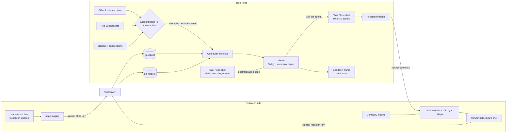

# Pillar 9 — Finance Hub User Spec

> **Status:** Partial. Finance Hub is live inside Task Node: about 60 company models and a home page of movers, earnings, model updates and the Goodbrief, republished automatically. Access is **validator-only**, and any bound validator counts, old-chain included. There is no top-30 tier, single Today page, *since your last visit* state, search or watchlist. Publishing is unsigned, and the Goodbrief's own scripts run on Task Node's origin.
>
> **Bubbles up to:** [Outcome B · A production-ready new chain](../README.md#three-outcomes). *A reason to join*. Finance Hub is what validators and top contributors get, so it pulls operators onto the new chain ([Pillar 3](03-validator-program.md)) and gives people a reason to do great work on Task Node.

## In one paragraph

Finance Hub is Post Fiat's members' research desk: the GoodAlexander coverage universe of company models (what changed, reported, is reporting and moved) plus the **Goodbrief** macro roundup. It is the reward for **validators**, who also get **GoodAlexander content**, and for **top-30 Task Node users**. Most content exists. This pillar adds the top-30 path, takes the validator rule from Pillar 3's access states, and turns the home page into one **Today** page worth opening daily. It also closes the leak paths, keeps LLM-written and third-party content away from the user's session, and moves publishing to a signed path that alerts when it stalls.

## User story

**Founder's story.** Once I am a validator or am a top-30 Task Node user, I should be able to log in and see Finance Hub. Finance Hub should have a clear portal of all the most recent model updates, earnings releases and changes across the coverage universe. It should allow access to the Goodbrief, which is the macro news roundup, and be an intuitively designed place where I want to log in every day and see what is going on in markets. *(Validator-program premise: validators should be able to access Finance Hub as well as GoodAlexander content.)*

**Augmented story.**

1. **Access.** I have a qualifying validator bound to Task Node, or I'm in the top 30. **Finance Hub** appears in my sidebar with the reason, for example *Validator · L1* or *Top 30 · rank 12* with the snapshot time. If I have neither, the locked page explains both ways in.
2. **Today.** The front page is **Today**. It covers equities, crypto and macro, and the old tabs become filters. In order:
    - the **Goodbrief** summary: its date, whether today's brief is out yet, and a link to the full brief
    - **Just reported**: result against consensus, model state, upside move and call takeaway
    - **Model updates**: target and expected upside, before → after, and why
    - **Reporting this week**, with the options-implied move
    - **Movers**, refreshed live
    - **Coverage changes**: models added or dropped
    - anything new since my last visit is marked, and my watchlist comes first

3. **Find.** I search by ticker or name and can star companies into a watchlist.
4. **Drill in.** A company page shows the model, change ledger, earnings history and latest note. It also shows **Contributor insights** and an **Ask the agent** button that opens Task Node chat on that company ([Pillar 10](10-information-hive-mind.md)).
5. **Come back.** On my next visit the *new* markers show what arrived since I last left, even if I refreshed, opened a second tab or switched to my phone mid-read. If I opt in, I get a notice when a new Goodbrief lands.
6. **Lose access clearly.** If I drop out of the top 30 or my validator lapses, the hub shows when access ends and how to regain it.

## What exists today

| Component | Where | State |
|---|---|---|
| View | [`FinanceHubView.jsx`](https://github.com/postfiatorg/tasknode/blob/main/src/features/research/FinanceHubView.jsx) · [`finance-hub-route.js`](https://github.com/postfiatorg/tasknode/blob/main/src/features/research/finance-hub-route.js) | Live. Same-origin iframe of the `ga-models` bundle, **no `sandbox`**, with a `postMessage` bridge for route and theme. The locked screen mentions validators only. |
| File gate | [`validator-bundles.js`](https://github.com/postfiatorg/tasknode/blob/main/server/validator-bundles.js) | Live. Every file request re-checks `accountMeetsTier`, decrypts on the server and serves `private,no-store`. The CSP allows inline scripts. |
| Whole-version paths | [`index-viewer-routes.js`](https://github.com/postfiatorg/tasknode/blob/main/server/index-viewer-routes.js) | Live. `index-auth/start` → `exchange` → `unlock` gives an eligible account the **whole-version key**. The whole-bundle ciphertext is served to anyone at `…/indices/<id>/content`. Unknown tiers fail closed. |
| Validator binding | [`validator-bindings.js`](https://github.com/postfiatorg/tasknode/blob/main/server/repositories/validator-bindings.js) · [`l1-validator-identity.js`](https://github.com/postfiatorg/tasknode/blob/main/server/l1-validator-identity.js) | Live. Old `postfiatd` networks and `l1-devnet`, the only L1 value (ML-DSA-65, registry-`active` **at bind time only**). An account may hold several bindings, unique only per validator id and per key, and any unrevoked one grants access. Participation (a mean of 95% or more over at least 25 observed days of the last 30) drives the monthly credit, not access. |
| Publisher | [`publish-validator-bundle.mjs`](https://github.com/postfiatorg/tasknode/blob/main/scripts/publish-validator-bundle.mjs) | Live. Hard-codes `tier: "validator"`. Writes the whole-bundle blob **and** per-file rows, with a new key per publication and an atomic swap that keeps the previous version. |
| Per-file loading | [plan](https://github.com/postfiatorg/tasknode/blob/main/docs/wiki/plans/finance-hub-demand-loading-20261111.md) · [PR #384](https://github.com/postfiatorg/tasknode/pull/384) | On `main`. In the plan's local replay, the home page read 221,307 encrypted bytes instead of the 19 MB archive. Production use is unconfirmed. |
| Hub content | `hub.py` · `build_models_static.py` · viewer `app.js` (private) | Live. *Just reported*, *Reporting*, *Updates* (before → after, with why), *Change ledger*, movers and coverage, in Equities, Crypto and Macro tabs. Movers are public Hyperliquid prices, with a Market Lens fallback. Notes are escaped. No coverage diff, search or watchlist. |
| Goodbrief | Market-data box → pfrpc staging → SSH pull by the build | Live, inside `ga-models`. Today's summary is rendered as escaped text, but *Open full brief* and the fallback frame load the HTML brief, **with its own scripts**, on Task Node's origin. A failed pull shows the last good copy, marked stale. The vendor's name is scrubbed. |
| Publish loop | `publish_to_tasknode.py`, every 15 minutes | Live. Render gate, shrink guard, five kept exports, `STALE.json` on failure. `scp` to pfrpc, which writes **directly to the production database**. Unsigned. |
| Leaderboard | [`directory-leaderboard.js`](https://github.com/postfiatorg/tasknode/blob/main/server/repositories/directory-leaderboard.js) · [`alignment-score.js`](https://github.com/postfiatorg/tasknode/blob/main/server/repositories/alignment-score.js) | Live, not linked to access. Score = 3 × network tasks + personal tasks + rewarded PFT / 25,000 + alignment. Tasks and PFT are **all-time**, rewarded work with on-chain evidence only. Alignment is the airdrop model's 0–100 judgement over 30 days. Only **publicly discoverable** accounts rank. No snapshot. |
| Other controls | [`rate-limit.js`](https://github.com/postfiatorg/tasknode/blob/main/server/rate-limit.js) · `account_blacklist` · [`app-realtime.js`](https://github.com/postfiatorg/tasknode/blob/main/server/app-realtime.js) | A rate limiter and blacklist exist, but bundle routes use neither. Notices are in-app only; there is no email sender. |
| Finance agent | [`158_finance_agent.sql`](https://github.com/postfiatorg/tasknode/blob/main/server/db/migrations/158_finance_agent.sql) | Migration only. The agent runs on the model host and pulls work with a service token. |
| Other GoodAlexander content | [`validator-research.md`](https://github.com/postfiatorg/tasknode/blob/main/docs/wiki/surfaces/validator-research.md) | Deep Research in chat is open to all, at cost. Research API keys are validator-only, and also charged at cost. |

## Architecture

**Rendering decision.** The viewer keeps rendering, same-origin, because it is first-party code that already draws every section; R8 removes inline script and isolates LLM-written and third-party content. The shell owns what needs the account (access, visits, watchlist, notices, agent hand-off) and passes it over the bridge. A native React port is out of scope.

## Technical requirements

### Access model

- **R1.** A tier `finance_hub` in `accountMeetsTier` returns `{ ok, basis, rank, snapshotAt, graceEndsAt }`, where basis is `validator`, `top30` or `grace`. Each publication, Library item and the API-key grant lists its **allowed bases** in metadata, checked per request, so different content per basis (open questions 5, 8) is a metadata change. An active `account_blacklist` entry or a suspension (R9) refuses access on any basis. Unknown tiers still fail closed.
- **R2.** Tier migration without an outage:
    - **Step 1.** Deploy code that accepts both `validator` and `finance_hub`. `publish-validator-bundle.mjs` takes `--tier`. `revokeValidatorBinding`, which today revokes only `tier='validator'` tokens, covers both.
    - **Step 2.** Switch the publisher and the live `ga-models` row to `finance_hub`. The `goodbrief` index (R21) starts on it.
    - An integration test fetches real files as a validator, a top-30 account, a rank-31 account and a suspended validator.
- **R3.** *Qualifying validator* is one server function. It reads Pillar 3's access state (*active*, or *lapsed* inside grace), not raw bindings, on a configured network list, so a testnet or mainnet value needs no code change. Whether liveness counts is open question 1. Results are cached, so file requests never wait on the registry. A stale validator feed blocks new grants but never revokes access (as in Pillar 3) and raises an alert (R22).
- **R4.** *Top 30* comes from a stored **daily snapshot** (account, rank, score, components, time) taken at a configured UTC time. A failed job leaves the last good snapshot in force and alerts. Scoring and population are open questions 2–3. Blacklisted accounts are skipped. Ties end on `account_id`, not today's possibly empty handle. Pillars 1, 4 and 8, which consider top-30 status as a gate or credential, read this snapshot.
- **R5.** **One grace mechanism for both bases.** An account that stops qualifying enters grace, and the hub shows the exact end time. A validator's grace is Pillar 3's *lapsed* window. Lengths, repeats and an optional keep-until rank are parameters (open question 4).
- **R6.** The session gains `financeHub` from R1. `App.jsx` and `hasFinanceHubAccess` read it, the sidebar shows the basis, and the locked screen explains both paths.

### Security and content rights

- **R7.** `ga-models` and `goodbrief` are served **only** through the per-file route. `unlock` refuses `finance_hub` indices and `…/content` returns 404 for them. Once R23 confirms per-file loading, the publisher stops writing their whole-bundle blob. First confirm no static site relies on these paths.
- **R8.** **Content isolation.**
    - The viewer's CSP drops `'unsafe-inline'` scripts. The one inline script in `index.html` moves to a file or is allowed by hash.
    - The full HTML Goodbrief is served with a `sandbox allow-scripts` CSP header and framed with the matching `sandbox` attribute, so whether framed or opened in a tab, its scripts run in an opaque origin and cannot call Task Node as the user. The frame reports its height over `postMessage`.
    - Contributor insights and any LLM or user text render only through the escaping renderer. The build rejects raw HTML in those files.
- **R9.** **Revocation and enforcement.** Once an account stops qualifying, its next file request fails. Viewed files cannot be recalled, and each publication uses a new key. Operators can **suspend** Finance Hub access with a recorded reason, without touching the binding or rank. Who may suspend, and the appeal path, is open question 6.
- **R10.** Bundle requests are logged per account. The existing rate limiter applies per account, and an alert fires on unusual counts of distinct companies read per day. Limits are operator settings tuned from the logs, so normal use across a phone and a laptop passes. Watermarking is open question 6.
- **R11.** **Content rights cover all outside access**, not only the top 30: old-chain bindings already let outside operators read the Goodbrief. Open question 5's answer is applied through allowed bases (R1), with no code change. Scrubbing the vendor's name is not a rights measure.

### Today page and content

- **R12.** Today is the landing view. It uses `brief.models[].printed` and `calendar.recent` for *Just reported*, plus `updates`, `calendar.upcoming` with options-implied moves, live `movers` and `coverage`. The Goodbrief summary comes from the `goodbrief` publication through the same gated route (from `ga-models` until R21 lands). If it is missing or not allowed, the section says why. The tabs become filters. The `ga-models` render gate checks Today against a fixture brief.
- **R13.** **Layout and states.**
    - Each section shows a configured number of items, watchlist first, then *see all*.
    - Each section has an empty state saying what comes next (such as the next report date) and a stale state from the existing freshness rules. On non-trading days movers show the last session, dated.
    - Fields follow the manifest's asset class, so perps and macro entries skip earnings fields.
    - Today and the Goodbrief summary work at phone width.
- **R14.** Each `hub/*.json` file carries a `schema` version, and the viewer degrades section by section. A contract test in the build checks every file against the viewer's schema. Optionally, store pre-print estimates so *Just reported* can compare with **our** number as well as consensus.
- **R15.** The build diffs `models.json` against the last export into `hub/coverage_changes.json` (model, added or dropped, note). Drops already need `--allow-shrink`.
- **R16.** **Visits.** Task Node stores `visit_baseline_at` and `last_active_at` per account. Every hub load, and a heartbeat while open, updates `last_active_at`. A load after more than a configured idle gap starts a new visit: the baseline becomes the previous `last_active_at`. Otherwise it stays, so refreshes, tabs and devices in one visit keep their markers. The shell passes the baseline to the viewer, and **Mark caught up** sets it to now.
- **R17.** Company search, and a per-account watchlist stored in Task Node.
- **R18.** Record eligible accounts, daily actives and return visits by basis, for the founder (targets: open question 9).
- **R19.** **Pillar 10 interface.**
    - `hub/coverage_manifest.json`: each company or protocol, its asset class and area tags, keyed by model directory (`RKLB`). Pillar 10 R9 adds an interview mode by asset class to each entry.
    - `models/<DIR>/agent_brief_members.json` and `agent_brief_public.json`. The build fails if the public file has model numbers or targets.
    - The research host pulls accepted insights with a read-only service token, as the finance agent does, into `models/<DIR>/contributor_insights.json` (empty if none).
    - **Ask the agent** posts `tasknode-finance-hub:ask-agent` with the model key. The shell opens a Pillar 10 interview (its R10) on that company, so anything a member offers goes through the same eligibility, attestation and screening.

### Publishing

- **R20.** A Task Node **publish API** replaces `scp` and the direct database write:
    - Files upload one by one into staging. A **signed commit** carries the manifest: `indexId`, a version that must increase, `issuedAt`, and each file's path, SHA-256 and size.
    - Keys are pinned **per index**: `ga-models` on the research host, `goodbrief` on pfrpc. Two keys are accepted during rotation, and a key can be revoked at once.
    - Task Node checks each file against the manifest, encrypts it in the existing per-file format and swaps atomically. A bad signature, the other index's key, a hash mismatch or an older version is rejected.
    - A signed rollback names a kept version. A documented manual path uses the same API, and a backup key can be held offline. The pfrpc database credential is retired.
- **R21.** The Goodbrief becomes its own signed publication (`goodbrief`), pushed from pfrpc after the existing checks (size floor, HTML doctype, `brief_date`). A failed model build can then never hold back the brief, and the SSH pull goes away.
- **R22.** Operator alerts fire on `STALE.json`, a failed publish, freshness past an operator-set threshold, a failed or overdue snapshot, a stale validator feed and R10 anomalies, alongside the in-hub stale banner.
- **R23.** Confirm per-file loading in production: the live `ga-models` row has `metadata.fileFormat`, and a cold Today load reads no company model file and not the archive.

### Retention, local app and GoodAlexander content

- **R24.** Opt-in notice when a new Goodbrief publishes, in-app and as a Task Node notification, switchable per account. Off-app delivery is open question 7.
- **R25.** On [Pillar 5](05-local-task-node.md)'s parity list Finance Hub is **web-only**: the native app, which has no web view, opens hosted Finance Hub in the system browser. Nothing is stored locally, and Ask the agent uses hosted chat. A later client with a web view loads the hosted origin top-level, never framed from a local origin.
- **R26.** **GoodAlexander content** shares the entitlement. Validators keep research API keys. A **Library** lists other GoodAlexander publications, each with allowed bases. Text, HTML and PDF use the per-file path; large media, if included, use short-lived signed URLs issued after the same check. Contents and top-30 parity are open question 8.

### Delivery order

- **Step 1: close the holes for today's validators.** R1–R3 and R6–R10, with the validator basis only.
- **Step 2: the daily page.** R12–R18 and R24.
- **Step 3: publishing.** R20–R23. The Goodbrief split must land before any basis-specific Goodbrief rule.
- **Step 4: the top-30 path.** R4 and R5, once open questions 2–4 are answered.

Steps 2 and 3 can run in parallel. R11 applies whenever open question 5 is answered. R19 and R26 follow Pillar 10 and open question 8.

### Economics

- **Supply cost.** Licences, LLM compute, research labour and two hosts, unpriced here. If licence cost grows with outside readers, that bears on open question 5.
- **Validator path.** Today one signed challenge on any network unlocks the hub until unbind, which neither pulls operators onto postfiatl1v2 nor keeps them live; R3 fixes that. Pillar 3 admission is permissioned and ratified, so the path is no cheap bypass unless admission becomes self-service.
- **Top-30 path.** Only rewarded work with on-chain evidence counts, which limits self-farming. But all-time totals entrench incumbents, and alignment, a model's judgement, can add 100 points, as much as 33 network tasks (open question 2).
- **Overlap.** If many top-30 accounts are already validators, ranking everyone adds few seats (open question 2).
- **Scarcity.** The reward is worth having only while it stays exclusive (R7–R10) and keeps arriving (R20–R22).

## Dependencies

| Depends on | Why |
|---|---|
| [Pillar 3 — Validators](03-validator-program.md) | Access states, grace, the uptime feed and admission. Its question 4 is the liveness half of open question 1. |
| [Pillar 10 — Information hive mind](10-information-hive-mind.md) | Agents, interviews and accepted insights, using the R19 interface. |
| [Pillar 5 — Local Task Node](05-local-task-node.md) | The parity list (R25). |
| [Pillar 6 — Hive identity](06-hive-identity.md) | Optional gating by minted identity, and a possible notice channel. |
| Research host and market-data box | The content and the two signed publishers. |
| Founder answers | They gate Step 4. |

## Acceptance criteria

1. A non-validator at snapshot rank 30 loads every file. Rank 31 gets 403 unless in grace, which shows the end time. A tie at rank 30 resolves the same way every run. After a failed snapshot job the previous one applies and an alert fires.
2. A validator in a qualifying Pillar 3 state gets in. A binding that fails the chosen rule is refused with a reason. A stale validator feed revokes no one.
3. After an account stops qualifying, its next file request fails. For `ga-models` and `goodbrief`, `unlock` returns no key and `…/content` returns 404.
4. A blacklisted or suspended account is refused on any basis. Changing a publication's allowed bases applies on the next request, with no deploy.
5. A script in a test Goodbrief cannot call any Task Node API. A `<script>` tag in contributor text renders as text.
6. Today shows all six sections, and a dropped model appears under Coverage changes. Empty, stale and non-trading-day states render. The founder reviews Today on a laptop and a phone and signs it off.
7. New markers survive a refresh, a second tab and a second device within one visit. After the idle gap, only what arrived since the last visit is marked. **Mark caught up** clears them.
8. Search finds any covered company, and a starred company comes first next visit.
9. A publish with a bad signature, the other index's key, a hash mismatch or an older version is rejected. A signed rollback succeeds.
10. The model build's render gate passes with the fixture brief. A Goodbrief publishes while the model build is failing, and a stalled build alerts.
11. In production, a cold Today load reads no company model file and not the archive.
12. Opting out stops notices. The local app opens hosted Finance Hub in the browser and stores no bundle file.
13. Every publication has the R19 files, and the public-brief check passes. Usage by basis is visible to the founder.

## Open questions for the founder

Each answer sets a parameter or an allowed-bases list; the build is the same under every option.

1. **Which validators qualify?** Network: (a) any binding, as today, which keeps rewarding the old chain against this pillar's purpose; or (b) postfiatl1v2 only, with old-chain bindings sunset at a Pillar 3 rollout step you choose. Liveness, shared with Pillar 3 question 4: (i) binding only; (ii) active in the registry with its current key; (iii) also meeting the participation rule, which shuts out new operators until they have history; or (iv) registry-active at once, with the participation rule after a ramp-in period. Changes: R3.
2. **Which score picks the top 30?** (a) The all-time leaderboard: simple, but it entrenches incumbents. (b) The same formula over a rolling window: rewards current work. (c) A dedicated score, for example network tasks and paid rewards only, or alignment capped: harder to game, but new. Also: should the number stay at 30 as the network grows, and are the 30 drawn from all accounts or from non-validators only? Changes: R4.
3. **Who is ranked?** Only publicly discoverable accounts, as today, or everyone? Everyone lets private contributors in without being listed. Changes: R4.
4. **Grace.** How long for each basis? Can it repeat? Is there a keep-until rank (enter at 30, keep access to a lower rank)? Changes: R5.
5. **Content rights.** Are the Goodbrief (an LLM synthesis of Bloomberg articles), the options data and the Market Lens fallback cleared for outside readers, including today's old-chain validators? (a) Confirm as is. (b) Goodbrief for some bases only, or for no outside reader, with models for all. (c) Licence review first, with outside readers on models only meanwhile. Should published text name its source rather than scrub it? Changes: R11 and the `goodbrief` bases.
6. **Leaks.** Per-user watermarks on the Goodbrief and model pages? They deter leaks and screenshots, at some build cost. Who may suspend access, and should appeals use the existing reinstatement board? Changes: R9, R10.
7. **Off-app notices.** Email (needs a sending provider and consent), a Hive message (Pillar 6), or in-app only? Changes: R24.
8. **GoodAlexander content.** What goes in the Library: posts, films, research reports? Do top-30 users get the same content and API keys as validators? Should validators also get Deep Research credit, so the perk is more than API access at cost? Changes: R26 and its bases.
9. **Success.** What usage would lead you to widen access, narrow it or invest more in content? Changes: what R18 reports against.

## Code references

All files linked under *What exists today*, plus:

- Task Node: [`validator-bundle-files.js`](https://github.com/postfiatorg/tasknode/blob/main/server/validator-bundle-files.js) · [`index-viewer.js`](https://github.com/postfiatorg/tasknode/blob/main/server/repositories/index-viewer.js) · [`148_value_accountability.sql`](https://github.com/postfiatorg/tasknode/blob/main/server/db/migrations/148_value_accountability.sql) (`account_blacklist`) · [`156_l1_validator_bindings.sql`](https://github.com/postfiatorg/tasknode/blob/main/server/db/migrations/156_l1_validator_bindings.sql) · [`159_validator_bundle_files.sql`](https://github.com/postfiatorg/tasknode/blob/main/server/db/migrations/159_validator_bundle_files.sql) · [`App.jsx`](https://github.com/postfiatorg/tasknode/blob/main/src/app/App.jsx) · [`app-state.js`](https://github.com/postfiatorg/tasknode/blob/main/server/app-state.js)
- L1: [`docs/runbooks/tasknode-l1-validator-binding.md`](https://github.com/postfiatorg/postfiatl1v2/blob/main/docs/runbooks/tasknode-l1-validator-binding.md)
- Private: `navstrategies-company-models/` — `navstrategies/company_models/hub.py`, `tools/finance_hub/build_models_static.py`, `render_gate.py`, `publish_to_tasknode.py`, `apps/company_model_viewer/app.js` · `navstrategies/navstrategies/data_sources/bloomberg/news_summary_pipeline.py`

---

*Revision history: [changelog](../changelog/09-finance-hub.md).*
