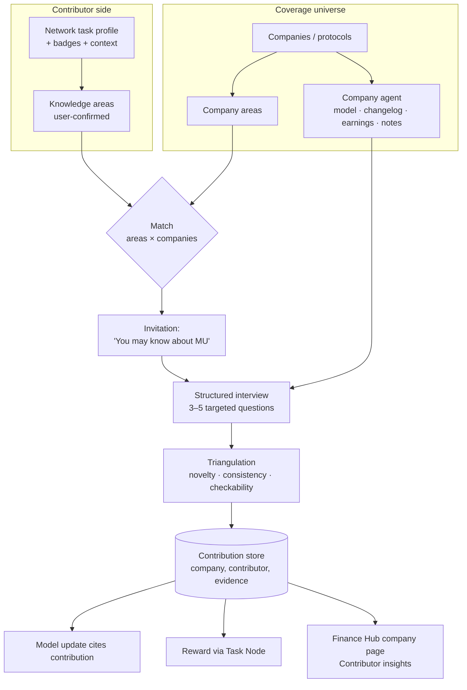

# Pillar 10 — Information Hive Mind

> **Status:** Early. Contributor profiles, expert badges, capability profiles and context documents are live, and per-company agent tables exist as a migration. There is no interviewing agent, no store of knowledge contributions, no link between users and the coverage universe, and no triangulation.
>
> **Bubbles up to:** *Post-human activity*. The network turns what its members know into better models, and pays them for it.

## In one paragraph

Task Node already knows a lot about its contributors: what tasks they've done, what they're good at and what's in their context documents. Finance Hub already holds a coverage universe of company models. This pillar connects the two. Each company or protocol in the coverage universe gets an **agent** ramped up on its history: model, changelog, earnings and notes. Task Node matches contributors to companies where their experience suggests they know something useful. The agent then holds a short structured **conversation** with the contributor, triangulating what they know against the company's history. Useful, checkable contributions are stored, credited to the contributor and fed into the model's next update.

## User story

**Founder's story.** I have done a large number of tasks on Task Node. I am classified as able to contribute specific types of information, and I can do that through chat. An agent ramped up on a company's history can triangulate with me, based on my experience, how far I might have useful information about a company or protocol. The coverage universe in Finance Hub is linked to specific users…

> The founder's text ends here. The rest of this story completes it from the other pillars.

**Augmented story.**

1. **Classified.** My Task Node profile lists **knowledge areas** inferred from my rewarded tasks, context and badges, for example *Solana infrastructure*, *semiconductor supply chains* and *Norwegian banking*. I can confirm or remove each one.
2. **Matched.** The coverage universe maps companies and protocols to knowledge areas. Task Node shows me **"You may know something about: MU, NVDA, Solana"** with a reason for each.
3. **Interviewed.** I open the MU agent. It already knows MU's model, recent earnings and open questions. It asks me 3–5 targeted questions where my experience is relevant, for example "Your tasks mention HBM supplier audits. Does lead-time commentary match what you've seen?" I answer in chat.
4. **Triangulated.** The agent scores each answer for **novelty** (not already in the model or notes), **consistency** with known facts and **checkability** (whether it can be verified later). It shows me a summary of what it took away.
5. **Credited.** Accepted contributions are stored against MU with my identity. When the model updates, the changelog cites them, and I receive a reward through the normal Task Node reward path.
6. **Visible.** Finance Hub's company page shows *Contributor insights* with an attribution, or anonymously if I choose. Validators and top-30 members can read them.

## What exists today

| Component | Where | State |
|---|---|---|
| Contributor diagnostic profiles | [`docs/wiki/architecture/network-task-profile-worker.md`](https://github.com/postfiatorg/tasknode/blob/main/docs/wiki/architecture/network-task-profile-worker.md) · [`prompts/memory/network_task_profile_v2.md`](https://github.com/postfiatorg/tasknode/blob/main/prompts/memory/network_task_profile_v2.md) · migration [`024_network_task_profiles.sql`](https://github.com/postfiatorg/tasknode/blob/main/server/db/migrations/024_network_task_profiles.sql) | Live. Built from context, deep memory and tasks. |
| Expert badges | [`server/expert-badge.js`](https://github.com/postfiatorg/tasknode/blob/main/server/expert-badge.js) (at least 20 personal tasks, score at least 80) · migration [`072`](https://github.com/postfiatorg/tasknode/blob/main/server/db/migrations/072_network_badges_identity_approvals.sql) | Live |
| Capability profiles | [`server/repositories/capability-profiles.js`](https://github.com/postfiatorg/tasknode/blob/main/server/repositories/capability-profiles.js) | Live (board managers) |
| Profile matching | [`server/repositories/recommended-connections.js`](https://github.com/postfiatorg/tasknode/blob/main/server/repositories/recommended-connections.js) (embeddings plus profiles) | Live, for people-to-people matching |
| Context documents | [`docs/wiki/surfaces/context.md`](https://github.com/postfiatorg/tasknode/blob/main/docs/wiki/surfaces/context.md) · [`prompts/context/context_edit_jobs_v1.xml`](https://github.com/postfiatorg/tasknode/blob/main/prompts/context/context_edit_jobs_v1.xml) | Live. The closest thing to interviewing today is the context editor's one "calibration question". |
| Per-company agent tables | [`server/db/migrations/158_finance_agent.sql`](https://github.com/postfiatorg/tasknode/blob/main/server/db/migrations/158_finance_agent.sql) (`finance_agent_threads`, `_messages`, `_proposals`, proposals needing operator approval) | **Migration only**; no code uses it. |
| Finance Hub coverage | [Pillar 9](09-finance-hub.md) | Live as a bundle. The term "coverage universe" appears nowhere in code. |
| Privacy boundary | [`server/hive-group-worker.js`](https://github.com/postfiatorg/tasknode/blob/main/server/hive-group-worker.js) (the Hive context excludes private memory) | Live, and must be kept |

## Architecture

## Technical requirements

### Knowledge areas

- **R1.** A `knowledge_areas` taxonomy shared by contributors and the coverage universe (sector, sub-industry and protocol tags). Each covered company or protocol is tagged in the hub build.
- **R2.** Infer a contributor's areas from the existing network task profile, badges and context. The contributor must **confirm** an area before it is used for matching, and can remove it at any time.

### Agents

- **R3.** One agent per covered company, using the existing `finance_agent_threads` / `_messages` tables. Its context comes from the published model, changelog, earnings history and notes for that company, and **never** from the contributor's private memory unless the contributor consents.
- **R4.** The interview is a structured exchange: the agent asks 3–5 targeted questions, and the user answers or skips each. The transcript is stored, and can be pinned through the [Pillar 2](02-message-protocol.md) protocol if the contributor makes it public.

### Contributions

- **R5.** Triangulation scores each claim for novelty, consistency and checkability, with a short rationale. Claims above the threshold become `finance_agent_proposals` that need approval by the model owner, as the migration already intends.
- **R6.** Approved contributions are linked to the model's CHANGELOG entry, and rewarded through the normal reward path (a task, or a reward line).
- **R7.** Attribution is the contributor's choice: by name, by minted identity ([Pillar 6](06-hive-identity.md)) or anonymous.

### Surfaces

- **R8.** The Task Node profile shows knowledge areas and suggested companies. Finance Hub company pages show *Contributor insights* and an **Ask the agent** entry point ([Pillar 9](09-finance-hub.md)).

## Dependencies

| Depends on | Why |
|---|---|
| [Pillar 9 — Finance Hub](09-finance-hub.md) | The coverage universe and the surface. |
| [Pillar 6 — Hive identity on chain](06-hive-identity.md) | Attribution. |
| [Pillar 2 — Message protocol](02-message-protocol.md) | Public transcripts and contributions. |
| Existing profile, badge and context systems | Classification. |

## Acceptance criteria

1. A contributor sees inferred knowledge areas, confirms two, and gets matched to at least one covered company.
2. The company agent runs an interview grounded in that company's model and changelog. Its questions cite the user's confirmed areas.
3. One contribution is scored, approved by the model owner, cited in the next model CHANGELOG and rewarded.
4. The contributor's private memory is never in the agent context without consent; a test asserts this.

## Open questions for the founder

- The founder's story ends at "linked to specific users". How should the coverage universe link to users: by assignment (a named analyst per company), by matching (this spec), or both?
- Should contributions be rewarded per accepted claim, or folded into tasks?
- Who approves contributions: the model owner only, or a reviewer agent first?

## Code references

- Profiles: [`server/db/migrations/024_network_task_profiles.sql`](https://github.com/postfiatorg/tasknode/blob/main/server/db/migrations/024_network_task_profiles.sql)
- Badges: [`server/expert-badge.js`](https://github.com/postfiatorg/tasknode/blob/main/server/expert-badge.js)
- Finance agent tables: [`server/db/migrations/158_finance_agent.sql`](https://github.com/postfiatorg/tasknode/blob/main/server/db/migrations/158_finance_agent.sql)
