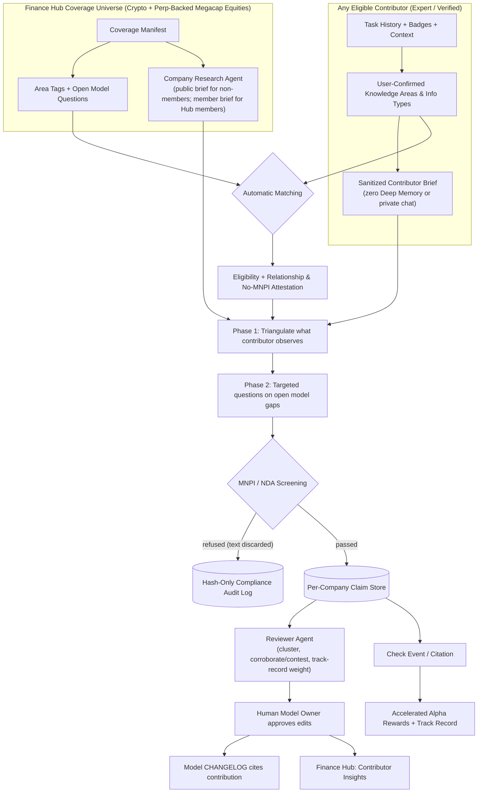

# Pillar 10 — Information Hive Mind

> **Status:** Early. Task Node already builds contributor diagnostic profiles (which map users' work to 5–10 companies/domains), Expert badges, capability profiles, and context documents, and migration `158_finance_agent.sql` defines initial per-company agent tables. What is missing: the two-phase triangulating interview agent, MNPI/confidentiality screening, the per-company claim pool & reviewer agent, Finance Hub coverage-universe matching, and accelerated alpha rewards.
>
> **Outcome:** [A · Post-human governance in public](../README.md#three-outcomes) — turning the distributed knowledge of Post Fiat's contributors into sharper, corroborated research models and rewarding genuine alpha fast.

## What this pillar is (in plain English)

Task Node already knows what its contributors are genuinely good at from their completed tasks, and Finance Hub maintains ~60 live models across crypto protocols and liquid megacap equities with perps. This pillar connects the two into a living **Information Hive Mind**:

1. **Match any eligible contributor to the coverage universe:** Task Node automatically maps eligible contributors (any Expert-badged or domain-verified user — not restricted to Finance Hub members) to covered **crypto protocols/tokens and liquid megacap equities that have perps in the Finance Hub coverage universe** (no random illiquid small-cap equities). Users always confirm or remove suggested knowledge areas before matching runs.
2. **Triangulate first, then ask sharp questions:** Each covered company or protocol gets an AI research agent ramped up on its history and open model questions. In Task Node chat, **Phase 1** checks what the contributor can actually observe directly (operator, builder, customer, trader, public-data analyst), and **Phase 2** asks targeted questions tied to the model's live blind spots. *(Non-Finance-Hub contributors see only a public company brief — zero gated model targets ever leak.)*
3. **Strict MNPI & confidentiality firewall:** Before any interview starts, the contributor declares their relationship to the company and attests they will not share inside or confidential information (current employees/insiders with MNPI or NDA duties on that name are blocked from interviewing on it). Every answer is screened before storage; anything looking like inside or NDA information is immediately refused and **never stored** (only an audit hash + reason code is logged).
4. **Pool & cross-check claims across contributors:** Accepted claims go into a per-company claim store where a reviewer agent clusters corroborating or conflicting claims and weights them by contributors' real track records. Human model owners decide whether to update the model and cite the contribution in the model `CHANGELOG`, surfacing verified **Contributor insights** back on Finance Hub.
5. **Accelerated rewards for alpha:** High-signal, novel, non-consensus claims earn **accelerated payouts** — a fast acceptance payout when cited/applied in a model update **plus an accelerated alpha bonus multiplier** when checkable claims prove out against real-world outcomes (especially well-argued contrarian `challenges` that improve model accuracy).

## How the Information Hive Mind loop works

## Locked-in design decisions

- **Coverage-to-user linking:** **Open automatic matching across any eligible Task Node users** (not limited to Finance Hub members and not bottlenecked on assigning one named owner per company; high-trust contributors can still build domain reputation on specific names). Non-Finance-Hub contributors receive a strictly public company brief with zero gated model numbers or price targets.
- **Asset classes in scope:** **Crypto protocols/tokens + liquid megacap equities that have perps in the Finance Hub coverage universe** (explicitly excluding random non-perp / illiquid equities). Paid interviews on listed equities enable once counsel signs off on the attestation wording and restricted-relationship rules.
- **Reward design (accelerated rewards for alpha):** Use Task Node's verified-task reward pipeline (bounded by existing badge payout caps and Sybil review) with **accelerated payouts for real alpha**:
  - Fast payout upon acceptance/citation in an applied model update;
  - **Accelerated alpha bonus multiplier** when a checkable claim is verified by a real-world event (earnings, on-chain data, public release), weighted extra for novel, non-consensus `challenges` that move model estimates closer to reality;
  - Uncheckable claims earn only if cited in an applied model update (preventing Sybil corroboration farming);
  - Falsified claims earn no further payout and lower the contributor's domain weight.
- **Safety, privacy & governance defaults locked in:**
  - **Eligibility:** Existing Task Node **Expert badge** (`>= 20` completed personal tasks, score `>= 80`) or a verified capability profile in the matched domain.
  - **Refused MNPI/NDA content:** Discard rejected text immediately — log **only** `(account, company, timestamp, reason, SHA-256 hash)` so the platform never holds rejected inside information.
  - **Relationship exclusions:** Block current employees and anyone bound by MNPI/NDA duties on a covered company from interviewing on that specific company; allow ordinary public observers, customers, builders, and analysts with explicit attestation.
  - **Model change authority:** **Human model owner approves every model edit** via `finance_agent_proposals` (falls back to Finance Hub operator queue if unowned).
  - **Privacy & pseudonymity:** Raw Deep Memory, private chat, context docs, and task evidence **never** reach company agents, reviewers, or Finance Hub. Attribution supports real handle, minted [Pillar 6](06-hive-identity.md) identity, or verified pseudonym (*hidden from public Finance Hub readers, known to Task Node operators* in v1; UI states this plainly).

## What exists today

| Piece | Current state | Where |
|---|---|---|
| Diagnostic profiles & matching | Live: `network_task_profiles` already extracts `domain_expertise` (5–10 companies) and `primary_contribution_ability`; embeddings match profiles (`recommended-connections.js`) | [`024_network_task_profiles.sql`](https://github.com/postfiatorg/tasknode/blob/main/server/db/migrations/024_network_task_profiles.sql), [`recommended-connections.js`](https://github.com/postfiatorg/tasknode/blob/main/server/repositories/recommended-connections.js) |
| Eligibility, badges & Sybil review | Live: Expert badge (`>= 20` tasks, `>= 80` score), badge payout caps (`max_payout_pft`, `eligibility_policy_json`), capability profiles, and Sybil flagging | [`server/expert-badge.js`](https://github.com/postfiatorg/tasknode/blob/main/server/expert-badge.js), [`network-badges.js`](https://github.com/postfiatorg/tasknode/blob/main/server/repositories/network-badges.js) |
| Per-company agent tables | Migration `158_finance_agent.sql` (`finance_agent_threads`, `_messages`, `_proposals`) exists, **no code uses it yet**, and it lacks claim/screening/attestation/reward tables | [`158_finance_agent.sql`](https://github.com/postfiatorg/tasknode/blob/main/server/db/migrations/158_finance_agent.sql) |
| Privacy boundary | Live rule: private chat, task evidence, and Deep Memory never leak into public surfaces | [`server/hive-group-worker.js`](https://github.com/postfiatorg/tasknode/blob/main/server/hive-group-worker.js) |

## Detailed specification

### 1. Coverage manifest, classification & privacy-safe matching
- **Coverage manifest (from [Pillar 9](09-finance-hub.md)):** Every Finance Hub build exports `hub/coverage_manifest.json` listing each covered crypto protocol and perp-backed megacap equity, its asset class, area tags, and enabled interview mode.
- **User-confirmed areas & info types:** Task Node suggests knowledge areas and information types (operator, builder, customer, trader, public-data analyst) privately from profiles/badges; nothing activates until the contributor confirms it, and match reasons are visible only to that user.
- **Sanitized contributor brief:** Company agents receive *only* confirmed areas/types, declared relationship, and a user-approved summary — never raw Deep Memory, context docs, or private chat.
- **Evidence-weighted matching:** Combines confirmed tags + embedding similarity against **public-safe topic tags** (never leaking gated model questions), weighted by completed tasks and past verified claims, with rotation and concurrent-interview caps. Contributors can also self-initiate an interview (including from Finance Hub's **Ask the agent** button) under the exact same eligibility, attestation, and screening rules.

### 2. True in-memory MNPI firewall & strictly isolated two-phase interviews
- **Strict non-MNPI guardrails:** System instructions + output filter block questions asking about unreleased earnings, guidance, deals, internal orders/pricing, product plans, legal matters, or employer/client confidential info — targeting strictly public/market-participant observations.
- **Pre-interview attestation:** Logs relationship declaration + no-MNPI attestation and blocks excluded relationships before Phase 1 starts.
- **In-memory pre-storage screening (zero-retention pipeline):** Every user message is screened **in RAM on the API handler BEFORE writing to `finance_agent_messages` or forwarding to any LLM** (using zero-data-retention model endpoints). Messages classify as `pass`, `redact` (user previews remaining text before saving), or `refuse` (raw text is discarded immediately in memory, never written to DB or chat history, and **only** `(account, company, timestamp, reason_code, sha256)` is written to the compliance log).
- **Strictly isolated member vs non-member two-phase interviews:**
  - **Non-Finance-Hub contributors** run exclusively against `agent_brief_public.json` + a build-checked public question list — **never** seeing gated model targets, member open model questions, or existing member pooled claims (preventing indirect extraction of Finance Hub research via Phase 2 prompts!).
  - **Finance Hub members** run against `agent_brief_members.json` and may also be asked to independently corroborate or challenge existing anonymized pooled claims.
  - **Phase 1 (Triangulation)** scores what the contributor directly observes; **Phase 2 (Targeted questions)** probes bounded open questions (capped turns/tokens per interview).

### 3. Claim store, objective alpha baseline, model bridge & accelerated rewards
- **Claims table (schema delta on migration `158`):** Stores company, contributor, client-signed claim text (signed by the contributor's [Pillar 6](06-hive-identity.md) identity or pseudonymous key **at submission time**, never offline later!), info type, stance (`confirms` | `refines` | `challenges`), evidence/mechanism, **snapshotted `model_estimate_before` & `market_consensus_before` at submission time** (so alpha is objectively measurable!), dated public `check_event`, screening result, attestation, attribution, cluster ID, status (`pending` | `accepted` | `rejected` | `verified` | `falsified` | `unresolvable`), and reward link.
- **Reviewer agent (prompt-injection hardened) & human approval:** Untrusted claim text is wrapped in strict quoted-data delimiters before entering the Reviewer Agent, which clusters duplicate claims, marks consensus vs contested, scores novelty/evidence/checkability, and queues `finance_agent_proposals` for the human model owner (auto-escalating to the Finance Hub operator queue after 7 days and expiring to `unresolvable` after 30 days if unreviewed). **Conflict-of-interest rule:** a model owner cannot approve or trigger payouts on their own submitted claims.
- **Research host bridge & instant takedown:** Research host pulls approved proposals via read-only service token; on `CHANGELOG` merge, the research host posts a signed webhook back to Task Node (`proposal_applied` + commit/CHANGELOG ref) that unlocks citation payouts and publishes `contributor_insights.json` (wrapped by Pillar 9's `< 1s` server-side MNPI takedown filter). Accepted claims also emit encrypted [Pillar 2](02-message-protocol.md) packets (transcripts stay private).
- **Concrete accelerated alpha reward bounds & anti-gaming:**
  - **Fast citation payout:** `$10–$50` PFT equivalent immediately when cited in an applied model `CHANGELOG` (split proportionally among corroborated duplicate claims in the same cluster).
  - **Accelerated alpha bonus multiplier:** **`2×–5×`** bonus upon check-event verification (highest for contrarian `challenges` that move model estimates closer to reported reality), capped by existing badge per-claim/monthly limits (`max_payout_pft`) and Sybil review.
  - **Anti-hedging & falsification:** Submitting contradictory stances on the same company + check event is blocked; falsified claims pay zero bonus and lower the contributor's domain weight. Tracked on an operator ROI dashboard (spend, acceptance rate, verification rate, cost per verified insight, and post-citation forecast accuracy delta).

## Milestones & completion checklist

### Build milestones
- [ ] **M1 · Coverage manifest, user confirmation & matching:** Consume `hub/coverage_manifest.json` (filtered to crypto protocols + perp-backed megacap equities), build private knowledge-area/info-type confirmation UI, sanitized contributor briefs, and evidence-weighted matching for any Expert/verified user.
- [ ] **M2 · Compliance firewall, attestation & red-team tests:** Build relationship/no-MNPI attestation, pre-storage `pass`/`redact`/`refuse` screening (hash-only refusal audit log), and complete legal counsel sign-off for perp-backed equity interviews; pass MNPI/NDA + prompt-injection + privacy-leak red-team suites.
- [ ] **M3 · Two-phase company agents & claim store:** Implement Phase 1 triangulation + Phase 2 targeted interviews on `finance_agent_threads` (using public vs member briefs cleanly) and add the claims/clustering schema delta on migration `158`.
- [ ] **M4 · Reviewer agent, model-owner proposals & Finance Hub insights:** Ship claim clustering/scoring, human model-owner approval queue (`finance_agent_proposals`), research-host service-token pull, `CHANGELOG` citation, and Finance Hub `Contributor insights` + **Ask the agent** integration.
- [ ] **M5 · Accelerated alpha rewards, Pillar 2 packets & ROI dashboard:** Wire badge-capped accelerated payouts (fast citation payout + verified alpha bonus multiplier + falsification weight penalty), encrypted [Pillar 2](02-message-protocol.md) claim packets, and the operator alpha/ROI dashboard.

### Required ship gates
- [ ] **1. Executed:** All M1–M5 code, screening guardrails, model-host bridge, and accelerated alpha payout logic merged and live in production.
- [ ] **2. Tested by user:** Founder tests matching on a crypto protocol and a perp-backed megacap equity (as both a Finance Hub member and a non-member verifying zero model-target leakage), triggers an intentional MNPI refusal confirming zero text stored, runs a two-contributor corroboration cycle, approves a model `CHANGELOG` citation, and verifies accelerated alpha payout + dashboard metrics.
- [ ] **3. Added to docs:** Contributor interview guide, MNPI/compliance policy, attribution/pseudonymity rules, and accelerated alpha reward docs published in Post Fiat docs.
- [ ] **4. Public blog post document:** Public blog post written and published introducing the **Post Fiat Information Hive Mind** — how AI company agents triangulate distributed expertise, filter out noise/MNPI, and pay accelerated rewards for verified alpha.

## Code references

- Contributor profiles & matching: [`024_network_task_profiles.sql`](https://github.com/postfiatorg/tasknode/blob/main/server/db/migrations/024_network_task_profiles.sql) · [`recommended-connections.js`](https://github.com/postfiatorg/tasknode/blob/main/server/repositories/recommended-connections.js) · [`capability-profiles.js`](https://github.com/postfiatorg/tasknode/blob/main/server/repositories/capability-profiles.js)
- Badges, caps & Sybil review: [`server/expert-badge.js`](https://github.com/postfiatorg/tasknode/blob/main/server/expert-badge.js) · [`network-badges.js`](https://github.com/postfiatorg/tasknode/blob/main/server/repositories/network-badges.js) · [`072_network_badges_identity_approvals.sql`](https://github.com/postfiatorg/tasknode/blob/main/server/db/migrations/072_network_badges_identity_approvals.sql)
- Finance agent tables & privacy boundary: [`158_finance_agent.sql`](https://github.com/postfiatorg/tasknode/blob/main/server/db/migrations/158_finance_agent.sql) · [`server/hive-group-worker.js`](https://github.com/postfiatorg/tasknode/blob/main/server/hive-group-worker.js)
