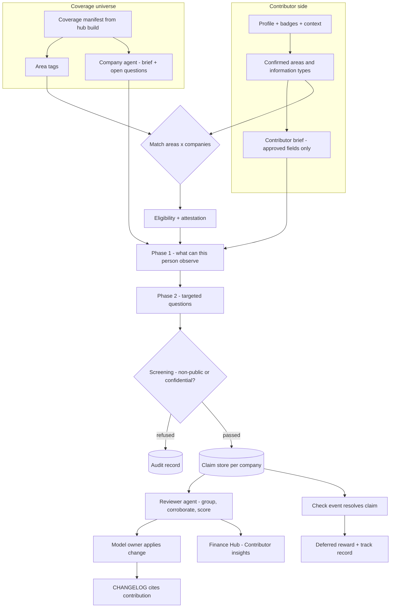

# Pillar 10 — Information Hive Mind

> **Status:** Early. Contributor profiles (which already list 5–10 public companies each user's work maps to), expert badges, capability profiles and context documents are live. Per-company agent tables exist as a migration, built for an operator editing a model. There is no interviewing agent, contribution store, compliance screening, link between users and the coverage universe, or triangulation.
>
> **Bubbles up to:** [Outcome A · Post-human governance in public](../README.md#three-outcomes). *Post-human activity*. The network turns what its members know into better models, and pays them for it.

## In one paragraph

Task Node knows its contributors: their tasks, skills and context. Finance Hub holds a coverage universe of company models. This pillar connects the two. Each covered company or protocol gets an **agent** ramped up on its history. The agent **triangulates the person** first: how far their experience could give them useful information about this company. Then it asks targeted questions. Every answer is **screened**, so the network never solicits or stores material non-public or confidential information. Claims from many contributors are pooled per company, where they are corroborated or contested; that pooling is the *hive mind*. Rewards are paid mainly **once a claim is checked**, not when an LLM likes it.

## User story

**Founder's story** (Deliverable 10, quoted as written except one typo fixed):

> I have done a large number of tasks on the task node. I am classified to contribute specific types of information to the task node and this can be done via chat. An agent who is ramped up on a company's history can triangulate with you based on your experience to what extent you could have useful information about a company or protocol. The coverage universe in finance hub is linked to specific users

The last sentence ends the deliverable without a full stop. It may be complete, or the start of a longer thought. Everything below it is **interpretation**, and how users are linked stays an open question.

**Augmented story (interpretation).**

1. **Classified.** My long rewarded task record makes me eligible. My profile lists **knowledge areas** (*Solana infrastructure*, *GPU compute markets*) and **information types**: how I know things, such as operator, builder, customer, trader or public-data analyst. I confirm or remove each. Only I see why each was suggested.
2. **Matched.** The coverage universe maps companies and protocols to areas. Task Node shows me **"You may know something about: NVDA, Solana"**.
3. **Attested.** Before the first question I declare my relationship to the company (none, customer, supplier, employee, former employee, investor). I confirm I won't share non-public information, or anything I owe an employer or client confidentiality on. If my relationship rules me out, the interview doesn't start.
4. **Triangulated.** In Task Node chat, the agent first works out what I can observe: "You've rented GPUs for training. Do you track public rental prices, and for which chips?" Then it asks two or three questions tied to the model's open questions: "The model assumes H100 rental prices hold next year. What have the public rates you track done?" It never asks about my employer's or clients' internal matters.
5. **Screened and pooled.** If an answer looks like inside or confidential information, the agent stops that line, says why, and stores nothing. Accepted claims join the company's claim store beside other contributors' claims that agree or disagree.
6. **Credited.** A reviewer agent groups and scores claims. The model owner applies any model change, and the CHANGELOG cites my contribution. Most of my reward is released when the claim is checked, for example at the next earnings release. Checked claims build my track record.
7. **Visible.** Finance Hub's company page shows *Contributor insights*: corroborated and contested claims, credited by name, minted identity or verified pseudonym.

## What exists today

| Component | Where | State |
|---|---|---|
| Contributor diagnostic profiles | [`network-task-profile-worker.md`](https://github.com/postfiatorg/tasknode/blob/main/docs/wiki/architecture/network-task-profile-worker.md) · [`network_task_profile_v2.md`](https://github.com/postfiatorg/tasknode/blob/main/prompts/memory/network_task_profile_v2.md) · [`024_network_task_profiles.sql`](https://github.com/postfiatorg/tasknode/blob/main/server/db/migrations/024_network_task_profiles.sql) | Live. Built from **Deep Memory and the context document** plus rewarded and refused tasks. Outputs `primary_contribution_ability` (the prompt asks whether the user "has important information") and `domain_expertise` (5–10 public companies). Derived from private sources, so it must not go into an agent directly. |
| Expert badges | [`server/expert-badge.js`](https://github.com/postfiatorg/tasknode/blob/main/server/expert-badge.js) (at least 20 completed personal tasks, score at least 80) | Live. A ready-made eligibility bar. |
| Badge definitions with caps | [`072_network_badges_identity_approvals.sql`](https://github.com/postfiatorg/tasknode/blob/main/server/db/migrations/072_network_badges_identity_approvals.sql) (`max_payout_pft`, `payout_policy_json`, `eligibility_policy_json`) · [`badge-based-network-task-routing.md`](https://github.com/postfiatorg/tasknode/blob/main/docs/wiki/architecture/badge-based-network-task-routing.md) | First enforcement slice live: an eligibility gate and payout and work-type caps for Network Task executors ([`network-badges.js`](https://github.com/postfiatorg/tasknode/blob/main/server/repositories/network-badges.js)). The routing spec requires checks before an offer and again before a reward. |
| Capability profiles | [`capability-profiles.js`](https://github.com/postfiatorg/tasknode/blob/main/server/repositories/capability-profiles.js) (`declared` → `verifying` → `verified`) | Live, used by board managers |
| Profile matching | [`recommended-connections.js`](https://github.com/postfiatorg/tasknode/blob/main/server/repositories/recommended-connections.js) (embeddings over a packet including `domain_expertise`, for non-private, discoverable profiles) | Live, people-to-people only |
| Context documents | [`context.md`](https://github.com/postfiatorg/tasknode/blob/main/docs/wiki/surfaces/context.md) · [`context_edit_jobs_v1.xml`](https://github.com/postfiatorg/tasknode/blob/main/prompts/context/context_edit_jobs_v1.xml) | Live. The closest thing to an interview is the editor's one "calibration question". |
| Verification and rewards | [`task-review-reward-worker.md`](https://github.com/postfiatorg/tasknode/blob/main/docs/wiki/architecture/task-review-reward-worker.md) | Live. A verification request precedes every reward. Payouts settle on the ledger, so they are public. |
| Sybil review | [`sybil-review-detection.md`](https://github.com/postfiatorg/tasknode/blob/main/docs/wiki/architecture/sybil-review-detection.md) | Live, recommend-only: it raises flags for people to review. |
| Per-company agent tables | [`158_finance_agent.sql`](https://github.com/postfiatorg/tasknode/blob/main/server/db/migrations/158_finance_agent.sql) (`finance_agent_threads`, `_messages` with `cost_usd`, `_proposals`) | **Migration only**; no code uses it. Designed for "an allowlisted operator" and an agent on the model host that reads a sealed model copy and proposes changes applied after approval. No fields for contributor claims, scores, attestation, attribution, verification or rewards. |
| Finance Hub coverage | [Pillar 9](09-finance-hub.md) | Validator-gated encrypted bundle built on the research host; top-30 access is planned. "Coverage universe" appears nowhere in Task Node code. |
| Privacy boundary | [`server/hive-group-worker.js`](https://github.com/postfiatorg/tasknode/blob/main/server/hive-group-worker.js) ("Private chat, task evidence and memory are not included here") | Live, and must be kept |

## Architecture

## Technical requirements

### Classification and matching

- **R1.** Each hub build publishes a **coverage manifest** ([Pillar 9](09-finance-hub.md) already produces `coverage` data): each company or protocol, its asset class (listed equity, token, protocol) and tags from a small controlled vocabulary. Task Node reads it rather than keeping its own list.
- **R2.** Two axes per contributor: **knowledge areas** and **information types**. Candidates come from the profile's `domain_expertise` and `primary_contribution_ability`, badges and verified capability profiles. A candidate is used only once the contributor **confirms** it, and can be removed at any time.
- **R3.** Matching combines confirmed tags with embedding similarity (the recommended-connections stack) against each company's open questions. It is weighted by **evidence** (rewarded tasks, past checked claims), not self-confirmation alone. Invitations rotate, and concurrent interviews per contributor are limited.

### Privacy

- **R4.** The agent sees only a **contributor brief**: confirmed areas and types, the declared relationship and a short experience summary the contributor approved. Raw profile text, Deep Memory, the context document, chat and task evidence never reach the agent, claim store, reviewers or Finance Hub.
- **R5.** Match reasons and suggested areas appear only on the contributor's private surfaces.

### Safeguards against non-public and confidential information

- **R6. What the agent never asks.** Instructions plus an output check forbid questions seeking:
    - non-public information about a covered company: unreleased results, guidance, deals, orders, pricing, product plans, audits or legal matters
    - anything learned under a duty of confidentiality to an employer, client or counterparty
    - internal matters of the contributor's current or recent employer or clients

    Questions target what the contributor observes in public or as an ordinary market participant: public prices and datasets, products bought openly, open-source code, on-chain data.

- **R7. Attestation.** Each interview records a relationship declaration and a no-non-public-information attestation. Relationships the founder's policy excludes block the interview for that company. Wording and exclusions are founder and counsel decisions.
- **R8. Screening and refusal.** Every answer is screened before storage: **pass**, **redact** (the contributor sees what remains) or **refuse**. On refuse, the agent drops that line, says why and asks no follow-up. Refused content never enters the claim store, agent context or reviewer queues. An audit record (account, company, time, reason, content hash) goes to the compliance reviewer.
- **R9. Asset-class modes.** Each manifest entry carries an interview mode by asset class. Paid interviews run only where the founder has approved that mode.

### Interview

- **R10.** Interviews run in Task Node chat on `finance_agent_threads` and `_messages` (`account_id`, `model`, `cost_usd`), in two phases:
    - **Phase 1** triangulates the person: what can they observe, how directly, how recently. It yields a per-company relevance score that feeds back into matching.
    - **Phase 2** asks adaptive questions from the company's open questions and existing claims. A contributor may be asked to corroborate a claim, never told whose it is.

    Turns and tokens per interview have a configurable cap. Contributors can also start an interview themselves, under the same eligibility, attestation and screening.

- **R11.** Each company's agent context is a **brief** rebuilt and cached at every hub publish: public facts, a model and changelog summary, and open questions, limited to what this contributor may see. Without Finance Hub access the brief carries no model numbers or targets, so prompt injection has nothing gated to extract. Agents start lazily.

### Contributions

- **R12.** A contribution table, as a schema delta on 158. Per claim: company, contributor, text, information type, stance (`confirms`, `refines`, `challenges`), evidence or mechanism, **check event** (a dated public event, or none), screening result, attestation, attribution, cluster, status (`pending`, `accepted`, `rejected`, `verified`, `falsified`, `unresolvable`) and reward link.
- **R13.** **Scoring:** novelty against the brief and claim store, evidence quality, checkability and **corroboration** by independent contributors. Agreement with the model is not a criterion, so a well-argued `challenges` claim can score highest.
- **R14.** **Pooling.** The reviewer agent clusters similar claims, marks clusters as consensus or contested, and weights them by contributors' track records. Two people making one claim yield one cluster with two supporters.
- **R15.** **Roles.**
    - The **reviewer agent** screens, clusters and scores, and drops duplicates and weak claims.
    - The **model owner** decides only on model changes, via `finance_agent_proposals`.
    - A **compliance reviewer** handles refusals and flags.
    - A company with no owner, or an owner who doesn't act, falls back to a Finance Hub operator queue.
- **R16.** **Bridge to the research host.** The model host pulls approved proposals and accepted clusters with its service token, as the 158 design describes. The CHANGELOG cites contribution IDs, and the next bundle carries a `contributor_insights` file.
- **R17.** **Information packets.** Each accepted claim is written as a [Pillar 2](02-message-protocol.md) packet, encrypted by default and signed with the contributor's [Pillar 6](06-hive-identity.md) identity or a pseudonymous key. Its hash is referenced from the proposal and CHANGELOG. Until Pillar 2 runs on the new chain, the database row is the record. Transcripts are not published by default.

### Economics

- **R18.** **Deferred rewards.** Rewards use the normal Task Node path (task, verification request, ledger payout), in up to two parts: an optional small credit on acceptance and the main amount on a **verification event**. That event is the check event confirming the claim, or the claim being cited in an applied model change. Falsified claims earn nothing more and lower the contributor's weight in that area.
- **R19.** **Caps in code.** Eligibility and per-period caps live in a badge definition (`eligibility_policy_json`, `max_payout_pft`, `payout_policy_json`), checked before the interview and again before the reward, as the badge-routing spec requires. Contributors pass through Sybil review.
- **R20.** **Measured value.** A dashboard shows spend, accepted claims, share verified, spend per verified claim, share of model changes citing contributions, and whether estimates moved toward reported outcomes after cited changes.

### Attribution and surfaces

- **R21.** Attribution by name, minted identity or **verified pseudonym** with a credential ("12 checked claims in GPU markets"). Until shielded payouts exist ([Pillar 5](05-local-task-node.md)), the UI says plainly that a pseudonym hides the contributor from Finance Hub readers only. Operators know who they are, and ledger payouts can be linked by timing.
- **R22.** The contributor's private profile shows areas, types, suggested companies and track record. Interviews run in Task Node chat. Finance Hub company pages show *Contributor insights* and **Ask the agent** for members ([Pillar 9](09-finance-hub.md)).

## Dependencies

| Depends on | Why |
|---|---|
| [Pillar 9 — Finance Hub](09-finance-hub.md) | Coverage manifest, briefs, access tiers, insights surface. |
| [Pillar 6 — Hive identity on chain](06-hive-identity.md) | Attribution and claim signing. |
| [Pillar 2 — Message protocol](02-message-protocol.md) | Encrypted contribution packets. |
| [Pillar 5 — Local Task Node](05-local-task-node.md) | Shielded payouts, if pseudonymous rewards must be unlinkable. |
| Research host model pipeline | Applying proposals, CHANGELOG citations, publishing insights. |
| Profile, badge, capability, Sybil and reward systems | Classification, eligibility, caps, payout. |

## Acceptance criteria

1. An eligible contributor confirms two suggested areas and is matched to at least one entry with an approved interview mode. An ineligible account can neither be invited nor start an interview.
2. Phase 1 produces a relevance score. Phase 2's questions cite the contributor's confirmed areas and the company's open questions.
3. **Screening test:** a red-team set of answers (unreleased results, employer internal data, NDA material) is refused, none of it reaches the claim store, agent context or reviewers, and each refusal leaves an audit record. A red-team set of prompts never draws a question R6 forbids.
4. **Privacy test:** no Deep Memory, context-document, chat or task-evidence text reaches the agent, other users' views of matching, the claim store or Finance Hub without consent.
5. **Gating test:** prompt-injection attempts by a contributor without Finance Hub access return no model numbers or targets.
6. Two independent contributors making the same claim produce one corroborated cluster.
7. One claim is cited in a CHANGELOG through an applied proposal, and its main reward is released only after its verification event. A falsified claim releases nothing further and lowers the contributor's weight.
8. The R20 dashboard shows real figures for the first cycle.

## Open questions for the founder

1. **"Linked to specific users."** Assignment (a named owner per company: accountable, but needs people), matching (this spec: scales, but nobody owns a company), or both? Or did you mean something else, such as each user having their own coverage list?
2. **Legal review.** Should counsel review before any paid interview, for which jurisdictions, and who writes the attestation?
3. **Asset classes in scope.** Protocols and tokens first; listed equities restricted to public questions; or everything under one set of rules? Protocols carry less securities-law risk, but token insider rules still apply.
4. **Use of outputs.** Do Finance Hub models inform any trading, NAVCoin or personal positions? If so, a stricter regime is needed, such as a restricted list or barring contributors linked to held positions.
5. **Relationship rules.** May current employees, former employees (after what gap), suppliers or customers of a covered company take part?
6. **Refused content.** Keep only a hash, or keep the text in a restricted log? The log helps audits, but holding the material is itself a risk.
7. **Eligibility.** What is "a large number of tasks": the Expert badge, a minimum count of rewarded tasks, a top-N rank, or a verified capability in the area?
8. **Reward shape and budget.** Pay everything on verification, or a small credit plus a deferred amount? Per claim, or folded into ordinary tasks? What are the funding source and the per-person and per-company caps? Do falsified claims only lower weight, or also forfeit earlier credit?
9. **Who approves.** Must a person approve every model change, or may the reviewer agent accept low-impact claims (more post-human, more risk)? Who is the compliance reviewer? Is owner review paid work or part of the role?
10. **Access.** Can contributors without Finance Hub access be interviewed, which widens the hive but limits what they can see? Or is this members-only?
11. **Pseudonymity.** Is "hidden from readers, known to operators" enough? Or should pseudonymous payouts wait for batched or shielded payouts?
12. **Unresolvable claims.** With no check event, should the reward come from citation in an applied change only, or also from corroboration?

## Code references

- Profiles: [`024_network_task_profiles.sql`](https://github.com/postfiatorg/tasknode/blob/main/server/db/migrations/024_network_task_profiles.sql) · [`prompts/memory/network_task_profile_v2.md`](https://github.com/postfiatorg/tasknode/blob/main/prompts/memory/network_task_profile_v2.md) · [`network-task-profile-worker.md`](https://github.com/postfiatorg/tasknode/blob/main/docs/wiki/architecture/network-task-profile-worker.md)
- Badges and caps: [`server/expert-badge.js`](https://github.com/postfiatorg/tasknode/blob/main/server/expert-badge.js) · [`072_network_badges_identity_approvals.sql`](https://github.com/postfiatorg/tasknode/blob/main/server/db/migrations/072_network_badges_identity_approvals.sql) · [`badge-based-network-task-routing.md`](https://github.com/postfiatorg/tasknode/blob/main/docs/wiki/architecture/badge-based-network-task-routing.md)
- Capability profiles and matching: [`capability-profiles.js`](https://github.com/postfiatorg/tasknode/blob/main/server/repositories/capability-profiles.js) · [`recommended-connections.js`](https://github.com/postfiatorg/tasknode/blob/main/server/repositories/recommended-connections.js)
- Finance agent tables: [`158_finance_agent.sql`](https://github.com/postfiatorg/tasknode/blob/main/server/db/migrations/158_finance_agent.sql)
- Rewards and Sybil review: [`task-review-reward-worker.md`](https://github.com/postfiatorg/tasknode/blob/main/docs/wiki/architecture/task-review-reward-worker.md) · [`sybil-review-detection.md`](https://github.com/postfiatorg/tasknode/blob/main/docs/wiki/architecture/sybil-review-detection.md)
- Privacy boundary: [`server/hive-group-worker.js`](https://github.com/postfiatorg/tasknode/blob/main/server/hive-group-worker.js)

---

*Revision history: [changelog](../changelog/10-information-hive-mind.md).*
