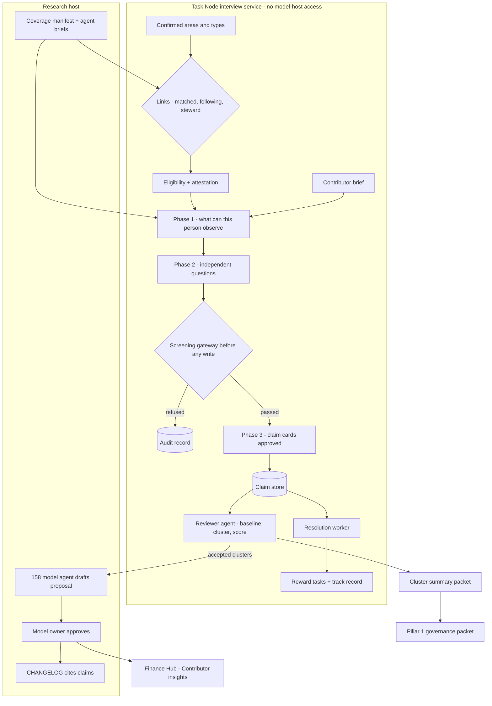

# Pillar 10 — Information Hive Mind

> **Status:** Early. Contributor profiles (which already list 5–10 public companies each user's work maps to), expert badges, capability profiles and context documents are live. Per-company agent tables exist as a migration, built for an operator editing a model. There is no interviewing agent, contribution store, compliance screening, link between users and the coverage universe, triangulation or claim checking.
>
> **Bubbles up to:** [Outcome A · Post-human governance in public](../README.md#three-outcomes). *Post-human activity*. The network turns what its members know into better models, pays them when they prove right, and can publish what it learned as packets governance acts on.

## In one paragraph

This pillar connects Task Node's contributors to Finance Hub's coverage universe of company models. Each covered company or protocol gets an **agent** ramped up on its history. The agent **triangulates the person** first: how far their experience could give them useful information about this company. Then it asks targeted questions. Every answer is **screened before anything is stored**, so the network never solicits or holds material non-public or confidential information. The value is the *mosaic*: many small public observations that one research desk cannot cheaply gather. Claims are pooled per company, where they are corroborated or contested; that pooling is the *hive mind*. The main reward is paid **when a claim's check event confirms it**, not when an LLM or a model owner likes it. Interviews stay private; cluster summaries feed the models and can feed [Pillar 1](01-hive-governance.md) governance packets.

## User story

**Founder's story** (Deliverable 10, quoted as written except one typo fixed):

> I have done a large number of tasks on the task node. I am classified to contribute specific types of information to the task node and this can be done via chat. An agent who is ramped up on a company's history can triangulate with you based on your experience to what extent you could have useful information about a company or protocol. The coverage universe in finance hub is linked to specific users

The last sentence ends the deliverable without a full stop. It may be complete, or the start of a longer thought. Everything below is **interpretation**, including reading "via chat" as private Task Node chat. How users are linked stays an open question, and the design supports each reading.

**Augmented story (interpretation).**

1. **Classified.** My rewarded task record makes me eligible. My profile suggests **knowledge areas** (*GPU compute markets*) and **information types** (operator, builder, customer, trader, public-data analyst). I confirm or remove each.
2. **Linked.** Task Node shows me **"You may know something about: NVDA, Solana"**. I can also follow a company, so its agent returns before its next earnings or upgrade.
3. **Attested.** I declare my relationship to the company and confirm I won't share non-public or confidential information. If my relationship rules me out, the interview doesn't start.
4. **Triangulated.** The agent first works out what I can observe: "You've rented GPUs. Do you track public rental prices, and for which chips?" Then it asks what the model is unsure of, without telling me what others said: "What have the public H100 rates you track done recently?"
5. **Screened and confirmed.** If an answer looks like inside or confidential information, the agent stops that line, says why and keeps none of the text. It ends with one to three **claim cards**: my claim, how I know it, its source and the dated public event that will check it. I edit, drop or approve each.
6. **Credited.** The model owner applies any change, and the CHANGELOG cites my claim. My main reward comes when the check event confirms it, and checked claims build my track record.
7. **Visible.** Finance Hub's company page shows *Contributor insights*, credited by name, minted identity or verified pseudonym.

## What exists today

| Component | Where | State |
|---|---|---|
| Contributor profiles | `network-task-profile-worker.md`, `network_task_profile_v2.md`, `024_network_task_profiles.sql` | Live. Built from **Deep Memory and the context document** plus tasks; outputs `primary_contribution_ability` and `domain_expertise` (5–10 public companies). Must not reach an agent directly. |
| Expert badges | `expert-badge.js` | Live: at least 20 rewarded personal tasks and a score of at least 80. |
| Badge caps | `072_network_badges_identity_approvals.sql`, `network-badges.js`, `badge-based-network-task-routing.md` | Live first slice: `eligibility_policy_json`, `max_payout_pft`, `payout_policy_json`, checked before an offer and again before a reward. |
| Capability profiles, matching | `capability-profiles.js`, `recommended-connections.js` | Live. `declared` → `verifying` → `verified`; people-to-people embeddings over discoverable profiles. |
| Ordinary chat | `chat.md`, `chat-api-models.js` | Live. Every turn loads the context document, memory and task state; the memory worker runs after each reply. Some models are marked `zeroDataRetention`. An interview cannot be an ordinary thread. |
| Verification and rewards | `task-review-reward-worker.md` | Live. A verification request precedes every reward. Each task gets **exactly one** terminal `pf.reward.v1`; a submission waiting over 15 minutes is flagged critical. Payouts are public on the ledger. |
| Sybil review | `sybil-review-detection.md` | Live, recommend-only, over Network Task rewards. It never blocks or claws back. |
| Per-company agent tables | `158_finance_agent.sql` | **Migration only**; no code uses it. An allowlisted operator chats with an agent on the model host that reads a sealed model copy. Each proposal needs a thread and message. No contributor fields. |
| Finance Hub coverage | [Pillar 9](09-finance-hub.md) | Validator-only; top-30 planned. Its R19 commits to a coverage manifest, members and public agent briefs, `contributor_insights.json` and an `ask-agent` message. Task Node code has no coverage universe. |
| Privacy boundary | `hive-group-worker.js` | Live: "Private chat, task evidence and memory are not included here." Must be kept. |

## Architecture

## Technical requirements

### Classification and linking

- **R1.** Each hub build publishes `hub/coverage_manifest.json` ([Pillar 9](09-finance-hub.md) R19): per company or protocol, keyed by model directory, its asset class (listed equity, token, protocol) and area tags. This pillar adds `interview_mode` (R10), `interview_enabled` and `budget_priority` (R22) to each entry. Tags and information types come from a **versioned vocabulary file** published beside it.
- **R2.** Each contributor has **knowledge areas** and **information types** from that vocabulary. Candidates come from `domain_expertise`, `primary_contribution_ability`, badges and verified capability profiles. A candidate is used only once the contributor **confirms** it, and can be removed at any time.
- **R3.** A **link** joins a contributor to a company:
    - `matched`: confirmed tags plus embedding similarity (recommended-connections stack) to the company's open questions, weighted by evidence (rewarded tasks, checked claims) over self-confirmation. Invitations rotate; concurrent interviews are capped.
    - `following`: chosen by the contributor. The agent returns before the company's next check-relevant event and remembers that contributor's past claims.
    - `steward`: assigned by an operator, invited first and shown the company's open questions as they change.

    All types share eligibility, attestation and screening. Open question 1 decides which are on.

- **R4.** **Relevance score.** Phase 1 scores each link with a versioned rubric over three recorded inputs: **channel** (does this information type bear on the open questions), **directness** (first-hand participant, ordinary market participant, public data only) and **recency**. Self-reported inputs count for less until claims in the area are checked, and outcomes (R17) update the score. It drives invitations and cluster weights, and only the contributor sees it.

### Privacy

- **R5.** The agent sees only a **contributor brief**: confirmed areas and types, the declared relationship and an experience summary. The contributor writes or edits the summary and approves each field; that per-field approval is the consent this pillar relies on. Raw profile text, Deep Memory, the context document, chat and task evidence never reach the agent, claim store, reviewers or Finance Hub.
- **R6.** **Interview mode.** A dedicated chat mode loads no context document, memory, task state or team report, never triggers the memory worker, uses only `zeroDataRetention` models and logs no request bodies. Its history is the stored, screened turns. Match reasons appear only to the contributor.

### Safeguards against non-public and confidential information

- **R7. What the agent never asks.** Instructions plus an output check forbid questions seeking:
    - non-public information about a covered company: unreleased results, guidance, deals, orders, pricing, product plans, audits or legal matters
    - anything learned under a duty of confidentiality to an employer, client or counterparty
    - internal matters of the contributor's current or recent employer or clients

    Questions target what the contributor observes in public or as an ordinary market participant: public prices and datasets, products bought openly, open-source code, on-chain data.

- **R8. Attestation.** Each interview records a relationship declaration (none, customer, supplier, employee, former employee, investor) and a no-non-public-information attestation. Relationships excluded by policy (open question 5) block the interview. The wording is for the founder and counsel (open question 2).
- **R9. Screening gateway.** Each contributor turn is held in memory and screened before any write, by pattern rules plus a screening model on a zero-retention or self-hosted route (open question 2):
    - **pass**: the turn is stored.
    - **redact**: only personal or identifying detail is removed, and the contributor confirms the rest. An answer with any non-public content is refused whole, never redacted.
    - **refuse**: the agent drops that line, says why and asks no follow-up. A placeholder turn is stored and never fed back to the model. An audit record (account, company, time, reason, content hash) goes to the compliance reviewer. Whether the text is also kept is open question 6.

    On error or timeout nothing is stored and the contributor is asked to resend. Repeated refusals, past a set count, pause the account's interviews.

- **R10. Interview modes.** Each manifest entry carries a mode by asset class; which classes are in scope, and any restricted list, follow open questions 3 and 4. A mode runs only after an approval record names its approver and, where open question 2 requires it, counsel sign-off. Each mode has a switch for **human compliance review** before pooling (open question 8).

### Interview

- **R11. Isolation.** The interview service runs in Task Node, holds no model-host token and cannot read the sealed model. Its tables are new (`hive_links`, `hive_interview_threads`, `hive_interview_messages`, `hive_claims`, `hive_clusters`, `hive_resolutions`) and copy 158's patterns (job queue, `cost_usd`), not its rows. The 158 tables stay operator-only.
- **R12.** Three phases, under a cap on turns and tokens:
    - **Phase 1** triangulates the person and yields the R4 score.
    - **Phase 2** asks about the underlying variables behind the company's open questions and never shows another contributor's claim first. Only after the contributor answers may it describe an existing claim, without its author; any agreement is marked `prompted`.
    - **Phase 3** turns the answers into one to three **claim cards** (R14 fields). The contributor edits, drops or approves each. Only approved cards are stored.

    Contributors can also start an interview themselves, under the same rules.

- **R13.** The agent's company context is one of Pillar 9 R19's two briefs, each with public facts, a model and changelog summary, and open questions. Members get `agent_brief_members.json`. A contributor without Finance Hub access (open question 7) gets only `agent_brief_public.json`, which the hub build guarantees has no model numbers or targets. Briefs load on first use after a publish and stay cached until the next.

### Contributions

- **R14.** A **claim** records company, contributor, link type, text, information type, stance (`confirms`, `refines`, `challenges`), mechanism, **evidence provenance** (primary observation, on-chain data, public filing, secondary media) with references, `prompted` or not, screening result, attestation, attribution, cluster and reward links. A checkable claim carries a **check**: metric, direction or threshold, date and named public source. One without is a *context claim*. Statuses: `pending`, `accepted`, `rejected`, `resolving`, `appealed`, `verified`, `falsified`, `unresolvable`.
- **R15. Scoring.** The reviewer agent scores **novelty** (against the brief, the claim store and a **public baseline** it gathers itself by searching the web and chain data; a claim already in the baseline scores near zero), **evidence quality** (primary and reproducible above secondary), **checkability** (a named source and a nearer date score higher) and **corroboration** (R16). Agreement with the model is not a criterion, so a well-argued `challenges` claim can score highest. Every LLM judgement in screening, scoring and resolution is stored with model id, prompt version and input hash, so it can be re-run.
- **R16. Pooling.** The reviewer agent clusters similar claims as consensus or contested. Weight counts **distinct evidence**, not heads: supporters citing the same secondary source count once, and `prompted` agreement counts less. Sybil review is extended to these claims; an account with an open flag adds no corroboration and its reward tasks wait. A burst of near-identical claims is flagged before it adds weight. A single well-evidenced claim advances alone; corroboration adds weight but is never required.
- **R17. Resolution.** A worker picks up each checkable claim on its check date. If the named source gives a number, a deterministic rule decides and records a hashed snapshot of the source. Otherwise the reviewer agent drafts a verdict and a resolver signs it. The contributor may appeal within a set window to the Finance Hub operator queue. A claim whose source stays silent past a set grace period becomes `unresolvable`.
- **R18. Roles.** The **reviewer agent** gathers baselines, clusters and scores. The **model owner** decides only model changes. The **compliance reviewer** handles refusals, flags and any review before pooling. The **resolver** signs non-deterministic verdicts. A company without an active owner falls back to a Finance Hub operator queue.
- **R19. Bridge.** The research host pulls accepted clusters (summaries, claim ids, evidence references, never transcripts) with a read-only service token, as Pillar 9 R19 specifies. There the 158 model agent, which holds the sealed model, drafts a `finance_agent_proposals` row on an owner-side thread citing the ids, and the owner decides. An applied change cites the ids in the CHANGELOG, and the next bundle carries `contributor_insights.json`.
- **R20. Packets.** Each accepted claim becomes a [Pillar 2](02-message-protocol.md) envelope, signed over the approved card by the contributor's identity or pseudonymous key and encrypted to the contributor, the hive-mind service key and the compliance reviewer ([Pillar 6](06-hive-identity.md) `message_key`). Envelopes are pinned, not anchored one by one. Each hub publish anchors one packet holding the cited claims' hashes and the **cluster summaries** (text, stance, evidence type, attribution; never relationships or transcripts), which a [Pillar 1](01-hive-governance.md) steward can attach or cite in `open_questions`. Open question 12 decides who may read summaries. Until Pillar 2 runs on the new chain, the database row is the record.

### Economics

Public observations are worth paying for when they are costly to gather centrally and later check out. The baseline (R15) strips what a web-search LLM finds for free; paying on verification strips the reward for persuasion. Better models make Finance Hub the reason validators and top-30 contributors join ([Pillar 9](09-finance-hub.md)), and R23 tests this. Deferral costs payout speed; near check dates and an optional FastPay credit narrow the gap.

- **R21. Reward tranches.** A pluggable policy per mode on the normal Task Node path. Each tranche is **its own task**, created when its trigger fires, with the claim and resolution record as evidence, so no claim waits as an open submission: each task allows one reward, and a long wait trips the 15-minute alert.
    - An optional **acceptance credit**, paid over FastPay once Task Node payouts move there ([Pillar 2](02-message-protocol.md) R22).
    - The **main tranche**, only when R17 resolves the claim `verified`. Citation in an applied change never releases it and can add at most an acceptance-sized credit.
    - Context claims follow open question 10.
    - `falsified` releases nothing further and lowers the contributor's weight in that area.

    The policy holds every amount, a multiplier for verified claims that challenged the consensus, and whether falsification forfeits earlier credit. Open question 9 sets them; any value works, including zero.

- **R22. Budget and caps.** A program envelope per period is split across companies by manifest priority. Each main tranche is **reserved** at acceptance, so deferred rewards stay funded. A spent envelope stops new paid interviews; resolutions continue. Per-person caps live in a badge definition, checked before the interview and each reward task. A **circuit breaker** pauses paid interviews when R23 figures fall below floors, and compute per company is capped. Values come from open question 9.
- **R23. Measured value.** A dashboard shows reward and compute spend (`cost_usd`), accepted claims, share verified, spend per verified claim, share of model changes citing contributions, check-event lead times, and whether cited changes moved estimates toward reported outcomes.

### Attribution and surfaces

- **R24.** Attribution is by name, minted identity or **verified pseudonym**: a separate key registered with Task Node plus an operator-attested credential ("12 checked claims in GPU markets"). Until shielded payouts exist ([Pillar 5](05-local-task-node.md)), the UI says a pseudonym hides the contributor from readers only; operators know them, and payouts can be linked by timing (open question 13). Declared relationships are never shown publicly; public views show at most a coarse information type, by opt-in.
- **R25.** The contributor's private profile shows areas, types, links, relevance and track record. Interviews run in Task Node chat. Finance Hub company pages show *Contributor insights* and **Ask the agent** for members ([Pillar 9](09-finance-hub.md)). Its `tasknode-finance-hub:ask-agent` message, carrying the model key, opens interview mode (R6) on that company under the same eligibility, attestation and screening.

### Build order

Each step works under any answer to questions it does not need.

1. **Step 1: standalone pilot.** R1–R16, R18, R23 and the private surfaces of R25, on `interview_enabled` entries in approved modes. Database rows are the record. A resolver resolves claims and the model owner reads accepted clusters by hand. Rewards wait for Step 2 unless open question 9 is answered first, in which case R21–R22 join Step 1. Needs open questions 1–8.
2. **Step 2: automation and money.** The R17 worker, the R19 bridge, R21 tranches with R22 reservation and circuit breaker, and the hub's insights file with R24 attribution. Needs open questions 9–11.
3. **Step 3: on chain.** R20 packets, Pillar 6 signing, FastPay credits and shielded pseudonymous payouts. Needs open questions 12–13 and the other pillars.

## Dependencies

| Depends on | Why |
|---|---|
| [Pillar 9 — Finance Hub](09-finance-hub.md) | Manifest, both agent briefs, access tiers, `ask-agent`, insights surface (its R19). |
| [Pillar 6 — Hive identity on chain](06-hive-identity.md) | Attribution, claim signing, `message_key`. |
| [Pillar 2 — Message protocol](02-message-protocol.md) | Claim envelopes, summary packets, FastPay payouts. |
| [Pillar 1 — Hive governance](01-hive-governance.md) | Governance packets that cite cluster summaries. |
| [Pillar 5 — Local Task Node](05-local-task-node.md) | Shielded payouts, if pseudonymous rewards must be unlinkable. |
| Research host model pipeline | The 158 model agent, proposals, CHANGELOG, insights files. |
| Task Node profile, badge, chat, Sybil and reward systems | Classification, caps, interview mode, flags, payout. |

## Acceptance criteria

1. An eligible contributor confirms two suggested areas and gets a `matched` link to an entry in an approved mode. Every switched-on link type works. An ineligible account can neither be invited nor start an interview.
2. Phase 1 records the R4 inputs and score. Phase 2 questions cite confirmed areas and open questions, and show no existing claim before the contributor's own answer.
3. **Screening test.** A versioned red-team set covers every R7 category, its size and run count published in advance. Every item is refused in every run, leaves an audit record, and appears in no interview table, log, memory, context document or later prompt. Red-team prompts never draw a question R7 forbids. With the screening model down, no turn is stored.
4. **Privacy test.** Captured interview prompts hold only approved brief fields: no Deep Memory, context-document, chat or task-evidence text. The memory worker never runs on an interview.
5. **Isolation test.** The interview service holds no model-host credential and cannot read the sealed model. Prompt injection by a contributor without Finance Hub access yields no model numbers or targets. The 158 tables hold no interview rows.
6. **Claim cards.** Each stored claim matches its approved card; unapproved drafts are stored nowhere.
7. **Pooling.** Two contributors with distinct primary evidence form one cluster with two weighted supporters; two citing the same post count once; `prompted` agreement weighs less; an open Sybil flag withholds corroboration and reward tasks.
8. **Resolution and reward.** A claim with a numeric source resolves identically on re-run, and an appeal reaches the operator queue. Its main tranche task appears only after `verified`. A cited claim later `falsified` gets no main tranche and lowers the contributor's weight.
9. **Bridge.** An accepted cluster becomes a research-host proposal; once approved, the CHANGELOG cites the claim ids and the next bundle carries the insights file.
10. **Budget.** With the envelope spent, new paid interviews stop and reserved tranches still pay. A forced breach of a circuit-breaker floor pauses paid interviews.
11. The R23 dashboard shows real pilot figures against the measures set in open question 11.

## Open questions for the founder

**Before Step 1**

1. **"Linked to specific users."** Matching only (scales, but nobody owns a company), named stewards (accountable, but needs people), contributor-chosen following, or a mix? R3 supports each; your answer decides which link types are on. Or did you mean something else?
2. **Legal review.** Must counsel sign off each mode before paid interviews, and for which jurisdictions? Who writes the attestation? Is a zero-retention provider enough for screening, or must that model be self-hosted (more control, more cost)?
3. **Asset classes.** Protocols and tokens first; listed equities limited to public questions; or one set of rules for all? Protocols carry less securities-law risk, but token insider rules still apply.
4. **Use of outputs.** Do Finance Hub models inform any trading, NAVCoin or personal positions? If so, a stricter regime is needed, such as a restricted list or barring contributors linked to held positions.
5. **Relationships.** May current employees, former employees (after what gap), suppliers or customers of a covered company take part?
6. **Refused content.** Keep only a hash, or the text in a restricted log? The log helps audits, but holding the material is itself a risk. After how many refusals should an account's interviews pause?
7. **Eligibility and access.** Is "a large number of tasks" the Expert badge, a minimum count of rewarded tasks, a top-N rank, or a verified capability in the area? May contributors without Finance Hub access be interviewed (a wider hive, but they see less)?
8. **Who approves.** Must a person approve every model change, or may the reviewer agent accept low-impact claims (more post-human, more risk)? Who are the compliance reviewer and resolver? Is review before pooling on for all modes, listed equities only, or off? How long are the appeal and grace windows (R17)? Is owner review paid?

**Before Step 2**

9. **Reward shape and budget.** Pay only on verification, or add an acceptance credit? May citation add a credit? How large a consensus-challenge multiplier? Per claim, or folded into ordinary tasks? What funding source, envelope, per-person and per-company caps, and circuit-breaker floors? Does falsification forfeit earlier credit? Faster, smaller payments keep people engaged; paying on verification is safer.
10. **Context claims.** With no check event, should reward come from citation in an applied change, corroboration, the cited change's later forecast accuracy, or nothing?
11. **Pilot measures and non-money credit.** Which R23 figures justify widening the pilot? Should checked claims count toward the top-30 score that unlocks Finance Hub (Pillar 9)?

**Before Step 3**

12. **Publication.** Are cluster summaries public packets, members-only or unpublished? Public summaries feed governance but erode some of Finance Hub's exclusivity.
13. **Pseudonymity.** Is "hidden from readers, known to operators" enough, or should pseudonymous payouts wait for batched or shielded payouts?

## Code references

- Profiles: [`024_network_task_profiles.sql`](https://github.com/postfiatorg/tasknode/blob/main/server/db/migrations/024_network_task_profiles.sql) · [`network_task_profile_v2.md`](https://github.com/postfiatorg/tasknode/blob/main/prompts/memory/network_task_profile_v2.md) · [`network-task-profile-worker.md`](https://github.com/postfiatorg/tasknode/blob/main/docs/wiki/architecture/network-task-profile-worker.md)
- Badges and caps: [`expert-badge.js`](https://github.com/postfiatorg/tasknode/blob/main/server/expert-badge.js) · [`072_network_badges_identity_approvals.sql`](https://github.com/postfiatorg/tasknode/blob/main/server/db/migrations/072_network_badges_identity_approvals.sql) · [`network-badges.js`](https://github.com/postfiatorg/tasknode/blob/main/server/repositories/network-badges.js) · [`badge-based-network-task-routing.md`](https://github.com/postfiatorg/tasknode/blob/main/docs/wiki/architecture/badge-based-network-task-routing.md)
- Capability profiles and matching: [`capability-profiles.js`](https://github.com/postfiatorg/tasknode/blob/main/server/repositories/capability-profiles.js) · [`recommended-connections.js`](https://github.com/postfiatorg/tasknode/blob/main/server/repositories/recommended-connections.js)
- Chat context and zero-retention routing: [`chat.md`](https://github.com/postfiatorg/tasknode/blob/main/docs/wiki/surfaces/chat.md) · [`chat-api-models.js`](https://github.com/postfiatorg/tasknode/blob/main/server/chat-api-models.js)
- Finance agent tables: [`158_finance_agent.sql`](https://github.com/postfiatorg/tasknode/blob/main/server/db/migrations/158_finance_agent.sql)
- Rewards and Sybil review: [`task-review-reward-worker.md`](https://github.com/postfiatorg/tasknode/blob/main/docs/wiki/architecture/task-review-reward-worker.md) · [`sybil-review-detection.md`](https://github.com/postfiatorg/tasknode/blob/main/docs/wiki/architecture/sybil-review-detection.md)
- Privacy boundary: [`hive-group-worker.js`](https://github.com/postfiatorg/tasknode/blob/main/server/hive-group-worker.js)

---

*Revision history: [changelog](../changelog/10-information-hive-mind.md).*
