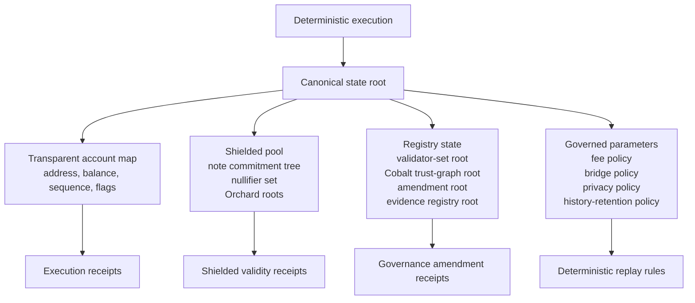
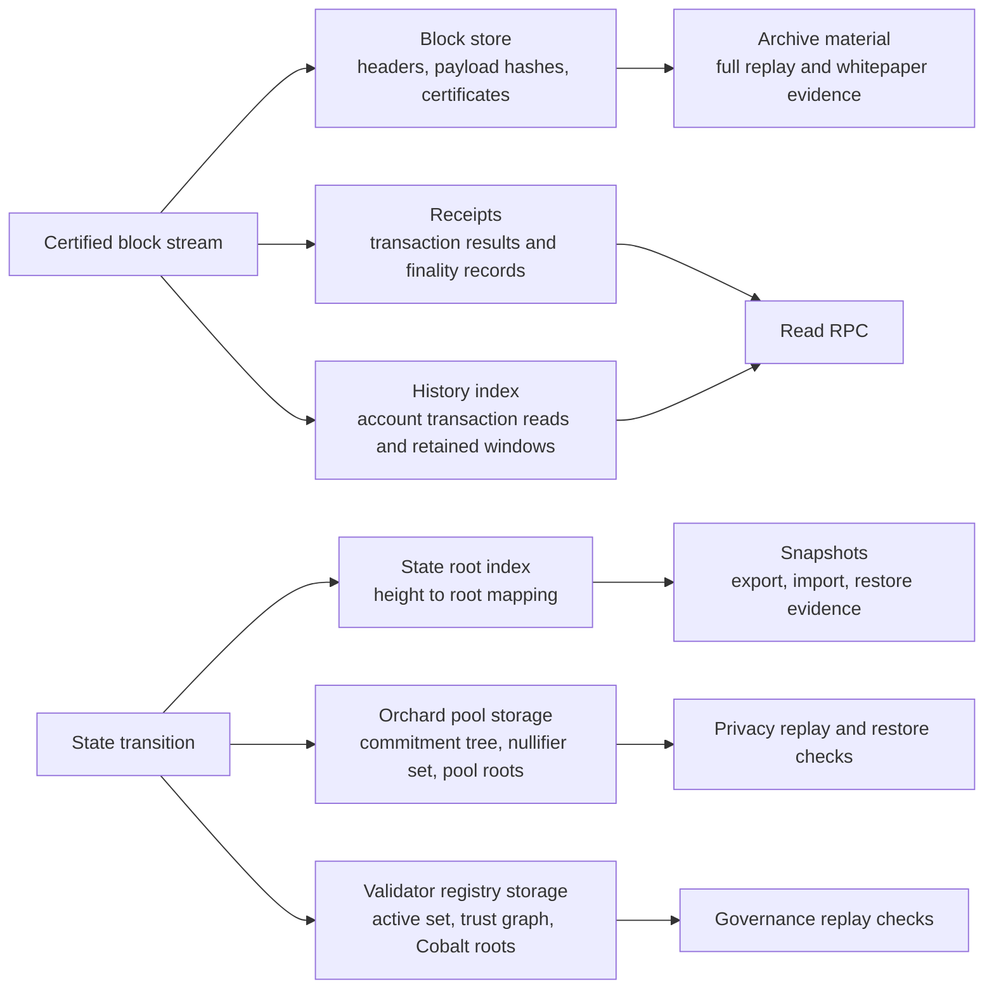
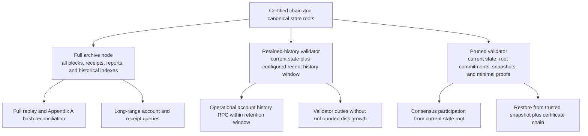

# State And Storage

PostFiat stores enough data to verify current state, serve account history, and
replay evidence without forcing every validator to retain every byte forever.

## State Objects

- accounts and balances;
- blocks and block headers;
- receipts and transaction finality records;
- validator registry and governance roots;
- Orchard pool roots, commitments, nullifiers, and public telemetry;
- retained-history indexes for account transaction reads;
- snapshots and archive material.



## Storage Layers



## Transactional finality-path store

The storage-scaling milestone selected an embedded transactional `redb`
store for finalized blocks, receipts, archived batches, ordered membership,
current state, history indexes, and chain-tip metadata. One finalized height is
committed in one write transaction with an expected-parent check. Proposal,
validation, state commitment, and finalized commit use a constant-size
ordered-history accumulator and indexed membership instead of materializing the
full ordered-batch history.

Authenticated JSONL v2 heads remain available for bounded legacy import, audit,
and comparison. Each transactional rebuild also emits a deterministic
`canonical-history.jsonl` audit export whose record count and SHA3-384 root are
verified against the authenticated database; missing, corrupted, or substituted
exports fail closed during independent verify-only. The export is never read or
written by proposal, voting, or finalized commit. The fixed-slot bitmap remains
a superseded bounded-work experiment; neither JSONL surface is the selected
primary finality-path store. Legacy heights retain their exact list-based state
roots, and the transactional generation can be rebuilt or verified offline
with:

```bash
postfiat-node storage-rebuild-transactional --data-dir PATH --output-dir PATH \
  --expected-tip HASH --expected-state-root HASH --offline-confirmed
postfiat-node storage-rebuild-transactional --data-dir PATH --output-dir PATH \
  --expected-tip HASH --expected-state-root HASH --verify-only \
  --offline-confirmed
```

Both forms require `--expected-tip` and `--expected-state-root`: the source
node's `status` `block_tip_hash` and `state_root`.

The verification form is strictly non-mutating. It requires existing source
and target directories plus the existing source integrity key, opens the
transactional database through `redb`'s read-only interface, and refuses a
pending source journal instead of recovering it. In-memory chain-tip
reconstruction is allowed, but chain-tip repair, JSONL v1-head upgrades,
crash-suffix truncation/checkpointing, manifest writes, and export writes are
not. Whole-directory mutation-sentinel tests cover successful verification and
each repair/refusal boundary.

**Last recorded deployment (2026-10-30).** The controlled devnet has run this
store since height 930 (2026-08-31). The latest fleet record names
`vote-records-20261030`, binary `87cfe797…`, source `ae70d66d`;
see [Network Status](../status/network-status.md). This is a dated record,
not a fresh fleet observation.

**Qualification: `OFFLINE QUALIFIED` (2026-10-23).** The packet for
`store-handle-20261021`, binary `eea96ba6…`, source `86706699`, covers
G1, G2 and G4 (attempt 4), and the exact height-924 replay with
its verify-only output. It also covers the height-1123 replay in place of the
lost 915 archive, and the six-clone migration rehearsal (924–934). It is on
the work server, not in git: `~/.cache/storage-packet-20261023/packet-r3/`,
checksum manifest `357f06ee…`. `python -m postfiat_rpc.storage_scaling verify`
accepts it offline; verifier output `e4fba47e…`. Offline qualification is not
G6 (`CLONE QUALIFIED`) and not a deployment decision, and public testnet
remains blocked. These results stay bound to that source and binary; they do
not automatically qualify later releases.

The redaction-safe G2 reports are committed under
[`benchmarks/storage-scaling/g2-eea96ba6/`](https://github.com/postfiatorg/postfiatl1v2/tree/main/benchmarks/storage-scaling/g2-eea96ba6).
The gate list and history are in the completed
[storage milestone](../plans/completed/storage-scaling-milestone.md) and the
[Storage Scaling Fix specification](storage-scaling-fix-spec.md).

## Validator-registry activation on continuation

When a node commits a new height, it activates due validator-registry updates
from the recorded governance history against the persisted registry file. Two
paths share this behavior in `crates/node/src/block_replay_wallet.rs`: the
ordered commit-side activation and the live activation that finalizes the
registry written with the block.

Both paths derive an **applied-history prefix**
(`applied_validator_registry_update_prefix_len`). The persisted registry always
equals the state produced by the most recently applied update, so applied
history runs through the *latest* recorded update whose affected validator set
reproduces its `new_registry_root` from the current registry. Everything at or
before that point is settled history and is never reapplied — including
accepted updates that a later update to the same validator record has
superseded, whose own roots are no longer reproducible. Updates after the
prefix are pending and chain through the unchanged fail-closed previous-root
and new-root checks in `crates/node/src/storage_commit.rs`: wrong-root,
reordered, or missing history rejects the commit without durable mutation.

Testing each update in isolation instead of deriving the prefix is what
stopped the 2026-08-30 exact height-924 G6 clone rehearsal: a superseded drill
rotation was treated as due again and correctly failed the previous-root check
(see the [postmortem](../postmortems/devnet-storage-g6-rehearsal-stop-2026-08-30.md)).
The repair landed at commit `2c7aa36f` with an exact regression — drill
rotation, signed rollback, later rotation of the same validator record, then a
successful next certified height — plus stale, reordered, duplicated, missing,
and wrong-root history coverage in
`crates/node/src/tests/validator_registry_continuation_tests.rs`. The repair is
part of the repository lineage: it does not make the historical `d0ae79f3`
candidate deployable. The later G5 qualification is recorded above; G6
remains open in the storage milestone.

## Partial History

Validators can have history roles. Full archive behavior and retained-history
behavior are separated so ordinary validators can operate without unbounded
chain-size growth.



Important sources:

- `crates/storage/src/lib.rs`
- `crates/node/src/history.rs`
- `docs/runbooks/validator-history-retention.md`
- `docs/runbooks/account-tx-index.md`
- `docs/status/controlled-testnet-history-roles.json`

## Snapshot And Replay

Snapshot export/import is part of the operator evidence surface. Privacy
snapshot evidence verifies Orchard pool counters and roots after restore.
Governance replay evidence verifies Cobalt lifecycle and amendment bundles.
