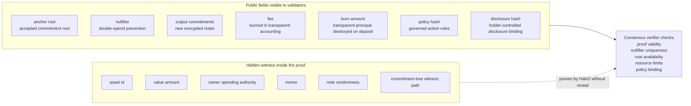
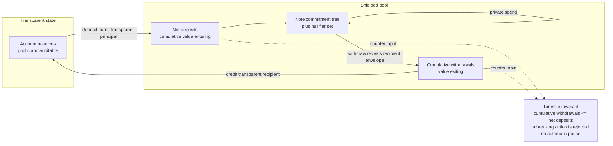

# Deposit, Spend, Withdraw

PostFiat's current shielded flow has three production-shaped operations:

1. transparent-to-Orchard deposit;
2. Orchard private spend;
3. Orchard-to-transparent withdraw.

They are on `main`. On the live devnet, public submission of shielded actions
is off on every validator, as recorded in the
[handoff of 23 November 2026](../status/handoff-2026-11-23.md); the switch is
not reported over RPC.

## PFSH02 rehearsal payments

**Shield** debits a public account and credits the private reserve for the exact issue. The local signer checks both output openings before signing the ML-DSA-65 authorization. **Pay** consumes private notes and appends two outputs. **Unshield** pays the bound public recipient. Native PFT fees reduce the private PFT reserve. A pfUSDC deposit pays PFT from the depositing account. A pfUSDC payment or exit pays the fee from its notes into a public collector for that source series. The wire omits the sender account.

In the six-validator rehearsal, a locally attested bridge deposit established 100 atoms of the governed pfUSDC series through signed transactions. The subsequent private shield moved all 100 atoms into its reserve. At height 30 the native PQ reserve held 494 atoms and the live PFT supply was 999,999,413 atoms after 587 atoms in burned fees. A fresh import recovered an unspent 99-atom PFT output and the 100-atom pfUSDC output after the pause. [Rehearsal record](../evidence/pq-private-payments-m8/rehearsal-record.md).

## Shielded Action Structure

A shielded action exposes enough data for consensus verification while keeping
the spent note, owner, amount, asset details, and memo inside the proof.

## Turnstile Accounting

The transparent and shielded states meet at a turnstile. Supply integrity is
checked with public counters in addition to proof verification.

An action that would break the turnstile is rejected with a receipt and
changes no pool state; in an atomic batch the whole batch is aborted. Examples
are a withdraw above the issued pool value (`orchard_withdraw_exceeds_pool`),
new notes beyond the recorded deposit budget (`turnstile_insufficient_deposit`)
and an Asset-Orchard egress above an asset's live balance
(`asset_orchard_accounting_underflow`). A rejection pauses nothing: shielded
actions stop only when governance activates the Orchard pool pause amendment,
which then rejects every action in a shielded batch with `orchard_pool_paused`.

Code: `orchard_withdraw_amount_for_apply`,
`apply_verified_orchard_action_to_shielded_state_with_exit_policy_and_deposit_credit`
and `debit_asset_orchard_balance` in `crates/node/src/orchard_state_application.rs`;
`verify_orchard_turnstile_accounting` in `crates/node/src/shielded_batch_actions.rs`;
`execute_shielded_batch_actions` in `crates/node/src/execution_actions.rs`.

## Deposit

A deposit envelope contains a signed transparent funding transfer to the
protocol burn sink and an Orchard/Halo2 output action. The Orchard action binds
the funding transfer id, amount, fee, policy id, and disclosure hash into the
authorization domain.

Accepted apply:

- verifies funding signature and sequence;
- burns transparent principal plus deposit resource fee;
- mints the Orchard note;
- updates pool roots and public counters;
- leaves the recipient note scan-spendable.

## Spend

`orchard-spend-create` builds a real Orchard spend from one decrypted note. It
can send full value minus fee or send an amount plus default change.

Accepted apply:

- verifies the Orchard proof;
- persists the nullifier;
- appends output commitments;
- burns the signed fee;
- rejects duplicate nullifiers.

## Withdraw

`orchard-withdraw-create` builds a one-note withdraw action bound to a
transparent recipient envelope.

Accepted apply:

- verifies the external binding;
- nullifies the spent note;
- burns the signed fee;
- credits the transparent recipient in the same committed block.

## Evidence

May 2026 runs; the reports are archived outside this repository (see
`reports/README.md`).

- `reports/testnet-orchard-wallet-finality-smoke/privacy-direct-deposit-20260515T132406Z/testnet-orchard-wallet-finality-smoke.json`
- `reports/testnet-orchard-peer-certified-smoke/peer-direct-deposit-20260515T134027Z/testnet-orchard-peer-certified-smoke.json`
- `reports/testnet-live-orchard-direct-deposit/current-write-gates-20260517T153630Z-orchard-direct-deposit/testnet-live-orchard-direct-deposit.json`
