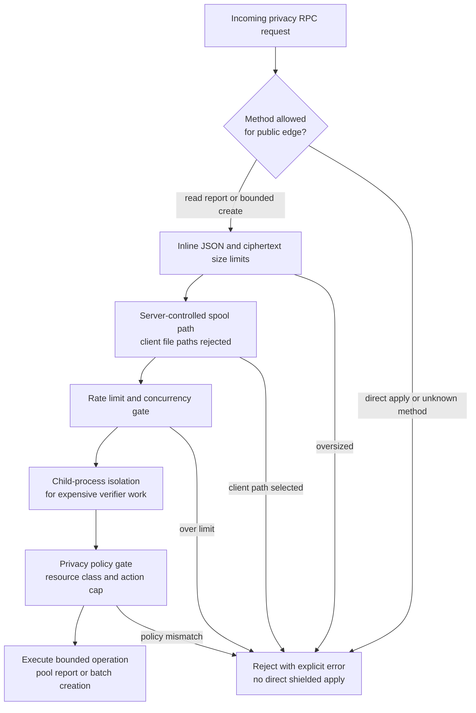

# Privacy RPC And Resource Policy

Remote privacy RPC is intentionally bounded. Proof verification is expensive
enough that public edge behavior must be explicit.

## Current RPC Posture

- Read-only pool report is available through `orchard_pool_report`.
- Remote Orchard batch creation is opt-in.
- Inline JSON is bounded.
- Server-controlled spool paths are used.
- Client-selected file paths are rejected.
- Direct shielded apply is rejected at the public edge.
- Concurrency and rate limits exist for remote verifier work.
- Child-process isolation exists for selected RPC operations.

## PFSH02 admission and block limits

The rehearsal genesis admits at most four PQ proofs and 596,520 charged archive bytes per block, with a per-payment ceiling of 149,130 bytes. The charge includes the canonical body, archive reference and storage framing. The largest body read back in M8 was 144,397 bytes and its charge was 145,140 bytes. A four-proof block charged 578,304 bytes. Ordinary payments continued in separate blocks on the same chain.

The admission service checks the candidate inclusion height and repeats state-dependent checks at dispatch. Activation at rehearsal height 6 permitted the first PFT shield. A signed zero-value amendment finalized at height 29 made candidates at heights 30 and 31 ineligible. Ordinary traffic finalized at height 30. Receipt lookup, private pool pages and full replay remain available while inclusion is paused. Quorum round time includes transport and persistence. The deterministic validity rules count proofs and bytes. [Rehearsal record](../evidence/pq-private-payments-m8/rehearsal-record.md).

On the shared AMD EPYC rehearsal host, the accelerated settlement path's slowest single action took 36.60 ms over accepted and rejected samples. The portable path reached 50.23 ms on CPU 13 and 55.32 ms on its pinned CPU 11 rerun, above the 50 ms release target. The protocol does not use machine time to decide whether a block is valid.

## RPC Resource Gates

## Resource Evidence

- malformed proof load;
- oversized proof rejection;
- ciphertext size rejection;
- RPC rate limit;
- RPC concurrency limit;
- RPC child isolation;
- repeated live target-hardware malformed load.

Evidence anchors:

- `reports/testnet-orchard-rpc-concurrency-limit/orchard-rpc-concurrency-limit-v0-20260515T171128Z/testnet-orchard-rpc-concurrency-limit.json`
- `reports/testnet-orchard-rpc-child-isolation/orchard-rpc-child-isolation-v0-20260515T174034Z/testnet-orchard-rpc-child-isolation.json`
- `reports/testnet-live-orchard-malformed-edge-load-series/live-orchard-malformed-edge-load-series-20260515T170500Z/testnet-live-orchard-malformed-edge-load-series.json`
