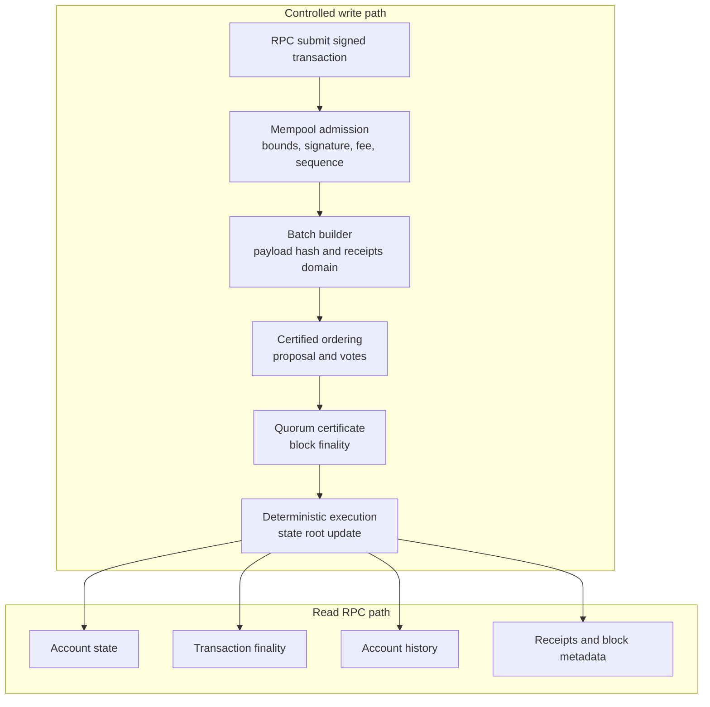

# RPC Overview

PostFiat RPC is read-first for the controlled network. Write paths exist, but
they are bounded and explicit because public write exposure changes abuse and
operator-risk assumptions.

## RPC Surfaces

| Surface | Purpose |
| --- | --- |
| Read RPC | Status, ledger, fee, validators, blocks, receipts, transaction finality, account history, pool reports. |
| Controlled write path | Bounded operator-approved transaction submission for live evidence and wallet tests. |
| Local request-file path | Local node command path for building batches from prepared request files. |
| Privacy batch creation | Opt-in bounded Orchard batch creation with rate and concurrency limits. |
| Owned lane | Signed, state-validated FastPay sign/apply methods enabled by default; operators can disable them with `--disable-owned-lane`. Unsigned wrap/unwrap methods are not remote methods. |
| Authenticated protocol mutation | FastSwap/FastLane messages that are remotely reachable by default but authorize themselves with owner signatures, policy commands, or quorum certificates. They are not unauthenticated writes. |

## Write And Read Paths



FastPay and FastSwap do not travel through this exact block-critical path for
every phase. Their prefunded object certificates and recovery boundaries are
documented in [Settlement Lanes](../architecture/settlement-lanes.md).

## Success and exposure rules

- A block certificate proves ordering/finality; it does not prove transaction
  success. Clients must check the matching receipt's accepted status and code.
- FastPay success requires the signed envelope, valid distinct-validator
  certificate, and the configured durable apply acknowledgements.
- FastSwap success requires the dual-owner intent and terminal Confirm effects
  certificate; read/status convergence is audit and catch-up evidence.
- Public or wildcard plaintext binds are rejected. Browser-facing deployments
  use a loopback node plus an authenticated TLS edge.
- Gated signed-submission and Orchard methods remain disabled unless the
  operator enables their exact flag. Signed owned-lane methods are enabled by
  default, with `--disable-owned-lane` as an emergency boundary; their read and
  recovery-status methods remain available. The code-derived inventory fails
  when a new method has no explicit posture.

## Current Tooling

- `crates/node/src/rpc_cli.rs`
- `crates/rpc_sdk/src/lib.rs`
- `scripts/testnet-rpc-doctor`
- `scripts/testnet-rpc-method-inventory`
- `scripts/test-rpc-method-inventory`
- `scripts/postfiat-rpc-account-tx`
- `python/postfiat_rpc/client.py`

## Read Next

- [Methods](methods.md)
- [Account History](account-history.md)
- [Write Policy](write-policy.md)
- [Examples](examples.md)

## Reads during a transactional validator commit

On Linux the isolated `receipts` worker first tries storage directly. On
writer contention it asks the local transport validator for an authenticated
MVCC snapshot of the handle that validator already owns. Both services must
run the reader-capable binary under the same uid and share the node directory
and network namespace. The lookup also works for a transaction the worker has
never seen. Its RPC event records the height and block hash of the snapshot,
including when the result is empty. It returns historical occurrences in block
order, with the requested limit. The validator processes one receipt request
at a time and enforces a query deadline and byte budget. If the snapshot cannot
answer (its deadline, the byte budget, or a listener under another uid), the
worker takes the ordinary bounded direct read instead. The snapshot keeps the
validator's store open until the read ends.

A warmed `status` can return a cached report during contention for up to 30
seconds from the read. Its event identifies the cached height and hash. It can
therefore be older than a receipt snapshot answered in the same window: compare
the heights in the two events rather than reading a receipt above the cached
status tip as a contradiction. Other
worker reads and mixed releases can still encounter the ordinary writer
deadline. An expired or unprimed status cache can also report a read failure.

### Measuring one validator file hold

Collect on the two-core validator host during an ordinary certified commit.
Enable `POSTFIAT_TRACE_COMMIT_LEASE=1` on the transport service for the
measurement and use a build containing the marker. Each newly durable block
then records its height, hash, process ID and kernel-host wall time in the
transport service's standard error. Use the active generation's absolute redb
path. The following trace reads lock syscalls only. Run as the host operator
with ptrace access and `strace` installed.

```sh
validator=validator-5
pid=$(systemctl show -p MainPID --value "postfiat-${validator}.service")
node_dir="/var/lib/postfiat/$validator"
transport_stderr="/var/log/postfiat/$validator/stderr.log"
absolute_generation_database="$node_dir/postfiat-state-v1.redb"
if test -f "$node_dir/transactional_generation.json"; then
  absolute_generation_database=$(jq -er '.database_directory + "/" + .database_file' "$node_dir/transactional_generation.json")
fi
absolute_generation_database=$(realpath -e "$absolute_generation_database")
trace_dir=$(mktemp -d)
getconf _NPROCESSORS_ONLN
taskset -pc "$pid"
sha256sum "/proc/$pid/exe"
timeout --signal=INT 120 strace -qq -ff --absolute-timestamps=unix,ns --syscall-times=ns -yy -e trace=flock \
  -o "$trace_dir/flock" -p "$pid"
scripts/measure-validator-commit-lease --pid "$pid" \
  --database "$absolute_generation_database" --trace-prefix "$trace_dir/flock" \
  --markers "$transport_stderr"
```

The output gives lower and upper bounds in milliseconds. The lower bound is
the time between successful acquisition returning and release starting. The
upper bound includes both syscall durations. Preserve the raw traces, marker,
validator identity, CPU count/affinity and release digest with the sample.
The tool requires one newly durable height within a complete lock interval.
If the window contains no such commit, collect another window. The 20-second
reader deadline, durable-write timer, and deliberately extended test lease
each measure something different from this file hold.
