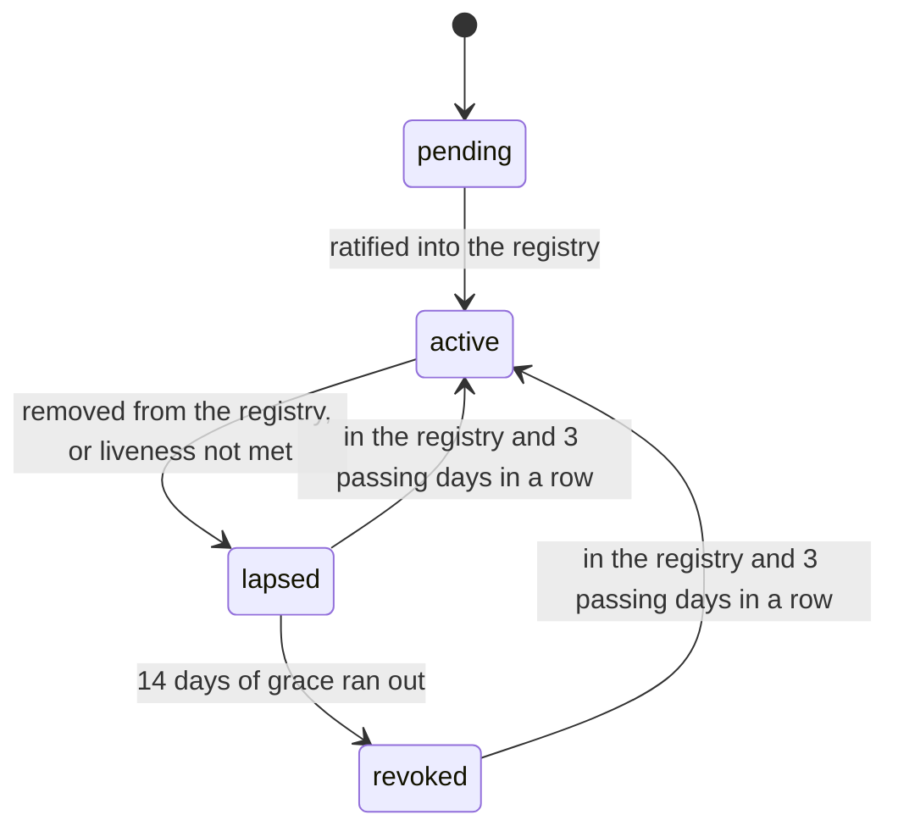

# Signed Validator Uptime Feed (`postfiat-validator-uptime-v1`)

**Status:** Phase 0 Contract C2
**JSON Schema:** [`schemas/postfiat-validator-uptime-v1.schema.json`](schemas/postfiat-validator-uptime-v1.schema.json)
**Pinned keyset schema:** [`schemas/postfiat-observer-keyset-v1.schema.json`](schemas/postfiat-observer-keyset-v1.schema.json)
**Fixtures:** [`feed`](schemas/postfiat-validator-uptime-v1.fixture.json), [`keyset`](schemas/postfiat-observer-keyset-v1.fixture.json) (signed with public test keys)
**Reference verifier and test:** [`scripts/test-validator-uptime-schema.py`](../../scripts/test-validator-uptime-schema.py)
**Related:** [`validator-rpc-profiles-v1.md`](validator-rpc-profiles-v1.md), [`tasknode-l1-validator-binding.md`](../runbooks/tasknode-l1-validator-binding.md), [`validator-registry.md`](../governance/validator-registry.md)

## 1. Purpose

Three independent observers watch the chain, count each validator's votes, and sign what they saw. Task Node, `postfiat-node top` and the public validator directory read the bundle of those three signed statements and act only on what at least two observers agree on.

The feed decides four things for a validator: Finance Hub access, research API keys, the monthly Task Node credit, and whether a removal proposal may be opened. It replaces the unsigned single-host projection in [`CONTRACT-l1-validators.md`](../../tools/tasknode-validator-binding/CONTRACT-l1-validators.md) and keeps that feed's way of measuring.

Observers only read. They hold no validator key and no governance key.

Where this text and the reference verifier differ, the verifier is right and this text has a bug.

## 2. What is measured

### 2.1 A day is a UTC day, dated by the observer

Block headers carry no time, and the chain makes a block only when there is something to order. A window counted in blocks would take a year on a quiet chain and an hour in a burst. So every window in this contract is counted in UTC days, and an observer dates blocks by when it saw them:

- An observer reads the finalized head at least every `max_observation_gap_seconds = 900`.
- Blocks that appear between two consecutive reads on the same UTC day belong to that day.
- If the head moved between two reads that straddle midnight, or two reads are more than 900 seconds apart, the observer cannot date those blocks. It marks the affected days `complete = false`.
- Dates before the observer started are never inferred.

This is `time_basis = "observer_brackets"`. Two honest observers can therefore differ by an incomplete day. Section 4 says how that is settled.

### 2.2 Certificate evidence and uncertain votes

The metric is `certificate-votes-observer-brackets-v2`. Count a validator once per committed block when either the prepare or precommit certificate contains its vote. A proposer RPC record is diagnostic evidence and never increases the count. The daily score is the integer floor of 10000 times the signed count divided by the committed count. An incomplete or idle day has a null score.

A certificate can close before a healthy validator answers. If a complete day in the current window falls below 9500 on certificate evidence, the observer withholds that registered validator's row. A consumer preserves existing access and holds new grants for a missing row. At present this limits automatic liveness enforcement to what the certificates establish. Registry removal is independently observable. A bracket whose endpoints have different registry roots or membership is incomplete. Removed, revoked identities age out after 30 days of continuous absence.

### 2.3 The window

`window_end` is the UTC midnight that starts the evaluation day; `window_start` is 30 days earlier. Over the complete days with blocks in that window (after a recovery, only those on or after `recovery_floor_date`, see 5.4):

- `observed_days`: how many there are.
- `mean_daily_participation_bps`: `floor(sum of participation_bps / observed_days)`, or `null` when there are none. Every day weighs the same.
- `consecutive_passing_days`: the length of the run of days at or above 9500 that ends at the most recent one.
- `liveness_met`: the validator is in the registry, and evidence is insufficient (zero days, or fewer than 25 days outside ramp and recovery) or the mean is at least `liveness_threshold_bps = 9500`.

All arithmetic is in whole basis points. 95% is exactly 9500.

## 3. What an observer signs

Each observer has its own ML-DSA-65 key (pure FIPS 204, never prehash; public key 1,952 bytes, signature 3,309 bytes). It signs with the context string

```text
postfiat-l1-v2/validator-uptime-feed/v1
```

over the canonical JSON (sorted keys, `,` and `:` separators, no whitespace, UTF-8) of this claim body:

```json
{
  "chain": { "network": "...", "chain_id": "...", "genesis_hash": "..." },
  "committee_epoch": 12,
  "finalized_block_hash": "...",
  "finalized_height": 6600,
  "observed_at": "2026-11-27T01:38:00Z",
  "observer_id": "observer-us-east-1",
  "operator_group": "...",
  "quorum_policy": { ... },
  "region": "us-east",
  "registry_root": "...",
  "schema": "postfiat-validator-uptime-v1",
  "schema_version": 1,
  "validator_claims": [ ... ],
  "window_spec": { ... }
}
```

`claim_digest_sha256` is the SHA-256 of those bytes; it is a convenience for logs and is checked, but the signature is what counts.

Each entry of `validator_claims` is a full validator row: its key, registry status, state, reason, dates, entitlements, and every day of the window. **Every field a consumer acts on is inside the signature.** There is no field that only the party serving the feed controls.

Two things the earlier draft carried are deliberately absent, because an observer cannot know them from the chain: the operator identity and the public RPC URL. Task Node keys "one grant per operator" on its own binding records (section 7), and the directory takes an RPC URL from the operator's own signed binding.

### 3.1 The pinned keyset

A consumer installs a `postfiat.observer_keyset.v1` file out of band. It names the chain and exactly three observers, each with `observer_id`, `region`, `operator_group` and `public_key_hex`. An attestation counts only if its `observer_id` is in that file and its key, region and operator group equal the pinned ones byte for byte. A key that arrives inside a feed is never trusted. The three observers have three different regions and three different operator groups.

## 4. How a consumer reads the feed

A consumer does these steps in order. The top-level `validators` array is a convenience; step 5 is what makes it safe to read.

1. Validate the feed against the JSON Schema. Refuse a feed for another chain or keyset generation than the pinned keyset, a window that is not 30 whole UTC days, or one observer listed twice.
2. Check each attestation on its own. It counts only if all of these hold:
   - the observer is pinned and its key, region and operator group match (3.1);
   - the digest matches and the ML-DSA-65 signature verifies over the claim body;
   - `observed_at` is at most 3600 seconds old and at most 60 seconds ahead of the consumer's clock;
   - `observed_at` is not earlier than the last attestation the consumer accepted from that observer, so an older feed cannot replace a newer one;
   - `observed_at` falls on the evaluation day, `window_end <= observed_at < window_end + 24h`;
   - every claim row follows from its own facts (section 5.5).

   An attestation that fails any check is dropped. **One wrong observer does not stop the feed.**
3. If fewer than two attestations count, the feed is **indeterminate**: the consumer blocks new validator bindings and new credit grants, and changes nothing else. It never revokes access on an indeterminate feed. An observer outage or a partition cannot mass-revoke healthy operators.
4. For each validator, group the counted claims by `(ml_dsa_public_key, registry_active, liveness_met, access_state, reward_eligible, finance_hub_access, research_api_keys_active, removal_proposal_eligible, first_active_date, grace_started_at, grace_expires_at, recovery_floor_date)`. A group of two or three is agreement. Without one, that validator has no quorum and is treated as in step 3; other validators are unaffected.
5. The validator's row is one observer's signed claim, copied whole. With three agreeing observers it is the one with the middle `mean_daily_participation_bps`; with two, the lower one. Ties go to the lower `observer_id`; an unknown score sorts lowest. The top-level row adds `source_observer_id` and `agreeing_observer_ids`. The consumer rebuilds the rows this way and refuses the feed if the served `validators` array differs in any byte.

This is the only rule for disagreement. Copying one observer's row whole means a single odd observer can move neither the score nor any date.

## 5. Access lifecycle



### 5.1 What each state gives

| `access_state` | Finance Hub and research API keys | Monthly credit | Removal proposal may be opened |
| --- | --- | --- | --- |
| `pending` | no | no | no |
| `active` | yes | yes, see 5.2 | no |
| `lapsed` | yes, for the 14 days of grace | no | no |
| `revoked` | no; existing API keys are invalidated | no | yes while still in the registry |

A removal proposal is only made possible here. The validators still ratify it explicitly.

### 5.2 Active

An observer without verified activation history uses a null activation date and all 30 window days. Cold start gives no ramp-in. An operator can restore lifecycle dates from a fresh quorum-signed checkpoint verified against the pinned generation and the observed chain. Each observer collects its own new daily evidence. When it withholds all validator rows it publishes a signed empty claim list, superseding the previous observation. Insufficient observations preserve current access and hold new admissions, restorations and credits.

A validator becomes `active` the day it is ratified; `first_active_date` is that UTC day. It stays active while `liveness_met` holds. The reason says which case applies, in this order:

- `day0_ramp_in`: the first 30 days after `first_active_date`. Credit is paid.
- `recovered_3day_streak`: the 30 days after a recovery (5.4). Credit is paid.
- `healthy_liveness`: at least `min_observed_days = 25` observed days. Credit is paid.
- `insufficient_observed_days`: fewer than 25 observed days, for example because the chain made no block on six days of the window. Access stays; the credit waits. Nobody loses access because the chain was quiet or an observer had gaps.

### 5.3 Lapsed and revoked

An active validator becomes `lapsed` when it leaves the registry (`removed_from_registry`) or `liveness_met` fails (`below_liveness_threshold`). `grace_started_at` is the UTC midnight that starts the day the observer first saw it, and `grace_expires_at` is exactly 14 days later. The operator is warned at once in `postfiat-node top` and Task Node.

Grace runs by the clock. When `observed_at >= grace_expires_at` without a recovery, the validator becomes `revoked` (`grace_expired`, or `removed_from_registry` if it is no longer in the registry). A quiet chain does not pause the grace clock and does not count as recovery.

### 5.4 Recovery

A lapsed or revoked validator that is in the registry and has `consecutive_passing_days >= 3` becomes `active` at once. `recovery_floor_date` is the date of the first of those three days. For 30 days from that date the score is taken over days on or after it, so the outage that caused the lapse cannot push a recovered operator straight back into grace. After those 30 days the floor is dropped and the full window counts again.

### 5.5 Every row is recomputed

The facts in a row are: the key, `registry_active`, `access_state`, `first_active_date`, `grace_started_at`, `recovery_floor_date` and `days`. Every other field (the counts, the mean, the streak, `liveness_met`, the reason, `grace_expires_at`, and the four entitlements) follows from them and is recomputed by the consumer (`derive_row` and `check_row` in the reference verifier). A signed row whose derived fields are wrong is treated as a wrong observer. `days` lists every UTC day of the window from `first_active_date` on, once and in order.

An observer keeps its own previous row per validator; `next_row` in the reference verifier is the transition it applies.

## 6. Publishing

Any party may bundle the three attestations and serve the feed; it needs no key. It sets `generated_at`, which is unsigned and used for nothing. Attestations with different windows cannot be bundled together, because the window is inside each signature. In the minutes after UTC midnight a bundle may hold fewer than two attestations for the new day; step 3 covers that.

## 7. Task Node binding

- `postfiat-node tasknode-bind`, shipped in the signed release, signs a single-use challenge over `(account_id, chain_id, node_id, nonce, expiry)` with FIPS 204 context `postfiat-l1-v2/tasknode-validator-binding/v1`.
- The monthly credit and the research entitlements are granted per operator, not per node, and once across the old and the new chain. Task Node decides who the operator is from its own verified account and binding records, and from the Pillar 6 identity once that is live. The feed does not carry it.
- Running an active validator and ranking in the Task Node top 30 remain two separate ways to qualify for Finance Hub.

## 8. Conformance

```bash
python3 scripts/test-validator-uptime-schema.py
```

It needs `jsonschema` and `dilithium-py` from `requirements-test.txt` and runs in the `python-sdk` CI job. It rebuilds the fixture byte for byte, verifies the three ML-DSA-65 signatures against the pinned keyset, and runs the rejection cases (swapped, zeroed, self-signed and invented signers; a changed field in a claim and in a served row; replay; stale; disagreement) and the lifecycle cases. Every producer and consumer, in any language, accepts and rejects the same feeds as this script.
