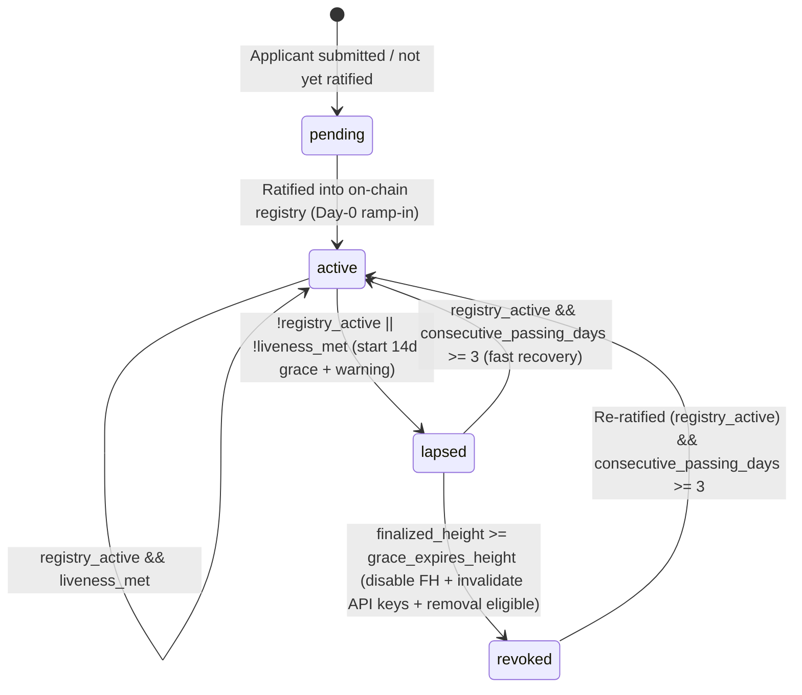

# Signed Multi-Observer Validator Uptime Feed Specification (`postfiat-validator-uptime-v1`)

**Status:** Frozen Phase 0 Contract C2
**Schema:** `postfiat-validator-uptime-v1` (version `1`)
**JSON Schema:** [`schemas/postfiat-validator-uptime-v1.schema.json`](schemas/postfiat-validator-uptime-v1.schema.json)
**Deterministic Fixture:** [`schemas/postfiat-validator-uptime-v1.fixture.json`](schemas/postfiat-validator-uptime-v1.fixture.json)
**Validator Test:** [`scripts/test-validator-uptime-schema.py`](../../scripts/test-validator-uptime-schema.py)
**Related:** [`validator-rpc-profiles-v1.md`](validator-rpc-profiles-v1.md), [`tasknode-l1-validator-binding.md`](../runbooks/tasknode-l1-validator-binding.md), [`validator-registry.md`](../governance/validator-registry.md)

## 1. Purpose and Scope

This specification freezes the wire schema, cryptographic verification boundary, latency-fair participation metric, 3-observer quorum rule, and `pending -> active -> lapsed (14d grace) -> revoked` access lifecycle for the Post Fiat L1v2 Validator Rewards Program.

It replaces the single-host unsigned `postfiat-tasknode-l1-registry-v1` projection documented in [`CONTRACT-l1-validators.md`](../../tools/tasknode-validator-binding/CONTRACT-l1-validators.md) for active-liveness enforcement across:

- **Task Node** (Finance Hub access, GoodAlexander Research API keys, and `$20/month` per-operator Task Node USD credit);
- **`postfiat-node top`** (read-only SSH status dashboard eligibility panel; see [`validator-rpc-profiles-v1.md`](validator-rpc-profiles-v1.md));
- **Public Validator Directory** (live validator state, participation score, operator identity, and optional public RPC URL);
- **Governance removal proposals** (automatic proposal eligibility after grace expiry; explicit validator ratification remains mandatory).

Observers are strictly read-only. They hold no validator consensus key and no governance key, and they cannot mutate consensus or registry state.

## 2. Cryptographic Format and 3-Observer (2-of-3) Quorum

### 2.1 Pinned Observer Set

- Exactly **3 independent, geographically distributed observers** (`observer_count = 3`) operate across distinct `region` and `operator_group` values (for example `us-east`, `eu-central`, `ap-northeast`).
- Each observer holds a dedicated offline-provisioned **pure FIPS 204 ML-DSA-65** signing key (public key: 1,952 bytes / `3904` lowercase hex characters; signature: 3,309 bytes / `6618` lowercase hex characters).
- Consumers pin the 3 trusted observer public keys in a local trust store (`observer_id -> public_key_hex`). No dynamic trust-on-first-use or unpinned redirect is permitted.

### 2.2 Per-Observer Signing Domain and Canonical Payload

Each observer signs its own attestation using pure FIPS 204 **ML-DSA-65** (never prehash) with fixed domain-separation context bytes:

```text
postfiat-l1-v2/validator-uptime-feed/v1
```

The message signed by observer `i` is the UTF-8 canonical JSON (sorted object keys, no extraneous whitespace, `,` and `:` separators, RFC 8785 / JCS compatible) of the observer's **claim body**:

```json
{
  "chain_id": "<chain.chain_id>",
  "finalized_block_hash": "<observer.finalized_block_hash>",
  "finalized_height": 432000,
  "genesis_hash": "<chain.genesis_hash>",
  "network": "<chain.network>",
  "observed_at": "<observer.observed_at>",
  "observer_id": "<observer.observer_id>",
  "operator_group": "<observer.operator_group>",
  "region": "<observer.region>",
  "registry_root": "<observer.registry_root>",
  "schema": "postfiat-validator-uptime-v1",
  "schema_version": 1,
  "validator_claims": [ ... ],
  "window_spec": { ... }
}
```

- `claim_digest_sha256` MUST equal the lowercase hex SHA-256 of these exact canonical UTF-8 bytes.
- `signature_hex` MUST verify over those exact canonical UTF-8 bytes under `public_key_hex` with context `postfiat-l1-v2/validator-uptime-feed/v1`.
- `validator_claims` MUST be sorted strictly ascending by `validator_id` with no duplicate `validator_id` or `ml_dsa_public_key`.

### 2.3 2-of-3 Quorum Reconciliation Rule

Task Node and `postfiat-node top` MUST NEVER trust the top-level `validators` array without verifying the bundled `observer_attestations`:

1. Verify at least **2 of the 3** pinned observer attestations pass ML-DSA-65 signature verification, `claim_digest_sha256` verification, and freshness checks.
2. Verify all agreeing observers have distinct `observer_id`, `region`, `operator_group`, and `public_key_hex`.
3. Verify all agreeing observers match the top-level `chain` identity (`network`, `chain_id`, `genesis_hash`, `registry_root`, `finalized_height`, `finalized_block_hash`).
4. For each validator row in `validators`:
   - `agreeing_observer_ids` MUST contain at least 2 distinct verified observers whose `validator_claims` match `ml_dsa_public_key`, `registry_active`, `liveness_met`, and `access_state`.
   - `mean_daily_participation_bps` is reconciled deterministically using exact integer basis points (`0..=10000`):
     - When **3** agreeing observers report non-null scores: take the **median** of the 3 integer values (eliminating any single partitioned or skewed observer).
     - When **2** agreeing observers report non-null scores: take the **minimum** of the 2 integer values (conservative fail-closed fallback while 1 observer is down).
   - If fewer than 2 verified observers agree on a validator's `access_state`, that validator has **no quorum** and MUST be treated under the stale/indeterminate rule in Section 2.4.

### 2.4 Freshness and Stale-Feed Safety Invariant

- **Freshness window:** An observer attestation is fresh iff `0 <= now_utc - observed_at <= 3600` seconds (allowing at most `max_future_skew_seconds = 60` seconds of clock skew, i.e., `observed_at <= now_utc + 60s`).
- **Stale feed (`age > 3600s` or `< 2` fresh verified observers):**
  - **MUST block** new Task Node validator bindings (`tasknode-bind` completion);
  - **MUST block** new `$20/month` Task Node credit grants;
  - **MUST NEVER revoke** existing Finance Hub access or invalidate active Research API keys.

This guarantees an observer outage or network partition can never mass-revoke healthy operators.

## 3. Latency-Fair Participation Metric (Zero Wall-Clock Drift)

### 3.1 Why `precommit_qc.votes` Alone Is Rejected

Counting only `precommit_qc.votes` in finalized block headers systematically penalizes geographically distant validators because low-latency peers assemble a BFT quorum first and omit slower valid votes from the certificate.

### 3.2 Latency-Fair Round-Window Credit Rule

Under `metric_version = "latency-fair-round-window-v1"`, each observer credits validator `v` for block height `h` if the observer receives **at least one valid ML-DSA-65 signed consensus message** attributable to `v`'s active registry key at height `h` within the block-height round window from any of the 4 allowed `credit_sources`:

1. `prepare_vote` (valid signed Consensus v2 prepare vote for height `h`);
2. `precommit_vote` (valid signed Consensus v2 precommit vote for height `h`, whether or not included in the finalized `precommit_qc.votes`);
3. `timeout_vote` (valid signed Consensus v2 timeout vote for height `h`);
4. `consensus_heartbeat` (valid signed validator liveness heartbeat bound to `(chain_id, genesis_hash, committee_epoch, height)`).

`precommit_qc_heights` is retained per height-day strictly as a diagnostic telemetry subset (`0 <= precommit_qc_heights <= credited_heights <= eligible_heights`) and never reduces `participation_bps`.

### 3.3 Deterministic Block-Height Windows (Height-Days)

Chain blocks carry no trusted UTC wall clock. All evaluation windows are partitioned deterministically by finalized block height using the governed chain constant `blocks_per_height_day` (for example `14400` blocks at 6-second nominal block cadence):

- Height-day `d` (`day_index = d`, `d >= 0`) covers the closed interval:
  - `from_height = d * blocks_per_height_day + 1`
  - `to_height = (d + 1) * blocks_per_height_day`
- A height-day is `complete = true` iff the observer holds verified continuous coverage over every height in `[from_height, to_height]`. Incomplete days MUST set `participation_bps = null` and do not count toward `observed_height_days`.
- For a complete height-day where `eligible_heights > 0` (the number of heights in `[from_height, to_height]` during which `v` was active in the on-chain registry):

```text
participation_bps = floor((credited_heights * 10000) / eligible_heights)
```

- Exact integer basis points (`0..=10000`) are mandatory across Rust, Python, and Node.js implementations. `95.00%` is exactly `9500` bps (`liveness_threshold_bps = 9500`).
- Over the trailing `evaluation_horizon_days = 30` completed height-days (or since `recovery_floor_height` after fast recovery; see Section 4.3), let `D` be the set of complete height-days with `eligible_heights > 0`:
  - `observed_height_days = |D|`
  - `mean_daily_participation_bps = floor(sum(d.participation_bps for d in D) / |D|)` if `|D| > 0`, else `null`
  - `consecutive_passing_days` = number of consecutive trailing days in `D` (ending at the most recent completed height-day) with `participation_bps >= 9500`.

## 4. Access Lifecycle State Machine (`pending -> active -> lapsed -> revoked`)



### 4.1 State Definitions and Entitlements

| `access_state` | `registry_active` | `finance_hub_access` | `research_api_keys_active` | `reward_eligible` (`$20/mo`) | `removal_proposal_eligible` |
| --- | --- | --- | --- | --- | --- |
| `pending` | `false` | `false` | `false` | `false` | `false` |
| `active` | `true` | `true` | `true` | `true` | `false` |
| `lapsed` (14d grace) | `true` or `false` | `true` (grace) | `true` (grace) | `false` (paused) | `false` |
| `revoked` | `true` or `false` | `false` (disabled) | `false` (**invalidated**) | `false` (paused) | `true` (if still in registry) / `false` (if already removed) |

### 4.2 Day-0 Ramp-In Rule

Newly ratified validators MUST NOT wait 25 days to unlock access:

- A validator enters `active` (`access_state_reason = "day0_ramp_in"`) immediately upon inclusion in the on-chain validator registry at `first_active_height`.
- `ramp_in_active` is `true` while `finalized_height < first_active_height + 30 * blocks_per_height_day`.
- While `ramp_in_active == true`, the validator is exempt from the `min_observed_days = 25` check: `liveness_met = true` iff `registry_active == true` AND (`observed_height_days == 0` OR `mean_daily_participation_bps >= 9500`).
- Once `ramp_in_active == false`, steady-state enforcement requires `registry_active == true`, `observed_height_days >= 25`, AND `mean_daily_participation_bps >= 9500` (`access_state_reason = "healthy_liveness"`).

### 4.3 14-Day Grace, Operator Warning, and 3-Day Fast Recovery

- **Entering `lapsed`:** When an `active` validator drops out of the registry (`removed_from_registry`), falls below `9500` bps (`below_liveness_threshold`), or has `< 25` observed days outside ramp-in (`insufficient_observed_days`), it transitions to `lapsed`:
  - `grace_started_height = finalized_height`
  - `grace_expires_height = grace_started_height + 14 * blocks_per_height_day`
  - `grace_started_at = observed_at`
  - `grace_expires_at = grace_started_at + 14 days`
  - An operator warning is triggered immediately (visible in `postfiat-node top` and Task Node).
  - Existing Finance Hub access and Research API keys remain active during the 14-day grace window; new monthly `$20` credit grants are paused until the validator returns to `active`.
- **Fast recovery (`lapsed -> active`):**
  - If the validator is `registry_active == true` and sustains `participation_bps >= 9500` for **`recovery_consecutive_days = 3` consecutive completed height-days** before `grace_expires_height`, it immediately transitions back to `active` (`access_state_reason = "recovered_3day_streak"`).
  - To prevent the 30-day rolling mean from immediately re-lapsing a recovered operator (e.g., after a 6-day outage), `recovery_floor_height` is set to the `from_height` of the first day of the 3-day passing streak. For the next 30 height-days after `recovery_floor_height`, `liveness_met` is evaluated over completed height-days at or after `recovery_floor_height` (requiring `mean_daily_participation_bps >= 9500` over those days), after which full 25-of-30 steady-state scoring resumes seamlessly.
- **Revocation (`lapsed -> revoked`):**
  - If `finalized_height >= grace_expires_height` without recovery, the validator transitions to `revoked` (`access_state_reason = "grace_expired"`, or `"removed_from_registry"` if already removed).
  - On `revoked`, Task Node MUST immediately:
    1. Disable Finance Hub access (`finance_hub_access = false`);
    2. **Invalidate all active GoodAlexander Research API keys** (`research_api_keys_active = false`);
    3. Pause the `$20/month` Task Node USD credit (`reward_eligible = false`).
  - If the validator is still in the on-chain registry (`registry_active == true`), `removal_proposal_eligible` becomes `true`, allowing automated submission of a validator removal proposal that the active validator set MUST still ratify explicitly under Cobalt/old-rule governance.

## 5. Task Node Binding and Per-Operator Deduplication Contract

- **Offline-capable binding (`postfiat-node tasknode-bind`):** Bundled inside the signed `postfiat-node` release (`linux-x86_64`, `linux-aarch64`), signs a single-use challenge binding `(account_id, chain_id, node_id, nonce, expiry)` via the validator signer allow-list using FIPS 204 context `postfiat-l1-v2/tasknode-validator-binding/v1`, and emits the optional Pillar 6 Hive identity validator-link co-signature.
- **Per-operator reward cap:** Monthly `$20` Task Node credit and research entitlements are granted **per operator (not per node)**, keyed by `operator_identity_id` (Pillar 6 Hive identity once live; verified Task Node account + network-correlation checks before Pillar 6). One grant per operator across old + new chains during migration — no double-dipping.
- **Independent Finance Hub paths:** Maintaining an `active` validator and ranking as a top-30 Task Node contributor remain independent qualification paths for Finance Hub.

## 6. Verification and Conformance Testing

Run the deterministic schema, fixture, canonical-digest, quorum, and state-machine test suite:

```bash
python3 scripts/test-validator-uptime-schema.py
```

All downstream producers (Rust/Python observer services) and consumers (Task Node, `postfiat-node top`, public validator directory) MUST pass validation against [`schemas/postfiat-validator-uptime-v1.schema.json`](schemas/postfiat-validator-uptime-v1.schema.json) and match the exact state-machine semantics validated by [`scripts/test-validator-uptime-schema.py`](../../scripts/test-validator-uptime-schema.py).
